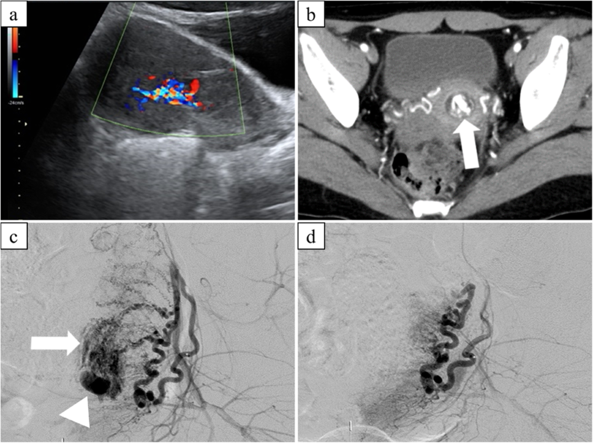
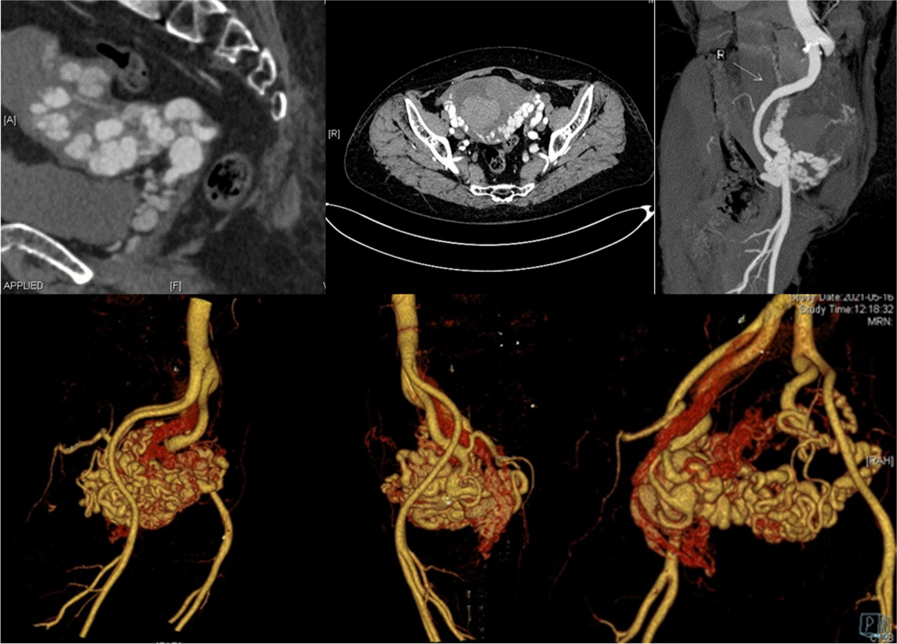
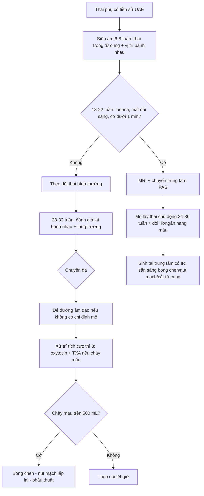

# 1931 — Thai kỳ sau nút mạch tử cung (UAE): tư vấn sinh sản, nhau cài răng lược và dự phòng băng huyết tái phát / Pregnancy after uterine artery embolization

**Tags:** `pattern:chay-mau` `pattern:gia-phinh` `pattern:thai-ky` `pattern:nguy-co-tai-phat` `pattern:bat-thuong-nhau` `vung:tu-cung` `vung:thai` `vung:tu-cung-phan-phu` `score:PAS` `protocol:SA-Doppler` `protocol:CTA` `protocol:MRI-chau`

**Mức chắc chắn (certainty):** tổng hợp y văn (literature synthesis) — ghép 1 phân tích gộp 23 nghiên cứu (**Matsuzaki S et al., *Sci Rep* 2021, PMC8377070, CC BY 4.0**), 1 nghiên cứu bệnh–chứng (**Jitsumori M et al., *Int J Womens Health* 2020, PMC7064279, CC BY-NC 4.0**), 1 tổng quan hệ thống 371 ca AVM (**Ruiz Labarta FJ et al., *J Pers Med* 2022, PMC9324499, CC BY 4.0**), 1 đoàn hệ dự trữ buồng trứng (**Mohr-Sasson A et al., *PLoS One* 2018, PMC6264507, CC BY 4.0**), 1 loạt 14 ca nút mạch bằng bọt gelatin (**Kimura Y et al., *CVIR Endovasc* 2020, PMC7016069, CC BY 4.0**) và dữ liệu liệt kê (Descargues 2004; Zhang 2021). Số nào nguồn không đưa thì ghi "chưa rõ".

> **Bài này trả lời 4 câu hỏi sau một ca nút mạch tử cung (uterine artery embolization, UAE):**
> (1) **Bệnh nhân còn khả năng có thai không, dự trữ buồng trứng mất bao nhiêu?** (2) **Thai kỳ sau UAE nguy hiểm vì bệnh gì — con số cụ thể?** (3) **Theo dõi thai thế nào, đẻ ở đâu, đẻ đường nào?** (4) **Khi nào băng huyết tái phát và xử trí ra sao?**
> Đây là **phần sau can thiệp** của [1723 – Giả phình động mạch tử cung](../1723-gia-phinh-dong-mach-tu-cung/lesson.md); phần **chẩn đoán – cấp cứu băng huyết** ở [1728](../1728-chay-mau-sau-vo-tu-cung/lesson.md); phần **nhau cài răng lược** ở [560](../560-nhau-cai-rang-luoc-PAS-cap-cuu-san/lesson.md).

## 1. Tổng quan bệnh học – cơ chế hình ảnh

### 1.1 Nút mạch tử cung "làm gì" trong tử cung

- Động mạch tử cung xuất phát từ **động mạch chậu trong**, đi trong dây chằng rộng, chia nhánh bó mạch **hướng lên** (thân tử cung) và **hướng xuống** (cổ tử cung, âm đạo). Tử cung có **hai nguồn máu nối tiếp**: động mạch tử cung và **động mạch buồng trứng** (từ động mạch chủ bụng) — nối với nhau qua vòi trứng và mạc treo buồng trứng. Đây là lý do **có thai vẫn được sau UAE**: khi một nguồn bị bít, nguồn còn lại và tuần hoàn bàng hệ vẫn nuôi được nội mạc.
- Kỹ thuật: chọn nhánh động mạch tử cung, bơm **hạt gelatin 500–1.000 µm** (hoặc PVA, microcoil, keo) tới khi **ứ dòng (stasis)** ở đoạn xa. Hạt kẹt ở **tiểu động mạch < 1 mm**, gây huyết khối tại chỗ; bọt gelatin **tiêu đi trong vài tuần**, mạch có thể **tái thông** — khác coil (bít vĩnh viễn) dùng cho túi giả phình/AVM.
- Hiệu quả cấp cứu (Zhang 2021, 43 nghiên cứu): **thành công kỹ thuật 99,3%**, **thành công lâm sàng 90,5%**; biến chứng hay gặp là **hội chứng sau nút mạch** và **rối loạn kinh nguyệt**.

### 1.2 TẠI SAO tử cung sau UAE lại sinh nhau cài răng lược

- UAE gây **thiếu máu cục bộ nội mạc – cơ tử cung**. Vùng cơ bị hoại tử vi thể được thay bằng **mô xơ**, nội mạc mất lớp xốp đủ dày để **màng rụng hóa (decidualization)** bình thường. Khi có thai, gai nhau gặp vùng **màng rụng khiếm khuyết** sẽ bám sâu vào cơ — đó là **phổ nhau cài răng lược (placenta accreta spectrum, PAS)**.
- **Con số phải thuộc (Matsuzaki 2021, 23 nghiên cứu, 483 thai sau UAE):**
  - **PAS 16,3% (34/208)**; **băng huyết sau sinh (postpartum hemorrhage, PPH) 24,0% (115/480)**; **cắt tử cung 6,5% (28/432)**.
  - So với thai phụ **có tiền sử PPH nhưng không UAE**: **PAS OR 20,82 (KTC 95% 3,27–132,41)**, **PPH OR 5,32 (1,40–20,16)**; **cắt tử cung, nhau tiền đạo, sinh non, chậm phát triển trong tử cung đều không đạt ý nghĩa** (OR 8,93; 2,31; 3,00; 7,22 — KTC rất rộng).
- **Jitsumori 2020** (16 thai sau UAE so với 3.139 thai không UAE): **PAS 37,5% so với 1,2%** (OR 50,3; KTC 17,38–145,59); **sinh non 12,5% so với 14,2%** và **chậm phát triển 6,2% so với 10,0%** — **không khác biệt**. Nghĩa là: **rủi ro chính là nhau bám sâu và chảy máu, không phải sinh non**.
- TẠI SAO **PAS nhiều mà sinh non không tăng**: tổn thương UAE khu trú ở **nội mạc – cơ**, không phá hủy toàn bộ thể tích tử cung; thai vẫn lớn bình thường, nhưng **bánh nhau bám vào chỗ xơ** nên khi bong sẽ chảy máu ồ ạt.

### 1.3 TẠI SAO dự trữ buồng trứng giảm nhưng vẫn có thai

- Buồng trứng được nuôi **một phần** bởi nhánh động mạch tử cung qua nối với động mạch buồng trứng; nút **hai bên** có thể làm giảm tưới máu vỏ buồng trứng.
- **Mohr-Sasson 2018** (21 nữ sau mổ lấy thai bảo tồn + UAE hai bên vì nhau bám sâu, so với 40 đối chứng cùng tuổi): **AMH 0,8 ng/mL (IQR 0,44–1,80) so với 2,08 (1,68–3,71), p = 0,001**; **FSH và estradiol không khác biệt** (p = 0,396 và p = 0,665). Điểm cốt lõi: **AMH là dấu hiệu nhạy nhất**, còn **FSH bình thường không loại trừ giảm dự trữ** — sai lầm hay gặp khi tư vấn.
- Khả năng sinh sản vẫn được bảo tồn: **Descargues 2004** (25 nữ sau UAE vì băng huyết sản khoa) — **100% có kinh trở lại**; **5/9 người muốn có thai đã có thai**, 10 thai kỳ, **không ca nào băng huyết tái phát**, cân nặng trẻ **3.220–4.100 g**. **Kimura 2020** (14 ca nút mạch vì sản phẩm thai lưu tăng sinh mạch): **6 thai kỳ trung bình 29 tháng sau UAE**, không biến chứng nặng.

### 1.4 Cơ chế hình ảnh: vì sao "xoáy màu", vì sao "tĩnh mạch về sớm"

- **Túi giả phình (pseudoaneurysm, PSA):** thành mạch bị rách, máu phụt vào mô quanh mạch tạo **túi không có cả ba lớp thành**. Trên **siêu âm Doppler màu**, máu vào túi thì tâm thu và ra thì tâm trương theo **hai hướng ngược nhau** → **dấu "yin-yang" (xoáy hai màu)**. Phổ xung tại cổ túi có **tốc độ đỉnh cao** — ca minh họa của Mou 2014 đo **215 cm/s** trong động mạch nuôi (Hình 1).
- **Dị dạng động – tĩnh mạch tử cung (uterine arteriovenous malformation, AVM):** có **thông trực tiếp giữa tiểu động mạch và tiểu tĩnh mạch**, thiếu giường mao mạch → **trở kháng thấp, tốc độ cao**, và **tĩnh mạch tử cung hiện sớm ngay thì động mạch**. Trên CTA/3D, thấy **chùm mạch ngoằn ngoèo, phình dạng "u" cục bộ** (Hình 2: nhánh trái phình **1,8 × 1,6 cm**, tĩnh mạch trái về sớm).
- **MRI:** mạch tốc độ cao tạo **khoảng trống tín hiệu dòng chảy (flow void)** trên T1 và T2 — tức là **đen** trên mọi chuỗi, vì proton đã chạy khỏi lát cắt trước khi phát tín hiệu.
- **Sau UAE:** mục tiêu là **mất tín hiệu Doppler trong túi/ổ dị dạng**; trên DSA là **không còn ngấm thuốc** ở nhánh đã nút (Hình 1d).

## 2. Mẫu hình + chẩn đoán phân biệt theo vị trí (Gamut)

Bài này có **hai gamut riêng**, phải tách rõ:

### 2.1 Gamut A — "khối mạch máu trong tử cung" sau sinh/sảy (lý do phải nút mạch)

- **PSA sau mổ lấy thai/nạo/gãy xương chậu:** khối giảm âm trong cơ tử cung + **xoáy màu**, có **cổ túi** nối động mạch tử cung; hay gặp ở **đoạn dưới – sẹo mổ**.
- **AVM tử cung:** chùm mạch ngoằn ngoèo lan tỏa trong cơ, **tĩnh mạch về sớm**, không có "cổ túi" đơn độc; thường sau nạo/hút, có thể bẩm sinh.
- **Sản phẩm thai lưu tăng sinh mạch (hypervascular retained products of conception, RPOC):** khối trong buồng tử cung, **có thể rất giàu mạch** — **bắt chước AVM** trên Doppler. Đây là **cạm bẫy chết người** (xem mục 5).
- **Thai lưu/ thai ngoài tử cung/ bệnh nguyên bào nuôi (gestational trophoblastic disease):** hình ảnh hỗn hợp, β-hCG cao; **β-hCG không phân biệt được RPOC với AVM** (Batra 2025).
- **Dị dạng động – tĩnh mạch bẩm sinh / thai trong sẹo mổ lấy thai:** bối cảnh lâm sàng quyết định.

### 2.2 Gamut B — "thai kỳ sau UAE" (bệnh gì sẽ gặp)

- **Thai bình thường** (đa số): không có triệu chứng, siêu âm bình thường.
- **PAS** — **16,3%**, nguy cơ cao nhất ở **UAE hai bên + tiền sử mổ lấy thai/nạo**.
- **PPH tái phát** — **24,0%**; cơ chế: tử cung xơ + giảm co bóp vùng nút mạch + nhau bám sâu.
- **Cắt tử cung** — **6,5%**; thường là hệ quả của PAS/PPH không cầm được, **không phải biến chứng độc lập của UAE**.
- **Sinh non, chậm phát triển, nhau tiền đạo:** **không tăng có ý nghĩa** trong phân tích gộp (Jitsumori; Matsuzaki) — **đừng dọa bệnh nhân bằng những rủi ro chưa có bằng chứng**.
- **AVM tái phát sau UAE:** **0 ca** trong 77 thai kỳ của tổng quan 371 ca (Ruiz Labarta 2022) — tin tốt để tư vấn.

## 3. Bảng so sánh phân biệt (ma trận đối chiếu)

| Thực thể (entity) | Hình ảnh điển hình | Chốt vào (rule-in) | Chốt loại (rule-out) | Gợi ý xác nhận |
|---|---|---|---|---|
| **PSA động mạch tử cung** | Khối giảm âm trong cơ + **xoáy màu yin-yang**, có cổ túi; phổ xung **tốc độ cao** (215 cm/s trong ca minh họa) | **Xoáy hai màu + cổ túi nối động mạch tử cung + tiền sử nạo/mổ lấy thai** | Không có cổ túi, mạch lan tỏa kiểu chùm → nghĩ AVM | Doppler màu + phổ xung; CTA/DSA khi cần can thiệp |
| **AVM tử cung** | Chùm mạch ngoằn ngoèo trong cơ, **tĩnh mạch về sớm thì động mạch**, trở kháng thấp | **Tĩnh mạch tử cung hiện sớm trên CTA/DSA + chùm mạch lan tỏa** | Có cổ túi đơn độc + phổ "to-and-fro" → PSA | CTA/MRA; DSA là chuẩn vàng |
| **RPOC tăng sinh mạch** | Khối trong **buồng tử cung**, có thể rất giàu mạch; **β-hCG không giúp phân biệt** | **Khối trong lòng tử cung + tiền sử sảy/đẻ non + β-hCG còn dương** | **Không có tĩnh mạch về sớm, không có chùm mạch trong cơ** → không phải AVM | Siêu âm + **nội soi buồng tử cung có IR dự phòng**; tránh nạo mù |
| **Thai sau UAE không biến chứng** | Thai đúng vị trí, bánh nhau bám mặt sau/thân, không lacuna | **Thai phát triển phù hợp tuổi, Doppler rốn – tử cung bình thường** | **Lacuna, mất dải sáng, mạch máu xuyên cơ** → chuyển PAS | Siêu âm 6–8 tuần; 18–22 và 28–32 tuần |
| **PAS sau UAE** | **Lacuna ("swiss cheese")**, mất **dải sáng sau bánh nhau**, cơ mỏng < 1 mm, mạch máu xuyên qua cơ tới bàng quang | **Lacuna + mất dải sáng + tiền sử UAE/mổ lấy thai** | Bánh nhau bám mặt sau, cơ dày đều → nguy cơ thấp | Siêu âm chuyên gia; **MRI khi siêu âm không kết luận** |
| **PPH tái phát** | Không có hình ảnh đặc hiệu trước sinh; chảy máu sau bong nhau | **Tiền sử UAE vì PPH + chảy máu > 500 mL (đẻ đường âm đạo) / > 1.000 mL (mổ lấy thai)** | Chảy máu do rách cổ tử cung/âm đạo, nhau sót → xử trí khác | Cân máu, xét nghiệm đông máu, siêu âm kiểm tra nhau sót |

**Ảnh minh họa 1 — trước và sau nút mạch (Kimura 2020, Fig 2, CC BY 4.0):**

*Bệnh nhân 32 tuổi chảy máu sau nạo vì thai lưu: (a) siêu âm khối tăng sinh mạch trong buồng tử cung; (b) CT thì động mạch có ổ ngấm thuốc; (c) DSA động mạch tử cung trái — **blush khu trú (mũi tên)** và **túi giả phình (đầu mũi tên)**; (d) sau nút mạch, **ổ ngấm thuốc biến mất**. Nguồn: Kimura Y et al., *CVIR Endovasc* 2020, PMC7016069, CC BY 4.0.*

**Ảnh minh họa 2 — AVM tử cung (BMC Womens Health 2024, Fig 2, CC BY-NC-ND 4.0):**

*CTA: động mạch tử cung hai bên **giãn, ngoằn ngoèo**, bên trái có **phình dạng "u" cục bộ ~1,8 × 1,6 cm**; **tĩnh mạch tử cung trái hiện sớm ngay thì động mạch** → chốt AVM. Nguồn: *BMC Womens Health* 2024, PMC11438250, CC BY-NC-ND 4.0 (ảnh nguyên bản, không chỉnh sửa).*

## 4. Protocol chụp + hệ phân độ/điểm chuẩn hóa

### 4.1 Trước khi có thai (tư vấn sau UAE)

- **Không chụp lại định kỳ nếu không triệu chứng.** Nếu còn ra máu bất thường: **siêu âm đầu dò âm đạo + Doppler màu** là bước 1; mục tiêu là **không còn dòng chảy trong túi/ổ dị dạng**.
- **Dự trữ buồng trứng:** đo **AMH** (và FSH/estradiol nếu cần) ở nữ **< 40 tuổi** có mong con — vì **FSH bình thường không loại trừ giảm dự trữ** (Mohr-Sasson 2018).
- **Tư vấn có số:** PAS **16,3%**, PPH **24,0%**, cắt tử cung **6,5%**; nhưng **đa số vẫn có thai và sinh con khỏe mạnh**, kinh nguyệt trở lại **100%**.
- **Thời điểm có thai lại:** **chưa có khuyến cáo chính thức dựa trên bằng chứng**; các loạt ca ghi nhận thai từ **2 tháng đến 5 năm** sau UAE (Ruiz Labarta 2022), và **6/14 ca có thai trung bình 29 tháng** sau nút mạch vì RPOC (Kimura 2020). Thực hành hợp lý: chờ **≥ 3–6 tháng** để tử cung hồi phục và hoàn tất đánh giá, nhưng **không được nói "phải chờ 1 năm" như một chân lý** — đó là **suy luận**, không phải dữ liệu.
- **Bổ sung sắt/acid folic**, kiểm tra huyết sắc tố trước khi mang thai; nữ có tiền sử PPH nên sinh tại **cơ sở có ngân hàng máu và IR**.

### 4.2 Theo dõi thai kỳ

- **6–8 tuần:** siêu âm xác định **thai trong tử cung**, số thai, tim thai; ghi **vị trí bánh nhau** và **sẹo mổ lấy thai cũ** (nếu có).
- **18–22 tuần:** siêu âm hình thái + **tầm soát PAS** (lacuna, mất dải sáng, cơ < 1 mm, mạch xuyên cơ). Nếu nghi ngờ → **MRI bổ sung** và chuyển **trung tâm sản – non**.
- **28–32 tuần:** siêu âm tăng trưởng + **đánh giá lại bánh nhau**; đo Doppler rốn/tử cung nếu thai nhỏ.
- **Không có chỉ định mổ lấy thai chỉ vì tiền sử UAE.** Mổ lấy thai khi có **PAS, nhau tiền đạo, sẹo tử cung có chỉ định** hoặc chỉ định sản khoa khác — đây là **suy luận từ dữ liệu** (không có thử nghiệm ngẫu nhiên).
- **PAS nghi ngờ:** mổ lấy thai **chủ động 34–36 tuần** tại trung tâm có **đội mổ – IR – ngân hàng máu**, có kế hoạch **cắt tử cung bảo tồn hay không** (xem [560](../560-nhau-cai-rang-luoc-PAS-cap-cuu-san/lesson.md)).

### 4.3 Xử trí khi băng huyết tái phát

- **Bước 1:** gọi hỗ trợ, đo mạch/huyết áp, **truyền máu theo tỷ lệ**, **acid tranexamic 1 g tĩnh mạch trong vòng 3 giờ đầu** (WOMAN 2017; WHO 2017).
- **Bước 2:** **oxytocin + misoprostol/carboprost**, xoa đáy tử cung, **bóng chèn (Bakri)**.
- **Bước 3:** **nút mạch tử cung lặp lại** hoặc **thắt động mạch tử cung/chậu trong**; nếu thất bại → **cắt tử cung**.
- **Lưu ý kỹ thuật:** sau UAE lần đầu, tử cung có thể được nuôi **bù qua động mạch buồng trứng** — lần nút thứ hai phải **chụp cả động mạch buồng trứng** để không sót nguồn chảy; nút buồng trứng hai bên có nguy cơ **suy buồng trứng**, chỉ làm khi cứu mạng.

### 4.4 Hệ phân độ liên quan

- **PAS:** phân độ **FIGO 2018/2020** (accreta – increta – percreta) dựa trên **độ sâu xâm lấn cơ và cấu trúc lân cận**; **không có RADS riêng** cho UAE.
- **PPH:** phân độ theo **lượng máu mất và đáp ứng điều trị** (nhẹ: < 1.000 mL và đáp ứng thuốc; nặng: ≥ 1.000 mL, cần truyền máu, can thiệp hoặc có dấu hiệu sốc).
- **AVM/PSA:** không có điểm chuẩn hóa; quyết định dựa trên **có chảy máu hoạt động + vị trí + mong con**.

## 5. Biến thể bình thường và cạm bẫy

1. **RPOC tăng sinh mạch bị gọi nhầm là AVM** — cạm bẫy số 1. Cả hai đều "giàu mạch" trên Doppler. **Khác biệt:** RPOC nằm **trong lòng tử cung**, **không có tĩnh mạch về sớm**, và **β-hCG không giúp phân biệt**. Nạo mù trong AVM có thể gây **chảy máu ồ ạt**; nội soi buồng tử cung nên có **IR dự phòng** (Batra 2025).
2. **PSA nhỏ có thể tự hết.** Không phải mọi túi giả phình đều phải nút ngay: **mất dòng tâm trương** trên phổ xung gợi ý túi đang giảm tưới máu và có thể **tự tiêu** (Baba 2018, túi 24 mm). Nhưng **PSA có chảy máu, tăng kích thước, hoặc trong thai kỳ** → **nút mạch** (Ugwumadu 2018: nút mạch ở **28 tuần**, thai không bị ảnh hưởng).
3. **"FSH bình thường = buồng trứng bình thường"** — sai. **AMH giảm rõ** trong khi FSH/E2 bình thường (Mohr-Sasson 2018); phải đo AMH khi tư vấn.
4. **"UAE = vô sinh"** — sai. Kinh nguyệt trở lại **100%**; **20,7%** bệnh nhân AVM sau UAE có thai lại (77/371), **77% không biến chứng**.
5. **Bánh nhau "bình thường" trên siêu âm 20 tuần không loại trừ PAS** — PAS có thể **tiến triển** khi tử cung to ra; phải **đánh giá lại ở 28–32 tuần**, nhất là khi bánh nhau **mặt trước – đoạn dưới**.
6. **Cạm bẫy mặt cắt:** khối mạch trong tử cung **không được chọc sinh thiết mù**; **không đặt dụng cụ** vào buồng tử cung khi nghi AVM **trước khi có CTA/DSA**.

## 6. Tự lượng giá — Blind Quiz

**Ca 1 — 32 tuổi, chảy máu âm đạo sau nạo vì thai lưu. Nhìn 4 ô ảnh, mô tả trước khi mở đáp án.**

- Gợi ý: bệnh nhân muốn có thai lại; đang ra máu, huyết động ổn.
- Câu hỏi: (1) Ổ bất thường nằm ở đâu? (2) Ô (c) có **hai** dấu hiệu gì? (3) Vì sao **không** nạo lại? (4) Sau nút mạch, tư vấn gì về thai kỳ sau?

<b>Bấm để hiện đáp án (findings + chẩn đoán)</b>

- (a) **Khối tăng sinh mạch trong buồng tử cung** trên siêu âm; (b) **ổ ngấm thuốc** trên CT thì động mạch.
- (c) DSA động mạch tử cung trái: **blush khu trú (mũi tên)** + **túi giả phình (đầu mũi tên)**; (d) sau nút mạch **không còn ngấm thuốc**.
- **Chẩn đoán:** PSA/RPOC tăng sinh mạch sau nạo — đã nút mạch thành công.
- **Không nạo lại** vì có thể **mở thông túi giả phình/AVM** → chảy máu không cầm; nếu cần lấy tổ chức, làm **nội soi có IR dự phòng**.
- **Tư vấn:** có thể có thai lại; **PAS 16,3%**, **PPH 24,0%**; theo dõi bánh nhau 18–22 và 28–32 tuần; sinh tại nơi có ngân hàng máu/IR.
- Nguồn: Kimura Y et al., *CVIR Endovasc* 2020, PMC7016069, CC BY 4.0.

**Ca 2 — 28 tuổi, ra máu tái diễn sau hút thai; siêu âm thấy "chùm mạch" trong cơ tử cung. CTA dưới đây:**

- Câu hỏi: (1) Đây là PSA hay AVM? (2) Dấu hiệu nào trên CTA chốt? (3) Vì sao **không** nạo? (4) Điều trị và tư vấn sinh sản?

<b>Bấm để hiện đáp án</b>

- **AVM tử cung:** động mạch tử cung **giãn, ngoằn ngoèo**, bên trái **phình dạng u ~1,8 × 1,6 cm**, **tĩnh mạch trái về sớm thì động mạch**.
- **Chốt:** tĩnh mạch về sớm + chùm mạch lan tỏa **không có cổ túi đơn độc**.
- **Không nạo:** nạo trong AVM có thể gây **băng huyết nặng**; ưu tiên **UAE** (thành công chung **88,4%**, lần đầu **79,2%**) hoặc phẫu thuật bảo tồn khi thất bại.
- **Tư vấn:** **77/371 (20,7%)** có thai lại; **77% không biến chứng**; **không ca AVM tái phát** trong 77 thai kỳ; khoảng cách 2 tháng – 5 năm.
- Nguồn: *BMC Womens Health* 2024, PMC11438250, CC BY-NC-ND 4.0; số liệu: Ruiz Labarta 2022, PMC9324499, CC BY 4.0.

**Ca 3 — 34 tuổi, tiền sử UAE hai bên vì băng huyết sau sinh, hiện thai 20 tuần. Siêu âm: bánh nhau mặt trước, có lacuna, cơ mỏng 0,8 mm.**

- Câu hỏi: (1) Chẩn đoán nghĩ đến? (2) Cần làm thêm gì? (3) Kế hoạch sinh? (4) Nếu bệnh nhân hỏi "có phải vì nút mạch mà tôi bị vậy không?" — trả lời thế nào?

<b>Bấm để hiện đáp án</b>

- **Nghi PAS** (lacuna + cơ **0,8 mm** < 1 mm + bánh nhau mặt trước).
- **Làm thêm:** MRI bánh nhau; chuyển **trung tâm sản – non** có IR/ngân hàng máu; đánh giá lại 28–32 tuần.
- **Kế hoạch:** mổ lấy thai chủ động **34–36 tuần**, đội mổ – IR – gây mê sẵn sàng, bàn về **bảo tồn tử cung vs cắt tử cung**.
- **Trả lời:** UAE là **yếu tố nguy cơ** đã được chứng minh (PAS **16,3%**, OR **20,82** so với người có PPH không UAE), **không phải lỗi của bệnh nhân**; đây là biến chứng đã biết, và **phần lớn vẫn sinh được con khỏe mạnh**.
- Nguồn: Matsuzaki 2021, PMC8377070, CC BY 4.0.

## Bài liên quan chéo
- [1723 – Giả phình động mạch tử cung](../1723-gia-phinh-dong-mach-tu-cung/lesson.md) — chẩn đoán PSA, dấu yin-yang, chỉ định nút mạch.
- [1657 – Dị dạng động–tĩnh mạch tử cung](../1657-di-dang-dong-tinh-mach-tu-cung/lesson.md) — phân biệt AVM với tăng sinh mạch cơ tử cung, ngưỡng PSV/RI.
- [1728 – Chảy máu sau vỡ tử cung](../1728-chay-mau-sau-vo-tu-cung/lesson.md) — xử trí băng huyết cấp, bóng chèn, nút mạch, cắt tử cung.
- [560 – Nhau cài răng lược](../560-nhau-cai-rang-luoc-PAS-cap-cuu-san/lesson.md) — tiêu chuẩn hình ảnh PAS, kế hoạch sinh.
- [1726 – Thai kỳ sau vỡ tử cung](../1726-thai-ky-sau-vo-tu-cung-danh-gia-seo/lesson.md) — đánh giá sẹo và thời điểm mổ.
- [1717 – Vỡ tử cung trên sẹo mổ lấy thai](../1717-vo-tu-cung-tren-seo-mo-lay-thai/lesson.md) — bối cảnh sẹo tử cung.
- [920 – Nút mạch cầm máu tiêu hóa](../920-vascular-embolization-gi-bleed/lesson.md) — nguyên lý nút mạch, vật liệu và biến chứng.

## Ảnh
- `images/1931_thai-sau-uae_DSA-truoc-sau_PMC7016069.png` — 4 ô (siêu âm, CT, DSA trước/sau nút mạch); Kimura Y et al., *CVIR Endovasc* 2020, PMC7016069, **CC BY 4.0**.
- `images/1931_avm-tu-cung_CTA_PMC11438250.png` — CTA + dựng 3D AVM tử cung; *BMC Womens Health* 2024, PMC11438250, **CC BY-NC-ND 4.0** (nguyên bản, không chỉnh sửa).
- Nguồn và giấy phép từng ảnh: `images/CREDITS.md`; liên kết gốc: `sources.md`.

> Không dùng để chẩn đoán độc lập khi chưa có người hướng dẫn.
