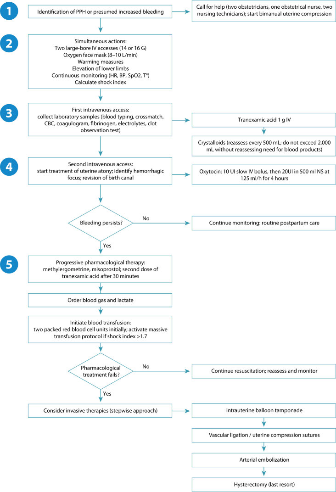
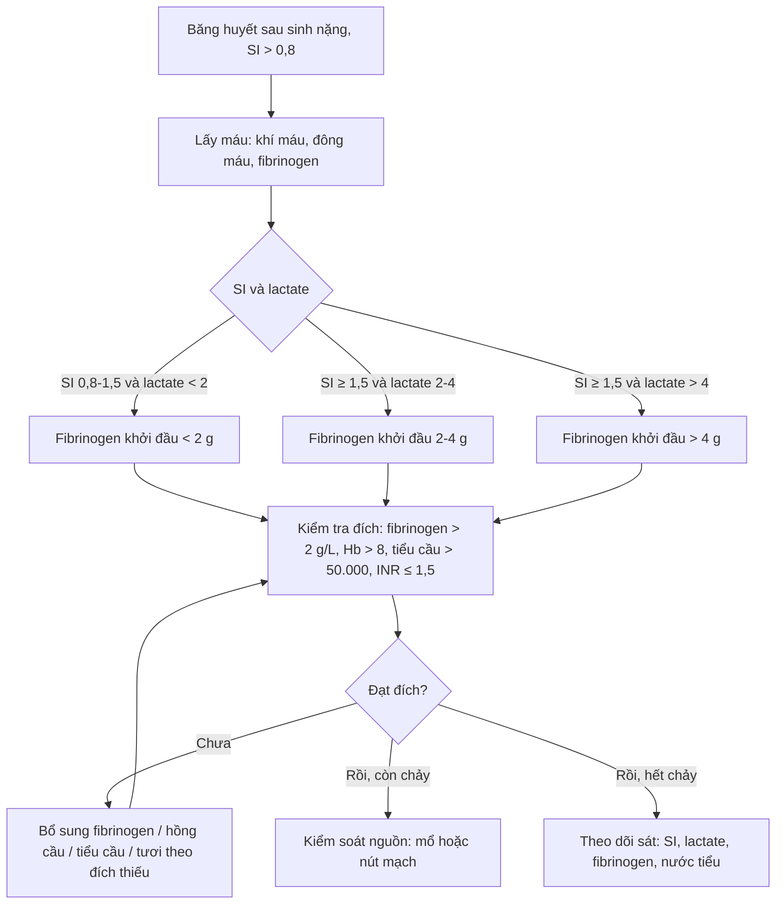
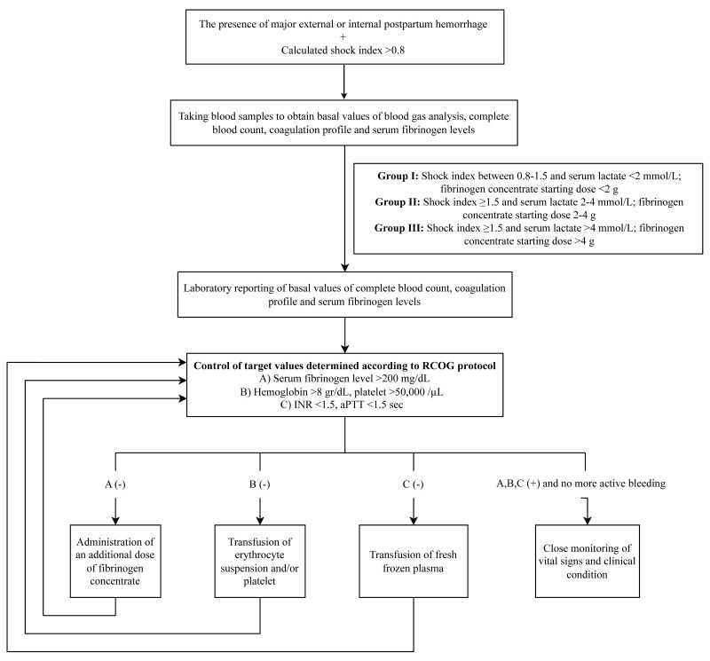
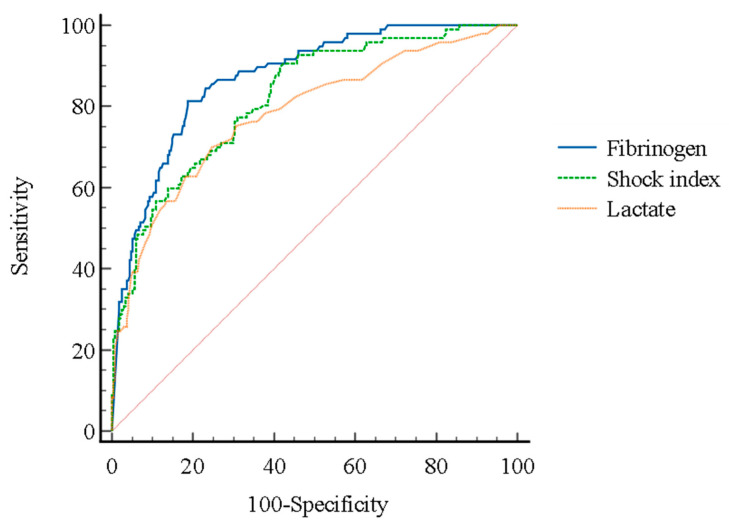
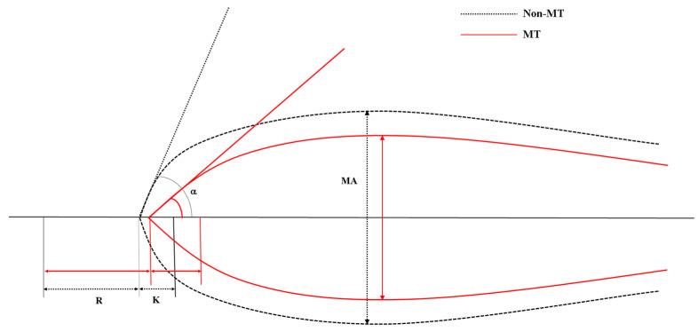

# 1932 — Truyền máu khối lượng lớn và rối loạn đông máu trong băng huyết sau sinh / Massive transfusion and coagulopathy in postpartum hemorrhage

**Tags:** `pattern:chay-mau` `pattern:mat-mau-o-at` `pattern:dong-mau-noi-mach` `pattern:soc-giam-the-tich` `vung:tu-cung-phan-phu` `protocol:phe-duyet-truyen-mau` `protocol:CT-bung` `protocol:ROTEM` `score:shock-index` `score:4T`
**Mức chắc chắn (certainty):** tổng hợp y văn (literature synthesis) — ghép 1 khuyến cáo quản lý máu chu sinh (Rev Bras Ginecol Obstet 2026, PMC13399376), 1 nghiên cứu đoàn hệ 364 ca băng huyết sau sinh tại khoa cấp cứu (J Pers Med 2024, PMC11050853), 1 nghiên cứu tiến cứu 40 ca về fibrinogen theo giờ (Cureus 2024, PMC11557738), 1 nghiên cứu 31 ca về lactate–fibrinogen dự báo truyền máu khối lượng lớn (2020, PMC6971467), 1 nghiên cứu 184 ca về TEG (J Pers Med 2024, PMC11050950), 1 phác đồ fibrinogen sớm theo sốc–lactate (2025, PMC12591932), 1 tổng quan can thiệp nội mạch theo nguyên nhân chảy máu (2026, PMC12504023) và 2 thử nghiệm ngẫu nhiên lớn (WOMAN 2017, PMID 28456509; PROPPR 2015, PMID 25647203). **Không có thử nghiệm ngẫu nhiên nào về tỷ lệ 1:1:1 trong sản khoa** — bằng chứng tỷ lệ đến từ chấn thương, đây là giới hạn thật của số liệu.

## 1. Tổng quan bệnh học – cơ chế hình ảnh

- **Vì sao băng huyết sau sinh (postpartum hemorrhage, PPH) gây rối loạn đông máu nhanh hơn chấn thương:** thai kỳ có **thể tích huyết tương tăng** và **fibrinogen tăng** — đạt đỉnh **~5 g/L** ở tam cá nguyệt III (so với **2,0–4,5 g/L** ngoài thai) (PMC11557738). Nghĩa là **một fibrinogen "bình thường" 2,5 g/L ở sản phụ đang chảy máu là đã cạn**; ngưỡng hành động vì thế **không** phải 1,5 g/L như người không mang thai mà là **2 g/L**.
- **Bốn cơ chế cùng lúc (tứ giác tử vong — lethal diamond):**
  1. **Pha loãng (dilutional):** dịch tinh thể và hồng cầu khối không chứa yếu tố đông máu.
  2. **Tiêu thụ (consumptive):** nhau bong non, nhau cài răng lược (PAS), vỡ tử cung, thuyên tắc ối — tiêu thụ fibrinogen và tiểu cầu tại chỗ.
  3. **Tăng tiêu sợi huyết (hyperfibrinolysis):** đặc biệt trong **thuyên tắc ối** và sốc kéo dài.
  4. **Mất cân bằng nhiệt–toan–canxi:** **hạ nhiệt < 35 °C**, **pH < 7,2**, **canxi ion < 1,0 mmol/L** làm giảm hoạt tính enzym và co mạch; đây là phần **bị bỏ quên nhiều nhất** vì không nằm trong bất kỳ ống nghiệm đông máu thường quy nào.
- **Vì sao fibrinogen là chỉ số sớm nhất:** fibrinogen là **cơ chất cuối** của dòng thác; nồng độ giảm **sớm và tuyến tính** với lượng máu mất, trong khi **PT/aPTT chỉ kéo dài khi đã mất > 30–40% yếu tố**. Vì vậy **PT/aPTT bình thường không loại trừ rối loạn đông máu** trong PPH.
- **Ngưỡng định lượng bắt buộc nhớ:**
  - **Fibrinogen < 2 g/L** = ngưỡng thay thế fibrinogen (khuyến cáo mạnh, bằng chứng trung bình–cao) (PMC13399376).
  - **FIBTEM A5 < 12 mm** trên ROTEM là ngưỡng tương đương; liều fibrinogen **25–50 mg/kg (~2–4 g)** (PMC13399376).
  - **Fibrinogen 2,35 g/L ở giờ 0** dự báo PPH nặng với **độ nhạy 96%, độ đặc hiệu 88,2%**; **2,0 g/L ở giờ 1** cũng 96%/88,2%; fibrinogen **2–3 g/L đã làm tăng gần gấp đôi nguy cơ PPH nặng** (PMC11557738).
  - **Dự báo cần truyền máu khối lượng lớn (MT):** fibrinogen **AUC 0,871**, **shock index AUC 0,821**, **lactate AUC 0,784**; cắt **400 mg/dL → độ nhạy và giá trị tiên đoán âm 100%**; cắt **100 mg/dL → độ đặc hiệu 91,8%, giá trị tiên đoán dương 70,7%** (PMC11050853).
  - **Lactate** cắt **4 mmol/L** và **fibrinogen** cắt **211 mg/dL** dự báo MT với **AUC 0,734** và **0,814** (PMC6971467).
  - **TEG:** **góc α < 60°** là yếu tố dự báo MT độc lập (**OR 7,769**; KTC 95% **2,736–22,062**), cùng **lactate (OR 1,674)** và **SI > 0,9 (OR 4,638)**; góc α < 60° có **độ nhạy 73,5%, độ đặc hiệu 72,0%, giá trị tiên đoán âm 92,3%** (PMC11050950).
- **Định nghĩa và tần suất (để hiểu quy mô):** MT thường định nghĩa **≥ 10 đơn vị hồng cầu khối trong 24 giờ** (một số nghiên cứu dùng **≥ 8 đơn vị**). Trong đoàn hệ quốc gia Hà Lan, PPH cần MT gặp **65/100.000 ca sinh**; **lượng máu mất trung vị 6.000 mL**; **cắt tử cung chu sinh 30%**; **tử vong 2,3%** (PMID 30667050). Tại khoa cấp cứu, **26,6%** ca PPH nguyên phát phải MT (PMC11050853) và **18,5%** trong một đoàn hệ TEG (PMC11050950).
- **TẠI SAO hình ảnh vẫn cần trong một bài "đông máu":** rối loạn đông máu **không gây chảy máu nếu không có nguồn chảy**. Trước khi truyền thêm 10 đơn vị máu, phải trả lời **"nguồn ở đâu"** bằng **CTA có cản quang**: **thoát mạch ≥ 100 HU** (iod, Z = 53) so với **máu tụ 40–60 HU**; **chụp không cản quang không phân biệt được** (bài 1728). **ĐM buồng trứng chỉ thấy trên chụp ĐM chủ ở ~20% ca**, cần **CE-CT** để không bỏ sót nguồn (PMC12504023).
- **TẠI SAO hình ảnh có thể "làm chậm" và khi nào chấp nhận:** CT ở bệnh nhân đang sốc làm **tụt huyết áp do nằm ngửa và thuốc cản quang**; chỉ chụp khi **huyết động ổn định** hoặc trong **phòng cấp cứu lai (hybrid ER)** có bàn CT, với truyền máu chạy song song (PMC12504023).

## 2. Mẫu hình + chẩn đoán phân biệt theo vị trí (Gamut)

Bài này gamut theo **cơ chế đông máu**, không theo vị trí giải phẫu — vì cùng một hình ảnh "còn chảy máu sau khâu" có 6 nguyên nhân khác nhau và **chỉ 2 trong 6 sửa được bằng truyền máu**.

- **Mất máu chưa bù đủ (under-resuscitation):** mạch nhanh, SI tăng, lactate tăng, Hb **có thể bình thường giờ đầu** → truyền máu + **kiểm soát nguồn**.
- **Pha loãng:** đã truyền > 1.500–2.000 mL tinh thể mà không đáp ứng → **bắt đầu truyền máu theo tỷ lệ** (PMC13399376).
- **Tiêu thụ (DIC sản khoa):** nhau bong non, thuyên tắc ối, PAS, thai chết lưu, tiền sản giật/HELLP → **giảm cả fibrinogen và tiểu cầu**, **D-dimer tăng rất cao**.
- **Tăng tiêu sợi huyết:** chảy máu không cầm dù fibrinogen đã bù, cục máu tan nhanh, **TEG LY30 cao** → cân nhắc **tranexamic acid** (đúng cửa sổ 3 giờ).
- **Thiếu hụt bẩm sinh:** bệnh von Willebrand, **afibrinogenemia/hipofibrinogenemia**, hemophilia carrier → tiền sử chảy máu, **aPTT/PT bất thường từ trước**.
- **Thuốc:** kháng đông (LMWH/warfarin/DOAC), **kháng tiểu cầu** → hỏi thuốc trước khi quy cho "đờ tử cung".
- **Nguyên nhân ngoại khoa thuần (surgical bleeding):** rách cổ tử cung/âm đạo, sót nhau, **vỡ tử cung**, **khuyết thành** → **không đáp ứng với bất kỳ đơn vị máu nào**; phải **mổ/nút mạch** (bài 1728, 1927).

**Gamut theo "còn chảy dù đã xử lý" — 3 câu hỏi theo thứ tự:**

1. **Nguồn đã kiểm soát chưa?** (nếu chưa → mổ/IR, không truyền thêm mù)
2. **Fibrinogen và canxi ion bao nhiêu?** (nếu < 2 g/L hoặc < 1,0 mmol/L → sửa ngay)
3. **Còn tăng tiêu sợi huyết/thiếu yếu tố nào?** (TEG/ROTEM quyết định)

## 3. Bảng so sánh phân biệt (ma trận đối chiếu)

| Thực thể (entity) | Dấu hiệu điển hình (xét nghiệm/hình ảnh) | Chốt vào (rule-in) | Chốt loại (rule-out) | Gợi ý xác nhận |
|---|---|---|---|---|
| **Mất máu chưa bù đủ** | SI ↑ (**> 0,8** vào phác đồ; **> 1,7** kích hoạt MT), lactate ↑ (**> 2**, cắt **4 mmol/L**), Hb có thể **bình thường giờ đầu** | **SI tăng + lactate tăng + đáp ứng với truyền** | Hb bình thường **không** loại trừ; nhưng SI bình thường + lactate bình thường + không chảy → không phải | Đo lại SI mỗi 15 phút; khí máu |
| **Pha loãng do dịch** | Đã truyền **> 1.500–2.000 mL** tinh thể, PT/aPTT dài, fibrinogen giảm | **Tinh thể > 2.000 mL mà không đáp ứng** | Chưa truyền dịch nhiều → chưa thể là pha loãng | Khởi động MT theo tỷ lệ; bù canxi |
| **DIC sản khoa (tiêu thụ)** | Fibrinogen ↓, tiểu cầu ↓, **D-dimer/FDP tăng rất cao**, PT/aPTT dài | **Fibrinogen < 2 g/L + tiểu cầu < 100.000/mm³ + D-dimer tăng** | Fibrinogen và tiểu cầu bình thường → **không phải DIC** | Xử lý nguyên nhân (lấy thai, mổ) + bù fibrinogen/tiểu cầu |
| **Tăng tiêu sợi huyết** | Cục máu tan nhanh, **LY30 cao** trên TEG, chảy không cầm dù fibrinogen đủ | **LY30 cao + chảy tiếp sau khi fibrinogen > 2 g/L** | Fibrinogen thấp đơn thuần → sửa fibrinogen trước | Tranexamic acid **1 g IV**, nhắc **1 g** sau 30 phút (bài 1) |
| **Thiếu hụt bẩm sinh (vWD, afibrinogenemia)** | Tiền sử chảy máu, aPTT/PT bất thường **từ trước**, fibrinogen rất thấp | **Tiền sử + xét nghiệm bất thường trước sinh** | Khởi phát hoàn toàn trong 24 giờ sau sinh → nghĩ mắc phải | Yếu tố VIII/vWF, fibrinogen; huyết học |
| **Nguyên nhân ngoại khoa (rách, vỡ, sót nhau)** | CTA: **thoát mạch ≥ 100 HU**, máu tụ **40–60 HU**, khuyết thành cơ | **Thoát mạch hoặc khuyết thành trên CTA/US** | CTA không thấy nguồn + huyết động ổn → tối ưu đông máu trước | Mổ/nút mạch (bài 1927, 1728) |

*Năm bước: nhận diện → hai đường truyền lớn + ấm + nâng chân + tính SI → xét nghiệm (nhóm máu, đông máu, fibrinogen, khí máu) + TXA 1 g → oxytocin và xác định nguồn → truyền 2 đơn vị hồng cầu, **kích hoạt MT khi SI > 1,7**, rồi leo thang bóng chèn → thắt mạch/mô khâu → nút mạch → cắt tử cung. Nguồn: Rev Bras Ginecol Obstet 2026 (PMC13399376), CC BY 4.0.*

### Ngưỡng đích trong hồi sức cầm máu (một bảng, dùng ngay tại giường)

| Thông số | Đích | Ghi chú |
|---|---|---|
| Huyết sắc tố | **> 8 g/dL** khi đang chảy; **< 7 g/dL** nếu ổn định | Ngưỡng thấp hơn chỉ dùng khi hết chảy (PMC13399376) |
| Fibrinogen | **> 2 g/L (200 mg/dL)** | Hoặc **FIBTEM A5 > 12 mm** |
| Tiểu cầu | **> 50.000/mm³** (> 100.000 nếu đang chảy tích cực) | |
| INR | **≤ 1,5** | |
| Canxi ion | **> 1,0 mmol/L** | Bù canxi theo từng đơn vị máu |
| Nhiệt độ | **> 35 °C** | Tránh hạ nhiệt |
| pH / kiềm dư / lactate | **pH > 7,2**, **BE > −6 mmol/L**, **lactate < 2 mmol/L** | |

## 4. Protocol chụp + hệ phân độ/điểm chuẩn hóa

### 4.1. Trình tự hồi sức (không chờ kết quả)

1. **Gọi trợ giúp** (2 sản khoa, 1 nữ hộ sinh, 2 điều dưỡng) + **ấn tử cung hai tay** (PMC13399376).
2. **Hai đường truyền lớn 14–16 G**, oxy, **ủ ấm**, **nâng chân**, theo dõi **mạch–HA–SpO₂–nhiệt độ**, **tính SI ngay**.
3. **Xét nghiệm:** nhóm máu + hòa hợp, công thức máu, đông máu, **fibrinogen**, điện giải, **khí máu (lactate, canxi ion)**; kèm **TEG/ROTEM** nếu có.
4. **Tranexamic acid 1 g IV trong 3 giờ đầu**, nhắc **1 g** nếu còn chảy hoặc chảy lại trong 24 giờ.
5. **Oxytocin 10 IU** IV chậm + truyền duy trì; xác định và sửa **nguồn chảy** (soi âm đạo, siêu âm, mổ).
6. **Truyền 2 đơn vị hồng cầu khối** khi bắt đầu truyền máu; **kích hoạt MT khi SI > 1,7**; tỷ lệ **1:1:1** (hồng cầu:tươi:tiểu cầu) theo quy ước.
7. **Bù fibrinogen sớm** khi **< 2 g/L** hoặc **FIBTEM A5 < 12 mm**: **25–50 mg/kg (~2–4 g)**; có thể dùng **tủa lạnh 8–10 đơn vị** (tăng **~0,5–1,0 g/L**) nếu không có fibrinogen cô đặc.
8. **Bù canxi ion > 1,0 mmol/L**, giữ **nhiệt > 35 °C**, sửa **toan**.
9. **Kiểm soát nguồn:** bóng chèn → mô khâu chèn → **thắt ĐM tử cung/ĐM chậu trong** → **nút mạch** → **cắt tử cung** (bài 1927, 1728).

### 4.2. Phác đồ fibrinogen theo sốc–lactate (khi chưa có kết quả)

*Cơ sở: phác đồ dùng **SI và lactate** để quyết định liều fibrinogen **trước khi có kết quả xét nghiệm**; nhóm liều **> 4 g** có **vào ICU 23,8%** so với **62,1%** ở nhóm **< 2 g** (P = 0,020), ít can thiệp ngoại khoa thứ phát và ít truyền máu hơn, **không có biến cố huyết khối hay tử vong** trong 103 ca (PMC12591932). Đây là dữ liệu hồi cứu, không phải bằng chứng nhân quả.*

### 4.3. Bằng chứng của hai can thiệp chính (đọc đúng dân số)

| Can thiệp | Dân số | Kết quả | Đọc thế nào |
|---|---|---|---|
| **Tranexamic acid 1 g** (WOMAN, **20.060** sản phụ) | PPH sau sinh đường âm đạo/mổ lấy thai | Tử vong do chảy máu **1,5% vs 1,9%** (RR **0,81**; KTC 95% **0,65–1,00**; p = 0,045); **trong 3 giờ** RR **0,69** (0,52–0,91; p = 0,008) | **Dùng càng sớm càng tốt**; sau 3 giờ không còn lợi ích rõ |
| **Tỷ lệ 1:1:1** (PROPPR, **680** bệnh nhân **chấn thương**) | Chấn thương nặng, mất máu ồ ạt | Tử vong 24 giờ **12,7% vs 17,0%** (p = 0,12); 30 ngày **22,4% vs 26,1%** (p = 0,26); **chết do mất máu 9,2% vs 14,6%** (p = 0,03); **đạt cầm máu 86% vs 78%** (p = 0,006) | **Không** phải thử nghiệm sản khoa; trong sản khoa đây là **quy ước thực hành**, không phải bằng chứng cấp 1 |

### 4.4. Hình ảnh: khi nào chụp, chụp gì

- **Huyết động không ổn:** **không CT** — siêu âm tại giường + mổ.
- **Huyết động ổn, chưa rõ nguồn:** **CTA bụng–chậu** (thì động mạch + tĩnh mạch cửa); đọc **thoát mạch ≥ 100 HU**, **máu tụ 40–60 HU**, **giả phình giữ nguyên hình thì muộn**.
- **Sau nút mạch vẫn chảy:** **CE-CT** tìm **ĐM buồng trứng/động mạch dây chằng tròn** — chỉ **20%** thấy được ĐM buồng trứng trên chụp ĐM chủ (PMC12504023).
- **Sau mổ:** CT khi **Hb giảm tiếp, sốt, đau bụng** — tìm máu tụ, hoại tử, rò, thoát mạch còn.

## 5. Biến thể bình thường và cạm bẫy

- **Hb bình thường giờ đầu KHÔNG loại trừ mất máu ồ ạt.** Hb chỉ giảm khi **pha loãng** xảy ra; dùng **SI, lactate, lượng máu mất ước tính**. Ca kinh điển: **SI 1,07** với **Hb 12,6 g/dL** (bài 1728).
- **Fibrinogen 2,5 g/L ở sản phụ đang chảy là BẤT THƯỜNG.** Ngưỡng thay thế là **< 2 g/L**; **2–3 g/L đã tăng gần gấp đôi nguy cơ PPH nặng** (PMC11557738). Đừng so với khoảng tham chiếu của người không mang thai.
- **PT/aPTT bình thường không loại trừ rối loạn đông máu:** các yếu tố chỉ kéo dài PT khi đã mất **> 30–40%**; **fibrinogen và TEG nhạy hơn**.
- **Bỏ quên canxi ion:** truyền nhiều máu có citrat → **canxi ion < 1,0 mmol/L** → tim co yếu, mạch giãn, đông máu kém; **bù canxi theo từng đơn vị máu**, không chờ triệu chứng.
- **Bù fibrinogen mà không kiểm soát nguồn:** truyền 10 đơn vị máu cho một **khuyết thành tử cung** hay **rách cổ tử cung** là truyền vô ích; **CTA/US trước** hoặc **mổ**.
- **Truyền quá tay:** **TACO/TRALI** và **tăng thể tích** ở sản phụ (đặc biệt tiền sản giật) — dùng ngưỡng **hạn chế (< 7 g/dL)** khi đã ổn định.
- **Tranexamic acid muộn:** sau **3 giờ** không còn giảm tử vong do chảy máu; dùng muộn **không thay thế** được kiểm soát nguồn.
- **1:1:1 không phải "chân lý":** nguồn gốc là **chấn thương** (PROPPR); trong sản khoa, **fibrinogen-first + kiểm soát nguồn** đang được ưu tiên hơn là đổ tỷ lệ cứng.
- **Số liệu nhỏ, đừng suy rộng:** phác đồ fibrinogen theo SI/lactate là **103 ca hồi cứu**; nghiên cứu lactate–fibrinogen là **31 ca**; hãy đọc **hướng** chứ không đọc con số tuyệt đối.

## 6. Tự lượng giá — Blind Quiz

**Ca 1 — Sản phụ 28 tuổi, sau sinh đường âm đạo 40 phút, đờ tử cung; đã oxytocin + misoprostol, còn chảy. Mạch 118, HA 92/56, Hb 11,8 g/dL.**

- Câu hỏi: Tính SI. Hb 11,8 g/dL có loại trừ mất máu nặng không? Bước nào trong lưu đồ phải làm ngay?

<b>Bấm để hiện đáp án (findings + chẩn đoán)</b>

- **Tính toán:** **SI = 118/92 = 1,28** → sốc vừa (ngưỡng vào phác đồ **> 0,8**; **> 1,7** là kích hoạt MT).
- **Hb:** **không loại trừ** — Hb chưa pha loãng trong giờ đầu; SI và lactate mới phản ánh mất máu cấp.
- **Việc phải làm:** hai đường truyền lớn, **TXA 1 g IV trong 3 giờ**, xét nghiệm **fibrinogen + khí máu**, **xác định nguồn chảy** (soi âm đạo), bóng chèn nếu buồng kín; **truyền hồng cầu khi bắt đầu truyền máu**.
- Nguồn ảnh: Rev Bras Ginecol Obstet 2026 (PMC13399376), CC BY 4.0.

**Ca 2 — Cùng bệnh nhân sau 90 phút: vẫn chảy, fibrinogen 1,4 g/L, lactate 5,2 mmol/L, SI 1,9.**

- Câu hỏi: Vào nhóm nào của phác đồ? Liều fibrinogen bao nhiêu? Vì sao không chờ kết quả đông máu đầy đủ?

<b>Bấm để hiện đáp án (findings + chẩn đoán)</b>

- **Nhóm:** **SI ≥ 1,5 và lactate > 4 mmol/L** → **nhóm III**, fibrinogen khởi đầu **> 4 g**.
- **Liều theo cân nặng:** **25–50 mg/kg (~2–4 g)**; nhóm > 4 g trong nghiên cứu có **vào ICU 23,8%** so với **62,1%** ở nhóm < 2 g.
- **Vì sao không chờ:** fibrinogen là yếu tố **giảm sớm nhất**; kết quả đông máu đầy đủ mất **30–60 phút**, trong khi mất máu tiếp tục. Đích sau bù: **fibrinogen > 2 g/L**, **canxi ion > 1,0 mmol/L**, **nhiệt > 35 °C**, **pH > 7,2**.
- **Song song:** kiểm soát nguồn (bóng chèn → mô khâu → thắt mạch/nút mạch).
- Nguồn ảnh: 2025 (PMC12591932), CC BY-NC-ND 4.0.

**Ca 3 — Sản phụ chảy máu ồ ạt; kết quả khí máu và ROC dự báo truyền máu khối lượng lớn.**

- Câu hỏi: Đường nào dự báo MT tốt nhất? Fibrinogen 400 mg/dL nói lên điều gì? Lactate 4 mmol/L có ý nghĩa gì?

<b>Bấm để hiện đáp án (findings + chẩn đoán)</b>

- **Đường tốt nhất:** **fibrinogen (AUC 0,871)** > **shock index (0,821)** > **lactate (0,784)**.
- **400 mg/dL:** ở ngưỡng này **độ nhạy và giá trị tiên đoán âm đều 100%** — nghĩa là **fibrinogen ≥ 400 mg/dL gần như loại trừ** nhu cầu MT; nhưng **không** dùng để chọn người cần truyền.
- **100 mg/dL:** **độ đặc hiệu 91,8%, giá trị tiên đoán dương 70,7%** → rất gợi ý MT.
- **Lactate 4 mmol/L:** ngưỡng cắt dự báo MT trong nghiên cứu 31 ca (**AUC 0,734**), phản ánh **giảm tưới máu mô**, không phải chỉ là "toan".
- Nguồn ảnh: J Pers Med 2024 (PMC11050853), CC BY 4.0.

**Ca 4 — Bệnh nhân có TEG ngay khi vào cấp cứu; so sánh nhóm không cần MT và nhóm cần MT.**

- Câu hỏi: Thông số nào tách hai nhóm rõ nhất? Vì sao góc α phản ánh fibrinogen? Ngưỡng nào dự báo MT?

<b>Bấm để hiện đáp án (findings + chẩn đoán)</b>

- **Thông số tách rõ:** **góc α** (tốc độ hình thành cục máu) — nhóm MT có góc α **nhỏ hơn** (đường liền dốc thoải hơn, đạt biên độ muộn hơn).
- **Vì sao:** góc α phản ánh **tốc độ trùng polymer fibrin**, phụ thuộc trực tiếp **nồng độ fibrinogen** và **hoạt tính thrombin**; **MA** phản ánh **độ bền cục máu** (tiểu cầu + fibrin).
- **Ngưỡng:** **góc α < 60°** → **OR 7,769** (2,736–22,062); **độ nhạy 73,5%, độ đặc hiệu 72,0%, NPV 92,3%**; kèm **SI > 0,9 (OR 4,638)** và **lactate (OR 1,674)**.
- Nguồn ảnh: J Pers Med 2024 (PMC11050950), CC BY 4.0.

## Bài liên quan chéo
- [1927 – Thắt ĐM tử cung (O'Leary) và thắt ĐM chậu trong khi băng huyết sau sinh không cầm](../1927-that-dong-mach-tu-cung-va-dong-mach-chau-trong/lesson.md)
- [1728 – Chảy máu sau vỡ tử cung: khâu bảo tồn, bóng chèn, UAE, cắt tử cung](../1728-chay-mau-sau-vo-tu-cung/lesson.md)
- [1717 – Vỡ tử cung trên sẹo mổ lấy thai](../1717-vo-tu-cung-tren-seo-mo-lay-thai/lesson.md)
- [1747 – Xuất huyết thai–mẹ (FMH): Kleihauer–Betke, MCA-PSV](../1747-xuat-huyet-thai-me/lesson.md)
- [1673 – Truyền máu trong tử cung qua tĩnh mạch rốn](../1673-truyen-mau-trong-tu-cung/lesson.md)
- [1816 – REBOA: chọn bóng, chiều dài chèn, ngưỡng thời gian](../1816-reboa-bong-chen-noi-mach-chu/lesson.md)

## Ảnh
- `images/1932_luu-do-xu-tri_LD_PMC13399376-F2.jpg` — lưu đồ xử lý ban đầu PPH (PMC13399376), CC BY 4.0.
- `images/1932_phac-do-fibrinogen_LD_PMC12591932-F1.jpg` — phác đồ fibrinogen theo SI/lactate (PMC12591932), CC BY-NC-ND 4.0.
- `images/1932_roc-fibrinogen_DT_PMC11050853-F1.jpg` — ROC fibrinogen/SI/lactate (PMC11050853), CC BY 4.0.
- `images/1932_teg_DT_PMC11050950-F2.jpg` — TEG: nhóm MT vs không MT (PMC11050950), CC BY 4.0.
- Nguồn, giấy phép và ghi chú phái sinh từng ảnh: `images/CREDITS.md`.

> Không dùng để chẩn đoán độc lập khi chưa có người hướng dẫn.
