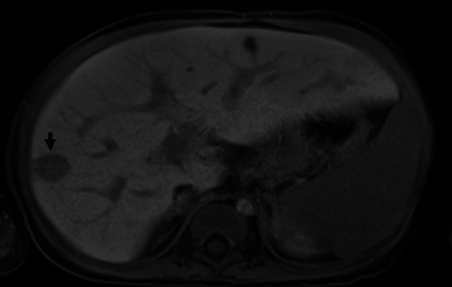
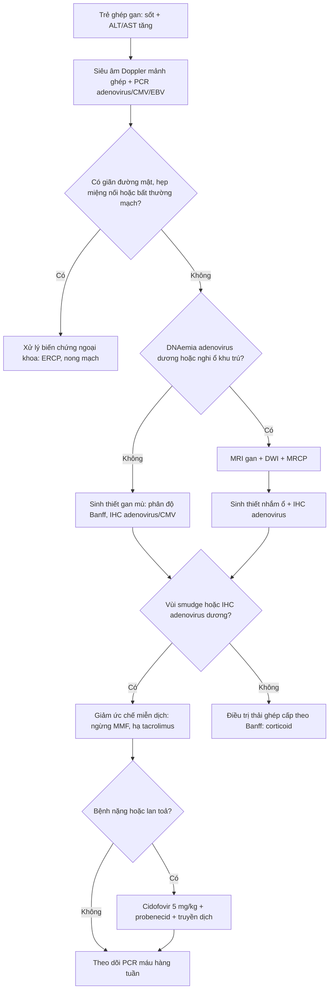
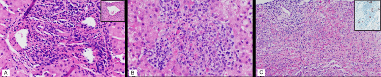
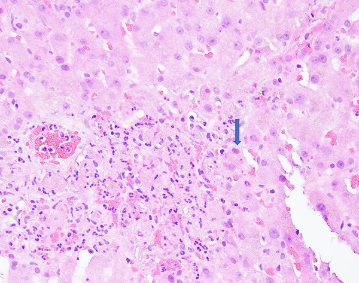

# 1933 — Viêm gan do adenovirus sau ghép gan ở trẻ: hoại tử gan "không đặc hiệu" ≠ thải ghép cấp / Adenovirus hepatitis after paediatric liver transplantation

**Tags:** `pattern:viem-gan-sau-ghep` `pattern:tang-transaminase` `pattern:hoai-tu-gan` `pattern:ton-thuong-gan-khu-tru` `pattern:giam-ty-trong-gan` `pattern:phu-quanh-cua` `vung:gan` `vung:duong-mat` `protocol:SA-Doppler` `protocol:MRI-gan` `protocol:sinh-thiet-gan` `protocol:PCR-adenovirus` `score:adenovirus-DNA` `incidentaloma:khong`
**Mức chắc chắn (certainty):** tổng hợp y văn (literature synthesis) — ghép **đoàn hệ 10 năm, 320 trẻ ghép gan** (*Pediatr Transplant* 2026, PMCID **PMC13001004**, CC BY-NC-ND), **ca nguyên văn 12 tháng tuổi có MRI + 3 lần sinh thiết** (*Cureus* 2023, PMCID **PMC10733164**, CC BY 4.0), **tổng quan mô bệnh – hình ảnh** (*Front Public Health* 2022, PMCID **PMC9095934**, CC BY), **ca người lớn có ảnh mô học tế bào "smudge"** (*Am J Case Rep* 2022, PMCID **PMC9364270**, CC BY-NC-ND) và **8 ca tử vong nhi** (*Emerg Infect Dis* 2024, PMCID **PMC10977843**, CC BY). Không có ca do nhóm tự chụp.

> **Câu chốt:** trẻ ghép gan **sốt + transaminase tăng trong 2–8 tuần đầu**, siêu âm "bình thường" — **adenovirus** nằm trong 3 nguyên nhân hàng đầu cùng **thải ghép cấp** và **nhiễm CMV**. Điểm chết người: **tăng liều corticoid vì "thải ghép"** khi mô học chỉ có **viêm/hoại tử không đặc hiệu**. Trong **84 ca adenovirus** sau ghép gan nhi, **41% biểu hiện bằng viêm gan**, **24% lan toả ≥ 2 cơ quan**, **tử vong 8%** và **40% chẩn đoán trong 30 ngày đầu sau ghép** (PMC13001004).

## 1. Tổng quan bệnh học – cơ chế hình ảnh (TẠI SAO)

### 1.1. Virus vào gan bằng đường nào và phá gan bằng cách nào

- **Adenovirus người (human adenovirus, HAdV)** là virus DNA sợi đôi, không có vỏ bọc; hơn 100 type, chia 7 loài A–G. Nhóm hô hấp **1–3, 5, 7**; nhóm đường tiêu hoá **40, 41**; ở người ghép tạng hay gặp **1–7** (PMC9095934).
- **Đường vào:** hô hấp, phân–miệng, phết mắt, máu/tổ chức ghép. Ở trẻ ghép gan, nguồn có thể là **tái hoạt virus tiềm ẩn của người nhận** hoặc **lây từ người cho** — ca 12 tháng tuổi trong bài nhận **gan từ người cho CMV(+) và EBV(+)**, biểu hiện bệnh ở **tuần thứ 2 sau ghép** (PMC10733164).
- **TẠI SAO gan là cơ quan đích:** tế bào Kupffer bắt giữ HAdV trong vài phút; **tế bào Kupffer chết hoại tử trong vòng 60 phút** sau khi virus vào tuần hoàn, giải phóng **IL-1α** và HMGB1 → phản ứng viêm toàn thân. Tổn thương gan vì vậy **phần lớn là miễn dịch – viêm (gián tiếp)**, không chỉ do virus phá tế bào trực tiếp (PMC9095934).
- **Mô bệnh:** **hoại tử đông tụ (coagulative necrosis) KHÔNG theo dải (non-banded)** — từ **hoại tử điểm (spotty) < 5%** đến **hoại tử dưới ồ ạt và ồ ạt tới 95%** nhu mô trong 12 ca được hệ thống hoá; **một nửa** các ca có viêm **quanh khoảng cửa** (periportal) rõ (PMC9095934).
- **Tế bào "smudge" (smudge cells):** nhân lớn, **kiềm tính**, chất nhiễm sắc dồn ra viền, thường có **vùng thuỷ tinh ái toan ở giữa**; xuất hiện **nhiều nhất ở rìa vùng hoại tử**, có khi rải rác trong tiểu thuỳ. **Nghịch lý quan trọng:** **58% (7/12) ca có rất ít viêm**, cá biệt chỉ **vài u hạt và thâm nhiễm lympho khoảng cửa** — nên mô học "nhẹ" **không loại trừ** adenovirus (PMC9095934).

### 1.2. TẠI SAO hình ảnh học "không đặc hiệu" — vật lý của phù và hoại tử

| Tổn thương mô bệnh | Vật lý – cơ chế | Dấu hiệu trên hình ảnh |
|---|---|---|
| **Phù nhu mô + phù quanh khoảng cửa** | Nước ngoại bào tăng → thời gian T2 dài, T1 dài | **Siêu âm:** gan to, tăng hồi âm, dấu **"trời sao" (starry sky)** do các khoảng cửa sáng hơn nhu mô. **MRI:** **T2/STIR tăng tín hiệu dạng dải quanh khoảng cửa**; T1 giảm nhẹ (PMC9095934) |
| **Hoại tử đông tụ** | Nhu mô mất tưới máu, không còn mạch → không ngấm thuốc; nước nội bào → ngoại bào | **CT:** **vùng giảm tỷ trọng (low attenuation)** rõ, bờ không đều; **ngấm thuốc không đồng nhất** thì động mạch–cửa. **MRI:** vùng hoại tử **T1 thấp, T2 cao, ngấm thuốc kém** |
| **Ổ hoại tử khu trú / "mass-like"** | Hoại tử + viêm lympho–bạch cầu tập trung thành đám | **CT/MRI:** **một hoặc nhiều ổ giảm tỷ trọng**; có ca **viền ngấm thuốc giống áp-xe**, có ca **giống di căn/lymphoma** (PMC9095934) |
| **Kẹp tế bào viêm + xơ nhẹ** | Giảm khuếch tán do tăng độ đặc tế bào (không phải mủ) | **DWI:** hạn chế khuếch tán **nhẹ** (ADC giảm vừa), khác **áp-xe** hạn chế mạnh, ADC rất thấp |

- **Con số then chốt:** chỉ **33% ca có báo cáo hình ảnh** cho thấy tổn thương **không đồng nhất hoặc khu trú**; **2/3 còn lại là thay đổi lan toả hoặc không đặc hiệu** (PMC9095934). Vì vậy **không thể chẩn đoán adenovirus bằng hình ảnh** — hình ảnh dùng để **loại trừ** biến chứng mạch–mật và **chọn chỗ sinh thiết**.
- **TẠI SAO ổ khu trú lại xuất hiện:** tổn thương gan trong adenovirus **không đồng đều về mặt giải phẫu** (heterogeneous involvement). Sinh thiết mù ở thuỳ gan "trông lành" có thể chỉ thấy **thải ghép cấp** hoặc **vài tế bào dương IHC**, trong khi **sinh thiết nhắm vào ổ** trên MRI/CT cho thấy **hoại tử lan rộng + vùi trong nhân** — đúng ca 12 tháng tuổi: sinh thiết ngày 6 = thải ghép cấp vừa–nặng, ngày 12 = "không còn thải ghép", ngày 15 (nhắm ổ) = **đám lympho–bạch cầu + hoại tử + u hạt lỏng**, **IHC adenovirus tăng dần** (PMC10733164).

### 1.3. Ngưỡng định lượng nằm lòng

| Đại lượng | Số liệu | Nguồn |
|---|---|---|
| Bệnh adenovirus có triệu chứng sau ghép gan nhi | **26% (84/320)** | PMC13001004 |
| Biểu hiện **viêm gan** trong số ca bệnh | **41%** | PMC13001004 |
| Sốt / triệu chứng tiêu hoá lúc chẩn đoán | **53% / 48%** | PMC13001004 |
| Thời điểm chẩn đoán, trung vị | **80 ngày** (IQR **19–260**) | PMC13001004 |
| Chẩn đoán **trong 30 ngày đầu** | **40% (31/84)** | PMC13001004 |
| Bệnh lan toả (≥ 2 cơ quan) | **24% (20/84)** | PMC13001004 |
| Tử vong chung của nhóm bệnh adenovirus | **8% (7/84)** | PMC13001004 |
| Tải lượng đỉnh ở nhóm **có** cidofovir vs **không** | **491.805** (IQR 24.800–1.900.000) vs **1.000** copies/mL (IQR 595–794.794) | PMC13001004 |
| Tỷ lệ nhiễm HAdV ở người **ghép tạng đặc** | **5–22%**, phần lớn **6 tháng đầu** | PMC9095934 |
| Tỷ lệ ca viêm gan HAdV là **trẻ em** | **64–66%** | PMC9095934 |
| Phần trăm hoại tử trong 12 ca mô học | **< 5% đến 95%** | PMC9095934 |
| Ca nhi có tải lượng máu toàn phần lúc chẩn đoán | **548.000 copies/mL** | PMC10733164 |
| Liều cidofovir dùng trong ca nhi | **5 mg/kg** (1 liều, kèm probenecid + truyền dịch) | PMC10733164 |
| Ngưỡng ức chế miễn dịch sau khi chẩn đoán (ca nhi) | **ngừng mycophenolate**, tacrolimus đích **7 tháng 10 ng/mL** | PMC10733164 |

- **Không có ngưỡng DNAemia thống nhất** cho adenovirus ở trẻ ghép gan: trung tâm trong PMC13001004 dùng cidofovir khi **có DNAemia + bệnh nặng**, nhưng chính nhóm này **tử vong cao nhất** — nghĩa là **chọn bệnh nhân bằng mức độ bệnh**, không bằng một con số tuyệt đối.

## 2. Mẫu hình + chẩn đoán phân biệt theo vị trí (Gamut)

- **Mẫu hình A — lan toả:** gan to + **phù quanh khoảng cửa** + transaminase tăng (ALT/AST thường **vài trăm U/L**, có ca **> 1.500 U/L** trong viêm gan "không rõ nguyên nhân" ở trẻ). Gamut: **thải ghép cấp**, **adenovirus**, **CMV/EBV**, **tổn thương do thuốc**, **ứ máu/suy tim phải**.
- **Mẫu hình B — nhiều ổ / giả u:** ≥ 2 ổ giảm tỷ trọng, có thể có viền ngấm thuốc. Gamut theo **vị trí và bờ**: **áp-xe vi khuẩn/nấm** (bờ dày, khí trong ổ), **adenovirus thể khu trú** (bờ mờ, không khí, tiến triển nhanh), **PTLD/lymphoma** (đám đặc, hạch), **di căn** (hiếm ở trẻ, nhưng là chẩn đoán hay bị đặt sai — đã có ca adenovirus bị đọc là **lymphoma** và **di căn** — PMC9095934), **nhồi máu gan** (hình nêm, ngoại vi, theo mạch).
- **Mẫu hình C — đường mật:** giãn đường mật + thành ống mật dày. Gamut: **hẹp miệng nối**, **viêm đường mật**, **viêm gan do adenovirus lan lên đường mật** (đã mô tả **vùi trong biểu mô ống mật ở 1/12 ca**, 8% — PMC9095934).
- **Mẫu hình D — "không có gì":** siêu âm bình thường, Doppler bình thường, **chỉ sốt + transaminase tăng** — đây là **mẫu hình thường gặp nhất** và là lý do phải **cấy/PCR + sinh thiết**, không dựa vào hình ảnh (ca 12 tháng tuổi: siêu âm ngày nhập viện **bình thường**, chỉ **2 ổ giảm hồi âm mới** xuất hiện ở lần siêu âm thứ hai — PMC10733164).

## 3. Bảng so sánh phân biệt (ma trận đối chiếu)

| Thực thể (entity) | Hình ảnh điển hình (SA/CT/MRI) | Chốt vào (rule-in) | Chốt loại (rule-out) | Gợi ý xác nhận |
|---|---|---|---|---|
| **Viêm gan adenovirus** | Lan toả: gan to + **phù quanh cửa T2 tăng**; khu trú: **ổ giảm tỷ trọng bờ mờ**, có thể viền ngấm thuốc; **DWI hạn chế nhẹ** | **Sốt + transaminase tăng trong 6 tháng đầu**, **IHC adenovirus dương** ở tế bào gan/đại thực bào, **PCR máu dương** | Bờ ổ dày + khí trong ổ + cấy mủ dương → **áp-xe**, không phải adenovirus đơn thuần | **PCR adenovirus máu định lượng + sinh thiết nhắm ổ + IHC**; theo dõi tải lượng |
| **Thải ghép cấp (ACR)** | Gan to nhẹ, **phù quanh cửa**, đường mật mảnh; **không có ổ khu trú** | **Sinh thiết: viêm khoảng cửa hỗn hợp + viêm tĩnh mạch cửa/gan**, phân độ Banff; đáp ứng corticoid | **Vùi trong nhân + hoại tử không theo dải + IHC dương** → không chỉ là ACR | Sinh thiết **trước** khi tăng corticoid; nhuộm IHC adenovirus trên **khối mô cũ** |
| **Viêm gan CMV** | Gan to, có thể **ổ nhỏ rải rác**; hiếm ổ lớn | **CMV QNAT máu dương** + **vùi "mắt cú"** trong tế bào nội mô/tế bào gan | Vùi **kiềm, lớn, "smudge"** + IHC adenovirus → adenovirus | PCR CMV, IHC CMV (bài 1918) |
| **PTLD/lymphoma** | **Đám đặc**, hạch rốn gan, có thể **xâm lấn mạch** | **EBV PCR cao + mô học tăng sinh lympho đơn dòng** | Tổn thương **bờ mờ, không đẩy mạch, tự khỏi sau giảm ức chế** → nghĩ adenovirus | EBV PCR, sinh thiết + hoá mô miễn dịch |
| **Áp-xe gan (vi khuẩn/nấm)** | **Ổ dịch bờ dày ngấm thuốc**, **khí trong ổ**, có thể nhiều ổ | **Cấy mủ/huyết dương**, sốt cao, **DWI hạn chế mạnh** | Ổ **không khí, bờ mảnh, không mủ khi chọc** + IHC adenovirus → adenovirus | Chọc hút/dẫn lưu, cấy nấm/khuẩn |
| **Viêm đường mật / hẹp miệng nối** | **Giãn đường mật**, thành ống dày, có thể sỏi bùn | **MRCP thấy hẹp + giãn**, đáp ứng dẫn lưu/ERCP | Đường mật **không giãn**, transaminase tăng **không tương xứng** → nghĩ nhu mô | MRCP, ERCP, cấy mật |

*Ca 12 tháng tuổi ghép gan: MRI cho thấy **nhiều ổ T1 giảm – T2 tăng, hạn chế khuếch tán nhẹ**, ổ lớn nhất **1,6 × 1,4 cm** (mũi tên). Ảnh nguyên bản, không crop. Nguồn: *Cureus* 2023, PMCID PMC10733164, CC BY 4.0.*

## 4. Protocol chụp + hệ phân tầng xử trí

### 4.1. Thứ tự hình ảnh – xét nghiệm (không được đảo)

1. **Siêu âm Doppler mảnh ghép** (đầu tiên, tại giường): kích thước gan, hồi âm, **dấu "trời sao"**, ổ khu trú, **phổ động mạch gan – tĩnh mạch cửa – tĩnh mạch gan** để loại **hẹp động mạch/huyết khối** (nguyên nhân ngoại khoa phải mổ lại).
2. **MRI gan có DWI + MRCP** khi: siêu âm bất thường, vàng da/tăng bilirubin trực tiếp, hoặc nghi ổ khu trú. **T2 fat-sat + DWI (b = 50/400/800) + chuỗi động mạch–cửa–muộn 3–5 phút**. Giá trị: **phân biệt phù lan toả – ổ hoại tử – áp-xe**, và **chọn ổ để sinh thiết**.
3. **CT** chỉ khi **chống chỉ định MRI** hoặc cần **hướng dẫn sinh thiết/chọc** nhanh; **giảm liều theo ALARA** ở trẻ.
4. **PCR adenovirus định lượng trong máu toàn phần** + **PCR dịch hô hấp/phân** — lưu ý **dương tính hô hấp đơn thuần không chứng minh viêm gan**; ca 12 tháng tuổi **panel hô hấp âm adenovirus** nhưng **máu 548.000 copies/mL** mới là chìa khoá (PMC10733164).
5. **Sinh thiết gan qua da dưới hướng dẫn siêu âm/CT**: **≥ 2 mẫu** (1 mù + 1 nhắm ổ nếu có), gửi **H&E + IHC adenovirus + CMV + EBV (EBER) + cấy**. Câu hỏi bắt buộc ghi trên phiếu: **"loại trừ adenovirus"** để phòng xét nghiệm nhuộm IHC.

### 4.2. Ngưỡng hành động

- **ALT/AST > 2 lần giới hạn trên** kèm sốt **không rõ ổ** sau ghép gan → **không tăng corticoid ngay**; làm **PCR adenovirus + siêu âm Doppler** trong **24 giờ**.
- **DNAemia dương + bằng chứng mô học/bệnh tạng đích** = **bệnh adenovirus** (không chỉ "nhiễm"). Xử trí theo bậc: **(1) giảm ức chế miễn dịch** (ngừng mycophenolate, hạ tacrolimus — ca nhi dùng đích **7 thay vì 10 ng/mL**); **(2) cidofovir 5 mg/kg** khi bệnh nặng/lan toả, kèm **probenecid + truyền dịch** vì độc thận; **(3) theo dõi tải lượng máu mỗi tuần**.
- **Ca nhi trong bài:** sốt ngày 21 → **548.000 copies/mL** → ngừng mycophenolate + 1 liều cidofovir 5 mg/kg → **hết sốt ngày 27** → tải lượng **42.540 → 6.750 copies/mL** (ngày 29 → 32) → **ra viện ngày 34**, PCR **âm sau 7 tuần** (PMC10733164).

- **Đáp ứng điều trị** đánh giá bằng **3 trục**: sốt, **transaminase**, **tải lượng máu**; hình ảnh chỉ theo dõi **ổ khu trú/áp-xe hoá** (siêu âm lại — ổ **giảm hồi âm biến mất** ở ngày 34 trong ca nhi).

## 5. Biến thể bình thường và cạm bẫy

- **"Mô học âm" không loại trừ:** lần sinh thiết đầu có thể chỉ thấy **thải ghép cấp** (ca nhi: ngày 6), lần hai **"không còn thải ghép"** nhưng **IHC đã có tế bào dương rải rác**; chỉ đến khi **nhắm đúng ổ** mới thấy **hoại tử + cụm tế bào dương**. Cách tránh: **nhuộm IHC adenovirus trên mọi khối sinh thiết gan sau ghép**, kể cả mô cũ lưu trữ.
- **Không thấy vùi không có nghĩa không có virus:** **58% ca có rất ít viêm**, vùi chỉ ở **rìa hoại tử**, có ca **không có vùi điển hình** nhưng IHC dương (ca nhi: "despite the absence of characteristic viral inclusions" — PMC10733164).
- **Bẫy đồng nhiễm:** panel hô hấp dương **rhinovirus/enterovirus + coronavirus** làm yên tâm sai; **adenovirus trong máu** mới là bằng chứng bệnh gan. Ngược lại, **PCR dịch hô hấp dương adenovirus** ở trẻ ghép **không đủ** chẩn đoán viêm gan.
- **Bẫy "gan bình thường trên siêu âm":** 2/3 ca **không có tổn thương khu trú**; Doppler bình thường **chỉ loại trừ hẹp mạch**, không loại trừ viêm gan.
- **Bẫy DWI:** hạn chế khuếch tán **nhẹ** trong đám hoại tử–viêm khác **áp-xe** (ADC rất thấp, viền dày); đừng chọc/dẫn lưu "áp-xe" không có mủ.
- **Bẫy điều trị:** **liều cao methylprednisolone 20 mg/kg** cho "thải ghép" có thể **làm bùng adenovirus**; trong ca nhi, corticoid được **giảm dần** ngay khi sinh thiết lần 2 không còn thải ghép, trước khi có kết quả IHC.
- **Biến thể lành tính:** **tăng transaminase thoáng qua** sau ghép do **thuốc/thải ghép nhẹ**; nếu **sốt + tải lượng tăng** thì không được xếp vào nhóm lành tính.

## 6. Tự lượng giá — Blind Quiz

**Ca 1 — Bé 12 tháng tuổi, ghép gan vì teo đường mật, sốt ngày thứ 14 sau ghép, ALT 132 U/L, AST 133 U/L, GGT 228 U/L; siêu âm lần đầu bình thường.**

- Hỏi: (1) Mô tả ổ tổn thương và tín hiệu; (2) 3 chẩn đoán phân biệt; (3) xét nghiệm nào quyết định và **làm gì trước khi tăng corticoid**?

<b>Bấm để hiện đáp án (findings + chẩn đoán)</b>

- **Dấu hiệu:** nhiều ổ **T1 giảm, T2 tăng**, **hạn chế khuếch tán nhẹ**, ổ lớn **1,6 × 1,4 cm** ở hạ phân thuỳ V, **không khí trong ổ**, **không đẩy mạch**.
- **Chẩn đoán:** **viêm gan do adenovirus** sau ghép gan — không phải áp-xe (không mủ, bờ mờ) và **không phải di căn/lymphoma** (không đám đặc, không hạch).
- **Quyết định:** **PCR adenovirus máu toàn phần (548.000 copies/mL)** + **sinh thiết nhắm ổ**; **giảm ức chế miễn dịch trước**, cidofovir **5 mg/kg** khi bệnh nặng. Không tăng corticoid khi chưa loại adenovirus.
- Nguồn ảnh: *Cureus* 2023, PMCID PMC10733164, CC BY 4.0 (nguyên bản).

**Ca 2 — Cùng bệnh nhi, ba lần sinh thiết gan trong 9 ngày.**

- Hỏi: vì sao lần 1 kết luận **thải ghép cấp** mà lần 3 lại ra **adenovirus**? Nhuộm nào chứng minh?

<b>Bấm để hiện đáp án</b>

- **A (ngày 6):** viêm khoảng cửa hỗn hợp + **viêm tĩnh mạch cửa và tĩnh mạch gan** = thải ghép cấp; **IHC adenovirus chỉ có tế bào dương đơn lẻ**.
- **B (ngày 12):** hết thải ghép, còn **cụm lympho–bạch cầu nhỏ** — dễ đọc là "âm tính".
- **C (ngày 15, sinh thiết nhắm ổ dưới CT):** **đám lympho–bạch cầu lớn + hoại tử + u hạt lỏng**, **IHC adenovirus dương thành cụm** (ô nhỏ).
- **Bài học:** tổn thương **không đồng đều** → sinh thiết mù bỏ sót; **IHC là chốt**, không phải sự hiện diện của vùi.
- Nguồn ảnh: *Cureus* 2023, PMCID PMC10733164, CC BY 4.0 (nguyên bản, giữ nhãn A–C).

**Ca 3 — Người lớn ghép thận, sốt cao, sinh thiết gan có thâm nhiễm bạch cầu trung tính + tế bào gan hoại tử.**

- Hỏi: mô tả nhân tế bào ở mũi tên; chẩn đoán và 2 chẩn đoán phân biệt mô học.

<b>Bấm để hiện đáp án</b>

- **Dấu hiệu:** tế bào gan **nhân lớn, kiềm tính, chất nhiễm sắc dồn viền** — tế bào **"smudge"**, kèm **ổ hoại tử + bạch cầu trung tính**.
- **Chẩn đoán:** **viêm gan adenovirus** (ca ghép thận, PCR adenovirus dương).
- **Phân biệt mô học:** **CMV** (vùi "mắt cú" trong nhân và bào tương, tế bào lớn hơn, thường ở nội mô), **nhiễm HSV** (hoại tử đồng tụ, vùi Cowdry A, ít ở gan người lớn), **thải ghép cấp** (viêm khoảng cửa, không có vùi).
- Nguồn ảnh: *Am J Case Rep* 2022, PMCID PMC9364270, **CC BY-NC-ND 4.0** — dùng **nguyên bản**, không crop/ghép.

## Bài liên quan chéo
- [1918 – Nhiễm CMV sau ghép gan ở trẻ](../1918-nhiem-cmv-sau-ghep-gan-o-tre/lesson.md)
- [1916 – Thải ghép cấp tế bào sau ghép gan](../1916-thai-ghep-cap-te-bao-sau-ghep-gan/lesson.md)
- [1914 – Suy chức năng mảnh ghép sớm](../1914-suy-chuc-nang-manh-ghep-som/lesson.md)
- [161 – Viêm ruột thừa cấp](../161-viem-ruot-thua-cap/lesson.md) (ổ nhiễm ổ bụng ở trẻ ghép — cùng nguyên tắc "không bỏ sót ổ ngoài gan")

## Ảnh
- `1933_viem-gan-adenovirus_MRI-ton-thuong_PMC10733164-F2.jpg` — MRI T1 gan, ổ 1,6 × 1,4 cm; *Cureus* 2023, PMCID PMC10733164, CC BY 4.0.
- `1933_viem-gan-adenovirus_histo-3-lan-sinh-thiet_PMC10733164-F1.jpg` — H&E 3 lần sinh thiết + IHC; *Cureus* 2023, PMCID PMC10733164, CC BY 4.0.
- `1933_viem-gan-adenovirus_histo-smudge-cell_PMC9364270-F1.jpg` — tế bào "smudge"; *Am J Case Rep* 2022, PMCID PMC9364270, CC BY-NC-ND 4.0 (nguyên bản).
- Chi tiết nguồn, giấy phép, phái sinh: `images/CREDITS.md`; link bài gốc: `sources.md`.

> Không dùng để chẩn đoán độc lập khi chưa có người hướng dẫn.
