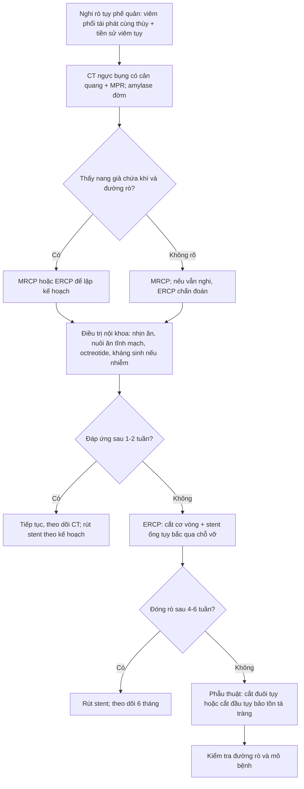
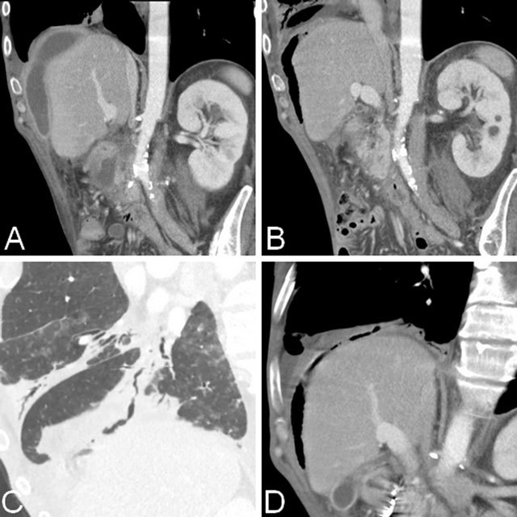
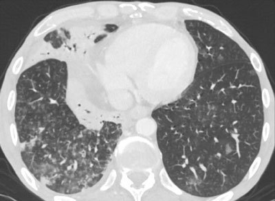
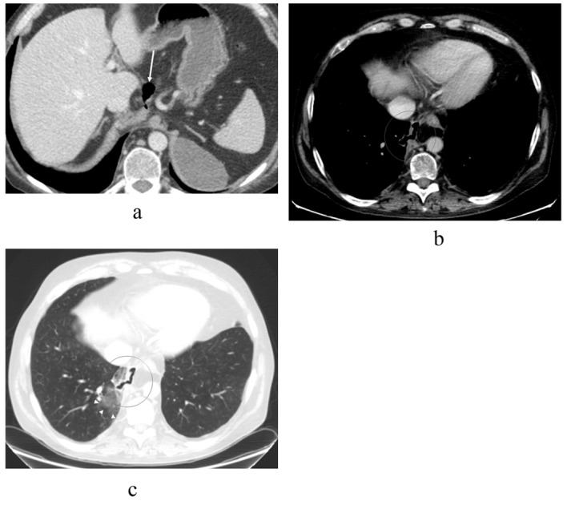

# 1934 — Rò tụy–phế quản: viêm phổi tái phát cùng thùy + nang giả tụy chứa khí xuyên hoành / Pancreaticobronchial fistula

**Tags:** `pattern:ro-ong-tuy` `pattern:nang-gia-tuy` `pattern:ro-tuy-phe-quan` `pattern:tree-in-bud` `pattern:ap-xe-phoi` `pattern:trung-that-tuy` `vung:tuy` `vung:trung-that` `vung:phe-quan` `vung:phoi` `vung:hoanh` `protocol:CT-bung-nguc` `protocol:MRCP` `protocol:ERCP` `protocol:noi-soi-phe-quan`

**Mức chắc chắn (certainty):** tổng hợp y văn (literature synthesis) — đọc toàn văn **3 ca nguyên văn có ảnh** (PMC6032811, PMC5074813, PMC7193244) + abstract của **4 ca/bài tổng quan** và **1 tổng quan hệ thống 157 ca rò tụy–màng phổi (2025)**. **PBF cực hiếm: tra PubMed ngày 2026-11-07 chỉ có 23 bài**, gần như toàn bộ là ca lâm sàng; vì vậy **không có ngưỡng nào từ RCT**. Phần sinh lý bệnh và con số tần suất là **suy luận (inference)** từ dữ liệu rò tụy–màng phổi (cùng đường rò, chỉ khác đích đến), ghi rõ tại chỗ.

## 1. Tổng quan bệnh học – cơ chế hình ảnh – vì sao "viêm phổi" lại bắt nguồn từ tụy

### 1.1. Đường đi của dịch tụy: từ sau phúc mạc lên trung thất rồi vào phế quản

- **Ống tụy vỡ** (viêm tụy cấp hoại tử, viêm tụy mạn, chấn thương, sau ERCP) → dịch tụy **rò ra sau phúc mạc**. Vì **áp lực trong ổ bụng > áp lực lồng ngực**, dịch đi theo **đường ít cản nhất**: lên dọc **động mạch chủ** hoặc **thực quản** qua **lỗ hoành**, tạo **nang giả tụy trung thất**, rồi vỡ vào **màng phổi** (rò tụy–màng phổi, PPF) hoặc vào **cây phế quản** (rò tụy–phế quản, PBF).
- **Điều kiện để thành PBF:** **màng phổi tạng dính vào cơ hoành** — khi đó dịch không vào khoang màng phổi tự do mà **ăn thẳng qua cơ hoành vào nhu mô phổi/phế quản** (PMC5074813). Một đường khác là **nang giả nhiễm khuẩn xuyên trực tiếp vòm hoành** (PMC6032811).
- **Vì sao nang giả có KHÍ:** bình thường nang giả tụy **không có khí**. Khí xuất hiện khi có **thông với đường tiêu hóa hoặc cây phế quản** — trên CT, **khí trong nang giả dưới hoành là chìa khóa gợi ý rò phế quản** (PMC6032811).

### 1.2. Vì sao phổi "viêm" mà không có vi khuẩn — và vì sao tree-in-bud

- Dịch tụy chứa **amylase, lipase, protease** ở dạng **chưa hoạt hóa** trong cây phế quản (không có enterokinase để hoạt hóa trypsinogen) → **không tự tiêu mô**, nhưng **kích thích niêm mạc phế quản** mạnh → **viêm phế quản hóa học, viêm phổi, xẹp phổi**, và về sau **áp-xe phổi** (PMC6032811; PMC5074813).
- **Tree-in-bud** trong PBF không phải lao mà là **dịch viêm giàu protein lan theo trục tiểu phế quản** — cùng hình ảnh, khác bản chất (PMC6032811).
- **Vì sao đờm giàu amylase:** tuyến tụy **tiết liên tục** vào đường rò, trong khi **thanh thải qua phế quản chậm** → nồng độ tích tụ cao **hàng trăm lần huyết thanh**. Ca nguyên văn ghi nhận **amylase đờm 57.500 IU/L** (PMID 17387570); một ca khác xác nhận bằng **lipase và amylase đờm tăng** (PMC6032811). **Amylase máu có thể chỉ tăng nhẹ hoặc bình thường** → **không dùng amylase máu để loại trừ**.

### 1.3. Những con số phải nhớ

- **PPF gặp ở 0,4% bệnh nhân viêm tụy và 4,5% bệnh nhân có nang giả tụy** (PMC7193244 dẫn y văn); **PBF còn hiếm hơn nhiều** — tra PubMed chỉ **23 bài** (2026).
- **Giới/tuổi:** tổng quan hệ thống **157 ca PPF**: **80,7% nam**, tuổi trung niên, **rượu là nguyên nhân chính 58%**, tổn thương thường ở **thân/đuôi tụy** (PMID 40471750, 2025).
- **Bên tổn thương:** trong 22 ca PPF, **86,36% thông với màng phổi TRÁI**, **13,64% bên phải** (PMC9574034, 2022) — nhưng PBF có thể ở **phổi phải** khi đường rò qua **vòm hoành phải** (ca PMC6032811).
- **Chẩn đoán muộn là quy luật:** loạt Anh ghi nhận thời gian từ khởi phát đến chẩn đoán **12, 28, 33 và 49 ngày**; một ca Mỹ trải qua **4 lần chọc dịch, 2 ống dẫn lưu, 2 lần mở ngực** trước khi đo amylase dịch (PMC7193244 dẫn y văn).
- **Điều trị:** tổng quan hệ thống 157 ca: **nội khoa đơn thuần thành công 16,49%**, **nội soi 79,2%**, **phẫu thuật 98,76%**; tái phát sau nội soi **1,88%**, sau mổ **0%**; **2 ca tử vong** (PMID 40471750). Con số này **cao hơn** các loạt ERCP đơn thuần (50–86%) vì định nghĩa "thành công" và mức độ nặng khác nhau — cần đọc cùng bối cảnh.

## 2. Mẫu hình + chẩn đoán phân biệt theo vị trí (Gamut)

- **Mẫu hình cốt lõi:** người có **tiền sử viêm tụy/rượu/chấn thương bụng**, đến với **ho, khạc đờm nhiều, khó thở, sốt tái diễn**, X-quang/CT có **đám mờ hoặc tree-in-bud ở ĐÁY MỘT BÊN**, và **ổ dịch/nang giả tụy dưới hoành cùng bên** → nghĩ PBF, đo **amylase đờm**.
- **Gamut theo vị trí đích:**
  - **Đáy phổi phải (xuyên vòm hoành phải):** thường gặp khi nang giả nằm ở **đầu/thân tụy** và dính vào vòm hoành phải; trên CT thấy đường rò **xuyên cơ hoành vào phân thùy đáy phải** (ca PMC6032811).
  - **Đáy phổi trái (qua lỗ hoành thực quản/động mạch chủ):** đường đi phổ biến nhất của PPF (**86% trái**); thể rò tụy vào màng phổi trái thường kèm **tràn dịch màng phổi trái lượng lớn** và có thể có **áp-xe phổi** (ca PPF + áp-xe phổi, PMC7193244) — khi đã thông phế quản thì thêm **ho khạc đờm nhiều/tree-in-bud**.
  - **Trung thất:** nang giả trung thất chèn **thực quản** (nuốt khó), **tĩnh mạch chủ trên** (phù mặt), hoặc **tim** (rò tụy–màng tim — rất hiếm, có thể chèn ép tim).
  - **Cây phế quản gốc:** hiếm; có thể gây **ho ra máu** do ăn mòn mạch máu phế quản.
- **Gamut theo hình thái phổi:** đám mờ đông đặc **một thùy/ một phân thùy**; **tree-in-bud**; **áp-xe** có mức khí–dịch; **xẹp phổi** do tắc; hiếm hơn là **mờ kính** do kích thích hóa học lan tỏa.

## 3. Bảng so sánh phân biệt (ma trận đối chiếu)

| Thực thể (entity) | Hình ảnh điển hình | Chốt vào (rule-in) | Chốt loại (rule-out) | Gợi ý xác nhận |
|---|---|---|---|---|
| **Rò tụy–phế quản (PBF)** | **Nang giả tụy chứa khí** dưới hoành + **đường rò xuyên cơ hoành** vào phế quản trên MPR coronal/sagittal; **tree-in-bud/đông đặc đáy cùng bên**; có thể áp-xe | **Đường rò thấy được + amylase/lipase đờm rất cao + tiền sử viêm tụy** | Nang giả **không khí**, không thấy đường rò, amylase đờm bình thường → ít nghĩ PBF | CT ngực–bụng có cản quang + MPR; MRCP/ERCP; amylase đờm |
| **Rò tụy–màng phổi (PPF) không thông phế quản** | **Tràn dịch màng phổi một bên, lượng lớn, tái phát nhanh**; nang giả/đường rò xuyên hoành; **không có tree-in-bud** | **Amylase dịch màng phổi > 1.000 U/L** (có thể tới hàng trăm nghìn) + protein > 3 g/dL | Đờm nhiều, tree-in-bud, khí trong nang → nghĩ đã thông phế quản | Chọc dò màng phổi; MRCP/ERCP |
| **Viêm phổi tái phát/giãn phế quản** | Đông đặc cùng thùy tái diễn, dày thành phế quản, tree-in-bud; **không có nang giả dưới hoành** | **Cùng một thùy tái phát ≥ 2 lần** + đờm mủ + đáp ứng kháng sinh | **Có nang giả chứa khí dưới hoành cùng bên** → không chỉ là viêm phổi | CT ngực; đối chiếu bụng; amylase đờm nếu nghi |
| **Lao phổi** | Tree-in-bud + hang **thùy trên/đỉnh**, nốt vệ tinh, dày màng phổi | **AFB/PCR dương**, tổn thương **đỉnh–thùy trên** | Tổn thương **đáy một bên** + nang giả tụy + amylase đờm cao → loại lao | AFB, Xpert MTB/RIF, CT |
| **Áp-xe phổi** | Hang có **mức khí–dịch**, thành dày, đông đặc quanh | **Sốt cao, đờm hôi, mức khí–dịch** | Có **nang giả tụy chứa khí dưới hoành** + đường rò → nghĩ PBF hơn | CT ngực–bụng; cấy đờm; amylase đờm |
| **Rò phế quản–màng phổi** | Tràn khí màng phổi dai dẳng, **rò khí qua ống dẫn lưu**, mủ màng phổi | **Rò khí kéo dài > 5 ngày** sau dẫn lưu | Không có rò khí, có nang giả tụy → loại trừ | CT có cản quang, nội soi phế quản |
| **Rò thực quản–màng phổi** | Tràn khí–dịch trung thất, **thuốc cản quang từ thực quản vào màng phổi**, đau ngực sau nội soi | **Nuốt cản quang thấy đường rò** | Không liên quan thực quản, amylase đờm cao → PBF | Nội soi/thuốc cản quang thực quản |
| **Rò tụy–màng tim** | Tràn dịch màng tim lượng lớn tái phát, **amylase dịch màng tim cao**, nang giả trung thất | **Amylase dịch màng tim cao** + nang giả trung thất | Không có dịch màng tim → loại trừ | Siêu âm tim, CT ngực, amylase dịch |

## 4. Protocol chụp + phân tầng điều trị

### 4.1. Hình ảnh — thứ tự và ngưỡng

- **CT bụng + ngực có cản quang tĩnh mạch, lát ≤ 1–2 mm, dựng MPR coronal và sagittal**: đây là **phương thức chốt**. Cần trả lời 3 câu: **(1) nang giả ở đâu, có khí không? (2) đường rò đi qua lỗ hoành nào/ xuyên vòm hoành? (3) phế quản nào bị thông?** (PMC6032811).
- **Cửa sổ phổi** bắt buộc: tìm **tree-in-bud, đông đặc, áp-xe** ở **đáy cùng bên** — nếu chỉ đọc cửa sổ trung thất sẽ bỏ sót tổn thương phổi.
- **MRCP** (hoặc MRI tụy): đánh giá **chỗ vỡ ống tụy, nang giả, đường rò** — tốt hơn CT cho **giải phẫu ống tụy**, cần trước khi đặt stent.
- **ERCP**: vừa **chẩn đoán** (thấy chỗ rò, đặt được catheter) vừa **điều trị** (cắt cơ vòng + stent ống tụy). Không cần chờ MRCP nếu đã có chỉ định can thiệp.
- **Xét nghiệm chốt:** **amylase và lipase trong ĐỜM** (hoặc dịch màng phổi nếu có tràn dịch). Ngưỡng thực hành: **amylase đờm cao gấp nhiều lần huyết thanh**; ca nguyên văn **57.500 IU/L**. **Không có ngưỡng tuyệt đối** — luôn so với amylase máu và bối cảnh.
- **Nội soi phế quản:** không bắt buộc; có thể thấy **lỗ rò** hoặc đờm bọt, nhưng **soi bình thường không loại trừ PBF**.

### 4.2. Phân tầng điều trị — "hạ lưu lượng rồi bịt đường rò"

- **Nội khoa (bước 1):** nhịn ăn, **nuôi ăn tĩnh mạch**, **octreotide/somatostatin** giảm tiết tụy, kháng sinh khi có nhiễm khuẩn, dẫn lưu ổ dịch/áp-xe. Tỷ lệ thành công đơn thuần **thấp (16,49%)** — không nên kéo dài khi bệnh nhân còn sốt/khạc mủ.
- **ERCP (bước 2):** **cắt cơ vòng + stent ống tụy 5–7 Fr** bắc qua chỗ vỡ, lưu **4–6 tuần**; ca nguyên văn dùng **stent 10 Fr, 5 cm** sau khi stent 7 Fr di trú, hết rò sau **1 tuần** (PMC6032811). Thành công **~79%** (PMID 40471750).
- **Phẫu thuật (bước 3):** **cắt đuôi tụy ± lách** khi tổn thương ở thân/đuôi; **cắt đầu tụy bảo tồn tá tràng (Beger)** khi tổn thương ở đầu; dẫn lưu màng phổi/áp-xe phổi kèm theo. Thành công **98,76%** nhưng là mổ lớn (PMID 40471750; PMC7193244).
- **Điều trị phổi song song:** dẫn lưu áp-xe phổi/tràn dịch khi cần; **không đặt ống dẫn lưu hút mạnh** nếu nghi rò khí lớn; kháng sinh theo cấy.

### 4.3. Theo dõi

- **Lâm sàng:** hết ho/đờm, hết sốt, tăng cân; **đờm giảm dần** là dấu hiệu đóng rò.
- **Hình ảnh:** CT lại sau **4–6 tuần** (nang giả nhỏ lại, khí mất, phổi sạch) — không cần CT mỗi tuần.
- **Xét nghiệm:** amylase đờm giảm; amylase máu không dùng để theo dõi.
- **Tái phát:** sau nội soi **1,88%**; nếu tái phát → chụp lại MRCP và cân nhắc mổ.

## 5. Biến thể bình thường và cạm bẫy

- **Bẫy 1 — chẩn đoán "viêm phổi" và điều trị kháng sinh lặp lại:** tổn thương phổi **cùng một thùy tái diễn** ở người có tiền sử viêm tụy/rượu phải gợi ý PBF; thời gian chẩn đoán muộn **12–49 ngày** là quy luật, không phải ngoại lệ.
- **Bẫy 2 — không đo amylase đờm:** đây là xét nghiệm **rẻ, chốt hướng**, nhưng thường bị bỏ vì "không nghĩ tới tụy". Đo **cả amylase và lipase**.
- **Bẫy 3 — khí dưới vòm hoành bị đọc là "thủng tạng rỗng":** khí trong **nang giả tụy** dưới hoành phải, bờ nhẵn, không có liềm khí tự do dưới cơ hoành → đừng mổ bụng cấp cứu.
- **Bẫy 4 — chỉ đọc lát cắt axial:** đường rò đi **chéo qua cơ hoành**, dễ bị bỏ nếu không dựng **MPR coronal/sagittal**; luôn yêu cầu **MPR mỏng**.
- **Bẫy 5 — tree-in-bud bị điều trị lao:** tree-in-bud trong PBF là **dịch viêm**, không phải lao; AFB âm và bối cảnh tụy giúp phân biệt.
- **Bẫy 6 — dẫn lưu áp-xe phổi đơn thuần:** có thể làm **rò phế quản–màng phổi** hoặc làm đường rò tụy–phế quản rộng hơn; cần xử lý **nguồn tụy** cùng lúc.
- **Bẫy 7 — bỏ sót ở trẻ:** ở trẻ, **chấn thương bụng kín** là nguyên nhân hàng đầu của rò tụy trong; trẻ "viêm phổi" sau chấn thương ngã xe đạp cần nghĩ PBF.
- **Bẫy 8 — amylase máu bình thường:** không loại trừ; amylase đờm/dịch mới là xét nghiệm đích.

## 6. Tự lượng giá — Blind Quiz ngay trên trang tĩnh

**Ca 1 — Nam 52 tuổi, tiền sử nang giả tụy sau viêm tụy đầu tụy, nay ho khạc đờm, khó thở, sốt. X-quang có đám mờ thùy giữa phải + tràn dịch màng phổi phải; dưới vòm hoành phải có "liềm khí" nhỏ.**

- Câu hỏi: "Liềm khí" dưới hoành là gì? Đường rò đi đâu? Xét nghiệm nào chốt chẩn đoán?

<b>Bấm để hiện đáp án (findings + chẩn đoán)</b>

- **Dấu hiệu:** ổ dịch **dưới vòm hoành phải, trên gan**, có **khí bên trong**, kích thước giảm so với trước; **MPR coronal** (C, D) thấy **phế quản đáy phải thông với nang giả qua cơ hoành**. Kèm **tree-in-bud** và đông đặc thùy giữa.
- **Chẩn đoán:** **rò tụy–phế quản** — khí trong nang giả là khí từ cây phế quản vào, không phải khí tự do ổ bụng.
- **Chốt chẩn đoán:** **amylase/lipase đờm tăng rất cao** (ca gốc xác nhận bằng amylase và lipase đờm); **không phải** chỉ dựa vào hình ảnh.
- **Xử trí:** octreotide + đặt **stent ống tụy 10 Fr** qua ERCP; hết rò sau 1 tuần.
- Nguồn ảnh: *J Belg Soc Radiol* 2015 (PMC6032811), **CC BY 3.0**.

**Ca 2 — Cùng bệnh nhân, cửa sổ phổi: đáy phải có nhiều nốt trung tâm tiểu thùy nối với nhánh tuyến tính.**

- Câu hỏi: Mô tả mẫu hình? Ba chẩn đoán phân biệt? Vì sao không phải lao?

<b>Bấm để hiện đáp án (findings + chẩn đoán)</b>

- **Dấu hiệu:** **tree-in-bud** (nốt trung tâm tiểu thùy + nhánh tuyến tính) ở **đáy phổi phải**, kèm đông đặc có **air bronchogram**.
- **Phân biệt:** lao, viêm phổi do vi khuẩn, **viêm tiểu phế quản hít/viêm do dịch tụy**.
- **Vì sao không phải lao:** tổn thương **đáy một bên**, không có hang đỉnh, **có nang giả tụy chứa khí cùng bên**, AFB âm; tree-in-bud ở đây do **dịch viêm giàu protein** lan theo tiểu phế quản.
- Nguồn ảnh: *J Belg Soc Radiol* 2015 (PMC6032811), **CC BY 3.0**.

**Ca 3 — Nam 54 tuổi, chấn thương ngực–bụng trái 1,5 năm trước, nay sốt, ho, khó thở. CT cho thấy đường khí đi từ ổ dịch trên tụy xuyên trung thất vào nhu mô phổi phải.**

- Câu hỏi: Đường rò đi qua đâu? Vì sao phổi phải mà chấn thương bên trái? Cần làm gì tiếp?

<b>Bấm để hiện đáp án (findings + chẩn đoán)</b>

- **Dấu hiệu:** (a) ổ dịch trên tụy; (b) khí trong trung thất; (c) **đường khí xuyên qua màng phổi trung thất phải vào nhu mô phổi**, kèm mờ kính quanh đường rò.
- **Giải thích:** dịch tụy đi theo **lỗ hoành/trung thất**, rồi xuyên qua **màng phổi trung thất bên phải** — bên phổi bị tổn thương **không nhất thiết cùng bên chấn thương**.
- **Chẩn đoán:** rò tụy–phế quản sau chấn thương (thể hiếm; ở trẻ chấn thương là nguyên nhân hàng đầu).
- **Xử trí:** xác nhận bằng amylase đờm; ERCP/MRCP; stent ống tụy hoặc **cắt đuôi tụy** nếu thất bại.
- Nguồn ảnh: *Gastroenterology Research* 2013 (PMC5074813), **CC BY 2.0**.

## Bài liên quan chéo

- [1737 – Rò tụy–màng phổi](../1737-ro-tuy-mang-phoi/lesson.md) (cùng đường rò, đích là khoang màng phổi)
- [1730 – Hội chứng ống tụy đứt](../1730-hoi-chung-ong-tuy-dut/lesson.md) (vì sao ổ dịch không bao giờ khô)
- [136 – U nang tụy](../136-u-nang-tuy/lesson.md) (chẩn đoán phân biệt nang giả – nang thật)
- [107 – MRCP](../107-mrcp-gadoxetic-acid-hbp/lesson.md) (kỹ thuật đánh giá ống tụy)
- [031 – Viêm phổi mẫu hình](../031-viem-phoi-mau-hinh/lesson.md) (tree-in-bud, đông đặc)
- [040 – Tràn dịch màng phổi](../040-tran-dich-mang-phoi/lesson.md) (tràn dịch tái phát một bên)
- [100 – Tổng quan hệ Bụng](../100-tong-quan-he-bung/lesson.md)

## Ảnh

- `images/1934_ro-tuy-phe-quan_CT-MPR_PMC6032811.jpg` — CT MPR: nang giả chứa khí + đường rò vào phế quản, *J Belg Soc Radiol* 2015, **CC BY 3.0**.
- `images/1934_ro-tuy-phe-quan_CT-nguc-trong-gan_PMC6032811.jpg` — tree-in-bud đáy phải, *J Belg Soc Radiol* 2015, **CC BY 3.0**.
- `images/1934_ro-tuy-phe-quan_CT-duong-ro-xuyen-hoanh_PMC5074813.jpg` — đường rò khí xuyên trung thất vào phổi, *Gastroenterology Research* 2013, **CC BY 2.0**.
- Chi tiết nguồn – giấy phép từng file: `images/CREDITS.md`; danh sách bài gốc: `sources.md`.

> Không dùng để chẩn đoán độc lập khi chưa có người hướng dẫn.
