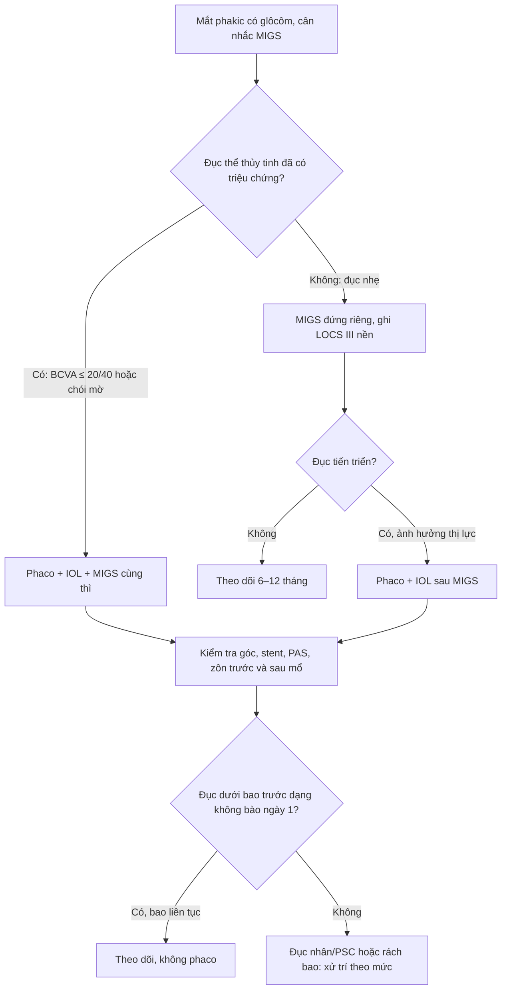
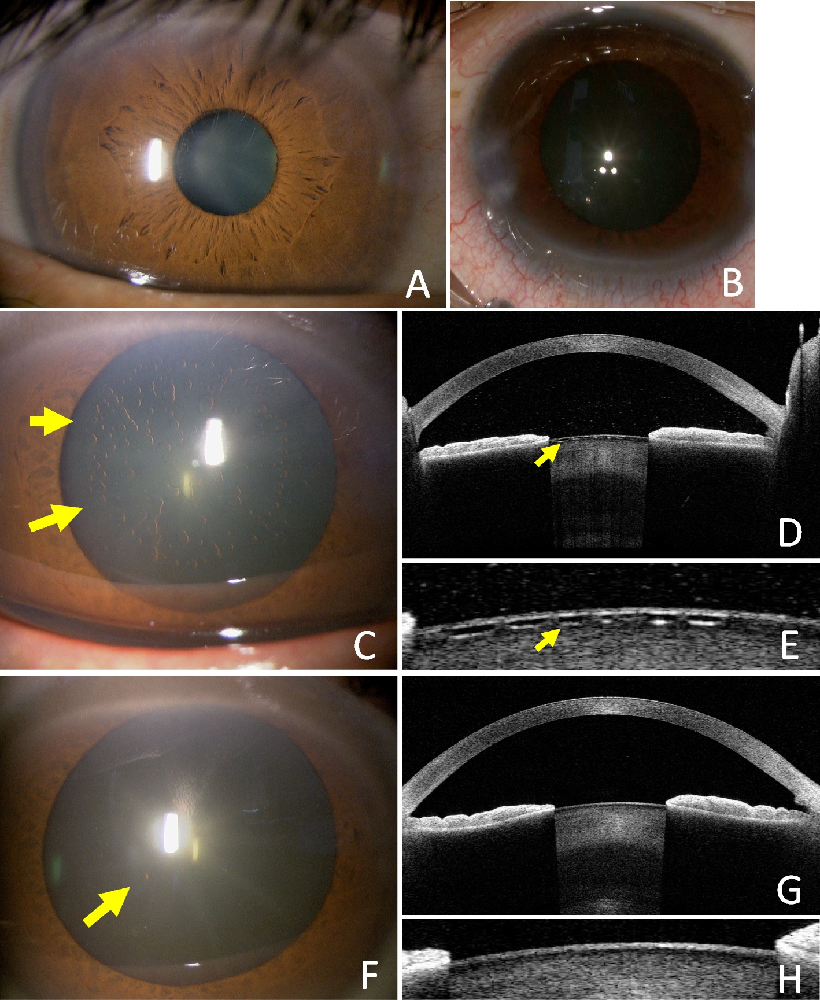
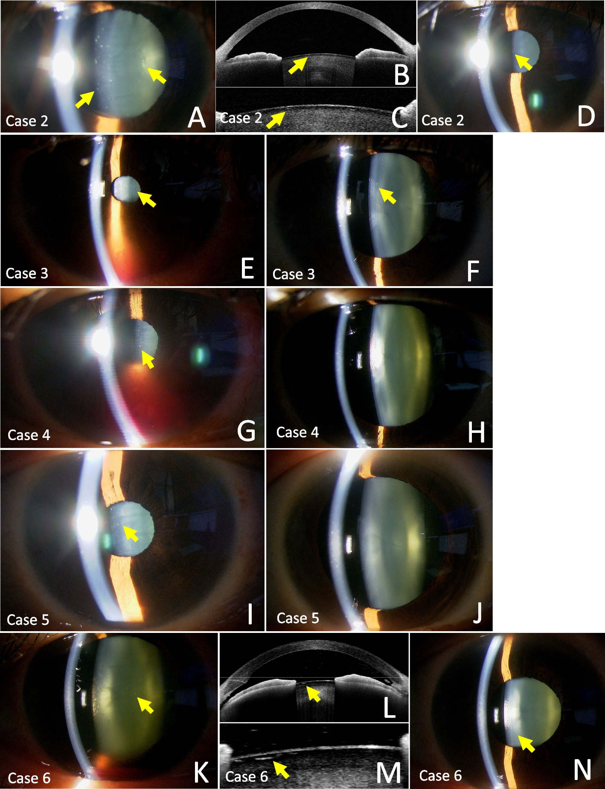

# 1935 — Đục thể thủy tinh sau MIGS: cơ chế, AS-OCT và quyết định phaco / Cataract after minimally invasive glaucoma surgery

**Tags:** `pattern:duc-the-thuy-tinh` `pattern:duc-nhan` `pattern:duc-duoi-bao-truoc` `pattern:duc-duoi-bao-sau` `pattern:khong-bao-thoang-qua` `pattern:ton-thuong-bao-the-thuy-tinh` `pattern:sau-migs` `vung:the-thuy-tinh` `vung:mat` `vung:tien-phong` `vung:goc-tien-phong` `protocol:slit-lamp` `protocol:AS-OCT` `protocol:phaco` `protocol:migs` `protocol:gonioscopy` `score:LOCS-III` `score:BCVA`
**Mức chắc chắn (certainty):** tổng hợp y văn (literature synthesis) — nhóm tự biên từ các nguồn mở, đã đối chiếu `authorString`/PMCID: loạt 6 ca đục dưới bao trước dạng không bào sau Tanito microhook (CC BY 4.0, PMC11134623), phân tích gộp MINIject so với 2 iStent đứng riêng (CC BY 4.0, PMC11676728), iStent inject 7 năm (PMC10960914) và 5 năm (PMC12069763), kỹ thuật đặt iStent trước khi lấy thể thủy tinh ở 63 mắt (PMC9452712), phê bình hiệu quả thực của stent bè (PMC10997962), tổng quan MIGS (PMC12416010), so sánh biến chứng phaco có/không kèm MIGS (PMC13349877) và tổng quan chọn bệnh nhân ghép MIGS với phaco (CC BY 4.0, PMC13413391). Chỗ nhóm suy luận được ghi rõ "suy luận"; chỗ y văn chưa có số liệu trực tiếp ghi "chưa rõ".

> **Vì sao bài này quan trọng:** MIGS ngày càng được làm trên mắt **còn thể thủy tinh** (phakic), và câu hỏi thực hành không phải "MIGS có gây đục thể thủy tinh không?" mà là **"đục này là đục thật do tuổi/mổ, hay chỉ là tổn thương thoáng qua trên bề mặt thể thủy tinh; và nếu đục thật thì phaco lúc nào, có làm mất tác dụng hạ nhãn áp của MIGS không?"** Trả lời sai theo hai hướng đều tốn kém: **mổ phaco sớm** một tổn thương tự khỏi, hoặc **bỏ qua đục thật** làm mất cửa sổ theo dõi đáy mắt và thị trường.

## 1. Tổng quan bệnh học – cơ chế hình ảnh: vì sao mắt sau MIGS có thể đục thể thủy tinh

### 1.1 MIGS nằm ở đâu so với thể thủy tinh

- **MIGS dựa trên ống Schlemm** (iStent/iStent inject, Hydrus, Kahook Dual Blade, Tanito microhook, GATT, canaloplasty/OMNI): dụng cụ và đường cắt nằm ở **góc tiền phòng – bè – ống Schlemm**, ngay sau góc và **sát mặt trước thể thủy tinh khi tiền phòng nông**; ở mắt tiền phòng nông, đồng tử nhỏ hoặc thể thủy tinh dày, đầu dụng cụ có thể **chạm bao trước**.
- **MIGS khoang trên hắc mạc (supraciliary)** (CyPass, MINIject): đặt vào **khoang trên hắc mạc**, xa thể thủy tinh hơn nhưng vẫn thao tác trong tiền phòng.
- **MIGS dưới kết mạc** (XEN, PreserFlo): đích dẫn lưu ở **dưới kết mạc**, đi qua tiền phòng nhưng **ít thao tác sát mặt trước thể thủy tinh**.
- Điểm chung: mọi MIGS ab interno đều cần **tiền phòng ổn định, đồng tử đủ rộng, thao tác gần mặt trước thể thủy tinh** — đây là nơi sinh ra cả **đục thật** lẫn **đục giả thoáng qua**.

### 1.2 Bốn cơ chế, và cách phân biệt bằng hình ảnh

1. **Chấn thương cơ học trực tiếp (traumatic lens injury).** Đầu dụng cụ chạm **bao trước** hoặc **vỏ trước** → đứt bao khu trú, vỏ trương nước, đục khu trú tại chỗ chạm; nếu rách bao đủ lớn, dịch tiền phòng vào vỏ gây đục nhanh và có thể phòi vỏ. Cơ chế này **hiếm khi được báo cáo có hệ thống** trong MIGS. Một loạt 63 mắt đặt iStent inject **trước khi lấy thể thủy tinh** (có video review từng ca) **không ghi nhận ca tổn thương thể thủy tinh nào**, gợi ý kỹ thuật kiểm soát tiền phòng tốt thì nguy cơ rất thấp (PMC9452712). Khi có, tổn thương thường **khu trú đúng vị trí đầu dụng cụ**, không đối xứng, và **không tự mất** như tổn thương do dòng chảy.
2. **Tổn thương do chất nhầy đàn hồi (OVD) và dòng tưới–hút quá mạnh.** Đây là cơ chế được mô tả rõ nhất: **6 ca liên tiếp** sau **Tanito microhook trabeculotomy (TMH)** giữ thể thủy tinh có **đục dưới bao trước dạng không bào (vacuolar anterior subcapsular opacities)** ngay **ngày 1 sau mổ** (PMC11134623). Tác giả giải thích bằng 3 yếu tố cộng lại:
   - **OVD phân tán (dispersive, ví dụ Viscoat)** bám chặt bao trước hơn OVD liên kết (cohesive); khi bơm–hút **kéo OVD ra trước**, lớp bao tách khỏi vỏ → tạo các **không bào tròn**.
   - **Dòng tưới mạnh** đập vào mặt trước thể thủy tinh (cùng cơ chế đã gặp sau đặt ICL).
   - **Nhãn áp cuối mổ cao** (để cầm máu chỗ cắt bè) làm tăng dòng nước qua tiền phòng.
   Các không bào xuất hiện **trong vùng đồng tử giãn 3–7 mm**, **giảm dần** và **mất hoàn toàn trong 21 tháng**, **không ảnh hưởng thị lực hay độ tương phản**. Đây **không phải đục thể thủy tinh thật** mà là tổn thương bề mặt bao/vỏ trước.
3. **Viêm và tăng nhãn áp sau mổ.** Máu tiền phòng, phản ứng viêm tiền phòng, tăng IOP thoáng qua → **phá hàng rào máu–thủy dịch**, tăng stress oxy hóa và thay đổi môi trường dịch kính; về lý thuyết thúc đẩy **đục nhân xơ** và **đục dưới bao sau (PSC)**. Số liệu định lượng cho riêng MIGS **chưa rõ**; đây là suy luận cơ chế, không phải quan hệ nhân quả đã chứng minh.
4. **Tiến triển tự nhiên theo tuổi, không do MIGS.** Đây là cơ chế **hay bị quy sai nhất**. Tuổi trung bình trong các loạt MIGS là **69–75** (PMC12069763, PMC9452712). Ở mắt đứng riêng (standalone), **iStent 2 năm: đục thể thủy tinh tiến triển 6/121 = 5,0%** (PMC11676728); loạt iStent inject **7 năm: 1 bệnh nhân đứng riêng đục tiến triển cả hai mắt ở tháng 3**, trong khi **IOP vẫn giảm 39,5–43,5%** và **thuốc giảm 62,1–76,2%** ở nhóm standalone (n = 44) (PMC10960914). Với TMH giữ thể thủy tinh, một tổng kết **560 ca TMH (80 ca giữ thể thủy tinh)** ghi **6 đục thể thủy tinh sau mổ** trong theo dõi trung bình **405 ngày** — tương đương **6/80 ≈ 7,5%** (số liệu dẫn trong PMC11134623). Như vậy, **đa số mắt sau MIGS không đục nhanh**, và tỷ lệ đục thật dao động theo thiết bị, tuổi và thời gian theo dõi.

### 1.3 Vì sao phaco sau MIGS lại làm "rối" đánh giá nhãn áp

- **Phaco đơn thuần tự nó hạ IOP**: ở người có glôcôm, mức giảm trung bình **16,5%** kéo dài ít nhất **36 tháng** (OHTS, dẫn qua PMC11676728); các tổng quan khác ghi **21–28% sau 2 năm** (PMC10997962). Vì vậy, khi bệnh nhân được phaco **sau** một MIGS, IOP giảm thêm **không chứng minh MIGS còn tốt** — và ngược lại, IOP tăng sau đó **không chứng minh MIGS đã hỏng**.
- **Hiệu quả cộng thêm của MIGS so với phaco đơn thuần rất khiêm tốn**: iStent inject **+1,9 mmHg**, Hydrus **+1,8 mmHg** trong các thử nghiệm ngẫu nhiên có đối chứng (PMC12416010). Một phân tích khác tính **+1,9% IOP** so với phaco đơn thuần (PMC10997962), và ước tính **2/3 mức giảm IOP/thuốc** trong mổ kết hợp đến từ **phaco**, chỉ **1/3** từ MIGS (PMC13349877). Đây là con số phải nói với bệnh nhân trước khi quyết định.
- **Chưa có RCT trực tiếp** trả lời "phaco sau MIGS có làm mất tác dụng hạ áp không" — ghi rõ **chưa rõ**. Dữ liệu gián tiếp: (a) iStent đứng riêng vẫn duy trì IOP giảm **39,5–43,5% trong 7 năm** (PMC10960914), **gợi ý** tác dụng của stent không phụ thuộc hoàn toàn vào việc có phaco hay không; (b) phaco làm sâu tiền phòng, mở góc và giảm IOP, nên **che lấp** một phần hiệu quả MIGS; (c) viêm và dính mống mắt chu biên (PAS) sau phaco có thể **bít lỗ stent** — đã có ca iStent bị mống mắt bít lỗ gây tăng IOP ngày 5 sau phaco, xử lý bằng pilocarpine (PMID 40262924, ca lâm sàng).
- **Kết luận thực hành:** đánh giá lại IOP **sau khi ngừng thuốc đủ thời gian**, ghi rõ **thời điểm so với phaco**, và **không kết luận MIGS thất bại** chỉ vì IOP thay đổi trong 3 tháng đầu sau phaco.

## 2. Mẫu hình + chẩn đoán phân biệt theo thời điểm (Gamut)

- **Mẫu hình lõi:** mắt có tiền sử MIGS (thường kèm glôcôm góc mở), đến khám vì **mờ dần không đau**; đèn khe thấy **đục nhân vàng** hoặc **mảng trắng dưới bao sau**, có thể kèm **không bào tròn dưới bao trước** nếu mới mổ.
- **Gamut theo thời điểm:**
  1. **Ngày 1–7 sau MIGS:** đục dưới bao trước dạng **không bào**, trong vùng đồng tử giãn → **tổn thương thoáng qua do OVD/dòng tưới**, không phải đục thật.
  2. **1–6 tháng:** đục **khu trú tại chỗ dụng cụ chạm** hoặc **đục nhanh toàn bộ** nếu rách bao lớn → **chấn thương thể thủy tinh thật**; cần soi kỹ bao trước.
  3. **6 tháng–nhiều năm:** **đục nhân xơ/PSC tiến triển** — phần lớn do **tiến triển tự nhiên theo tuổi** (suy luận từ bối cảnh dịch tễ), có thể nhanh hơn ở mắt viêm/tăng IOP.
  4. **Mắt đã phaco trước MIGS:** không gọi là "đục thể thủy tinh"; nghĩ **IOL mờ (glistenings/calcification)**, **màng dầu**, **PCO** hoặc **thể thủy tinh nhân tạo lệch**.
  5. **Mắt chưa phaco, có đục đã rõ trước MIGS:** đây là **chỉ định mổ kết hợp**, không phải biến chứng.
- **Mẫu hình hình ảnh:**
  - **Đèn khe:** đục nhân (mất phản xạ đỏ, vàng nâu), PSC (mảng trắng sau bao), không bào dưới bao trước (chấm tròn lấp lánh, xếp trong vùng đồng tử giãn), rách bao (đường mất liên tục, vỏ phòi).
  - **AS-OCT:** không bào = **chấm/túi tăng phản xạ ngay dưới bao trước**, bao còn liên tục; rách bao = **mất liên tục đường phản xạ bao**, vỏ trước dày; đồng thời đo **độ sâu tiền phòng**, phát hiện **dính mống mắt–giác mạc** và **vị trí stent** trong ống Schlemm.
  - **Siêu âm B:** khi đục quá dày che đáy mắt, loại trừ bong võng mạc/u nội nhãn trước khi mổ.

## 3. Bảng so sánh phân biệt (ma trận đối chiếu)

| Thực thể (entity) | Hình ảnh điển hình | Chốt vào (rule-in) | Chốt loại (rule-out) | Gợi ý xác nhận |
|---|---|---|---|---|
| **Đục nhân xơ tiến triển sau MIGS** | Nhân vàng/nâu, mất phản xạ đỏ, tiến triển nhiều tháng–năm | **Tiền sử MIGS + đục nhân tiến triển + không có tổn thương bao khu trú**; thường tuổi > 60 | **Không bào ngày 1 sau mổ, tự giảm** → không phải đục nhân; **đục khu trú đúng đầu dụng cụ** → nghĩ chấn thương | LOCS III (NO/NC), ảnh đèn khe định kỳ, so sánh 3–6 tháng |
| **Đục dưới bao sau (PSC) sau MIGS** | Mảng trắng/xám ngay sau bao sau, trục quang | **PSC mới/xấu đi sau MIGS + mắt viêm/tăng IOP hoặc bơm dầu** | **Không bào dưới bao TRƯỚC** → khác vị trí; **màng sau IOL** ở mắt pseudophakic → PCO | Đèn khe + RetroIllumination; AS-OCT vùng sau bao |
| **Đục dưới bao trước dạng không bào thoáng qua (sau TMH/ab interno)** | Nhiều chấm tròn, lấp lánh, **ngay dưới bao trước**, trong vùng đồng tử giãn 3–7 mm, **ngày 1** | **Mổ ab interno giữ thể thủy tinh + không bào ngày 1 + bao liên tục trên AS-OCT + thị lực không giảm** | **Mất liên tục bao, vỏ phòi, đục khu trú** → rách bao thật; **đục nhân/PSC** → đục thật | AS-OCT (chấm tăng phản xạ dưới bao), theo dõi 3–6 tháng; **không phaco** |
| **Chấn thương bao trước/vỏ do dụng cụ** | Đục khu trú tại một điểm, có thể hình nan hoa, tiến triển nhanh | **Vị trí khớp đầu dụng cụ + bao mất liên tục/dày + tiền phòng nông/đồng tử nhỏ lúc mổ** | **Tổn thương tròn rải rác, đối xứng trong vùng đồng tử** → do OVD/dòng chảy | AS-OCT bao trước; soi góc tìm mảnh vỏ; nếu rách lớn → phaco sớm |
| **Rách zôn/thể thủy tinh lắc lư (phacodonesis)** | Thể thủy tinh rung theo chuyển động mắt, tiền phòng sâu không đều, có thể lệch | **Rung thể thủy tinh + zôn đứt thấy trên đèn khe/AS-OCT + tiền sử chấn thương hoặc pseudoexfoliation** | **Thể thủy tinh vững, chỉ đục nhân** → không phải zôn; **IOL lệch** ở mắt pseudophakic → khác | Đèn khe sau nhỏ giọt; AS-OCT/UBM góc; chuẩn bị IOL rãnh/thì khác nếu zôn yếu |
| **Đục giả do OVD/bọt khí/nếp giác mạc** | Bóng tròn, dải sáng di động, **thay đổi theo tư thế/ngày**, không nằm trong bao | **Mờ ngay sau mổ + bóng khí/OVD thấy rõ + giảm trong vài ngày** | **Chấm cố định dưới bao trước** → không bào thật; **đục nhân** → đục thật | Đèn khe nhiều ngày, chụp lại; không mổ khi chưa rõ |
| **IOL mờ/PCO ở mắt đã phaco** | IOL trắng đục/lấm tấm, màng sau IOL | **Đã phaco + mờ dần + màng sau IOL trên đèn khe** | **Thể thủy tinh còn** → không phải PCO/IOL; **dầu trong tiền phòng** → đục giả do dầu | Đèn khe/AS-OCT; YAG bao sau nếu PCO |

## 4. Protocol chụp/đánh giá + phân độ + khi nào phaco

### 4.1 Trước MIGS (bắt buộc ghi nền)

- **Đèn khe + LOCS III** cho cả 4 thành phần: **NO1–6** (đục nhân màu), **NC1–6** (đục nhân), **C1–6** (vỏ), **P1–5** (dưới bao sau); ghi ảnh nền nếu có.
- **BCVA, khúc xạ, IOP, soi góc (gonioscopy)**, độ sâu tiền phòng, siêu âm sinh trắc nếu cân nhắc IOL.
- **AS-OCT tiền phòng** khi tiền phòng nông, nghi zôn yếu hoặc cần đo vị trí thể thủy tinh; đây là **mốc so sánh** cho mọi tổn thương sau mổ.
- **Quyết định:** nếu đục thể thủy tinh **đã có triệu chứng** (BCVA ≤ 20/40 hoặc chói/mờ ảnh hưởng sinh hoạt) → **phaco + IOL + MIGS cùng thì**; nếu đục nhẹ, không triệu chứng → **MIGS đứng riêng** và theo dõi.

### 4.2 Sau MIGS

- **Ngày 1, tuần 1, tháng 1, sau đó 3–6 tháng:** đèn khe tìm **không bào dưới bao trước**, rách bao, phản ứng viêm, máu tiền phòng, IOP, vị trí stent.
- **AS-OCT** nếu mờ không giải thích được, tiền phòng nông, nghi zôn yếu, hoặc cần xác nhận **không bào dưới bao trước** và **vị trí stent bè** (với iStent/Hydrus: trong ống Schlemm, lỗ thông vào tiền phòng).
- **Siêu âm B** khi đục quá dày không nhìn đáy mắt.

### 4.3 Ngưỡng và thời điểm phaco

- **Phaco khi đục có ý nghĩa thị giác:** BCVA ≤ **20/40 (6/12)** hoặc triệu chứng chói/mờ ảnh hưởng sinh hoạt, **hoặc** đục cản trở **theo dõi đáy mắt/thị trường** ở mắt glôcôm nặng. Không có ngưỡng LOCS tuyệt đối — **triệu chứng + chức năng** quyết định.
- **Không phaco** cho không bào dưới bao trước đơn thuần ngày 1 sau mổ nếu thị lực bình thường và bao còn liên tục: **theo dõi**, vì đa số **mất trong 21 tháng** (PMC11134623).
- **Phaco sau MIGS:** kiểm tra **vị trí stent/góc, PAS, tình trạng zôn** trước mổ; giữ tiền phòng ổn định, tránh hút quá mạnh gần lỗ stent (khuyến cáo kỹ thuật, **suy luận**); sau mổ theo dõi **IOP spike, phản ứng viêm, bít lỗ stent** (ca iStent bị mống mắt bít lỗ ngày 5 sau phaco — PMID 40262924).
- **Tư vấn:** MIGS cộng thêm **1,8–1,9 mmHg** so với phaco đơn thuần (PMC12416010); **2/3** mức giảm IOP trong mổ kết hợp đến từ phaco (PMC13349877); **không hứa** "phaco sẽ không ảnh hưởng MIGS" — nói rõ **chưa có RCT trực tiếp**.

## 5. Biến thể bình thường và cạm bẫy

- **Biến thể bình thường:** **không bào dưới bao trước thoáng qua** sau ab interno là tổn thương **lành tính, tự khỏi**, không phải đục thể thủy tinh; đừng đưa vào danh sách "biến chứng nặng" khi tư vấn.
- **Cạm bẫy 1 — đọc không bào thành đục thật:** không bào **tròn, rải rác, trong vùng đồng tử giãn**, xuất hiện **ngày 1**, giảm dần; đục nhân/PSC **khu trú trục quang**, tiến triển. AS-OCT giúp phân biệt: không bào nằm **ngay dưới bao trước**, bao liên tục.
- **Cạm bẫy 2 — bỏ sót rách bao:** tổn thương **một điểm**, bờ không đều, vỏ phòi, tiền phòng nông; nếu bỏ qua, phaco muộn có thể gặp **vỏ trương nước, zôn yếu, mất nhân vào dịch kính**.
- **Cạm bẫy 3 — OVD/bọt khí/nếp giác mạc giả đục:** bóng **di động**, thay đổi theo ngày/tư thế; chụp lại trước khi can thiệp.
- **Cạm bẫy 4 — "satisfaction of search":** thấy đục thể thủy tinh rồi dừng, **bỏ sót stent bị bít, PAS, mống mắt chạm IOL, tăng IOP do corticoid**. Ở mắt sau MIGS, luôn **soi góc** khi IOP tăng.
- **Cạm bẫy 5 — quy IOP tăng sau phaco cho MIGS hỏng:** phân biệt **đáp ứng corticoid** (tăng sau 2–6 tuần, giảm khi ngừng), **OVD tồn lưu**, **bít stent/PAS**, **glôcôm ác tính**; đo lại sau khi ngừng thuốc và soi góc.
- **Cạm bẫy 6 — mắt pseudophakic:** "đục" ở mắt đã phaco là **PCO/IOL mờ**, không phải đục thể thủy tinh; đừng mô tả sai trong hồ sơ.

## 6. Tự lượng giá — Blind Quiz

**Ca 1 — mờ nhẹ ngày đầu sau mổ glôcôm ab interno**

- Gợi ý lâm sàng: nam 59 tuổi, glôcôm góc mở, mổ TMH giữ thể thủy tinh; ngày 1 thấy mờ nhẹ, BCVA 0,9.
- Câu hỏi: (1) Mô tả tổn thương trong ảnh C và D–E. (2) Ba chẩn đoán phân biệt? (3) Có nên phaco ngay không, vì sao?

<b>Bấm để hiện đáp án (findings + chẩn đoán)</b>

- Dấu hiệu: ảnh C — nhiều **chấm tròn lấp lánh dưới bao trước**, nằm trong vùng đồng tử giãn (mũi tên vàng); D–E — AS-OCT thấy **chấm/túi tăng phản xạ ngay dưới bao trước**, **bao còn liên tục**.
- Chẩn đoán: **đục dưới bao trước dạng không bào thoáng qua sau ab interno** (transient anterior subcapsular vacuolar opacities), do **OVD phân tán + dòng tưới mạnh + IOP cuối mổ cao** — không phải đục thể thủy tinh thật.
- Xử trí: **theo dõi**, không phaco; tổn thương giảm dần và **mất hoàn toàn**, thị lực không giảm.
- Nguồn ảnh: Shimizu H, Tanito M, *BMC Ophthalmol* 2024 (PMC11134623), Fig. 1, CC BY 4.0; ảnh chuyển định dạng PNG→JPEG, **không crop**.

**Ca 2 — cùng bệnh cảnh ở nhiều mắt: tổn thương có lặp lại?**

- Gợi ý lâm sàng: 5 bệnh nhân khác, cùng phẫu thuật viên, cùng kỹ thuật; tất cả đều thấy tổn thương **ngày 1**, thị lực giữ nguyên.
- Câu hỏi: (1) Điểm chung của các tổn thương? (2) Vì sao không gọi là "đục thể thủy tinh do mổ"? (3) Theo dõi bao lâu?

<b>Bấm để hiện đáp án (findings + chẩn đoán)</b>

- Dấu hiệu: các **không bào tròn dưới bao trước** (mũi tên vàng) ở nhiều mức độ; AS-OCT xác nhận **tổn thương dưới bao, bao nguyên**; một số ảnh theo dõi muộn cho thấy **giảm rõ**.
- Chẩn đoán: **tổn thương bề mặt bao/vỏ trước do OVD + dòng tưới**, cùng cơ chế với ca 1; **không phải đục nhân/PSC** và **không phải rách bao**.
- Theo dõi: đèn khe + AS-OCT **3–6 tháng/lần**; trong loạt này tổn thương **mất hoàn toàn trong 21 tháng**, **không can thiệp**.
- Nguồn ảnh: Shimizu H, Tanito M, *BMC Ophthalmol* 2024 (PMC11134623), Fig. 2, CC BY 4.0; ảnh chuyển định dạng PNG→JPEG, **không crop**.

**Ca 3 — câu hỏi định lượng, không có ảnh**

- Bệnh nhân 70 tuổi, glôcôm góc mở, đặt **2 iStent inject đứng riêng** (không phaco) 2 năm trước; nay đục nhân, BCVA 20/60. Bệnh nhân hỏi: "Đục này do stent không? Nếu mổ phaco thì stent mất tác dụng không?"
- Câu hỏi: (1) Tỷ lệ đục thể thủy tinh tiến triển ở iStent đứng riêng theo dữ liệu gộp là bao nhiêu? (2) Trả lời nào đúng về tác dụng của stent sau phaco?

<b>Bấm để hiện đáp án</b>

- (1) **6/121 = 5,0%** ở 24 tháng trong phân tích gộp các nghiên cứu iStent đứng riêng (PMC11676728); loạt 7 năm có **1 bệnh nhân đục tiến triển cả hai mắt ở tháng 3** (PMC10960914). Phần lớn đục là **tiến triển tự nhiên theo tuổi**, không phải "do stent".
- (2) **Stent không mất tác dụng chỉ vì phaco**: nhóm iStent đứng riêng vẫn giảm IOP **39,5–43,5%** và thuốc **62,1–76,2%** trong 7 năm (PMC10960914); nhưng **chưa có RCT trực tiếp** về phaco sau MIGS, và phaco **tự nó hạ IOP** (16,5% ở OHTS; 21–28% sau 2 năm — PMC10997962), nên phải đánh giá lại IOP sau khi ngừng thuốc và soi góc tìm **bít stent/PAS**.
- Suy luận: nếu IOP tăng sau phaco, **đừng kết luận ngay "stent hỏng"** — kiểm tra nguyên nhân khác trước.

## Bài liên quan chéo
- [1447 – Rách thể mi sau MIGS/Yamane: CCD thoáng qua, khe thật, xử trí](../1447-rach-the-mi-sau-migs-va-yamane/lesson.md)
- [1863 – Đục thể thủy tinh ở mắt bơm dầu silicone: một thì hay hai thì, sinh trắc học và khúc xạ](../1863-duc-the-thuy-tinh-mat-bom-dau-silicone/lesson.md)
- [1837 – Dầu silicone trong tiền phòng & nội mô giác mạc](../1837-dau-silicone-tien-phong-ton-thuong-noi-mo/lesson.md)
- [1452 – Glôcôm do thể thủy tinh chưa mổ (phacolytic/phacomorphic)](../1452-glaucom-do-the-thuy-tinh-chua-mo/lesson.md)
- [1454 – Đặt IOL ở mắt đã phacolytic: zôn yếu, rách bao, kết cục](../1454-dat-iol-mat-phacolytic/lesson.md)
- [400 – Tổng quan Mắt & thị giác](../400-tong-quan-mat-thi-giac/lesson.md)

## Ảnh
- `images/1935_duc-the-thuy-tinh-sau-MIGS_Slitlamp-ASOCT_PMC11134623-Fig1.jpg` — Fig. 1, Shimizu H, Tanito M, *BMC Ophthalmol* 2024 (PMC11134623), CC BY 4.0; chuyển PNG→JPEG, **không crop**.
- `images/1935_dubao-truoc-khong-bao_Slitlamp-ASOCT_PMC11134623-Fig2.jpg` — Fig. 2, cùng bài, CC BY 4.0; chuyển PNG→JPEG, **không crop**.
- Nguồn + giấy phép từng ảnh: `images/CREDITS.md`.

> Không dùng để chẩn đoán độc lập khi chưa có người hướng dẫn.
