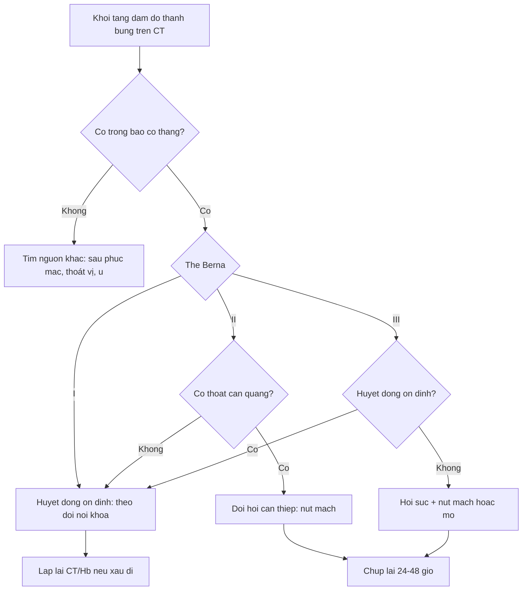
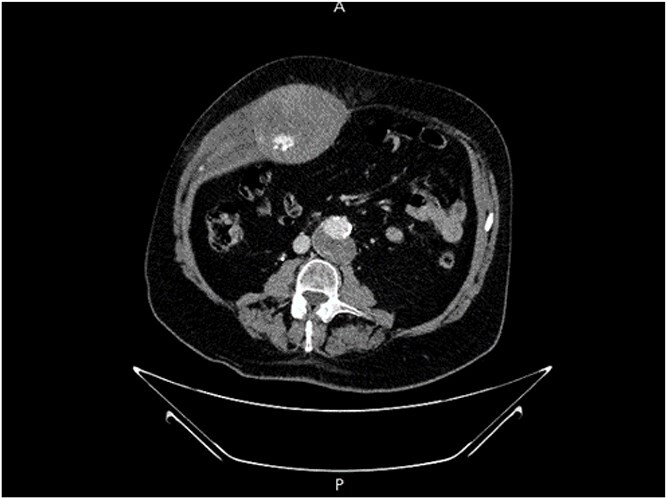
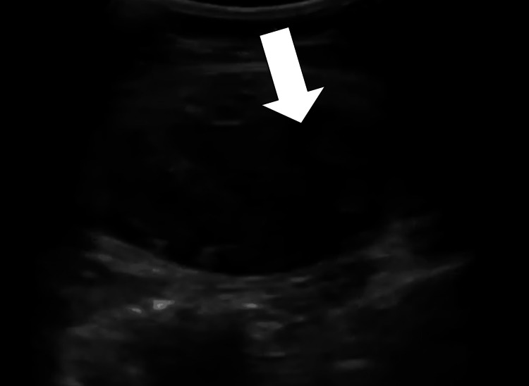
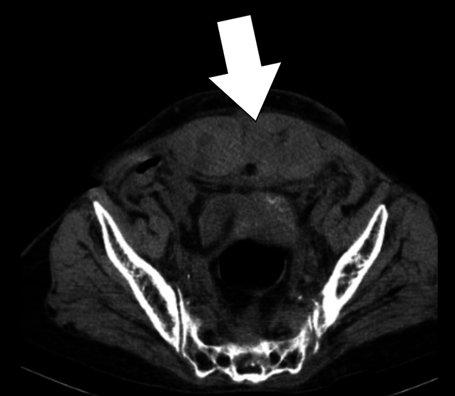

# 1936 — Tụ máu bao cơ thẳng bụng / Rectus sheath hematoma (RSH)

**Tags:** `pattern:tu-mau-thanh-bung` `pattern:khoi-thanh-bung` `vung:thanh-bung` `vung:o-bung` `protocol:CT-bung-co-can-quang` `score:Berna` `incidentaloma:khong`

**Mức chắc chắn (certainty):** tổng hợp y văn (literature synthesis) — số liệu lấy từ **hai đoàn hệ hồi cứu** (59 ca, PMC13561060; 44 ca, PMC12885678), **một bài tổng quan kèm ca** (PMC12812700), và **ba ca nguyên văn có ảnh** (PMC13426710; PMC13286293 — 2 hình; PMC13544793). Không có thử nghiệm ngẫu nhiên; các ngưỡng điều trị là thực hành đồng thuận, chỗ suy luận được ghi rõ.

> **Câu chốt:** RSH là **"bụng cấp" giả** — khối máu trong bao cơ thẳng, **không ở trong ổ phúc mạc**. Ba con số quyết định: **(1)** CT đúng **95–100%**, siêu âm chỉ **75–95%** (PMC12812700); **(2)** trong đoàn hệ 59 ca, **27,1% phải can thiệp (nút mạch)**, **tử vong 90 ngày 22,0%**, và **thoát cản quang là yếu tố dự báo can thiệp mạnh nhất — OR 17,46** (PMC13561060); **(3)** **dưới đường cung (arcuate line) không có lá sau bao cơ** → máu chảy xuống **khoang trước bàng quang**, gây **cảm ứng phúc mạc** và dễ bị mổ nhầm vì "bụng cấp" (PMC12812700).

## 1. Tổng quan bệnh học – cơ chế hình ảnh (TẠI SAO)

### 1.1 Giải phẫu quyết định hình thái máu tụ

- Cơ thẳng bụng (rectus abdominis) nằm trong **bao cơ thẳng (rectus sheath)** do **cân chéo bụng** tách thành **lá trước và lá sau**. **Đường cung (arcuate line)** là mốc thấp nhất của **lá sau**: **trên đường cung** cơ được bọc cả trước và sau; **dưới đường cung** chỉ còn **lá trước + cân ngang (transversalis fascia)** — **không có lá sau**.
- Hệ mạch: **động mạch thượng vị trên (superior epigastric artery)** từ động mạch ngực trong đi xuống; **động mạch thượng vị dưới (inferior epigastric artery)** từ động mạch chậu ngoài đi lên; hai hệ **nối nhau trong cơ** quanh rốn. Vì vậy máu tụ thường do **rách nhánh mạch** (ho, tiêm dưới da, chấn thương) hoặc **rách cơ**.
- **TẠI SAO dưới đường cung là bẫy:** không có lá sau giữ lại → máu **lan tự do xuống khoang trước bàng quang (space of Retzius)** và có thể **sang khoang sau phúc mạc**, không bị ép thành khối căng tại chỗ. Máu sát phúc mạc → **đau + phản ứng thành bụng**, bắt chước **viêm phúc mạc/áp-xe**. Trên CT, đây là lý do máu tụ **"chảy dài" theo thành bụng dưới**, không phải khối cầu.
- **Trên đường cung**, lá sau giam máu trong bao → khối **hình thoi/oval trong cơ**, căng đau nhưng **ít cảm ứng phúc mạc**.

### 1.2 Vật lý cản quang: đọc máu tụ theo HU

- Máu **cấp** đông lại: **50–80 HU**, có khi tới **85 HU** cho phần cục máu đông đặc; máu **lỏng** khoảng **45 HU** (PMC12812700). So với cơ thẳng bình thường **~40–50 HU** → máu cấp **tăng đậm độ nhẹ**, dễ bị bỏ qua nếu không so **hai bên**.
- **Thoát cản quang hoạt động (active extravasation):** ổ **≥ 90–130 HU**, gần bằng **độ đậm của động mạch kề bên**, **giữ nguyên hoặc lan rộng ở thì muộn** — khác **máu đông** (đậm độ giảm dần, không đổi hình). Đây là dấu **quyết định nút mạch**: trong 36 ca có CTA, thoát cản quang **OR 17,46** cho nhu cầu can thiệp (PMC13561060).
- **Thể tích máu tụ** cũng dự báo can thiệp (**OR 1,002 mỗi đơn vị thể tích**; bài gốc không ghi rõ đơn vị thể tích trong abstract) (PMC13561060).
- **MRI (khi cần):** hemoglobin thoái giáng theo thời gian — **T1 sáng/T2 tối** ở máu bán cấp sớm (methemoglobin nội bào), **T1 và T2 đều sáng** ở bán cấp muộn (methemoglobin ngoại bào); **vỏ hemosiderin T2 tối** ở thể mạn. MRI hữu ích khi **mang thai** (không bức xạ) và khi CT chưa phân biệt **máu – u** (PMC12812700).

### 1.3 Ai bị và vì sao

- **Yếu tố nguy cơ:** **chống đông/kháng kết tập tiểu cầu** (hay gặp nhất trong các ca có triệu chứng), **ho mạnh**, **gắng sức**, **thai kỳ**, **tiêm dưới da/thành bụng**, **tăng huyết áp**, **béo**, **mổ bụng cũ**, **chấn thương nhẹ** (PMC12812700; PMC13286293; PMC13426710).
- **Tuổi/giới trong đoàn hệ 59 ca:** trung vị **72 tuổi**, **77,9% nữ** (PMC13561060). Đoàn hệ 44 ca: tuổi trung bình **61,5 ± 15,3**, thể tích máu tụ trung bình **512,9 ± 462,7 mm³** (PMC12885678).
- **Thai kỳ:** RSH là nguyên nhân đau bụng cấp hiếm nhưng **dễ nhầm với nhau bong non, HELLP, vỡ tử cung**; một tổng quan ghi **tử vong mẹ 13%** và **bệnh suất chu sinh 50%** trong các ca RSH thai kỳ được báo cáo (PMC12812700 — số từ y văn tổng hợp, không phải tỷ lệ dân số).

## 2. Mẫu hình + chẩn đoán phân biệt theo vị trí (gamut)

- **Khối tăng đậm độ trong cơ thẳng, một bên, trên đường cung:** máu tụ thể **I**; phân biệt **u cơ/tổn thương cơ (desmoid, di căn)**, **áp-xe cơ**, **tụ máu do tiêm**, **endometrioma thành bụng** (tiền sử mổ lấy thai).
- **Máu tụ lan xuống khoang trước bàng quang, dưới đường cung:** thể **II/III**; phân biệt **thoát vị bẹn/đùi nghẹt**, **áp-xe vùng chậu**, **khối bàng quang**, **tụ máu sau phúc mạc**, **vỡ khung chậu**.
- **Khối thành bụng + bụng cấp + thiếu máu cấp:** nghĩ RSH **đang chảy máu** (thoát cản quang) — ưu tiên CTA và hội chẩn can thiệp; **không chọc dò mù**.
- **Bối cảnh thai kỳ:** phân biệt **RSH** với **nhau bong non**, **vỡ tử cung**, **HELLP**, **xoắn buồng trứng**, **viêm tụy** — siêu âm thành bụng + CT/MRI theo mức ưu tiên mẹ–thai.
- **Mnemonic vị trí – cơ chế "RECTUS":** **R**upture of epigastric vessel, **E**xtravasation (active), **C**ough/exertion, **T**rauma/injection, **U**nder arcuate line (lan rộng), **S**urgery/anticoagulation.

## 3. Bảng so sánh phân biệt (ma trận đối chiếu)

| Thực thể (entity) | Hình ảnh điển hình (US/CT) | Chốt vào (rule-in) | Chốt loại (rule-out) | Gợi ý xác nhận |
|---|---|---|---|---|
| **RSH thể I (Berna)** | Khối **oval/thoi trong cơ**, tăng đậm độ, **một bên**, không vượt cân ngang | **Trong bao cơ + không có lá sau bị đẩy** | Dịch **trong ổ phúc mạc** hoặc **túi thoát vị** → không phải RSH | US đối chiếu hai bên; CT không cản quang đủ nếu ổn định |
| **RSH thể II** | Máu **giữa cơ và cân ngang**, có thể **một/hai bên**, **chưa vào khoang trước bàng quang** | **Máu chạm cân ngang nhưng chưa xuống bàng quang** | Máu **trong khoang trước bàng quang** → thể III | CT có cản quang, thì muộn |
| **RSH thể III** | Máu **vượt cân ngang vào phúc mạc/khoang trước bàng quang**, khối lớn, đẩy bàng quang | **Máu xuống dưới đường cung + chèn ép bàng quang + tụt Hb** | Không có thành phần trong bao cơ → nghĩ **chảy máu sau phúc mạc/khung chậu** | CTA ± nút mạch; theo dõi huyết động |
| **Thoát vị bẹn/đùi nghẹt** | Quai ruột/mỡ **đi qua lỗ thoát vị**, có **cổ túi** | **Cổ túi + quai ruột + dấu tắc ruột** | Khối **trong cơ thẳng**, không có cổ túi | US Valsalva; CT thì muộn |
| **Áp-xe thành bụng** | Ổ dịch **vỏ ngấm thuốc**, **khí trong mô mềm**, sốt | **Khí + vỏ ngấm thuốc + sốt** | **Máu tụ không có khí**, đậm độ đồng nhất theo tuổi máu | Chọc hút dưới hướng dẫn; cấy |
| **U mô mềm/di căn thành bụng** | Khối **đặc ngấm thuốc không đều**, có thành phần hoại tử | **Ngấm thuốc tiến triển + bờ không đều + tiền sử u** | **Không ngấm thuốc như mô đặc**, có **mức cặn – huyết thanh** | MRI T1/T2 + sinh thiết nếu nghi |
| **Tụ máu sau phúc mạc** | Máu **quanh cơ thắt lưng – chậu**, **dưới cân** | **Lan theo khoang sau phúc mạc**, không trong bao cơ | Thành phần **trong bao cơ thẳng** → RSH | CTA; tìm nguồn (ĐM chậu, thắt lưng) |

### Dấu hiệu lâm sàng – hình ảnh phối hợp

- **Nghiệm pháp Fothergill:** khối **vẫn sờ thấy và cố định** khi bệnh nhân **gồng cơ bụng/ngẩng đầu** → tổn thương **thành bụng**, không phải trong ổ phúc mạc.
- **Nghiệm pháp Carnett:** đau **tăng khi gồng cơ bụng** → nguồn đau ở **thành bụng**.
- **Cullen sign** (bầm quanh rốn) **hiếm** — xuất hiện muộn, **không dùng để loại trừ**.
- **US:** ổ **echo hỗn hợp, không đồng nhất**, trong cơ thẳng; máu cấp có thể **gần như đồng âm với cơ** → luôn so **bên đối diện** và ấn đầu dò (máu tụ **không đổi hình theo nhịp thở** như quai ruột).

## 4. Protocol chụp + hệ phân độ Berna

### 4.1 Protocol

- **Siêu âm thành bụng** (đầu tay, có thai): đầu dò thẳng tần số cao, quét **dọc và ngang cả hai cơ thẳng** từ bờ sườn đến xương mu; đánh dấu vị trí so với **rốn/đường cung**; bật **Doppler màu** tìm ổ phổ bất thường (không thay thế CTA).
- **CT bụng–chậu có cản quang**, **lát ≤ 3 mm**, **ba thì khi nghi chảy máu**: **không cản quang → động mạch (25–35 s) → tĩnh mạch/muộn (70–90 s)**. Thì **không cản quang** giúp phân biệt máu cấp với **mô đặc/khối u**; thì **muộn** xác nhận **thoát cản quang hoạt động** và **dấu "blush" lan rộng**.
- **CTA (nếu nghi thoát mạch)** theo cùng protocol; ghi rõ **vị trí ổ thoát** (thượng vị trên/dưới, nhánh cơ) để can thiệp chọn mạch.
- **Đo và báo cáo:** **thể tích (mL/cm³)**, **kích thước 3 chiều**, **thể Berna**, **có/không thoát cản quang**, **có vào khoang trước bàng quang**, **chèn ép bàng quang**, **mức độ đẩy phúc mạc**.
- **MRI** khi **có thai** hoặc cần phân biệt **máu – u**: T1 ± fat-sat, T2, DWI; không dùng gadolinium thường quy trong thai.

### 4.2 Phân độ Berna (1996) + ngưỡng xử trí

- **Berna I:** máu **trong cơ**, cơ to, **oval/thoi**, **một bên**, **không bóc tách cân** → hầu hết **ổn định**, điều trị nội khoa.
- **Berna II:** máu **giữa cơ và cân ngang**, **một hoặc hai bên**, **chưa vào khoang trước bàng quang** → theo dõi sát; **nút mạch nếu thoát cản quang/tụt Hb**.
- **Berna III:** máu **vượt cân ngang vào phúc mạc hoặc khoang trước bàng quang** → **nguy cơ tụt huyết áp**, cần hồi sức, **nút mạch là lựa chọn đầu tay** ở người không mang thai; **mổ** khi không kiểm soát được hoặc có biến chứng (PMC12812700; PMC13544793).
- **Ngưỡng thực hành (từ đoàn hệ 59 ca):** can thiệp **27,1%**, tử vong 90 ngày **22,0%**; **tuổi** (OR 1,088 mỗi năm) và **mức giảm Hb** (OR 1,086 mỗi g/L) dự báo tử vong (PMC13561060). Chỉ số bệnh nền **CCI ≥ 6** dự báo tử vong tốt hơn kích thước máu tụ (AUC 0,732; OR 1,46 mỗi điểm) (PMC12885678).
- **Xử trí nội khoa:** **ngừng/bắc cầu kháng đông**, **đảo ngược kháng đông** khi cần, **bù dịch – máu**, **giảm đau**, **thắt lưng bụng (binder)** khi dung nạp; theo dõi **Hb/Hct, Lactate, huyết áp, nước tiểu**.
- **Can thiệp:** **nút mạch chọn lọc ĐM thượng vị** (keo/coil) khi **thoát cản quang** hoặc **Hb tiếp tục giảm**; **mổ** khi **shock, máu tụ căng nhanh, thất bại nút mạch** (PMC13544793).

## 5. Biến thể bình thường và cạm bẫy

- **Cơ thẳng không đối xứng** (do tập luyện, mổ cũ, teo) → **so sánh đậm độ** chứ không chỉ so kích thước; đừng gọi "khối" khi chỉ là **bó cơ lớn hơn**.
- **Máu tụ cấp gần đồng âm trên US** → dễ bỏ sót; luôn **so bên đối diện**, ấn đầu dò, và **Doppler**; nếu nghi, chuyển CT.
- **Dưới đường cung = "bụng cấp" giả:** đau + phản ứng thành bụng + tụt Hb nhưng **ổ phúc mạc trống**; **đừng mổ thăm dò** khi chưa loại RSH — CT là chốt.
- **Chọc dò/dẫn lưu mù khối thành bụng** có thể **làm bùng phát chảy máu** (đặc biệt khi đang thoát cản quang) → chỉ chọc khi đã loại máu tụ đang chảy hoặc có hướng dẫn hình ảnh và hội chẩn.
- **"Đuôi mèo" (cat's tail):** một số mô tả dùng cho máu tụ **thuôn nhọn theo ĐM thượng vị dưới**; hiện **chưa tìm thấy trong y văn open-access kiểm chứng** — dùng như mô tả hình thái, **không phải tiêu chuẩn chẩn đoán**.
- **Satisfaction of search:** thấy máu tụ **không được dừng** — tìm **ổ thoát cản quang**, **máu sau phúc mạc**, **vỡ khung chậu**, **thuốc chống đông** và **nguyên nhân ho/gắng sức**.
- **Thai kỳ:** RSH có thể **tự giới hạn**, nhưng **tụt Hb nhanh** là chỉ định can thiệp; tránh **chụp CT không cần thiết**, ưu tiên **US/MRI**, và **không dùng ergometrine** (co mạch) khi nghi bóc tách/co thắt mạch.

## 6. Tự lượng giá — Blind Quiz

**Ca 1 — Nam 68 tuổi, ho kéo dài, đau hông phải, Hb giảm 2 g/dL.**

- Gợi ý: khối **trong thành bụng**, không thấy trong ổ phúc mạc; bệnh nhân không chấn thương.
- Câu hỏi: Khối nằm ở khoang nào? Có dấu hiệu gì cho biết **đang chảy máu**? Hai việc cần làm tiếp theo?

<b>Bấm để hiện đáp án (findings + chẩn đoán)</b>

- **Findings:** khối lớn **tăng đậm độ trong bao cơ thẳng phải**, có **ổ đậm độ cao bên trong (blush)** tương đương động mạch → **thoát cản quang hoạt động** từ **ĐM thượng vị trên**; không có máu tự do trong ổ phúc mạc.
- **Chẩn đoán:** **RSH lớn, đang chảy máu** (có **thoát cản quang hoạt động** từ **ĐM thượng vị trên**) — cần phân độ **Berna** đầy đủ để quyết định nút mạch hay theo dõi. Cơ chế: rách nhánh **ĐM thượng vị trên** sau ho; hoạt động cản quang **giữ nguyên/lan ở thì muộn** = máu còn chảy, không phải cục đông.
- **Xử trí:** hồi sức + **đảo ngược kháng đông nếu có**, **CTA thì muộn để bản đồ mạch**, **nút mạch chọn lọc** (keo/coil); mổ nếu không ổn định. Đoàn hệ 59 ca: thoát cản quang **OR 17,46** cho nhu cầu can thiệp.
- Nguồn: J Surg Case Rep 2026, **PMC13426710**, CC BY 4.0.

**Ca 2 — Nữ 64 tuổi, warfarin, INR cao, đau bụng dưới + khối sờ thấy; siêu âm thành bụng.**

- Câu hỏi: Mô tả khối? Vì sao **không** gọi là "khối u phần mềm"? Bước tiếp theo để phân độ?

<b>Bấm để hiện đáp án</b>

- **Findings:** ổ **echo hỗn hợp, không đồng nhất**, trong **cơ thẳng bụng trái**, không có tưới máu trong lòng; không thấy dịch tự do ổ bụng.
- **Chẩn đoán:** **RSH** — bối cảnh **chống đông vượt mức** + khối thành bụng; **không phải u** vì không có thành phần mô đặc ngấm thuốc và **thay đổi theo thời gian/điều trị**.
- **Tiếp theo:** **CT có cản quang 3 thì** để phân **Berna I–III**, tìm **thoát cản quang**, đo thể tích và đánh giá **khoang trước bàng quang**; theo dõi **Hb** và **huyết động**.
- Nguồn: Cureus 2026, **PMC13286293**, CC BY 4.0.

**Ca 3 — Cùng bệnh nhân Ca 2, CT cho thấy máu xuống dưới đường cung.**

- Câu hỏi: Đây là thể mấy? Vì sao bệnh nhân có **phản ứng thành bụng** dù không viêm phúc mạc? Khi nào chuyển nút mạch?

<b>Bấm để hiện đáp án</b>

- **Findings:** máu tụ lớn **trong cơ thẳng trái**, lan **xuống khoang trước bàng quang**, đẩy bàng quang ra sau; **không có khí**, **không có thoát cản quang** trong thì này.
- **Chẩn đoán:** **RSH thể III** (vượt cân ngang vào khoang trước bàng quang). **Phản ứng thành bụng** do máu **sát phúc mạc** dưới đường cung — nơi **không có lá sau** giữ máu, chứ không phải viêm phúc mạc thật.
- **Ngưỡng can thiệp:** **thoát cản quang**, **Hb tiếp tục giảm**, **huyết động không ổn** → **nút mạch**; nếu ổn định, điều trị nội khoa + theo dõi sát (ca này hồi phục với điều trị nội khoa).
- Nguồn: Cureus 2026, **PMC13286293**, CC BY 4.0.

## Bài liên quan chéo
- [110 – Giải phẫu bụng cắt lớp: khoang sau phúc mạc & thành bụng](../110-giai-phau-bung/lesson.md)
- [160 – Bụng cấp hố chậu & tắc ruột](../160-bung-cap-GI/lesson.md)
- [3061 – Nốt thành bụng mới sau mổ: áp-xe hay di căn lỗ trocar](../3061-di-can-lo-trocar-sau-pipac-va-noi-soi/lesson.md)
- [1449 – Tiêm nội nhãn ở bệnh nhân dùng thuốc chống đông (nguyên tắc ngừng thuốc)](../1449-tiem-noi-nhan-o-benh-nhan-dung-thuoc-chong-dong/lesson.md)

## Ảnh
- Tên file: `1936_tu-mau_{Modality}_{PMCID}.jpg`. Nguồn + giấy phép từng ảnh: `images/CREDITS.md`.
- Không dùng ảnh CC BY-NC-ND cho ảnh ghép; các ảnh trong bài là **nguyên bản**.

> Không dùng để chẩn đoán độc lập khi chưa có người hướng dẫn.
