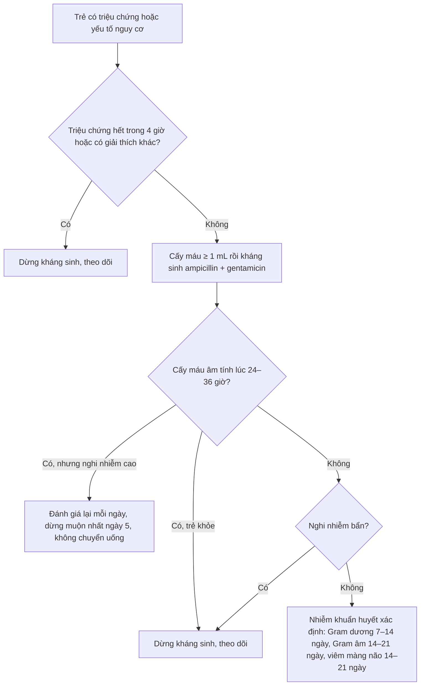
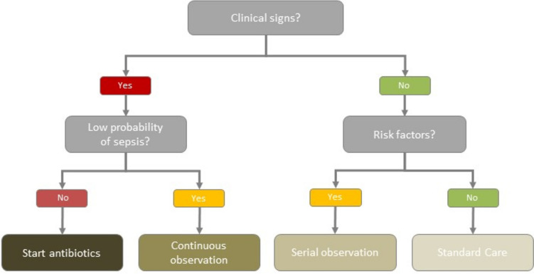
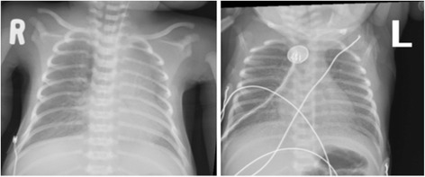
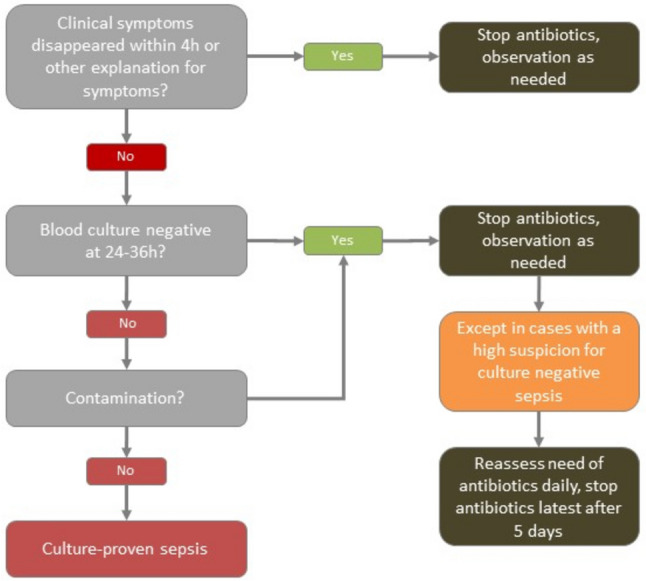

# 1937 — Nhiễm khuẩn huyết sơ sinh khởi phát sớm ở trẻ có mẹ viêm màng ối: dùng kháng sinh bao lâu, dừng dựa vào gì / Early-onset neonatal sepsis in the infant of a mother with chorioamnionitis: how long, and on what evidence to stop

**Tags:** `pattern:viem` `pattern:nhiem-khuan-huyet` `pattern:dong-dac` `pattern:hat-kinh-mo` `vung:phoi` `vung:so-sinh` `protocol:X-quang-nguc` `protocol:cay-mau` `score:EOS-calculator`
**Mức chắc chắn (certainty):** tổng hợp y văn (literature synthesis) — ghép **hướng dẫn Thụy Sĩ 2024** (PMC11527939: thuật toán "không triệu chứng thì không kháng sinh", thời hạn 24–36 giờ, 5 ngày, 7–14 và 14–21 ngày), **đoàn hệ 13 mạng lưới 2014–2018** (PMC9685486: 757.979 trẻ, 2,86% nhận kháng sinh, EOS 0,49/1.000), **phân tích gộp toàn cầu** (PMC8311109: 2.824/100.000 trẻ sinh sống, 17,6% tử vong), và **đoàn hệ cực non tháng** (PMC6531328: kháng sinh sớm kéo dài ở 5.730 trẻ 401–1.000 g). Số nào nguồn không nêu ghi "chưa rõ".

> **Câu chốt:** với trẻ **có mẹ viêm màng ối nhưng trẻ KHÔNG có dấu hiệu bệnh**, câu trả lời hiện đại không phải "7 ngày kháng sinh" mà là **theo dõi sát 48 giờ, cấy máu ≥ 1 mL trước khi dùng thuốc, và dừng ở 24–36 giờ nếu cấy âm + trẻ khỏe**. Ba con số quyết định: cứ **1 ca EOS được xác định thì có 58 trẻ được dùng kháng sinh** và **273 ngày kháng sinh** tiêu tốn (PMC9685486); **90% trẻ EOS có triệu chứng trong 48 giờ đầu** (PMC11527939) — nên "chờ xem" chỉ an toàn khi có **khám lại liên tục**, không phải "cho thuốc rồi quên".

## 1. Tổng quan bệnh học – cơ chế hình ảnh

### 1.1 Vì sao EOS xảy ra trong 48–72 giờ đầu và vì sao mẹ viêm màng ối là chìa khóa (TẠI SAO)

- **Đường lây là tại sinh (vertical):** vi khuẩn từ âm đạo – cổ tử cung đi lên qua **màng ối** hoặc nhiễm dịch ối khi vỡ ối, rồi vào **phổi – máu – màng não** của thai. Vì vậy EOS **không phải bệnh "mắc phải" sau sinh** mà là bệnh **đã khởi phát trước/sát sinh**, biểu hiện trong **48–72 giờ đầu**.
- **Hai tác nhân chi phối:** **Streptococcus nhóm B (GBS)** và **E. coli** — GBS gây viêm phổi – nhiễm khuẩn huyết – viêm màng não; E. coli trội hơn ở trẻ non tháng và thường kháng ampicillin.
- **Vì sao viêm màng ối làm tăng nguy cơ:** viêm màng ối tạo **ổ vi khuẩn nồng độ cao ngay sát thai**, làm **vỡ ối kéo dài** và **sinh non** — ba yếu tố cộng gộp. Nguy cơ tương đối của EOS ở trẻ có mẹ viêm màng ối **≈ 5 lần** (bài 1926), nhưng vì EOS nền chỉ **0,49/1.000** (PMC9685486) nên **nguy cơ tuyệt đối vẫn thấp** — đây là lý do "quan sát" trở thành lựa chọn hợp lý ở trẻ đủ tháng khỏe mạnh.
- **Vì sao kháng sinh kéo dài có hại:** kháng sinh đầu đời phá **hệ vi khuẩn chí (microbiome)** đang định hình, liên quan tới **hen, béo phì, đái tháo đường type 1, bệnh viêm ruột** về sau; đồng thời làm tăng **chọn lọc đề kháng** và **tách mẹ – con**. Ở 13 mạng lưới, mỗi ca EOS "đi kèm" 58 trẻ được điều trị và 273 ngày kháng sinh (PMC9685486).

### 1.2 Vì sao hình ảnh trông như vậy (vật lý từng phương thức)

- **X-quang ngực sơ sinh:** phổi sơ sinh còn **dịch trong phế nang và mô kẽ** ngay sau sinh. Dịch này hấp thụ tia X → **mờ**; khi dịch rút đi trong **24–72 giờ** phổi trở nên sáng. Vì vậy:
  - **RDS (bệnh màng trong):** thiếu surfactant → phế nang xẹp **thể tích phổi thấp (< 7 cung sườn)**, mờ **hạt mịn đối xứng** (ground-glass), **air bronchogram** nổi bật vì phế quản chứa khí nằm trong nhu mô mờ.
  - **Viêm phổi do GBS/EOS:** **dịch viêm giàu protein + bất hoạt surfactant** cũng gây xẹp và mờ hạt mịn → **bắt chước RDS hoàn hảo**, khác biệt duy nhất trên phim là **bối cảnh** (đủ tháng/già tháng, mẹ sốt, ối hôi) chứ không phải hình thái.
  - **TTN (thở nhanh thoáng qua):** dịch còn trong **khe liên thùy và màng phổi** → **đường mạch nổi, dịch rãnh, thể tích phổi bình thường hoặc hơi tăng**, tự hết trong **48–72 giờ**.
  - **MAS (hít phân su):** đám mờ **thô, không đều**, ứ khí, dễ **tràn khí màng phổi** ở trẻ già tháng.
- **Vì sao X-quang có thể bình thường trong EOS:** tổn thương phổi là **vi mô** ở giai đoạn đầu; phim chụp sớm chỉ thấy **thay đổi mờ nhẹ hoặc không thấy gì**. Vì vậy **X-quang bình thường KHÔNG loại trừ nhiễm khuẩn huyết** — đây là cạm bẫy hay gặp.
- **Vì sao CRP đến muộn:** IL-6 tăng **0–6 giờ** (đỉnh ~2 giờ), CRP do gan tổng hợp nên tăng **6–12 giờ**, đỉnh **24–48 giờ**, về bình thường **48–72 giờ**. Một CRP lúc 6 giờ có **độ nhạy thấp**; giá trị nằm ở **hai lần âm tính liên tiếp 24–36 giờ** để **dừng kháng sinh** (PMC11527939).
- **Vì sao procalcitonin (PCT) khó dùng:** PCT **tăng sinh lý sau sinh**, đỉnh **24–48 giờ** (trẻ non tháng đỉnh cao hơn và kéo dài hơn), nên **một giá trị đơn lẻ không phân biệt được nhiễm với "sinh lý"**; chỉ **chuỗi PCT 48–72 giờ** mới có ý nghĩa.

### 1.3 Ngưỡng định lượng nằm lòng

| Đại lượng | Ngưỡng / con số | Ý nghĩa | Nguồn |
|---|---|---|---|
| EOS ở trẻ ≥ 34 tuần (13 mạng lưới) | **0,49/1.000** trẻ sinh sống (khoảng 0,18–1,45) | Nguy cơ nền rất thấp | PMC9685486 |
| Tử vong do EOS | **3,20%** (12/375) | Không phải bệnh lành tính | PMC9685486 |
| Tỉ lệ trẻ được dùng kháng sinh tuần đầu | **2,86%** (21.703/757.979), 1,18–12,45% giữa các mạng | Dùng thuốc nhiều hơn bệnh **58 lần** | PMC9685486 |
| Số trẻ điều trị cho mỗi ca EOS | **58 trẻ**; **273 ngày kháng sinh/ca** | Thước đo lạm dụng | PMC9685486 |
| Thời gian kháng sinh khi **không** có EOS | **trung vị 4 ngày (3–6)** | Thực hành, không phải khuyến cáo | PMC9685486 |
| Thời gian kháng sinh khi **có** EOS | **trung vị 9 ngày (7–14)** | Tương ứng 7–14 ngày Gram dương | PMC9685486 |
| Triệu chứng khởi phát | **> 90%** trong **48 giờ đầu** | Cơ sở của "theo dõi 48 giờ" | PMC11527939 |
| EOS toàn cầu (mọi cân nặng) | **2.824/100.000** trẻ sinh sống; **17,6%** tử vong | Gánh nặng ở nước thu nhập thấp | PMC8311109 |
| EOS thập niên 2009–2018 (LMIC) | **3.930/100.000** | Xu hướng tăng | PMC8311109 |
| Cấy máu tối thiểu | **≥ 1 mL** (tốt nhất 1–2 mL) trước kháng sinh | Dưới 1 mL → âm tính giả | PMC11527939 |
| Tỉ lệ I/T (immature/total neutrophil) | **≥ 0,2** là bất thường | Bạch cầu non chưa trưởng thành | PMC9685486 |
| CRP dùng để **dừng** thuốc | **2 lần âm tính liên tiếp trong 24–36 giờ** | Giá trị nằm ở chuỗi, không ở một lần | PMC11527939 |
| Viêm màng ối (Triple I) | sốt **≥ 39,0 °C một lần** hoặc **38,0–38,9 °C đo lại sau 30 phút** | Ngưỡng "documented fever" | bài 1926 |
| Thời gian kháng sinh Gram dương / Gram âm | **7–14 ngày** / **14–21 ngày** | Tính theo vi khuẩn và ổ nhiễm | PMC11527939 |
| "Nhiễm khuẩn huyết cấy âm" | Dừng **muộn nhất 5 ngày**, **không chuyển uống** | Tránh kéo dài mơ hồ | PMC11527939 |

## 2. Mẫu hình + chẩn đoán phân biệt theo vị trí (gamut)

**Mẫu hình chính:** *trẻ sơ sinh thở nhanh/rên/rút lõm + yếu tố nguy cơ mẹ (sốt, ối vỡ > 18 giờ, GBS dương, sinh non)* → nghĩ **EOS**. Gamut dưới đây xếp theo **hình thái phổi trên X-quang**, vì đó là thứ bác sĩ CĐHA phải trả lời.

- **Mờ hạt mịn đối xứng + thể tích thấp:** **RDS** (non tháng), **viêm phổi do GBS/EOS** (đủ tháng, mẹ viêm màng ối), **viêm phổi bẩm sinh khác** (Listeria, E. coli).
- **Thể tích bình thường/tăng + dịch rãnh + đường mạch nổi:** **TTN** (thường sau mổ lấy thai chủ động, hết trong 48–72 giờ).
- **Đám mờ thô không đều + ứ khí ± tràn khí:** **MAS** (già tháng, ối phân su).
- **Mờ một bên + mất thể tích (khe/trung thất lệch):** **xẹp phổi** do nút nhầy, ống nội khí quản sai vị trí, dị vật hiếm.
- **Phổi "sạch" nhưng trẻ sốc/toan:** **nhiễm khuẩn huyết không có ổ phổi**, bệnh chuyển hóa, tim bẩm sinh ống động mạch phụ thuộc.
- **Tim to + tuần hoàn phổi tăng:** **tim bẩm sinh**; **PPHN** khi áp lực phổi cao (bài 607).
- **Bụng:** **viêm ruột hoại tử (NEC)** khi có **khí trong thành ruột (pneumatosis)**, khí tĩnh mạch cửa — không được quy hết cho "sepsis".
- **Ngoài phổi:** tràn khí màng phổi, tràn dịch màng phổi, đặt catheter rốn sai vị trí — **nguyên nhân "giả sepsis" hoặc biến chứng của thở máy**.

## 3. Bảng so sánh phân biệt (ma trận đối chiếu)

| Thực thể (entity) | Hình ảnh điển hình | Chốt vào (rule-in) | Chốt loại (rule-out) | Gợi ý xác nhận |
|---|---|---|---|---|
| **EOS / viêm phổi do GBS** | Mờ hạt mịn, thể tích **thấp**, air bronchogram; có thể khu trú hoặc bình thường | **Mẹ sốt/viêm màng ối + trẻ bệnh trong 48 giờ + cấy máu dương** hoặc **mờ hạt mịn ở trẻ đủ tháng** | Phổi sạch + trẻ khỏe + cấy âm 24–36 giờ + CRP âm → không viêm phổi | Cấy máu ≥ 1 mL; CRP 0 và 24–36 giờ; X-quang lặp khi xấu đi |
| **RDS** | Mờ hạt mịn **đối xứng**, thể tích **< 7 cung sườn**, air bronchogram | **Non tháng + suy hô hấp ngay sau sinh + đáp ứng surfactant** | Đủ tháng, mẹ sốt, CRP tăng → không phải RDS đơn thuần | Tuổi thai + đáp ứng surfactant; cấy máu để loại EOS |
| **TTN** | **Dịch khe liên thùy**, đường mạch nổi, thể tích bình thường/tăng | **Sinh mổ chủ động + thở nhanh + hết trong 48–72 giờ** | Xấu đi sau 72 giờ, sốt, CRP tăng → không phải TTN | Theo dõi 48–72 giờ; X-quang lặp nếu không cải thiện |
| **MAS** | Đám mờ **thô, không đều**, ứ khí, tràn khí | **Già tháng + ối phân su + bẩn da/móng** | Phổi hạt mịn đối xứng, non tháng → không phải MAS | Lâm sàng + X-quang; hút khí quản |
| **PPHN** | Phổi sạch hoặc giảm tưới máu; tim to | **Tăng áp phổi, shunt phải–trái, chênh SpO₂ trước–sau ống động mạch** | Phổi mờ hạt mịn + CRP tăng → nghĩ nhiễm trước | Siêu âm tim (bài 607) |
| **Tim bẩm sinh ống động mạch phụ thuộc** | Tim to, tuần hoàn phổi tăng/giảm | **Suy tuần hoàn khi ống động mạch đóng + siêu âm tim bất thường** | Phổi mờ + cấy dương → nhiễm | Siêu âm tim trước khi kết luận sepsis |
| **NEC** | **Pneumatosis**, khí tĩnh mạch cửa, thành ruột dày | **Bụng chướng + máu trong phân + khí trong thành ruột** | Bụng mềm, phim bụng bình thường → loại | X-quang bụng; siêu âm bụng |

## 4. Protocol chụp + hệ phân độ/điểm chuẩn hóa

**Chụp X-quang ngực (ngực thẳng, trẻ nằm):**
- Chỉ định: **suy hô hấp, nghi viêm phổi, kiểm tra ống nội khí quản/catheter rốn, nghi tràn khí**.
- **Không chụp lặp thường quy** khi trẻ ổn định; lặp khi **xấu đi, đổi thông khí, sau đặt ống**.
- Đọc theo thứ tự: **thể tích phổi (đếm cung sườn) → mẫu hình mờ (hạt mịn/thô/khu trú) → khe và màng phổi → ống và catheter → bóng khí**.

**Xét nghiệm trước và trong khi dùng kháng sinh:**

| Bước | Việc làm | Ngưỡng / ghi chú |
|---|---|---|
| 1 | **Cấy máu ≥ 1 mL** (1–2 mL) vào **một** chai hiếu khí, **trước** liều kháng sinh đầu | Dưới 1 mL làm giảm độ nhạy rõ rệt |
| 2 | Công thức máu + **I/T** lúc 6–12 giờ | I/T **≥ 0,2**; bạch cầu giảm là dấu hiệu nặng |
| 3 | **CRP lúc 0 và 24–36 giờ** | Hai lần âm tính là căn cứ **dừng** thuốc |
| 4 | **PCT** nếu có, lúc 0 và 48–72 giờ | Không dùng một giá trị đơn lẻ |
| 5 | **Chọc dò tủy sống** | Chỉ khi **cấy máu dương, trẻ nặng, co giật/rối loạn ý thức**; không thường quy |
| 6 | X-quang ngực | Không bắt buộc nếu không có dấu hô hấp |

**Thuật toán thời gian kháng sinh (theo hướng dẫn Thụy Sĩ 2024, PMC11527939):**

*Hình 1 — Cây quyết định: có triệu chứng thì phân tầng "xác suất thấp" (cho theo dõi liên tục) hay khởi trị; không triệu chứng thì dựa vào yếu tố nguy cơ để chọn theo dõi cách quãng hay chăm sóc thường quy. Nguồn: PMC11527939 Fig. 1, **CC BY 4.0**.*

**Ghi chú về "máy tính EOS" (EOS calculator):** công cụ dựa trên xác suất (tuổi thai, thời gian vỡ ối, GBS, sốt mẹ, mức độ bệnh) giúp **giảm tỉ lệ dùng kháng sinh** mà không tăng thất bại điều trị trong nhiều đoàn hệ. Tuy vậy **hướng dẫn Thụy Sĩ 2024 không khuyến cáo dùng** vì lợi ích chưa rõ ở nơi tỉ lệ dùng kháng sinh nền đã **dưới 3%**, và vì **âm tính giả** ở trẻ có viêm màng ối nặng (PMC11527939). Kết luận thực dụng: **công cụ hỗ trợ, không thay khám lâm sàng lặp lại**.

## 5. Biến thể bình thường và cạm bẫy

- **Dịch khe liên thùy nhỏ ở trẻ sinh mổ:** bình thường, tự hết; **không** gọi là viêm phổi chỉ vì có đường mờ mảnh ở rãnh.
- **"Phổi trắng" do kỹ thuật:** phim chụp thì thở ra mạnh hoặc tia yếu làm phổi mờ giả; **so sánh thể tích và bờ cơ hoành** trước khi kết luận.
- **Cạm bẫy 1 — trẻ đủ tháng mờ hạt mịn bị gọi là RDS:** RDS ở đủ tháng là **ngoại lệ**; mờ hạt mịn + mẹ sốt/ối vỡ lâu phải nghĩ **viêm phổi GBS/EOS** và **cấy máu trước kháng sinh**.
- **Cạm bẫy 2 — "cấy âm là không nhiễm":** cấy âm có thể do **lấy < 1 mL**, **kháng sinh mẹ truyền qua nhau**, hoặc vi khuẩn mọc chậm; ở trẻ nặng, **cấy âm không cho phép dừng thuốc ngay** (PMC11527939).
- **Cạm bẫy 3 — một CRP bình thường lúc 6 giờ:** CRP chưa tăng; phải **lặp 24–36 giờ**.
- **Cạm bẫy 4 — PCT cao đơn thuần:** PCT tăng sinh lý sau sinh; **không** chẩn đoán "nhiễm khuẩn huyết cấy âm" chỉ vì PCT cao.
- **Cạm bẫy 5 — điều trị 7 ngày "cho chắc":** ở trẻ khỏe, cấy âm, **24–36 giờ là đủ để dừng**; kéo dài làm tăng đề kháng và rối loạn vi khuẩn chí, trong khi **không** giảm tử vong (PMC6531328 cho thấy kháng sinh sớm kéo dài **không** gắn với tăng tử vong/NEC, tức là lợi ích cũng không chứng minh được).
- **Cạm bẫy 6 — bỏ sót ổ ngoài phổi:** trẻ "nhiễm khuẩn huyết" không đáp ứng phải tìm **NEC, viêm màng não, áp-xe, catheter nhiễm**; và **đừng quên siêu âm tim** khi nghi tim bẩm sinh.

## 6. Tự lượng giá — Blind Quiz ngay trên trang tĩnh (không cần app)

**Ca 1 — trẻ 39 tuần, mẹ sốt 39,2 °C trong chuyển dạ, trẻ thở nhanh 80 lần/phút, rên nhẹ**

- Gợi ý lâm sàng: ối vỡ 14 giờ, mẹ được dùng ampicillin 2 liều trước sinh; trẻ không sốt, SpO₂ 92% khí trời.
- Câu hỏi: (1) Trẻ thuộc nhánh nào của thuật toán? (2) Có bắt buộc chọc dò tủy sống không? (3) Nếu cấy máu âm lúc 30 giờ và trẻ khỏe, làm gì?

<b>Bấm để hiện đáp án (findings + chẩn đoán)</b>

- Dấu hiệu: trẻ **có triệu chứng** → nhánh có triệu chứng; nguy cơ cao vì **mẹ sốt + ối vỡ 14 giờ**. Phim cho thấy **mờ quanh rốn phổi và đám mờ rải rác hai bên**, thể tích phổi không giảm rõ — ở trẻ **đủ tháng** phải nghĩ **viêm phổi do GBS/EOS**, không mặc định là RDS.
- Chẩn đoán: **EOS nghi ngờ** — cấy máu **≥ 1 mL trước** liều kháng sinh, khởi trị **ampicillin + gentamicin**. **Không chọc dò tủy sống thường quy** khi trẻ không có dấu thần kinh và chưa có cấy dương.
- Xử trí: cấy âm + trẻ khỏe + CRP âm 24–36 giờ → **dừng kháng sinh**, tiếp tục theo dõi; nếu nghi nhiễm cao → **dừng muộn nhất ngày 5**, không chuyển uống.
- Nguồn ảnh: PMC5469193 Fig. 1, CC BY 4.0 (nhãn R/L do tác giả đặt).

**Ca 2 — trẻ 32 tuần, sinh thường, mẹ không sốt, trẻ rên và rút lõm từ giờ đầu**

- Gợi ý lâm sàng: cân nặng 1.750 g, không thở máy, CRP 8 mg/L lúc 12 giờ.
- Câu hỏi: (1) Vì sao **không** được dừng kháng sinh chỉ vì CRP 8 mg/L? (2) Nếu cấy âm 36 giờ và trẻ vẫn rên, quyết định thế nào?

<b>Bấm để hiện đáp án (findings + chẩn đoán)</b>

- Dấu hiệu: sơ đồ hình 2 cho thấy **triệu chứng hết trong 4 giờ** hoặc **cấy âm 24–36 giờ + không nghi nhiễm bẩn** là điều kiện dừng; CRP chỉ **hỗ trợ**.
- Chẩn đoán: **nghi EOS** ở trẻ non tháng — tiếp tục kháng sinh khi còn triệu chứng; đánh giá lại mỗi ngày và **dừng muộn nhất ngày 5** nếu không tìm được ổ và cấy âm.
- Vì sao: CRP 8 mg/L có thể **chưa lên đỉnh** hoặc đã **giảm**; quyết định dựa trên **diễn biến lâm sàng + cấy máu**, không dựa một xét nghiệm.
- Nguồn ảnh: PMC11527939 Fig. 2, CC BY 4.0.

**Ca 3 — bài toán lạm dụng kháng sinh**

- Gợi ý: một khoa sinh 5.000 ca/năm, dùng kháng sinh tuần đầu cho **8%** trẻ, EOS xác định **0,5/1.000**.
- Câu hỏi: (1) Ước tính số trẻ được điều trị cho mỗi ca EOS? (2) Nếu giảm tỉ lệ dùng xuống **3%**, số trẻ "tránh" được kháng sinh mỗi năm là bao nhiêu?

<b>Bấm để hiện đáp án (findings + chẩn đoán)</b>

- Tính toán: 5.000 × 8% = **400 trẻ** dùng kháng sinh; EOS = 5.000 × 0,5/1.000 = **2,5 ca** → **160 trẻ điều trị cho mỗi ca EOS** (cao hơn con số 58 của 13 mạng lưới).
- Nếu còn **3%**: 150 trẻ → **giảm 250 trẻ/năm** phơi nhiễm kháng sinh, tương đương **giảm khoảng 1.000 ngày kháng sinh** nếu mỗi đợt 4 ngày.
- Bài học: chỉ số cần báo cáo là **"số trẻ điều trị trên mỗi ca EOS"** và **ngày kháng sinh/1.000 trẻ sinh sống** (PMC9685486 dùng 135 ngày/1.000).
- Nguồn số liệu: PMC9685486, CC BY 4.0.

## Bài liên quan chéo
- [1926 – Viêm màng ối – nhiễm khuẩn ối: tiêu chuẩn Triple I, ngưỡng dịch ối, nguy cơ EOS ≈ 5 lần](../1926-viem-mang-oi-nhiem-khuan-oi/lesson.md)
- [610 – Suy hô hấp sơ sinh & dị dạng phổi](../610-suy-ho-hap-so-sinh-va-di-dang-phoi/lesson.md)
- [607 – Tăng áp phổi sơ sinh (PPHN)](../607-tang-ap-phoi-so-sinh-pphn/lesson.md)
- [605 – Siêu âm phổi điểm số ở sơ sinh](../605-sieu-am-phoi-diem-so-sinh/lesson.md)

## Ảnh
- `images/1937_eos-so-sinh_SODO-thuat-toan_PMC11527939-Fig1.jpg` — thuật toán khởi trị/theo dõi.
- `images/1937_eos-so-sinh_SODO-thoi-gian-khang-sinh_PMC11527939-Fig2.jpg` — thuật toán thời gian kháng sinh.
- Cả hai: PMC11527939, **CC BY 4.0**; chi tiết trong `images/CREDITS.md`.

> Không dùng để chẩn đoán độc lập khi chưa có người hướng dẫn.
