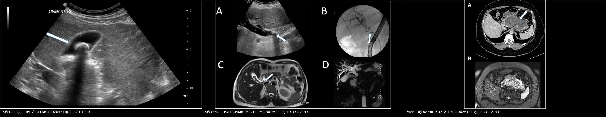
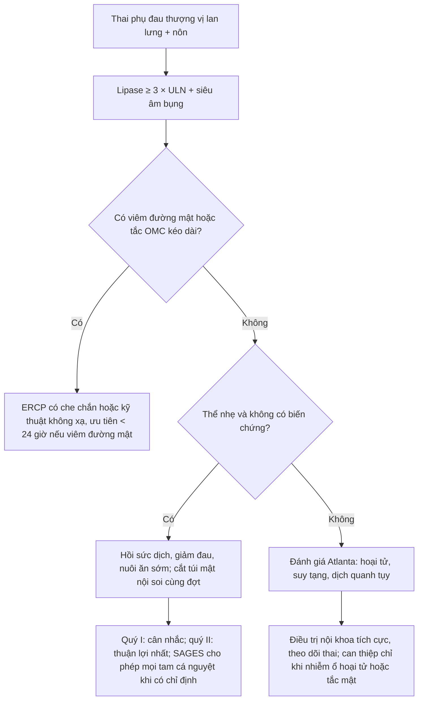
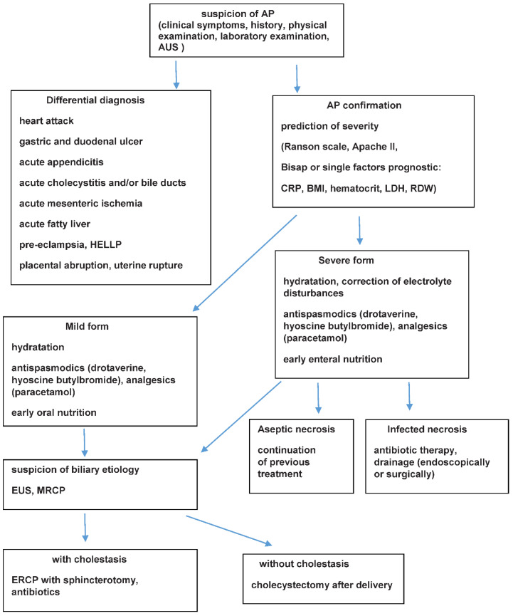
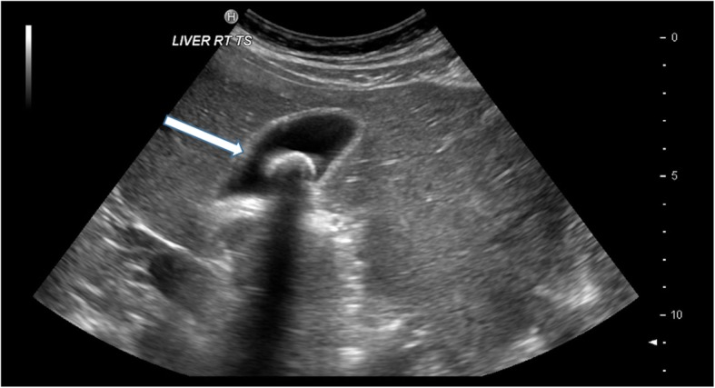
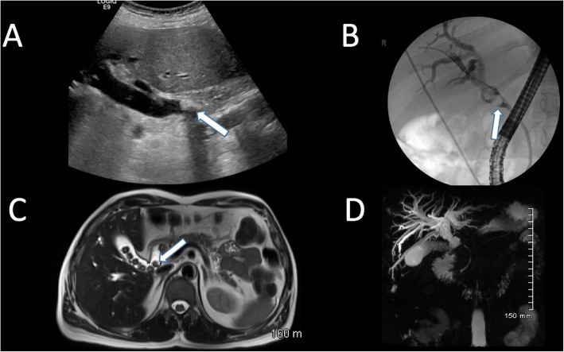
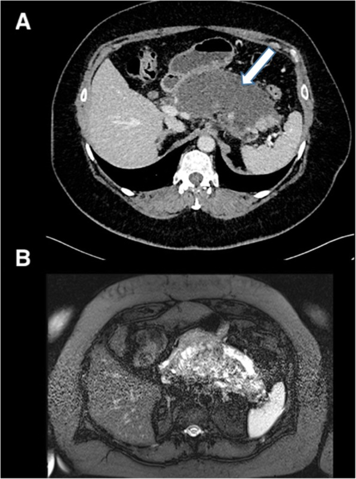

# 1938 — Viêm tụy cấp do sỏi ở thai phụ: khi nào ERCP, khi nào cắt túi mật, và ngưỡng lipase để không mổ oan / Acute biliary pancreatitis in pregnancy: ERCP, cholecystectomy, and the lipase threshold

**Tags:** `pattern:viem` `pattern:tac-nghen` `pattern:soi` `pattern:phu-tuy` `vung:tuy` `vung:duong-mat` `vung:thai-nhi` `protocol:sieu-am-bung` `protocol:MRCP` `protocol:ERCP` `score:Atlanta-2012`
**Mức chắc chắn (certainty):** tổng hợp y văn (literature synthesis) — ghép **tổng quan 2024** (PMC11012882: định nghĩa 2/3 tiêu chuẩn, vai trò siêu âm/MRI/EUS, dinh dưỡng, cắt túi mật), **tổng quan 2022** (PMC9737239: dịch tễ, tử vong mẹ 3,3%, thai 11,6–18,7%, siêu âm Se 73%/Sp 91%, thuật toán xử trí), **phân tích gộp ERCP ở thai** (PMC6941455: 1.307 thai phụ/27 nghiên cứu, liều xạ, biến cố), **nghiên cứu 4.034 ca Trung Quốc** (trích trong PMC11012882: tử vong mẹ 2,8%) và **tổng quan same-admission vs delayed cholecystectomy** (PMC6263067: tái phát tới 33%, biến cố chờ mổ 25,39%). Số nào nguồn không nêu ghi "chưa rõ".

> **Câu chốt:** ba quyết định, ba ngưỡng. (1) **Chẩn đoán**: đau thượng vị lan lưng + **lipase ≥ 3 × giới hạn trên** (không cần CT). (2) **ERCP** chỉ khi có **viêm đường mật hoặc tắc ống mật chủ kéo dài** — không phải cứ "viêm tụy do sỏi"; ERCP ở thai nhiều ca nhất thế giới (**1.307 ca**) có **biến cố thai 5,2–6,2%**, và liều xạ trung bình **3,1 mSv** — vượt ngưỡng khuyến cáo **< 1 mSv** cho quý I nếu không che chắn/không dùng kỹ thuật không xạ. (3) **Cắt túi mật cùng đợt** cho thể nhẹ: bảo tồn có **tái phát tới 33%**, chờ mổ có **25,39% biến cố mật** — nên "chờ sau sinh" chỉ dành cho thể nặng hoặc quý III sát sinh.

## 1. Tổng quan bệnh học – cơ chế hình ảnh

### 1.1 Vì sao sỏi mật gây viêm tụy và vì sao thai kỳ làm tăng nguy cơ (TẠI SAO)

- **Cơ chế "tắc tạm thời – hồi phục":** sỏi nhỏ từ túi mật xuống **ống mật chủ**, kẹt ở **bóng Vater/ống tụy chính** → **tăng áp lực ống tụy** → **trypsinogen thành trypsin** ngay trong nhu mô, hoạt hóa dây chuyền (elastase, phospholipase A2) → **tự tiêu mô mỡ và mạch máu**. Sỏi thường **trôi đi**, nên hình ảnh có thể **không thấy sỏi** tại thời điểm chụp — đây là lý do "siêu âm âm tính" không loại trừ nguyên nhân mật.
- **Vì sao có thai làm tăng sỏi:** **estrogen** làm tăng bài tiết cholesterol vào mật và **progesterone** làm **giảm co bóp túi mật** → ứ mật, tinh thể cholesterol. Trong 6 tháng cuối thai, **bùn mật mới 31%** và **sỏi mới 2%**; sau sinh 1 năm, **bùn tự hết 61%** còn **sỏi chỉ 28%** (PMC11012882).
- **Vì sao đau lan lưng:** tụy nằm sau phúc mạc, kích thích **đám rối tạng (celiac plexus)** → đau **thượng vị xuyên ra lưng**; khác với đau túi mật **hạ sườn phải** lan vai phải. Đây là mốc phân biệt lâm sàng quan trọng nhất.
- **Vì sao thể nặng nguy hiểm cho thai:** SIRS mẹ → **giảm tưới máu tử cung – bánh nhau**, sốt và toan → **chuyển dạ non, thai lưu**. Khoảng **1/3 thai phụ** tiến triển thể nặng (PMC9737239).

### 1.2 Vì sao hình ảnh trông như vậy (vật lý từng phương thức)

- **Siêu âm bụng:** sỏi mật **tăng hồi âm mạnh + bóng lưng sạch (posterior acoustic shadowing)** vì sỏi cản gần như toàn bộ sóng; **bùn mật** cũng tăng hồi âm nhưng **không có bóng lưng** và lắng theo trọng lực. Với **viêm tụy cấp**, tụy thường **phù to, giảm hồi âm** do **dịch phù trong mô kẽ**; đầu tụy bị che bởi **hơi tá tràng** nên siêu âm **bỏ sót tụy ở 20–30%** (chưa rõ con số chính xác cho thai — cần tra). Giá trị lớn nhất của siêu âm ở thai là **tìm sỏi túi mật và giãn đường mật**, không phải đánh giá nhu mô tụy.
- **MRI/MRCP:** mật và dịch tụy **sáng trên T2** (nước tự do), còn **sỏi là "lỗ khuyết" tối** trong lòng ống sáng. MRCP **không cần gadolinium**, nên tránh được lo ngại về thuốc cản từ; độ chính xác cho sỏi ống mật chủ **> 90%** (PMC9737239).
- **CT:** sỏi cholesterol thường **đồng/tăng nhẹ tỉ trọng**, khó thấy hơn sỏi canxi; CT mạnh nhất ở **biến chứng**: hoại tử tụy **không ngấm thuốc**, dịch quanh tụy, khí trong ổ hoại tử nhiễm khuẩn. Nhưng CT dùng **liều xạ**, nên trong thai **không phải lựa chọn đầu tay**.
- **Nội soi siêu âm (EUS):** đầu dò sát thành dạ dày – tá tràng, **không xạ**, độ phân giải cao cho **sỏi ống mật chủ nhỏ**; an toàn mọi tam cá nguyệt nhưng cần **gây mê/tiền mê** có kiểm soát (PMC11012882).

### 1.3 Ngưỡng định lượng nằm lòng

| Đại lượng | Ngưỡng / con số | Ý nghĩa | Nguồn |
|---|---|---|---|
| Tần suất viêm tụy cấp ở thai | **1/1.000 – 1/5.000** thai kỳ | Bệnh hiếm nhưng nặng | PMC9737239 |
| Tử vong mẹ | **3,3%** (số cũ); **2,8%** trong 4.034 ca Trung Quốc | Đã giảm mạnh so với 37% trước đây | PMC9737239, PMC11012882 |
| Tử vong thai | **11,6–18,7%** | Lý do phải theo dõi thai liên tục | PMC9737239 |
| Tử vong mẹ theo tam cá nguyệt | **12,7%** (quý I), **7,9%** (quý II), **6,4%** (quý III) | Quý I nặng nhất trong dữ liệu gộp | PMC11012882 |
| Nguyên nhân do sỏi | **14,29–96,3%** giữa các nghiên cứu | Nguyên nhân hàng đầu | PMC9737239 |
| Thể nặng | **≈ 1/3** thai phụ | Không được xem là bệnh nhẹ | PMC9737239 |
| Lipase/amylase | **≥ 3 × giới hạn trên** | Một trong 3 tiêu chuẩn Atlanta | PMC11012882 |
| Amylase về bình thường | **48–72 giờ** sau khởi phát | Xét nghiệm muộn dễ âm tính giả | PMC9737239 |
| Siêu âm cho nguyên nhân mật | **Se 73%, Sp 91%** | Tốt để xác nhận, không đủ để loại trừ sỏi OMC | PMC9737239 |
| MRCP cho sỏi OMC | **độ chính xác > 90%** | Thay thế CT trong thai | PMC9737239 |
| Tái phát khi **không** cắt túi mật | **tới 33%** | Cơ sở của cắt túi mật cùng đợt | PMC6263067 |
| Biến cố mật khi **chờ** mổ | **25,39%** (biliary colic 13,56%, viêm tụy tái phát 8,5%) | Chờ mổ không miễn phí | PMC6263067 |
| ERCP ở thai | **1.307 ca/27 nghiên cứu**, biến cố chung **15,9%**, biến cố thai **5,2–6,2%** | Ngưỡng lợi ích/nguy cơ | PMC6941455 |
| Liều xạ ERCP | **3,2 ± 1,8 phút** chiếu, **3,1 ± 1,64 mSv** | Khuyến cáo **< 1 mSv** quý I, **< 5 mSv** cả thai kỳ | PMC6941455 |
| Phẫu thuật cắt túi mật ở thai | biến chứng mẹ **≈ 4%**, thai **5,8%** | Thấp hơn nguy cơ bảo tồn | PMC10768355 |

## 2. Mẫu hình + chẩn đoán phân biệt theo vị trí (gamut)

**Mẫu hình chính:** *thai phụ đau thượng vị dữ dội lan ra lưng + nôn + amyase/lipase tăng* → nghĩ **viêm tụy cấp**. Gamut dưới đây xếp theo **vị trí giải phẫu của ổ bệnh**, vì mỗi vị trí có hình ảnh và xử trí khác nhau.

- **Tụy – ống tụy:** viêm tụy do sỏi (bài này), viêm tụy do **tăng triglyceride** (thai kỳ là yếu tố làm nặng), viêm tụy do thuốc, **tăng canxi do cường tuyến cận giáp** (bài 1673/1680 liên quan chuyển hóa).
- **Túi mật:** **viêm túi mật cấp** (bài 1925) — đau hạ sườn phải, Murphy, thành túi mật **> 3 mm**.
- **Đường mật:** **viêm đường mật cấp** (bài 1929) — sốt, vàng da, giãn ống mật chủ; đây là chỉ định **ERCP cấp**.
- **Dạ dày – tá tràng:** loét thủng, viêm dạ dày nặng — khí ngoài lòng, dịch tự do, đau tăng khi ấn.
- **Gan:** **gan nhiễm mỡ cấp thai kỳ (AFLP)** và **HELLP** — men gan tăng, giảm tiểu cầu, hạ đường huyết, tổn thương gan **lan tỏa** không có sỏi.
- **Mạch mạc treo:** **thiếu máu mạc treo** (bài 1908) — đau **không tương xứng**, khí trong thành ruột muộn.
- **Tử cung – phần phụ:** **nhau bong non**, **xoắn buồng trứng**, **vỡ tử cung** — đau kèm bất thường tim thai, ra máu.
- **Niệu quản:** **sỏi niệu quản** (bài 1818) — đau hông lưng lan xuống, tiểu máu, ứ nước.

## 3. Bảng so sánh phân biệt (ma trận đối chiếu)

| Thực thể (entity) | Hình ảnh điển hình | Chốt vào (rule-in) | Chốt loại (rule-out) | Gợi ý xác nhận |
|---|---|---|---|---|
| **Viêm tụy cấp do sỏi** | Tụy phù, dịch quanh tụy; sỏi túi mật **có bóng lưng**; MRCP lỗ khuyết ở OMC | **Đau thượng vị lan lưng + lipase ≥ 3 × ULN + sỏi/bùn mật** | Lipase bình thường, không sỏi, không đau điển hình → ít nghĩ | Lipase lặp; siêu âm; MRCP khi nghi tắc |
| **Viêm túi mật cấp** | **Thành túi mật > 3 mm**, dịch quanh túi, sỏi cổ túi, Murphy siêu âm | **Đau hạ sườn phải + Murphy + thành dày + sỏi** | Thành < 3 mm, không sỏi, đau lan lưng → loại | Siêu âm (bài 1925); không cần CT |
| **Viêm đường mật cấp** | Giãn ống mật chủ, sỏi OMC, dày thành ống mật | **Sốt + vàng da + đau hạ sườn phải (Charcot) + giãn đường mật** | Không giãn mật, không vàng da, lipase trội → nghĩ tụy | MRCP/EUS; **ERCP cấp** (bài 1929) |
| **AFLP / HELLP** | Gan **giảm tỉ trọng lan tỏa** trên CT (nếu chụp), không sỏi | **Men gan tăng + giảm tiểu cầu + hạ đường huyết + tan máu** | Tiểu cầu bình thường, không tan máu → loại | Xét nghiệm máu là chính; hình ảnh chỉ hỗ trợ |
| **Loét thủng** | Khí ngoài lòng, dịch tự do, thành dạ dày gián đoạn | **Đau như dao đâm + đề kháng thành bụng + khí tự do** | Không khí tự do, lipase tăng trội → loại | X-quang bụng đứng; CT có che chắn |
| **Thiếu máu mạc treo** | Thành ruột dày, khí trong thành, mạch tắc trên CTA | **Đau không tương xứng + toan lactic + mạch máu tắc** | Lipase cao, sỏi rõ, đau giảm sau giảm đau → loại | CTA (hạn chế xạ); theo dõi sát |
| **Sỏi niệu quản** | Ứ nước, sỏi niệu quản, giãn đài bể thận | **Đau hông lưng lan xuống + tiểu máu + ứ nước** | Không ứ nước, không tiểu máu, lipase cao → loại | Siêu âm thận; MRU nếu cần |

*Hình 1 — Ảnh ghép letterbox: **(A)** sỏi tăng hồi âm có bóng lưng; **(B)** sỏi OMC: siêu âm, ERCP (khuyết thuốc), MRI T2 và MRCP MIP; **(C)** viêm tụy do sỏi: CT hoại tử – dịch quanh tụy và T2 fat-sat tương ứng. Nguồn: PMC7002643 Figs. 1, 19, 20, **CC BY 4.0**.*

## 4. Protocol chụp + hệ phân độ/điểm chuẩn hóa

**Chẩn đoán (Atlanta 2012):** cần **2 trong 3** — đau điển hình, **lipase/amylase ≥ 3 × ULN**, hình ảnh phù hợp. Không cần CT để chẩn đoán.

**Chiến lược hình ảnh theo bước:**

| Bước | Phương thức | Khi nào | Ghi chú an toàn |
|---|---|---|---|
| 1 | **Siêu âm bụng** | Mọi ca nghi ngờ | Không xạ; tìm sỏi/bùn, giãn đường mật, dịch; hạn chế ở quý III do tử cung che |
| 2 | **MRCP không cản từ** | Nghi sỏi OMC, vàng da, giãn đường mật, siêu âm không kết luận | Không dùng gadolinium; tránh quý I nếu có thể, nhưng **làm khi cần** |
| 3 | **EUS** | Nghi sỏi OMC nhỏ, định làm ERCP | Không xạ; cần gây mê có kiểm soát |
| 4 | **CT bụng có cản quang** | Nghi hoại tử, biến chứng, nhiễm khuẩn ổ hoại tử, chấn thương | **Hạn chế tối đa**; che chắn, trường chiếu hẹp |
| 5 | **ERCP** | Viêm đường mật, tắc OMC kéo dài, thất bại điều trị nội | Che chắn; ưu tiên kỹ thuật **không xạ**; stent nhựa nếu chưa mổ được |

**Phân độ và xử trí:**

*Hình 2 — Thuật toán của tổng quan 2022: chẩn đoán, phân độ, xử trí thể nhẹ/nặng, EUS/MRCP khi nghi nguyên nhân mật, ERCP khi có ứ mật. **Phản biện:** sơ đồ ghi "cắt túi mật sau sinh" cho nhánh không ứ mật — khuyến cáo hiện hành (SAGES, phân tích gộp same-admission) nghiêng về **cắt cùng đợt** cho thể nhẹ vì tái phát tới 33% (PMC6263067). Nguồn ảnh: PMC9737239 Fig. 1, **CC BY 4.0**.*

**Điều trị nội khoa (nền tảng, không phụ thuộc hình ảnh):**
- **Dịch tinh thể** đích hướng (thường **5–10 mL/kg/giờ** trong 24 giờ đầu), ưu tiên Ringer lactat.
- **Giảm đau:** paracetamol; **tránh NSAID sau 20 tuần** (đóng ống động mạch sớm, thiểu ối) — xem bài 1930.
- **Nuôi ăn sớm** bằng đường miệng khi dung nạp; không cần nhịn ăn kéo dài.
- **Kháng sinh** chỉ khi nhiễm ổ hoại tử hoặc viêm đường mật, không dùng dự phòng thường quy.
- **Theo dõi thai:** monitoring tim thai, siêu âm tăng trưởng; **viêm tụy không phải chỉ định chấm dứt thai kỳ**.
- **Corticoid** khi có nguy cơ sinh non 24–34 tuần.

## 5. Biến thể bình thường và cạm bẫy

- **"Siêu âm không thấy sỏi = không do sỏi":** sai. Độ nhạy của siêu âm cho **nguyên nhân mật chỉ 73%**; đầu tụy bị hơi che, sỏi OMC nhỏ dễ bỏ. Nếu vàng da/giãn mật → **MRCP/EUS**.
- **Lipase bình thường trong tăng triglyceride nặng:** mẫu **đục như sữa** có thể làm xét nghiệm **âm tính giả**; nghi ngờ thì đo **triglyceride** (ngưỡng gây bệnh thường **≥ 1.000 mg/dL ≈ 11,3 mmol/L**).
- **Amylase về bình thường sau 48–72 giờ:** bệnh nhân đến muộn có thể chỉ còn **lipase tăng**; không dùng amylase muộn để loại trừ.
- **Nhầm với viêm đường mật:** cả hai đều đau thượng vị; khác biệt là **sốt + vàng da + giãn đường mật** → ERCP, không phải chỉ hồi sức.
- **Chọc hút/CT sớm ở thể nhẹ:** không làm thay đổi điều trị, chỉ thêm xạ; **CT đúng lúc** là khi nghi hoại tử hoặc xấu đi sau 72 giờ.
- **Cạm bẫy "đau bụng cấp ở thai = mổ"**: viêm tụy thể nhẹ **không mổ tụy**; mổ chỉ cho biến chứng hoặc cắt túi mật phòng tái phát.
- **Bỏ sót sau sinh:** nguy cơ viêm tụy **tăng trong 2 năm sau sinh** (PMC11012882); đau thượng vị ở giai đoạn này vẫn phải nghĩ mật – tụy.

## 6. Tự lượng giá — Blind Quiz ngay trên trang tĩnh (không cần app)

**Ca 1 — thai 28 tuần, đau hạ sườn phải từng cơn sau ăn mỡ**

- Gợi ý lâm sàng: không sốt, không vàng da, lipase bình thường, đau 2 giờ rồi hết.
- Câu hỏi: (1) Dấu hiệu siêu âm chính? (2) Chẩn đoán? (3) Có cần ERCP không?

<b>Bấm để hiện đáp án (findings + chẩn đoán)</b>

- Dấu hiệu: **cấu trúc tăng hồi âm trong lòng túi mật + bóng lưng sạch** = **sỏi mật**; không có dấu viêm túi mật (thành mỏng, không dịch quanh túi).
- Chẩn đoán: **sỏi mật có triệu chứng (đau quặn mật)** — không phải viêm tụy vì **lipase bình thường**, không đau lan lưng.
- Xử trí: giảm đau (paracetamol), **không ERCP** (không tắc mật, không viêm đường mật); cân nhắc **cắt túi mật** vì bảo tồn tái phát tới 33% — xem bài 1930 để chọn thời điểm.
- Nguồn ảnh: PMC7002643 Fig. 1, CC BY 4.0.

**Ca 2 — thai 20 tuần, đau thượng vị lan lưng 2 ngày, lipase 8 × ULN, vàng da nhẹ**

- Gợi ý lâm sàng: sốt 38,2 °C, ống mật chủ 11 mm trên siêu âm, không suy tạng.
- Câu hỏi: (1) Vì sao đây là chỉ định ERCP? (2) Thời điểm? (3) Nếu chưa cắt túi mật được ngay thì làm gì?

<b>Bấm để hiện đáp án (findings + chẩn đoán)</b>

- Dấu hiệu: **sỏi OMC** — siêu âm thấy khối tăng hồi âm trong ống giãn; **ERCP** khuyết thuốc; **MRI T2/MRCP** lỗ khuyết tối trong dịch mật sáng. Kèm **sốt + vàng da + giãn OMC** = **viêm đường mật** trên nền viêm tụy do sỏi.
- Chẩn đoán: **viêm đường mật cấp do sỏi** — chỉ định **ERCP dẫn lưu** (không chờ đỡ tụy), ưu tiên **< 24 giờ** khi có viêm đường mật nặng.
- Nếu chưa mổ được: **stent nhựa** qua ERCP để giữ thông mật, cắt túi mật sau; dùng **kỹ thuật không xạ/che chắn** vì liều trung bình ERCP **3,1 mSv** vượt ngưỡng **1 mSv** quý I.
- Nguồn ảnh: PMC7002643 Fig. 19, CC BY 4.0.

**Ca 3 — thai 32 tuần, viêm tụy do sỏi thể nhẹ, hết đau sau 48 giờ**

- Gợi ý lâm sàng: không suy tạng, không hoại tử, ăn lại được ngày 2.
- Câu hỏi: (1) Có nên chờ sau sinh mới cắt túi mật? (2) Nguy cơ nếu chờ? (3) Tam cá nguyệt nào thuận lợi?

<b>Bấm để hiện đáp án (findings + chẩn đoán)</b>

- Dấu hiệu: hình CT cho thấy **vùng tụy hoại tử/không ngấm thuốc + dịch quanh tụy** (ca nặng hơn ca của bạn); MRI T2 xác nhận phù và dịch. Ca của bạn ở thể nhẹ vì không có các dấu hiệu này và hết đau nhanh.
- Chẩn đoán: **viêm tụy do sỏi thể nhẹ** — chỉ định **cắt túi mật nội soi cùng đợt** (same-admission) theo khuyến cáo hiện hành.
- Vì sao không chờ: **tái phát tới 33%** khi không cắt; khi chờ mổ, **25,39%** có biến cố mật (đau quặn 13,56%, viêm tụy tái phát 8,5%).
- Tam cá nguyệt: **quý II** thuận lợi nhất theo kinh điển; **SAGES** cho phép mổ **mọi tam cá nguyệt** khi có chỉ định; quý III sát sinh có thể cân nhắc mổ sau sinh.
- Nguồn ảnh: PMC7002643 Fig. 20, CC BY 4.0.

## Bài liên quan chéo
- [1925 – Viêm túi mật cấp ở thai phụ: chẩn đoán, TG18, SAGES 2024](../1925-viem-tui-mat-cap-thai-ky/lesson.md)
- [1929 – Viêm đường mật cấp ở thai phụ: TG18, ERCP < 24 giờ](../1929-viem-duong-mat-cap-thai-ky/lesson.md)
- [1930 – Sỏi mật không biến chứng ở thai phụ: ai chờ được, giảm đau theo quý](../1930-soi-mat-khong-bien-chung-thai-ky/lesson.md)
- [135 – Viêm tụy cấp: phân độ Atlanta 2012](../135-viem-tuy-Atlanta/lesson.md)
- [1680 – Viêm tụy tăng triglyceride ở người lớn](../1680-viem-tuy-tang-triglyceride-nguoi-lon/lesson.md)

## Ảnh
- `images/1938_viem-tuy-soi-thai_US-soi-tui-mat_PMC7002643-Fig1.jpg` — sỏi túi mật điển hình.
- `images/1938_viem-tuy-soi-thai_US-ERCP-MRI-OMC_PMC7002643-Fig19.jpg` — sỏi OMC bốn phương thức.
- `images/1938_viem-tuy-soi-thai_CT-MRI-tuy_PMC7002643-Fig20.jpg` — viêm tụy do sỏi trên CT/MRI.
- `images/1938_viem-tuy-soi-thai_SODO-xu-tri_PMC9737239-Fig1.jpg` — thuật toán xử trí.
- `images/composite_1938_viem-tuy-soi.jpg` — ảnh ghép đối chiếu (Figs. 1, 19, 20).
- Nguồn và giấy phép từng ảnh: `images/CREDITS.md`.

> Không dùng để chẩn đoán độc lập khi chưa có người hướng dẫn.
