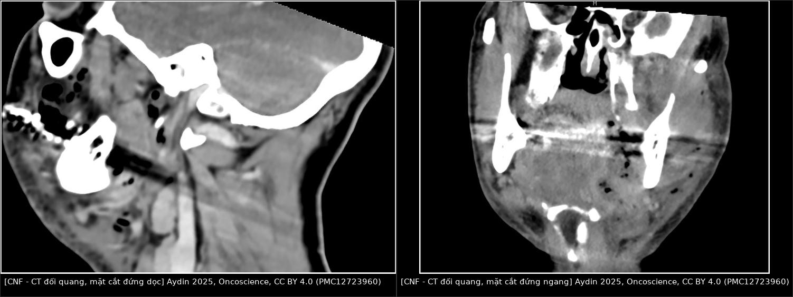
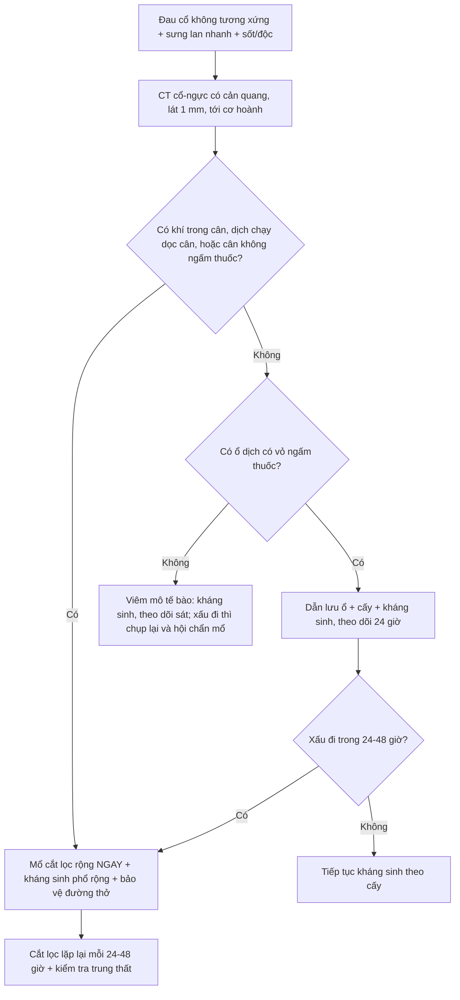
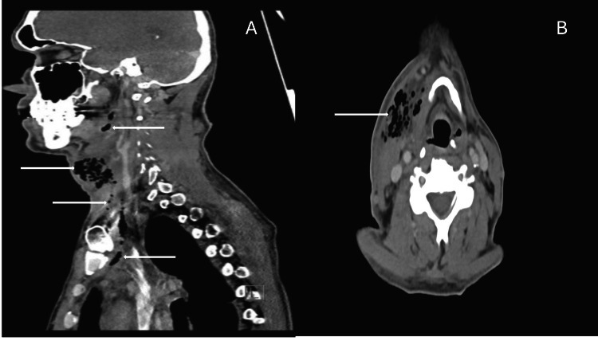
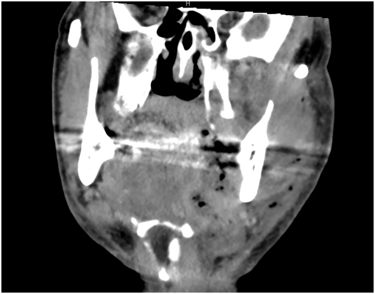
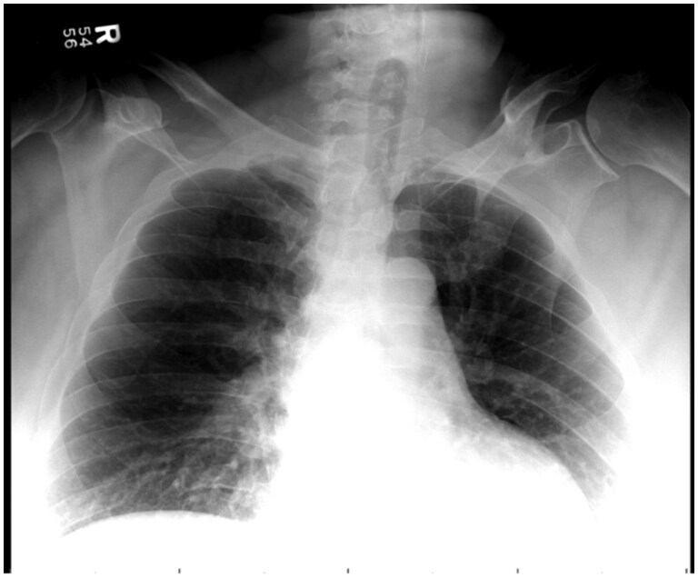

# 1939 — Viêm cân mạc hoại tử vùng cổ: khí trong cân, dày cân và cửa sổ cắt lọc tính bằng giờ / Cervical necrotizing fasciitis

**Tags:** `pattern:khi-mo-mem` `pattern:day-can` `pattern:viem-mo-te-bao` `pattern:apxe` `vung:co` `vung:dau-co` `vung:trung-that` `protocol:CT-co-tuong` `protocol:MRI-co-tuong` `score:LRINEC` `score:nfSOFA`

**Mức chắc chắn (certainty):** tổng hợp y văn (literature synthesis) — số liệu lấy từ tổng quan đầu–cổ *Oncoscience* 2025 (PMC12723960), tổng quan trung thất hoại tử *Cureus* 2026 (PMC13464360), đoàn hệ 26 ca *J Clin Med* 2026 (PMC13410499), loạt 26 ca *Cureus* 2024 (PMC11348871) và các ca minh họa CC BY 4.0. Nhóm **không có bệnh nhân của mình**; mọi con số đều là số của tác giả gốc, ghi kèm PMCID.

> **Câu chốt:** đây là **cấp cứu ngoại khoa, không phải bệnh nhiễm trùng điều trị bằng kháng sinh** — chẩn đoán đặt trên **đau không tương xứng + sưng lan tính bằng giờ + độc tính toàn thân**, và **CT có cản quang là chuẩn hình ảnh** (dày cân, dịch chạy dọc cân, khí trong cân). Khí là **dấu hiệu đặc hiệu nhưng không bắt buộc**; ngược lại, khí dưới da một mình **không đồng nghĩa hoại tử**. Điều trị đúng là **cắt lọc rộng ngay + cắt lọc lặp lại mỗi 24–48 giờ + bảo vệ đường thở**.

## 1. Tổng quan bệnh học – cơ chế hình ảnh

### 1.1 Bệnh học và tốc độ lan
- Viêm cân mạc hoại tử (necrotizing fasciitis, NF) là **hoại tử cân và mô mỡ dưới da kèm huyết khối vi mạch xuyên**, lan **dọc mặt phẳng cân** — nơi mô liên kết lỏng, ít cản trở, nên tốc độ lan **tính bằng giờ** (tổng quan PMC12723960: từ viêm mô tế bào đến tổn thương cân sâu có thể trong vài giờ).
- **Type I (đa vi khuẩn, ~phổ biến nhất ở cổ)**: hỗn hợp kỵ khí + hiếu khí, khởi điểm **răng (odontogenic)** hoặc họng; **Type II**: *Streptococcus pyogenes* đơn thuần; **Type III**: *Clostridium* (sinh hơi mạnh).
- Đoàn hệ Croatia 26 ca (PMC13410499): **toàn bộ 21 ca do răng đều từ răng hàm dưới**; tỉ lệ liên cầu **giảm từ 82% xuống 33%** sau đại dịch, xuất hiện thêm *Acinetobacter, Candida, Corynebacterium*; tỉ lệ mắc **tăng 2,58 lần** (KTC 95% 1,18–5,61).
- Loạt 26 ca Bucharest (PMC11348871): **> 60% do răng**, **30,8% đái tháo đường**, **42,3% không có bệnh nền** — tức bệnh vẫn chết người ở người trước đó khỏe mạnh.

### 1.2 TẠI SAO hình ảnh trông như vậy (vật lý + mô bệnh)
| Dấu hiệu trên CT | Vì sao (cơ chế) | Hệ quả đọc phim |
|---|---|---|
| **Khí trong cân/mô dưới da** | Vi khuẩn lên men kỵ khí sinh hơi **và/hoặc** khí được bơm vào bởi **tay khoan nha khoa áp lực cao** (PMC13464360) | Khí có **HU ≈ −1.000** (không khí), tách hẳn mỡ (**−100 đến −50 HU**) trên cửa sổ mô mềm; nhưng **cùng đậm độ khí có thể lành tính** → phải đọc cùng bối cảnh |
| **Cân dày, phù, dịch chạy dọc cân** | Viêm thấm dịch + hoại tử cân; dịch đi theo **mặt phẳng cân** chứ không khu trú thành ổ | Dịch **dài, dọc, bám mặt phẳng** (khác ổ áp-xe tròn có vỏ) |
| **Cân không ngấm thuốc** | Huyết khối mạch xuyên nuôi cân → không có thuốc tới cân hoại tử | Đây là lý do **bắt buộc CT có cản quang**; CT không thuốc chỉ còn khí và dày cân |
| **Da còn hồng hào, chưa loét** | Máu nuôi **da** đi qua **cân** đã huyết khối; hoại tử da là dấu hiệu **muộn** | "Da lành" **không loại trừ**; đừng chờ da tím/hoại tử mới mổ |
| **Tổn thương lan xuống trung thất** | Khoang nguy hiểm (danger space) thông từ cổ xuống trung thất sau | Phải **chụp tới cơ hoành**, không dừng ở cổ |

### 1.3 Ngưỡng định lượng cần nhớ
- Tỉ lệ đầu–cổ trong tổng số NF: **3–10%** (PMC13464360) — tổng quan khác ghi **< 5%** (PMC12723960): **hai nguồn không thống nhất**, dùng khoảng rộng và ghi rõ nguồn.
- Khoảng **1%** nhiễm khuẩn răng nặng tiến triển thành NF; **1,5–3,6%** nhiễm khuẩn cổ sâu tiến triển thành **trung thất hoại tử (DNM)** (PMC13464360).
- Tử vong CNF: đa số nghiên cứu **10–40%**; đoàn hệ hiện đại **11,5%** (3/26, PMC13410499); **DNM có thể tới 40%** (PMC13464360).
- Tiên lượng xấu: **mổ trễ, tuổi > 60, đái tháo đường, suy thận, sốc nhiễm khuẩn lúc nhập viện** (PMC12723960); cohort đầu–cổ ghi nhận **đái tháo đường + nfSOFA ≥ 2** gắn với kết cục xấu (PMC13464360).
- Nằm viện trung vị **21 ngày** (giai đoạn sau đại dịch) so với **12 ngày** (trước đại dịch) (PMC13410499).
- Liệu pháp oxy cao áp (HBOT) hỗ trợ: tử vong **7,6%** so với **13,4%** ở tổng quan trước — nhưng HBOT **không thay thế** cắt lọc và **không được làm chậm** chuyển mổ (PMC12723960).

## 2. Mẫu hình + chẩn đoán phân biệt theo vị trí (gamut)

### 2.1 Định khu bằng véc-tơ đẩy (không đoán theo cảm giác)
- **Mỡ khoang bên hầu (parapharyngeal fat) bị đẩy ra sau** → tổn thương ở **trước**, tức khoang dưới hàm/dưới lưỡi (Ludwig).
- **Mỡ khoang bên hầu bị đẩy ra trước** → tổn thương ở **sau**, tức khoang sau hầu/nguy hiểm.
- **Động mạch cảnh trong (ICA) bị đẩy** → khối ở **khoang cảnh (carotid space)**; **không đẩy ICA** mà bọc quanh → tổn thương **xuất phát từ khoang cảnh** (huyết khối, giả phình).
- Từ khoang sau hầu/nguy hiểm, đường lan xuống **trung thất sau** là lý do CNF luôn phải đọc kèm lát cắt ngực trên.

### 2.2 Gamut theo "có khí / không khí trong mô mềm cổ"
- **Có khí:** CNF; áp-xe do vi khuẩn sinh hơi; **viêm tủy xương sinh khí** (emphysematous osteomyelitis, thường kèm khí trong tủy xương); khí do can thiệp (tay khoan nha khoa, catheter, chấn thương); **rách thực quản/khí quản** → tràn khí trung thất; **khí dưới da lành tính** sau vết thương nhỏ/oxy già.
- **Không khí:** viêm mô tế bào (cellulitis); **áp-xe thành thục** (vỏ ngấm thuốc); **Ludwig angina** (viêm mô tế bào sàn miệng hai bên, không ổ dịch); **hội chứng Lemierre** (huyết khối tĩnh mạch cảnh trong); viêm tuyến giáp mủ; viêm cân mạc do nấm (khí hiếm).
- Gợi nhớ **"khí không bắt buộc, độc tính mới bắt buộc"**: quyết định mổ dựa trên **bệnh cảnh + CT dày cân/dịch dọc cân**, không chờ khí.

## 3. Bảng so sánh phân biệt (ma trận đối chiếu)

| Thực thể (entity) | Hình ảnh điển hình (CT có cản quang) | Chốt vào (rule-in) | Chốt loại (rule-out) | Gợi ý xác nhận |
|---|---|---|---|---|
| **Viêm cân mạc hoại tử cổ (CNF)** | Dày cân lan, dịch **chạy dọc mặt phẳng cân**, khí trong cân ± mô dưới da, **cân không ngấm thuốc**, có thể lan trung thất | **Đau không tương xứng + sưng tính bằng giờ + dịch dọc cân/khí trong cân**; đau tăng khi sờ dọc cân | Ổ dịch **tròn có vỏ ngấm thuốc đều** và không dày cân lan → nghĩ áp-xe | Mổ thăm dò: cân xám, mủ "nước rửa bát", không chảy máu tươi, tách bằng ngón tay (PMC13410499) |
| **Viêm mô tế bào (cellulitis)** | Dày mô dưới da, **mỡ "bẩn" (dirty fat)**, không dịch dọc cân, không khí | Bờ mờ, không ổ dịch, không khí | **Dịch dọc cân + khí + cân không ngấm thuốc** → CNF | Đáp ứng kháng sinh; nếu xấu đi trong 24 giờ → chụp lại |
| **Áp-xe cổ sâu thành thục** | Ổ dịch **tròn, vỏ ngấm thuốc**, có thể có khí **trong lòng ổ** | Vỏ ngấm thuốc + mức khí–dịch trong ổ | Dịch **không có vỏ, chạy dài theo cân** → CNF | Dẫn lưu + cấy; không cải thiện sau 24–48 giờ → nghĩ CNF |
| **Ludwig angina** | Viêm mô tế bào **sàn miệng hai bên**, đẩy lưỡi ra sau, **không ổ dịch rõ** | Sưng dưới hàm hai bên + lưỡi bè + nguy cơ đường thở | Khí trong cân/dịch dọc cân → CNF | Đường thở trước, kháng sinh, dẫn lưu khi có ổ |
| **Lemierre (huyết khối TM cảnh trong)** | **Khuyết thuốc trong lòng tĩnh mạch cảnh trong**, giãn tĩnh mạch, thâm nhiễm quanh mạch, di căn phổi | Khuyết thuốc **trong lòng mạch** + viêm quanh mạch | Khí lan trong cân + dày cân rộng → CNF | Siêu âm/CTV; cấy máu kỵ khí (*Fusobacterium*) |
| **Khí dưới da lành tính** | Khí dưới da/cơ lan rộng nhưng **không dày cân, không dịch dọc cân, không ổ** | **LRINEC 0, không sốt, không độc tính**, khí không theo cân | Sốc/nhiễm toan/LRINEC cao + dày cân → CNF | Theo dõi sát; ca 64 tuổi LRINEC 0 khỏi không mổ (PMC13062205) |
| **Viêm tủy xương sinh khí** | **Khí trong tủy xương** + phá hủy xương + khí mô mềm quanh | Khí **trong xương**, bờ xương phá hủy | Chỉ khí mô mềm, xương nguyên → CNF/áp-xe | CT xương; MRI khi cần; cấy xương |
| **Rò thực quản/khí quản** | Tràn khí trung thất ± dịch trung thất, **khí quanh thực quản/khí quản**, không dày cân cổ lan tỏa | Khí **quanh ống tiêu hóa/đường thở** + bối cảnh nôn/soi/chấn thương | Dày cân cổ lan + khí trong cân cổ → CNF/DNM | Nội soi có chuẩn bị; CT có uống cản quang tan trong nước |

*Trái: mặt cắt đứng dọc — khí rải rác trong mô mềm cổ và dọc cân, mất mặt phẳng mỡ bình thường. Phải: mặt cắt đứng ngang — khí thành đám một bên cổ và dưới da, kèm dày cân. Ảnh nguyên bản từ Aydin 2025, Oncoscience, CC BY 4.0 (PMC12723960); ghép letterbox bằng `tools/make_composite.py`, không crop/kéo giãn.*

## 4. Protocol chụp + hệ phân độ/điểm chuẩn hóa

### 4.1 Protocol
- **CT cổ–ngực có cản quang** là chuẩn: lát **≤ 1 mm**, từ **nền sọ tới cơ hoành** (không dừng ở cổ — DNM là nguyên nhân tử vong chính), thuốc **1,5 mL/kg**, thì **tĩnh mạch cửa 60–70 giây**; không cần thì động mạch trừ khi nghi giả phình cảnh.
- **Suy thận:** CT không cản quang **vẫn thấy khí** nhưng **mất dấu cân không ngấm thuốc** — đừng vì thế mà kết luận "không hoại tử".
- **MRI** chỉ khi bệnh nhân ổn định và cần phân biệt mô mềm: MRI **đánh giá quá mức** phù và **kém nhạy khí hơn CT** (PMC13464360) → không dùng để loại trừ cấp cứu.
- **Siêu âm** tại giường: tìm dịch/khí và hướng dẫn chọc hút, **không loại trừ** CNF.
- **Xét nghiệm trước mổ:** cấy máu 2 bộ + cấy mủ sâu, lactate, CRP, công thức máu, creatinin, điện giải, glucose; đánh giá **nfSOFA**.

### 4.2 LRINEC — dùng đúng, đừng dùng một mình
Bảng điểm LRINEC (Wong 2004, dẫn qua PMC13464360):

| Biến số | 0 điểm | 1 điểm | 2 điểm | 4 điểm |
|---|---|---|---|---|
| CRP (mg/L) | < 150 | — | — | ≥ 150 |
| Bạch cầu (×10⁹/L) | < 15 | 15–25 | > 25 | — |
| Hemoglobin (g/dL) | > 13,5 | 11–13,5 | < 11 | — |
| Natri (mmol/L) | ≥ 135 | — | < 135 | — |
| Creatinin (µmol/L) | ≤ 141 | — | > 141 | — |
| Glucose (mmol/L) | ≤ 10 | > 10 | — | — |

- Ngưỡng kinh điển: **≥ 6 = nguy cơ trung bình**, **≥ 8 = nguy cơ cao**; nhưng ở **đầu–cổ** điểm này **không phân biệt được nhóm kết cục xấu và tốt** trong loạt của Vittetoe (PMC13464360) → **LRINEC thấp KHÔNG loại trừ**.
- Bổ sung **nfSOFA ≥ 2** khi đánh giá tiên lượng (PMC13464360).

## 5. Biến thể bình thường và cạm bẫy

- **X-quang ngực bình thường không loại trừ:** ca 47 tuổi được cho về sau phim ngực "bình thường", hôm sau nhập lại với viêm cân mạc hoại tử lan trung thất + viêm tủy xương sinh khí (**PMC12857575**) — chỉ CT mới trả lời.
- **Khí ≠ hoại tử:** khí có thể do **tay khoan nha khoa** (bơm khí vào mặt phẳng cân) hoặc **khí dưới da lành tính** sau vết thương nhỏ, rửa oxy già (**LRINEC 0, không sốc** — PMC13062205; ca tương tự mổ thăm dò âm tính, PMC13392414). Ngược lại **CNF có thể không có khí** → dày cân + dịch dọc cân mới là dấu hiệu chính.
- **Da còn hồng hào:** hoại tử da là dấu hiệu **muộn** do huyết khối mạch xuyên; chờ da tím là mất cửa sổ cắt lọc.
- **Ức chế miễn dịch che dấu:** ca dùng etanercept **không có thay đổi da**, khởi đầu bằng **nấc cứt kéo dài** (ký sinh/kích thích thần kinh hoành–phế vị) rồi mới sốc nhiễm khuẩn (**PMC12357488**) — bệnh cảnh "lạ" ở người suy giảm miễn dịch phải hạ ngưỡng chụp CT.
- **Sa vào lòng tìm kiếm (satisfaction of search):** thấy một ổ áp-xe là dừng, bỏ qua **dày cân lan xuống khoang nguy hiểm/trung thất** — luôn cuộn hết từ nền sọ tới cơ hoành.
- **Tràn khí trung thất đơn thuần:** khí trung thất do Boerhaave/chấn thương/thở máy **không kèm dày cân cổ**; đừng gọi DNM khi thiếu tổn thương cổ.
- **Giả ảnh:** khí trong ruột/túi thừa vùng cổ, khí trong ống thông, khí do bơm rửa — đọc trên cửa sổ mô mềm và đối chiếu vị trí giải phẫu, không chỉ dựa vào "đốm đen".

## 6. Tự lượng giá — Blind Quiz (bấm để hiện đáp án)

**Ca 1 — nam 61 tuổi, suy giảm miễn dịch, sưng cổ + nấc cứt không cắt**

- Bối cảnh: đau/sưng cổ, nuốt khó, không có thay đổi da rõ; CRP và bạch cầu tăng.
- Câu hỏi: (1) Dấu hiệu chính trên CT? (2) Ba chẩn đoán phân biệt? (3) Dấu hiệu nào buộc mổ ngay?

<b>Bấm để hiện đáp án (findings + chẩn đoán)</b>

- Dấu hiệu: **(A) mặt cắt đứng dọc** — khí thành đám trong các khoang cổ sâu bên phải (quanh hầu, dưới hàm, tạng) và **lan xuống trung thất trên**; **(B) mặt cắt ngang** — khí trong khoang cổ sau bên phải, dày cân xung quanh.
- Chẩn đoán: **viêm cân mạc hoại tử cổ (CNF) + trung thất hoại tử lan xuống (DNM)** — khí nằm **trong cân** chứ không phải trong lòng một ổ có vỏ.
- Vì sao mổ ngay: dịch/khí **chạy dọc mặt phẳng cân** = hoại tử lan, kháng sinh đơn thuần không tới được mô đã huyết khối mạch xuyên.
- Nguồn ảnh: Lorenzo E và cs, *Cureus* 2025, CC BY 4.0 (PMC12357488), Fig. 1.

**Ca 2 — nam 58 tuổi, sưng cổ–ngực, đau tăng khi sờ dọc cơ ức đòn chũm**

- Bối cảnh: sốt 39 °C, CRP 280 mg/L, bạch cầu 26 ×10⁹/L; đã dùng kháng sinh 2 ngày không đỡ.
- Câu hỏi: Mô tả phân bố khí? Đây là viêm mô tế bào hay hoại tử? Cần làm gì trong 6 giờ tới?

<b>Bấm để hiện đáp án (findings + chẩn đoán)</b>

- Dấu hiệu: khí **thành đám, nhiều ổ** trong mô dưới da và dọc cân một bên cổ, kèm **dày cân lan** và mất mặt phẳng mỡ; không thấy vỏ ngấm thuốc bao quanh ổ dịch.
- Chẩn đoán: **CNF** — khí + dày cân + dịch dọc cân; phân bố **theo mặt phẳng cân**, không theo một ổ.
- Sáu giờ tới: **hội chẩn mổ cắt lọc rộng ngay**, kháng sinh phổ rộng đường tĩnh mạch, đánh giá đường thở (cân nhắc mở khí quản chủ động vì cần mổ lặp lại), chụp/đọc lại tới cơ hoành tìm DNM.
- Nguồn ảnh: Aydin A và cs, *Oncoscience* 2025, CC BY 4.0 (PMC12723960), Fig. 2.

**Ca 3 — nam 47 tuổi, đau vai + sốt, phim ngực "bình thường", 3 ngày sau đỏ lan cổ–ngực**

- Bối cảnh: lần 1 khám vì đau vai, phim ngực không bất thường, được cho về; lần 2 đỏ và sưng lan cổ–ngực, bạch cầu tăng thêm.
- Câu hỏi: Phim này loại trừ được gì? Bước tiếp theo? Nếu CT có khí trong xương đòn/khớp ức đòn thì thêm chẩn đoán gì?

<b>Bấm để hiện đáp án (findings + chẩn đoán)</b>

- Dấu hiệu: **X-quang ngực không thấy khí mô mềm, không thấy tổn thương xương rõ** — nhưng **không loại trừ** nhiễm khuẩn mô mềm sâu/xương.
- Bước tiếp theo: **CT ngực–cổ có cản quang ngay**; ca thật cho thấy **viêm tủy xương sinh khí xương sườn 1 + nhiễm khớp ức đòn**, kèm NF lan trung thất trên và cổ dưới, phải mổ nhiều lần.
- Bài học: phim thường **có thể bình thường một cách đánh lừa**; khí trong **tủy xương** là dấu hiệu của viêm tủy xương sinh khí, không chỉ là khí mô mềm.
- Nguồn ảnh: Algodi M và cs, *BJR Case Reports* 2026, CC BY 4.0 (PMC12857575), Fig. 1.

## Bài liên quan chéo
- [238 — Hội chứng Lemierre: huyết khối tĩnh mạch cảnh trong](../238-lemierre-huyet-khoi-tm-canh-trong/lesson.md)
- [749 — Nhiễm khuẩn răng lan trung thất](../749-nhiem-khuan-rang-lan-trung-that/lesson.md)
- [751 — Viêm xương hàm do răng](../751-viem-xuong-ham-do-rang/lesson.md)
- [1986 — Viêm mô hoại tử ở trẻ](../1986-viem-mo-hoai-tu-o-tre/lesson.md)
- [061 — Tràn khí trung thất](../061-tran-khi-trung-that/lesson.md)
- [1767 — Phù bạch mạch đầu cổ sau xạ](../1767-phu-bach-mach-dau-co-sau-xa/lesson.md)

> **Disclaimer y tế:** bài học dùng cho mục đích học tập, **không dùng để chẩn đoán độc lập** khi chưa có người hướng dẫn. Quyết định mổ thuộc về kíp lâm sàng tại giường bệnh.
