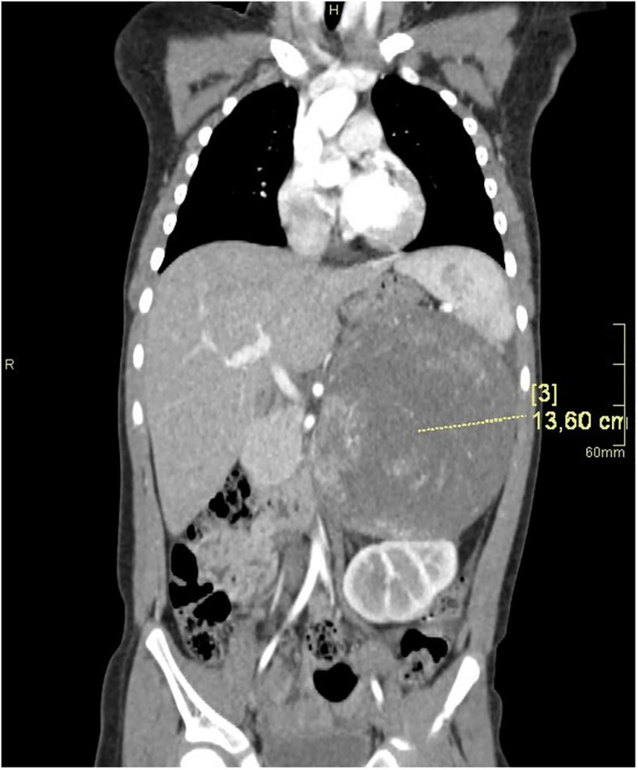
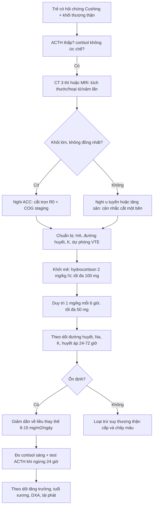
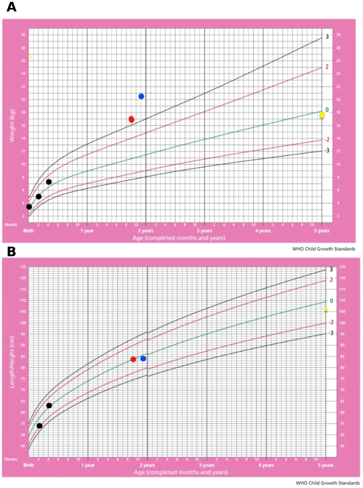

# 194 — Cushing do u vỏ thượng thận ở trẻ: chuẩn bị chu phẫu & theo dõi nội tiết sau cắt / Pediatric ACTH-independent Cushing syndrome: perioperative and postoperative endocrine management

**Tags:** `pattern:khoi-thuong-than` `pattern:cushing` `pattern:nam-hoa` `pattern:suy-thuong-than` `vung:thuong-than` `vung:o-bung-nhi` `protocol:CT-bung-co-can-quang` `protocol:MRI-thuong-than` `score:COG-stage-ACC` `score:Wieneke` `incidentaloma:u-thuong-than`

**Mức chắc chắn (certainty):** tổng hợp y văn (literature synthesis) — số liệu từ 2 ca nguyên văn có ảnh (PMC10702754, PMC13433170), 2 nghiên cứu nhiều trung tâm (IPACTR 254 bệnh nhi; COG ARAR0332, 78 bệnh nhi), 1 nghiên cứu hồi cứu 81 người lớn về phục hồi trục HPA sau cắt thượng thận và đồng thuận BSPED 2023 về liều hydrocortison ở trẻ.

> **Câu chốt:** Cắt u vỏ thượng thận ở trẻ **không kết thúc ở phòng mổ**. Bệnh nhi đã bị **ức chế trục dưới đồi–yên–thượng thận (HPA)** từ trước, nên khi lấy nguồn cortisol đột ngột sẽ **suy thượng thận cấp trong 24–72 giờ đầu** nếu không bù steroid. Ngược lại, bù quá tay/giảm liều quá nhanh sẽ che mất **tái phát** và gây **tăng đường huyết, chậm lành vết mổ**. Vì vậy mỗi ca cần: **liều stress chu phẫu theo cân nặng**, **theo dõi đường huyết–điện giải–huyết áp**, **lịch giảm liều**, và **đánh giá lại HPA + tăng trưởng–dậy thì–xương** trong 2–3 năm.

## 1. Tổng quan bệnh học – cơ chế hình ảnh

- **Vì sao trẻ có Cushing lại khác người lớn:** Cushing **không phụ thuộc ACTH (ACTH-independent)** do bệnh vỏ thượng thận chiếm **~20%** Cushing người lớn, **15%** ở trẻ **> 7 tuổi**, nhưng ở trẻ **nhỏ hơn** có thể chiếm **tới một nửa** số ca (PMC3132884). Nghĩa là ở trẻ nhỏ, **khối thượng thận là nguyên nhân hàng đầu**, còn u tuyến yên ít gặp hơn.
- **TẠI SAO cortisol thừa gây bệnh cảnh "béo + chậm cao":** cortisol tăng **tân tạo đường (gluconeogenesis)** và kháng insulin → tích mỡ trung tâm, mặt tròn, gù trâu; đồng thời **ức chế GH và IGF-1** + tăng hủy xương → **cao chậm lại, tuổi xương trẻ hơn tuổi thật** (dù androgen u tiết ra có thể làm tuổi xương tăng trong thể nam hóa). Trên **biểu đồ tăng trưởng**, đây là điểm phân biệt với béo phì đơn thuần: **cân nặng vượt +2 SD nhưng chiều cao quanh 0 SD** (ca PMC13433170: cân **+2 SD**, cao **0 SD**).
- **TẠI SAO u ngấm mạnh thì động mạch rồi thải thuốc:** vỏ thượng thận là mô **giàu mạch**, u tuyến và ACC đều **ngấm mạnh thì động mạch**; khác biệt nằm ở **kích thước – tính không đồng nhất – hoại tử – vôi hóa** (chi tiết ma trận ở bài `193`). Trên CT, ACC trẻ trung bình **9,9 cm** so với u tuyến **4,4 cm** (AUC **0,92**), không đồng nhất gặp **13/14** ACC so với **2/9** u tuyến (OR **45,5**) (Flynt, Pediatr Radiol 2015, dẫn trong bài `193`).
- **TẠI SAO cắt u gây suy thượng thận cấp:** cortisol cao kéo dài **ức chế CRH/ACTH**, làm **vỏ thượng thận bên đối diện teo** và **trục HPA "ngủ"**. Khi lấy u, cortisol tụt từ mức bệnh lý xuống **0** trong vài giờ — cơ thể không kịp đáp ứng stress phẫu thuật. Đây là lý do phải **bù liều stress ngay lúc khởi mê**, không chờ có triệu chứng.
- **Thời gian hồi phục trục HPA (số liệu định lượng):** ở 81 người lớn sau cắt thượng thận một bên vì tăng cortisol, trục HPA hồi phục **trung vị 4,3 tháng (IQR 1,6–11,4)**; **Cushing nặng 11,4 tháng** so với **Cushing trung bình 2,8** và **tăng cortisol nhẹ (MACE) 2,1 tháng**. Yếu tố dự báo hồi phục chậm: **cortisol trước mổ > 10 µg/dL** (9,7 so với 1,3 tháng), **bệnh kéo dài > 1 năm** (11,4 so với 2,8 tháng), **mặt tròn** (11,4 so với 2,2 tháng), **teo cơ** (13,1 so với 2,7 tháng) (PMC6246804). Ở trẻ, ca iMAD 23 tháng tuổi chỉ cần bù steroid **3 ngày** sau mổ — tức **dao động rất rộng**, không được hứa trước với gia đình một mốc cố định.
- **Bối cảnh dịch tễ – tiên lượng:** IPACTR (254 bệnh nhi): **84,2%** biểu hiện **nam hóa**, **5,5%** Cushing đơn thuần, **83%** cắt trọn u, sống không bệnh 5 năm **54,2%** (PubMed 14990639). COG ARAR0332 (78 bệnh nhi): EFS 5 năm theo giai đoạn **86,2% (I) – 53,3% (II) – 81% (III) – 7,1% (IV)**; OS **95,2 – 78,8 – 94,7 – 15,6%**; biến cố liên quan mitotane **10,5%** (PMC8462560).

## 2. Mẫu hình + chẩn đoán phân biệt theo tuổi & kiểu nội tiết (gamut)

- **A — Nhũ nhi/nhi nhỏ + Cushing đơn thuần, hình ảnh thượng thận "bình thường":** nghĩ **bệnh vi nốt thượng thận (isolated micronodular adrenal disease — iMAD)** hoặc **PPNAD/Carney**. Ca 23 tháng: MRI thượng thận **bình thường**, chẩn đoán nhờ **xạ hình ¹³¹I-NP-59** sau ức chế metyrapone (PMC13433170). Bài học: **MRI bình thường không loại trừ**.
- **B — Trẻ 2–6 tuổi + nam hóa nhanh:** **u tuyến hoặc ACC tiết androgen**; phân biệt **tăng sản thượng thận bẩm sinh (CAH) thể không điển hình**, **u tế bào Leydig**, **u thượng thận lạc chỗ**.
- **C — Trẻ + Cushing + tăng huyết áp nặng:** ACC thể hỗn hợp hoặc **pheochromocytoma** (khác hoàn toàn về xử trí — xem bài `195`); phân biệt bằng **metanephrine** trước mọi can thiệp.
- **D — Trẻ + Cushing + khối lớn không đồng nhất:** ACC (bài `193`) — cần **cắt trọn R0**, không sinh thiết trước nếu mổ được.
- **E — Cushing "trung ương" (ACTH cao):** u tuyến yên (Cushing disease) hoặc **tiết ACTH lạc chỗ** — hình ảnh thượng thận là **tăng sản hai bên đối xứng**, không có khối thống trị.
- Gợi nhớ **"4 nhóm theo ACTH":** **ACTH thấp + một khối** (u tuyến/ACC), **ACTH thấp + hai bên** (iMAD/PPNAD/BAH), **ACTH cao + tuyến yên** (Cushing disease), **ACTH cao + ngoài yên** (lạc chỗ).

## 3. Bảng so sánh phân biệt (ma trận đối chiếu)

| Thực thể (entity) | Hình ảnh điển hình | Chốt vào (rule-in) | Chốt loại (rule-out) | Gợi ý xác nhận |
|---|---|---|---|---|
| **U tuyến vỏ thượng thận** | Khối **< 4–5 cm**, đồng nhất, ngấm đều, không hoại tử; thượng thận đối diện **teo** | **Một khối nhỏ đồng nhất + ACTH thấp + cortisol không ức chế** | **Khối > 6 cm, hoại tử, vôi hóa, không đồng nhất** → ACC | CT 3 thì; mô bệnh sau cắt (Wieneke) |
| **ACC ở trẻ** | Khối lớn (trung bình **9,9 cm**), **không đồng nhất**, hoại tử, vôi hóa, ± huyết khối IVC | **Khối lớn + nam hóa/Cushing + DHEA-S/testosteron rất cao, ACTH thấp** | **Đồng nhất, < 4 cm, không xâm lấn** → u tuyến | CT/MRI bụng; COG staging; TP53 |
| **iMAD / PPNAD (Carney)** | **Hai thượng thận bình thường hoặc hơi to, nhiều nốt nhỏ**, không có khối thống trị | **ACTH thấp + hai bên + MRI bình thường + xạ hình NP-59 hai bên** | **Một khối thống trị đơn độc** → u | Xạ hình NP-59; gen PRKAR1A (PPNAD) |
| **Tăng sản thượng thận bẩm sinh (CAH)** | Hai bên to đối xứng, giữ hình; không khối | **17-OHP tăng + ACTH tăng + điện giải (hạ Na, tăng K)** | **ACTH thấp + một khối** → u/hyperplasia nguyên phát | 17-OHP, CYP21A2 |
| **Cushing disease (u tuyến yên)** | Tuyến yên **vi tuyến ≤ 10 mm**; thượng thận **tăng sản hai bên** | **ACTH cao/không ức chế + MRI yên có u + hai thượng thận to** | **ACTH bị ức chế hoàn toàn** → nguồn tại thượng thận | MRI yên động; xoang đá dưới |
| **Pheochromocytoma** | Khối ngấm mạnh, có thể hoại tử; ± hạch | **Metanephrine tăng + cơn THA** | **Cortisol/androgen tăng, metanephrine bình thường** | Metanephrine trước can thiệp (bài `195`) |

*Bé gái 4 tuổi, dậy thì sớm + dấu hiệu Cushing: CT bụng mặt phẳng trước–sau, khối đặc lớn thượng thận trái **13,6 cm**, không đồng nhất, đè đẩy thận trái xuống; mô bệnh là ACC. Nguồn: Frontiers in Endocrinology 2023 (PMC10702754), CC BY 4.0.*

## 4. Protocol chụp + phác đồ nội tiết chu phẫu

**Hình ảnh (trước mổ):**
- **CT bụng 3 thì có cản quang** là chuẩn: đo **kích thước, HU không tiêm, tính đồng nhất, hoại tử, vôi hóa, xâm lấn tĩnh mạch chủ dưới**. Trẻ nhỏ ưu tiên **MRI** nếu đã chụp nhiều lần (ALARA) — nhưng **MRI bình thường không loại trừ** iMAD (ca PMC13433170).
- **X-quang tuổi xương** (bàn tay trái) và **DXA + đánh giá gãy đốt sống** khi Cushing kéo dài: cortisol thừa gây **loãng xương, gãy lún**, hồi phục một phần sau khi chữa.
- **Không sinh thiết** khối thượng thận nghi PPGL; với ACC có thể mổ trực tiếp.

**Chuẩn bị chu phẫu (kiểm soát trước mổ):**
- Điều chỉnh **huyết áp, đường huyết, hạ kali**; dự phòng **huyết khối tĩnh mạch** (Cushing là trạng thái tăng đông); điều trị nhiễm trùng trước mổ.
- **Không dùng liều stress sớm quá mức kéo dài** — bù đủ trong ngày mổ, giảm nhanh sau đó theo lâm sàng.

**Liều hydrocortison chu phẫu ở trẻ (BSPED 2023, PMC10646833):**
- **Khởi mê:** hydrocortison **2 mg/kg IV** (tối đa **100 mg**); **sơ sinh: 4 mg/kg IV**.
- **Duy trì:** **1 mg/kg IV mỗi 6 giờ** (tối đa **50 mg**/lần); **sơ sinh 2 mg/kg mỗi 6 giờ**. Có thể truyền liên tục sau liều khởi mê.
- **Suy thượng thận cấp (cấp cứu):** hydrocortison IM/IV **25 mg (< 1 tuổi) · 50 mg (1–5 tuổi) · 100 mg (≥ 6 tuổi)**, lặp lại sau 6 giờ nếu còn sốc.
- **Ngày ốm (sick day):** tổng liều hydrocortison **~30 mg/m²/ngày** chia 4 lần; liều thay thế thường **8 mg/m²/ngày**, tối ưu tăng trưởng **10–15 mg/m²/ngày**.

**Sau mổ — theo dõi và giảm liều:**
- **24–72 giờ đầu:** theo dõi **đường huyết** (trẻ nhỏ dễ hạ đường huyết khi mất cortisol), **Na⁺/K⁺**, **huyết áp**, nước tiểu; hạ HA + hạ Na + tăng K + hạ đường huyết = **suy thượng thận cấp**.
- **Giảm liều:** từ liều stress xuống liều thay thế trong **2–4 ngày** ở ca đơn giản; ca Cushing nặng/ACC cần **giảm chậm theo tuần** và giáo dục gia đình về **sick day + ống tiêm hydrocortison dự phòng**.
- **Đánh giá trục HPA:** đo **cortisol 8 giờ sáng** sau khi ngừng hydrocortison **24 giờ** (tránh nhiễu xét nghiệm); nếu cortisol thấp, **test ACTH (cosyntropin)**; dự kiến hồi phục **trung vị 4,3 tháng**, có thể **> 1 năm** ở ca nặng.
- **Theo dõi dài hạn:** cân nặng/chiều cao mỗi 3–6 tháng (bắt kịp tăng trưởng), **tuổi xương**, **dậy thì**, **DXA** sau 12 tháng; tầm soát tái phát bằng hình ảnh + xét nghiệm nội tiết.
- **Nếu dùng mitotane (ACC):** thuốc **cảm ứng enzym gan**, làm giảm nồng độ hydrocortison → **tăng liều thay thế** và dùng **hydrocortison** (không dùng dexamethason để theo dõi); theo dõi nồng độ mitotane.

## 5. Biến thể bình thường và cạm bẫy

- **Biến thể bình thường:** **thượng thận trái cao hơn phải**, hình chữ V/Y, **không dày > 5 mm** ở trẻ lớn; **tủy thượng thận không thấy** trên CT thường; **bóng thượng thận giả** do lách/tĩnh mạch lách.
- **Cạm bẫy 1 — "MRI bình thường nên loại trừ Cushing do thượng thận":** sai. iMAD có MRI bình thường; phải dựa vào **sinh hóa + xạ hình** (PMC13433170).
- **Cạm bẫy 2 — bù steroid quá tay rồi kết luận "không suy thượng thận":** cortisol đo trong lúc đang truyền hydrocortison **không đánh giá được trục HPA**; phải ngừng **24 giờ** trước xét nghiệm.
- **Cạm bẫy 3 — cắt u xong là "khỏi":** vẫn phải theo dõi **tái phát** (ACC giai đoạn II có EFS 5 năm chỉ **53,3%**) và **di căn phổi** (ca u tuyến "lành" ở trẻ vẫn di căn phổi khi bỏ theo dõi — PMC11220538).
- **Cạm bẫy 4 — nhầm béo phì đơn thuần với Cushing:** béo phì có **cao theo cân** (cả hai +2 SD); Cushing có **cân tăng, cao chững**; thêm **tăng HA, rạn da tím, yếu cơ**.
- **Cạm bẫy 5 — hạ đường huyết ở trẻ nhỏ sau mổ:** cortisol là hormone **đối kháng insulin**; khi mất nguồn cortisol đột ngột, trẻ **< 5 tuổi** dễ hạ đường huyết — kiểm tra glucose mỗi 4–6 giờ trong 48 giờ đầu.
- **Cạm bẫy 6 — dùng dexamethason "để bù" ở ca ACC dùng mitotane:** dexamethason không theo dõi được bằng cortisol và **không thay thế được** liều hydrocortison cần thiết; ưu tiên **hydrocortison**.

## 6. Tự lượng giá — Blind Quiz

**Ca 1 — Bé gái 4 tuổi, dậy thì sớm và mặt tròn. Nhìn ảnh trước, mô tả trước.**

- Gợi ý lâm sàng: tăng cân nhanh, lông mu sớm, huyết áp cao; không dùng corticoid.
- Câu hỏi: (1) Mô tả khối và mối liên quan với thận/lách; (2) 3 chẩn đoán phân biệt; (3) xét nghiệm nào chốt nguồn cortisol?

<b>Bấm để hiện đáp án (findings + chẩn đoán)</b>

- **Dấu hiệu:** khối đặc **13,6 cm** vùng thượng thận trái, **không đồng nhất**, có ổ giảm tỷ trọng (hoại tử), đè đẩy thận trái xuống và đẩy lách sang bên; không thấy tuyến thượng thận trái bình thường.
- **Chẩn đoán:** **ung thư vỏ thượng thận (ACC)** ở trẻ (mô bệnh: tăng sinh tế bào ác tính, hoại tử, xâm lấn mạch) — bệnh nhi có hội chứng Li–Fraumeni.
- **Chốt nguồn cortisol:** **ACTH thấp**, cortisol máu **không ức chế** với dexamethason, **DHEA-S/testosteron tăng**; sau đó **CT/MRI bụng + mô bệnh**.
- **Xử trí:** cắt trọn u + phân giai đoạn COG; chuẩn bị **hydrocortison liều stress** và theo dõi suy thượng thận sau mổ.
- **Nguồn ảnh:** Frontiers in Endocrinology 2023 (PMC10702754), CC BY 4.0.

**Ca 2 — Bé gái 23 tháng, tăng cân nhanh, rậm lông, HA cao. Nhìn biểu đồ tăng trưởng.**

- Câu hỏi: (1) Đọc vị trí cân nặng và chiều cao trên 2 biểu đồ; (2) kiểu này gợi ý gì so với béo phì đơn thuần? (3) nếu MRI thượng thận bình thường thì làm gì tiếp?

<b>Bấm để hiện đáp án</b>

- **Dấu hiệu:** (A) cân nặng tăng vọt lên **+2 SD** quanh 22 tháng; (B) chiều cao vẫn quanh **0 SD** — **cân tăng nhưng cao không tăng tương ứng**.
- **Ý nghĩa:** kiểu "béo + chững cao" phù hợp **Cushing**, khác béo phì đơn thuần (thường cao vượt trung bình).
- **Bước tiếp:** sinh hóa (**ACTH thấp, cortisol không ức chế, UFC tăng**); nếu MRI thượng thận bình thường → **xạ hình ¹³¹I-NP-59** sau ức chế metyrapone để tìm **iMAD/PPNAD** hai bên; ca này sau **cắt thượng thận phải** chỉ cần bù steroid **3 ngày**, theo dõi 3 năm ổn định.
- **Nguồn ảnh:** Frontiers in Endocrinology 2026 (PMC13433170), CC BY 4.0.

## Bài liên quan chéo
- [193 – Ung thư vỏ thượng thận ở trẻ: nam hóa/Cushing, COG, Wieneke & mitotane](../193-ung-thu-vo-thuong-than-o-tre/lesson.md)
- [092 – Suy thượng thận & suy tuyến yên do ức chế điểm kiểm soát miễn dịch quanh mổ](../092-suy-thuong-than-suy-tuyen-yen-quanh-mo/lesson.md)
- [155 – Tổn thương thượng thận tình cờ](../155-thuong-than-tinh-co/lesson.md)
- [195 – Đột quỵ cấp ở bệnh nhân PPGL chưa cắt u](../195-dot-quy-cap-ppgl-tieu-soi-huyet/lesson.md)
- [177 – Điều trị và theo dõi PPGL](../177-dieu-tri-va-theo-doi-ppgl/lesson.md)

## Ảnh
- `images/194_cushing-tre_CT_PMC10702754-F2.jpg` — Fig. 2 (CT bụng), CC BY 4.0.
- `images/194_cushing-tre_bieu-do-tang-truong_PMC13433170-F2.jpg` — Fig. 2 (biểu đồ tăng trưởng WHO), CC BY 4.0.
- Nguồn, giấy phép và attribution từng ảnh: `images/CREDITS.md` + `sources.md`.

> Không dùng để chẩn đoán độc lập khi chưa có người hướng dẫn.
