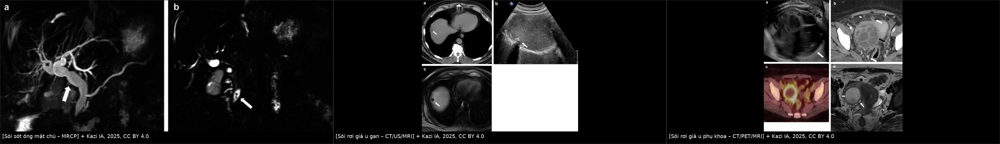
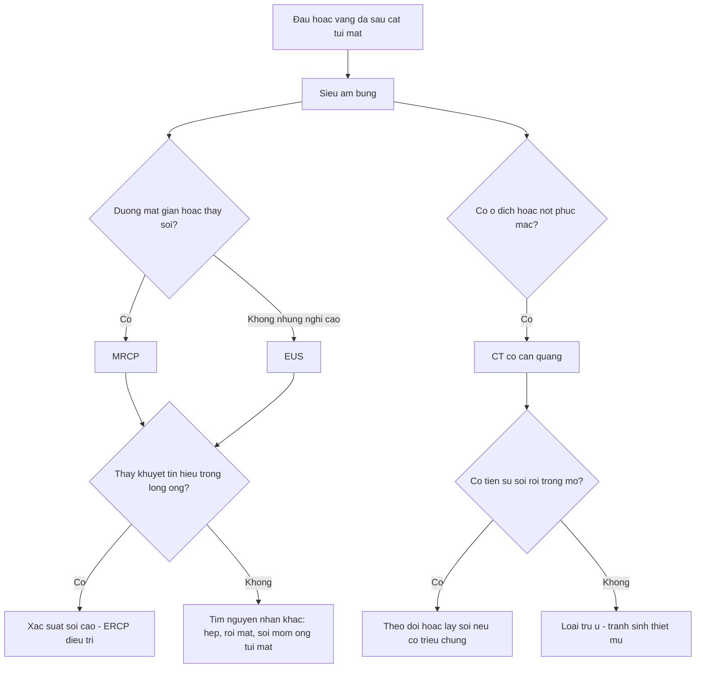
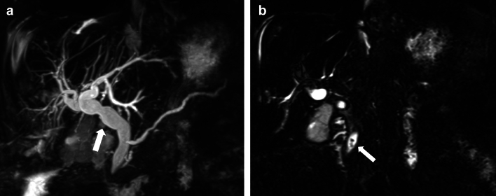
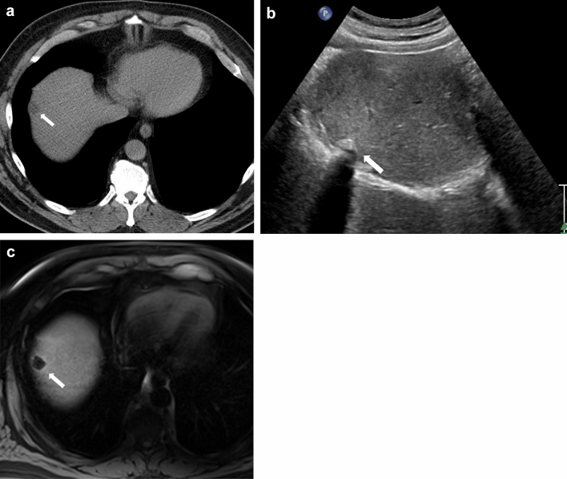
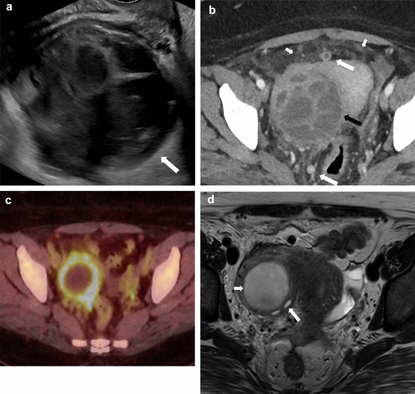

# 1940 — Sỏi sót, sỏi tái phát và sỏi rơi sau cắt túi mật / Retained, recurrent and dropped gallstones

**Tags:** `pattern:khuyet-tin-hieu` `pattern:soi-duong-mat` `vung:duong-mat` `vung:tui-mat` `vung:o-bung` `protocol:MRCP` `protocol:EUS` `score:ASGE-choledocholithiasis`
**Mức chắc chắn (certainty):** tổng hợp y văn (literature synthesis) — dựa trên **tổng quan biến chứng sau cắt túi mật có 3 ca minh họa** (Abdom Radiol 2025, PMC11711778), **nghiên cứu dân số GallRiks về sỏi sót** (Surg Open Sci 2026, PMC12905770), **phân tích gộp Cochrane EUS vs MRCP** (2015, PMC6464848), **so sánh CT vs MRI/MRCP 691 ca** (Cureus 2025, PMC12569963) và các ca sỏi mỏm ống túi mật/sỏi rơi giả u. Không có ca do nhóm tự chụp.

> **Câu hỏi thực hành:** nữ **75 tuổi**, cắt túi mật nội soi **3 năm trước**, nay **đau hạ sườn phải + vàng da nhẹ**, **ALP tăng**, siêu âm thấy **đường mật trong gan giãn** nhưng **không thấy sỏi**. Có phải "đau do cắt túi mật" không, và chụp gì tiếp?
> Bài chốt **ba quyết định**: **(1)** đau/vàng da sau cắt túi mật **không được mặc định là "hội chứng sau cắt túi mật"** — phải loại **sỏi sót ống mật chủ**, **sỏi mỏm ống túi mật**, **hẹp đường mật**; **(2)** **MRCP là lựa chọn đầu tay** (sens **0,93**, spec **0,96**), **EUS** tương đương (sens **0,95**, spec **0,97**) và dùng khi MRCP âm tính mà nghi ngờ cao; **(3)** sỏi **rơi trong mổ** là nguyên nhân **hay bị quên nhất** — nó tạo **u hạt/áp-xe** ở phúc mạc, có thể **giả di căn phúc mạc hoặc u buồng trứng** trên CT/PET.

## 1. Tổng quan bệnh học – cơ chế hình ảnh

- **Ba cơ chế khác nhau, ba bộ hình ảnh khác nhau:**
  1. **Sỏi sót (retained):** sỏi đã có trong **ống mật chủ** nhưng bị bỏ sót lúc mổ (không thấy trên X-quang mổ/đường mật đồ trong mổ, hoặc sỏi nhỏ trôi lên trên).
  2. **Sỏi mỏm ống túi mật/túi mật còn lại (stump/remnant):** gặp khi **cắt túi mật bán phần (subtotal)** hoặc mỏm ống túi mật còn dài — sỏi nằm **trong mỏm**, gây **"Mirizzi sau cắt túi mật" (post-cholecystectomy Mirizzi syndrome)**.
  3. **Sỏi rơi (dropped/spilled):** sỏi rơi ra **khoang phúc mạc** khi túi mật thủng trong mổ; sỏi trở thành **dị vật** → **u hạt, áp-xe, dò**, hiếm khi **tắc ruột**.
- **Tần suất — đây là biến chứng phổ biến, không hiếm:** sỏi rơi gặp trong **36%** ca cắt túi mật nội soi (báo cáo khác: **tới 40%**); **16–50%** số sỏi rơi **không lấy hết**; **0,1–6%** bệnh nhân có biến chứng; trong số có biến chứng, **50–60% là áp-xe** ổ bụng/thành bụng/sau phúc mạc.
- **Sỏi sót ống mật chủ sau mổ — số liệu dân số:** trong đoàn hệ **386** bệnh nhân được nghi ngờ sỏi ống mật chủ, **182 (47,2%)** có sỏi trên **đường mật đồ trong mổ**; sau mổ, **33/182 (18,1%)** xuất hiện **sỏi sót** được xác nhận (24 ca có ERCP ghi nhận, 9 ca chỉ ghi trong hồ sơ). Tức là **gần 1/5** bệnh nhân có sỏi đã thấy trong mổ vẫn còn sỏi sau mổ — đây là lý do **không được "tin" một lần sạch sỏi**.
- **TẠI SAO MRCP thấy sỏi còn CT thường âm tính:** sỏi cholesterol **gần như đồng đậm độ với dịch mật**, nên trên CT không tách khỏi mật; **chỉ sỏi cản quang (giàu calci)** mới thấy rõ. Ngược lại, trên **chuỗi T2 nặng** (MRCP), **dịch mật sáng rực** còn sỏi **không có proton linh động** → hiện thành **khuyết tín hiệu (signal void)**. Chính vì vậy **không khí, dòng chảy, mỏm tá tràng, chèn ép mạch** cũng tạo khuyết tín hiệu và **bắt chước sỏi**.
- **TẠI SAO sỏi rơi lại tạo khối giả u:** sỏi là **dị vật không tan**; phản ứng viêm quanh sỏi tạo **vỏ xơ ngấm thuốc + mô hạt**, có thể **vôi hóa viền** và **dính vào phúc mạc/tạng**. Trên CT, tổn thương là **nốt/khối mô mềm ± vôi hóa**, không có đặc điểm của sỏi → dễ đọc thành **di căn phúc mạc**; trên **PET/CT**, viêm hoạt động cho **tăng chuyển hóa viền** → **dương tính giả**.
- **Số liệu chẩn đoán hình ảnh (dùng để chọn phương thức):** so sánh trên **691** bệnh nhân (tỉ lệ sỏi **45%**): **MRI/MRCP** sens **92,7%**, spec **91,9%**, độ chính xác **92,3%**, AUC **0,95**; **CT** 73,2% / 82,9% / 78,3% / AUC 0,83; **đánh giá lâm sàng** 71,1% / 87,1% / 80%. Phân tích gộp Cochrane: **EUS** sens **0,95** (0,91–0,97), spec **0,97** (0,94–0,99) — 13 nghiên cứu, 1.537 người; **MRCP** sens **0,93** (0,87–0,96), spec **0,96** (0,90–0,98) — 7 nghiên cứu, 996 người; **không khác biệt** (p = 0,5). Với **xác suất trước 41%**, kết quả **EUS dương** đưa xác suất sau lên **0,96**, **âm** xuống **0,03**.

## 2. Mẫu hình + chẩn đoán phân biệt theo vị trí (gamut)

- **Mẫu hình 1 — khuyết tín hiệu trong ống mật:** sỏi trong **OMC/ống gan chung/ống túi mật**, kèm **giãn đường mật thượng lưu**; bờ khuyết **tròn, đều**, nằm trong lòng ống, **không đổi theo tư thế**.
- **Mẫu hình 2 — cấu trúc cản quang/tăng đậm độ:** trên CT, sỏi calci hóa là **điểm tăng đậm độ**; sỏi trong **mỏm ống túi mật** nằm ở **rãnh túi mật**, sát **gan phải**, có thể làm **mỏm giãn thành nang** (ca báo: mỏm giãn từ **nhẹ lúc 241 ngày** lên **> 40 mm với sỏi 9 mm** sau **2 năm 122 ngày**).
- **Mẫu hình 3 — ổ dịch/nốt phúc mạc có sỏi ở trung tâm:** sỏi rơi tạo **u hạt** (nốt đặc, có thể vôi hóa) hoặc **áp-xe** (ổ dịch vỏ ngấm thuốc ± khí); vị trí hay gặp: **dưới gan, khoang Morison, mặt hoành phải, hố chậu, thành bụng tại lỗ trocar**.
- **Gamut theo vị trí — 5 nhóm cần nghĩ khi "đau/vàng da sau cắt túi mật":**
  1. **Trong lòng ống mật chủ:** sỏi sót, sỏi tái phát, sỏi nguyên phát (LPAC — đột biến **ABCB4/MDR3**).
  2. **Trong mỏm ống túi mật/túi mật còn lại:** sỏi mỏm, **hẹp mỏm**, **Mirizzi sau cắt túi mật**.
  3. **Tại miệng nối/hẹp đường mật:** hẹp sau mổ, rò mật, **kẹp clip di trú** làm nidus.
  4. **Khoang phúc mạc:** sỏi rơi → u hạt, áp-xe, dò.
  5. **Ngoài ổ bụng (hiếm):** sỏi rơi di trú **lên ngực hoặc đường niệu**.

## 3. Bảng so sánh phân biệt (ma trận đối chiếu)

| Thực thể (entity) | Hình ảnh điển hình | Chốt vào (rule-in) | Chốt loại (rule-out) | Gợi ý xác nhận |
|---|---|---|---|---|
| **Sỏi sót ống mật chủ** | Khuyết tín hiệu **tròn, trong lòng OMC**, giãn đường mật thượng lưu; CT có thể âm tính | **Khuyết tín hiệu nằm trong lòng ống + giãn thượng lưu + tiền sử sỏi** | Khuyết tín hiệu **ở thành/ngoài lòng ống**, đổi theo tư thế → khí/dòng chảy | MRCP; EUS nếu MRCP âm mà nghi cao; ERCP để **điều trị** |
| **Sỏi mỏm ống túi mật / Mirizzi sau cắt túi mật** | Sỏi trong **mỏm giãn thành nang** ở rãnh túi mật; có thể **chèn ép OMC** gây vàng da | **Cấu trúc dạng nang ở rãnh túi mật + sỏi trong đó + tiền sử cắt bán phần** | Nang ống mật chủ (vị trí trong gan/ngoài gan, không sát rãnh túi mật) | MRCP + EUS; CT thấy mỏm giãn |
| **Sỏi rơi — u hạt (granuloma)** | Nốt đặc **± vôi hóa viền**, sát gan/mặt hoành/hố chậu; **không có sỏi trong đường mật** | **Tiền sử túi mật thủng/sỏi rơi trong mổ + nốt ở vị trí điển hình** | Không có tiền sử rơi sỏi + nốt mới, tăng kích thước → phải loại u | US (ổ tăng âm + bóng lưng), CT; **chỉ sinh thiết khi không thể loại u** |
| **Sỏi rơi — áp-xe** | Ổ dịch **vỏ ngấm thuốc**, có thể có **khí**, sỏi **ở trung tâm** ổ | **Ổ dịch + cấu trúc cản quang trung tâm + tiền sử rơi sỏi** | Ổ dịch không có sỏi + sốt cao đơn thuần → áp-xe vi khuẩn thông thường | CT/US; **dẫn lưu không đủ nếu còn sỏi** — cần lấy sỏi |
| **Sỏi tái phát/nguyên phát (LPAC)** | Nhiều sỏi **trong gan + OMC** sau cắt túi mật, tái diễn nhiều đợt | **Tái phát nhiều lần + sỏi trong gan + tiền sử gia đình** | Một đợt sỏi đơn độc sau mổ → nghĩ sỏi sót hơn | MRCP; xét gen **ABCB4** khi tái phát sớm |
| **Di căn phúc mạc / u buồng trứng (bắt chước)** | Nốt phúc mạc nhiều ổ, khối phần phụ **phức hợp**, **PET dương tính viền** | **Nốt + bệnh ác đang theo dõi** | **Tiền sử sỏi rơi** + nốt **không tăng theo thời gian** + có cấu trúc cản quang trung tâm → nghĩ sỏi | Đối chiếu phim cũ; **tránh sinh thiết mù**; hỏi kỹ biên bản mổ |
| **Clip phẫu thuật di trú** | Cấu trúc **cản quang hình chữ V/thẳng** trong OMC hoặc mỏm, gây sỏi quanh clip | **Hình dạng clip + vị trí đúng chỗ đặt clip cũ** | Không có hình dạng clip → sỏi thật | CT (clip rõ), MRCP (clip = khuyết tín hiệu) |

*Trái: MRCP — giãn đường mật + **sỏi sót ở đoạn cuối OMC** (khuyết tín hiệu). Giữa: sỏi rơi ở **vòm gan phải** — CT giảm đậm độ, siêu âm **tăng âm + bóng lưng**, MRI **khuyết tín hiệu**. Phải: sỏi rơi gây **áp-xe hố chậu** với **nốt phúc mạc** và **PET tăng chuyển hóa viền** — giả u phụ khoa/di căn. Nguồn: Kazi IA và cs, *Abdom Radiol* 2025 (PMC11711778), **CC BY 4.0**. Ảnh ghép letterbox, không crop.*

### Hai dấu hiệu quyết định "sỏi thật" hay "bắt chước"

- **Dấu "trong lòng ống" (intraluminal):** khuyết tín hiệu **bị bao quanh hoàn toàn bởi dịch mật sáng** ở mọi bình diện → sỏi. Nếu khuyết **chạm thành** hoặc **nằm ngoài lòng ống** → nghĩ **khí, clip, chèn ép mạch**.
- **Dấu "bóng lưng sạch" (clean posterior shadowing) trên siêu âm:** sỏi cho **bóng lưng rõ, đều**; khí cho **bóng lưng bẩn, lẫn vệt** ("dirty shadowing") và **di chuyển** khi đổi tư thế/ấn đầu dò.

## 4. Protocol chụp + hệ phân tầng nguy cơ

- **Bước 1 — siêu âm bụng (đầu tay):** đánh giá **giãn đường mật**, sỏi trong túi mật/mỏm, **dịch quanh gan**, và **quét cả khoang phúc mạc** (dưới gan, mặt hoành, hố chậu, lỗ trocar) bằng **đầu dò tần số cao** khi nghi sỏi rơi nhỏ (vài mm).
- **Bước 2 — MRCP (không cần cản quang):** chuỗi **T2 nặng 3D + thick slab**, đọc **khuyết tín hiệu trong lòng ống**, đo **đường kính OMC** và mức giãn; luôn **đối chiếu 2 bình diện** để loại khí/dòng chảy. Nếu **MRCP âm mà nghi ngờ cao** → **EUS**.
- **Bước 3 — CT có cản quang:** dùng cho **ổ dịch, áp-xe, nốt phúc mạc, sỏi calci hóa, biến chứng mạch**; **không dùng CT để loại trừ sỏi cholesterol**.
- **Bước 4 — ERCP:** là **điều trị**, không phải xét nghiệm chẩn đoán; chỉ định theo **phân tầng nguy cơ ASGE 2019**:
  - **Yếu tố mạnh:** **sỏi thấy trên hình ảnh**, **viêm đường mật lâm sàng**, **bilirubin toàn phần > 4 mg/dL** → nguy cơ **cao**, ERCP trước/xuất viện.
  - **Yếu tố trung bình:** **OMC giãn > 6 mm** (khi còn túi mật), **bilirubin 1,8–4 mg/dL**, **tuổi > 55** → nguy cơ **trung bình**, làm **MRCP/EUS trước**.
  - **Không yếu tố nào** → nguy cơ **thấp**, không ERCP mù.
- **Với sỏi rơi:** **không có "phân độ" hình ảnh** — quyết định dựa trên **có triệu chứng/áp-xe hay không**: sỏi rơi **không triệu chứng** thường **theo dõi**; **áp-xe/tắc ruột/dò** → **lấy sỏi** (nội soi phúc mạc qua da, phẫu thuật nội soi, hoặc mổ).

## 5. Biến thể bình thường và cạm bẫy

- **Khuyết tín hiệu "giả sỏi" trên MRCP:** **khí sau cắt cơ vòng Oddi/ERCP cũ**, **dòng chảy**, **mỏm tá tràng lớn (prominent duodenal papilla)**, **mạch máu chèn ép**, **clip**. Đọc trên **nhiều bình diện** và **so trước–sau** là bắt buộc.
- **Siêu âm "không thấy sỏi" không loại trừ sỏi OMC:** khí tá tràng và đoạn cuối OMC nằm sau tá tràng là **điểm mù kinh điển**.
- **Sỏi rơi bị đọc thành di căn:** ca 63 tuổi có tiền sử **leiomyosarcoma**, **10 tháng** sau cắt túi mật xuất hiện **nốt phúc mạc** nghi tái phát; **sinh thiết qua CT không kết luận**, **nội soi ổ bụng** mới thấy **sỏi rơi + viêm u hạt**. Bài học: **hỏi biên bản mổ** trước khi kết luận ung thư.
- **PET dương tính không đồng nghĩa ung thư:** áp-xe quanh sỏi cho **tăng chuyển hóa viền** — bẫy trực tiếp của ca hố chậu ở hình trên.
- **Dẫn lưu ổ áp-xe mà bỏ sỏi = thất bại:** sỏi là **dị vật**, ổ sẽ **tái lập** hoặc **thành dò**; phải **lấy sỏi**.
- **"Đau do cắt túi mật" là chẩn đoán loại trừ:** trước khi gắn nhãn, phải loại **sỏi sót/mỏm**, **hẹp đường mật**, **rò mật**, **viêm tụy**, **loét dạ dày**, **đau thành bụng** (bài 1967).

## 6. Tự lượng giá — Blind Quiz

**Ca 1 — Nữ 75 tuổi, cắt túi mật 3 năm trước, đau hạ sườn phải + vàng da nhẹ, ALP tăng, siêu âm chỉ thấy giãn đường mật. Nhìn MRCP, mô tả trước.**

- Hỏi: có bao nhiêu khuyết tín hiệu? Nằm **trong lòng ống** hay ngoài? Vì sao siêu âm và CT có thể âm tính? Bước tiếp theo là chẩn đoán hay điều trị?

<b>Bấm để hiện đáp án (findings + chẩn đoán)</b>

- **Dấu hiệu:** (a) MIP MRCP — **giãn đường mật trong và ngoài gan** (mũi tên); (b) 3D SPACE — **khuyết tín hiệu tròn ở đoạn cuối ống mật chủ**, bao quanh hoàn toàn bởi dịch mật sáng.
- **Chẩn đoán:** **sỏi sót ống mật chủ** sau cắt túi mật.
- **Vì sao siêu âm/CT âm:** sỏi cholesterol **đồng đậm độ dịch mật** nên CT không tách; OMC đoạn cuối **bị khí tá tràng che** trên siêu âm.
- **Vì sao MRCP:** sỏi **không có proton linh động** → **khuyết tín hiệu** trên nền mật sáng; sens **0,93**, spec **0,96** (Cochrane).
- **Bước tiếp theo:** **ERCP điều trị** (không phải "chụp lại để xác nhận" nhiều lần) khi có **vàng da + giãn đường mật**.
- Nguồn: Kazi IA và cs, *Abdom Radiol* 2025 (PMC11711778), **CC BY 4.0**.

**Ca 2 — Nam 51 tuổi, cắt túi mật vài tháng trước, **nấc cụt dai dẳng**; CT ngực bình thường nhưng thấy một tổn thương ở vòm gan phải. Ba phương thức của cùng tổn thương:**

- Hỏi: mỗi phương thức cho thấy gì? Tổn thương **đặc hay dịch**? Dấu hiệu nào trên siêu âm quyết định? Có nên sinh thiết?

<b>Bấm để hiện đáp án (findings + chẩn đoán)</b>

- **Dấu hiệu:** (a) CT không cản quang — **tổn thương giảm đậm độ** ở vòm gan phải (mũi tên); (b) siêu âm — **ổ tăng âm kèm bóng lưng** ở vùng dưới hoành, **ấn vào gan phải**; (c) MRI T1 — **khuyết tín hiệu** tương ứng.
- **Chẩn đoán:** **sỏi rơi (dropped gallstone)** ở khoang dưới hoành, tạo phản ứng mô quanh sỏi — **không phải u gan**.
- **Vì sao CT giả "tổn thương dịch":** sỏi cholesterol **đồng đậm độ**, phần viêm quanh sỏi tạo **giảm đậm độ**; chỉ **siêu âm** mới lộ bản chất **dị vật tăng âm + bóng lưng**.
- **Có nên sinh thiết:** **không** khi đã có **bóng lưng + tiền sử cắt túi mật**; sinh thiết mù sỏi dễ gây **dò/nhiễm**.
- Nguồn: Kazi IA và cs, *Abdom Radiol* 2025 (PMC11711778), **CC BY 4.0**.

**Ca 3 — Nữ 46 tuổi, cắt túi mật trước đó, nay khối hố chậu; siêu âm thấy khối phần phụ phức hợp; CT có nốt phúc mạc, PET dương tính.**

- Hỏi: hình ảnh gợi ý **u buồng trứng/di căn phúc mạc** hay **viêm**? Dấu hiệu nào trên PET dễ đánh lừa? Câu hỏi bệnh sử nào phải đặt ra trước khi mổ?

<b>Bấm để hiện đáp án (findings + chẩn đoán)</b>

- **Dấu hiệu:** (a) siêu âm — **khối phức hợp đa vách** ở phần phụ; (b) CT — khối **ngấm thuốc không đều**, **mất mặt phẳng mỡ với tử cung**, **nốt phúc mạc tròn**; (c) PET/CT — **tăng chuyển hóa ở viền** khối; (d) MRI T2 — **giảm vách, tăng tín hiệu dịch**, khối **dính buồng trứng phải**.
- **Chẩn đoán:** **áp-xe hố chậu do sỏi rơi**; các "nốt phúc mạc" là **sỏi + viêm u hạt** (giải phẫu bệnh xác nhận), không phải di căn.
- **Vì sao PET đánh lừa:** viêm hoạt động quanh sỏi cho **tăng chuyển hóa viền** — giống **di căn phúc mạc/u buồng trứng**.
- **Câu hỏi bệnh sử:** **"lúc mổ túi mật có thủng/túi mật vỡ và có ghi nhận rơi sỏi không?"** — nếu có, **đừng sinh thiết mù**, tìm **cấu trúc cản quang trong ổ** trên CT và **bóng lưng** trên siêu âm.
- Nguồn: Kazi IA và cs, *Abdom Radiol* 2025 (PMC11711778), **CC BY 4.0**.

## Bài liên quan chéo
- [130 – Túi mật: bình thường và bệnh lý](../130-tui-mat/lesson.md)
- [131 – Tắc mật: tiếp cận và phân biệt](../131-tac-mat/lesson.md)
- [107 – MRCP và gadoxetic acid (HBP)](../107-mrcp-gadoxetic-acid-hbp/lesson.md)
- [108 – Tổn thương đường mật sau cắt túi mật (Strasberg–Bismuth)](../108-ton-thuong-duong-mat-sau-cat-tui-mat/lesson.md)
- [141 – Phúc mạc: dịch, nốt, dày](../141-phuc-mac/lesson.md)
- [1925 – Viêm túi mật cấp trong thai kỳ](../1925-viem-tui-mat-cap-thai-ky/lesson.md)
- [1930 – Sỏi mật không biến chứng trong thai kỳ](../1930-soi-mat-khong-bien-chung-thai-ky/lesson.md)

> Không dùng để chẩn đoán độc lập khi chưa có người hướng dẫn.
