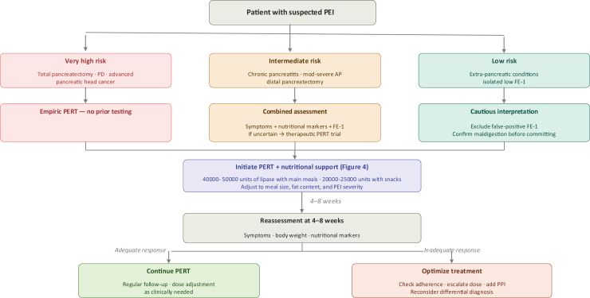
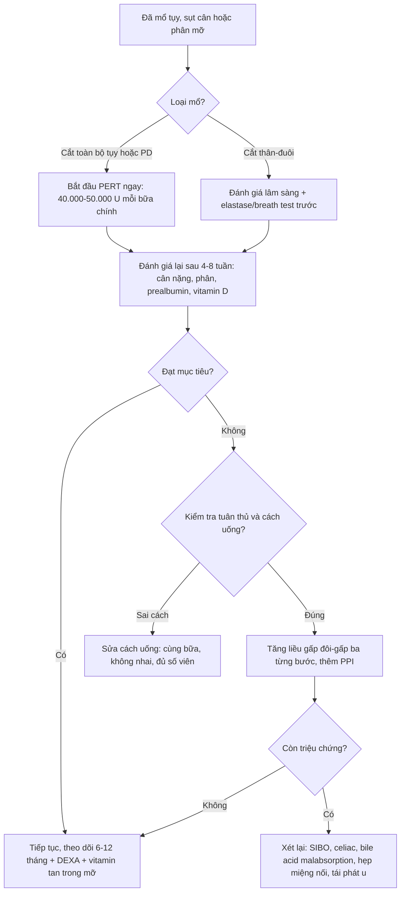
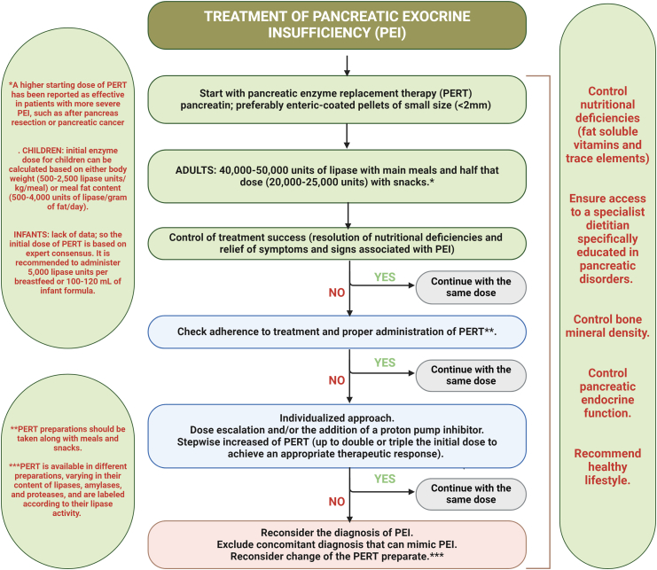

# 1941 — Suy tụy ngoại tiết sau mổ tụy: liều enzyme (PERT), theo dõi và cạm bẫy / Pancreatic exocrine insufficiency after pancreatic surgery

**Tags:** `pattern:suy-tuy-ngoai-tiet` `pattern:tieu-chay` `pattern:giam-can` `pattern:thieu-vi-chat` `vung:tuy` `vung:o-bung` `protocol:elastase-1` `protocol:13C-MTG` `protocol:CT-bung` `score:PERT-dose`

**Mức chắc chắn (certainty):** tổng hợp y văn (literature synthesis) — số liệu lấy từ **một sổ đăng ký đa trung tâm 1.015 bệnh nhân** (EURO-PEI, United European Gastroenterol J 2026 — PMC13633429), **một đoàn hệ tiến cứu 254 ca đo chức năng bằng breath test** (Pancreatology 2023), **một thử nghiệm ngẫu nhiên có đối chứng 304 ca** (Clin Gastroenterol Hepatol 2020), **một bài tổng quan có sơ đồ điều trị** (eClinicalMedicine 2026 — PMC13091941, CC BY 4.0) và **một nghiên cứu bệnh–chứng về liều cao ở trẻ** (N Engl J Med 1997). Không có thử nghiệm so sánh trực tiếp các chiến lược tăng liều; phần suy luận được ghi rõ.

> **Câu chốt:** sau cắt tụy, suy tụy ngoại tiết gần như là quy luật, không phải biến chứng — ba con số quyết định: **(1)** ở 197 ca cắt tụy–tá tràng, chức năng ngoại tiết đo bằng breath test giảm từ **32,84% xuống 15,80%** và tỷ lệ **cần PERT tăng từ 25,9% lên 68,0%** (Pancreatology 2023); **(2)** liều *tối ưu* sau cắt tụy cao hơn nhiều liều khởi đầu: **75.000 PhU/bữa chính** (IQR 60.000–105.000) và **240.000 PhU/ngày** (IQR 175.000–375.000) — so với liều khởi đầu chuẩn 50.000 PhU/bữa (PMC13633429); **(3)** **chỉ 56,2%** đạt mục tiêu với liều đầu, nhưng **93,7%** đạt sau khi chủ động chuẩn độ — và **tuân thủ** là yếu tố quyết định: nhóm tuân thủ tăng **1,09 kg** trong khi nhóm giả dược giảm **2,28 kg** (chênh **3,37 kg**, p < 0,001; Clin Gastroenterol Hepatol 2020).

## 1. Tổng quan bệnh học – cơ chế hình ảnh (TẠI SAO)

### 1.1 Vì sao cắt tụy hầu như luôn gây suy tụy ngoại tiết

- Cắt tụy–tá tràng (pancreaticoduodenectomy, PD/Whipple) bỏ **đầu tụy** — nơi tập trung phần lớn nhu mô và mọi đường dẫn lưu của ống Wirsung; cắt toàn bộ tụy (total pancreatectomy) thì **không còn mô tiết**. Sau PD chỉ còn **thân–đuôi**, và mô này mất dần chức năng vì **teo do tắc dòng dịch, xơ hóa, thiếu máu cục bộ** ở mỏm cắt.
- Ngoài mất nhu mô, còn ba cơ chế **cơ học** làm giảm hiệu quả tiêu hóa mỡ: (a) **mất đồng bộ (asynchrony)** — enzyme và thức ăn không cùng đến ruột non đúng lúc sau khi tái lập lưu thông kiểu Roux-en-Y; (b) **mất bicarbonat** của dịch tụy → pH lòng ruột thấp, lipase bị bất hoạt; (c) **mất phản hồi CCK** do mất mô đầu tụy/tá tràng.
- Hệ quả định lượng: tiêu mỡ chỉ sụp khi **lượng lipase đến tá tràng giảm dưới ~10% mức tiết sinh lý** — vì vậy phải mất một phần lớn nhu mô mới có phân mỡ, và **liều khởi đầu PERT được khuyến cáo tương ứng ít nhất 10% tiết sinh lý** (eClinicalMedicine 2026).
- **Số liệu thực tế:** **98%** bệnh nhân sau PD có fecal elastase < 200 µg/g ở 6 tháng (91 ca, J Visc Surg 2018 — tổng hợp trong [bài 1981](../1981-hep-mieng-noi-tuy-ruot-sau-whipple/lesson.md)); trong 197 ca đo breath test, **68,0%** cần PERT sau mổ; yếu tố dự báo mạnh là **ống tụy chính > 3 mm** (PEI **62,7% vs 37,3%**, **OR 3,11**, p = 0,009). Cắt **thân–đuôi** thì khác hẳn: **57 ca không giảm chức năng có ý nghĩa** (Pancreatology 2023) — nên **"cắt tụy" không đồng nghĩa "PEI"**, phải phân biệt loại mổ.

### 1.2 TẠI SAO hình ảnh KHÔNG chẩn đoán được PEI (vật lý + mô bệnh)

- PEI là **thiếu chức năng tiết**, không phải tổn thương khu trú: một mỏm tụy teo nhỏ vẫn có thể tiết đủ enzyme, và ngược lại một mỏm tụy trông "bình thường" có thể đã mất 90% chức năng do xơ hóa lan tỏa. Vì vậy **không có ngưỡng kích thước/đậm độ nào trên CT để chẩn đoán PEI**.
- Cái **nhìn thấy được** là các dấu hiệu *thay thế nhu mô*, và chúng giải thích được bằng vật lý mô:
  - **Teo mỏm tụy:** giảm đường kính trước–sau của thân–đuôi; trên CT là nhu mô mỏng, bờ phân thùy rõ, không ngấm thuốc bất thường.
  - **Thay mỡ (fatty replacement):** mô tuyến được thay bằng mỡ → đậm độ **−10 đến −100 HU** trên CT không cản quang (mỡ có hệ số suy giảm tia X thấp hơn nước), và trên MRI **T1W rất sáng, mất tín hiệu khi fat-sat** — đây là dấu hiệu *mô học* của teo, không phải thước đo chức năng.
  - **Giãn ống tụy thượng lưu** sau miệng nối hẹp — nhưng giãn nhẹ 3–5 mm là bình thường hậu phẫu (xem [bài 1981](../1981-hep-mieng-noi-tuy-ruot-sau-whipple/lesson.md)).
- Kết luận thực dụng: **hình ảnh dùng để loại trừ nguyên nhân khác** (hẹp miệng nối, tái phát u, ứ dịch, giả phình) và để **theo dõi mỡ gan/teo nhu mô**; **chẩn đoán PEI là chẩn đoán chức năng + lâm sàng**.

### 1.3 Ngưỡng định lượng dùng được ngay

- **Fecal elastase-1 < 200 µg/g** = suy tụy ngoại tiết; **100–200 µg/g** = mức trung bình, **< 100 µg/g** = mức nặng. Sau cắt tụy, elastase gần như luôn thấp (**98%** sau PD) nên **không dùng để phân độ nặng** hay để chẩn đoán *mới* — nó chỉ xác nhận bối cảnh.
- **Breath test ¹³C-MTG:** **cPDR-6h < 23%** = PEI (Pancreatology 2023); đây là khảo sát chức năng gần với "chuẩn vàng" hơn elastase nhưng ít nơi làm được.
- **Thiếu vi chất rất phổ biến:** trong 792 bệnh nhân được xét nghiệm, **49,7%** có ≥ 1 bất thường sinh hóa; **thiếu vitamin D 75,5%**, **thiếu magie 56,9%**, prealbumin thấp **53,2%**, transferrin thấp **50,0%** (PMC13633429). Đây là lý do phải theo dõi **vitamin tan trong mỡ (A, D, E, K)** và **mật độ xương**, không chỉ cân nặng.

## 2. Mẫu hình + chẩn đoán phân biệt theo vị trí (gamut)

**Mẫu hình chính:** *bệnh nhân đã mổ tụy, sụt cân + phân mỡ/lỏng, nhiều tháng sau mổ* — hình ảnh bụng **không có ổ tắc, không khối tái phát**, nhưng bệnh nhân "ăn mãi không lên cân".

Gamut theo **cơ chế** (quan trọng hơn vị trí giải phẫu, vì PEI là bệnh lý chức năng):

| Cơ chế | Thực thể | Vì sao phải nghĩ tới |
|---|---|---|
| **Mất nhu mô/tiết** | PEI sau cắt tụy, viêm tụy mạn còn lại | Nguyên nhân số 1; **68%** sau PD cần PERT |
| **Mất đồng bộ / pH thấp** | Tái lập lưu thông RY, mất bicarbonat | Cùng liều enzyme nhưng không trộn được với thức ăn |
| **Loạn khuẩn ruột non** | SIBO sau mổ nối tụy–ruột | Tiêu chảy, đầy hơi; **không đáp ứng PERT** dù tăng liều |
| **Mất acid mật/tiêu hóa mỡ** | Bile acid malabsorption sau cắt đầu tụy | Phân lỏng, đáp ứng cholestyramine; dễ nhầm PEI |
| **Tắc cơ học** | Hẹp miệng nối PJ, sỏi ống tụy còn lại | Đau từng đợt + ống tụy giãn (bài 1981) |
| **U tiến triển** | Tái phát tại miệng nối/mạc treo | Sụt cân + đau mới; hình ảnh có khối/ADC thấp |
| **Rối loạn chuyển hóa do cắt tụy** | Bệnh tụy sinh đái tháo đường (T3cDM) | Đường huyết dao động làm sụt cân, nhầm với PEI |

- **Phân biệt sống còn:** PEI → **tăng liều enzyme**; tái phát u → **chẩn đoán mô học và điều trị hệ thống**; hẹp miệng nối → **nong/stent**. Ba hướng điều trị khác nhau hoàn toàn nên **không được "thử PERT" rồi bỏ qua hình ảnh** ở người có đau mới hoặc sụt cân nhanh.
- **Điểm nối với hình ảnh:** PEI **không loại trừ** hẹp miệng nối và ngược lại — bệnh nhân có thể vừa hẹp vừa PEI; điều trị enzyme **không chờ** kết quả MRCP.

*Sơ đồ phân tầng: **nguy cơ rất cao** (cắt toàn bộ tụy, PD, ung thư đầu tụy) → **dùng PERT ngay, không cần xét nghiệm trước**; liều khởi đầu **40.000–50.000 U lipase/bữa chính**, **20.000–25.000 U/bữa phụ**; đánh giá lại sau **4–8 tuần**. Nguồn: eClinicalMedicine 2026 — PMC13091941, Fig. 2; giấy phép **CC BY 4.0**.*

## 3. Bảng so sánh phân biệt (ma trận đối chiếu)

| Thực thể (entity) | Hình ảnh / xét nghiệm điển hình | Chốt vào (rule-in) | Chốt loại (rule-out) | Gợi ý xác nhận |
|---|---|---|---|---|
| **PEI sau cắt tụy** | CT: mỏm tụy teo ± thay mỡ (−10 đến −100 HU); elastase **< 200 µg/g**; breath test **cPDR-6h < 23%** | **Sụt cân + phân mỡ/lỏng sau mổ + elastase thấp**; đáp ứng sau tăng liều | Không có tiêu chảy mỡ, cân nặng ổn, đáp ứng đủ với liều đầu → không phải PEI mất bù | Thử PERT liều chuẩn 4–8 tuần, đo lại cân nặng/prealbumin |
| **SIBO** | CT/MRE bình thường; breath test glucose/lactulose dương; **không có dấu hiệu tắc** | **Đầy hơi + tiêu chảy không đáp ứng PERT dù đã tăng liều và thêm PPI** | Đáp ứng hoàn toàn với PERT đơn thuần → ít nghĩ SIBO | Breath test; thử kháng sinh theo kinh nghiệm |
| **Bile acid malabsorption** | Không có tổn thương đặc hiệu trên CT/MRI; **SEHCAT hoặc FGF19** (nếu có) | **Phân lỏng, mót rặn, đáp ứng cholestyramine** | Phân mỡ thật + elastase rất thấp → nghi PEI hơn | Thử cholestyramine 4–8 tuần |
| **Hẹp miệng nối PJ** | **MPD > 3 mm + thắt đột ngột tại miệng nối + teo nhu mô** | **Đau từng đợt + ống tụy giãn tiến triển** (bài 1981) | Ống tụy không giãn, không thắt → loại | MRCP ± secretin; EUS; nong thử |
| **Tái phát u tại miệng nối** | Khối **≥ 1 cm**, ngấm thuốc thì ĐM/TM, **ADC thấp**, CA 19-9 tăng | **Khối mới/to dần qua các lần chụp** | Mô xơ ngấm thuốc thì muộn, kích thước ổn định, không hạn chế khuếch tán | EUS-FNA/FNB; PET-CT khi còn nghi |
| **Đái tháo đường do cắt tụy (T3cDM)** | Không có dấu hiệu hình ảnh riêng; **HbA1c, CGM** | **Đường huyết dao động mạnh, hạ đường huyết** cùng sụt cân | Đường huyết ổn định, sụt cân do kém hấp thu → nghĩ PEI | HbA1c + CGM; phối hợp nội tiết |

## 4. Protocol điều trị + ngưỡng chuẩn độ

- **Bước 0 — nhận diện nhóm nguy cơ rất cao:** cắt toàn bộ tụy, PD, ung thư đầu tụy → **bắt đầu PERT ngay khi ăn lại**, không chờ xét nghiệm chức năng (sơ đồ Hình 2). Ở nhóm này, chờ đợi = bỏ đói nhu mô và mất cơ.
- **Bước 1 — liều khởi đầu (người lớn):** **40.000–50.000 U lipase/bữa chính**, **20.000–25.000 U/bữa phụ**; uống **cùng bữa**, chia nửa liều đầu và cuối bữa nếu bữa nhiều mỡ. Viên bao tan ở **pH ≥ 5,5** nên phải nuốt nguyên viên, không nhai.
- **Bước 2 — liều thực tế sau cắt tụy cao hơn:** sổ đăng ký EURO-PEI cho thấy liều *tối ưu* là **75.000 PhU/bữa chính** và **240.000 PhU/ngày**; **46,9%** bệnh nhân đạt mục tiêu chỉ khi vượt liều khởi đầu thông thường. Vì vậy **liều khởi đầu là điểm xuất phát, không phải đích**.
- **Bước 3 — đánh giá lại 4–8 tuần:** cân nặng, số lần/tính chất phân, đầy hơi, prealbumin/albumin, vitamin D, magie, HbA1c. Đích: **hết phân mỡ, tăng cân, bình thường hóa vi chất**.
- **Bước 4 — nếu chưa đạt, theo đúng thứ tự:** (a) kiểm tra **tuân thủ và cách uống** (số viên/bữa, có bỏ bữa không); (b) **tăng liều gấp đôi–gấp ba** từng bước; (c) **thêm PPI** (đặc biệt người còn dạ dày toan nhiều hoặc đã cắt dạ dày); (d) **xét lại chẩn đoán** — SIBO, bệnh celiac, bile acid malabsorption, nhiễm trùng.
- **Bước 5 — theo dõi dài hạn:** vitamin A/D/E/K, **DEXA** (loãng xương do kém hấp thu vitamin D), HbA1c, và **chụp theo dõi u** theo lịch ung thư. Không hạn chế mỡ trong khẩu phần — hạn chế mỡ chỉ làm giảm năng lượng và tăng sụt cân.

**Bảng ngưỡng dùng trong quyết định:**

| Thông số | Ngưỡng / giá trị | Ý nghĩa |
|---|---|---|
| Fecal elastase-1 | **< 200 µg/g** (100–200 trung bình, < 100 nặng) | Xác nhận PEI; sau cắt tụy gần như luôn thấp |
| Breath test ¹³C-MTG | **cPDR-6h < 23%** | Chuẩn chức năng tốt hơn elastase |
| Liều khởi đầu (người lớn) | **40.000–50.000 U/bữa chính**; 20.000–25.000 U/bữa phụ | Theo eClinicalMedicine 2026 |
| Liều tối ưu sau cắt tụy | **75.000 PhU/bữa** (60.000–105.000); **240.000 PhU/ngày** | PMC13633429 (185 ca cắt tụy) |
| Tỷ lệ cần PERT sau PD | **68,0%** (197 ca) | Pancreatology 2023 |
| Ống tụy chính > 3 mm | **OR 3,11** cho PEI sau mổ | Yếu tố dự báo trước mổ |
| Đạt mục tiêu | **56,2%** với liều đầu → **93,7%** sau chuẩn độ | Kiên trì chuẩn độ có lợi |
| Trẻ em | **500–2.500 U/kg/bữa** hoặc **500–4.000 U/g mỡ/ngày**; **< 10.000 U/kg/ngày** | Tránh xơ hóa đại tràng (fibrosing colonopathy) |
| Tác dụng phụ | **3,7%**, chủ yếu **táo bón**; ngừng thuốc **0,6%** | Không liên quan liều |

*Sơ đồ điều trị: liều người lớn **40.000–50.000 U/bữa chính** và **20.000–25.000 U/bữa phụ**; trẻ **500–2.500 U/kg/bữa** hoặc **500–4.000 U/g mỡ/ngày**; nếu không đạt → kiểm tra tuân thủ → tăng liều **gấp đôi–gấp ba** ± PPI → xét lại chẩn đoán. Nguồn: eClinicalMedicine 2026 — PMC13091941, Fig. 4; **CC BY 4.0**.*

## 5. Biến thể bình thường và cạm bẫy

- **"Mỏm tụy teo + thay mỡ" không phải chẩn đoán PEI:** đây là hình ảnh thường gặp sau mổ và không tương quan chặt với chức năng; đừng ghi "suy tụy" trong báo cáo CĐHA chỉ vì mỏm tụy mỏng. Ngược lại, **mỏm tụy trông đầy đặn vẫn có thể PEI nặng**.
- **Bẫy elastase:** sau PD, elastase thấp ở **98%** → dùng nó để "theo dõi đáp ứng điều trị" là sai; đáp ứng đo bằng **cân nặng, phân, prealbumin, vitamin D**.
- **Bẫy "tiêu chảy do thuốc":** tác dụng phụ của PERT chủ yếu là **táo bón** (3,7%, không liên quan liều); **tiêu chảy nặng lên sau tăng liều hiếm khi do enzyme** — phải nghĩ **SIBO, bile acid malabsorption, nhiễm trùng (kể cả *C. difficile*), hoặc tá dược** trước khi giảm liều. Giảm liều vì "tiêu chảy do thuốc" là nguyên nhân phổ biến của thất bại điều trị.
- **Bẫy liều "đủ viên nhưng sai cách":** uống lúc bụng đói, uống sau bữa quá lâu, hoặc nhai viên bao tan → enzyme mất hoạt tính ở dạ dày; kiểm tra cách uống **trước khi** tăng liều.
- **Bẫy trẻ em:** liều tính theo **U/kg/bữa**; vượt **10.000 U/kg/ngày** liên quan **xơ hóa đại tràng** (N Engl J Med 1997: nhóm bệnh trung bình **50.046 vs 18.985 U/kg/ngày**; RR **199,5** khi > 50.000 U/kg/ngày). Ở người lớn không có ngưỡng này, nhưng nguyên tắc "không vượt liều cần thiết" vẫn đúng.
- **Bẫy hạn chế mỡ:** khuyến cáo "ăn ít mỡ" ở bệnh nhân PEI là **sai** — làm giảm năng lượng, tăng sụt cân và thiếu vitamin tan trong mỡ; điều trị đúng là **đủ enzyme cho khẩu phần bình thường**.

## 6. Tự lượng giá — Blind Quiz (bấm để hiện đáp án)

**Ca 1 — Nữ 58 tuổi, PD vì ung thư đầu tụy 8 tháng trước, sụt 6 kg, phân lỏng nhờn, không đau bụng.**

- Câu hỏi: (1) Bệnh nhân thuộc nhóm nguy cơ nào? (2) Có cần làm xét nghiệm chức năng trước khi điều trị không? (3) Liều khởi đầu và mốc đánh giá lại?

<b>Bấm để hiện đáp án (findings + chẩn đoán)</b>

- **Nhận định:** cắt tụy–tá tràng + ung thư đầu tụy = **nhóm nguy cơ rất cao**; sụt cân + phân mỡ phù hợp PEI.
- **Chẩn đoán:** suy tụy ngoại tiết sau cắt tụy — **điều trị ngay, không cần xét nghiệm chức năng trước** (68% bệnh nhân PD cần PERT; elastase thấp ở 98% nên xét nghiệm không đổi quyết định).
- **Điều trị:** **40.000–50.000 U lipase/bữa chính**, 20.000–25.000 U/bữa phụ, uống cùng bữa; đánh giá lại sau **4–8 tuần** (cân nặng, phân, prealbumin, vitamin D); nếu chưa đạt → kiểm tra tuân thủ → tăng liều ± PPI.
- **Nguồn ảnh:** eClinicalMedicine 2026, PMC13091941 Fig. 2 — CC BY 4.0.

**Ca 2 — Cùng bệnh nhân sau 6 tuần: đã uống 3 viên/bữa, phân bớt mỡ nhưng vẫn tiêu chảy 4–6 lần/ngày và không tăng cân.**

- Câu hỏi: (1) Bước tiếp theo theo đúng thứ tự? (2) Hai nguyên nhân nào phải loại trừ trước khi tiếp tục tăng liều? (3) Khi nào nghĩ đến hẹp miệng nối hoặc tái phát u?

<b>Bấm để hiện đáp án</b>

- **Bước tiếp theo:** (1) xác nhận **cách uống và tuân thủ** (cùng bữa, không nhai, đủ liều theo lượng mỡ); (2) **tăng liều gấp đôi–gấp ba** từng bước; (3) **thêm PPI**; (4) nếu vẫn không đạt → **xét lại chẩn đoán**.
- **Hai nguyên nhân phải loại trừ:** **SIBO** (đầy hơi, tiêu chảy không đáp ứng dù đã tăng liều) và **bile acid malabsorption** (phân lỏng, đáp ứng cholestyramine); ngoài ra loại trừ nhiễm trùng và bệnh celiac.
- **Nghĩ hẹp miệng nối/tái phát u khi:** đau bụng **mới hoặc từng đợt**, sụt cân **nhanh**, ống tụy giãn tiến triển trên MRCP, hoặc có khối/ADC thấp tại miệng nối. Khi đó **ngừng tăng liều mù** và chụp lại.
- **Nguồn ảnh:** eClinicalMedicine 2026, PMC13091941 Fig. 4 — CC BY 4.0.

## Bài liên quan chéo
- [1981 – Hẹp miệng nối tụy–ruột sau Whipple](../1981-hep-mieng-noi-tuy-ruot-sau-whipple/lesson.md)
- [135 – Viêm tụy cấp & phân độ Atlanta](../135-viem-tuy-Atlanta/lesson.md)
- [1730 – Hội chứng ống tụy đứt](../1730-hoi-chung-ong-tuy-dut/lesson.md)
- [1736 – Cổ trướng tụy & rò tụy nội bộ](../1736-co-truong-tuy-ro-tuy-noi-bo/lesson.md)
- [1840 – Huyết khối mảnh ghép tụy](../1840-huyet-khoi-manh-ghep-tuy/lesson.md)
- [1942 – Chảy máu muộn sau cắt tụy–tá tràng (PPH)](../1942-chay-mau-muon-sau-cat-tuy-ta-trang/lesson.md)

## Ảnh
- `images/1941_pert-sau-mo-tuy_SoDo_PMC13091941.jpg` — sơ đồ phân tầng, CC BY 4.0.
- `images/1941_pert-sau-mo-tuy_SoDo2_PMC13091941.jpg` — sơ đồ điều trị, CC BY 4.0.
- Nguồn + giấy phép từng ảnh: `images/CREDITS.md`.

> Không dùng để chẩn đoán độc lập khi chưa có người hướng dẫn.
