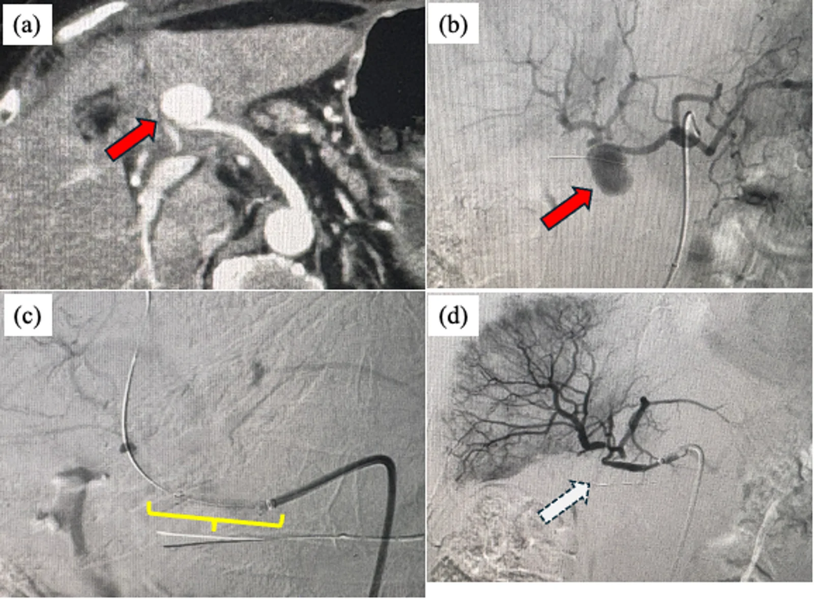
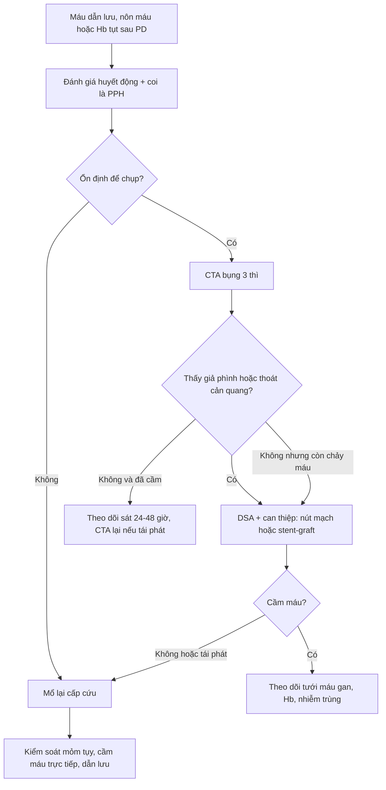
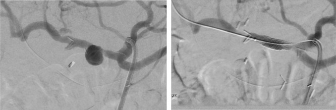

# 1942 — Chảy máu muộn sau cắt tụy–tá tràng (PPH): "sentinel bleed", giả phình và can thiệp nội mạch / Delayed postpancreatectomy hemorrhage

**Tags:** `pattern:xuat-huyet-tieu-hoa` `pattern:gia-phinh` `pattern:sentinel-bleed` `pattern:ro-dong-mach` `vung:tuy` `vung:o-bung` `protocol:CTA` `protocol:DSA` `protocol:nut-mach` `score:ISGPS-PPH`

**Mức chắc chắn (certainty):** tổng hợp y văn (literature synthesis) — số liệu lấy từ **một phân tích gộp 15 nghiên cứu/248 ca PPH muộn** (J Gastrointest Surg 2011), **một đoàn hệ 616 ca mổ tụy với 25 ca chảy máu muộn** (Indian J Gastroenterol 2023), **một đoàn hệ 440 ca PD** (Ann Surg Open 2021 — PMC10455063), **một loạt 18 ca can thiệp nội mạch** (2019 — PMC6966415), **một loạt 750 ca mổ tụy/16 ca PPH nặng** (BMC Surg 2026 — PMC13688979) và **định nghĩa ISGPS 2007**. Không có thử nghiệm ngẫu nhiên; các ngưỡng can thiệp là thực hành đồng thuận.

> **Câu chốt:** chảy máu muộn sau cắt tụy–tá tràng là biến cố **có báo trước** nhưng hay bị bỏ qua — ba con số quyết định: **(1)** **45%** ca chảy máu muộn có **"sentinel bleed"** (chảy máu nhỏ tự cầm 1–2 ngày trước khi vỡ ồ ạt), và **62%** có kèm **rò tụy/áp-xe** — tức là giả phình hình thành trong ổ nhiễm (J Gastrointest Surg 2011); **(2)** khi đã vỡ, **can thiệp nội mạch giảm tử vong còn 22% so với 47% nếu mổ** (p = 0,02), dù tỷ lệ cầm máu hoàn toàn tương đương (80% vs 76%); **(3)** **CTA có thể âm**: chỉ **9% (6/39)** ca có thoát cản quang trên CTA, nên **CTA âm không loại trừ** và bệnh nhân còn chảy máu phải **chụp DSA** (PMC10455063).

## 1. Tổng quan bệnh học – cơ chế hình ảnh (TẠI SAO)

### 1.1 Cơ chế: dịch tụy "ăn" thành mạch, không phải một mạch máu tự vỡ

- Sau cắt tụy–tá tràng (PD), động mạch vị–tá tràng (GDA) được **thắt sát gốc**, để lại một **mỏm cụt ngắn** nằm ngay cạnh miệng nối tụy–ruột. Mỏm này **không có nhu mô che phủ** và nằm trong vùng mà **dịch tụy giàu enzyme** có thể thoát ra nếu có **rò tụy sau mổ (POPF)**.
- Hai yếu tố cùng lúc: **enzyme tiêu protein** (trypsin, chymotrypsin, elastase) phá hủy lớp áo ngoài và cơ trơn thành mạch; **nhiễm khuẩn** trong ổ dịch làm viêm quanh mạch. Thành mạch mất dần → phình giả (pseudoaneurysm) — một **túi máu được bao bởi mô xơ/viêm, không có 3 lớp thành mạch**.
- Giả phình **không co thắt, không tự cầm** như mạch lành: khi vỡ, máu chảy vào **khoang phúc mạc** (chảy máu ngoài lòng ruột) hoặc **vào lòng ruột** qua miệng nối (chảy máu trong lòng ruột). Đây là lý do PPH muộn **ồ ạt và tái phát** nếu chỉ truyền máu.
- **"Sentinel bleed"** là đợt chảy máu nhỏ (máu ở dẫn lưu, nôn máu, đi cầu phân đen) **vài giờ–vài ngày trước** đợt vỡ lớn; máu đông tạm bít lỗ rò, sau đó cục máu bị tiêu/trôi → vỡ lại. Vì vậy **sentinel bleed là một dấu hiệu CĐHA-cấp cứu, không phải "chảy máu nhẹ đã ổn"**.

### 1.2 TẠI SAO nhìn thấy trên CTA/DSA — và tại sao có thể KHÔNG thấy

- **Giả phình trên CTA:** lòng túi chứa máu **cùng đậm độ với động mạch ở thì động mạch** (thuốc cản quang iod ~300–500 HU), **không có thành mạch thật** nên bờ có thể không đều và **không thắt dần như mạch lành**; nếu một phần túi đã huyết khối thì có dấu **"yin–yang"** (phần ngấm thuốc cạnh phần không ngấm 40–70 HU). Vị trí điển hình: **mỏm GDA**, dọc **động mạch gan chung/gan riêng**, hoặc **động mạch gan phải thay thế**.
- **Thoát cản quang (extravasation)** chỉ thấy khi máu **đang chảy chủ động** tại thời điểm chụp — đây là lý do **độ nhạy thấp**: trong 440 ca PD, chỉ **6/39 (9%)** ca CTA có thoát cản quang, dù sau đó 26 ca phải can thiệp. CTA vẫn có giá trị lớn vì thấy **giả phình, ổ dịch quanh mỏm tụy, thiếu máu tạng, khí trong ổ**.
- **DSA** là khảo sát **động** — thấy rõ túi giả phình, nhánh nuôi, và cho phép can thiệp ngay trong cùng một lần chụp. Vì vậy ở bệnh nhân **còn chảy máu** dù CTA âm, **bước tiếp theo là DSA**, không phải "theo dõi thêm".
- **Vật lý của "không thấy gì":** máu trong lòng ruột hoặc trong ổ dịch có đậm độ **30–60 HU**, không khác dịch tiêu hóa; một cục máu đông trong lòng túi giả phình có thể **che mất lòng túi** trên thì động mạch. Do đó **âm tính trên một lần chụp không có giá trị loại trừ**.

### 1.3 Ngưỡng định lượng dùng ngay (ISGPS 2007 + các đoàn hệ)

- **ISGPS phân loại theo 3 trục:** **khởi phát** (sớm ≤ 24 giờ / muộn > 24 giờ), **vị trí** (trong lòng ruột / ngoài lòng ruột), **mức độ** (nhẹ / nặng) → **độ A, B, C**:
  - **A:** nhẹ, **không cần can thiệp** (truyền dịch, theo dõi).
  - **B:** sớm nhưng nặng, hoặc muộn nhưng nhẹ; cần **truyền máu/nội soi/nút mạch**, chưa suy tạng.
  - **C:** muộn và nặng, **đe dọa tính mạng**, cần **can thiệp lớn (nút mạch/stent hoặc mổ lại)**, thường phải hồi sức tích cực.
- **Tần suất:** PPH nói chung **3–10%**; PPH muộn **3,3%** (phân tích gộp 248 ca); PPH **nặng cần can thiệp cấp cứu 2,1%** (16/750 ca; **2,7%** sau PD, **0,9%** sau cắt thân–đuôi); trong một đoàn hệ 440 PD, **15%** có chảy máu theo định nghĩa rộng (gồm cả chảy máu nhẹ).
- **Thời điểm:** trung vị **5 ngày** sau mổ (IQR 2–14), **78%** là muộn > 24 giờ; **45%** biểu hiện bằng **máu trong dẫn lưu**, 28% nôn máu/phân đen.
- **Tử vong:** **22%** (nội mạch) vs **47%** (mổ) trong PPH muộn; **12% vs 3%** tử vong 90 ngày ở nhóm có/không PPH trong đoàn hệ 440 ca.

## 2. Mẫu hình + chẩn đoán phân biệt theo vị trí (gamut)

**Mẫu hình chính:** *bệnh nhân 5–14 ngày sau PD, có POPF hoặc ổ dịch, đột ngột **máu ở dẫn lưu** hoặc **nôn máu/phân đen**, kèm **nhịp tim nhanh và Hb tụt** — có thể chỉ là "sentinel bleed" nhỏ.*

Gamut theo **vị trí nguồn chảy**:

| Vị trí nguồn | Thực thể | Vì sao phải nghĩ tới |
|---|---|---|
| **Mỏm GDA** | Giả phình mỏm GDA | Vị trí số 1; mỏm cụt ngắn cạnh miệng nối, dễ bị dịch tụy ăn mòn |
| **Động mạch gan** | Giả phình CHA/PHA, **động mạch gan phải thay thế** | Chảy máu ồ ạt; nút mạch có nguy cơ **thiếu máu gan** |
| **Nhánh SMA/gan thay thế** | Giả phình nhánh, chảy máu vào quai ruột | Dễ bỏ sót trên CTA nếu không chụp thì ĐM muộn |
| **Miệng nối** | Loét/chảy máu miệng nối PJ–GJ, mạch máu bờ cắt | Nội soi thấy nhưng **không được cầm máu mù** nếu nghi giả phình |
| **Đường mật** | Hemobilia (giả phình gan → đường mật) | Tam chứng đau–vàng da–máu trong ống dẫn lưu mật |
| **Tĩnh mạch cửa/lách** | Tăng áp cửa do huyết khối TM lách sau mổ | Chảy máu ít, dai dẳng; khác hoàn toàn PPH động mạch |

- **Phân biệt sống còn:** **PPH động mạch muộn** → **DSA + nút mạch/stent** ngay; **chảy máu sớm ≤ 24 giờ** → thường do **kỹ thuật mổ** (mỏm tụy, mạch nhỏ) → **mổ lại**; **loét miệng nối** → nội soi can thiệp; **tăng áp cửa** → điều trị nguyên nhân, không nút mạch mù.
- **Điểm nối:** bệnh nhân có **POPF grade B/C** là nhóm nguy cơ cao nhất — **72%** ca chảy máu muộn có CR-POPF, **52%** có rò mật (Indian J Gastroenterol 2023). Ghi nhận "rò tụy đang điều trị" trong báo cáo CĐHA là **red flag**, không phải chi tiết phụ.

*(a) CECT thì động mạch: **túi giả phình ở mỏm động mạch vị–tá tràng** (mũi tên đỏ); (b) chụp mạch xác nhận; (c) đặt **stent-graft** bắc qua cổ túi; (d) sau can thiệp, túi không còn ngấm thuốc. Nguồn: BMC Surg 2026 — PMC13688979, Fig. 1; giấy phép **CC BY-NC-ND 4.0**, ảnh nguyên bản không cắt/ghép.*

## 3. Bảng so sánh phân biệt (ma trận đối chiếu)

| Thực thể (entity) | Hình ảnh điển hình (CTA / DSA) | Chốt vào (rule-in) | Chốt loại (rule-out) | Gợi ý xác nhận |
|---|---|---|---|---|
| **Giả phình mỏm GDA/ĐM gan (PPH muộn)** | Túi **đồng đậm độ động mạch** ở thì ĐM, bờ không đều, có thể "yin–yang"; DSA thấy rõ cổ túi | **Máu ở dẫn lưu/nôn máu 5–14 ngày sau mổ + POPF + túi ngấm thuốc thì ĐM** | Không có túi, không thoát cản quang, và **không còn chảy máu** → có thể theo dõi | DSA (± nút mạch/stent) khi còn nghi |
| **Chảy máu sớm ≤ 24 giờ** | Ổ dịch/máu quanh mỏm tụy; CTA thường không có giả phình | **Tụt Hb ngay sau mổ + dẫn lưu ra máu tươi** | Chảy máu xuất hiện sau nhiều ngày → không phải sớm | Mổ lại thăm dò |
| **Loét miệng nối / chảy máu niêm mạc** | Không có túi giả phình; nội soi thấy ổ loét/chảy máu rỉ | **Nội soi thấy điểm chảy, không có mạch đập** | Có túi giả phình cạnh miệng nối → **không** cầm máu qua nội soi mù | Nội soi có chuẩn bị can thiệp mạch |
| **Hemobilia** | Giả phình trong gan + **máu trong đường mật**; MRCP/ERCP thấy cục máu | **Đau + vàng da + máu qua dẫn lưu mật** | Không có máu trong đường mật → loại | ERCP/CT thì ĐM muộn |
| **Tăng áp cửa do huyết khối TM lách** | Lách to, tuần hoàn bàng hệ, **khuyết thuốc TM lách**, không túi giả phình | **Chảy máu ít, dai dẳng + lách to + khuyết thuốc TM lách** | Không có bàng hệ/không huyết khối → loại | CT thì cửa; Doppler |
| **Rò động mạch–ruột (arterioenteric fistula)** | **Khí trong túi giả phình**, mất liên tục thành ruột–mạch, máu trong ruột | **Chảy máu tái phát nhiều đợt + khí trong ổ cạnh mạch** | Không khí, không liên tục → ít nghĩ | DSA + CT; cân nhắc stent-graft phủ |

## 4. Protocol chụp + phân độ & thuật toán xử trí

- **Bước 1 — nhận diện "sentinel bleed":** bất kỳ máu ở dẫn lưu, nôn máu, phân đen, hoặc **Hb tụt ≥ 2 g/dL** trong 24 giờ sau PD → **coi là PPH cho tới khi loại trừ**. Không chờ "chảy máu nhiều".
- **Bước 2 — CTA bụng 3 thì (không cản quang, thì ĐM mỏng ≤ 1 mm, thì TM cửa):** tìm **giả phình mỏm GDA/ĐM gan**, thoát cản quang, ổ dịch quanh mỏm tụy, khí trong ổ, huyết khối TM lách. CTA âm **không loại trừ** nếu còn chảy máu.
- **Bước 3 — DSA chọn lọc (thân tạng + SMA):** xác định nhánh nuôi và can thiệp cùng lúc. **Luôn chụp cả SMA** vì động mạch gan phải thay thế xuất phát từ SMA.
- **Bước 4 — chọn kỹ thuật can thiệp:**
  - **Nút mạch (coil/liquid embolic)** nếu có thể **bảo tồn dòng gan** — hiệu quả cao, tái phát thấp hơn.
  - **Stent-graft phủ** khi tổn thương ở **mỏm GDA quá ngắn** hoặc **động mạch gan chính** — bảo tồn tưới máu gan nhưng **nguy cơ tắc stent cao**: **5/7 stent tắc**, thời gian thông trung vị **10 ngày** (IQR 8–22) trong đoàn hệ 440 ca; **30 ngày/1 năm tử vong 11%/25%** trong loạt 18 ca.
  - **Nút mạch gan (sacrifice)** khi không còn cách nào khác: cầm máu tốt hơn nút siêu chọn lọc (tái phát **39%** chung; **nút siêu chọn lọc tái phát 100%** trong loạt nhỏ), nhưng **biến chứng gan 56%** (áp-xe/nhiễm trùng) — cần cân nhắc.
- **Bước 5 — mổ lại** khi: chảy máu **sớm ≤ 24 giờ**, bệnh nhân **không đủ ổn định để chụp**, can thiệp **thất bại/tái phát**, hoặc có **biến chứng bụng cần mổ** (hoại tử ruột, bục miệng nối).

**Bảng ngưỡng & số liệu dùng trong quyết định:**

| Thông số | Ngưỡng / giá trị | Ý nghĩa |
|---|---|---|
| Sentinel bleed | **45%** PPH muộn; **50% vs 11,1%** ở nhóm có/không giả phình | Dấu hiệu báo trước, phải chụp ngay |
| Thời điểm PPH | trung vị **5 ngày** (2–14); **78%** muộn | Khung thời gian để cảnh giác |
| CTA | **58%** được chụp; **9%** có thoát cản quang | Âm không loại trừ |
| Nút mạch | Cầm máu **94,1–100%** (kỹ thuật/lâm sàng) | Điều trị đầu tay |
| Tử vong nội mạch vs mổ | **22% vs 47%** (p = 0,02) | Ưu tiên nội mạch khi ổn định |
| Tắc stent gan | **5/7**, trung vị **10 ngày** | Cần theo dõi tưới máu gan |
| CR-POPF kèm PPH muộn | **72%**; rò mật **52%** | Ổ nhiễm là động lực |
| PPH nặng | **2,1%** (16/750); PD **2,7%** | Quy mô vấn đề |

*DSA thì động mạch: **túi giả phình 14 mm ở động mạch gan chung** ngay trên mỏm GDA (trái); sau đặt **stent-graft bóng nong 7 × 23 mm**, túi không còn ngấm thuốc (phải). Nguồn: Ann Surg Open 2021 — PMC10455063, Fig. 1; giấy phép **CC BY 4.0**.*

## 5. Biến thể bình thường và cạm bẫy

- **"Sentinel bleed" bị bỏ qua** là lỗi chết người phổ biến nhất: chảy máu nhỏ, tự cầm, Hb chỉ giảm nhẹ → hay được ghi "chảy máu dẫn lưu, theo dõi". **45%** ca vỡ ồ ạt có tiền triệu này; chụp CTA/DSA ngay là cách duy nhất để cắt chuỗi.
- **CTA âm không loại trừ:** chỉ **9%** ca có thoát cản quang; nếu bệnh nhân còn chảy máu, **đi thẳng DSA**. Ngược lại, đừng chụp CTA lặp lại nhiều lần ở người đang mất máu — mất thời gian.
- **Nội soi cầm máu mù:** nội soi có thể **không tìm được điểm chảy** (ca báo cáo: chảy máu từ giả phình ĐM gan phải sau cắt toàn bộ tụy, nội soi âm) và **can thiệp qua nội soi vào vùng giả phình** có thể làm bung cục máu, gây vỡ ồ ạt. Nội soi chỉ nên làm **khi có kế hoạch can thiệp mạch song song**.
- **Bẫy "coil xong là xong":** nút mạch siêu chọn lọc có thể **tái phát do tuần hoàn bàng hệ** (báo cáo tái phát 100% trong một loạt nhỏ 4 ca); phải chụp kiểm tra và theo dõi Hb, đau, sốt sau can thiệp.
- **Bẫy stent-graft:** stent bảo tồn dòng gan nhưng **tắc sớm** (5/7, trung vị 10 ngày) → nguy cơ **áp-xe/hoại tử gan**; cần theo dõi men gan, sốt, và hình ảnh tưới máu gan. Vai trò kháng kết tập tiểu cầu sau stent còn **chưa rõ** — không có khuyến cáo mạnh.
- **Bẫy "chảy máu do chống đông":** bệnh nhân sau mổ thường được dự phòng heparin; ngừng/đảo ngược chống đông **không thay thế** việc tìm giả phình. Ngược lại, đừng trì hoãn DSA để "chờ đông máu bình thường".

## 6. Tự lượng giá — Blind Quiz (bấm để hiện đáp án)

**Ca 1 — Nam 67 tuổi, PD ngày thứ 9, POPF grade B đang dẫn lưu; đột ngột ra 200 mL máu tươi qua dẫn lưu, Hb 10,2 → 8,6 g/dL, mạch 112/phút, huyết áp ổn.**

- Câu hỏi: (1) Đây là loại PPH nào theo ISGPS? (2) Hình ảnh (a) cho thấy gì và nằm ở đâu? (3) Bước tiếp theo và lựa chọn can thiệp?

<b>Bấm để hiện đáp án (findings + chẩn đoán)</b>

- **Phân loại:** chảy máu **muộn (> 24 giờ), ngoài lòng ruột, mức nặng** (Hb tụt 1,6 g/dL, mạch nhanh) → **PPH độ B/C**, cần can thiệp.
- **Findings:** (a) **túi giả phình ở mỏm động mạch vị–tá tràng**, ngấm thuốc đồng thì động mạch (mũi tên đỏ), nằm cạnh ổ dịch quanh mỏm tụy; (b)–(d) DSA xác nhận và đặt stent-graft, túi mất ngấm thuốc.
- **Chẩn đoán:** giả phình mỏm GDA trên nền POPF — cơ chế dịch tụy ăn mòn thành mạch.
- **Xử trí:** DSA + can thiệp ngay (nút mạch nếu bảo tồn được dòng gan; stent-graft nếu mỏm quá ngắn/ở ĐM gan chính); theo dõi tưới máu gan và nhiễm trùng ổ dịch.
- **Nguồn ảnh:** BMC Surg 2026, PMC13688979 Fig. 1 — CC BY-NC-ND 4.0 (nguyên bản, không cắt/ghép).

**Ca 2 — Nam 62 tuổi, PD, ngày thứ 5 nôn 100 mL máu đỏ, sau đó tự cầm; nội soi dạ dày–tá tràng không thấy điểm chảy. CTA không có thoát cản quang.**

- Câu hỏi: (1) Vì sao không được xuất viện/theo dõi ngoài? (2) CTA âm có loại trừ giả phình? (3) Bước tiếp theo?

<b>Bấm để hiện đáp án</b>

- **Không được xuất viện:** đây là **sentinel bleed** — **45%** ca PPH muộn có tiền triệu này; đợt vỡ lớn thường đến trong **vài giờ–vài ngày**.
- **CTA âm KHÔNG loại trừ:** chỉ **9% (6/39)** ca có thoát cản quang; giả phình có thể bị cục máu đông che lấp hoặc nhỏ hơn độ phân giải.
- **Bước tiếp theo:** **DSA chọn lọc thân tạng + SMA** (tìm động mạch gan phải thay thế); nếu thấy giả phình → **nút mạch hoặc stent-graft**; nếu không thấy và bệnh nhân ổn định → theo dõi sát + chụp lại khi có dấu hiệu mới.
- **Nguồn ảnh:** Ann Surg Open 2021, PMC10455063 Fig. 1 — CC BY 4.0.

## Bài liên quan chéo
- [1981 – Hẹp miệng nối tụy–ruột sau Whipple](../1981-hep-mieng-noi-tuy-ruot-sau-whipple/lesson.md)
- [1941 – Suy tụy ngoại tiết sau mổ tụy (PERT)](../1941-pert-sau-phau-thuat-tuy/lesson.md)
- [1819 – Chảy máu tiêu hóa muộn do giả phình động mạch tạng](../1819-chay-mau-muon-gia-phinh-mach-tang/lesson.md)
- [1912 – Phình động mạch tạng (lách/gan/thân tạng/SMA/tá tụy–tá tràng)](../1912-phinh-dong-mach-tang/lesson.md)
- [1683 – Hoại tử tụy nhiễm khuẩn & step-up](../1683-hoai-tu-tuy-nhiem-khuan-step-up/lesson.md)
- [1840 – Huyết khối mảnh ghép tụy](../1840-huyet-khoi-manh-ghep-tuy/lesson.md)

## Ảnh
- `images/1942_pph_CT-DSA_PMC13688979.webp` — CECT + DSA, CC BY-NC-ND 4.0 (nguyên bản).
- `images/1942_pph_DSA_PMC10455063.jpg` — DSA + stent-graft, CC BY 4.0.
- Nguồn + giấy phép từng ảnh: `images/CREDITS.md`. Không tạo ảnh ghép vì một ảnh là **CC BY-NC-ND**.

> Không dùng để chẩn đoán độc lập khi chưa có người hướng dẫn.
