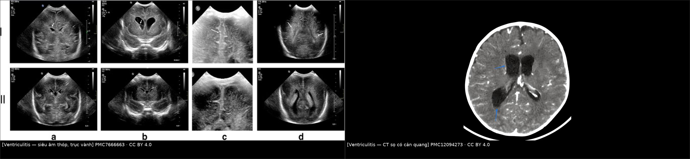
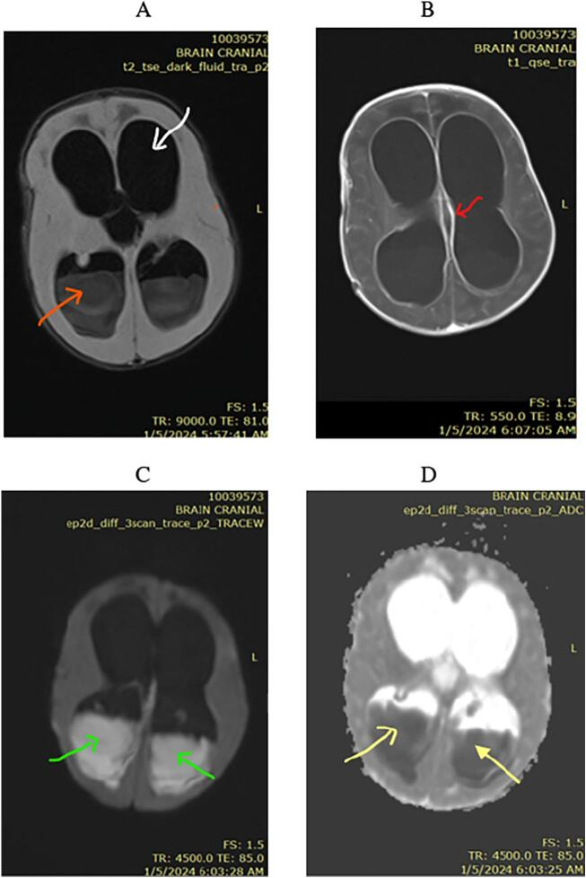
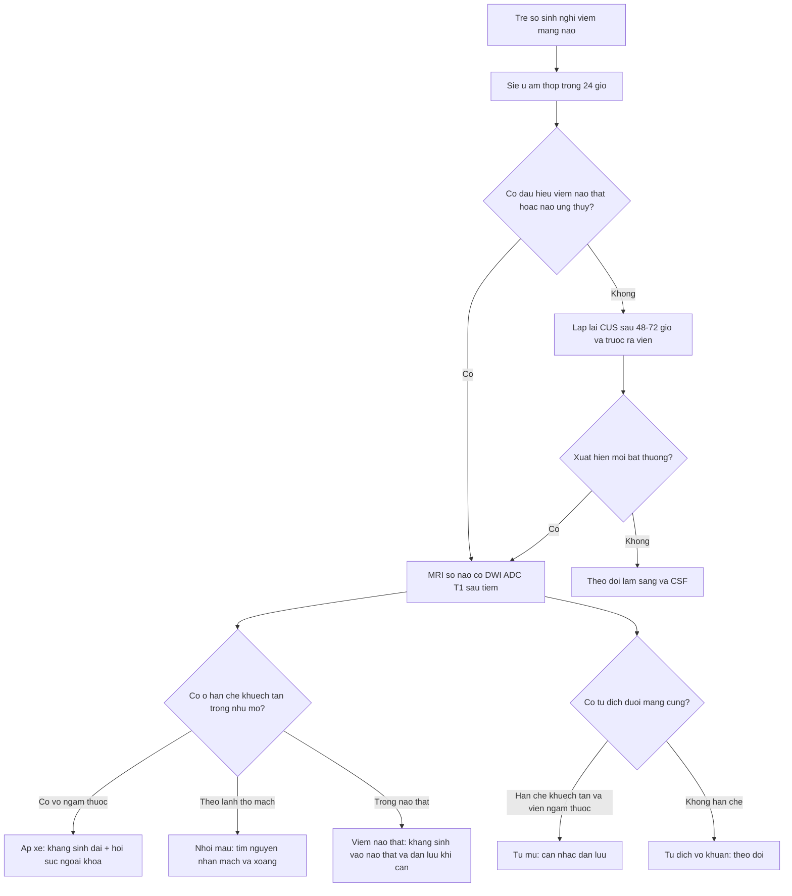
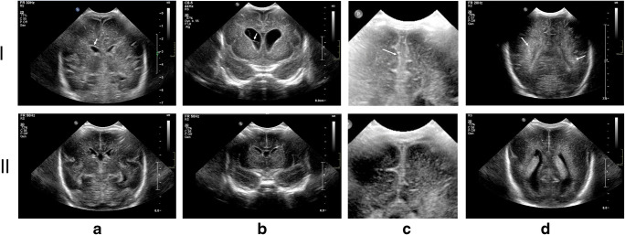
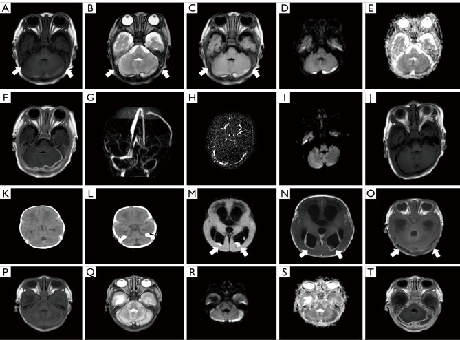

# 1943 — Viêm màng não mủ ở sơ sinh (GBS/E. coli): chọc dò tủy sống khi nào, kháng sinh liều màng não bao lâu, và đọc biến chứng trên siêu âm thóp – MRI

**Tags:** `pattern:viem` `pattern:manh-nao-ngam-thuoc` `pattern:mu-noi-so` `pattern:han-che-khuech-tan` `pattern:nao-ung-thuy` `pattern:nhoi-mau` `vung:nao` `vung:manh-nao` `vung:nao-that` `vung:so-sinh` `anatomy:than-nao` `protocol:sieu-am-thop` `protocol:MRI-so-nao` `protocol:CT-so-nao` `score:khong-co` `incidentaloma:khong`

**Mức chắc chắn (certainty):** tổng hợp y văn (literature synthesis) — ghép **đoàn hệ Úc 21 ca cấy dương** (*J Paediatr Child Health* 2026, **PMC13148498**, CC BY-NC-ND), **đoàn hệ Hà Lan 45 trẻ sơ sinh** so sánh viêm màng não và **viêm não thất** có **siêu âm thóp (cranial ultrasound, CUS)** đối chiếu (*Eur J Pediatr* 2020, **PMC7666663**, CC BY 4.0), **nghiên cứu bệnh–chứng 227 trẻ** về **não úng thủy (hydrocephalus)** (*Sci Rep* 2026, **PMC13323394**, CC BY-NC-ND), **nghiên cứu 78 trẻ đủ tháng** về ngưỡng **dịch não tủy (cerebrospinal fluid, CSF)** (*Front Pediatr* 2019, **PMC6351467**), **đoàn hệ 80 ca khởi phát sớm 20 năm** (*BMC Pediatr* 2026, **PMC13520391**, CC BY-NC-ND), **hồi cứu 209 trẻ nhiễm khuẩn huyết** (**PMC11476132**, CC BY 3.0), **hồi cứu 52 ca** của một trung tâm (*Pan Afr Med J* 2026, **PMC13750973**, CC BY-NC-ND), và **3 ca nguyên văn có ảnh** (**PMC12094273**, **PMC12361597** — CC BY 4.0; **PMC10963804** — CC BY-NC-ND). Nhóm **không có bệnh nhân của mình**; chỗ suy luận từ người lớn/trẻ lớn sang sơ sinh ghi **[suy luận]**. **Không ghi tên tác giả** — attribution = **tạp chí + năm + PMCID/DOI**.

> **Câu chốt:** viêm màng não sơ sinh **hiếm nhưng không phải ca lạ** (**~1/2.000 trẻ sinh sống**, **0,22–6,1/1.000** toàn cầu) và **1/6 trẻ mắc sẽ tử vong**, trong khi **20–50% trẻ sống còn có di chứng thần kinh**. Ba con số định hình cách đọc hình ảnh: **CSF cấy dương chỉ 39% và nhuộm Gram dương chỉ 12%** (PMC13750973) → **không thể chờ cấy để chụp**; **viêm não thất gặp ở 20%** ca nhiễm trùng thần kinh trung ương (TKTW) và khi có viêm não thất thì **não úng thủy cần điều trị 55,5% so với 2,77%** (PMC7666663); **áp-xe não 22,2% vs 2,77%** trong cùng so sánh. Vì vậy hình ảnh có **một việc rõ ràng: tìm biến chứng để đổi điều trị** — **viêm não thất, áp-xe, tụ mủ dưới màng cứng, nhồi máu, não úng thủy** — chứ không dùng để “chẩn đoán viêm màng não”.

> **Ranh giới với bài đã có:** [1937](../1937-nhiem-khuan-huyet-so-sinh-eos-khang-sinh-bao-lau/lesson.md) trả lời **nhiễm khuẩn huyết khởi phát sớm: dùng kháng sinh bao lâu, dừng dựa vào gì**; [1926](../1926-viem-mang-oi-nhiem-khuan-oi/lesson.md) trả lời **viêm màng ối – nhiễm khuẩn ối của mẹ**; [6100](../6100-cham-soc-va-cai-ong-mo-khi-quan-tre/lesson.md) trả lời **chăm sóc và cai ống mở khí quản**; [6101](../6101-xep-phoi-tai-dien-mot-ben-tre-bpd-tbm/lesson.md) trả lời **xẹp phổi tái diễn ở trẻ bệnh phổi mạn**. Bài này chỉ trả lời **khi nào chọc dò, liều và thời gian kháng sinh, và cách đọc 5 biến chứng trên CUS/CT/MRI**.

## 1. Tổng quan bệnh học – cơ chế hình ảnh (TẠI SAO)

### 1.1 Từ máu đến màng não: bốn tầng tổn thương giải thích bốn kiểu hình ảnh

- **Đường vào:** ở sơ sinh, vi khuẩn vào máu (**nhiễm khuẩn huyết**) rồi **bám và vượt hàng rào máu–não** tại mao mạch màng não – đám rối mạch mạc; **47%** ca viêm màng não có **cấy máu dương cùng loại vi khuẩn** (PMC13148498). Vì vậy **cấy máu dương là chỉ định chọc dò** chứ không phải bằng chứng đã đủ.
- **Tầng 1 – màng não (leptomeningitis):** viêm làm **mạch máu màng não giãn, hàng rào máu–não vỡ** → **ngấm thuốc màng não – vỏ mềm (pia–arachnoid)** trên T1 sau tiêm, **FLAIR tăng tín hiệu ở rãnh** do **dịch giàu protein**. Đây là lý do **FLAIR nhạy hơn T2** với exudate mỏng trong rãnh.
- **Tầng 2 – khoang dưới nhện:** **mủ đặc (pus)** lấp rãnh và bể đáy → trên **CUS** rãnh và **bờ não cuộn (gyri/sulci) tăng hồi âm**, **dịch não tủy ngoại vi tăng hồi âm** thay vì trống âm (PMC7666663, hình IA–ID). Cơ chế: mủ tạo **vô số mặt phân cách âm học** (tế bào, protein, fibrin) → **phản xạ sóng mạnh** = tăng hồi âm; **không phải vôi hóa**.
- **Tầng 3 – não thất (ventriculitis):** vi khuẩn lan vào dịch não thất → **viêm màng não thất (ependymitis)**: **T1 sau tiêm ngấm thuốc dọc thành não thất**, **FLAIR có vật liệu trong lòng não thất**, **DWI tăng và ADC giảm** vì mủ đặc (PMC12361597; PMC12094273). Đây là **dấu đổi điều trị**: kháng sinh huyết thanh kém thấm vào ổ mủ trong não thất, và **não thất bị chia vách** làm dẫn lưu kém.
- **Tầng 4 – nhu mô:** **viêm não (cerebritis) → áp-xe** (ổ mủ có vỏ) hoặc **nhồi máu** do **viêm mạch (vasculitis)**/huyết khối xoang. Cả hai đều **hạn chế khuếch tán** trên DWI, nhưng **áp-xe có vỏ ngấm thuốc viền + hiệu ứng khối**, còn **nhồi máu theo lãnh thổ mạch, không có vỏ** — đây là **cặp phân biệt quan trọng nhất trên MRI** (PMC10963804).

### 1.2 Vì sao sơ sinh lại dễ bị và dễ bỏ sót: 5 con số

| Số liệu | Giá trị | Ý nghĩa thực hành | Nguồn |
|---|---|---|---|
| Tần suất | **~1/2.000 trẻ sinh sống**; toàn cầu **0,22–6,1/1.000** | Không hiếm; **trẻ non tháng cao hơn** | PMC13148498; PMC13750973 |
| Tử vong | **tới 1/6**; đoàn hệ **19%**; **13,7%** (Pháp) – **27–58%** (nước đang phát triển) | Tỷ lệ chết còn cao dù có kháng sinh | PMC13148498; PMC13750973 |
| Di chứng thần kinh | **20–50%** trẻ sống | Nghe kém, động kinh, chậm phát triển, não úng thủy | PMC13750973 |
| Vi khuẩn | **GBS 29%**, *S. aureus* **19%**, *E. coli* **19%** (Úc); *E. coli* **37,1%** và GBS **30,65%** (Trung Quốc, khởi phát sớm) | **GBS** trội ở ca muộn cộng đồng; **Gram âm** trội ở NICU/non tháng | PMC13148498; PMC13520391 |
| Viêm màng não trong nhiễm khuẩn huyết | **28,2%** (59/209) | Chọc dò **không** phải xét nghiệm “tuỳ chọn” | PMC11476132 |

- **Vì sao khó chẩn đoán lâm sàng:** dấu hiệu sơ sinh **không đặc hiệu** (bú kém, thân nhiệt không ổn định, ngưng thở, co giật); trong đoàn hệ 26 ca vi khuẩn, **sốt 81%**, **bỏ bú 19%**, **co giật 13%**, **grunting 6%** (PMC13750973). **Không có triệu chứng nào đủ để loại trừ.**
- **Vì sao cấy âm không loại trừ:** **32%** ca được chọc dò **khi đã dùng kháng sinh**, **6%** dịch **lẫn máu** không đếm được tế bào; **soi trực tiếp dương 12%**, **cấy dương 39%** (PMC13750973). Đây là lý do **hình ảnh và chỉ số viêm đóng vai trò bổ trợ**, không phải “chờ kết quả”.
- **Vì sao kháng sinh kéo dài lại hay gặp:** khi cấy âm mà CSF không bình thường, thầy thuốc thường kéo dài **7–14 ngày**; phân tích 2025 cho thấy **cấy máu dương (aOR 118,48)**, **chọc dò muộn (OR 8,28)**, **CRP ≥ 50 mg/L (aOR 2,60)**, **chọc dò lẫn máu (aOR 2,14)** là yếu tố dự báo dùng kháng sinh kéo dài (PMC12466339) — nghĩa là **quyết định dừng phải dựa vào bộ dữ liệu, không chỉ một xét nghiệm**.

### 1.3 Bốn cơ chế biến chứng và vì sao chúng “hiện” trên từng modality

- **Viêm não thất:** mủ trong não thất → **vách hóa, dính màng não thất**, cản trở lưu thông dịch → **não úng thủy**. Trên CUS: **bờ não thất tăng hồi âm/dày**, **cặn lơ lửng, dải (stranding)**; trên MRI: **ngấm thuốc màng não thất + hạn chế khuếch tán** (PMC7666663; PMC12361597).
- **Não úng thủy:** exudate bít **hạt màng nhện (arachnoid granulations)** và **cống Sylvius** làm **giãn não thất**, thường **muộn hơn** viêm màng não. Trong 227 trẻ viêm màng não, **73 trẻ có não úng thủy**, **49,3% đặt bể Ommaya**, **34,2% đặt shunt não thất – phúc mạc**; nhóm này có **động kinh 37% vs 3,9%**, **nghe kém 53,4% vs 15,6%**, **nhuyễn não 39,7% vs 4,5%**, **tử vong 8,2% vs 0,6%** (PMC13323394).
- **Nhồi máu:** viêm mạch và huyết khối → **nhồi máu động mạch/tĩnh mạch**, có thể **chảy máu**. Trên CUS: **vùng tăng hồi âm rồi dịch hóa**; trên MRI: **DWI tăng – ADC giảm theo lãnh thổ**, **không có vỏ ngấm thuốc**.
- **Tụ dịch/tụ mủ dưới màng cứng:** ở trẻ còn thóp, khoang dưới màng cứng dễ giãn; **dịch vô khuẩn** (effusion) khác **mủ** (empyema). **Chốt phân biệt là DWI/ADC + ngấm thuốc viền**: trong ca hố sau sau viêm màng não sơ sinh, tổn thương **hai bên, trước xoang sigma/xoang ngang**, **T1 hơi giảm, T2/FLAIR tăng**, **bờ tăng tín hiệu không liên tục trên T1**, **hạn chế khuếch tán rõ** và **ngấm thuốc viền** (PMC10963804).

*Trái: **siêu âm thóp (CUS)** — hàng trên là **viêm não thất**: **bờ não thất dày, tăng hồi âm** (IA), **não thất giãn hai bên kèm dải trong lòng não thất phải** (IB), **rãnh/gyri và dịch não tủy ngoại vi tăng hồi âm** (IC), **chất trắng quanh não thất tăng hồi âm** (ID); hàng dưới là **viêm màng não không có viêm não thất**: bờ não thất và dịch não tủy bình thường (IIA–IID). Phải: **CT sọ có cản quang** — **giãn ba não thất**, **ngấm thuốc thành não thất phải** (mũi tên trên) và **cặn lắng ở sừng chẩm** (mũi tên dưới) = **viêm não thất mủ**. Nguồn: *Eur J Pediatr* 2020 (**PMC7666663**, CC BY 4.0) và *Cureus* 2025 (**PMC12094273**, CC BY 4.0); ghép bằng `tools/make_composite.py`, không crop.*

## 2. Mẫu hình + chẩn đoán phân biệt theo vị trí (gamut)

**Mẫu hình trung tâm:** *trẻ sơ sinh (hoặc nhũ nhi < 3 tháng) sốt/không ổn định thân nhiệt, bú kém, co giật hoặc ngưng thở, cấy máu dương hoặc CSF viêm; trên hình ảnh có **một trong năm mẫu hình**: (1) rãnh/bờ cuộn tăng hồi âm trên CUS; (2) bờ não thất tăng hồi âm + cặn; (3) ngấm thuốc màng não–màng não thất; (4) ổ hạn chế khuếch tán trong nhu mô; (5) giãn não thất.*

Gamut theo **vị trí** (mỗi khoang một nhóm chẩn đoán):

- **Rãnh – khoang dưới nhện (màng mềm):** viêm màng não mủ · viêm màng não vô khuẩn/vi-rút · xuất huyết dưới nhện · **viêm màng não do herpes** (thường có tổn thương nhu mô kèm) · sau chấn thương/sau mổ.
- **Não thất:** **viêm não thất mủ** · **giãn não thất sau xuất huyết (PHVD)** — bờ não thất cũng tăng hồi âm nhưng **không có cặn mới/không ngấm thuốc màng não thất** · máu trong não thất · u đám rối mạch lạc.
- **Nhu mô:** **áp-xe** · **viêm não (cerebritis)** · **nhồi máu** (động mạch, tĩnh mạch, xoang) · u bẩm sinh · loạn sản vỏ não.
- **Khoang dưới màng cứng:** **tụ mủ (empyema)** · **tụ dịch vô khuẩn (effusion)** · máu tụ dưới màng cứng · tụ dịch dưới màng cứng sau mổ.
- **Ngoài trục vùng hố sau:** tụ mủ dưới màng cứng hố sau (thường **hai bên, trước xoang sigma/ngang**) — dễ bị bỏ sót vì **không giãn não thất sớm** (PMC10963804).

**Ba câu hỏi phải trả lời trên mỗi phim** (thay cho việc “mô tả cho đủ”):
1. **Có mủ trong não thất không?** (bờ não thất ngấm thuốc + cặn/DWI) → đổi kháng sinh/dẫn lưu.
2. **Có ổ hạn chế khuếch tán trong nhu mô không?** → **áp-xe vs nhồi máu** (vỏ ngấm thuốc vs theo lãnh thổ).
3. **Có giãn não thất mới/xấu đi không?** → đo **chỉ số não thất** trên CUS và so sánh chuỗi.

## 3. Bảng so sánh phân biệt (ma trận đối chiếu)

| Thực thể (entity) | Hình ảnh điển hình | Chốt vào (rule-in) | Chốt loại (rule-out) | Gợi ý xác nhận |
|---|---|---|---|---|
| **Viêm màng não mủ (leptomeningitis)** | CUS: rãnh/gyri tăng hồi âm, dịch ngoại vi tăng hồi âm; MRI: ngấm thuốc màng não – vỏ mềm, FLAIR rãnh tăng tín hiệu | **Ngấm thuốc màng mềm lan tỏa + CSF viêm** (WBC > 20 × 10⁶/L, protein > 1.000 mg/L ở trẻ đủ tháng) | **Không có ngấm thuốc màng não không loại trừ** (sớm, đã dùng kháng sinh) | CSF cấy/PCR + MRI tương phản |
| **Viêm não thất mủ (ventriculitis)** | CUS: bờ não thất dày/tăng hồi âm, **cặn, dải trong lòng**; MRI: **ngấm thuốc màng não thất**, FLAIR có vật liệu, **DWI tăng/ADC giảm** | **Bờ não thất ngấm thuốc + cặn/DWI trong não thất** | **PHVD đơn thuần**: giãn nhưng **không ngấm thuốc màng não thất, không cặn mới** | MRI có DWI/ADC; CUS chuỗi |
| **Áp-xe não** | Ổ có **vỏ ngấm thuốc viền**, trung tâm **DWI tăng – ADC giảm**, phù quanh, hiệu ứng khối | **Vỏ viền + hạn chế khuếch tán trung tâm** | **Nhồi máu**: hạn chế khuếch tán **theo lãnh thổ, không vỏ**; **cerebritis**: ngấm thuốc lan tỏa, chưa vỏ | MRI + DWI/ADC, theo dõi 7–14 ngày |
| **Nhồi máu não** | Vùng **DWI tăng/ADC giảm** hình nêm/theo mạch, có thể chảy máu (SWI) | **Hạn chế khuếch tán theo lãnh thổ mạch** | **Áp-xe** (vỏ viền) và **u** (không theo lãnh thổ) | MRA/MRV, siêu âm Doppler xuyên thóp |
| **Tụ mủ dưới màng cứng** | Khoang dưới màng cứng **hạn chế khuếch tán**, **ngấm thuốc viền**, T1 hơi giảm, T2/FLAIR tăng | **DWI/ADC hạn chế trong khoang ngoài trục + viền ngấm thuốc** | **Tụ dịch vô khuẩn**: **không hạn chế khuếch tán**, không viền | MRI; chọc hút chỉ khi có chỉ định |
| **Não úng thủy sau viêm** | Giãn não thất, **bờ não thất có thể tăng hồi âm do dịch hóa**, đầu to, thóp căng | **Giãn não thất tiến triển trên chuỗi + triệu chứng tăng áp lực** | **Giãn nhẹ ổn định** không triệu chứng | CUS chuỗi; MRI khi chuẩn bị shunt |

- **Ảnh ghép đối chiếu:** `images/composite_1943_ventriculitis-cus-ct.jpg` — **cùng một biến chứng (viêm não thất)** nhìn bằng **CUS** và **CT**: CUS cho **bờ não thất/cặn** ở giường bệnh, CT cho **ngấm thuốc thành não thất + cặn sừng chẩm**.

*Bốn chuỗi của **cùng một trẻ** có **ứ mủ trong não thất (intraventricular empyema)**: (A) **FLAIR** — giãn não thất (mũi tên trắng) với **vật liệu tăng tín hiệu trong lòng** (mũi tên cam); (B) **T1 sau tiêm** — **ngấm thuốc thành não thất** (mũi tên đỏ); (C) **DWI** — **tăng tín hiệu mạnh** (mũi tên xanh); (D) **ADC** — **giảm tín hiệu** (mũi tên vàng) = **hạn chế khuếch tán thật**, không phải T2 shine-through. Đây là bộ bốn chứng minh **mủ đặc trong não thất**. Nguồn: *J Surg Case Rep* 2025 (**PMC12361597**), CC BY 4.0.*

## 4. Protocol chụp + ngưỡng quyết định

### 4.1 Chọc dò tủy sống (lumbar puncture, LP): chỉ định và cách đọc

- **Chỉ định** (theo thực hành phổ biến và dữ liệu đoàn hệ): **cấy máu dương**, **co giật**, **trẻ nặng/lơ mơ**, **nghi nhiễm khuẩn huyết khởi phát muộn**, **thất bại điều trị**. Trong bài 1937 đã chốt **chọc dò chọn lọc** ở trẻ khỏe; **nhưng khi có một trong các dấu trên thì LP là bắt buộc** — vì **28,2%** trẻ nhiễm khuẩn huyết có viêm màng não (PMC11476132).
- **Ngưỡng CSF định lượng** (trẻ đủ tháng): **WBC > 20 × 10⁶/L** — **độ nhạy 95,1%, độ đặc hiệu 98,7%**; ghép nhiều thông số chỉ nâng độ đặc hiệu lên **99,0–99,7%** mà **không nâng độ nhạy** (PMC6351467). Tiêu chuẩn kèm theo: **glucose < 1,7 mmol/L** (đủ tháng) hoặc **< 1,1 mmol/L** (non tháng), **protein > 1.000 mg/L** (đủ tháng) hoặc **> 1.500 mg/L** (non tháng) — cần **≥ 2 tiêu chuẩn** khi cấy âm (PMC13049943).
- **Bẫy dịch lẫn máu:** **6%** ca có CSF lẫn máu không đếm được (PMC13750973); **chọc dò lẫn máu** làm tăng nguy cơ dùng kháng sinh kéo dài (aOR 2,14; PMC12466339) — phải **hiệu chỉnh theo hồng cầu** và ghi rõ trong phiếu.
- **Glucose thấp kéo dài 48 giờ** sau kháng sinh đúng là **dấu tiên lượng xấu**, thường phản ánh **viêm não thất** (PMC13750973) → **chỉ định MRI/CUS lặp**.

### 4.2 Kháng sinh: liều “liều màng não” và thời gian

- **Khởi đầu:** **ampicillin 200 mg/kg/ngày + cefotaxime 200 mg/kg/ngày + gentamicin 3–5 mg/kg/ngày** (phác đồ 3 thuốc trong đoàn hệ 26 ca vi khuẩn; PMC13750973). **Ampicillin** phủ **GBS, Listeria**; **cefotaxime** phủ **Gram âm** và **thấm CSF tốt hơn ceftriaxone ở sơ sinh vàng da** (ceftriaxone gắn albumin, **đẩy bilirubin** → nguy cơ **vàng da nhân**) **[suy luận dược lý chuẩn, không lấy từ bài này]**.
- **Thời gian:** trung bình **22 ngày (10–60 ngày)** trong đoàn hệ 26 ca (PMC13750973); thực hành chung **14 ngày với GBS**, **21 ngày với Gram âm** và **kéo dài khi có viêm não thất/áp-xe** — đây là **thực hành phổ biến**, chưa có thử nghiệm ngẫu nhiên ở sơ sinh.
- **Không dùng corticoid thường quy:** tổng quan dẫn chứng **corticosteroid không có vai trò trong viêm màng não sơ sinh** (PMC13750973). Ngược lại, phân tích 2026 thấy **dexamethasone được dùng nhiều hơn ở nhóm có biến chứng thần kinh cấp** (PMC13049943) — **không phải bằng chứng có lợi**, mà là **confounding theo mức nặng**.

### 4.3 Hình ảnh: chọn modality theo câu hỏi, không theo “cho đủ bộ”

- **CUS (siêu âm thóp)** — **đầu tay**, không bức xạ, làm tại giường: cửa sổ **thóp trước** (trục vành/trục dọc), thêm **thóp sau** và **cửa sổ hố sau** khi nghi tổn thương hố sau; đánh giá **kích thước não thất, bờ não thất, cặn, rãnh/gyri, chất trắng quanh não thất**, và **Doppler** (RI) khi nghi tăng áp lực. **Hạn chế:** phụ thuộc người làm, **khó thấy khoang dưới màng cứng và hố sau**; **dấu viêm não thất xuất hiện dần theo thời gian** nên **CUS bình thường sớm không loại trừ** — phải chụp chuỗi (PMC7666663).
- **MRI não** — **chuẩn** khi nghi biến chứng: **DWI + ADC** (mủ/nhồi máu), **T1 sau tiêm** (màng não, màng não thất, vỏ áp-xe), **T2/FLAIR** (dịch, phù), **SWI** (chảy máu), **MRV** khi nghi huyết khối xoang. Trong 26 ca vi khuẩn, MRI được làm **3 ca** và **cả 3 đều có não úng thủy** (PMC13750973) — cho thấy **MRI đổi thông tin** khi được chỉ định đúng.
- **CT sọ** — chỉ khi **không có MRI/cấp cứu**, hoặc **kiểm tra shunt**; ưu tiên **liều thấp** (ALARA). CT đủ để thấy **giãn não thất, ngấm thuốc thành não thất, cặn lắng** (PMC12094273) nhưng **kém hơn MRI với ổ nhỏ ở hố sau và màng não**.
- **Siêu âm qua thóp trong theo dõi shunt/Ommaya:** đo **đường kính não thất trước** và **chỉ số não thất** mỗi lần, cùng vị trí đầu dò, để so sánh chuỗi.

## 5. Biến thể bình thường và cạm bẫy

- **Biến thể bình thường dễ gọi nhầm:** **đám rối mạch lạc (choroid plexus)** và **vùng quanh não thất** vốn **tăng hồi âm** ở trẻ non tháng; **bờ não thất hơi sáng** sau xuất huyết cũ. Phân biệt bằng: **đối xứng, không cặn lơ lửng, không đổi theo chuỗi, không ngấm thuốc màng não thất**.
- **Cạm bẫy 1 — PHVD giả viêm não thất:** **đa số** trẻ viêm não thất trong đoàn hệ Hà Lan **đã có giãn não thất sau xuất huyết từ trước** (PMC7666663). Nếu chỉ thấy “bờ não thất sáng + não thất giãn” ở trẻ **đã có PHVD**, **không được kết luận viêm não thất** nếu thiếu **cặn mới hoặc ngấm thuốc màng não thất**.
- **Cạm bẫy 2 — CUS sớm bình thường:** dấu CUS **xuất hiện dần**; một CUS bình thường trong **24–48 giờ đầu** không loại trừ biến chứng. Đây là lý do luôn **lặp CUS sau 48–72 giờ** và **trước xuất viện** (PMC7666663).
- **Cạm bẫy 3 — “vành ngấm thuốc” không đồng nghĩa áp-xe:** tổn thương **vành ngấm thuốc** ở sơ sinh còn gặp trong **nhồi máu bán cấp, viêm não, u bẩm sinh**; phải dựa **DWI/ADC + hình dạng theo lãnh thổ** (PMC10963804).
- **Cạm bẫy 4 — tụ dịch dưới màng cứng “vô khuẩn” bị mổ oan:** **dịch vô khuẩn không hạn chế khuếch tán**; chỉ **dẫn lưu khi có mủ (DWI hạn chế + viền ngấm thuốc) hoặc chèn ép**. Trong viêm màng não sơ sinh, tụ mủ hố sau có thể **hai bên và kín đáo** — cần MRI có DWI mới thấy (PMC10963804).
- **Cạm bẫy 5 — bỏ sót vì “đã có chẩn đoán” (satisfaction of search):** trẻ đã xác định viêm màng não vẫn có thể **tiến triển áp-xe/nhồi máu** trong 1–2 tuần; **triệu chứng xấu đi (co giật mới, li bì, thóp căng, thiếu máu cục bộ) là chỉ định chụp lại**, không phải “đổi kháng sinh mù”.
- **Cạm bẫy 6 — kháng sinh trước chọc dò:** **32%** ca trong đoàn hệ được chọc dò sau kháng sinh (PMC13750973). Nếu LP chưa làm được vì trẻ nặng, **cấy máu + PCR + hình ảnh** vẫn phải làm; **đừng coi CSF âm là đã loại trừ**.

## 6. Tự lượng giá — Blind Quiz ngay trên trang tĩnh

**Ca 1 — trẻ sơ sinh co giật, thóp căng**

- Gợi ý lâm sàng: sơ sinh 3 tuần, sốt, bú kém, một cơn co giật; đang điều trị kháng sinh theo nhiễm khuẩn huyết.
- Câu hỏi: Bờ não thất và lòng não thất có gì bất thường? Ba chẩn đoán phân biệt? Dấu nào chốt viêm não thất thay vì giãn não thất sau xuất huyết?

<b>Bấm để hiện đáp án (findings + chẩn đoán)</b>

- Dấu hiệu: **bờ não thất dày, tăng hồi âm**; **dải tăng hồi âm trong lòng não thất phải**; **não thất giãn hai bên**; ngoài ra **rãnh/gyri và dịch ngoại vi tăng hồi âm**, **chất trắng quanh não thất tăng hồi âm** (hình IA–ID).
- Chẩn đoán: **viêm não thất mủ (ventriculitis)** trong viêm màng não — mủ trong dịch não thất tạo mặt phân cách âm học nên tăng hồi âm, không phải vôi hóa.
- Phân biệt: **PHVD** (giãn nhưng không cặn mới/không ngấm thuốc), **máu trong não thất** (có mức, theo thời gian), **u đám rối** (khu trú, có mạch).
- Nguồn ảnh: *Eur J Pediatr* 2020 (**PMC7666663**), CC BY 4.0 — hàng trên (I) là viêm não thất, hàng dưới (II) là viêm màng não không viêm não thất.

**Ca 2 — trẻ nhũ nhi sốt kéo dài, đầu to nhanh**

- Gợi ý lâm sàng: nhũ nhi sau một đợt viêm màng não muộn, sốt lại, thóp căng.
- Câu hỏi: Vật liệu trong não thất có phải mủ không? Chuỗi nào chứng minh **hạn chế khuếch tán thật**? Vì sao không thể chỉ dựa vào FLAIR?

<b>Bấm để hiện đáp án (findings + chẩn đoán)</b>

- Dấu hiệu: **FLAIR** có vật liệu tăng tín hiệu trong não thất (mũi tên cam); **T1 sau tiêm** ngấm thuốc thành não thất (đỏ); **DWI** tăng (xanh); **ADC** giảm (vàng).
- Chẩn đoán: **ứ mủ trong não thất (intraventricular empyema)** — DWI tăng **kèm ADC giảm** mới là hạn chế khuếch tán thật; FLAIR tăng đơn thuần có thể do **T2 shine-through** hoặc dịch giàu protein.
- Vì sao quan trọng: mủ trong não thất **không đáp ứng kháng sinh tĩnh mạch đơn thuần**, cần **dẫn lưu/kháng sinh vào não thất** theo quyết định ngoại khoa.
- Nguồn ảnh: *J Surg Case Rep* 2025 (**PMC12361597**), CC BY 4.0.

**Ca 3 — sau viêm màng não, không giãn não thất nhưng li bì**

- Gợi ý lâm sàng: sơ sinh đã điều trị viêm màng não 10 ngày, sốt lại, cổ gượng; CUS không giãn não thất.
- Câu hỏi: Tổn thương ngoài trục nằm ở đâu? Dấu nào phân biệt **tụ mủ** với **tụ dịch vô khuẩn**? Có nên chọc hút ngay không?

<b>Bấm để hiện đáp án (findings + chẩn đoán)</b>

- Dấu hiệu: tổn thương **hai bên, trước xoang sigma/xoang ngang**, **T1 hơi giảm**, **T2/FLAIR tăng**, **bờ tăng tín hiệu không liên tục trên T1**, **hạn chế khuếch tán rõ** trên DWI/ADC, **ngấm thuốc viền** sau tiêm (các mũi tên).
- Chẩn đoán: **tụ mủ dưới màng cứng hố sau (posterior fossa subdural empyema)** sau viêm màng não sơ sinh — **hạn chế khuếch tán + viền ngấm thuốc** là chốt; tụ dịch vô khuẩn **không hạn chế khuếch tán**.
- Xử trí: **hội chẩn ngoại khoa** khi có chèn ép/triệu chứng; **không chọc hút mù** vì nguy cơ chảy máu và gieo mầm.
- Nguồn ảnh: *Quant Imaging Med Surg* 2024 (**PMC10963804**) — CC BY-NC-ND 4.0, dùng **nguyên bản**.

## 7. Câu hỏi nghiên cứu & điểm chưa đồng thuận (tính đến 11/2026)

1. **[Tranh cãi] Ở trẻ sơ sinh viêm màng não mủ, thêm dexamethasone có giảm di chứng thần kinh so với kháng sinh đơn thuần không?**
   - **Đã biết:** tổng quan thực hành kết luận **corticosteroid không có vai trò trong viêm màng não sơ sinh** (PMC13750973); nhưng phân tích 2026 lại thấy **dexamethasone được dùng nhiều hơn ở nhóm có biến chứng thần kinh cấp** — phản ánh **chỉ định theo mức nặng**, không phải hiệu quả (PMC13049943).
   - **Chưa rõ:** chưa có thử nghiệm ngẫu nhiên ở sơ sinh phân tầng theo **vi khuẩn (GBS vs Gram âm)** và **có/không viêm não thất**; nguy cơ **giảm thính lực** có thể khác nhau theo tác nhân.
   - **Hướng nghiên cứu:** RCT đa trung tâm với outcome **nghe kém lúc 12–24 tháng** và **não úng thủy cần shunt**.
   - **Nguồn:** PMC13750973 (2026); PMC13049943 (2026).

2. **[Khác biệt thực hành] Chọc dò tủy sống lặp và thời gian kháng sinh: 14 ngày cố định hay “theo CSF/vật liệu trong não thất”?**
   - **Đã biết:** **32%** ca được chọc dò sau kháng sinh và thời gian điều trị trung bình **22 ngày (10–60)** (PMC13750973); **LP lặp** được dùng để **tiên lượng** và phát hiện **não úng thủy** (PMC12320273; PMC13323394); khảo sát thực hành cho thấy **không thống nhất** về LP lặp thường quy (PMC1718764).
   - **Chưa rõ:** ngưỡng **WBC/protein trên LP lặp** để **kéo dài** hay **dừng** kháng sinh; giá trị của **LP lặp ở trẻ có viêm não thất** so với **MRI**.
   - **Hướng nghiên cứu:** đoàn hệ tiến cứu so **chiến lược dừng theo LP lặp** vs **theo lâm sàng + MRI**, outcome **tái phát trong 30 ngày**.
   - **Nguồn:** PMC12320273 (2025); PMC1718764 (2001); PMC13323394 (2026).

3. **[Khoảng trống] Chưa có ngưỡng hình ảnh định lượng nào dự báo được não úng thủy phải đặt shunt ở viêm màng não sơ sinh.**
   - **Đã biết:** dấu CUS viêm não thất **có độ đồng thuận giữa người đọc ở mức “substantial”** nhưng vẫn **chủ quan** (PMC7666663); các nghiên cứu dự báo não úng thủy dùng **CSF (WBC, protein)**, không dùng **chỉ số não thất** (PMC13323394); mô tả MRI tụ mủ hố sau hiện **chỉ là ca lâm sàng** (PMC10963804).
   - **Chưa rõ:** ngưỡng **chỉ số não thất (ventricular index)** hoặc **tốc độ giãn theo tuần** nào dự báo **shunt**; giá trị của **DWI màng não thất** làm dấu tiên lượng.
   - **Hướng nghiên cứu:** nghiên cứu tiên lượng đa trung tâm, đo **chỉ số não thất trên CUS chuẩn hóa** + **DWI/ADC màng não thất**, outcome **shunt trong 6 tháng**.
   - **Nguồn:** PMC7666663 (2020); PMC13323394 (2026); PMC10963804 (2024).

## Bài liên quan chéo
- [1937 – Nhiễm khuẩn huyết sơ sinh khởi phát sớm: kháng sinh bao lâu](../1937-nhiem-khuan-huyet-so-sinh-eos-khang-sinh-bao-lau/lesson.md)
- [1926 – Viêm màng ối – nhiễm khuẩn ối (chorioamnionitis)](../1926-viem-mang-oi-nhiem-khuan-oi/lesson.md)
- [6100 – Chăm sóc và cai ống mở khí quản ở trẻ](../6100-cham-soc-va-cai-ong-mo-khi-quan-tre/lesson.md)
- [6101 – Xẹp phổi tái diễn một bên ở trẻ BPD/TBM](../6101-xep-phoi-tai-dien-mot-ben-tre-bpd-tbm/lesson.md)

## Ảnh
- Tên file: `1943_viem-mang-nao-so-sinh_<Modality>_<PMCID>-Fig<n>.jpg`. Nguồn + giấy phép **từng ảnh** trong `images/CREDITS.md`.
- Ảnh **CC BY-NC-ND 4.0** (PMC10963804): **nguyên bản**, không crop/ghép. Composite chỉ dùng ảnh **CC BY 4.0** (PMC7666663 + PMC12094273).

> Không dùng để chẩn đoán độc lập khi chưa có người hướng dẫn (disclaimer y tế).
