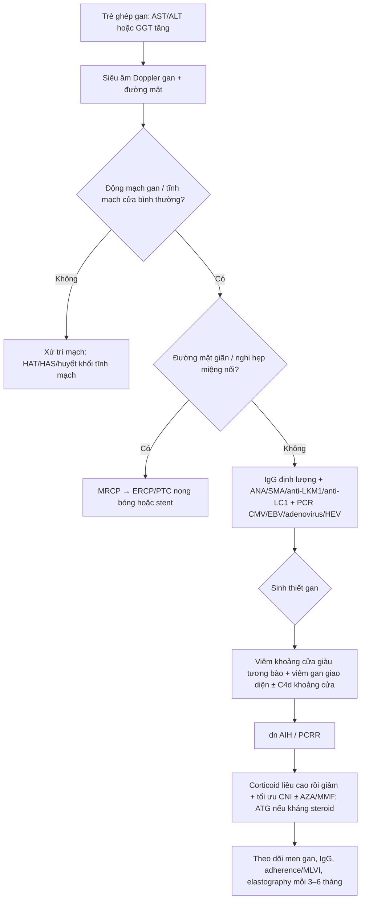
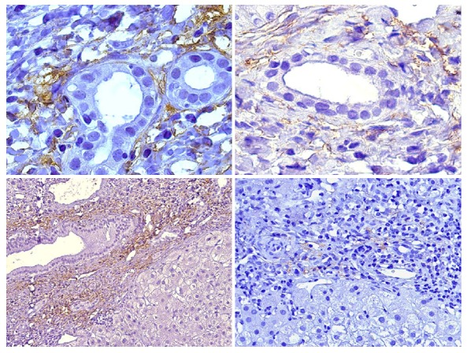
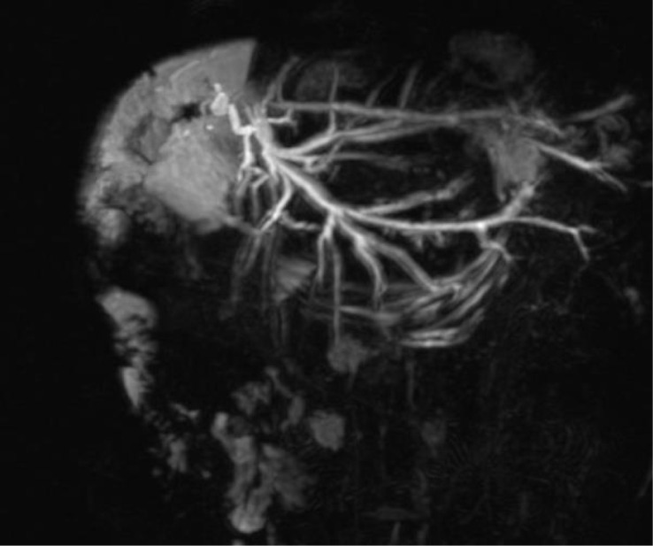
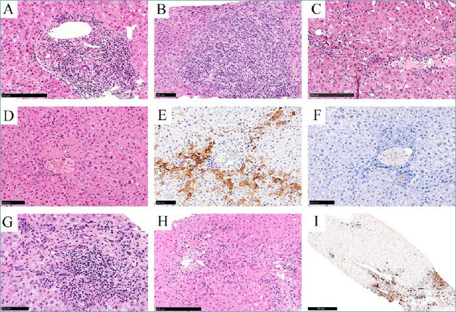

# 1945 — Viêm gan tự miễn de novo sau ghép gan ở trẻ (de novo autoimmune hepatitis / plasma cell-rich rejection): IgG, tự kháng thể, mô học tương bào — và vì sao hình ảnh chỉ để LOẠI TRỪ

**Tags:** `pattern:viem-gan` `pattern:thai-ghep` `pattern:plasma-cell` `pattern:viem-gan-giao-dien` `pattern:tu-khang-the` `pattern:xo-gan` `vung:gan` `vung:duong-mat` `protocol:SA-Doppler` `protocol:MRCP` `protocol:MRI` `protocol:sinh-thiet`

**Mức chắc chắn (certainty):** tổng hợp y văn (literature synthesis) — ghép 5 nguồn open-access đã đọc toàn văn: **Gemell R et al., *Pediatr Transplant* 2026 (PMC13366277, CC BY 4.0)** — đoàn hệ 91 trẻ ghép gan, 14 ca plasma cell-rich rejection (15,3%); **Aguilera I et al., *World J Gastroenterol* 2018 (PMC6079293, CC BY-NC 4.0)** — cơ chế GSTT1, C4d khoảng cửa, thành phần tế bào; **Harputluoglu M et al., *World J Transplant* 2022 (PMC8968478, CC BY-NC 4.0)** — tổng quan chẩn đoán – điều trị; **Cussa D et al., *Front Gastroenterol* 2025 (PMC12952373, CC BY)** — biến chứng đường mật muộn ở trẻ ghép gan (ảnh MRCP đối chiếu); **Pathologica 2022 (PMC9040542, CC BY-NC-ND)** — tập ảnh mô học thải ghép, có thể plasma cell-rich. Phân tích gộp về tỉ lệ mắc (7 nghiên cứu, N = 251) chỉ có abstract, không có PMCID — ghi rõ khi trích. Số nào nguồn không đưa thì ghi "chưa rõ".

> **Bài này trả lời 4 câu hỏi của một trẻ ghép gan có men gan tăng muộn:**
> (1) **Đây là thải ghép cấp, thải ghép thể dịch, viêm gan tự miễn de novo, hay hẹp đường mật?** (2) **Hình ảnh (siêu âm, MRCP, đàn hồi) làm được gì — và KHÔNG làm được gì?** (3) **Xét nghiệm nào và mô học nào chốt chẩn đoán?** (4) **Điều trị và theo dõi ra sao, khi nào nghĩ tới mất mảnh ghép?**
> Điểm tựa: **không có dấu hiệu hình ảnh đặc hiệu cho viêm gan tự miễn de novo**. Vai trò của CĐHA là **loại trừ nguyên nhân mạch – đường mật – khối**, còn chẩn đoán nằm ở **IgG + tự kháng thể + sinh thiết gan**.

## 1. Tổng quan bệnh học – cơ chế hình ảnh

### 1.1 Định nghĩa và cách gọi tên đang thay đổi

- **Viêm gan tự miễn de novo (de novo autoimmune hepatitis, dn AIH)** là viêm gan kiểu tự miễn xuất hiện ở người **ghép gan vì bệnh KHÔNG phải viêm gan tự miễn**: men gan tăng, **IgG tăng**, **tự kháng thể mới xuất hiện**, mô học **viêm gan giao diện giàu tương bào**.
- Từ 2016, Nhóm công tác Banff đề nghị gọi thực thể này là **thải ghép giàu tương bào (plasma cell-rich rejection, PCRR)** vì bằng chứng cho thấy đây là **phản ứng allo-miễn dịch** chứ không phải tự miễn thật. Bài này dùng cả hai tên, ưu tiên **dn AIH/PCRR**.
- **Tần suất (các nguồn khác nhau, phải nhớ khoảng):**
  - Tổng quan: **3–5%** người ghép gan; **trẻ 5–10%** so với **người lớn 1–3%** (PMC8968478).
  - Đoàn hệ trẻ 91 ca: **14/91 = 15,3%**, và **31,1%** trong số trẻ đã có thải ghép cấp tế bào (PMC13366277).
  - Phân tích gộp 7 nghiên cứu ở trẻ có tự kháng thể tăng sau ghép: **9% (KTC 95% 1–23%)**, I² = 86% — con số này **chỉ nên dùng để tư vấn, không dùng làm ngưỡng chẩn đoán**.
- **Thời điểm:** thể muộn, **> 6 tháng sau ghép**; trong đoàn hệ trẻ, **trung vị 20,6 tháng (IQR 7,5–28)**; ca đã báo từ **12 tháng tới 7 năm**. Nghĩa là **không loại trừ được chỉ vì đã ghép nhiều năm**.

### 1.2 TẠI SAO cơ thể "tự miễn" với mảnh ghép: GSTT1 và tương bào

- **GSTT1 (glutathione S-transferase T1)** là enzyme chuyển hóa pha II, biểu hiện mạnh ở gan và thận; **một bộ phận người mang kiểu gen GSTT1*0/0 (null)** — không có kháng nguyên. Nếu người nhận **null** nhận gan từ người cho **dương tính**, protein GSTT1 của người cho bị nhận diện như **kháng nguyên hòa hợp mô phụ (minor histocompatibility antigen)** → sinh **kháng thể anti-GSTT1** và **tế bào T nhớ đặc hiệu GSTT1**.
- **Con số chốt:** kháng thể anti-GSTT1 được tìm thấy ở **100% bệnh nhân dn AIH khi được xét nghiệm** (PMC6079293). Đây là bằng chứng mạnh nhất cho bản chất allo-miễn dịch.
- **C4d trong mao mạch khoảng cửa** là dấu hiệu lắng đọng bổ thể — **kiểu khoảng cửa**, khác kiểu xoang gan của thải ghép thể dịch do HLA (PMC6079293). Trong đoàn hệ trẻ: **C4d dương 21,4% ở PCRR so với 3,2% ở nhóm không PCRR** (PMC13366277).
- **Thành phần tế bào của thâm nhiễm (đếm bằng phần mềm NewCAST):** tế bào T **36,6%**, **tương bào 28,8%** (trong đó **17% IgG4+**), tế bào B **14,9%**, đại thực bào **19,7%**; **CD3+ ~1.600/mm²** ở người lớn và **~3.000/mm²** ở trẻ đang hoạt động bệnh. Đây là lý do mô học được gọi là "giàu tương bào", **không phải** vì tương bào là tế bào duy nhất.

### 1.3 TẠI SAO hình ảnh KHÔNG chẩn đoán được dn AIH

- Tổn thương là **vi thể, lan tỏa trong khoảng cửa và vùng quanh tĩnh mạch trung tâm**, không tạo khối, không tạo ổ dịch, **không có mật độ/tín hiệu đặc hiệu**. Siêu âm thường **bình thường** hoặc chỉ thấy **gan to, echo không đồng nhất**; CT càng không có giá trị chẩn đoán.
- **Đàn hồi gan (elastography)** có thể tăng khi có xơ hóa, nhưng **cũng tăng do ứ mật, sung huyết, viêm cấp** — nên **không có ngưỡng kPa nào chẩn đoán dn AIH** (chưa rõ ngưỡng, cần nghiên cứu riêng).
- Vì vậy **hình ảnh chỉ có ba việc**: (1) **loại trừ hẹp/tắc đường mật** (MRCP), (2) **loại trừ hẹp/huyết khối động mạch – tĩnh mạch cửa** (Doppler), (3) **phát hiện biến chứng** (ứ mật, ổ áp-xe, xơ gan, tăng áp cửa). Chẩn đoán xác định = **sinh thiết gan**.

### 1.4 Vì sao gọi nhầm rất tốn kém

- Nếu gọi là **thải ghép cấp** và chỉ tăng tacrolimus → bỏ sót dn AIH, tiếp tục tổn thương mô học, **xơ hóa và mất mảnh ghép**.
- Nếu gọi là **nhiễm trùng** và giảm ức chế miễn dịch → **bùng phát thải ghép**.
- Nếu gọi là **hẹp đường mật** và đặt stent → không giải quyết viêm gan, nguy cơ nhiễm trùng đường mật.
- Trong đoàn hệ trẻ, PCRR gắn với **thải ghép mạn 35,7% so với 6,5%** và **viêm tĩnh mạch trung tâm (central perivenulitis) 85,7% so với 3,2%** (PMC13366277) — tức là **bỏ sót thì mất mảnh ghép dần**, dù tử vong trong nghiên cứu không tăng độc lập (HR 0,51; KTC 0,15–1,73).

## 2. Mẫu hình + chẩn đoán phân biệt theo vị trí (gamut)

### 2.1 Bốn kiểu trình bày lâm sàng – hình ảnh

- **Mẫu A — tăng men gan đơn thuần, hình ảnh bình thường:** AST/ALT tăng 2–10 lần, không sốt, siêu âm và Doppler bình thường, MRCP không hẹp. Đây là **kiểu điển hình của dn AIH** và cũng là kiểu của **thải ghép cấp muộn** — chỉ sinh thiết phân biệt được.
- **Mẫu B — tăng GGT/ALP (kiểu ứ mật):** dễ bị quy cho **hẹp miệng nối đường mật**. Nhưng **38% trẻ dn AIH có GGT > 2 lần giới hạn trên** ở lần theo dõi cuối, do **tổn thương ống mật nhỏ** (PMC6079293) — nghĩa là **GGT tăng không loại trừ dn AIH**, và MRCP bình thường không loại trừ.
- **Mẫu C — tự kháng thể mới + IgG tăng:** ANA/SMA/anti-LKM1/anti-LC1 xuất hiện **sau ghép** ở trẻ trước đó âm tính. Trong đoàn hệ trẻ, **ANA dương 35,7% ở PCRR so với 0%** nhóm không PCRR.
- **Mẫu D — xơ gan/thải ghép mạn muộn:** gan teo, bờ không đều, tăng áp cửa trên Doppler/elastography, **ống mật biến mất** trên mô học — đây là **hậu quả**, không phải hình ảnh của dn AIH.

### 2.2 Gamut theo thời gian sau ghép

- **< 1 tháng:** thải ghép cấp sớm, thiếu máu – tái tưới máu, nhiễm trùng vết mổ, huyết khối mạch sớm.
- **1–6 tháng:** thải ghép cấp, nhiễm CMV/EBV, hẹp miệng nối đường mật, DILI.
- **> 6 tháng (đúng "cửa sổ" của dn AIH):** **dn AIH/PCRR**, thải ghép cấp muộn, thải ghép thể dịch mạn, **tái phát bệnh gốc** (nếu ghép vì AIH/PSC/PBC), hẹp đường mật muộn, **de novo MASLD**, PTLD, nhiễm virus mạn.
- **Nhiều năm:** xơ gan mảnh ghép, thải ghép mạn (ductopenia), PTLD, ung thư da/lymphoma.

### 2.3 Sơ đồ quyết định

## 3. Bảng so sánh phân biệt (ma trận đối chiếu)

| Thực thể (entity) | Hình ảnh / mô học điển hình | Chốt vào (rule-in) | Chốt loại (rule-out) | Gợi ý xác nhận |
|---|---|---|---|---|
| **dn AIH / PCRR** | Hình ảnh **bình thường** hoặc gan to; mô học **viêm khoảng cửa giàu tương bào + viêm gan giao diện**, ± **C4d mao mạch khoảng cửa**, ± viêm tĩnh mạch trung tâm | **IgG tăng + tự kháng thể mới + mô học giàu tương bào**, đáp ứng corticoid; anti-GSTT1 nếu làm được | **Không có tương bào, không viêm giao diện, IgG bình thường** → ít khả năng (không loại trừ tuyệt đối) | Sinh thiết + IgG + autoantibody + C4d + DSA |
| **Thải ghép cấp tế bào muộn (late ACR/TCMR)** | Thâm nhiễm khoảng cửa **hỗn hợp** (lymphocyte, tương bào, eosinophil), **viêm nội mô**, tổn thương ống mật; **Banff RAI** cho điểm | **Banff RAI ≥ 4–6** + viêm nội mô + đáp ứng steroid; **tương bào ít** | **Tương bào chiếm ưu thế + tự kháng thể + IgG tăng** → nghiêng dn AIH | Sinh thiết + Banff RAI; đáp ứng với tăng ức chế miễn dịch |
| **Thải ghép thể dịch (AMR)** | **C4d dương mạnh** (kiểu xoang hoặc khoảng cửa), viêm nội mô, **DSA dương**; hình ảnh không đặc hiệu | **DSA + C4d + tổn thương mô học** theo Banff 2016 | **DSA âm, C4d âm** → ít khả năng AMR | DSA (HLA), C4d, sinh thiết |
| **Tái phát viêm gan tự miễn** | Giống AIH nguyên phát; **chỉ xảy ra khi ghép vì AIH** | Tiền sử ghép vì AIH + tự kháng thể **tái xuất** + mô học AIH | **Ghép vì bệnh khác** → không gọi tái phát | Sinh thiết + so sánh huyết thanh trước/sau ghép |
| **Hẹp miệng nối đường mật** | **MRCP: hẹp khu trú tại miệng nối**, giãn đường mật trong gan phía trên; siêu âm thấy giãn ống mật | **Hẹp trên MRCP + giãn đường mật** + đáp ứng nong bóng | **MRCP bình thường, không giãn ống mật** → ít khả năng | MRCP → ERCP/PTC |
| **Hẹp/huyết khối động mạch gan (HAT/HAS)** | Doppler: **mất phổ**, **PSV > 200 cm/s**, **RI < 0,5 + SAT > 0,08 s**; CTA xác nhận | **Khuyết thuốc trên CTA** + bất thường Doppler | **Phổ ba pha bình thường ở nhánh trong gan** → loại trừ tắc hoàn toàn | Doppler + CTA (xem bài 1913) |
| **Viêm gan do CMV/EBV/adenovirus/HEV** | Hình ảnh không đặc hiệu; có thể ổ giảm đậm; **PCR máu/mô dương** | **PCR dương + thể vùi/mô học đặc trưng** | **PCR âm** → ít khả năng (nhưng không loại trừ tuyệt đối) | PCR máu + mô; xem bài 1918 |
| **Tổn thương gan do thuốc (DILI)** | Không đặc hiệu; có thể viêm giao diện **giống AIH** | **Liên quan thời gian với thuốc + cải thiện khi ngừng** | **Không có thuốc mới, tự kháng thể mới, IgG tăng** → nghiêng dn AIH | Ngừng thuốc nghi ngờ + sinh thiết |
| **De novo MASLD** | **Gan nhiễm mỡ** trên siêu âm/CT (**−10 đến −40 HU** so với lách), elastography tăng | **Mỡ trong gan + béo phì/kháng insulin** | **Không mỡ, mô học viêm giao diện** → loại | Siêu âm/CT/MRI PDFF; sinh thiết |
| **PTLD** | **Khối/hạch** trong hoặc quanh gan, có thể hoại tử; **EBV dương** | **Khối đặc + EBV + mô học tăng sinh lympho** | **Không khối, chỉ viêm khoảng cửa** → loại | CT/MRI + sinh thiết + EBV |

## 4. Protocol chụp + hệ phân độ/ngưỡng xử trí

### 4.1 Bộ ba hình ảnh tối thiểu (theo thứ tự)

1. **Siêu âm gan + Doppler mạch gan – tĩnh mạch cửa – tĩnh mạch gan:** kích thước gan, echo, dịch quanh gan, giãn đường mật, **phổ động mạch gan (RI, PSV, SAT)**, hướng dòng tĩnh mạch cửa. Đây là bước **loại trừ mạch** rẻ và nhanh nhất.
2. **MRCP (hoặc MRCP + MRI gan có cản quang từ):** khi **GGT/ALP tăng** hoặc siêu âm nghi giãn đường mật; tìm **hẹp miệng nối**, sỏi bùn, rò mật. Hình MRCP hẹp miệng nối là "chốt loại" quan trọng nhất trước khi quy mọi thứ cho dn AIH.
3. **Đàn hồi gan (shear-wave/ARFI hoặc transient elastography):** đo **nền** sau ghép và lặp lại mỗi **6–12 tháng** để theo dõi xơ hóa; **không dùng để chẩn đoán**, vì viêm/ứ mật/sung huyết đều làm cứng gan giả tạo.

### 4.2 Xét nghiệm (bắt buộc trước sinh thiết)

- **Men gan:** AST, ALT, GGT, ALP, bilirubin, albumin, INR.
- **IgG định lượng** (không chỉ protein toàn phần) — IgG tăng là một trụ cột; **IgG bình thường không loại trừ**.
- **Tự kháng thể:** ANA, anti-SMA, anti-LKM1, anti-LC1; nếu có điều kiện: **anti-GSTT1** (dương ở 100% ca dn AIH khi được làm).
- **DSA (HLA)** và **C4d** trên mô: phân biệt với AMR.
- **PCR virus:** CMV, EBV, adenovirus, **HEV** (viêm gan E có thể bùng phát sau ghép).
- **Đánh giá tuân thủ:** **MLVI (medication level variability index)** — trong đoàn hệ trẻ, MLVI trung vị **2,05**, và MLVI cao gắn với thải ghép cấp; **kiểm tra tuân thủ trước khi tăng ức chế miễn dịch**.

### 4.3 Sinh thiết gan — tiêu chuẩn xác định

- **Chỉ định:** men gan tăng kéo dài **> 3 tháng** không rõ nguyên nhân, sau khi đã loại trừ mạch – đường mật – virus; hoặc nghi thải ghép muộn.
- **Đặc điểm mô học gợi ý dn AIH/PCRR:** **viêm khoảng cửa giàu tương bào**, **viêm gan giao diện**, **viêm tĩnh mạch trung tâm (central perivenulitis)**, ± **C4d mao mạch khoảng cửa**, ± tổn thương ống mật. Trong đoàn hệ trẻ: **viêm tĩnh mạch trung tâm 85,7%** và **C4d 21,4%** ở PCRR.
- **Không có ngưỡng "số tương bào/mm²" được chấp nhận chung** để chẩn đoán; mô tả định lượng (28,8% thâm nhiễm; 17% IgG4+) là dữ liệu nghiên cứu, **không phải tiêu chuẩn**.

### 4.4 Điều trị và ngưỡng theo dõi

- **Bậc 1:** **corticoid liều cao** (methylprednisolone **10 mg/kg × 3 ngày** rồi giảm liều, theo phác đồ của đoàn hệ) + **tối ưu tacrolimus**; duy trì **prednisone ± azathioprine**.
- **Bậc 2:** **mycophenolate mofetil (MMF)** thay azathioprine nếu không đáp ứng; **ATG** cho ca kháng steroid; **rituximab** ở một số ca chọn lọc. **Không có đồng thuận** về phác đồ tối ưu (PMC13366277).
- **Theo dõi:** men gan và IgG mỗi **2–4 tuần** trong đợt cấp, sau đó **3–6 tháng**; elastography **6–12 tháng**; soi/đánh giá thải ghép mạn nếu GGT/ALP tăng kéo dài.
- **Tiên lượng:** dn AIH có thể tiến triển **xơ hóa, thải ghép mạn, mất mảnh ghép** nếu không điều trị. Nếu bệnh nhân **ghép vì AIH** (tái phát, không phải de novo), tái phát **36–68% sau 5 năm** và **33–60% phải ghép lại** (PMC8968478) — con số này **không** áp cho dn AIH.

## 5. Biến thể bình thường và cạm bẫy

- **Cạm bẫy 1 — "thấy tương bào là dn AIH":** tương bào có mặt trong **thải ghép cấp muộn, AMR, thải ghép mạn, nhiễm virus, DILI**. Chẩn đoán cần **bối cảnh + IgG + tự kháng thể + C4d/DSA + đáp ứng điều trị**, không chỉ một loại tế bào.
- **Cạm bẫy 2 — tự kháng thể dương = tự miễn:** ANA/SMA **không đặc hiệu**; Banff 2016 **đã bỏ ANA/SMA khỏi tiêu chuẩn chẩn đoán** vì chúng xuất hiện ở nhiều bối cảnh. Tự kháng thể chỉ **tăng xác suất**.
- **Cạm bẫy 3 — IgG bình thường:** một phần bệnh nhân không tăng IgG; **IgG bình thường không loại trừ dn AIH** (đặc biệt trẻ đang dùng ức chế miễn dịch).
- **Cạm bẫy 4 — GGT tăng thì đổ cho đường mật:** MRCP bình thường **không loại trừ** tổn thương ống mật nhỏ của dn AIH; **38% trẻ có GGT > 2× ULN** ở lần theo dõi cuối.
- **Cạm bẫy 5 — elastography "cứng = xơ":** viêm cấp, ứ mật, sung huyết làm tăng độ cứng; đo trong đợt cấp dễ **overcall xơ hóa**. Đo lại khi men gan ổn định.
- **Cạm bẫy 6 — bỏ qua tuân thủ:** MLVI cao là yếu tố nguy cơ thải ghép; **tăng thuốc mà không kiểm tra tuân thủ** thì thất bại.
- **Cạm bẫy 7 — quên nhiễm trùng:** **CMV disease** là yếu tố tử vong độc lập (HR 3,71; KTC 1,67–8,25) trong đoàn hệ trẻ; trước khi tăng ức chế miễn dịch phải **loại trừ nhiễm**.
- **Cạm bẫy 8 — hình ảnh đẹp làm yên tâm:** siêu âm/MRCP bình thường **không loại trừ** dn AIH; đây là bệnh **mô học**.

## 6. Tự lượng giá — Blind Quiz ngay trên trang tĩnh

**Ca 1 — trẻ 8 tuổi, ghép gan 2 năm, men gan tăng, không sốt**

- Gợi ý lâm sàng: AST/ALT tăng 3 lần, IgG tăng, ANA mới dương; siêu âm và MRCP bình thường.
- Câu hỏi: Hình cho thấy kỹ thuật gì và lắng đọng ở đâu? Lắng đọng này gợi ý cơ chế nào? Cần thêm xét nghiệm gì để phân biệt với AMR do HLA?

<b>Bấm để hiện đáp án (findings + chẩn đoán)</b>

- Dấu hiệu: các khoảng cửa có **thâm nhiễm tế bào** và **C4d dương ở mao mạch khoảng cửa** (nhuộm hóa mô miễn dịch) — kiểu khoảng cửa, không phải kiểu xoang.
- Chẩn đoán: **dn AIH / plasma cell-rich rejection** — C4d khoảng cửa phản ánh hoạt hóa bổ thể qua kháng thể (anti-GSTT1), không phải tự miễn kinh điển.
- Cần thêm: **DSA HLA**, **anti-GSTT1**, IgG định lượng, autoantibody, và **đáp ứng với corticoid**; AMR do HLA thường có **C4d kiểu xoang + DSA HLA dương**.
- Nguồn ảnh: Aguilera I et al., *World J Gastroenterol* 2018, PMC6079293 Fig. 2, CC BY-NC 4.0.

**Ca 2 — trẻ 5 tuổi, ghép gan 18 tháng, GGT tăng đơn độc**

- Gợi ý lâm sàng: không vàng da, không sốt, men gan nhẹ, **GGT tăng gấp 4 lần**; siêu âm thấy đường mật trong gan hơi giãn.
- Câu hỏi: Hình MRCP cho thấy gì, ở đâu? Vì sao không được kết luận ngay "dn AIH"? Bước xử trí tiếp theo?

<b>Bấm để hiện đáp án (findings + chẩn đoán)</b>

- Dấu hiệu: **hẹp khu trú tại miệng nối mật–ruột (biliodigestive anastomosis)** sau ghép gan chia gan trái, kèm **giãn đường mật trong gan** phía trên.
- Chẩn đoán: **hẹp miệng nối đường mật muộn** — nguyên nhân ứ mật hay gặp ở trẻ ghép gan; **không phải dn AIH** dù GGT tăng.
- Xử trí: **ERCP/PTC nong bóng ± stent**; chỉ sinh thiết nếu sau khi giải quyết hẹp mà men gan vẫn tăng hoặc có tự kháng thể/IgG tăng.
- Nguồn ảnh: Cussa D et al., *Front Gastroenterol (Lausanne)* 2025, PMC12952373 Fig. 2, CC BY.

**Ca 3 — trẻ 12 tuổi, ghép gan 4 năm, sinh thiết vì men gan tăng dai dẳng**

- Gợi ý lâm sàng: IgG tăng nhẹ, ANA âm, DSA âm; không đáp ứng hoàn toàn với tăng tacrolimus.
- Câu hỏi: Panel G và I cho thấy gì? Vì sao "giàu tương bào" chưa đủ để chẩn đoán? Cần bổ sung gì?

<b>Bấm để hiện đáp án (findings + chẩn đoán)</b>

- Dấu hiệu: **G** — thâm nhiễm khoảng cửa với **nhiều tương bào** và **viêm gan giao diện**; **I** — nhuộm **MUM-1** đánh dấu tương bào, giúp đếm và định vị.
- Chẩn đoán: **biến thể giàu tương bào của thải ghép (plasma cell-rich rejection)** — nhưng tương bào cũng gặp trong thải ghép cấp muộn/AMR, nên cần **bối cảnh, IgG, tự kháng thể, C4d/DSA** và **đáp ứng điều trị**.
- Cần bổ sung: **anti-GSTT1** (nếu có), C4d, DSA; cân nhắc **thử corticoid liều cao** và đánh giá đáp ứng; kiểm tra **tuân thủ (MLVI)** và **PCR CMV/EBV** trước khi tăng ức chế miễn dịch.
- Nguồn ảnh: *Pathologica* 2022, PMC9040542 Fig. 4 (G, I), CC BY-NC-ND.

## Bài liên quan chéo

- [1916 – Thải ghép cấp tế bào (TCMR) sau ghép gan](../1916-thai-ghep-cap-te-bao-sau-ghep-gan/lesson.md)
- [1917 – Thải ghép thể dịch (AMR) sau ghép gan](../1917-thai-ghep-the-dich-sau-ghep-gan/lesson.md)
- [1918 – Nhiễm CMV sau ghép gan ở trẻ](../1918-nhiem-cmv-sau-ghep-gan-o-tre/lesson.md)
- [1913 – Hẹp & huyết khối động mạch gan sau ghép](../1913-hep-huyet-khoi-hep-dong-mach-gan-sau-ghep/lesson.md)
- [1827 – Hẹp tĩnh mạch cửa sau ghép gan](../1827-hep-tinh-mach-cua-sau-ghep-gan/lesson.md)
- [1814 – Rò mật sau cắt gan](../1814-ro-mat-sau-cat-gan/lesson.md)

## Ảnh

- `images/1945_dnAIH_Mo-hoc-PMC6079293-f2.jpg` — khoảng cửa trong thải ghép giàu tương bào, C4d dương ở mao mạch khoảng cửa. Aguilera I et al., *World J Gastroenterol* 2018, PMC6079293 Fig. 2, **CC BY-NC 4.0**.
- `images/1945_dnAIH_MRCP_PMC12952373-f2.jpg` — MRCP: hẹp miệng nối mật–ruột sau ghép gan chia gan trái. Cussa D et al., *Front Gastroenterol (Lausanne)* 2025, PMC12952373 Fig. 2, **CC BY**.
- `images/1945_dnAIH_Mo-hoc-PMC9040542-f4.jpg` — mô học thải ghép; panel G (biến thể giàu tương bào + viêm giao diện) và I (MUM-1). *Pathologica* 2022, PMC9040542 Fig. 4, **CC BY-NC-ND** (dùng nguyên bản, không crop/ghép).

> Không dùng để chẩn đoán độc lập khi chưa có người hướng dẫn.
