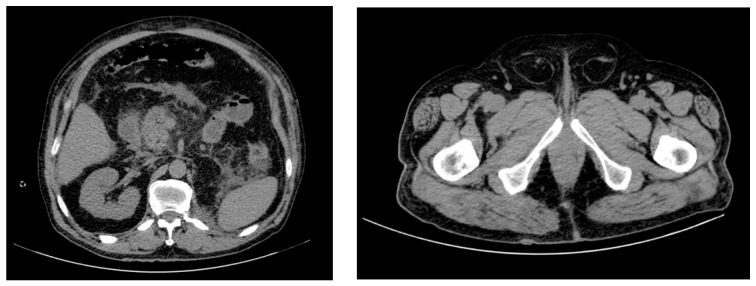
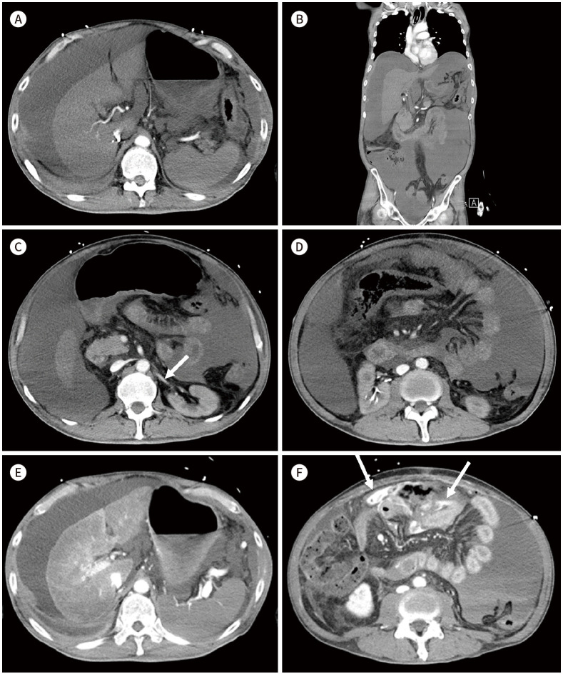
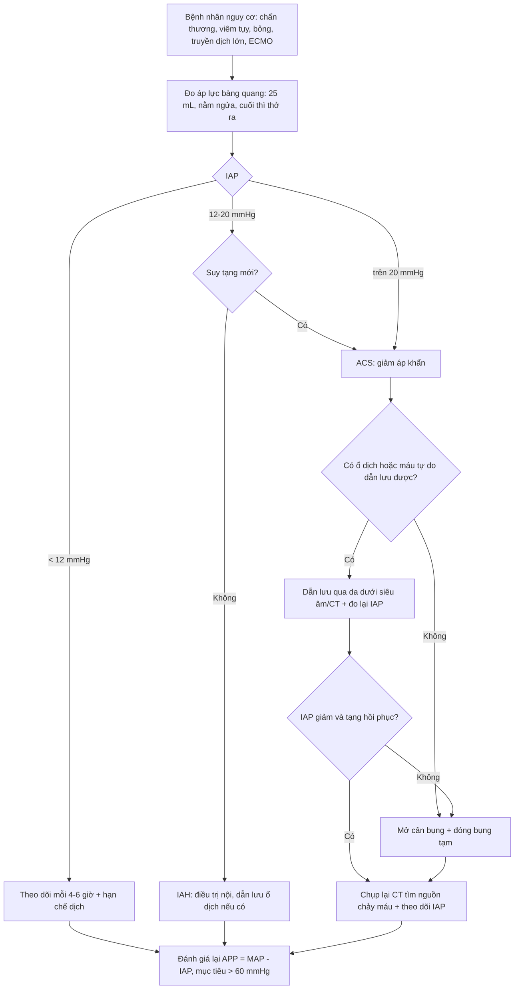
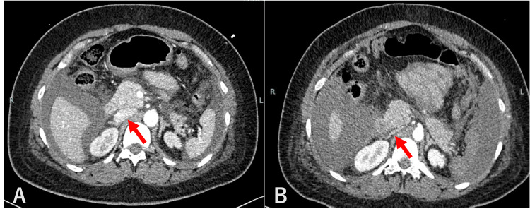
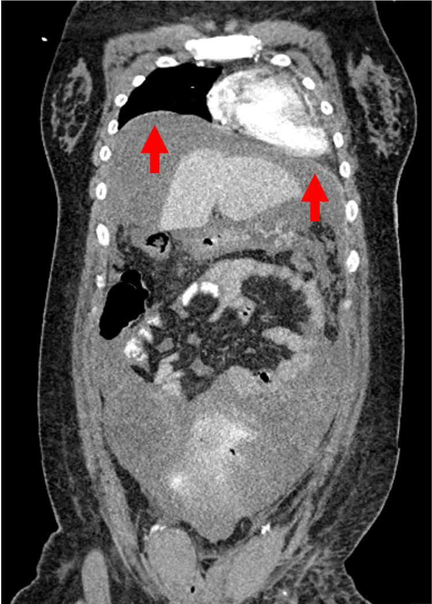

# 1946 — Chèn ép khoang bụng (ACS): CT báo động trước khi ta kịp đo áp lực bàng quang

**Tags:** `pattern:tang-ap-luc-o-bung` `pattern:bung-tron` `pattern:hep-tm-chu-duoi` `pattern:co-hoanh-cao` `pattern:ngam-thuoc-kem` `vung:bung` `vung:thanh-bung` `score:WSACS-IAH` `protocol:CT-bung-co-can-quang` `protocol:do-ap-luc-bang-quang` `incidentaloma:khong`
**Mức chắc chắn (certainty):** tổng hợp y văn (literature synthesis) — ghép **đồng thuận WSACS 2013 + khảo sát quốc tế 2022–2023 của WSACS** (*World J Emerg Surg* 2024, PMCID **PMC11605967**, CC BY 4.0), **bài tổng quan ACS trong viêm tụy cấp** (*Diagnostics* 2022, PMCID **PMC9818265**, CC BY 4.0), **hai ca nguyên văn có ảnh** (*J Korean Soc Radiol* 2025, PMCID **PMC11973108**, CC BY-NC 4.0; *Cureus* 2025, PMCID **PMC12375933**, CC BY 4.0) và **hai đoàn hệ** (*World J Gastrointest Surg* 2021, PMCID **PMC8069070**, CC BY-NC 4.0; *J Clin Med* 2025, PMCID **PMC11818648**, CC BY 4.0). Không có ca do nhóm tự chụp.

> **Câu chốt:** **tăng áp lực ổ bụng (intra-abdominal hypertension, IAH) là IAP ≥ 12 mmHg**, còn **chèn ép khoang bụng (abdominal compartment syndrome, ACS) là IAP > 20 mmHg + tổn thương cơ quan MỚI** — **chốt chẩn đoán là đo áp lực bàng quang, không phải CT**. Nhưng CT là thứ **báo động sớm và tìm nguyên nhân**: **bụng tròn (đường kính trước–sau ≥ đường kính ngang)**, **TM chủ dưới dẹt như khe**, **vòm hoành cao**, **ngấm thuốc nhu mô kém + thuốc ứ ở tĩnh mạch ngoài ổ bụng**. Ba con số định khung: **tử vong ~50%** khi ACS trên viêm tụy cấp nặng (PMC9818265), **ACS gặp 2,9% bệnh nhân ECMO so với 0,8% ICU không ECMO** (PMC11818648), và **áp lực tưới máu ổ bụng (APP) bình thường 60 mmHg** — dưới ngưỡng đó là bắt đầu mất tạng (PMC8069070).

## 1. Tổng quan bệnh học – cơ chế hình ảnh (TẠI SAO)

### 1.1. Định nghĩa có số — và vì sao phải thuộc

| Khái niệm | Ngưỡng (WSACS 2013) | Ghi chú |
|---|---|---|
| IAP bình thường | **5–7 mmHg** (người khỏe, nằm ngửa); **~10 mmHg** (bệnh nặng); **7–14 mmHg** (béo) | đo ở thì thở ra, tư thế nằm ngửa |
| **IAH** | **IAP ≥ 12 mmHg** bền vững, **2 lần đo cách nhau 1–6 giờ** | IAH là *áp lực*, chưa có suy tạng |
| **ACS** | **IAP > 20 mmHg** + **tổn thương cơ quan mới** (bài tổng quan dùng ngưỡng **SOFA > 3**) | ACS là *hội chứng*, phải can thiệp |
| Độ I / II / III / IV | **12–15** / **16–20** / **21–25** / **> 25 mmHg** | độ III–IV gần như chắc chắn cần can thiệp |
| **APP** (áp lực tưới máu ổ bụng) | **APP = MAP − IAP**, bình thường **60 mmHg** | APP **thấp hơn** huyết áp động mạch trong tiên lượng tử vong |

- **Vì sao gọi là "khoang" (compartment):** ổ bụng là hộp kín có **thành bụng đàn hồi**. Bình thường **độ tuân thủ thành bụng 250–450 mL/mmHg** (PMC9818265): thêm 1 lít dịch làm IAP tăng rất ít. Nhưng khi thành bụng **phù/bỏng/cứng** hoặc ổ bụng **đã đầy** (máu tụ, dịch tụy, ruột giãn), độ tuân thủ giảm còn vài chục mL/mmHg → **thêm vài trăm mL là IAP vọt qua 20 mmHg**. Đây là lý do **cùng một lượng máu tụ, người này chỉ đau bụng, người kia suy tạng**.
- **Vì sao tăng áp lực lại làm thiếu máu tạng:** theo **Laplace** (sức căng thành ∝ áp lực × bán kính), áp lực ngoài lòng mạch tăng → **mạch máu bị bóp từ ngoài vào**, chênh áp tưới máu giảm. Hệ quả theo thứ tự: **tĩnh mạch (áp lực thấp) bị xẹp trước → mao mạch ruột/gan/thận giảm tưới → thiểu niệu, toan chuyển hóa, phù ruột**.

### 1.2. Vì sao CT trông như vậy — vật lý từng dấu hiệu

- **TM chủ dưới dẹt (slit-like IVC):** thành TM chủ dưới mỏng, áp lực trong lòng chỉ **2–8 mmHg** ở người giảm thể tích. Khi **áp lực ngoài lòng 20–25 mmHg**, TM chủ dưới bị **ép dẹt thành khe** — ca Cureus chụp **ngày trước** thấy TM chủ dưới còn tròn, **ngày ngưng tim** thấy dẹt (PMC12375933). Đây là dấu **cơ học**, không phải dấu viêm.
- **Thuốc ứ ở tĩnh mạch ngoài ổ bụng (contrast stagnation):** cùng cơ chế — máu tĩnh mạch từ chi dưới và tạng không về được → **ứ ở tĩnh mạch tay đầu (brachiocephalic)**, trên CT thấy **thuốc đọng đậm, gần như không rửa** (ca Cureus). Đọc CT ở bệnh nhân ACS phải nhìn **tĩnh mạch ngoài ổ bụng**, không chỉ nhu mô.
- **Ngấm thuốc nhu mô kém + thành ruột ngấm mạnh:** khi **APP giảm**, thuốc tới gan/lách/thận **chậm và loãng** → nhu mô "nhạt" như chụp thiếu thuốc; trong khi **ruột thiếu máu** lại có **ngấm niêm mạch mạnh, thành dày, phù quanh ruột** ("shock bowel") do giãn mạch và rò mao mạch. Ca J Korean Soc Radiol: **máu tự do 15–20 HU**, **gan–lách–thận ngấm kém**, **TM thận dẹt (mũi tên)**, **đường kính trước–sau thành bụng tăng** (PMC11973108).
- **Vòm hoành cao:** ổ bụng căng đẩy cơ hoành lên → **giảm thể tích phổi, xẹp đáy phổi, tăng áp lực đường thở**. Ca Cureus: vòm hoành lên **ngang thân đốt sống ngực T5** (PMC12375933) — đây là dấu **gián tiếp nhưng rất dễ thấy** trên lát cắt ngực bụng.
- **Bụng tròn (round belly sign):** ổ bụng căng làm **đường kính trước–sau ≥ đường kính ngang** — bình thường bụng người nằm ngửa **rộng hơn cao**; khi đảo chiều tỷ lệ đó, nghĩ tới **IAH** (ảnh mục 2, PMC9818265).

### 1.3. Ngưỡng định lượng nằm lòng (dịch tễ – tiên lượng)

| Đại lượng | Số liệu | Nguồn |
|---|---|---|
| ACS ở bệnh nhân ECMO | **2,9% (47/1.643)**; ở nhóm **được hồi sinh tim phổi: 4,2% (32/766)** | PMC11818648 |
| ACS ở ICU **không** ECMO (cùng trung tâm) | **0,8% (291/36.795)** | PMC11818648 |
| IAH/ACS trong **viêm tụy cấp nặng** | **~15%**; **tử vong ~50%** khi đã có ACS | PMC9818265 |
| Độ tuân thủ thành bụng bình thường | **250–450 mL/mmHg** | PMC9818265 |
| Nghiệm pháp đo IAP qua bàng quang | **tối đa 25 mL** nước muối vô khuẩn; nằm ngửa, **cuối thì thở ra** | PMC8069070 |
| Đầu giường cao **30–40°** | làm IAP **tăng thêm 4–9 mmHg** | PMC8069070 |
| APP mục tiêu | **> 60 mmHg** (bình thường 60) | PMC8069070 |
| Máu tự do trên CT trong ca ACS | **15–20 HU** (máu chưa đông, còn loãng) | PMC11973108 |

- **Chưa rõ — cần tra:** không có **ngưỡng diện tích/đường kính cụ thể trên CT** được thẩm định để chẩn đoán ACS; các bài dùng dấu hiệu **định tính** (bụng tròn, TM chủ dưới dẹt, cơ hoành cao) và **IAP** là tiêu chuẩn vàng. Vì vậy bài này **không** đặt ra "tỷ lệ AP/ngang > 0,8 là ACS" — không có nguồn.

## 2. Mẫu hình + chẩn đoán phân biệt theo vị trí (Gamut)

- **Mẫu hình chung:** bụng **căng tròn**, **TM chủ dưới dẹt**, **cơ hoành cao**, **nhu mô ngấm thuốc kém**, **ruột dày – ngấm niêm mạch mạnh**, ± **dịch/máu tự do 15–20 HU**.
- **Theo khoang tích tụ (phải chỉ ra được khoang nào đang chiếm chỗ):**
  - **Thành bụng:** tụ máu bao cơ thẳng (**bài 1936**), phù thành bụng sau bỏng, huyết khối tĩnh mạch chủ dưới thành bụng, bỏng > 20% diện tích cơ thể (ACS **thứ phát**).
  - **Ổ phúc mạc:** máu tụ do chấn thương (ca PMC11973108), **cổ trướng căng** (xơ gan, ung thư phúc mạc), dịch tụy, khí tự do, dịch thẩm thấu sau lọc màng bụng.
  - **Sau phúc mạc:** máu tụ sau phúc mạc, **viêm tụy cấp hoại tử** (PMC9818265), vỡ phình động mạch chủ bụng, thoát thuốc sau can thiệp.
  - **Lòng ruột:** **giãn ruột non/đại tràng**, liệt ruột, xoắn, tắc ruột non–non (**bài 3128**), hội chứng Ogilvie.
  - **Ngoài ổ bụng (ACS thứ tự khác):** bỏng ngực – thành ngực, thở máy **PEEP cao**, hồi sinh tim phổi kéo dài, truyền dịch **khối lượng lớn**.
- **Mẫu hình mô phỏng (không phải ACS):** **béo bụng** (bụng tròn nhưng IAP 7–14 mmHg, không suy tạng); **cổ trướng mạn** (dịch nhiều nhưng thành bụng mềm, chọc ra là giảm); **suy tim phải** (TM chủ dưới **giãn** chứ không dẹt).
- **Câu hỏi định hướng:** *"Khoang nào đang chiếm thể tích, và thành bụng có còn đàn hồi không?"* — trả lời được hai câu này là ra hướng xử trí (chọc/dẫn lưu vs mở cân bụng).

*Bệnh nhân **76 tuổi**, viêm tụy cấp hoại tử biến chứng ACS: ổ bụng **căng tròn, đường kính trước–sau ≥ đường kính ngang** (dấu bụng tròn), kèm **thoát vị bẹn hai bên** do áp lực ổ bụng cao đẩy tạng ra ngoài. Ảnh nguyên bản 2 panel, không crop. Nguồn: *Diagnostics* 2022, PMCID PMC9818265, CC BY 4.0.*

## 3. Bảng so sánh phân biệt (ma trận đối chiếu)

| Thực thể (entity) | Hình ảnh điển hình | Chốt vào (rule-in) | Chốt loại (rule-out) | Gợi ý xác nhận |
|---|---|---|---|---|
| **ACS (nguyên phát)** | Bụng tròn, **TM chủ dưới dẹt**, **cơ hoành cao**, **nhu mô ngấm kém**, **thuốc ứ tĩnh mạch tay đầu**, ruột dày ngấm niêm mạch | **IAP > 20 mmHg + suy tạng mới** (thiểu niệu, tăng áp lực đường thở, toan); CT có ≥ 2 dấu hiệu trên | **TM chủ dưới giãn** + tĩnh mạch cổ nổi → nghĩ suy tim phải, không phải ACS | **Đo áp lực bàng quang** (25 mL, nằm ngửa, cuối thì thở ra); APP = MAP − IAP |
| **IAH chưa thành ACS** | CT **có thể bình thường** hoặc chỉ bụng tròn nhẹ | **IAP 12–20 mmHg**, **chưa** suy tạng mới | Đã có suy tạng mới → **không** còn là IAH đơn thuần | Đo IAP 2 lần cách 1–6 giờ; theo dõi mỗi 4–6 giờ |
| **Shock bowel / thiếu máu ruột non (bài 1908)** | Ruột giãn, **thành mỏng ngấm mạch mạnh**, phù mạc treo, dịch; mạch mạc treo có thể tắc | **Tụt áp + toan lactic**, mạch mạc treo tổn thương trên CTA | **TM chủ dưới dẹt + bụng tròn + IAP cao** → nguyên nhân là **áp lực**, không chỉ giảm tưới máu | CTA thì cổng + đo IAP; nội soi khi nghi hoại tử |
| **Tụ máu bao cơ thẳng (bài 1936)** | Khối **tăng tỷ trọng trong bao cơ thẳng**, hình thoi, đẩy phúc mạc vào trong | **Đau thành bụng khu trú + dấu Carnival/Fothergill**, sau mổ/tiêm kháng đông | Máu tụ **nhỏ, không đổi IAP** → không gây ACS | Siêu âm/CT; **đo IAP** nếu máu tụ lớn |
| **Cổ trướng căng** | Dịch tự do nhiều, **bụng tròn**, cơ hoành cao; **không** có máu tụ | **Chọc dịch giảm IAP ngay lập tức** | Dịch **ít** mà IAP vẫn cao → tìm nguyên nhân khác (thành bụng, ruột) | Siêu âm + chọc dẫn lưu; đo IAP trước/sau |
| **Béo bụng (biến thể)** | Thành bụng dày mỡ, bụng tròn, **TM chủ dưới bình thường** | **Không suy tạng**, IAP nền 7–14 mmHg | **Suy tạng mới + TM chủ dưới dẹt** → không phải béo đơn thuần | Đo IAP; so phim cũ |
| **Thoát vị thành bụng do áp lực** | Tạng/thành ruột **chui qua lỗ thoát vị** (bẹn, rốn, vết mổ) hai bên | **Bụng tròn + thoát vị mới xuất hiện** cùng đợt | Thoát vị **cũ, mạn** không kèm bụng tròn | Khám + CT; theo dõi nghẹt |

*Nam **54 tuổi**, ACS sau tai nạn giao thông. **A** (thì cổng, trục ngang): **máu tự do lượng lớn ~15–20 HU**, **không thấy thoát mạch hoạt tính**, **gan–lách–thành ruột ngấm thuốc kém**. **B** (trục đứng): **cơ hoành cao**, máu tự do nhiều. **C–D** (thì muộn 3 phút): **TM thận dẹt (mũi tên)**, **đường kính trước–sau thành bụng tăng**, nhu mô vẫn ngấm kém trong khi TM chủ dưới ngấm tốt. **E–F** (sau đặt catheter dẫn lưu qua da): **thoát mạch xuất hiện ở mạc treo cạnh rốn (mũi tên)** — ổ máu tụ do nhánh tĩnh mạch mạc treo trên; **đường kính trước–sau giảm** sau khi giảm áp. Ảnh nguyên bản 6 panel, không crop. Nguồn: *J Korean Soc Radiol* 2025, PMCID PMC11973108, CC BY-NC 4.0.*

## 4. Protocol chụp + đo áp lực + phân tầng xử trí

### 4.1. CT bụng–chậu: chụp thế nào để trả lời được câu hỏi áp lực

1. **Thì cổng (portal venous) là thì chính** — cần **nhu mô tạng + tĩnh mạch**; thì động mạch muộn **vô dụng ở bệnh nhân tụt áp** vì thuốc tới muộn và loãng. Ca PMC11973108 chụp **thì cổng** rồi **thì muộn 3 phút** để tìm thoát mạch.
2. **Không trì hoãn vì chờ "đủ thuốc"** — bệnh nhân ACS có thể **ngưng tim ngay sau khi rời máy** (ca Cureus). Chụp **nhanh, không cản quang đường tiêu hóa** khi bệnh nhân nặng.
3. **Đọc theo trình tự 6 bước (ghi vào phiếu đọc):**
   - **Bước 1 — hình dạng bụng:** đường kính **trước–sau** so với **ngang** (dấu bụng tròn).
   - **Bước 2 — tĩnh mạch lớn:** **TM chủ dưới** (dẹt/khe?), **TM thận** hai bên (dẹt?), **tĩnh mạch tay đầu** (thuốc ứ?).
   - **Bước 3 — cơ hoành:** vị trí vòm hoành, xẹp đáy phổi, tràn dịch màng phổi.
   - **Bước 4 — thành ruột:** độ dày, **mức ngấm niêm mạch**, phù mạc treo, hơi trong thành.
   - **Bước 5 — khoang tích tụ:** máu/dịch tự do (**đo HU**), ổ dịch tụy, máu tụ sau phúc mạc/thành bụng.
   - **Bước 6 — mạch và tạng đặc:** khuyết thuốc động mạch mạc treo (**bài 1908**), nhồi máu gan/lách/thận, giãn đường mật.
4. **Chụp lại sau khi đặt catheter dẫn lưu** (*khi bệnh nhân ổn định*): ca PMC11973108 — lần chụp đầu **không thấy nguồn chảy máu** vì áp lực cao + thuốc kém; **sau khi giảm áp**, nguồn chảy (**nhánh tĩnh mạch mạc treo trên**) **hiện ra**. Đây là bài học: **CT âm tính về nguồn máu trong ACS không phải CT âm tính**.

### 4.2. Đo áp lực bàng quang (chuẩn vàng) — 5 điều bắt buộc

- **Tư thế:** nằm ngửa hoàn toàn; **đầu giường cao 30–40° làm IAP tăng 4–9 mmHg** → **không đo khi đầu cao**.
- **Lượng nước:** **tối đa 25 mL** nước muối vô khuẩn (bơm nhiều hơn sẽ **làm tăng IAP giả tạo**).
- **Thì đo:** **cuối thì thở ra**, không gồng cơ bụng.
- **Mốc 0:** **đường nách giữa ngang mào chậu**.
- **Số lần:** **2 lần cách nhau 1–6 giờ** mới gọi là IAH bền vững; sau đó theo dõi **mỗi 4–6 giờ** khi còn nguy cơ.
- **Chống chỉ định:** đã cắt bàng quang, **vỡ bàng quang** → dùng phương pháp khác (dạ dày, trực tràng, tĩnh mạch chủ dưới).

### 4.3. Phân tầng xử trí

| Mức | IAP / APP | Xử trí |
|---|---|---|
| **Nguy cơ (chưa IAH)** | IAP < 12 mmHg | Theo dõi IAP mỗi 4–6 giờ; hạn chế dịch, giảm PEEP nếu được |
| **IAH độ I–II** | **12–20 mmHg**, chưa suy tạng | **Điều trị nội:** đặt sonde dạ dày, prokinetic, trung tiện, giảm dịch, lợi tiểu/lọc máu, giảm PEEP, giảm đau–an thần |
| **IAH độ III–IV** | **21–25 / > 25 mmHg** | Thêm **giãn cơ (cisatracurium 0,15 mg/kg bolus)**, dẫn lưu dịch/máu **dưới siêu âm hoặc CT**, cân nhắc **mở cân bụng** |
| **ACS** | **IAP > 20 mmHg + suy tạng mới**, hoặc **APP < 60 mmHg** | **Giảm áp ngay**: dẫn lưu qua da nếu có ổ dịch → **mở cân bụng (decompressive laparotomy)** + đóng bụng tạm (Bogota/VAC) |

- **Mốc thời gian:** **mở cân bụng muộn làm tăng tử vong**; các ca sống sót trong y văn đều được **giảm áp trong vòng vài giờ** sau khi nhận ra (ca Cureus: ngưng tim **ngay sau** chụp CT → mổ giảm áp cấp cứu, cứu sống không di chứng nặng).

## 5. Biến thể bình thường và cạm bẫy

- **Cạm bẫy 1 — "CT bình thường nên không có IAH":** IAH **độ I–II thường không có dấu hiệu CT**. CT chỉ giúp khi áp lực đủ cao để bóp tĩnh mạch; **chẩn đoán vẫn là IAP**.
- **Cạm bẫy 2 — đọc "ngấm thuốc kém" thành "chụp thiếu thuốc":** ở ACS, **thuốc ứ ở tĩnh mạch tay đầu** là dấu **cùng một cơ chế**; đừng yêu cầu chụp lại thì động mạch (làm chậm giảm áp).
- **Cạm bẫy 3 — TM chủ dưới dẹt do giảm thể tích:** giảm thể tích **cũng** làm TM chủ dưới dẹt. Phân biệt bằng **tĩnh mạch ngoài ổ bụng ứ + bụng tròn + IAP cao**; giảm thể tích đơn thuần thì **bụng mềm, không tròn**.
- **Cạm bẫy 4 — bỏ sót khoang tích tụ:** máu tụ **thành bụng** (bài 1936) và **sau phúc mạc** dễ bị đọc là "dịch tự do"; phải **truy khoang** — quyết định **chọc ở đâu** khác nhau hoàn toàn.
- **Cạm bẫy 5 — chọc/dẫn lưu sai chỗ:** máu tụ **trong bao cơ thẳng** không dẫn lưu qua đường phúc mạc; **ổ dịch tụy** dẫn lưu qua đường sau phúc mạc. Dẫn lưu sai → **không giảm IAP** mà còn gây nhiễm.
- **Cạm bẫy 6 — cho rằng hết ACS sau khi dẫn lưu:** IAP có thể **tăng lại** khi dịch tái tích (ca viêm tụy); phải **đo lại 4–6 giờ** và tìm **nguồn chảy máu** nếu dịch ra nhiều.
- **Cạm bẫy 7 — bỏ qua thoát vị mới:** **thoát vị bẹn/rốn/vết mổ xuất hiện cùng đợt bụng căng** là dấu áp lực, không phải "thoát vị tình cờ" (ảnh PMC9818265).
- **Cạm bẫy 8 — béo bụng:** người béo có **IAP nền 7–14 mmHg** và bụng tròn sẵn; chỉ gọi ACS khi **có suy tạng mới + TM chủ dưới dẹt**.
- **Cạm bẫy 9 — tư thế đo:** đo khi **đầu giường cao 30–40°** làm IAP tăng **4–9 mmHg** → chẩn đoán ACS giả. Luôn ghi **tư thế + lượng nước bơm** cạnh con số.

*Nữ **32 tuổi**, ngày 2 sau mổ lấy thai, bụng chướng tăng rồi **ngưng tim ngay sau chụp CT**. **A** — ngày trước: **TM chủ dưới còn tròn, có thuốc** (mũi tên đỏ). **B** — lúc ngưng tim: **TM chủ dưới dẹt thành khe**, nhu mô ngấm kém. Mổ giảm áp cấp cứu, bệnh nhân sống **không di chứng nặng**. Ảnh nguyên bản 2 panel, không crop. Nguồn: *Cureus* 2025, PMCID PMC12375933, CC BY 4.0.*

*Cùng bệnh nhân, cùng lần chụp: **vòm hoành lên ngang thân đốt sống ngực T5** — ổ bụng căng đẩy cơ hoành lên, làm giảm thể tích phổi và tăng áp lực đường thở (cơ chế "khoang kép" bụng–ngực). Ảnh nguyên bản, không crop. Nguồn: *Cureus* 2025, PMCID PMC12375933, CC BY 4.0.*

## 6. Tự lượng giá — Blind Quiz

**Ca 1 — Nam 54 tuổi, tai nạn giao thông, bụng chướng nhanh, huyết áp 80/50 mmHg, nước tiểu 10 mL/giờ. CT bụng thì cổng:**

- Hỏi: (1) Dấu hiệu nào trên CT hướng tới **ACS** chứ không chỉ là mất máu? (2) Vì sao **không thấy nguồn chảy máu** ở lần chụp này? (3) Bước tiếp theo ngay tại giường?

<b>Bấm để hiện đáp án (findings + chẩn đoán)</b>

- **Dấu hiệu:** máu tự do **15–20 HU**; **gan–lách–thành ruột ngấm kém**; **TM thận dẹt (mũi tên)**; **đường kính trước–sau thành bụng tăng**; **cơ hoành cao** — mẫu hình **ACS nguyên phát do máu trong ổ bụng**.
- **Vì sao không thấy nguồn:** áp lực ổ bụng cao + **giảm tưới máu mạc treo** làm thuốc **tới muộn và loãng**, nên thoát mạch **không hiện**. Sau khi **giảm áp bằng catheter**, CT lặp **thấy thoát mạch ở nhánh tĩnh mạch mạc treo trên**.
- **Bước tiếp:** **đo áp lực bàng quang** (25 mL, nằm ngửa, cuối thì thở ra, mốc đường nách giữa ngang mào chậu); nếu **IAP > 20 mmHg + thiểu niệu/toan** → **dẫn lưu qua da** hoặc **mở cân bụng**.
- Nguồn ảnh + số liệu: *J Korean Soc Radiol* 2025, PMCID PMC11973108, CC BY-NC 4.0.

**Ca 2 — Nữ 32 tuổi, ngày 2 sau mổ lấy thai, bụng chướng tăng nhanh, khó thở, rồi ngưng tim. CT được chụp ngay trước khi ngưng tim (ảnh dưới).**

- Hỏi: (1) Hai dấu hiệu CT nào được dùng để chẩn đoán? (2) Vì sao **không chờ** kết quả xét nghiệm? (3) Can thiệp nào đã cứu bệnh nhân?

<b>Bấm để hiện đáp án</b>

- **Dấu hiệu:** **TM chủ dưới dẹt thành khe** so với ngày trước (ảnh A→B); **vòm hoành lên ngang T5**; **thuốc ứ ở tĩnh mạch tay đầu** (không rửa). Bộ ba này = **ACS**.
- **Vì sao không chờ:** ACS có thể **tiến tới ngưng tim trong vài phút**; chẩn đoán dựa trên **IAP + suy tạng**, không dựa vào men tim hay khí máu.
- **Can thiệp:** **mở cân bụng giải áp cấp cứu** + đóng bụng tạm; bệnh nhân sống, **không di chứng nặng**.
- Nguồn số liệu: *Cureus* 2025, PMCID PMC12375933, CC BY 4.0.

**Ca 3 — Nam 76 tuổi, viêm tụy cấp hoại tử ngày 6, bụng chướng, PaO₂/FiO₂ giảm, nước tiểu ít. CT bụng có cản quang:**

- Hỏi: (1) Dấu hiệu hình dạng bụng gọi là gì? (2) Nó có đủ để chẩn đoán ACS không? (3) Xử trí đầu tay?

<b>Bấm để hiện đáp án</b>

- **Dấu hiệu:** **bụng tròn (round belly sign)** — đường kính **trước–sau ≥ ngang**; kèm **thoát vị bẹn hai bên** do áp lực cao.
- **Không đủ:** dấu này **chỉ gợi ý IAH**; chẩn đoán ACS cần **IAP > 20 mmHg + suy tạng mới**. Ở viêm tụy cấp nặng, **~15%** có IAH/ACS và **tử vong ~50%** khi đã có ACS.
- **Xử trí:** điều trị nội (sonde dạ dày, prokinetic, giảm dịch, giảm đau) + **dẫn lưu ổ dịch tụy qua da** dưới hướng dẫn siêu âm/CT; **mở cân bụng** nếu không đáp ứng.
- Nguồn ảnh + số liệu: *Diagnostics* 2022, PMCID PMC9818265, CC BY 4.0.

## Bài liên quan chéo
- [1936 – Tụ máu bao cơ thẳng bụng](../1936-tu-mau-bao-co-thang-bung/lesson.md) (nguyên nhân **thành bụng** của ACS — cùng bệnh cảnh, khác khoang)
- [1908 – Thiếu máu mạc treo & bóc tách động mạch tạng](../1908-thieu-mau-mac-treo-va-boc-tach-dong-mach-tang/lesson.md) (hàng phân biệt "ruột thiếu máu" — mạch tắc vs áp lực cao)
- [1911 – Viêm đại tràng thiếu máu](../1911-viem-dai-trang-thieu-mau/lesson.md) (tổn thương ruột do giảm tưới máu)
- [3128 – Lồng ruột non–non ở người lớn](../3128-long-ruot-non-non-nguoi-lon/lesson.md) (nguyên nhân **lòng ruột** gây chướng)
- [098 – Barotrauma & tràn khí áp lực thở máy](../098-barotrauma-tran-khi-ap-luc-tho-may/lesson.md) (hệ quả lồng ngực của cơ hoành cao + PEEP cao)
- [160 – Đau bụng cấp (tiếp cận)](../160-bung-cap-GI/lesson.md) (khung tiếp cận bụng cấp trước khi nghĩ tới ACS)

## Ảnh
- `1946_acs_CT_RoundBelly_PMC9818265-F2.jpg` — dấu **bụng tròn** + thoát vị bẹn hai bên trong ACS do viêm tụy cấp; *Diagnostics* 2022, PMCID PMC9818265, CC BY 4.0.
- `1946_acs_CT_Axial-Coronal_PMC11973108-F1.jpg` — 6 panel CT trước/sau dẫn lưu qua da (máu 15–20 HU, TM thận dẹt, nguồn chảy từ nhánh TM mạc treo trên); *J Korean Soc Radiol* 2025, PMCID PMC11973108, CC BY-NC 4.0.
- `1946_acs_CT_IVC_PMC12375933-F2.jpg` — so sánh **TM chủ dưới** ngày trước vs lúc ngưng tim; *Cureus* 2025, PMCID PMC12375933, CC BY 4.0.
- `1946_acs_CT_Diaphragm_PMC12375933-F3.jpg` — **vòm hoành cao** ngang T5 trong cùng ca; *Cureus* 2025, PMCID PMC12375933, CC BY 4.0.
- Chi tiết nguồn, giấy phép, phái sinh: `images/CREDITS.md`; link bài gốc: `sources.md`.

> Không dùng để chẩn đoán độc lập khi chưa có người hướng dẫn.
