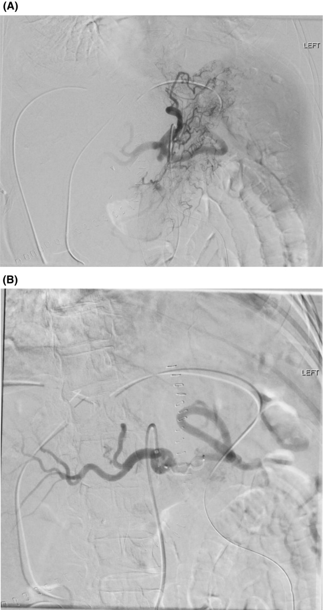
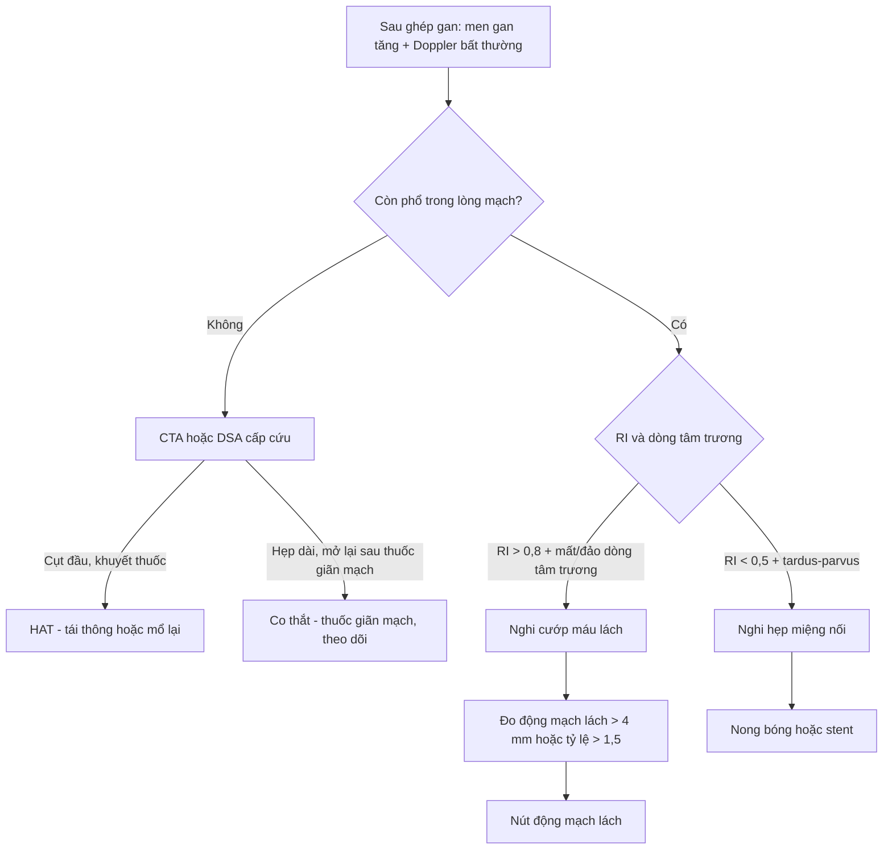
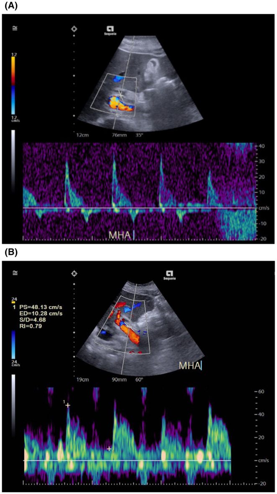
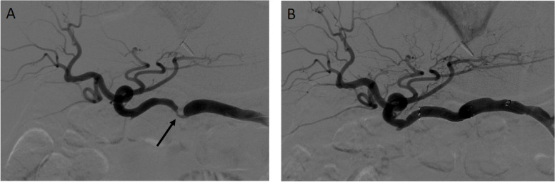

# 1947 — Co thắt động mạch gan & hội chứng cướp máu lách sau ghép gan: hai nguyên nhân "mất dòng" không phải huyết khối / Hepatic artery vasospasm and splenic artery steal syndrome after liver transplantation

**Tags:** `pattern:mat-song-toc-do` `pattern:gia-tac-mach` `pattern:tardus-parvus` `pattern:dao-dong-tam-truong` `vung:dong-mach-gan` `vung:lach` `vung:gan` `score:RI` `protocol:Doppler` `protocol:CTA-bung` `protocol:DSA`
**Mức chắc chắn (certainty):** tổng hợp y văn (literature synthesis) — ghép **1 ca co thắt được mổ lại vì tưởng huyết khối** (*Clin Transplant Res* 2024, PMC11075816, CC BY-NC), **1 loạt 3 ca cướp máu lách có DSA + Doppler trước/sau nút mạch** (*Clin Case Rep* 2024, PMC11091234, CC BY-NC), **1 loạt 75 ca nút động mạch lách so vị trí nút** (*PLoS One* 2022, PMC8912229, CC BY) và **1 loạt 48 thủ thuật hẹp động mạch gan so can thiệp trực tiếp với nút mạch tạng** (*CVIR Endovasc* 2024, PMC11032299, CC BY). **Không có thử nghiệm ngẫu nhiên**; tỷ lệ co thắt **chưa được xác định** trong y văn.

> **Câu chốt:** sau ghép gan, **"không thấy phổ động mạch gan" không đồng nghĩa huyết khối**. Có **ba** nguyên nhân, và **xử trí ngược nhau**: **huyết khối (HAT)** cần tái thông/mổ lại trong vài giờ; **co thắt** là **rối loạn chức năng, tự hồi phục** — mổ lại chỉ để xác nhận và bơm thuốc giãn mạch; **cướp máu lách (SASS)** là **dòng máu bị "hút" sang lách**, điều trị bằng **nút động mạch lách** chứ không phải nong động mạch gan. Ba bệnh cảnh này **khác nhau ở chỉ một vài số đo Doppler** và **chỉ DSA mới phân định được** — nên điều trị theo hình ảnh mà không có DSA/CTA là điều trị mù.

## 1. Tổng quan bệnh học – cơ chế hình ảnh (TẠI SAO)

### 1.1 Ba cơ chế của cùng một triệu chứng "mất dòng"

- **Huyết khối (hepatic artery thrombosis, HAT):** là **biến cố cấu trúc**, chiếm **2,9% ở người lớn** và **8,3% ở trẻ** sau ghép gan, là **nguyên nhân mất ghép đứng thứ hai** sau chức năng ghép kém nguyên phát (PMC11075816). Xử trí: tái thông nội mạch hoặc mổ lại — đã có bài **1913**.
- **Co thắt (vasospasm):** là **biến cố chức năng của lớp áo giữa**. Sau kẹp mạch – tái tưới máu, hạ huyết áp, hạ thân nhiệt, catecholamin tăng, thiếu máu lạnh kéo dài, lớp cơ trơn của **động mạch gan ghép** co lại. Theo **định luật Poiseuille**, lưu lượng **tỷ lệ với bán kính lũy thừa 4**: giảm bán kính **20%** làm lưu lượng giảm **≈ 2,4 lần**, giảm **50%** làm lưu lượng giảm **16 lần**. Vì vậy **co thắt không cần hẹp lòng thật** cũng đủ làm **mất phổ hoàn toàn** trên Doppler — đúng ca PMC11075816: động mạch **thông hoàn toàn** nhưng **không có dòng trong các nhánh trong gan**.
- **Cướp máu lách (splenic artery steal syndrome, SASS):** **không có tổn thương động mạch gan**. Lách to → **giường mạch lách có sức cản thấp, lưu lượng rất cao** → khi dòng qua thân tạng (celiac trunk) bị "chia", phần lớn chảy vào **động mạch lách**, phần **động mạch gan** tụt áp và **mất dòng tâm trương** (thậm chí **đảo dòng**). Tỷ lệ SASS sau ghép gan được báo cáo **3–6%** (PMC8912229).

### 1.2 TẠI SAO Doppler cho ba bức tranh khác nhau

1. **Vật lý của chỉ số sức cản (resistive index, RI):** `RI = (PSV − EDV) / PSV`. **Hẹp miệng nối** làm **giảm áp lực hạ lưu** → **RI thấp (< 0,5)**, **PSV cao tại chỗ hẹp (> 200 cm/s)**, và **phổ tardus–parvus** (tăng tốc chậm, đỉnh tù) ở **động mạch gan trong gan**. **Cướp máu lách** thì ngược lại: động mạch gan **nhận ít máu**, **dòng tâm trương mất hoặc đảo**, nên **RI cao (> 0,8)** — đây là điểm phân biệt cốt lõi với hẹp.
2. **Vì sao số đo RI lại phân loại được bệnh nhân:** trong loạt 48 thủ thuật của PMC11032299, **RI trước can thiệp ở nhóm hẹp thật là 0,53 (IQR 0,44–0,59)** — được nong/stent động mạch gan; còn **nhóm được nút mạch tạng (chủ yếu động mạch lách) có RI 0,64 (IQR 0,52–0,70)**, khác biệt **p = 0,008**. Nói cách khác: **RI càng thấp càng nghĩ hẹp thật; RI còn cao kèm đảo dòng tâm trương càng nghĩ cướp máu lách**.
3. **Vì sao co thắt "giả huyết khối":** co thắt **lan tỏa, dài đoạn**, không có mảng xơ vữa, không có huyết khối trong lòng. Trên **DSA**, sau bơm **thuốc giãn mạch (papaverine, verapamil, nitroglycerin)** lòng mạch **mở lại** — đó là **tiêu chuẩn vàng tại chỗ**. Ca PMC11075816: Doppler ngày 1 hậu phẫu **mất dòng nhánh trong gan** → mở lại thấy **động mạch ghép co thắt** → bơm **papaverine + urokinase** trong mạch và **nicorandil** tĩnh mạch → **dòng hồi phục**, ra viện **ngày 23** với men gan bình thường.
4. **Vì sao cần DSA chứ không chỉ CTA:** DSA **vừa chẩn đoán vừa điều trị** (bơm thuốc giãn mạch, nong bóng, stent, nút lách) và cho **thử nghiệm chức năng** mà CTA không làm được. CTA hữu ích để **loại trừ tắc hoàn toàn, giả phình, hẹp miệng nối** và để **đo đường kính động mạch lách/gan** trước thủ thuật.

### 1.3 Ngưỡng định lượng nằm lòng

| Đại lượng | Số liệu | Nguồn |
|---|---|---|
| Tỷ lệ SASS sau ghép gan | **3–6%** | PMC8912229 |
| Tỷ lệ HAT sau ghép gan | **2,9%** người lớn · **8,3%** trẻ | PMC11075816 |
| Tỷ lệ co thắt động mạch gan sau ghép | **chưa rõ** — y văn không có mẫu số | PMC11075816 |
| Thể tích lách gợi ý SASS | **> 830 cm³**, độ chính xác **≈ 75%** | PMC11091234 (dẫn y văn) |
| Đường kính động mạch lách gợi ý SASS | **> 4,0 mm** | PMC11091234 |
| Tỷ lệ đường kính động mạch lách/động mạch gan | **> 1,5** | PMC11091234 |
| Chênh đường kính lách – gan | **≥ 6 mm** dự báo SASS | PMC11091234 (dẫn y văn) |
| Doppler gợi ý SASS | **RI > 0,8**, **mất/đảo dòng tâm trương** | PMC11091234 |
| Tần suất ca SASS có mô tả bất thường Doppler | **30% (34/113)** — Doppler **không đủ** để chẩn đoán | PMC11091234 |
| RI trước can thiệp: hẹp thật vs nút mạch tạng | **0,53 (0,44–0,59)** vs **0,64 (0,52–0,70)**, **p = 0,008** | PMC11032299 |
| Mức hẹp trên DSA: hẹp thật vs nút mạch tạng | **59% ± 9** vs **56% ± 12**, p = 0,32 | PMC11032299 |
| Biến chứng thủ thuật: nong/stent vs nút mạch tạng | **29% (6/21)** vs **4% (1/27)**, **p = 0,015** | PMC11032299 |
| Tử vong liên quan gan 1 năm: nong/stent vs nút mạch tạng | **10% (2/21)** vs **0% (0/27)**, p = 0,10 | PMC11032299 |
| ALT giảm sau 1 tháng: nong/stent vs nút mạch tạng | **−72 U/L** vs **−112,5 U/L**, p = 0,60 | PMC11032299 |
| Nút lách gần (proximal) vs xa: GPT ngày 3 | **57,0** vs **118,0 U/L** (IQR 107,5 vs 254,0), **p = 0,002** | PMC8912229 |
| Nút lách gần vs xa: GOT ngày 3 | **48,0** vs **81,0 U/L**, **p = 0,008** | PMC8912229 |
| Nút lách gần vs xa: tiểu cầu ngày 7 | **122** vs **83 ×10³**, **p = 0,014** | PMC8912229 |
| Ca co thắt: PSV/RI trong mổ | **PSV 45 cm/s**, **RI 0,6** → ngày 1 mất dòng | PMC11075816 |
| Ca co thắt: thời gian nằm viện | ra viện **ngày 23**, men gan bình thường | PMC11075816 |

*Hình 1 — DSA thân tạng. (A) Thuốc cản quang dồn gần như toàn bộ vào **động mạch lách**; **động mạch gan** chỉ còn một nhánh mờ. (B) Sau nút động mạch lách (thấy các vòng coil), **động mạch gan và các nhánh trong gan hiện đầy đủ**. Nguồn: *Clin Case Rep* 2024 (PMC11091234), CC BY-NC 4.0 — xem `images/CREDITS.md`.*

## 2. Mẫu hình + chẩn đoán phân biệt theo vị trí (Gamut)

**Mẫu hình chung:** bệnh nhân **sau ghép gan vài ngày đến vài tuần**, **men gan tăng**, có khi **sốt/hạ huyết áp**, Doppler **bất thường ở vùng rốn gan**. Câu hỏi hình ảnh luôn là: **dòng máu gan còn không, và nếu mất thì do cấu trúc hay do chức năng?**

- **Theo vị trí tổn thương trên DSA/CTA:**
  - **Miệng nối động mạch gan** → hẹp miệng nối, huyết khối, giả phình, bóc tách (bài 1861, 1913, 1915).
  - **Động mạch gan lan tỏa, dài đoạn** → co thắt (thường sau kẹp mạch, hạ huyết áp, hoặc do catheter).
  - **Thân tạng và động mạch lách** → cướp máu lách; lách to, động mạch lách giãn.
  - **Nhu mô gan** → ổ nhồi máu, ứ mật, hoại tử đường mật do thiếu máu (biến chứng của cả ba).
- **Gamut "mất phổ động mạch gan" sau ghép:** **HAT** · **hẹp miệng nối** · **co thắt** · **cướp máu lách** · **chèn ép/tắc do tụ máu hoặc kink** · **giảm cung lượng tim – hạ huyết áp** · **kỹ thuật đặt đầu dò sai (góc > 60°)**.
- **Gamut "tăng men gan sau ghép":** **thải ghép cấp** · **nhiễm trùng/viêm đường mật** · **thiếu máu động mạch (ba nguyên nhân trên)** · **tắc tĩnh mạch cửa** · **độc tính thuốc** · **tái phát bệnh nền**.

## 3. Bảng so sánh phân biệt (ma trận đối chiếu)

| Thực thể (entity) | Hình ảnh điển hình (Doppler / CTA / DSA) | Chốt vào (rule-in) | Chốt loại (rule-out) | Gợi ý xác nhận |
|---|---|---|---|---|
| **Huyết khối động mạch gan (HAT, bài 1913)** | Mất phổ cả **trong và ngoài gan**; CTA **khuyết thuốc hoàn toàn**; DSA **cụt đầu** | **Không có phổ ở mọi điểm + CTA khuyết thuốc lòng mạch + men gan tăng nhanh** | **Còn phổ ở một đoạn, hoặc phổ hồi phục sau thuốc giãn mạch** → không phải HAT | CTA 3 thì lát mỏng; DSA cấp cứu |
| **Co thắt động mạch gan** | **Hẹp lan tỏa, dài đoạn**, không mảng xơ vữa; phổ **yếu/mất** nhưng **không có khuyết thuốc khu trú**; **mở lại sau papaverine/verapamil** | **DSA: hẹp dài + giãn ra sau thuốc giãn mạch** | **Hẹp khu trú tại miệng nối, không đổi sau thuốc** → hẹp thật | DSA + thử thuốc giãn mạch trong cùng thì |
| **Cướp máu lách (SASS)** | **RI > 0,8**, **mất/đảo dòng tâm trương**; CTA: **động mạch lách > 4 mm hoặc tỷ lệ > 1,5**, lách **> 830 cm³**; DSA: thuốc dồn vào lách, gan mờ | **Đảo dòng tâm trương + động mạch lách giãn + dòng gan tăng sau nút lách** | **RI < 0,5, PSV cao tại miệng nối** → hẹp thật | DSA thân tạng; nút lách là **phép thử chẩn đoán** |
| **Hẹp miệng nối (bài 1861, 1915)** | **PSV > 200 cm/s** tại chỗ hẹp, **RI < 0,5**, **SAT > 80 ms**, **tardus–parvus** hạ lưu | **Hẹp khu trú + chênh áp qua chỗ hẹp + tardus–parvus** | **RI > 0,8 + đảo dòng tâm trương** → nghĩ cướp máu lách | CTA; đo chênh áp khi nong bóng |
| **Giả phình/Bóc tách động mạch gan** | Túi thuốc ngoài lòng mạch, **giữ hình thì muộn**; bóc tách: **giả lòng** | **Túi thuốc giữ hình thì muộn** | **Không có túi, không giả lòng** | CTA 3 thì; DSA |
| **Tụ máu/chèn ép ngoài mạch** | Khối máu tụ quanh rốn gan **đè xẹp** động mạch, **không có tổn thương nội mạc** | **Khối đè + mạch xẹp nhưng thành mạch nguyên** | **Huyết khối trong lòng/thành mạch** → HAT/bóc tách | CTA; siêu âm có thuốc cản quang (CEUS) |
| **Giảm cung lượng/hạ huyết áp** | **Phổ yếu toàn bộ** cả động mạch lách và gan, **RI bình thường hoặc cao**, hồi phục khi bù dịch/vận mạch | **Phổ yếu đồng thời nhiều tạng + huyết áp thấp** | **Bất thường khu trú một động mạch** → tổn thương thật | Theo dõi sau bù thể tích; Doppler lặp |

## 4. Protocol chụp + ngưỡng xử trí

**Doppler là tuyến đầu, làm hằng ngày trong tuần đầu** sau ghép gan (PMC11091234). Đo **PSV, EDV, RI, thời gian tăng tốc (SAT)** tại **vùng rốn gan và trong gan**, ghi **góc dò ≤ 60°**, và **luôn so với lần đo trước** — vì cả ba bệnh cảnh đều **thay đổi theo giờ**.

- **CTA bụng 3 thì (lát ≤ 1 mm)** khi Doppler bất thường: xác định **tắc, hẹp khu trú, giả phình, bóc tách**, và **đo đường kính động mạch lách/gan**.
- **DSA thân tạng** khi CTA không phân định hoặc khi có khả năng can thiệp: bơm thuốc giãn mạch **(papaverine 30–60 mg hoặc verapamil/nitroglycerin)** để **phân biệt co thắt với hẹp thật**; nong bóng/stent nếu hẹp thật; **nút động mạch lách** nếu SASS.
- **Nút động mạch lách:** coil, **Amplatzer plug** hoặc **hạt PVA 500–700 µm**; kỹ thuật **gần hay xa** đều hiệu quả, **nút gần có xu hướng bình thường hóa men gan sớm hơn** (PMC8912229). Loạt 75 ca: **100% thủ thuật thành công về kỹ thuật**, dòng động mạch gan cải thiện ngay.
- **Sau nút lách:** theo dõi **men gan 1–3–7 ngày và 1 tháng**, **công thức máu** (tiểu cầu), **đau lách/nhiễm trùng lách**; Doppler lặp để xác nhận **RI giảm và dòng tâm trương trở lại**.

**Bảng ngưỡng hành động (tóm tắt):**

| Tình huống | Ngưỡng | Hành động |
|---|---|---|
| RI động mạch gan | **< 0,5** | Nghĩ hẹp/tardus–parvus → CTA/DSA |
| RI động mạch gan | **> 0,8** kèm mất/đảo dòng tâm trương | Nghĩ cướp máu lách → đo động mạch lách, cân nhắc nút |
| Đường kính động mạch lách | **> 4,0 mm** hoặc **> 1,5 ×** động mạch gan | Ủng hộ SASS |
| Thể tích lách | **> 830 cm³** | Ủng hộ SASS (độ chính xác ≈ 75%) |
| DSA sau thuốc giãn mạch | Lòng mạch mở **rõ rệt** | Co thắt, không đặt stent |
| Men gan sau nút lách | Giảm trong **1–7 ngày** | Xác nhận chẩn đoán SASS |

## 5. Biến thể bình thường và cạm bẫy

- **RI cao trong 1–3 ngày đầu** sau ghép có thể là **sinh lý** (phù mảnh ghép, thiếu máu lạnh) — đừng vội gọi hẹp; **luôn so chuỗi đo** (bài 1913).
- **Đảo dòng tâm trương thoáng qua** khi bệnh nhân **hạ huyết áp hoặc vừa ăn**; đo lại sau khi ổn định.
- **Co thắt do catheter** khi chụp DSA: hình ảnh hẹp dài xuất hiện **sau khi đã đặt catheter**, mất đi khi bơm thuốc giãn mạch — **không được đặt stent** vào đoạn co thắt chức năng.
- **"Mất dòng" do đầu dò:** góc dò **> 60°**, cửa sổ kém, bệnh nhân thở mạnh, khí ruột; luôn đổi cửa sổ và **kiểm tra bằng Doppler màu trước khi kết luận**.
- **Cướp máu lách có thể che một hẹp thật đồng thời:** sau nút lách mà **RI vẫn thấp, PSV vẫn cao** → phải chụp lại để tìm hẹp miệng nối.
- **Nút lách không phải "vô hại":** biến chứng gồm **đau lách, áp-xe lách, huyết khối tĩnh mạch lách**; **coil trôi vào nhánh** gây **nhồi máu lách** — vì vậy nhiều trung tâm chọn **Amplatzer plug** hoặc **hạt PVA** thay coil ở động mạch lách giãn nhiều.
- **Sai lầm hay gặp nhất:** thấy **mất phổ** là **mổ lại ngay** mà không chụp mạch. Với co thắt, **mổ lại không sửa được gì** — ca PMC11075816 chỉ hồi phục nhờ **thuốc giãn mạch**.

## 6. Tự lượng giá — Blind Quiz

**Ca 1 — nữ 74 tuổi, ghép gan vì xơ gan rượu có tăng áp cửa; hậu phẫu men gan tăng, siêu âm Doppler vùng rốn gan**

- Gợi ý lâm sàng: không sốt, huyết áp ổn định; bệnh nền xơ gan có tăng áp cửa và cổ trướng.
- Câu hỏi: (1) Mô tả **hình dạng phổ** và **dòng tâm trương** ở panel A? (2) Chỉ số nào giúp phân biệt **cướp máu lách** với **hẹp miệng nối**? (3) Panel B đo được **PS 48,13 cm/s, ED 10,28 cm/s, RI 0,79** — thay đổi này chứng minh điều gì?

<b>Bấm để hiện đáp án (findings + chẩn đoán)</b>

- Dấu hiệu (findings): panel A — phổ động mạch gan **mất dòng tâm trương, có đoạn đảo dòng** (dưới đường đáy), đỉnh tâm thu hẹp; đây là kiểu **"đảo dòng tâm trương"** kinh điển của **cướp máu lách**. Panel B — sau nút động mạch lách: **PS 48,13 cm/s, ED 10,28 cm/s, RI 0,79**, dòng tâm trương **trở lại dương**.
- Chẩn đoán: **hội chứng cướp máu lách (SASS)** sau ghép gan, được điều trị bằng **nút động mạch lách (Amplatzer plug)**; men gan về bình thường **2 ngày** sau thủ thuật.
- Vì sao: dòng lách chiếm ưu thế → áp lực động mạch gan tụt → **mất dòng tâm trương**; khi cắt dòng lách, **áp lực và dòng tâm trương hồi phục ngay** — RI 0,79 nằm trong khoảng bình thường sau ghép.
- Phản biện: **RI 0,79 chưa phải "thấp"** — điểm chốt là **đảo dòng tâm trương trước thủ thuật**, không phải giá trị RI đơn lẻ; và chỉ **30% ca SASS** có bất thường Doppler được mô tả (PMC11091234).
- Nguồn ảnh: *Clin Case Rep* 2024;12:e8930 (PMC11091234), CC BY-NC 4.0.

**Ca 2 — nam 61 tuổi, ghép gan 3 tháng, men gan tăng, Doppler nghi hẹp; chụp mạch thân tạng**

- Gợi ý lâm sàng: không sốt; Doppler nghi hẹp với **RI thấp** (nhóm nong/stent trong loạt có RI trung vị **0,53**).
- Câu hỏi: (1) Tổn thương ở panel A nằm ở đâu và hình thái? (2) Vì sao **không** chọn nút động mạch lách ở ca này? (3) Panel B cho thấy gì?

<b>Bấm để hiện đáp án (findings + chẩn đoán)</b>

- Dấu hiệu (findings): panel A — **hẹp khu trú, ngắn** ngay tại **miệng nối động mạch gan** (mũi tên), đoạn sau hẹp giãn nhẹ; panel B — sau **nong bóng**, lòng mạch **mở rộng**, không còn eo.
- Chẩn đoán: **hẹp miệng nối động mạch gan (HAS)** có ý nghĩa lâm sàng → **nong bóng ± stent**.
- Vì sao: RI **thấp** + hẹp **khu trú** = tổn thương **cấu trúc**, không phải cướp máu lách; trong loạt PMC11032299, nhóm nong/stent có **RI trước thủ thuật 0,53** và **mức hẹp 59% ± 9**.
- Phản biện: nhóm can thiệp trực tiếp có **biến chứng 29%** và **tử vong liên quan gan 1 năm 10%** (so với **4%** và **0%** ở nhóm nút mạch tạng) — nhưng đây là **so sánh hồi cứu, không ngẫu nhiên**, và nhóm nút mạch tạng chủ yếu là bệnh nhân **không có hẹp thật**; **không được đọc thành "nút lách tốt hơn nong mạch"**.
- Nguồn ảnh: *CVIR Endovasc* 2024;7:39 (PMC11032299), CC BY 4.0.

**Ca 3 — trẻ có bệnh gan ứ mật tiến triển, ghép gan; ngày 1 hậu phẫu sốt, tụt huyết áp, men gan tăng, Doppler mất dòng nhánh trong gan**

- Câu hỏi: (1) Chẩn đoán nghĩ đến đầu tiên? (2) Nếu mổ lại thấy **động mạch thông hoàn toàn nhưng co nhỏ** thì xử trí? (3) Điều gì chứng minh đó không phải huyết khối?

<b>Bấm để hiện đáp án (findings + chẩn đoán)</b>

- Dấu hiệu (findings): Doppler **mất phổ nhánh trong gan**; trong mổ động mạch ghép **co thắt**, **không huyết khối**; PSV trong mổ **45 cm/s**, RI **0,6**.
- Chẩn đoán: **co thắt động mạch gan** sau ghép (biến cố chức năng, không phải tắc).
- Xử trí: bơm **papaverine + urokinase** trong mạch, **nicorandil** tĩnh mạch → dòng hồi phục; ra viện **ngày 23**, men gan bình thường.
- Vì sao: co thắt làm **bán kính giảm** → lưu lượng giảm theo **bán kính lũy thừa 4** (Poiseuille), đủ để **mất phổ** dù lòng mạch thông; **thuốc giãn mạch phục hồi** chứng minh cơ chế chức năng.
- Nguồn: *Clin Transplant Res* 2024;38:63 (PMC11075816), CC BY-NC 4.0 — ca nguyên văn, không có ảnh trong bài dùng được.

## Bài liên quan chéo
- [1913 — Hẹp & huyết khối động mạch gan sau ghép gan](../1913-hep-huyet-khoi-hep-dong-mach-gan-sau-ghep/lesson.md)
- [1861 — Hẹp động mạch gan sau ghép gan](../1861-hep-dong-mach-gan-ghep-gan/lesson.md)
- [1915 — Hẹp động mạch gan ở trẻ sau ghép gan](../1915-hep-dong-mach-gan-tre-sau-ghep/lesson.md)
- [1906 — Hẹp động ra tĩnh mạch gan sau ghép gan](../1906-hep-dong-ra-tm-gan-sau-ghep-gan/lesson.md)
- [1827 — Hẹp tĩnh mạch cửa sau ghép gan](../1827-hep-tinh-mach-cua-sau-ghep-gan/lesson.md)
- [1825 — Hội chứng gan nhỏ](../1825-hoi-chung-gan-nho/lesson.md)

## Ảnh
- `images/1947_splenic-steal_DSA_PMC11091234-f1.jpg` — DSA thân tạng trước/sau nút lách (CC BY-NC 4.0).
- `images/1947_splenic-steal_Doppler_PMC11091234-f2.jpg` — Doppler động mạch gan trước/sau nút lách (CC BY-NC 4.0).
- `images/1947_hep-stenosis_DSA_PMC11032299-f2.jpg` — DSA hẹp miệng nối trước/sau nong bóng (CC BY 4.0).
- Nguồn, giấy phép và phái sinh từng ảnh: `images/CREDITS.md`; link gốc: `sources.md`.

> Không dùng để chẩn đoán độc lập khi chưa có người hướng dẫn.
