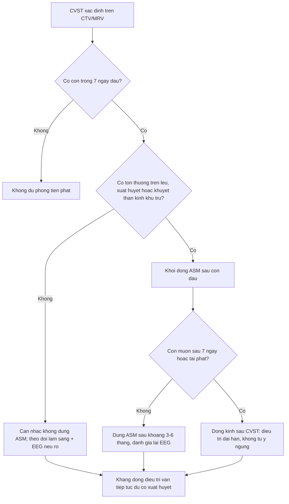
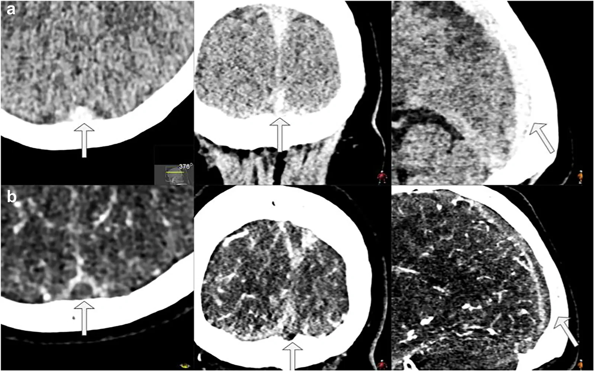
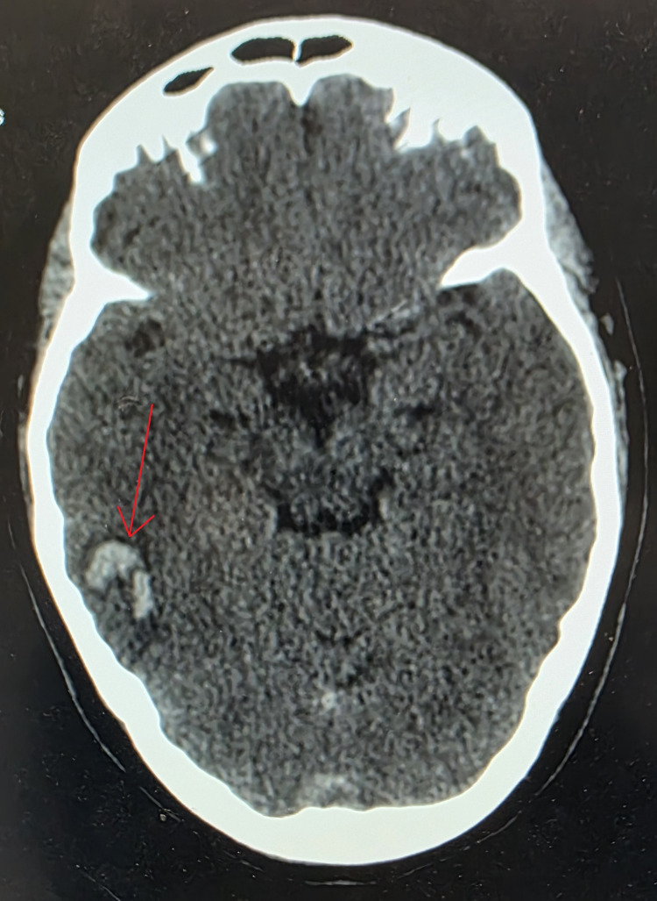
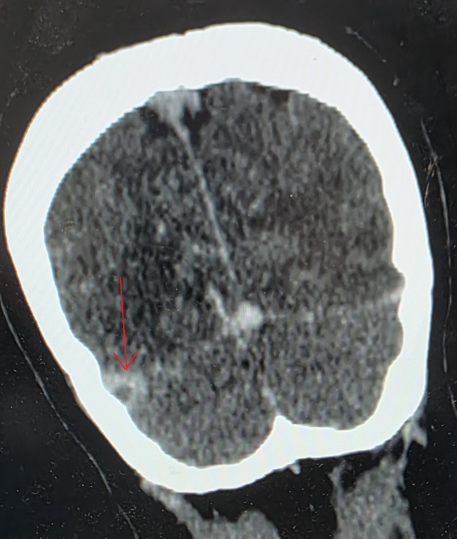
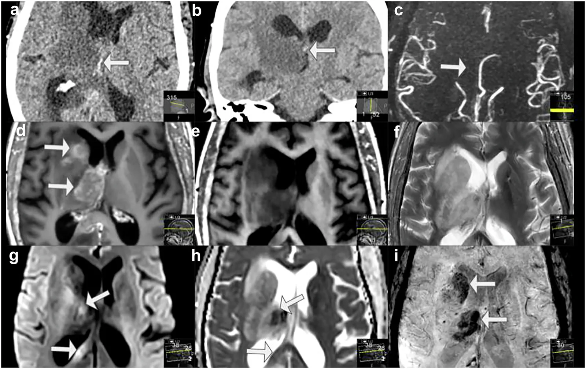

# 1948 — Co giật & động kinh sau huyết khối xoang tĩnh mạch não / Seizures and post-CVST epilepsy

**Tags:** `pattern:co-giat` `pattern:nhoi-mau-tinh-mach` `pattern:co-dac-mau` `pattern:xuat-huyet-nao` `pattern:khuyet-dong-chay` `vung:nao` `vung:vo-nao` `vung:xoang-tinh-mach` `protocol:NCCT` `protocol:CTV` `protocol:MRV` `protocol:MRI-nao` `score:ILAE-2017` `score:mRS`

**Mức chắc chắn (certainty):** tổng hợp y văn (literature synthesis) — **một tổng quan hệ thống 63 bài** về co giật trong CVST (PMC6119760), **ba đoàn hệ hồi cứu** (69 ca, PMC5756278; 80 ca, PMC9865306; đa trung tâm 2025, PMC12033526), **hai tổng quan hệ thống 2022–2025** về cơn muộn (PMC9153875; PMC12394382) và **một tổng quan hình ảnh theo vị trí giải phẫu** 2026 (PMC13588991). Không có thử nghiệm ngẫu nhiên về dự phòng bằng thuốc chống động kinh (ASM) trong CVST — mọi khuyến cáo điều trị đều là **ý kiến chuyên gia/thực hành đồng thuận**, được ghi rõ tại mục (4).

> **Câu chốt:** co giật là **mặt khởi phát thường gặp của CVST** (35–50% tổng quát, tới **76%** thể chu sinh) nhưng **KHÔNG phải một bệnh động kinh**: cơn trong **7 ngày đầu** là **cơn triệu chứng cấp (acute symptomatic seizure, ASyS)** do não đang bị tổn thương cấp, còn **cơn sau 7 ngày** mới là **động kinh sau CVST (post-CVST epilepsy, PCE)** và có nguy cơ tái phát cao. Ba số quyết định: **(1)** tổn thương **xuất huyết/nhồi máu xuất huyết là yếu tố dự báo mạnh nhất — OR 6,05** (PMC9865306); **(2)** **khuyết thần kinh khu trú OR 5,16**, huyết khối **xoang dọc trên 65,6% vs 40,5%** (PMC5756278); **(3)** **trạng thái động kinh làm tử vong tăng 44% vs 5,6%** (PMC12033526). Điều trị: **không dự phòng tiên phát** cho mọi bệnh nhân; **khởi động ASM sau cơn đầu** khi có tổn thương trên lều/khuyết thần kinh khu trú, và **không trì hoãn kháng đông vì có xuất huyết**.

## 1. Tổng quan bệnh học – cơ chế hình ảnh (TẠI SAO)

### 1.1 Vì sao huyết khối tĩnh mạch gây co giật — chuỗi ba bước

- **Bước 1 — ứ huyết áp lực cao:** xoang màng cứng **không có van**, dòng chảy chậm và không đập. Tắc xoang dọc trên hoặc tĩnh mạch vỏ làm áp lực mao mạch–tĩnh mạch tăng, **gradient lọc tăng** → dịch và hồng cầu thoát vào mô não. Đây là lý do tổn thương **không theo lãnh thổ động mạch**: hay gặp **cạnh đường giữa hai bên (parasagittal)** ở huyết khối xoang dọc trên, và **thùy thái dương/đỉnh** khi tắc xoang ngang–xích-ma.
- **Bước 2 — hàng rào máu–não vỡ:** phù mạch (vasogenic) rồi phù độc tế bào (cytotoxic) → **DWI sáng/ADC tối** ở vùng nhồi máu, **FLAIR tăng** lan theo vỏ. Tổn thương vỏ **trực tiếp lên vùng vận động–cảm giác** (trán sau, đỉnh) là nơi dễ phát cơn nhất — phù hợp với dữ liệu: **thùy trán 31,3% vs 10,8%**, **thùy thái dương 43,8% vs 8,1%** ở nhóm có cơn (PMC5756278).
- **Bước 3 — máu và sản phẩm giáng hóa:** khi có **nhồi máu xuất huyết**, hemosiderin/iron và hemoglobin thoái giáng là chất **kích thích vỏ não và gây động kinh** đã biết từ xuất huyết não; đây là lý do **xuất huyết là yếu tố dự báo mạnh nhất** (OR 6,05; PMC9865306). Trên **SWI**, các **vi chảy máu vỏ** và **tĩnh mạch tủy xoắn ốc giãn (corkscrew medullary veins)** là dấu hiệu ứ tĩnh mạch nặng (PMC13588991).
- **Vì sao cắt mốc 7 ngày:** đây là **quy ước vận hành của ILAE** (2017) cho cơn triệu chứng cấp sau tổn thương não cấp, không phải ranh giới sinh học tuyệt đối. Hệ quả thực hành: cơn **ngày 2–7 tệ hơn cơn ngày 1** (OR 3,3 cho mRS 90 ngày xấu; PMC12033526), và **cơn sau 7 ngày** là yếu tố dự báo tái phát mạnh nhất.

### 1.2 Dịch tễ định lượng — không phải "hiếm gặp"

- **CVST chiếm 0,5–1% đột quỵ**, **3–4/1.000.000 người lớn/năm**; nữ nhiều hơn, tuổi 20–40 (PMC5756278).
- **Cơn triệu chứng cấp:** **6,9–76%** giữa các nghiên cứu; giá trị hay gặp **35–50%**, **60%** ở CVST nặng, **76%** ở CVST chu sinh (PMC6119760).
- **Động kinh sau CVST:** **4–16%**; **ISCVT 11%** (36 ca ở 6 tháng, 55 ca ở 1 năm, 66 ca ở 2 năm) — tức **phần lớn xuất hiện trong năm đầu** (PMC6119760). Tổng quan 2025 ghi **~10% trong 2 năm** với **nguy cơ tái phát cao** (PMC12394382).
- **Cơn đầu tiên là biểu hiện khởi phát** ở khoảng **29%** bệnh nhân, trong đó **59%** là cơn toàn thể (Sidhom, dẫn qua PMC5756278).
- **Tiên lượng:** trong đoàn hệ 69 ca, **tử vong 9,38% vs 5,41%** và **kết cục tốt 90 ngày 81,25% vs 86,47%** — **khác biệt KHÔNG có ý nghĩa** (p = 0,469 và 0,793) (PMC5756278). Nghĩa là: **bản thân cơn không quyết định tiên lượng; tổn thương nền và trạng thái động kinh mới quyết định**.

### 1.3 Đọc hình ảnh theo cơ chế — dấu trực tiếp và gián tiếp

- **Dấu trực tiếp trên NCCT:** **tăng đậm độ trong lòng xoang** ("dense cord sign" khi thấy trên lát cắt dọc xoang) — huyết khối cấp **50–80 HU**, so với máu tĩnh mạch bình thường **~35–45 HU**. Độ nhạy **thấp** với huyết khối nhỏ và phụ thuộc cửa sổ, nên **NCCT bình thường KHÔNG loại trừ** (PMC13588991).
- **CTV:** **khuyết thuốc trong lòng xoang**, và dấu **"empty delta sign"** — thành xoang ngấm thuốc bao quanh huyết khối không ngấm; thấy rõ nhất ở **xoang dọc trên trên lát trục/vành**. Dấu này **có thể âm ở giai đoạn rất sớm** và **dương giả** khi có **hạt nhện (arachnoid granulation) to, dòng chảy chậm, hoặc giả ảnh dòng chảy** (PMC13588991).
- **MRI — vì sao T1 sáng:** hemoglobin thoái giáng thành **methemoglobin nội bào** ở máu bán cấp sớm → **T1 tăng tín hiệu** trong lòng xoang/tĩnh mạch vỏ, **T2 có thể tối**; ở bán cấp muộn methemoglobin ngoại bào → **T1 và T2 đều sáng**. Mất **flow void** bình thường là dấu gián tiếp. **T1 hyperintense cortical vein** là dấu chốt của **huyết khối tĩnh mạch vỏ đơn độc** — thể dễ bị bỏ sót nhất (PMC13588991, Hình 11).
- **DWI/ADC:** nhồi máu tĩnh mạch **hạn chế khuếch tán** nhưng có thể **hồi phục** nếu tái thông — khác nhồi máu động mạch đã hoại tử; vì vậy **đừng dùng ADC để "chốt tử vong mô"** như trong đột quỵ động mạch.
- **SWI/T2\*:** **vi chảy máu vỏ, tĩnh mạch giãn xoắn ốc, huyết khối trong xoang tối** — nhạy nhất với thành phần xuất huyết, đúng với **yếu tố dự báo cơn mạnh nhất** (PMC13588991, PMC9865306).

## 2. Mẫu hình + chẩn đoán phân biệt theo vị trí (gamut)

- **Cơn + nhồi máu hai bên cạnh đường giữa, có/xuất huyết:** nghĩ **huyết khối xoang dọc trên** (nguyên nhân hay gặp nhất của cơn); phân biệt **nhồi máu động mạch não trước hai bên (hiếm)**, **PRES**, **di căn/glôcôm**.
- **Cơn + tổn thương thùy thái dương/đỉnh một bên, có xuất huyết:** nghĩ **huyết khối xoang ngang–xích-ma** (thường kèm đau tai, viêm tai giữa) hoặc **huyết khối tĩnh mạch vỏ**; phân biệt **nhồi máu động mạch não giữa**, **viêm não herpes**, **u não chảy máu**.
- **Cơn + tổn thương đồi thị hai bên:** nghĩ **huyết khối tĩnh mạch não trong (internal cerebral vein)**; phân biệt **nhồi máu động mạch thân nền (artery of Percheron)**, **bệnh não Wernicke**, **u não hai đồi thị**.
- **Cơn + đau đầu dữ dội + thiếu máu cục bộ thùy chẩm:** nghĩ **huyết khối xoang ngang phải/trái lan tĩnh mạch Labbé**; phân biệt **PRES**, **đột quỵ động mạch não sau**, **migraine có aura**.
- **Cơn + sốt + cứng gáy:** phải loại **viêm màng não** trước khi quy cho CVST — hai bệnh có thể **cùng tồn tại** (viêm màng não → CVST), và **chọc dòng không làm tăng nguy cơ tụt não nếu không có khối lớn**.
- **Gợi nhớ theo vị trí – cơ chế "SEIZURE":** **S**agittal sinus (dọc trên), **E**xtra-axial (vị trí sát xương dễ bỏ sót), **I**ntraparenchymal hemorrhage, **Z**ygomatic/otitic source (viêm tai), **U**nderlying thrombophilia, **R**ecurrent late seizure (động kinh), **E**ncephalopathy/status.

## 3. Bảng so sánh phân biệt (ma trận đối chiếu)

| Thực thể (entity) | Hình ảnh điển hình | Chốt vào (rule-in) | Chốt loại (rule-out) | Gợi ý xác nhận |
|---|---|---|---|---|
| **ASyS trong CVST (≤ 7 ngày)** | Khuyết thuốc xoang trên CTV/MRV + nhồi máu vỏ cạnh đường giữa ± xuất huyết; **T1 sáng trong xoang** | **Khuyết thuốc trong xoang/tĩnh mạch vỏ + cơn trong 7 ngày** | CTV/MRV bình thường **hoàn toàn** + không tổn thương vỏ → tìm nguyên nhân khác | CTV hoặc MRI + MRV **bắt buộc**, không chỉ NCCT |
| **Động kinh sau CVST (PCE, > 7 ngày)** | Ổ **gliosis + hemosiderin** (SWI tối) ở vùng nhồi máu cũ, teo vỏ khu trú | **Cơn không do yếu tố cấp + ổ tổn thương cũ trên MRI** | Cơn do rối loạn điện giải/thuốc/nhiễm trùng cấp → cơn triệu chứng cấp | EEG + MRI có SWI; theo dõi ≥ 1 năm |
| **Trạng thái động kinh (status epilepticus)** | Cơn ≥ 5 phút hoặc nhiều cơn không hồi phục; **phù vỏ/DWI sáng lan** sau cơn dài | **Cơn kéo dài/kẹp ≥ 5 phút**; EEG có hoạt động liên tục | Cơn co giật đơn độc < 5 phút | EEG khẩn; **tử vong 44% vs 5,6%** |
| **Nhồi máu động mạch** | Tổn thương **theo lãnh thổ mạch**, bờ thẳng, **vỏ + dưới vỏ**, không tăng đậm độ xoang | **Theo lãnh thổ + mạch não bình thường trên CTA/MRA** | **Tổn thương cạnh đường giữa hai bên + khuyết thuốc xoang** → CVST | CTA/MRA; không thay thế CTV |
| **PRES / sản giật** | Phù **FLAIR hai bên chẩm–đỉnh**, **hồi phục**, thường không xuất huyết lớn | **Phù đối xứng vùng sau + huyết áp cao/thai** | **Khuyết thuốc xoang + nhồi máu có xuất huyết một bên** → CVST | MRI; loại CVST bằng MRV (hai bệnh có thể phối hợp) |
| **Viêm màng não** | Ngấm màng não, ứ mủ rãnh, có thể **giãn não thất**; **có thể kèm CVST** | **DNT: tế bào tăng, protein tăng, cấy/PCR dương** | DNT bình thường + khuyết thuốc xoang → CVST đơn thuần | Chọc dòng; **không trì hoãn kháng sinh** |
| **Tụ máu dưới màng cứng cấp** | Hình **liềm**, vắt qua đường khớp sọ, **không theo lãnh thổ** | **Hình liềm + xoang bình thường** | Tổn thương **trong nhu mô** + khuyết thuốc xoang → CVST | CT xương; theo dõi |
| **Liệt Todd sau cơn** | Không có tổn thương mới tương ứng; **hồi phục trong 24–48 giờ** | **Yếu sau cơn, hồi phục nhanh, hình ảnh không tương xứng** | **Khuyết thuốc xoang/mới trên DWI** → CVST có nhồi máu thật | Chụp lại; **54,7%** cơn có liệt Todd |

### Dấu hiệu lâm sàng – hình ảnh phối hợp

- **Không đau đầu lại là dấu hiệu nguy cơ cơn:** cơn gặp **58%** ở người **không đau đầu** vs **32%** ở người có đau đầu (PMC6119760) — bệnh nhân "chỉ co giật, không đau đầu" dễ bị chẩn đoán động kinh nguyên phát và **bỏ sót CVST**.
- **Tăng áp nội sọ đơn thuần** (đau đầu + phù gai, không khuyết thần kinh) có nguy cơ cơn **< 3%** (ISCVT, dẫn qua PMC6119760); **huyết khối xoang ngang đơn độc** có cơn **16% vs 47%** khi tổn thương lan rộng (Damak, dẫn qua PMC6119760).
- **D-dimer cao** liên quan đến cơn triệu chứng cấp; **heparin và thời điểm kháng đông KHÔNG làm thay đổi tỉ lệ cơn** (PMC6119760) — tức **không dùng kháng đông để "phòng cơn"** và **không ngừng kháng đông vì đã có cơn**.

## 4. Protocol chụp + phân tầng và quyết định ASM

### 4.1 Protocol

- **Bước 1 — NCCT không cản quang:** tìm **tăng đậm độ xoang/tĩnh mạch vỏ**, xuất huyết, nhồi máu; **không dùng NCCT bình thường để loại trừ**.
- **Bước 2 — CTV xoang (hoặc MRV):** lát **≤ 1 mm**, tái tạo MPR theo trục xoang dọc trên và xoang ngang hai bên; đọc **khuyết thuốc + empty delta sign**. Với MRI: **T1 3D trước/sau tiêm + T2 + FLAIR + SWI + DWI/ADC + MRV (TOF hoặc phase-contrast)**.
- **Bước 3 — đánh giá nhu mô:** đo vị trí/kích thước nhồi máu, **có xuất huyết không**, **có phù lan gây chèn ép không**, **có tụ máu dưới màng cứng** (dấu hiệu nặng, liên quan cơn muộn).
- **Bước 4 — EEG:** chỉ định khi **cơn không rõ ràng, cơn kéo dài, rối loạn ý thức không giải thích, hoặc trước khi ngừng ASM**; **EEG liên tục** khi nghi trạng thái động kinh không co giật.
- **Theo dõi hình ảnh:** chụp lại **3 tháng** bằng CTV/MRV để đánh giá tái thông; **MRI có SWI** ở bệnh nhân có cơn muộn để tìm ổ gliosis/hemosiderin.

### 4.2 Phân tầng nguy cơ & quyết định (flowchart)

- **Không dự phòng tiên phát cho mọi bệnh nhân:** ESO và AHA/ASA **không khuyến cáo** ASM dự phòng ở mọi ca CVST (PMC12033526); khảo sát chuyên gia cho thấy **8%** dùng cho tất cả, **21%** chỉ khi có tổn thương khu trú, **71%** còn lại dùng chọn lọc/không dùng (PMC6119760).
- **Khởi động sau cơn đầu** khi có **tổn thương trên lều, xuất huyết, hoặc khuyết thần kinh khu trú** — đây là khuyến cáo đồng thuận trong tổng quan 63 bài (PMC6119760).
- **Thời gian:** **không có RCT**; thực hành là **cá thể hóa** — cơn đơn độc sớm + tổn thương ổn định → cân nhắc **ngừng sau vài tháng** (nhiều trung tâm dùng **3–6 tháng**) sau khi đánh giá lại EEG; **cơn muộn/tái phát** → **điều trị dài hạn** vì nguy cơ tái phát cao (PMC12394382). Ghi rõ đây là **thực hành đồng thuận, bằng chứng thấp**.
- **Trạng thái động kinh:** xử trí theo phác đồ chung (benzodiazepine → ASM tĩnh mạch → ICU); **tử vong 44% vs 5,6%** so với không có trạng thái (PMC12033526) — **không chờ chẩn đoán CVST xong mới cắt cơn**.
- **Kháng đông:** **tiếp tục/khởi động LMWH dù có nhồi máu xuất huyết** — đây là điểm khác biệt cốt lõi với xuất huyết não nguyên phát; **không dùng cơn co giật làm lý do trì hoãn**.

## 5. Biến thể bình thường và cạm bẫy

- **Hạt nhện (arachnoid granulation) to** tăng đậm độ trong xoang ngang trên NCCT và **ngấm thuốc đồng nhất** trên CTV — **không phải huyết khối**; phân biệt bằng **vị trí điển hình sát thành xoang, bờ đều, không khuyết thuốc lòng mạch**.
- **Giả ảnh dòng chảy (flow artifact) trên T1 3D GRE/time-of-flight** tạo **signal void** giả trong xoang ngang — luôn đối chiếu **chuỗi xung thứ hai (T1 sau tiêm, MRV phase-contrast)** trước khi gọi huyết khối (PMC13588991, Hình 7–8).
- **Dòng chảy chậm** trong xoang ngang bên phải (thường lớn hơn) làm **mất tín hiệu trên T2/MRV TOF** — đọc cùng **CTV** hoặc **MRV có cản từ** để tránh dương giả.
- **"Co giật + NCCT bình thường = động kinh nguyên phát"** là bẫy chết người: **NCCT bình thường ở 10–30%** ca CVST; bắt buộc **CTV/MRV** khi cơn mới xuất hiện ở người trẻ, có yếu tố nguy cơ (thuốc tránh thai, thai, nhiễm trùng tai/xoang, tăng đông).
- **Liệt Todd sau cơn** bị đọc là "đột quỵ động mạch" → **54,7%** cơn có liệt Todd (PMC6119760); nếu hình ảnh **không có tổn thương tương ứng**, nghĩ liệt Todd và **chụp lại**, nhưng **vẫn phải loại CVST bằng CTV/MRV**.
- **Nhồi máu tĩnh mạch hai bên cạnh đường giữa có xuất huyết** rất dễ bị gọi là "di căn/u não chảy máu" hoặc "bệnh mạch máu do tăng huyết áp" — **bờ tổn thương không theo lãnh thổ động mạch** và **có khuyết thuốc xoang** là chốt.
- **Satisfaction of search:** thấy xuất huyết là dừng — phải **truy khuyết thuốc xoang** và **tụ máu dưới màng cứng** (yếu tố dự báo cơn muộn).
- **Cơn muộn không có nghĩa "CVST đã khỏi":** xoang có thể còn hẹp/tắc mạn; **động kinh** là bệnh cảnh riêng, cần **theo dõi dài hạn và không tự ngừng ASM**.

## 6. Tự lượng giá — Blind Quiz

**Ca 1 — Nữ 29 tuổi, đau đầu 5 ngày rồi một cơn co giật toàn thể; NCCT và CTV xoang dọc trên.**

- Gợi ý: không có thiếu máu cục bộ rõ trên phim; bệnh nhân dùng thuốc tránh thai.
- Câu hỏi: Hai dấu hiệu trực tiếp trên ảnh là gì? Vì sao **NCCT bình thường không loại trừ**? Có cần dự phòng ASM cho mọi ca không?

<b>Bấm để hiện đáp án (findings + chẩn đoán)</b>

- **Findings:** (a) **tăng đậm độ trong lòng xoang dọc trên** trên NCCT (mũi tên) — huyết khối cấp; (b) trên CTV, **khuyết thuốc trong lòng xoang** (mũi tên) với thành xoang còn ngấm thuốc — tương ứng **empty delta sign**.
- **Chẩn đoán:** **CVST xoang dọc trên có cơn triệu chứng cấp**. Cơ chế: huyết khối làm tăng áp lực tĩnh mạch vỏ → phù và kích thích vỏ vận động; cơn trong 7 ngày là **ASyS**, không phải động kinh.
- **Xử trí:** **kháng đông điều trị ngay** (kể cả khi có xuất huyết nhỏ), **không dự phòng ASM cho mọi ca**; khởi động ASM nếu có tổn thương trên lều/khuyết thần kinh. Chụp lại CTV/MRV **3 tháng**.
- Nguồn: Insights Imaging 2026, **PMC13588991**, Fig. 1 — CC BY 4.0.

**Ca 2 — Nam 56 tuổi, cơn co giật cục bộ rồi liệt nửa người; NCCT có ổ xuất huyết thùy thái dương.**

- Câu hỏi: Vì sao ổ xuất huyết **không theo lãnh thổ động mạch** lại quan trọng? Cơn này thuộc loại nào? Yếu tố nào dự báo cơn mạnh nhất?

<b>Bấm để hiện đáp án</b>

- **Findings:** ổ **xuất huyết trong nhu mô thùy thái dương phải** (mũi tên), bờ không đều, có phù xung quanh; không có máu dưới màng cứng.
- **Chẩn đoán:** **nhồi máu tĩnh mạch có xuất huyết do huyết khối xoang ngang phải** — cơn trong 7 ngày là **ASyS**. **Xuất huyết là yếu tố dự báo cơn mạnh nhất: OR 6,05** (95% CI 1,88–19,47) (PMC9865306); khuyết thần kinh khu trú **OR 5,16** (PMC5756278).
- **Vì sao quan trọng:** nhồi máu động mạch **theo lãnh thổ và tôn trọng bờ vỏ–dưới vỏ**; tổn thương tĩnh mạch **vượt lãnh thổ, hay chạm vỏ và hai bên cạnh đường giữa** — nếu chỉ đọc "xuất huyết thùy" sẽ bỏ sót nguyên nhân tĩnh mạch.
- Nguồn: Cureus 2026, **PMC12968466**, Fig. 1 — CC BY 4.0.

**Ca 3 — Cùng bệnh nhân Ca 2, CT có cản quang thì tĩnh mạch; sau 6 tuần xuất hiện cơn thứ hai dù đã hết nhồi máu cấp.**

- Câu hỏi: Dấu hiệu trên ảnh là gì? Vì sao cơn thứ hai **sau 7 ngày** đổi chẩn đoán thành **động kinh**? Điều trị khác gì cơn đầu?

<b>Bấm để hiện đáp án</b>

- **Findings:** **khuyết thuốc dạng tam giác trong xoang** với thành xoang ngấm thuốc bao quanh (mũi tên) — **empty delta sign**; huyết khối xoang ngang đã được xác nhận cùng bên tổn thương.
- **Chẩn đoán:** cơn thứ hai **sau 7 ngày** = **động kinh sau CVST (PCE)** — ổ gliosis + hemosiderin ở vỏ thái dương là nguồn động kinh; nguy cơ tái phát cao (**100% vs 19%** khi có cơn muộn; PMC9865306), trong khi **cơn sớm đơn độc ít tái phát** (0% vs 81%; PMC9865306).
- **Điều trị:** **ASM dài hạn, không tự ngừng**; tiếp tục kháng đông theo chỉ định CVST; **EEG** để định hướng và theo dõi. **Trạng thái động kinh phải cắt ngay** vì tử vong **44% vs 5,6%** (PMC12033526).
- Nguồn: Cureus 2026, **PMC12968466**, Fig. 3 — CC BY 4.0.

**Ca 4 — Nữ 34 tuổi, cơn co giật + rối loạn ý thức; MRI cho thấy tổn thương đồi thị hai bên, ban đầu bị nghĩ là u não.**

- Câu hỏi: Vì sao tổn thương **hai đồi thị** lại gợi ý tĩnh mạch não trong? Dấu hiệu nào trên MRI chốt huyết khối? Phân biệt với nguyên nhân động mạch nào?

<b>Bấm để hiện đáp án</b>

- **Findings:** trên NCCT, **tăng đậm độ tĩnh mạch não trong phải** (a, b); trên MRI, **T1 tăng tín hiệu trong tĩnh mạch huyết khối** (d, e), **T2/FLAIR tăng** ở đồi thị phải lan sang trái (f, g, h), **SWI có vi chảy máu** (i).
- **Chẩn đoán:** **huyết khối tĩnh mạch não trong (internal cerebral vein) gây nhồi máu đồi thị hai bên** — cơ chế: tắc dẫn lưu sâu → phù độc tế bào hai đồi thị, dễ nhầm u não hai đồi thị.
- **Phân biệt:** **nhồi máu động mạch thân nền/artery of Percheron** (hình ảnh giống nhưng **không có T1 sáng trong tĩnh mạch**, mạch nền bình thường), **bệnh não Wernicke** (không xuất huyết, có bối cảnh thiếu thiamine), **u não** (ngấm thuốc, hiệu ứng khối tiến triển).
- Nguồn: Insights Imaging 2026, **PMC13588991**, Fig. 13 — CC BY 4.0.

## Bài liên quan chéo
- [1743 – Huyết khối xoang tĩnh mạch não ở OHSS](../1743-huyet-khoi-xoang-ohss/lesson.md) (chẩn đoán – kháng đông)
- [1783 – Huyết khối xoang sau chấn thương đầu ở trẻ](../1783-huyet-khoi-xoang-sau-chan-thuong-dau-tre/lesson.md)
- [216 – Dị dạng mạch não và CVST](../216-di-dang-mach-CVST/lesson.md)
- [1781 – CVST ở trẻ thiếu máu/huyết tán](../1781-huyet-khoi-tinh-mach-nao-tre-thieu-mau-huyet-tan/lesson.md)
- [212 – Xuất huyết sọ](../212-xuat-huyet-so-nao/lesson.md) (phân biệt xuất huyết nguyên phát)
- [200 – Tổng quan Thần kinh](../200-tong-quan-he-than-kinh/lesson.md)

## Ảnh
- Tên file: `1948_cvst_{Modality}_{PMCID}.{ext}`. Nguồn + giấy phép từng ảnh: `images/CREDITS.md`.
- Cả 4 ảnh là **nguyên bản**, không crop/ghép; đều **CC BY 4.0**.

> Không dùng để chẩn đoán độc lập khi chưa có người hướng dẫn.
