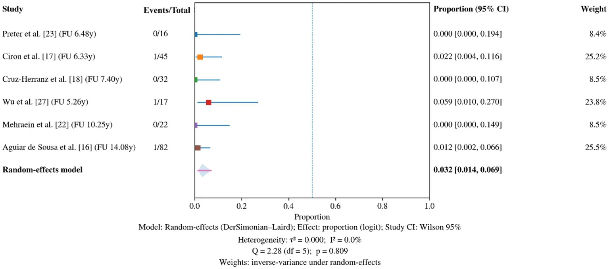
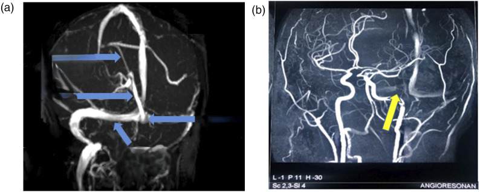
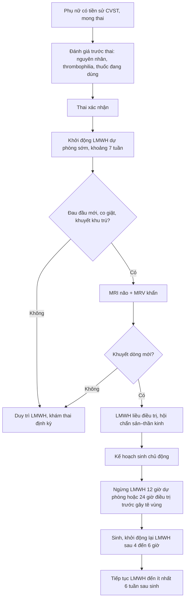
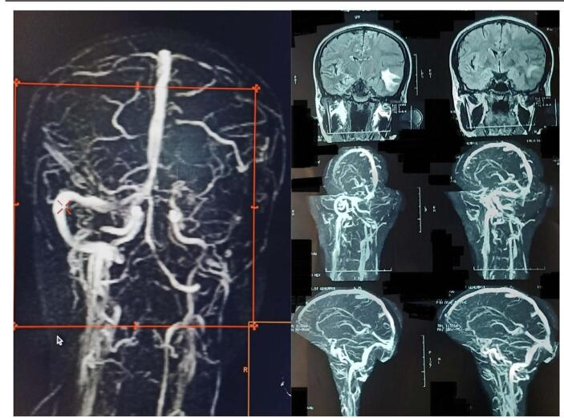
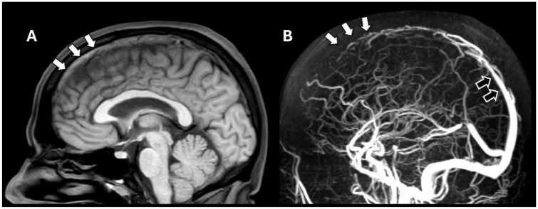

# 1949 — Thai kỳ sau huyết khối xoang tĩnh mạch não: tư vấn, dự phòng và theo dõi / Pregnancy after cerebral venous sinus thrombosis

**Tags:** `pattern:huyet-khoi-xoang` `pattern:khuyet-dong-chay` `pattern:co-dac-mau` `pattern:xuat-huyet-nao` `vung:nao` `vung:xoang-tinh-mach` `vung:thai` `protocol:MRV` `protocol:CTV` `protocol:MRI-nao` `protocol:LMWH` `score:mRS`

**Mức chắc chắn (certainty):** tổng hợp y văn (literature synthesis) — **một tổng quan hệ thống + phân tích gộp 12 đoàn hệ** (Front Neurol 2026, **PMC13612440**), **một tổng quan quản lý CVT** (Int J Stroke 2025, **PMC12664938**), **hai ca nguyên văn có ảnh MRV** (PMC13227014 thai 8 tuần; PMC11981357 hậu sản), và **khuyến cáo ESO 2017** (PMC6454824 — chỉ đọc được phần tóm tắt khuyến cáo, không có toàn văn mở). Các con số tái phát/thai làm tổ đều lấy từ phân tích gộp, có ghi rõ độ chắc chắn **thấp–rất thấp** của bằng chứng.

> **Câu chốt:** thai kỳ **KHÔNG phải chống chỉ định** sau huyết khối xoang tĩnh mạch não (CVST), nhưng **là cửa sổ nguy cơ cao phải dự phòng có kế hoạch**: tái phát CVST trong thai kỳ/hậu sản sau đó chỉ **3,17% (95% CI 1,43–6,89; 3/291 thai)** và **không ca tái phát nào tử vong**, trong khi **thai sống 69,6%** và **sảy thai tự nhiên 19,4%** — nghĩa là **tiên lượng tốt nếu dự phòng đúng**. Ba việc quyết định: **(1)** khởi động **LMWH sớm** (trung vị **7 tuần tuổi thai**) và **kéo dài ≥ 6 tuần sau sinh**; **(2)** **không dùng warfarin/DOAC trong thai kỳ**; **(3)** **không chẩn đoán "tái phát" bằng đau đầu đơn thuần** — phải chụp **MRV/CTV** và loại **giả khuyết dòng của xoang ngang giảm sản**.

## 1. Tổng quan bệnh học – cơ chế hình ảnh (TẠI SAO)

### 1.1 Vì sao thai kỳ làm huyết khối — tam giác Virchow nhân ba

- **Ứ trệ (stasis — quan trọng nhất ở hậu sản):** tử cung to chèn ép tĩnh mạch chủ dưới, progesterone làm giãn tĩnh mạch; dòng trong **xoang màng cứng không có van, chậm và không đập** nên huyết khối lan ngược theo chiều dòng chảy dễ hơn ở tĩnh mạch chi. Đây là lý do **60,47%** các ca CVST chu sinh xảy ra ở **hậu sản**, dồn vào **2 tuần đầu** (PMC13612440).
- **Tăng đông:** fibrinogen, yếu tố VII/VIII/X tăng, **protein S giảm sinh lý**, PAI-1 tăng → khi thai phụ có thêm yếu tố nền (thrombophilia di truyền **53,8%** trong một đoàn hệ dự phòng — PMC13612440), ngưỡng tạo huyết khối bị vượt qua.
- **Tổn thương nội mạc:** sinh thường/sinh mổ, bóc nhau, nhiễm trùng hậu sản — đây là **yếu tố thứ ba** giải thích vì sao hậu sản nặng hơn thai kỳ giữa.

### 1.2 Chuỗi sinh lý bệnh → hình ảnh (vì sao dấu hiệu xuất hiện như vậy)

1. **Huyết khối trong lòng xoang** → trên **NCCT** là **tăng đậm độ ("dense sinus sign")**: huyết khối cấp **~50–80 HU** so với máu tĩnh mạch đang chảy **~35–45 HU**. Độ nhạy thấp, **NCCT bình thường không loại trừ CVST** (PMC12664938).
2. **Methemoglobin** ở máu bán cấp (ngày 3–7 trở đi) → **T1 tăng tín hiệu trong lòng xoang**, trong khi xoang bình thường **mất tín hiệu (flow void)**. Đây là cơ sở của dấu **"T1 hyperintense sinus/cortical vein"** — hữu ích khi thai phụ **không được tiêm gadolinium**.
3. **Khuyết dòng trên MRV/CTV:** huyết khối chiếm lòng xoang → không có tín hiệu dòng; trên CTV có cản quang là **"empty delta sign"** (thành xoang ngấm thuốc bao quanh huyết khối không ngấm).
4. **Tăng áp tĩnh mạch** → phù mạch rồi phù độc tế bào → **nhồi máu tĩnh mạch**, có thể **chuyển dạng xuất huyết** (ICH **23,6–30,2%** — PMC13612440); vì vậy hình ảnh não **không theo lãnh thổ động mạch**, hay gặp **cạnh đường giữa (parasagittal)** với huyết khối xoang dọc trên, **thùy thái dương/tiểu não** với huyết khối xoang ngang–xích-ma.

### 1.3 Dịch tễ và phân bố — số dùng để tư vấn

- **Tần suất CVST chung:** **1,2–1,3/100.000 người/năm** (đã tăng từ 0,3–0,5 trước đây) — Int J Stroke 2025, PMC12664938.
- **Phân bố xoang trong CVST chu sinh:** **xoang dọc trên 57,4–71%**, **xoang ngang 51,16%**, **xoang xích-ma 31%**, **tĩnh mạch sâu 3–11,63%** (PMC13612440).
- **Triệu chứng:** **đau đầu 81–96,8%**, **co giật ~39%**, **khuyết thần kinh khu trú 37,21–45%** (PMC13612440).
- **Độ trễ chẩn đoán:** trung vị **10 ngày từ khởi phát đến chẩn đoán**, nhưng chỉ **1 ngày từ nhập viện đến chẩn đoán** — tức **chậm nằm ở tuyến trước**, không phải ở phòng chụp (PMC13612440). Đây là lý do bài này đặt **ngưỡng chụp** lên trước ngưỡng xét nghiệm.
- **Tử vong CVST cấp trong thai kỳ/hậu sản:** **7/109 (6,4%)** và **9/87 (10,3%)**; một đoàn hệ rộng ghi **~4,5%**; **mRS 0–2 đạt 74%** ở một loạt, nhưng **~46% tử vong hoặc phụ thuộc** ở loạt nặng (PMC13612440). Con số này **khác hẳn** nhóm tái phát trong thai kỳ sau đó (0 tử vong) — hai bối cảnh không được gộp khi tư vấn.

### 1.4 Con số then chốt của câu hỏi "có thai lại được không?"

| Câu hỏi của người bệnh | Số trả lời | Nguồn |
|---|---|---|
| Tái phát CVST trong thai kỳ/hậu sản sau đó | **3,17%** (95% CI 1,43–6,89) — **3 sự kiện/291 thai**, I² = 0% | PMC13612440 (Hình 5) |
| Thai sống / sinh được | **69,6%** (95% CI 59,2–78,4) | PMC13612440 (Hình 3) |
| Sảy thai tự nhiên | **19,4%** (95% CI 13,8–26,5) — **không cao hơn** dân số chung một cách rõ rệt | PMC13612440 (Hình 4) |
| Tử vong mẹ trong thai kỳ sau CVST | **0** ở 4/5 đoàn hệ; 1 ca do sản giật 38 tuần | PMC13612440 |
| Dự phòng bằng LMWH | **83,1%** các thai kỳ (ISCVT) và **90,9%** ở một đoàn hệ; **79,4%** dùng **liều dự phòng** | PMC13612440 |
| Thời điểm bắt đầu và kết thúc | bắt đầu **trung vị 7 tuần tuổi thai**; duy trì **≥ 6 tuần sau sinh** | PMC13612440 + ESO 2017 |

*Phân tích gộp 6 đoàn hệ, 291 thai: **3,17%** (95% CI 1,43–6,89), I² = 0%. Nguồn: Al Muteri T & Almutairi RD, Front Neurol 2026 (PMC13612440), Fig. 5, CC BY 4.0.*

> **Phản biện (bắt buộc):** bằng chứng cho các con số trên là **đoàn hệ quan sát, nguy cơ sai lệch cao, độ chắc chắn THẤP–RẤT THẤP** (tác giả tự xếp hạng; 3 sự kiện/291 thai là **quá ít** để cá thể hóa). Vì vậy **không hứa "an toàn tuyệt đối"** với người bệnh — chỉ được nói **"nguy cơ tái phát thấp, khoảng 3%, và dự phòng bằng LMWH là chuẩn"**.

## 2. Mẫu hình + chẩn đoán phân biệt theo vị trí (gamut)

- **Theo thời điểm (timing gamut — quan trọng nhất ở sản khoa):**
  - **Tam cá nguyệt 1:** hiếm nhưng có thật — ca nguyên văn thai **8 tuần** đau đầu dữ dội 48 giờ, huyết khối **xoang ngang phải** (PMC13227014). Dễ bị gọi nhầm là **nôn nghén nặng/đau đầu do căng**.
  - **Tam cá nguyệt 3:** thường gắn **tiền sản giật**, **mổ lấy thai**, bất động.
  - **Hậu sản 0–14 ngày:** **60,47%** các ca chu sinh; đau đầu sau **gây tê tủy sống/ngoài màng cứng** dễ bị quy cho **đau đầu do thủng màng cứng (PDPH)** — nhưng **PDPH giảm khi nằm, không kèm co giật/khuyết khu trú**.
  - **Sau 6 tuần:** ít gặp; nghĩ tới **thrombophilia/APLS/u**.
- **Theo lãnh thổ tĩnh mạch (location gamut):**
  - **Xoang dọc trên** → nhồi máu/xuất huyết **cạnh đường giữa hai bên**, liệt hai chi dưới, co giật.
  - **Xoang ngang – xích-ma** → **thùy thái dương/tiểu não**, đau tai, giả u; hay gặp sau **viêm tai giữa** (thrombophlebitis).
  - **Tĩnh mạch não trong (thalamostriate, Rosenthal)** → **nhồi máu hai đồi thị**, rối loạn ý thức — thể nặng nhất.
  - **Tĩnh mạch vỏ đơn độc** → mô não bình thường + **T1 sáng một tĩnh mạch vỏ**; thể dễ bỏ sót nhất.
  - **Tĩnh mạch cảnh trong** → sưng cổ, giả u; hay sau đặt catheter.

## 3. Bảng so sánh phân biệt (ma trận đối chiếu)

| Thực thể (entity) | Hình ảnh điển hình | Chốt vào (rule-in) | Chốt loại (rule-out) | Gợi ý xác nhận |
|---|---|---|---|---|
| **CVST hậu sản** | NCCT **tăng đậm độ xoang**; **T1 sáng** trong xoang; **MRV mất tín hiệu** một đoạn **liên tục**, có thể **empty delta sign** trên CTV; nhồi máu/xuất huyết **không theo lãnh thổ động mạch** | **Khuyết dòng kèm bất thường nhu mô cùng lãnh thổ tĩnh mạch** + đau đầu mới, co giật, khuyết khu trú trong **2 tuần sau sinh** | Nếu **MRV bình thường hoàn toàn** và không có tổn thương nhu mô → **loại CVST** (nhưng phải loại giả khuyết dòng, xem mục 5) | **MRV 2D TOF + MRI T1/T2/SWI**; CTV nếu không chụp được MRI |
| **Tiền sản giật/sản giật – PRES** | Phù **vỏ–dưới vỏ hai bên**, ưu thế **chẩm–đỉnh**, **FLAIR tăng**, có thể **xuất huyết điểm**; **mạch máu còn thông** | **Phù đối xứng, hồi phục sau sinh**, HA cao + protein niệu | **MRV/CTV bình thường** + phân bố đối xứng điển hình | MRI + MRV; theo dõi HA, protein niệu |
| **RCVS** | **Co thắt–giãn bất thường nhiều động mạch** (chuỗi hạt), **SAH vỏ lồi**, nhồi máu/xuất huyết nhỏ nhiều ổ | **Đau đầu sét đánh lặp lại** (thunderclap) + co thắt lan tỏa | **MRV bình thường**; không có huyết khối xoang | CTA/MRA lúc triệu chứng, chụp lại 4–6 tuần |
| **Nhồi máu động mạch** | Vùng tưới máu **theo mạch** (MCA/ACA/PCA), bờ rõ | **Đột ngột, khuyết khu trú theo mạch**, DWI sáng/ADC tối theo lãnh thổ | Tổn thương **cạnh đường giữa/không theo mạch** → nghĩ tĩnh mạch | MRA/CTA; siêu âm tim, Holter |
| **Tăng áp nội sọ vô căn (IIH)** | Não **bình thường**, **giãn vỏ dây thần kinh thị**, **xoang ngang hẹp hai bên** | **Đau đầu + ù tai mạch đập + phù gai**, **không có huyết khối** | **MRV không có khuyết dòng**, áp lực mở cao | Chọc dò áp lực; **không nhầm hẹp xoang do IIH với huyết khối** |
| **Apoplexy tuyến yên** | Khối yên **xuất huyết/hoại tử**, giãn rộng yên | **Đau đầu sét đánh + sụp mi + suy thượng thận** | Xoang **còn thông**; khối tại yên | MRI yên; cortisol 8h |

*Hình (a): mũi tên xanh chỉ các xoang bình thường (dùng làm tham chiếu). Hình (b): mũi tên vàng — **không thấy dòng xoang ngang phải**, tương ứng huyết khối. Nguồn: Quizhpe E et al., J Investig Med High Impact Case Rep 2026 (PMC13227014), Fig. 1, CC BY-NC 4.0 — nguyên bản, không chỉnh.*

## 4. Protocol chụp + hệ phân độ/điểm + quy trình dự phòng

### 4.1 Chụp gì, khi nào (thai phụ)

| Bước | Thai kỳ | Hậu sản |
|---|---|---|
| 1 | **MRI não không cản quang** (T1, T2, FLAIR, DWI/ADC, SWI) + **MRV 2D TOF** — ưu tiên vì **không bức xạ** và T1 thấy huyết khối | **NCCT → CTV** nếu cấp cứu/không hợp tác; MRI + MRV nếu ổn định |
| 2 | **Gadolinium**: chỉ khi kết quả không cản quang không kết luận — thai kỳ **hạn chế**, hỏi ý kiến chuyên khoa | MRV sau tiêm hoặc CTV đều được |
| 3 | **Không dùng D-dimer để loại trừ** (có thể bình thường; tăng sinh lý trong thai) | Như trái |
| 4 | Chụp lại **MRV ở 3–6 tháng** để xác nhận tái thông | MRV 3–6 tháng |

- **Tái thông tự nhiên** là quy luật: ca nguyên văn thai 8 tuần có **tái thông một phần trên MRI tại 5 tháng** (PMC13227014, Fig. 2) — nên **không chụp lặp quá dày** khi lâm sàng ổn.
- **Không chẩn đoán "huyết khối mới" chỉ vì còn khuyết dòng**: khuyết dòng tồn tại lâu hơn triệu chứng; **so sánh với phim cũ** là bắt buộc.

### 4.2 Điều trị và dự phòng (ngưỡng cụ thể)

- **Cấp:** **LMWH liều điều trị** (enoxaparin **1 mg/kg mỗi 12 giờ**; chỉnh theo cân nặng và chức năng thận) — **không dùng heparin không phân đoạn liều cao kéo dài** khi có thể dùng LMWH; **không trì hoãn kháng đông vì có xuất huyết nhu mô** (thường do ứ tĩnh mạch, không phải chống chỉ định).
- **Duy trì trong thai:** LMWH **suốt thai kỳ**; **warfarin và DOAC chống chỉ định** (warfarin qua nhau thai gây bệnh lý thai; DOAC thiếu dữ liệu, không dùng).
- **Sau sinh:** tiếp tục **≥ 6 tuần sau sinh** (ESO 2017, PMC6454824) và **tổng thời gian ≥ 3–6 tháng** tùy yếu tố khởi phát; **warfarin dùng được khi cho con bú**, **DOAC chỉ khi không có lựa chọn** (dữ liệu qua sữa hạn chế).
- **Dự phòng ở thai kỳ SAU CVST:** **LMWH liều dự phòng** bắt đầu **sớm (trung vị 7 tuần tuổi thai)**, duy trì **đến ≥ 6 tuần sau sinh**; nếu có **thrombophilia/APLS hoặc CVST không rõ nguyên nhân** cân nhắc **liều trung gian/điều trị** theo chuyên khoa huyết học (PMC13612440; ESO 2017).
- **Gây tê vùng khi chuyển dạ:** ngưỡng thực hành phổ biến (ASRA): **ngừng LMWH dự phòng ≥ 12 giờ**, **liều điều trị ≥ 24 giờ** trước đặt catheter; **khởi động lại ≥ 4–6 giờ sau** rút catheter. Kế hoạch sinh **chủ động** (khởi phát chuyển dạ có hẹn) để kiểm soát khoảng ngừng thuốc.
- **Tránh estrogen:** **không dùng thuốc tránh thai chứa estrogen** (WHO MEC nhóm 4); **progestin-only/IUD** là lựa chọn.
- **Tầm soát thrombophilia:** **không làm thường quy cho mọi người**; làm **khi nghi APLS (SLE, huyết khối tái phát, thai lưu)** và **làm ngoài thai kỳ** vì protein S/C giảm sinh lý trong thai → **dương giả**.

## 5. Biến thể bình thường và cạm bẫy

- **Giả khuyết dòng trên MRV (pitfall số 1 — gây "tái phát" oan):** **bất đối xứng xoang ngang** rất thường gặp (một bên giảm sản/không sản, tỉ lệ chính xác thay đổi theo loạt giải phẫu — **chưa kiểm chứng trong lượt này**), **hạt nhện (arachnoid granulation)** lồi vào lòng xoang, và **giả ảnh dòng chảy** ở chỗ xoang đổi hướng. Ba cách loại: **(1)** xem **T1/T2** — huyết khối **sáng trên T1**, giảm sản thì **không**; **(2)** dùng **CTV hoặc MRV sau tiêm** thay vì chỉ TOF; **(3)** so **phim cũ** và **hai bình diện**.
- **"Dense sinus" giả:** trẻ sơ sinh, đa hồng cầu, hematocrit cao, hoặc **dải xương** sát xoang — đối chiếu **HU hai bên** và **cửa sổ** trước khi gọi huyết khối.
- **Đau đầu sau gây tê tủy sống:** **PDPH giảm khi nằm**, xuất hiện **24–48 giờ sau**, không co giật; **CVST có thể xảy ra SAU thủng màng cứng** (mất dịch → ứ trệ) — nếu đau đầu **đổi tính chất, tăng khi nằm, kèm co giật** thì **chụp MRV**, đừng tăng liều caffeine mãi.
- **Sản giật đi trước CVST:** tiền sản giật **là yếu tố nguy cơ** của CVST; hình ảnh **PRES + huyết khối xoang có thể cùng tồn tại** — nếu **MRV có khuyết dòng** thì **phải điều trị CVST**, không quy tất cả cho PRES.
- **Sai lầm "thai kỳ chống chỉ định chụp"**: **MRI không cản quang + MRV an toàn**, và **bỏ chụp** là nguyên nhân chính của **trễ 10 ngày** (mục 1.3). Ngược lại, **chụp lặp MRV mỗi tháng** khi không có triệu chứng là **lạm dụng** — tái thông cần **3–6 tháng**.
- **Cạm bẫy tư vấn:** dùng số **tử vong 6,4–10,3% của CVST cấp** để dọa người đang **mong thai sau CVST** là **sai bối cảnh** (nhóm đó có **0 tử vong**).

## 6. Tự lượng giá — Blind Quiz

**Ca 1 — Thai 8 tuần, đau đầu dữ dội 48 giờ, nôn; HA 110/60, không sốt, không dấu thần kinh khu trú.**

- Câu hỏi: (1) Bất thường nằm ở xoang nào? (2) Ba chẩn đoán phân biệt? (3) Cần chụp thêm gì **khi đang mang thai**?

<b>Bấm để hiện đáp án (findings + chẩn đoán)</b>

- **Dấu hiệu:** hình (b) **mất tín hiệu dòng xoang ngang phải** (mũi tên vàng), trong khi các xoang còn lại còn tín hiệu (mũi tên xanh ở hình a).
- **Chẩn đoán:** **huyết khối xoang ngang phải** ở tam cá nguyệt 1 — đã xác nhận bằng MRI + MRV, điều trị heparin rồi warfarin, **tái thông một phần lúc 5 tháng**, không di chứng.
- **Phân biệt:** đau đầu do nôn nghén, tiền sản giật (chưa có ở 8 tuần), viêm màng não, RCVS.
- **Vì sao không chần chừ:** thai kỳ **không cấm MRI/MRV không cản quang**; trễ chụp chính là yếu tố làm tăng biến chứng.
- **Nguồn ảnh:** Quizhpe E et al., J Investig Med High Impact Case Rep 2026 (PMC13227014), Fig. 1, **CC BY-NC 4.0**.

**Ca 2 — Sản phụ 3 ngày sau sinh, đau đầu tăng dần, một cơn co giật; MRV dưới đây.**

- Câu hỏi: (1) Xoang nào mất tín hiệu? (2) Vì sao hậu sản là cửa sổ nguy cơ cao nhất? (3) Bước tiếp theo **trong 1 giờ**?

<b>Bấm để hiện đáp án (findings + chẩn đoán)</b>

- **Dấu hiệu:** **mất tín hiệu xoang ngang trái** trên MRV (khung đỏ), kèm hình ảnh nhồi máu/xuất huyết thùy trên các lát cắt.
- **Chẩn đoán:** **CVST hậu sản** — 60,47% ca chu sinh xảy ra ở hậu sản, dồn vào 2 tuần đầu.
- **Bước tiếp theo:** **khởi động LMWH liều điều trị ngay** (không chờ kết quả đông máu), theo dõi thần kinh, hội chẩn sản–thần kinh; **không trì hoãn vì có xuất huyết**.
- **Nguồn ảnh:** Ali M et al., Ann Med Surg 2025 (PMC11981357), Fig. 3, **CC BY-NC-ND 4.0** — nguyên bản, không chỉnh sửa.

**Ca 3 — Người bệnh hỏi: "Tôi từng bị huyết khối xoang năm 2022, giờ muốn có thai. Tôi có phải chụp gì không, và nguy cơ tái phát là bao nhiêu?"**

- Câu hỏi: (1) Hai dấu hiệu trên hình A và B? (2) Trả lời nguy cơ tái phát bằng con số nào? (3) Kế hoạch thuốc trước–trong–sau thai?

<b>Bấm để hiện đáp án (findings + chẩn đoán)</b>

- **Hình A:** **T1 sáng trong lòng xoang dọc trên đoạn trước** (mũi tên trắng) — methemoglobin của huyết khối bán cấp. **Hình B:** **MRV mất tín hiệu đoạn trước**, trong khi đoạn sau vẫn thấy dòng (mũi tên rỗng) — khuyết dòng **khu trú, liên tục** chứ không phải giả ảnh.
- **Tư vấn:** **tái phát ~3,17% (95% CI 1,43–6,89)** trong thai kỳ/hậu sản sau đó; **thai sống 69,6%**; **sảy thai 19,4%** — thấp và **không phải chống chỉ định**.
- **Kế hoạch:** đánh giá nguyên nhân + thrombophilia **trước khi có thai** (làm ngoài thai), **LMWH dự phòng từ sớm (~7 tuần) đến ≥ 6 tuần sau sinh**, **không estrogen**, kế hoạch sinh và ngưỡng ngừng thuốc cho gây tê vùng.
- **Nguồn ảnh:** Vellema J et al., Int J Stroke 2025 (PMC12664938), Fig. 2, **CC BY 4.0**.

## Bài liên quan chéo
- [1948 – Co giật & động kinh sau huyết khối xoang tĩnh mạch não](../1948-co-giat-dong-kinh-huyet-khoi-xoang/lesson.md)
- [216 – Dị dạng mạch não & huyết khối xoang tĩnh mạch](../216-di-dang-mach-CVST/lesson.md)
- [1953 – Thai lưu muộn: quy trình tìm nguyên nhân](../1953-thai-luu-muon-tim-nguyen-nhan/lesson.md)
- [190 – Sỏi niệu quản ở thận ghép](../190-soi-nieu-quan-than-ghep-bang-quang-than-kinh/lesson.md)

## Ảnh
- `images/1949_cvst-thai_MRV-PMC13227014-fig1.jpg` — MRV thai 8 tuần, huyết khối xoang ngang phải (CC BY-NC 4.0).
- `images/1949_cvst-thai_MRV-PMC13227014-fig2.jpg` — MRV cùng ca sau 5 tháng, tái thông một phần (CC BY-NC 4.0).
- `images/1949_cvst-sau-sinh_MRV-PMC11981357-fig3.jpg` — MRV hậu sản, mất tín hiệu xoang ngang trái (CC BY-NC-ND 4.0, nguyên bản).
- `images/1949_cvst_T1-MRV_PMC12664938-fig2.jpg` — T1 sáng trong xoang dọc trên + MRV khuyết dòng (CC BY 4.0).
- `images/1949_cvst-thai_forest-PMC13612440-fig5.webp` — forest plot tái phát CVST trong thai kỳ sau (CC BY 4.0), dùng làm hình minh hoạ số liệu ở mục 1.4.

> **Disclaimer:** bài học dùng cho mục đích học tập và tra cứu, **không dùng để chẩn đoán và điều trị độc lập** khi chưa có bác sĩ chuyên khoa. Mọi quyết định dùng thuốc trong thai kỳ phải cá thể hóa theo hội chẩn sản – thần kinh – huyết học.
