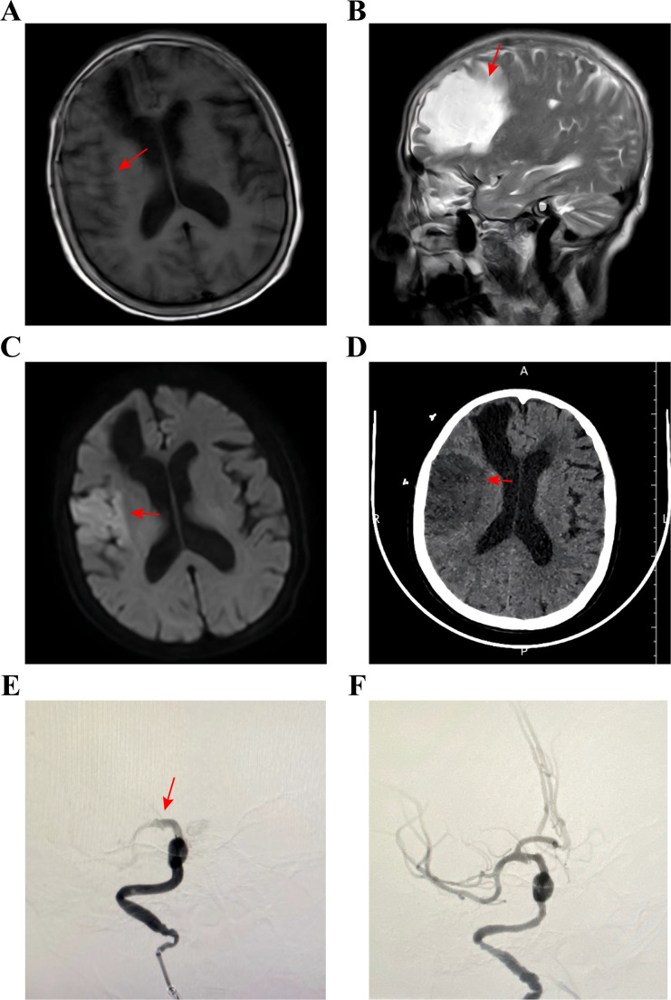
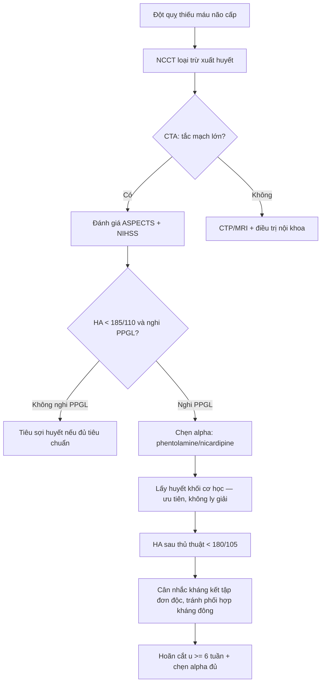
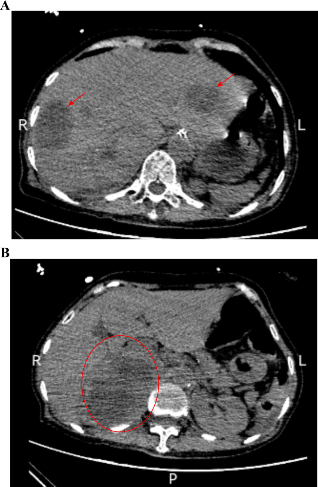
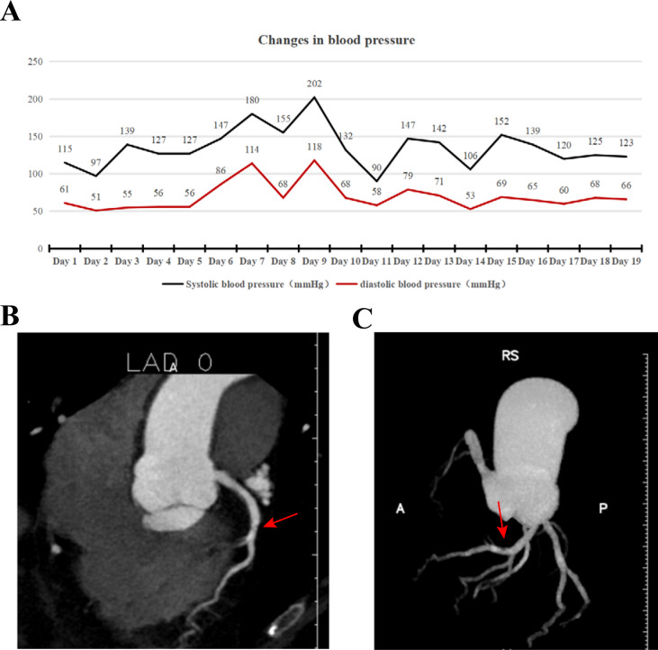

# 195 — Đột quỵ cấp ở bệnh nhân u tủy thượng thận (PPGL) chưa cắt u: tiêu sợi huyết hay lấy huyết khối? / Acute ischemic stroke in unresected pheochromocytoma–paraganglioma

**Tags:** `pattern:nhoi-mau-nao` `pattern:tac-mach-lon` `pattern:con-tha` `vung:nao` `vung:thuong-than` `protocol:CTA-mach-nao` `protocol:DSA-lay-huyet-khoi` `score:ASPECTS` `score:NIHSS` `score:mRS` `incidentaloma:u-thuong-than`

**Mức chắc chắn (certainty):** tổng hợp y văn (literature synthesis) — ghép 1 ca nguyên văn có ảnh (PMC13236608, 2026: nhồi máu + lấy huyết khối ở bệnh nhân PPGL chưa cắt) với 1 ca tử vong sau tiêu sợi huyết vì nhồi máu cơ tim (PMC4177258), 1 ca trẻ tử vong do nhồi máu hành não (PMC9794225), 2 loạt ca trẻ (PubMed 12503867) và các ngưỡng chuẩn của AHA/ASA 2019 + Endocrine Society 2014.

> **Câu chốt:** Ở bệnh nhân **đột quỵ thiếu máu não cấp** mà huyết áp **dao động dữ dội** (vọt > 200 mmHg rồi tụt < 90/60 mmHg), kèm **khối thượng thận** hoặc **cơn đau đầu–đánh trống ngực–vã mồ hôi**, phải nghĩ **PPGL (u tủy thượng thận – u cận hạch)** trước khi quyết định tiêu sợi huyết. **Tiêu sợi huyết (thrombolysis)** ở người chưa biết có PPGL có thể gây **vỡ u, chảy máu sau phúc mạc** (đã có ca tử vong), còn **lấy huyết khối cơ học (mechanical thrombectomy)** không dùng thuốc tan cục máu nên là lựa chọn **ưu tiên khi có tắc mạch lớn** — nhưng vẫn phải **chẹn alpha và kiểm soát huyết áp trước, trong và sau thủ thuật**.

## 1. Tổng quan bệnh học – cơ chế hình ảnh

- **Dịch tễ (số liệu):** PPGL gặp ở **0,1–0,6%** người tăng huyết áp; tỉ lệ mới mắc khoảng **1,9/1 triệu người–năm**; **10–30%** u hoàn toàn không triệu chứng và được phát hiện tình cờ trên hình ảnh (PMC13236608, PMC4177258). Ở trẻ, PPGL chỉ chiếm **~1%** các ca tăng huyết áp nhi (PubMed 12503867) — nhưng chính vì thế mà **bị bỏ sót lâu hơn**.
- **Vì sao catecholamine gây tắc mạch LỚN (không chỉ co thắt nhỏ):** ba cơ chế cộng lại —
  1. **Tổn thương nội mô do tăng huyết áp dữ dội** → bộc lộ yếu tố mô, kết dính tiểu cầu;
  2. **Tăng đông (hypercoagulability)**: catecholamine làm tăng yếu tố đông máu và **ức chế tiêu sợi huyết nội sinh**, đồng thời cô đặc máu do mất nước;
  3. **Co mạch + dòng chảy xoáy tại chỗ hẹp** → huyết khối hình thành tại chỗ hoặc từ tim (bệnh cơ tim do catecholamine sinh huyết khối trong buồng tim).
  Hệ quả trên hình ảnh: **tắc ICA/MCA (hoặc thân nền)** với **huyết khối dài, "quá tải" (large clot burden)**, thường **không tương xứng với mức xơ vữa** — mạch máu "trơn" ở người trẻ nhưng bị bít hoàn toàn.
- **Vì sao hình ảnh não không đủ để chẩn đoán nguyên nhân:** tổn thương trên **DWI/ADC** chỉ nói "nhồi máu", **không nói "vì catecholamine"**. Cái đổi thái độ điều trị là **bối cảnh huyết áp dao động + khối thượng thận + metanephrine**. Vì vậy mọi ca đột quỵ trẻ/không rõ nguyên nhân nên **chụp CT bụng cùng lần CTA não** khi có tăng huyết áp khó kiểm soát.
- **Vì sao TIÊU SỢI HUYẾT nguy hiểm riêng ở PPGL:** u tủy thượng thận là khối **mạch máu rất giàu, áp lực trong u cao**; khi có cơn tăng huyết áp kèm ly giải fibrin, u dễ **vỡ trong u rồi vỡ vỏ**. Y văn ghi **65 ca vỡ u PPGL cấp tính**, trong đó **~20%** chảy máu lan cả sau phúc mạc và ổ bụng; **dưới 1/3** bệnh nhân có triệu chứng gợi ý PPGL trước đó (PMC4177258). Ca điển hình: nam **62 tuổi**, tenecteplase vì STEMI, **1 giờ sau** đau bụng dữ dội, huyết áp tụt **70/30 mmHg**, mổ cấp cứu thấy u thượng thận trái **10 × 7 × 2 cm** đã vỡ, tử vong vì suy đa tạng.
- **Ngưỡng và số liệu của ca lấy huyết khối (ca nguyên văn có ảnh):** nữ **70 tuổi**, nhập viện vì STEMI (đã quá cửa sổ can thiệp), **ngày thứ 2** đột ngột yếu nửa người trái — MRI thấy **nhồi máu lớn bán cầu phải**, DSA xác nhận **tắc ICA phải + thân trên MCA phải**, lấy huyết khối đạt **eTICI 3**. **VMA niệu 59,11 mg/24 giờ** (tham chiếu 0–12), khối thượng thận phải **10 × 6,8 cm** trên CT. Huyết áp trong viện **dao động 202 mmHg đến < 90/60 mmHg**, phải dùng **phenoxybenzamine** dài hạn. **Biến chứng: máu tụ dưới màng cứng sau mổ** do phối hợp kháng kết tập tiểu cầu + kháng đông (PMC13236608).
- **Vì sao trẻ em nguy hiểm hơn:** trẻ thường **không có triệu chứng kinh điển**, biểu hiện bằng **co giật, hôn mê, suy tim**; ca **5 tuổi** nhồi máu **hành não – tủy cổ C7**, tử vong, giải phẫu phát hiện PPGL + đột biến **VHL c.414A>G** (PMC9794225). Hai trẻ Đài Loan: một **nhồi máu**, một **xuất huyết nội sọ**, norepinephrine niệu **1.480,8** và **3.279 µg/ngày** (PubMed 12503867).

## 2. Mẫu hình + chẩn đoán phân biệt theo cơ chế (gamut)

- **A — Tắc mạch lớn (LVO) do huyết khối "catecholamine":** NIHSS cao đột ngột, **ASPECTS ≥ 6**, CTA thấy tắc **ICA/M1/thân nền**, mạch không xơ vữa nặng. Đây là nhóm **hưởng lợi từ lấy huyết khối** — và là nhóm đặt câu hỏi "có nên tiêu sợi huyết?".
- **B — Nhồi máu vùng phân thủy (watershed) do tụt huyết áp:** sau cơn THA, u tiết catecholamine rồi **"cạn" đột ngột** (hoại tử u, chẹn alpha quá tay, mất nước) → tụt áp → tổn thương **giữa các lãnh thổ mạch**, đối xứng hai bên. Đừng nhầm với bệnh mạch nhỏ.
- **C — Xuất huyết nội sọ / dưới nhện:** cơn THA > 200 mmHg làm vỡ mạch nhỏ; trên CT là **máu tụ thùy/nhân bèo** hoặc SAH — **chống chỉ định tiêu sợi huyết tuyệt đối**.
- **D — PRES/RCVS (phù mạch, co mạch từng đoạn):** đau đầu sét đánh tái diễn, co giật, mù vỏ não; MRI **FLAIR sáng nhưng ADC TĂNG** (phù, không hồi phục tổn thương) hoặc **co thắt "chuỗi hạt"** trên MRA/DSA (bài `184`).
- **E — Nhồi máu + huyết khối động mạch ngoại biên cùng lúc:** PPGL gây **trạng thái tăng đông toàn thân**; ca 50 tuổi có PPGL chưa cắt bị **nhồi máu não + tắc động mạch dưới đòn/nách/cánh tay**, phải mổ lấy huyết khối chi (PubMed 23478505); ca 25 tuổi sốc catecholamine có **thiếu máu chi dưới sau đặt catheter**, phải cắt cụt (PMC13061532). Gợi ý: **tìm thêm tắc mạch ngoài não** khi đã xác định PPGL.
- **F — Bắt chước (mimic):** bệnh mạch máu nhỏ do THA, **viêm mạch nguyên phát CNS** (đã có ca bị chẩn đoán nhầm viêm mạch rồi chụp mạch gây cơn THA — PubMed 18509763), **loạn sản cơ xơ (FMD)**, thuốc co mạch (cocaine, triptan).
- Gợi nhớ **5 nhóm mạch máu của catecholamine: "L–W–H–P–R"** — **L**VO, **W**atershed, **H**emorrhage, **P**RES, **R**CVS.

## 3. Bảng so sánh phân biệt (ma trận đối chiếu)

| Thực thể (entity) | Hình ảnh điển hình | Chốt vào (rule-in) | Chốt loại (rule-out) | Gợi ý xác nhận |
|---|---|---|---|---|
| **Nhồi máu LVO do PPGL** | Tắc **ICA/M1/thân nền** trên CTA; DWI hạn chế khuếch tán lãnh thổ lớn; **không xơ vữa đáng kể**; ± khối thượng thận | **THA dao động + khối thượng thận + metanephrine/VMA tăng** (VMA 59,11 mg/24h) | **Mảng xơ vữa loét/hẹp > 70% tại chỗ tắc + không có u** → xơ vữa | CTA não + CT bụng cùng lần; metanephrine; DSA |
| **Nhồi máu xơ vữa (người lớn tuổi)** | Hẹp–tắc tại chỗ xơ vữa, vôi hóa, **nhiều ổ nhồi máu rải rác**, tuổi > 60, ĐTĐ/hút thuốc | **Hẹp tại chỗ + yếu tố nguy cơ + không u thượng thận** | **THA kịch phát từng cơn + u thượng thận** → PPGL | CTA/CTP; siêu âm Doppler cảnh |
| **RCVS** | Co thắt **từng đoạn "chuỗi hạt"** trên MRA/DSA, **hồi phục sau ~3 tháng**; ± nhồi máu phân thủy | **Đau đầu sét đánh tái diễn + co mạch lan tỏa + hồi phục** | **Tắc một điểm cố định + giảm tưới máu lãnh thổ** → LVO | MRA/DSA lặp lại sau 8–12 tuần |
| **PRES** | Phù **chẩm–đỉnh đối xứng**, FLAIR sáng, **ADC tăng**; thể trung tâm ở THA mạn | **Phù mạch không hạn chế khuếch tán + đáp ứng hạ áp** | **ADC tối** → nhồi máu thật | MRI DWI/ADC; theo dõi hồi phục |
| **Xuất huyết não do cơn THA** | Máu tụ **nhân bèo/đồi thị/thùy**, ± IVH; **tăng tỷ trọng 50–80 HU** cấp | **Máu tụ trên NCCT + THA > 180/120** | **Không có máu trên NCCT** → nhồi máu | NCCT; CTA loại trừ phình/dò |
| **Viêm mạch CNS (bắt chước)** | Hẹp–co thắt **nhiều ổ, nhiều mạch**, ngấm màng não; **không có u thượng thận** | **Đa ổ + tổn thương nhu mô dạng nốt + CRP cao** | **Metanephrine tăng + u thượng thận** → PPGL | MRI tương phản; sinh thiết não (hiếm) |

*Nữ 70 tuổi có PPGL chưa cắt: (A–C) MRI T1/T2/DWI — nhồi máu lớn bán cầu phải; (D) CT — giảm tỷ trọng vùng đảo/thùy trán; (E) DSA — tắc thân trên MCA phải; (F) sau lấy huyết khối, eTICI 3. Nguồn: Frontiers in Oncology 2026 (PMC13236608), CC BY 4.0.*

## 4. Protocol chụp + ngưỡng xử trí

- **Trình tự hình ảnh (không chậm cửa sổ vàng):** **NCCT** (loại trừ xuất huyết) → **CTA đầu–cổ** (tắc mạch lớn, bóc tách, hẹp tại chỗ) → **CT tưới máu** nếu 6–24 giờ hoặc không rõ thời điểm khởi phát. Kèm **CT bụng có cản quang** nếu huyết áp dao động hoặc có khối thượng thận tình cờ — **không hoãn lấy huyết khối** vì chờ kết quả bụng.
- **Ngưỡng huyết áp (AHA/ASA 2019):**
  - **Tiêu sợi huyết:** chỉ dùng khi **HA < 185/110 mmHg** và giữ **< 180/105 mmHg** trong 24 giờ sau.
  - **Lấy huyết khối:** **HA < 185/110 mmHg** trước thủ thuật; sau thủ thuật giữ **< 180/105 mmHg**; tránh hạ áp tích cực quá mức vì có thể làm giảm tưới máu vùng bán nguyện (penumbra).
  - Ở PPGL, ngưỡng này **khó đạt bằng thuốc thường** vì THA do catecholamine → cần **chẹn alpha** trước.
- **Chuẩn bị PPGL (Endocrine Society 2014 + bài `177`):** chẹn alpha **7–14 ngày** trước can thiệp/mổ, đích **HA ngồi < 130/80 mmHg** và **HA tâm thu đứng > 90 mmHg**; bù muối ≥ 5.000 mg/ngày; **không chẹn beta đơn thuần** (nguy cơ co mạch không đối kháng alpha).
- **Cơn catecholamine cấp:** **phentolamine 1–5 mg IV** (bolus, lặp lại) hoặc **nicardipine truyền**; sau khi đã chẹn alpha mới thêm **esmolol** nếu nhịp nhanh; theo dõi **hạ HA sau khi cắt u** (ca PMC13236608 tụt < 90/60).
- **Thời điểm cắt u:** sau đột quỵ nên **hoãn ≥ 6 tuần** để não ổn định, đồng thời đạt chẹn alpha đầy đủ (bài `184`, ca cần **9 tuần** chẹn alpha và vẫn có 6 cơn THA trong mổ).
- **Chống chỉ định tiêu sợi huyết cần nhớ:** xuất huyết nội sọ, ASPECTS thấp, THA kháng trị > 185/110, rối loạn đông, **nghi PPGL chưa chẹn alpha** (nguy cơ vỡ u — bằng chứng ca, không phải chống chỉ định tuyệt đối trong guideline).

## 5. Biến thể bình thường và cạm bẫy

- **Biến thể bình thường dễ nhầm:** **nhân xám sáng hơn chất trắng** trên DWI (bình thường, do mật độ tế bào) — đừng đọc là "nhồi máu vỏ"; **giãn khoang quanh mạch (Virchow–Robin)** không hạn chế khuếch tán; **động mạch giảm tín hiệu do dòng chảy** trên MRA không phải tắc.
- **Cạm bẫy 1 — "đột quỵ do xơ vữa" ở người trẻ/bệnh nhân THA khó kiểm soát:** bỏ qua PPGL nghĩa là bỏ qua nguyên nhân **chữa khỏi được** và tiếp tục dùng thuốc hạ áp thông thường (có thể gây tụt áp).
- **Cạm bẫy 2 — tiêu sợi huyết khi chưa biết có PPGL:** nguy cơ **vỡ u, chảy máu sau phúc mạc**; ca 62 tuổi tử vong sau tenecteplase (PMC4177258). Nếu đã lỡ dùng và xuất hiện **đau bụng + tụt HA**, nghĩ ngay **chảy máu trong u**, không chờ "sốc phản vệ".
- **Cạm bẫy 3 — chẹn beta trước chẹn alpha:** làm mất đối kháng alpha → **co mạch nặng, THA nghịch lý**; cũng đừng dùng **labetalol** khi định đo metanephrine (gây nhiễu xét nghiệm).
- **Cạm bẫy 4 — chụp mạch số hóa khi chưa chẹn alpha:** ca bị chẩn đoán "viêm mạch", chụp mạch thường quy → **cơn THA + nặng thêm thần kinh** (PubMed 18509763). Ở PPGL, mọi can thiệp có cản quang/kích thích đều cần **chuẩn bị alpha** trước.
- **Cạm bẫy 5 — sau lấy huyết khối dùng "kháng kết tập kép + kháng đông":** ca PMC13236608 bị **máu tụ dưới màng cứng**; ở PPGL nên **giảm bậc sớm**, ưu tiên một thuốc, theo dõi NCCT khi đau đầu mới.
- **Cạm bẫy 6 — bỏ sót khối thượng thận "tình cờ":** khối thượng thận **> 4 cm, không đồng nhất, ngấm mạnh** ở bệnh nhân THA phải **loại trừ PPGL trước khi sinh thiết** — sinh thiết u PPGL có thể gây cơn THA chết người (bài `155`, `168`).

## 6. Tự lượng giá — Blind Quiz

**Ca 1 — Nữ 70 tuổi, yếu nửa người trái đột ngột ngày thứ 2 nhập viện. Nhìn ảnh trước, mô tả trước.**

- Gợi ý lâm sàng: đang điều trị vì nhồi máu cơ tim, huyết áp dao động mạnh; không có tiền sử rung nhĩ.
- Câu hỏi: (1) Tổn thương ở lãnh thổ mạch nào? (2) Có tắc mạch lớn không? (3) Ba chẩn đoán phân biệt về nguyên nhân, và dấu hiệu nào trên ảnh bụng giúp chốt?

<b>Bấm để hiện đáp án (findings + chẩn đoán)</b>

- **Dấu hiệu (findings):** (A–C) MRI T1/T2/DWI — vùng **giảm T1, tăng T2, tăng DWI** lớn ở **thùy trán–đỉnh–thái dương–đảo phải**; (D) CT — giảm tỷ trọng vùng đảo/thùy trán, mất ranh giới xám–trắng; (E) DSA — **tắc thân trên MCA phải**; (F) sau lấy huyết khối **eTICI 3**.
- **Chẩn đoán (diagnosis):** **nhồi máu não cấp do tắc mạch lớn** trên nền **PPGL chưa cắt** (u thượng thận phải 10 × 6,8 cm; **VMA niệu 59,11 mg/24h**). Cơ chế: catecholamine → tổn thương nội mô + tăng đông + co mạch → huyết khối tại chỗ.
- **Vì sao không tiêu sợi huyết:** huyết áp dao động tới **202 mmHg**, nguy cơ vỡ u và xuất huyết chuyển dạng; chọn **lấy huyết khối cơ học**.
- **Nguồn ảnh:** Frontiers in Oncology 2026 (PMC13236608), CC BY 4.0.

**Ca 2 — Cùng bệnh nhân: CT bụng sau can thiệp.**

- Câu hỏi: Mô tả khối và vị trí; nó giải thích triệu chứng nào? Cần xét nghiệm gì trước khi can thiệp tiếp?

<b>Bấm để hiện đáp án</b>

- **Dấu hiệu:** khối **bầu dục 10 × 6,8 cm** giữa gan và thận phải, **không đồng nhất**, có ổ giảm tỷ trọng trong u; **không thấy tuyến thượng thận phải bình thường** — khối thay thế tuyến.
- **Chẩn đoán:** **PPGL** (u tủy thượng thận) — xác nhận bằng **metanephrine tự do huyết tương / VMA niệu**; **không sinh thiết** trước khi chẹn alpha.
- **Xử trí tiếp:** chẹn alpha 7–14 ngày, đích HA ngồi **< 130/80 mmHg**, hoãn cắt u **≥ 6 tuần** sau đột quỵ; theo dõi hạ HA sau cắt u.
- **Nguồn ảnh:** Frontiers in Oncology 2026 (PMC13236608), CC BY 4.0.

**Ca 3 — Huyết áp 19 ngày của chính bệnh nhân trên.**

- Câu hỏi: Kiểu dao động huyết áp gợi ý gì? Vì sao đây là "chống chỉ định sinh lý" của tiêu sợi huyết?

<b>Bấm để hiện đáp án</b>

- **Dấu hiệu:** huyết áp tâm thu **vọt tới 202 mmHg** (ngày 9) rồi **tụt < 90/60 mmHg** nhiều lần; CTA vành chỉ **hẹp nhẹ LAD** — nhồi máu cơ tim không do tắc mạch vành (MINOCA) kiểu catecholamine.
- **Ý nghĩa:** dao động áp lực lớn là đặc trưng của u tiết catecholamine; **tiêu sợi huyết** vừa khó kiểm soát HA, vừa làm tăng nguy cơ **vỡ u/chảy máu** — ưu tiên **can thiệp cơ học + chẹn alpha**.
- **Nguồn ảnh:** Frontiers in Oncology 2026 (PMC13236608), CC BY 4.0.

## Bài liên quan chéo
- [184 – Biến chứng thần kinh của PPGL: PRES, RCVS, đột quỵ & xuất huyết não](../184-bien-chung-than-kinh-ppgl/lesson.md)
- [177 – Điều trị và theo dõi PPGL](../177-dieu-tri-va-theo-doi-ppgl/lesson.md)
- [168 – PPGL: chẩn đoán và phân biệt](../168-pheo-paraganglioma/lesson.md)
- [167 – Biến chứng tim mạch của u tủy thượng thận](../167-bien-chung-tim-mach-pheo-pgl/lesson.md)
- [211 – Đột quỵ não](../211-dot-quy-nao/lesson.md)
- [193 – Ung thư vỏ thượng thận ở trẻ](../193-ung-thu-vo-thuong-than-o-tre/lesson.md)

## Ảnh
- `images/195_ppgl-nhoi-mau_MRI-DSA_PMC13236608-F2.jpg` — Fig. 2 (MRI T1/T2/DWI + CT + DSA), CC BY 4.0.
- `images/195_ppgl-khoi-thuong-than_CT_PMC13236608-F3.jpg` — Fig. 3 (CT bụng), CC BY 4.0.
- `images/195_ppgl-huyet-ap_CTA_PMC13236608-F4.jpg` — Fig. 4 (biểu đồ HA + CTA vành), CC BY 4.0.
- Nguồn, giấy phép và attribution từng ảnh: `images/CREDITS.md` + `sources.md`.

> Không dùng để chẩn đoán độc lập khi chưa có người hướng dẫn.
