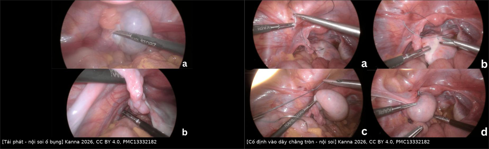
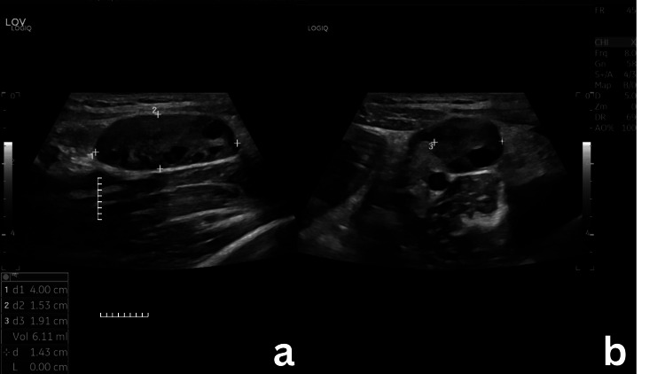
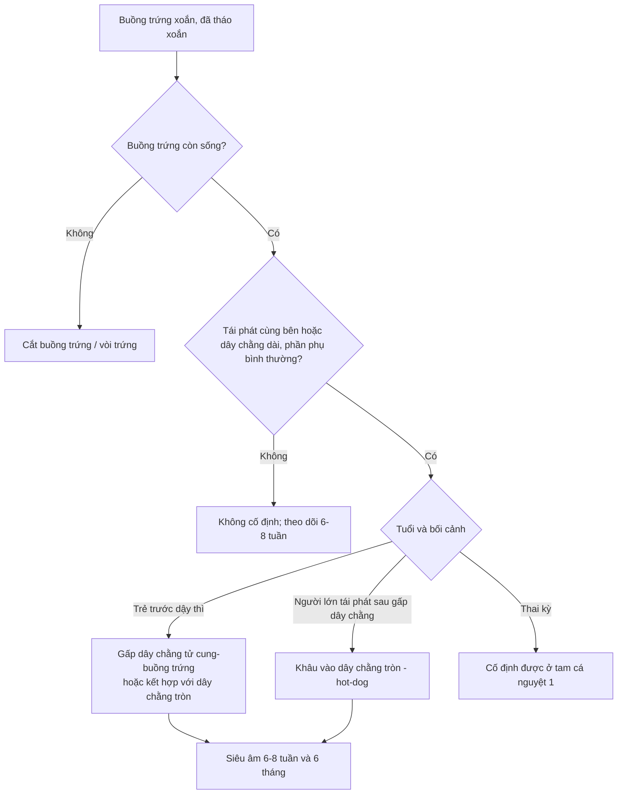
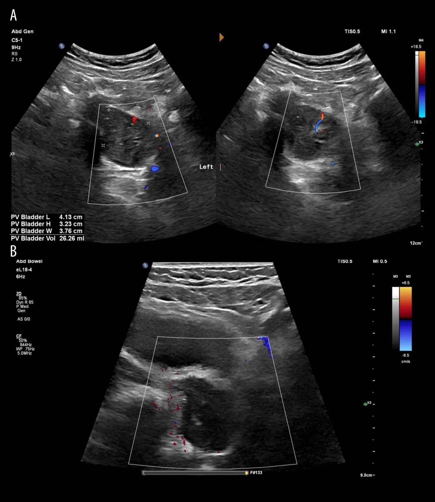
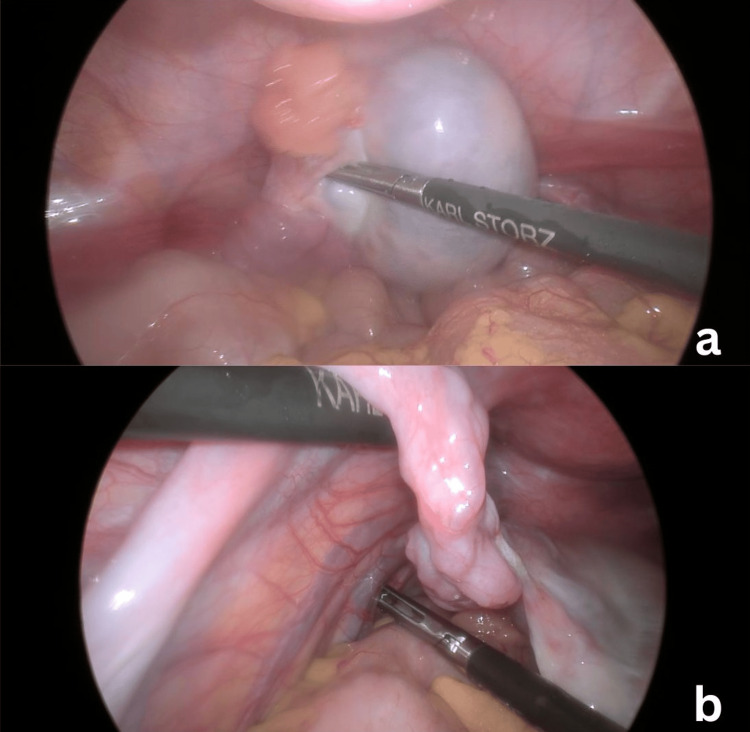

# 1950 — Cố định buồng trứng sau tháo xoắn / Oophoropexy after ovarian detorsion

**Tags:** `pattern:xoan-phan-phu` `pattern:xoan-tai-phat` `vung:tieu-khung` `vung:phan-phu` `protocol:sieu-am-Doppler` `protocol:noi-soi-o-bung`

**Mức chắc chắn (certainty):** tổng hợp y văn (literature synthesis) — số liệu từ **một đoàn hệ 38 ca cố định lần đầu** (PMC12414049), **một đoàn hệ nhi 18 ca** (PMID 41110824), **một đoàn hệ 56 trẻ** (PMC13510985), **một nghiên cứu bệnh–chứng 30 + 60 ca** (PMID 42704740) và **ba ca nguyên văn có ảnh** (PMC13332182; PMC13657673). Không có thử nghiệm ngẫu nhiên; mọi khuyến nghị kỹ thuật là **thực hành đồng thuận**, chỗ suy luận được ghi rõ.

> **Câu chốt:** Cố định buồng trứng (oophoropexy) là quyết định **sau** khi đã tháo xoắn và cứu được buồng trứng — không phải để điều trị cơn xoắn cấp. Ba con số quyết định: **(1)** xoắn tái phát sau điều trị bảo tồn **15% dân số chung, tới 70% ở trẻ trước dậy thì/vị thành niên** (PMC12414049); **(2)** sau cố định lần đầu, tái phát chung **18,4%**, trong đó **khâu gấp dây chằng tử cung–buồng trứng 25,9% (7/27)** so với **khâu vào dây chằng tròn 0% (0/11)** — khác biệt **chưa có ý nghĩa (p = 0,08)**; **(3)** ở trẻ, cố định **chỉ vào dây chằng tròn tái phát 100% (5/5)** so với **20%** ở các vị trí khác (P = 0,027) — bằng chứng **xung đột** giữa người lớn và trẻ em, phải đọc theo tuổi.

## 1. Tổng quan bệnh học – cơ chế hình ảnh (TẠI SAO)

### 1.1 Giải phẫu quyết định chỗ xoắn và chỗ cố định

- Buồng trứng treo bằng **dây chằng tử cung–buồng trứng (utero-ovarian ligament / ligamentum ovarii proprium)** ở phía trong, **dây chằng treo buồng trứng (suspensory ligament, chứa mạch buồng trứng)** ở phía trên–ngoài và **mạc treo buồng trứng (mesovarium)**. Trục xoắn là **trục mạch máu trong dây chằng treo**; buồng trứng quay quanh trục này **theo chiều kim đồng hồ hoặc ngược**, kéo theo vòi trứng.
- **Yếu tố nền tảng của xoắn tái phát:** dây chằng tử cung–buồng trứng **dài, giãn, tăng di động (hypermobile)** — đặc trưng ở trẻ **trước dậy thì** với phần phụ kích thước bình thường, không u. Ở người lớn, yếu tố thường gặp hơn là **nang buồng trứng** (nang hoàng thể, nang nang), **buồng trứng to do kích thích buồng trứng/PCOS**, **thai kỳ** (tử cung to làm đổi trục) (PMC12414049; PMID 41110824).
- **TẠI SAO tháo xoắn đơn thuần không sửa được nguyên nhân:** tháo xoắn chỉ giải phóng cơn xoắn hiện tại; **chiều dài và độ chùng của dây chằng vẫn nguyên** → buồng trứng vẫn quay lại được quanh trục mạch máu. Cố định (oophoropexy) tạo **điểm neo** hoặc **rút ngắn dây chằng**, làm giảm **cung quay** quanh trục mạch máu. Vì vậy cố định **không phải** là điều trị cơn đau cấp, mà là **dự phòng tái phát** — và cũng không sửa được chất lượng mô buồng trứng đã bị thiếu máu.
- **TẠI SAO buồng trứng to ra khi xoắn:** trong xoắn, **tĩnh mạch và bạch mạch bị ép trước** → ứ dịch, phù nề, buồng trứng **to nhanh**; động mạch còn thông một phần nhờ **tuần hoàn kép** (động mạch buồng trứng + nhánh động mạch tử cung). Vì vậy hình ảnh kinh điển là **buồng trứng to, nang noãn bị đẩy ra ngoại vi**, chứ không phải khối đặc.

### 1.2 Vật lý siêu âm – vì sao Doppler không được dùng để loại trừ

- **Siêu âm đầu dò âm đạo/ổ bụng:** buồng trứng **to bất đối xứng**, nhu mô **echo dày/không đồng nhất**, **nang noãn ngoại vi**, có thể thấy **dấu xoáy (whirlpool sign)** — cuống mạch xoắn hình “xoáy nước”; trong loạt 38 ca, **whirlpool gặp tới 73,3%**, **phù buồng trứng 80%**, kích thước buồng trứng **≤ 45 mm** ở nhóm được cố định (PMC12414049).
- **Doppler màu:** xoắn **tĩnh mạch trước, động mạch sau** → có thể còn **phổ động mạch** dù đã xoắn; **không có phổ** thì gợi ý nặng hơn nhưng **phổ bình thường không loại trừ xoắn**. Ca nguyên văn 9 tuổi: buồng trứng **41 × 37 × 32 mm (~27 mL)**, phổ **giảm nhưng còn**, mổ xác nhận xoắn **~360°** (PMC13657673). Đây là lý do **quyết định mổ dựa trên lâm sàng**, không dựa riêng Doppler.
- **Thể tích buồng trứng là chỉ số theo dõi khách quan:** ca 12 tuổi có buồng trứng **26,72 mL** trước mổ; sau cố định **6 tháng** còn **4,00 × 1,53 × 1,91 cm = 6,11 mL** (PMC13332182). Ca 9 tuổi: **~27 mL** trước mổ → **16 × 14 × 24 mm (~2,7 mL)** sau **8 tuần** (PMC13657673). Thể tích giảm > 70% là bằng chứng hồi phục tưới máu, không phải teo.
- **CT/MRI:** không cần cho chẩn đoán xoắn cấp; MRI hữu ích khi **mang thai** hoặc khi siêu âm không kết luận, để loại **u phần phụ** và **áp-xe vòi trứng**. Không có dấu hiệu đặc hiệu trên CT cho “xoắn” — CT chỉ loại trừ nguyên nhân khác.

### 1.3 Dịch tễ và gánh nặng tái phát (số liệu định lượng)

- Xoắn phần phụ chiếm **2–6%** cấp cứu phụ khoa (PMC12414049).
- **Tái phát sau điều trị bảo tồn:** **15%** dân số chung; **tới 70%** ở trẻ trước dậy thì/vị thành niên; các loạt gộp ghi **19–38%** (PMC12414049 dẫn y văn).
- **Sau cố định lần đầu:** **18,4%** chung; **25,9%** sau khâu gấp dây chằng tử cung–buồng trứng; **0%** sau khâu vào dây chằng tròn (n = 11) (PMC12414049).
- **Ở trẻ (18 ca, trung vị 9,4 tuổi):** tái phát chung **44%**; **40%** sau tháo xoắn đơn thuần và **50%** sau tháo xoắn + cố định (p = 1); **tất cả ca cố định vào dây chằng tròn tái phát (5/5 = 100%)** so với **20%** ở các vị trí khác (**P = 0,027**) (PMID 41110824).
- **Loạt 56 trẻ (2010–2025):** bảo tồn buồng trứng **62,5%**; tái phát được ghi nhận **5,4%**; xoắn **trước sinh** có cắt buồng trứng **8/8 = 100%** so với **27,1%** ở trẻ sinh sau (PMC13510985).

## 2. Mẫu hình + chẩn đoán phân biệt theo vị trí và theo tuổi (gamut)

### 2.1 Theo bối cảnh lâm sàng

- **Trẻ trước dậy thì, phần phụ bình thường:** dây chằng tử cung–buồng trứng dài/tăng di động → xoắn tái phát nhiều lần; đây là nhóm **lợi ích lớn nhất** từ cố định nhưng cũng là nhóm **bằng chứng kỹ thuật yếu nhất** (các loạt 5–18 ca).
- **Tuổi sinh sản, có nang:** nang hoàng thể/nang nang là “điểm tựa” gây xoắn; xử trí là **bóc nang (cystectomy)** hơn là cố định đơn thuần — trong loạt 38 ca cố định, chỉ giữ **nang sinh lý** (hoàng thể, nang nang, hoàng thể xuất huyết), nang bệnh lý được bóc (PMC12414049).
- **PCOS/kích thích buồng trứng/thai kỳ:** buồng trứng to, nhiều nang → nguy cơ tái phát và xoắn đối bên; cố định **vẫn khả thi trong 3 tháng đầu thai kỳ**, 7/8 ca trong tam cá nguyệt 1 không biến chứng (PMC12414049).
- **Sau cắt vòi trứng/mổ vùng chậu:** dính và thay đổi giải phẫu → cần đánh giá tại mổ, không suy đoán trên siêu âm.

### 2.2 Gamut theo vị trí cố định

- **Gấp/rút ngắn dây chằng tử cung–buồng trứng (ovarian ligament plication):** khâu gấp đôi dây chằng bằng chỉ không tiêu; kỹ thuật phổ biến nhất (71% trong loạt 38 ca) (PMC12414049).
- **Khâu dây chằng tử cung–buồng trứng vào dây chằng tròn (“hot-dog in a bun” / ovario-round ligament fixation):** hai mũi chỉ không tiêu giữa hai dây chằng, buồng trứng nằm giữa như “xúc xích trong bánh mì”; **0/11 tái phát** ở người lớn (PMC12414049).
- **Khâu vào thành chậu (pelvic sidewall):** hiệu quả thấp, **không an toàn khi tĩnh mạch chậu giãn** — ca nguyên văn ghi rõ “fixation to the pelvic sidewall technically unsafe” vì tĩnh mạch chậu giãn lớn (PMC13332182).
- **Khâu vào dây chằng cùng–tử cung (uterosacral), hố buồng trứng (ovarian fossa), thân tử cung:** có mô tả, số liệu rất ít; trong loạt nhi, cố định vào **dây chằng tròn** thất bại 100%, các vị trí khác 20% (PMID 41110824).
- **Cố định hai bên (prophylactic contralateral):** không có bằng chứng từ thử nghiệm; ca xoắn **không đồng thời (asynchronous)** ở buồng trứng còn lại đã được báo cáo từ 1993 (PMID 8321802) — quyết định **cá thể hóa**, không mặc định.

### 2.3 Phân biệt nguyên nhân đau tái phát sau cố định

- **Xoắn tái phát** (đau từng cơn, buồng trứng to, whirlpool) — chẩn đoán **tại mổ**, không loại trừ bằng Doppler.
- **Dính sau mổ** (đau mạn, buồng trứng dính thành chậu) — MRI/CT ít giá trị, chẩn đoán lâm sàng ± nội soi.
- **Đau do chính cố định** (đau vùng chậu mạn, giao hợp đau) — số liệu bệnh–chứng ở mục 5.
- **Nang buồng trứng mới**, **viêm phần phụ**, **viêm ruột thừa**, **sỏi niệu quản** — siêu âm + xét nghiệm.

## 3. Bảng so sánh phân biệt (ma trận đối chiếu)

| Thực thể / kỹ thuật | Hình ảnh – mô tả tại mổ | Chốt vào (rule-in) | Chốt loại (rule-out) | Gợi ý xác nhận |
|---|---|---|---|---|
| **Gấp dây chằng tử cung–buồng trứng** | Dây chằng bị gấp đôi, khâu chỉ không tiêu; buồng trứng còn di động trong giới hạn | Dây chằng **dài, chùng** + tái phát cùng bên; buồng trứng còn sống sau tháo xoắn | Dây chằng đã ngắn, không còn chùng; buồng trứng hoại tử phải cắt | Thấy mũi chỉ + đo chiều dài dây chằng; theo dõi tái phát **25,9%** (PMC12414049) |
| **Khâu vào dây chằng tròn (“hot-dog”)** | Hai mũi chỉ giữa dây chằng tử cung–buồng trứng và dây chằng tròn; buồng trứng áp vào dây chằng tròn | Tái phát sau gấp dây chằng; dây chằng tròn **to, chắc**, không có tĩnh mạch giãn quanh | Tĩnh mạch chậu giãn lớn; không xác định được niệu quản | **0/11 tái phát** ở người lớn (p = 0,08); **100% tái phát** khi chỉ khâu dây chằng tròn ở trẻ (PMID 41110824) |
| **Khâu thành chậu** | Buồng trứng cố định vào phúc mạc thành chậu; dễ căng, dễ rách phúc mạc | Cần neo cố định khi không tiếp cận được dây chằng tròn | Tĩnh mạch chậu giãn; nguy cơ chảy máu/tổn thương mạch | Ca nguyên văn: **không an toàn** khi tĩnh mạch chậu giãn (PMC13332182) |
| **Không cố định (chỉ tháo xoắn)** | Buồng trứng hồi phục kích thước, không có chỉ khâu | Xoắn lần đầu, không tái phát, có nang đã bóc | Tái phát cùng bên ≥ 2 lần; dây chằng dài cả hai bên | Tái phát **40%** ở trẻ sau tháo xoắn đơn thuần (PMID 41110824) |
| **Xoắn đối bên không đồng thời** | Buồng trứng còn lại xoắn sau nhiều tháng–năm | Tiền sử xoắn một bên + đau bên đối diện; phần phụ bình thường | Có u/nang giải thích được; không có dấu hiệu xoắn | Báo cáo ca từ 1993; **không có tỷ lệ chuẩn** (PMID 8321802) |

*Trái: buồng trứng phì đại, cuống mạch xoắn, tĩnh mạch chậu giãn. Phải: các thì khâu cố định buồng trứng vào dây chằng tròn. Nguồn: Kanna 2026, CC BY 4.0, PMC13332182 — ảnh ghép letterbox, không crop.*

### 3.1 Đọc đúng sự xung đột bằng chứng giữa người lớn và trẻ em

- **Người lớn (loạt 38 ca):** khâu vào dây chằng tròn **không tái phát ca nào** nhưng **n = 11**, khoảng tin cậy rộng, **p = 0,08** → chỉ là **tín hiệu**, không phải bằng chứng thuyết phục (PMC12414049).
- **Trẻ em (18 ca):** cố định **chỉ vào dây chằng tròn** tái phát **5/5**; tác giả kết luận dây chằng tròn là **vị trí cố định không phù hợp** ở nhóm này (P = 0,027) (PMID 41110824).
- **Cách đọc cho thực hành:** ở trẻ, ưu tiên **gấp dây chằng tử cung–buồng trứng** hoặc khâu **kết hợp** tử cung–buồng trứng + dây chằng tròn; ở người lớn tái phát sau gấp dây chằng, khâu dây chằng tròn là lựa chọn hợp lý. **Không áp dụng kết quả người lớn cho trẻ** và ngược lại.

## 4. Protocol can thiệp + theo dõi

### 4.1 Trước mổ

- **Siêu âm Doppler** là bước đầu: đo **thể tích buồng trứng** (ba chiều), mô tả nang, **whirlpool**, phổ Doppler. Ghi rõ **không loại trừ xoắn khi còn phổ**.
- **Xét nghiệm** β-hCG (loại thai ngoài tử cung + ảnh hưởng lựa chọn thì mổ), công thức máu, CRP.
- **Không chờ CT/MRI** nếu bệnh cảnh điển hình; MRI khi mang thai hoặc cần loại u.

### 4.2 Trong mổ (nội soi là chuẩn)

1. **Đánh giá:** số vòng xoắn (ca nguyên văn: **4 vòng**, **~360°**), màu buồng trứng, dịch ổ bụng.
2. **Tháo xoắn** và **chờ 5–10 phút**: màu hồng lại một phần là dấu hiệu còn sống; **không cắt buồng trứng chỉ vì màu tím** — loạt 56 trẻ bảo tồn được **62,5%**.
3. **Xử lý nang** nếu có (bóc nang, cầm máu kỹ).
4. **Quyết định cố định:** tái phát cùng bên, phần phụ bình thường/dây chằng dài, hoặc nguy cơ cao (trẻ trước dậy thì, PCOS, thai). **Không cố định thường quy** cho mọi ca xoắn lần đầu.
5. **Kỹ thuật:** chỉ **không tiêu** (Ethibond/Prolene/Silk) — trong loạt 38 ca, Ethibond dùng nhiều nhất; **không có khác biệt tái phát theo loại chỉ** (PMC12414049). Khâu **2 mũi** giữa dây chằng tử cung–buồng trứng và dây chằng tròn (kiểu “hot-dog”), hoặc gấp dây chằng tử cung–buồng trứng. **Xác định niệu quản** trước khi khâu dây chằng tròn (nguy cơ tổn thương niệu quản khi người mổ ít kinh nghiệm).
6. **Thai kỳ:** cố định được thực hiện **an toàn trong tam cá nguyệt 1** (7/8 ca, không biến chứng) (PMC12414049).

### 4.3 Theo dõi sau mổ

- **Siêu âm lại 6–8 tuần** và **6 tháng**: thể tích buồng trứng, nang noãn, phổ Doppler. Ca 12 tuổi: **26,72 → 6,11 mL** sau 6 tháng; ca 9 tuổi: **~27 → 2,7 mL** sau 8 tuần (PMC13332182; PMC13657673).

*Buồng trứng hồi phục hình thái, nang noãn phân bố đều; thể tích giảm từ 26,72 mL còn 6,11 mL. Nguồn: Kanna 2026, CC BY 4.0, PMC13332182 — Fig. 5.*
- **Tư vấn triệu chứng:** đau vùng chậu mạn, giao hợp đau, đau bụng kinh có thể **tăng sau cố định** (mục 5) — hỏi chủ động ở mỗi lần khám.
- **Tái phát vẫn có thể xảy ra dù đã cố định** — dạy bệnh nhân/cha mẹ nhận biết đau từng cơn để quay lại sớm.

## 5. Biến thể bình thường và cạm bẫy

- **Còn phổ Doppler ≠ không xoắn.** Ca 9 tuổi có phổ giảm nhưng còn, mổ xác nhận xoắn 360°; “phổ bình thường” không được dùng để trì hoãn mổ khi lâm sàng mạnh (PMC13657673).
- **Buồng trứng tím/đen không đồng nghĩa hoại tử.** Tháo xoắn và chờ giúp cứu **62,5%** trong loạt 56 trẻ; cắt sớm là mất buồng trứng oan (PMC13510985). Ngoại lệ: xoắn **trước sinh** có tỷ lệ cắt **100% (8/8)** — nhưng đây là bối cảnh riêng.
- **Cố định không phải “vô hại”:** so với tháo xoắn đơn thuần, cố định làm tăng **đau bụng kinh nặng 46% vs 10%** (aOR **4,11**; KTC 1,15–14,66), **giao hợp đau 23,3% vs 1,7%**, **đau vùng chậu không do kinh 36,7% vs 11,7%**; **khả năng sinh sản tương đương**; theo dõi trung vị **48 tháng** (PMID 42704740). Phải tư vấn trước mổ.
- **Vị trí cố định sai làm tăng tái phát:** ở trẻ, khâu **chỉ vào dây chằng tròn** tái phát **5/5** — khác với người lớn; đừng suy rộng kỹ thuật “hot-dog” cho trẻ khi chưa có dữ liệu (PMID 41110824).
- **Khâu thành chậu khi tĩnh mạch chậu giãn** có thể gây chảy máu/tổn thương mạch; ca nguyên văn đã bỏ phương án này vì lý do an toàn (PMC13332182).
- **Teo buồng trứng tiến triển** gặp **38%** sau xoắn ở loạt nhi, dù đã tháo xoắn — cần theo dõi thể tích, không hứa “buồng trứng bình thường” (PMID 41110824).
- **Cố định hai bên thường quy:** không có bằng chứng; xoắn đối bên không đồng thời là **ca hiếm** nhưng có thật (PMID 8321802) — quyết định theo nguy cơ từng bệnh nhân.
- **Mẫu số nhỏ, p = 0,08:** đừng khẳng định “khâu dây chằng tròn tốt hơn” như một kết luận chắc chắn; đây là **giả thuyết cần thử nghiệm lớn**.

## 6. Tự lượng giá — Blind Quiz

**Ca 1 — Bé gái 9 tuổi, tiền sử xoắn buồng trứng trái đã tháo xoắn + cố định, nay đau bụng trái 2 ngày, nôn 1 ngày.**

- Hỏi: mô tả buồng trứng và phổ Doppler? Thể tích ước lượng bao nhiêu? Ba chẩn đoán phân biệt? Dấu hiệu nào **không** loại trừ xoắn?

<b>Bấm để hiện đáp án (findings + chẩn đoán)</b>

- Buồng trứng trái **to, phù nề** (đo 4,13 × 3,23 × 3,76 cm **≈ 26 mL**, mổ ghi 41 × 37 × 32 mm ≈ 27 mL), nang noãn đẩy ngoại vi; Doppler màu **giảm tín hiệu trong nhu mô nhưng còn phổ**.
- Phân biệt: **xoắn buồng trứng tái phát dù đã cố định**, nang hoàng thể xuất huyết, viêm phần phụ, viêm ruột thừa (nếu đau bên phải).
- **Phổ Doppler còn/giảm không loại trừ xoắn** — mổ xác nhận xoắn **~360°**, buồng trứng còn sống.
- Nguồn: Alqahtani 2026, **CC BY-NC-ND 4.0**, PMC13657673 — Fig. 1, nguyên bản không chỉnh sửa.

**Ca 2 — Bé gái 12 tuổi (4 cơn đau trái trong 4 tháng). Trong mổ: buồng trứng phì đại, cuống xoắn 4 vòng, tĩnh mạch chậu giãn lớn.**

- Hỏi: chẩn đoán? Có nên cắt buồng trứng? Nếu cố định, chọn vị trí nào và vì sao **không** khâu thành chậu?

<b>Bấm để hiện đáp án</b>

- **Xoắn buồng trứng tái phát**; buồng trứng còn sống sau tháo xoắn → **giữ buồng trứng**, không cắt vì màu tím.
- Tĩnh mạch chậu giãn lớn → **khâu thành chậu không an toàn**; chọn **khâu vào dây chằng tròn** (người lớn, tái phát sau gấp dây chằng) với hai mũi chỉ không tiêu, xác định niệu quản.
- Nguồn: Kanna 2026, CC BY 4.0, PMC13332182 — Fig. 2.

**Ca 3 — Bệnh nhi ở ca 2: hình ảnh tại mổ và theo dõi sau cố định.**

- Hỏi: hai thì trong ảnh ghép thể hiện gì? Nếu đau tái diễn, chẩn đoán nào phải nghĩ trước? Theo dõi bằng gì?

<b>Bấm để hiện đáp án</b>

- Trái: **buồng trứng xoắn tái phát** (phì đại, cuống xoắn, tĩnh mạch giãn). Phải: **các thì cố định vào dây chằng tròn**.
- Đau tái diễn sau cố định: nghĩ **xoắn tái phát** (dù hiếm), **dính**, **đau do cố định** (đau kinh/giao hợp đau), hoặc nang mới. Siêu âm đo thể tích + Doppler; không loại trừ xoắn nếu phổ còn.
- Nguồn: Kanna 2026, CC BY 4.0, PMC13332182 — Fig. 2 + Fig. 3; ảnh ghép letterbox.

## Bài liên quan chéo
- [1742 – Xoắn buồng trứng và OHSS](../1742-xoan-buong-trung-ohss/lesson.md)
- [1632 – Trụ mô buồng trứng trước dậy thì](../1632-tru-mo-buong-trung-truoc-day-thi/lesson.md)
- [1669 – Hội chứng quá kích buồng trứng](../1669-hoi-chung-qua-kich-buong-trung/lesson.md)
- [530 – Buồng trứng O-RADS trên siêu âm/MRI](../530-buong-trung-ORADS-sieu-am-MRI/lesson.md)
- [533 – Theo dõi và bảo tồn sinh sản sau u buồng trứng](../533-theo-doi-va-bao-ton-sinh-san-sau-u-buong-trung/lesson.md)

> Không dùng để chẩn đoán độc lập khi chưa có người hướng dẫn.
