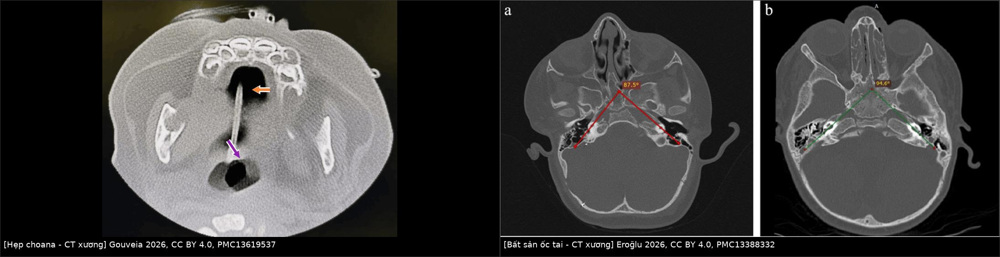
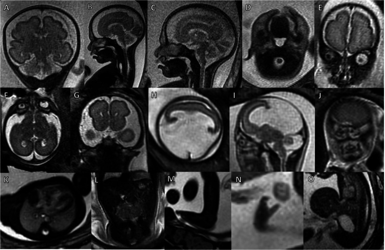
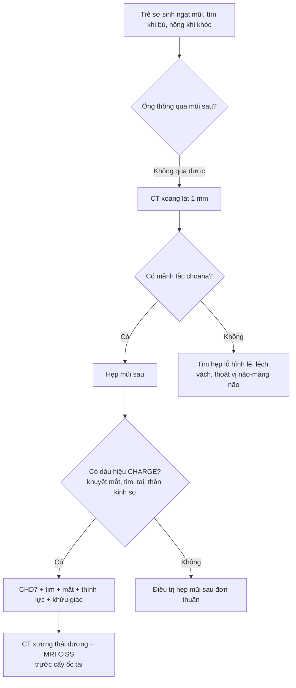
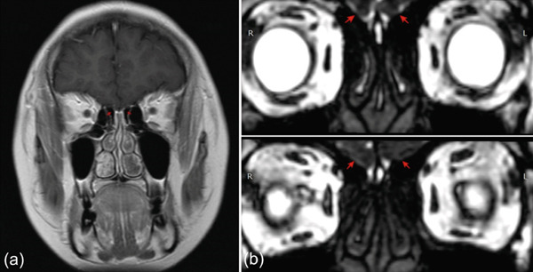
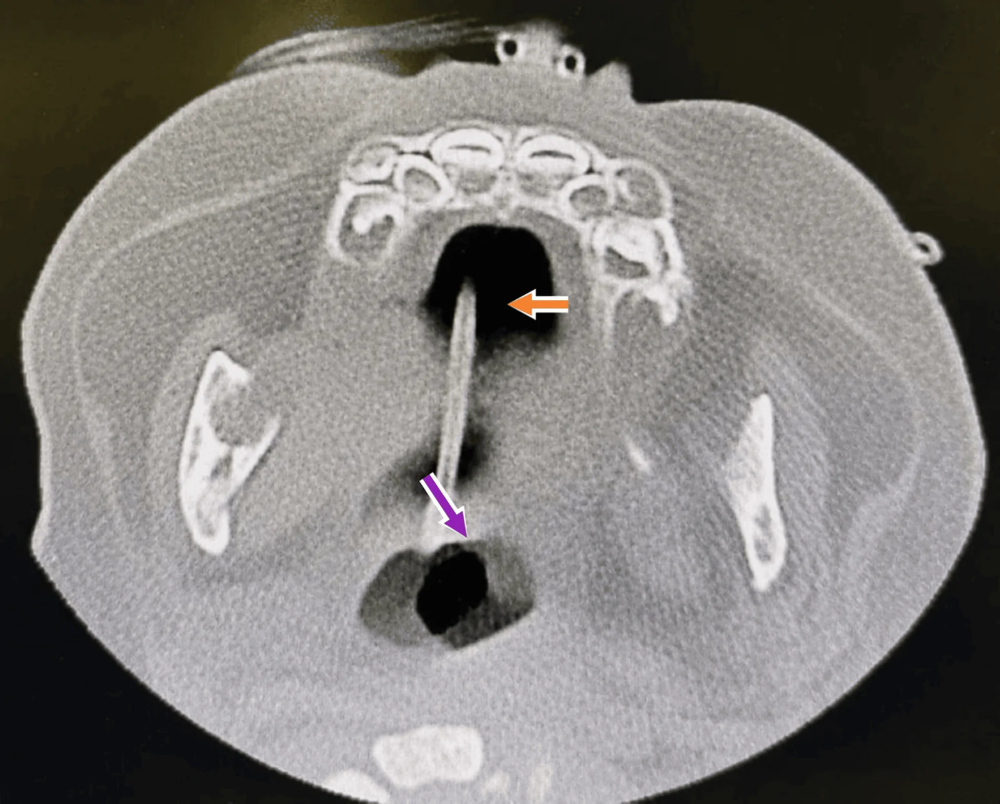
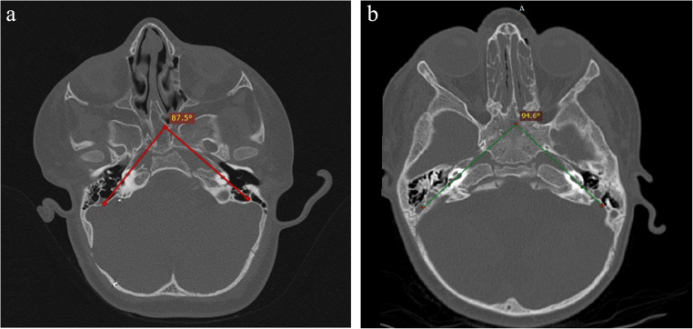

# 1951 — Hội chứng CHARGE: hẹp mũi sau, bất sản hành khứu giác và bất sản ốc tai / CHARGE syndrome

**Tags:** `pattern:hep-bam-sinh` `pattern:bat-san` `vung:dau-co` `vung:mui` `vung:xoang` `vung:oc-tai` `vung:xuong-thai-duong` `protocol:CT-xuong-lat-1mm` `protocol:MRI-so-nao`

**Mức chắc chắn (certainty):** tổng hợp y văn (literature synthesis) — số liệu từ **một phân tích gộp 70 nghiên cứu/1.564 bệnh nhân** (PMC13737458), **một đoàn hệ 70 trẻ hẹp mũi sau** (PMC13038761), **một đoàn hệ 18 bệnh nhân CHARGE chụp CT xương thái dương** (PMC13388332), **một phân tích gộp 85 bệnh nhân/99 tai cấy ốc tai điện tử** (PMID 42087294), và các ca nguyên văn có ảnh (PMC8269040; PMC13619537; PMC13342138; PMC12911516). Không có thử nghiệm ngẫu nhiên; ngưỡng chẩn đoán là **tiêu chuẩn lâm sàng Blake**, chỗ suy luận được ghi rõ.

> **Câu chốt:** CHARGE là bệnh **đa dị tật do CHD7**, trong đó ba tầng tổn thương hay bị đọc rời rạc chính là **đường thở (hẹp mũi sau), tai (bất sản ốc tai/ống bán khuyên) và khứu giác (bất sản hành khứu giác)**. Bốn con số quyết định: **(1)** tần suất **1/15.000–17.000** trẻ sinh sống, **~30% tử vong trước 5 tuổi** (PMC12613921); **(2)** hẹp mũi sau gặp **31,5% hai bên** và **15,4% một bên** khi gộp 58 nghiên cứu (PMC13737458); **(3)** bất sản/giảm sản **ống bán khuyên 73,6%**, **ốc tai 49,8%**, **dây thần kinh ốc tai 49,1%**, **điếc tiếp nhận 56,9%** (PMC13737458); **(4)** hẹp lại sau mổ hẹp mũi sau ở CHARGE **31,3%** — đặt stent **không** làm giảm mà còn liên quan tăng hẹp lại (PMC8269040).

## 1. Tổng quan bệnh học – cơ chế hình ảnh (TẠI SAO)

### 1.1 CHD7 và “ba trục” của CHARGE

- **CHARGE** là từ viết tắt: **C**oloboma (khuyết mắt), **H**eart defect (dị tật tim), **A**tresia choanae (hẹp mũi sau), **R**etarded growth/development (chậm phát triển), **G**enital hypoplasia (thiểu sản sinh dục), **E**ar anomalies/deafness (dị tật tai/điếc). Nguyên nhân chính là **đột biến CHD7** (chromodomain helicase DNA-binding protein 7) — gen điều hòa nhiễm sắc chất, ảnh hưởng **tế bào mào thần kinh** và **phát triển trục giữa**.
- **TẠI SAO cùng một gen gây cả mũi sau, tai và khứu giác:** cả ba cấu trúc đều phát triển từ **trục giữa sọ mặt – não trước** và **tế bào mào thần kinh** trong cùng cửa sổ phôi thai. CHD7 thiếu hụt → **hẹp mũi sau** (dị tật trục giữa), **bất sản ốc tai/ống bán khuyên** (dị tật tai trong), **bất sản hành khứu giác** (dị tật não trước) — không phải ba bệnh riêng lẻ mà là **ba mặt của một bệnh**.
- **Dịch tễ và tiên lượng:** **1/15.000–17.000** trẻ sinh sống; **~30% tử vong trước 5 tuổi** (PMC12613921). Kiểu hình thường gặp: **khuyết mắt 80–85%**, **dị tật tim 60%**, **hẹp mũi sau 60–65%**, **chậm phát triển 80%**, **dị tật sinh dục 70–75% ở bé trai**, **dị tật tai/điếc 80%** (PMC12613921 dẫn y văn).
- **Tiêu chuẩn Blake:** **3 tiêu chuẩn chính**, hoặc **2 chính + 2 phụ**. Chính: **khuyết mắt, hẹp mũi sau, dị tật vành tai đặc trưng, rối loạn chức năng dây thần kinh sọ**. Phụ: thiểu sản sinh dục, chậm phát triển, dị tật tim, chậm tăng trưởng, sứt môi/vòm, rò khí quản–thực quản, mặt đặc trưng (PMC8269040).

### 1.2 Vì sao CT và MRI nhìn thấy tổn thương (vật lý + giải phẫu)

- **Hẹp mũi sau trên CT xương:** mảnh xương/màng chắn **cửa sau mũi** có **đậm độ xương 700–1.000 HU** (thể xương/hỗn hợp) hoặc **mô mềm ~40–60 HU** (thể màng thuần). Dấu hiệu đi kèm: **vomer dày**, **mảnh chân bướm trong bị đẩy vào trong (medial bowing of the medial pterygoid plate)**, ổ mũi chứa dịch. Đo **độ dày mảnh tắc** và **chiều rộng choana** trên lát **≤ 1 mm** — cần lát mỏng vì mảnh tắc ở trẻ có thể chỉ **1–3 mm**.
- **Bất sản ốc tai trên CT xương thái dương:** ốc tai bình thường có **2,5 vòng**; bất sản/giảm sản làm **thiếu vòng, mất phân chia khoang**, **góc ốc tai hẹp**. Trong 18 bệnh nhân CHARGE, **góc ốc tai 94,49° ± 10,02°** so với **114,02° ± 8,17°** ở nhóm chứng (**p < 0,001**); **giảm sản ốc tai type III** là thể thường gặp nhất (PMC13388332). Góc hẹp là **cảnh báo kỹ thuật** khi đặt điện cực cấy ốc tai.
- **Dây thần kinh ốc tai trên MRI:** 3D **CISS/FIESTA** (hoặc T2 lát mỏng 0,8–1 mm) cho thấy **dây thần kinh trong ống tai trong**; **giảm sản/không có dây** gặp **49,1%** (PMC13737458) — đây là lý do **không thể chỉ dựa CT** trước khi cấy ốc tai.
- **Bất sản hành khứu giác trên MRI:** hành khứu giác là cấu trúc **1–2 mm** nằm trên **mảnh sàng**, nhìn rõ nhất trên **T2 coronal lát mỏng qua rãnh khứu giác** hoặc **CISS**. Bất sản hai bên → **mất rãnh khứu giác**, **không thấy hành khứu giác**; trên thai, dấu hiệu có thể thấy từ **~29 tuần** (PMC13342138). Bất sản hành khứu giác gặp **28,8%** trong CHARGE (PMC13737458) — nhưng **không đặc hiệu** (gặp cả Kallmann; mục 5).

### 1.3 Ngưỡng và số liệu của ba tầng tổn thương

- **Đường thở:** hẹp mũi sau gặp **36–65%** trong CHARGE (PMC8269040 dẫn y văn); gộp 58 nghiên cứu: **một bên 15,4% (95% CI 11,6–19,2)**, **hai bên 31,5% (95% CI 23,3–39,7)**; **laryngomalacia 27,7%**, **mở khí quản 23,6%** (PMC13737458). Tần suất chung ở trẻ sinh sống **1/5.000–8.000** — thể **xương/hỗn hợp** chiếm đa số, thể màng thuần hiếm (PMC13398210).
- **Tai:** **viêm tai giữa tiết dịch 54,5%**, **bất sản/giảm sản ống bán khuyên 73,6%**, **giảm sản ốc tai 49,8%**, **giảm sản dây thần kinh ốc tai 49,1%**, **điếc tiếp nhận 56,9%** (PMC13737458). Trong 70 trẻ hẹp mũi sau, **49% có rối loạn thính lực**; điếc tiếp nhận **43% ở hẹp hai bên** so với **9% ở hẹp một bên** (p < 0,01) (PMC13038761).
- **Khứu giác và thần kinh sọ:** **bất thường khứu giác 28,8%**, **liệt mặt 35,2%**, **sứt môi/vòm 25,6%** (PMC13737458) — liệt mặt là **yếu tố nguy cơ phẫu thuật** (đường mổ, giác mạc).
- **Kết quả cấy ốc tai:** gộp **85 bệnh nhân/99 tai**: **CAP tăng +2,9 điểm** (p = 0,004), **IT-MAIS tăng +11,9** (p = 0,036) (PMID 42087294). Loạt 14 trẻ/22 tai: tuổi cấy trung bình **25,9 tháng**, CAP **0,36 → 3,21**, **42,9% đạt CAP ≥ 4**; **tất cả đều có thiếu hụt dây thần kinh ốc tai** nhưng vẫn cải thiện (PMID 38738912).

## 2. Mẫu hình + chẩn đoán phân biệt theo vị trí (gamut)

### 2.1 Tắc mũi sau ở trẻ sơ sinh

- **Hẹp mũi sau hai bên (bilateral choanal atresia):** cấp cứu đường thở — trẻ **tím khi bú, hồng lại khi khóc** (vì chỉ thở bằng miệng khi khóc); ống thông mũi **không qua được** cả hai bên.
- **Hẹp một bên:** thường **chẩn đoán muộn** — chảy mũi mủ một bên kéo dài, ngạt một bên; có thể phát hiện ở **tuổi trưởng thành** (ca 22 tuổi trong PMC13398210).
- **Gamut khác:** **hẹp lỗ hình lê (pyriform aperture stenosis)** — hẹp xương hàm trên giữa, thường kèm răng cửa giữa; **lệch vách mũi**; **nang ống lệ–mũi**; **thoát vị não–màng não (encephalocele)**; **u quái mũi**.

### 2.2 Dị tật tai trong

- **CHARGE:** giảm sản ốc tai (type III thường gặp), **bất sản ống bán khuyên**, ống tai trong hẹp, dây thần kinh giảm sản.
- **Khác:** **Pendred** (ốc tai Mondini + **ống tiền đình giãn rộng**), **nhiễm CMV bẩm sinh** (không phải dị tật xương điển hình), **Trisomy 21** (hẹp ống tai trong, dị tật mũi–xoang), **Waardenburg**, **bất sản dây thần kinh ốc tai đơn thuần**.

### 2.3 Bất sản hành khứu giác

- **Kallmann:** bất sản hành khứu giác + **suy sinh dục do thiếu GnRH**, không có hẹp mũi sau/dị tật tai.
- **CHARGE:** bất sản hành khứu giác **kèm** hẹp mũi sau, dị tật tai, khuyết mắt, dị tật tim.
- **Khác:** mất khứu giác bẩm sinh đơn thuần, sau chấn thương, sau viêm màng não.

## 3. Bảng so sánh phân biệt (ma trận đối chiếu)

| Thực thể | Hình ảnh điển hình | Chốt vào (rule-in) | Chốt loại (rule-out) | Gợi ý xác nhận |
|---|---|---|---|---|
| **CHARGE** | **Hẹp mũi sau hai bên** + **bất sản/giảm sản ống bán khuyên** + giảm sản ốc tai + **bất sản hành khứu giác** + khuyết mắt/dị tật tim | **≥ 3 tiêu chuẩn chính**, hoặc **2 chính + 2 phụ**; tổn thương **nhiều tầng** (mũi sau + tai trong + khứu giác) | Hẹp mũi sau đơn độc, tai trong bình thường, khứu giác bình thường | CHD7; CT xương thái dương ≤ 1 mm; MRI CISS; tim–mắt–nội tiết |
| **Hẹp mũi sau đơn thuần** | Mảnh tắc xương/màng **một bên**; vomer dày; tai trong bình thường | Hẹp **một bên**, không dị tật khác | Có bất sản ốc tai/ống bán khuyên → nghĩ CHARGE | CT ≤ 1 mm; nội soi; thính lực |
| **Trisomy 21 + hẹp mũi sau** | Hẹp choana ± hẹp ống tai trong; **không** bất sản ống bán khuyên | Bộ mặt Down + tim bẩm sinh (AVSD) + giảm trương lực | Dị tật tai trong kiểu CHARGE | Karyotype/NIPT; siêu âm tim |
| **Kallmann** | **Bất sản hành khứu giác hai bên** trên MRI; **không** hẹp choana, tai trong bình thường | Vô khứu giác + **suy sinh dục do thiếu GnRH** | Có hẹp mũi sau/dị tật tai → nghĩ CHARGE | MRI coronal T2/CISS; LH/FSH, testosterone |
| **Pendred** | ốc tai Mondini + **ống tiền đình giãn rộng**; choana bình thường | Điếc tiếp nhận + bướu giáp; EVA | Bất sản ống bán khuyên/ốc tai kiểu CHARGE | CT xương thái dương; iodide perchlorate; gen SLC26A4 |

*Trái: CT xoang lát mỏng — vomer dày, mảnh tắc choana (ca Trisomy 21, cùng hình thái với CHARGE; **không phải** ca CHARGE). Phải: CT xương thái dương — giảm sản ốc tai type I (a, góc 87,5°) và type III (b, góc 94,0°) ở bệnh nhân CHARGE. Nguồn: Gouveia 2026, CC BY 4.0, PMC13619537; Eroğlu 2026, CC BY 4.0, PMC13388332 — ảnh ghép letterbox.*

### 3.1 Vì sao phải tìm đủ ba tầng thay vì dừng ở mũi

- **Bỏ sót tai trong = bỏ sót điếc:** **56,9%** có điếc tiếp nhận; nếu chỉ mổ hẹp mũi sau mà không đo thính lực/CT xương thái dương, trẻ mất **cửa sổ ngôn ngữ** (PMC13737458).
- **Bỏ sót khứu giác = bỏ sót an toàn:** trẻ không ngửi được dễ **hít sặc, bỏng, ngộ độc**; bất thường khứu giác **28,8%** (PMC13737458).
- **Bỏ sót tim/mắt = bỏ sót tử vong:** dị tật tim **60%**, tử vong **~30% trước 5 tuổi** — khám tim và mắt **trước khi xuất viện** (PMC12613921).

## 4. Protocol chụp + tiêu chuẩn chẩn đoán

### 4.1 CT

- **CT xoang + xương thái dương, lát ≤ 1 mm, thuật toán xương, không cản quang** khi nghi hẹp mũi sau hoặc dị tật tai.
- **Đo và ghi:** độ dày mảnh tắc (mm), chiều rộng choana hai bên, độ dày vomer, hướng mảnh chân bướm; mô tả **thể xương/hỗn hợp/màng**.
- **Xương thái dương:** số vòng ốc tai, phân loại giảm sản (type I–IV), **góc ốc tai**, ống tai trong, chuỗi xương con, ống bán khuyên.
- **Trẻ sơ sinh:** cân nhắc **giảm liều theo ALARA**; không chụp lặp lại nếu đã đủ trả lời câu hỏi phẫu thuật.

### 4.2 MRI

- **MRI sọ + xương thái dương:** **T2 coronal 0,8–1 mm** qua rãnh khứu giác + **3D CISS/FIESTA** cho dây thần kinh sọ VII–VIII.
- **Chỉ định:** trước cấy ốc tai (đánh giá dây thần kinh ốc tai), nghi bất sản hành khứu giác, đánh giá dị tật não trước/dị tật trục giữa.
- **Thai:** MRI thai **T2** có thể thấy **bất sản hành khứu giác** và các dấu hiệu trục giữa từ **~29 tuần**; không thay thế siêu âm sàng lọc (PMC13342138).

*Hình phenotyping thai: hàng trên là CHARGE (A khoang dịch ngoài trục giãn; B teo thực quản; C–D sứt môi/vòm; **E bất sản hành khứu giác**). Các hàng dưới là Trisomy 13/18 (đối chứng). Nguồn: Stuempflen 2026, CC BY 4.0, PMC13342138 — Fig. 2, nguyên bản.*

### 4.3 Tiêu chuẩn chẩn đoán và lộ trình

- **Đường thở:** hẹp hai bên là **cấp cứu** — đặt ống thông miệng/đường thở miệng, mổ nội soi qua mũi khi ổn định.
- **Hẹp lại sau mổ:** **31,3%** ở CHARGE, **47,8%** ở không hội chứng; **đặt stent** liên quan **hẹp lại nhiều hơn** (CHARGE 40% vs 16,7%; không hội chứng 63,6% vs 33,3%) và **tăng số lần nong** (p = 0,018) → **cân nhắc kỹ, không đặt stent thường quy** (PMC8269040).
- **Thính lực:** đo **ABR/thính lực đồ** sớm; nếu điếc tiếp nhận nặng → **MRI dây thần kinh ốc tai** trước cấy; tư vấn kết quả **CAP/IT-MAIS cải thiện nhưng không đồng đều** (PMID 42087294; PMID 38738912).

## 5. Biến thể bình thường và cạm bẫy

- **Hẹp mũi sau một bên có thể chẩn đoán ở người lớn:** ngạt mũi + chảy mũi mủ một bên nhiều năm, dễ bị điều trị như viêm mũi mạn; CT lát mỏng là chốt (ca 22 tuổi, PMC13398210).
- **Thể màng thuần có thể bị bỏ sót trên CT:** mảnh màng mỏng, đậm độ mô mềm, không thấy rõ trên lát dày; cần **nội soi mũi** đối chiếu (PMC8269040).
- **Bất sản hành khứu giác không đồng nghĩa CHARGE:** cùng dấu hiệu gặp trong **Kallmann** — ca minh họa dưới đây là **Kallmann**, không phải CHARGE; phân biệt bằng hẹp choana, dị tật tai trong, khuyết mắt và tuyến sinh dục.

*Ca Kallmann 30 tuổi: (a) T1 coronal, (b) CISS — mũi tên đỏ chỉ vị trí **không có hành khứu giác**. Đây là **dấu hiệu dùng chung**, không phải ca CHARGE. Nguồn: Soryadharma 2026, CC BY 4.0, PMC12911516 — Fig. 3.*

- **Bất sản ống bán khuyên đơn độc** có thể gặp ở người không CHARGE; đừng chẩn đoán hội chứng chỉ dựa một dị tật.
- **Dây thần kinh ốc tai không có** trên MRI làm kết quả cấy ốc tai kém/không thể — cần **MRI trước mổ**, không chỉ CT (PMC13737458).
- **Liệt mặt 35,2%** và **dị tật chuỗi xương con** làm phẫu thuật tai khó; **đường vào và giải phẫu dây VII phải đánh giá trước** (PMC13737458).
- **Đặt stent sau mổ hẹp mũi sau** không giảm hẹp lại, còn tăng nong — tránh “làm thêm cho chắc” (PMC8269040).
- **Chẩn đoán muộn gây tử vong:** nếu chỉ sửa mũi mà không tầm soát **tim, mắt, thính lực, khứu giác, nội tiết**, bỏ sót dị tật tim (60%) — nguyên nhân tử vong chính (PMC12613921).
- **Thai:** bất sản hành khứu giác có thể **chưa thấy trước 29 tuần**; MRI sớm bình thường **không loại trừ** CHARGE (PMC13342138).

## 6. Tự lượng giá — Blind Quiz

**Ca 1 — Sơ sinh 2 ngày, tím khi bú, hồng khi khóc, không luồn được ống thông mũi hai bên.**

- Hỏi: mô tả mảnh tắc và vomer? Chẩn đoán? Cần tìm thêm gì để không bỏ sót hội chứng?

<b>Bấm để hiện đáp án (findings + chẩn đoán)</b>

- **Vomer dày**, mảnh xương chắn **cửa sau mũi** (mũi tên cam: mảnh tắc; mũi tên tím: hẹp/xơ vomer), ổ mũi sau bị bít → **hẹp mũi sau hai bên**.
- Đây là **cấp cứu đường thở**; sau khi ổn định phải tìm **khuyết mắt, dị tật tim, dị tật vành tai, liệt mặt, bất sản hành khứu giác** → nghi **CHARGE**, gửi **CHD7**.
- Lưu ý nguồn: ca minh họa là **Trisomy 21**, cùng hình thái hẹp choana; không phải ca CHARGE.
- Nguồn: Gouveia 2026, CC BY 4.0, PMC13619537 — Fig. 3, nguyên bản.

**Ca 2 — Bé 3 tuổi CHARGE, điếc tiếp nhận hai bên, chuẩn bị cấy ốc tai.**

- Hỏi: bất thường ốc tai là gì? Góc ốc tai so với bình thường? Còn cần thêm hình ảnh nào trước mổ?

<b>Bấm để hiện đáp án</b>

- **Giảm sản ốc tai**: (a) type I — góc **87,5°**; (b) type III — góc **94,0°**; ốc tai thiếu vòng/không phân chia khoang.
- Ở 18 bệnh nhân CHARGE, góc trung bình **94,49° ± 10,02°** so với **114,02° ± 8,17°** ở chứng (p < 0,001) — góc hẹp làm đặt điện cực khó hơn.
- Cần **MRI CISS/FIESTA** đánh giá **dây thần kinh ốc tai** (giảm sản/không có 49,1%) trước khi quyết định cấy; kết quả CAP/IT-MAIS cải thiện nhưng không đồng đều.
- Nguồn: Eroğlu 2026, CC BY 4.0, PMC13388332 — Fig. 2, nguyên bản.

**Ca 3 — Bé trai 14 tuổi: không ngửi được từ nhỏ, chậm dậy thì, không ngạt mũi.**

- Hỏi: dấu hiệu trên MRI? Hai chẩn đoán phân biệt chính? Dấu hiệu nào giúp phân biệt?

<b>Bấm để hiện đáp án</b>

- **Không thấy hành khứu giác hai bên** (mũi tên đỏ), rãnh khứu giác mất → **vô khứu giác bẩm sinh**.
- Phân biệt: **Kallmann** (kèm suy sinh dục do thiếu GnRH, LH/FSH thấp) và **CHARGE** (kèm hẹp mũi sau, bất sản ốc tai/ống bán khuyên, khuyết mắt, dị tật tim).
- Ca minh họa là **Kallmann**; nếu có hẹp choana/dị tật tai trong → đổi hướng sang CHARGE và gửi CHD7.
- Nguồn: Soryadharma 2026, CC BY 4.0, PMC12911516 — Fig. 3, nguyên bản.

## Bài liên quan chéo
- [1741 – Kallmann: thiếu sản hành khứu giác](../1741-kallmann-thieu-san-hanh-khuu-giac/lesson.md)
- [205 – Xơ hóa mè đạo sau viêm mê nhĩ](../205-xo-hoa-me-dao-sau-viem-me-nhi/lesson.md)
- [692 – Microtia–atresia: phục hồi thính lực](../692-microtia-atresia-phuc-hoi-thinh-luc/lesson.md)
- [695 – Hội chứng Treacher Collins–Nager](../695-hoi-chung-treacher-collins-nager/lesson.md)
- [710 – Giải phẫu CT mũi–xoang](../710-sinonasal-ct-anatomy/lesson.md)
- [497 – Theo dõi sau cấy ốc tai ở trẻ](../497-theo-doi-sau-cay-oc-tai-tre/lesson.md)

> Không dùng để chẩn đoán độc lập khi chưa có người hướng dẫn.
