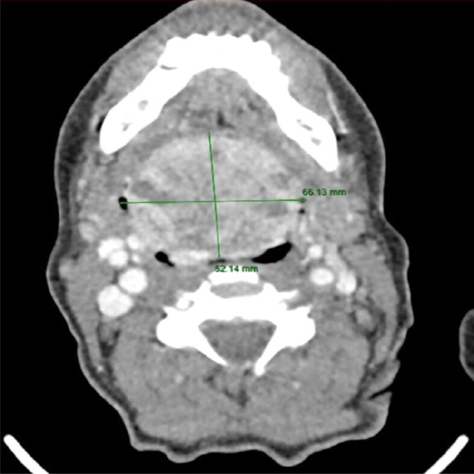
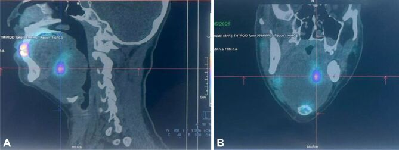
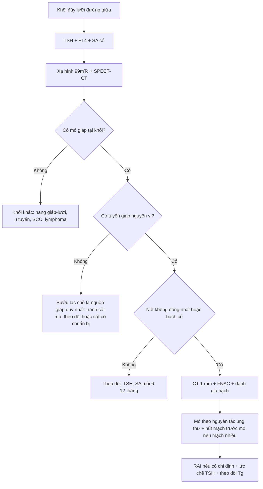
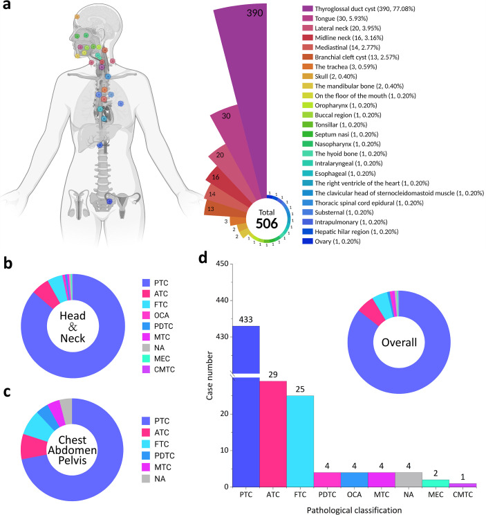

# 1952 — Ung thư tuyến giáp phát sinh trong bướu giáp lạc chỗ (carcinoma arising in ectopic thyroid): khối đáy lưỡi "trắng" trên CT — khi nào chỉ theo dõi, khi nào mổ + iod phóng xạ

**Tags:** `pattern:khoi-day-luoi` `pattern:tang-dam` `pattern:voi-hoa` `pattern:ngam-thuoc-manh` `pattern:hach-co` `vung:loi` `vung:san-mieng` `vung:tuyen-giap` `vung:co` `protocol:SA-co` `protocol:xa-hinh` `protocol:SPECT-CT` `protocol:CT-co-can-quang` `protocol:MRI` `protocol:DSA-nut-mach` `incidentaloma:khoi-day-luoi`

**Mức chắc chắn (certainty):** tổng hợp y văn (literature synthesis) — ghép **tổng quan hệ thống 506 ca ung thư giáp lạc chỗ (ETC) từ 348 bài** (Front Endocrinol 2026, PMC13259913, CC BY 4.0), **ca ung thư NOS trong bướu giáp lạc chỗ dưới lưỡi 66 × 52 mm có nút mạch trước mổ** (Rom J Morphol Embryol 2025, PMC13092302, CC BY-NC-SA 4.0), **ca PTC đáy lưỡi 13 tuổi** (Front Oncol 2022, PMC9716014), **tổng quan SPECT/CT–PET/CT** (Diagnostics 2024, PMC11241737) và **bài nền 1899 về bướu giáp lạc chỗ lành tính**. Không có ca do nhóm tự chụp. Số nào nguồn không nêu ghi "chưa rõ".

> **Bốn câu hỏi của một khối đáy lưỡi đường giữa:**
> (1) **Đây là mô giáp lạc chỗ, nang giáp–lưỡi hay u khác?** (2) **Vì sao nó tăng đậm trên CT không cản quang — iod, máu hay vôi hóa?** (3) **Trong khối lành tính đó đã có ung thư chưa?** (4) **Cắt bao nhiêu, có cần iod phóng xạ, và có phải cắt luôn tuyến giáp nguyên vị?**
> **Câu chốt:** ung thư hóa trong mô giáp lạc chỗ **< 1%** các ca lạc chỗ, nhưng khi đã có thì **85,6% là ung thư nhú (PTC)** và **22,1% đã có hạch/di căn lúc chẩn đoán** (PMC13259913). Vì vậy **khối lạc chỗ "lành tính" không được cắt mù, cũng không được theo dõi mù**: phải chứng minh bằng **xạ hình + SA + CT** và **đánh giá hạch cổ** trước khi quyết định.

## 1. Tổng quan bệnh học – cơ chế hình ảnh: vì sao khối này "trắng" và vì sao nó có thể là ung thư

### 1.1 Phôi thai và dịch tễ: từ nụ giáp ở sàn hầu đến ung thư

- Tuyến giáp phôi thai đi từ **lỗ tịt (foramen caecum) ở đáy lưỡi** xuống trước khí quản. Dừng dọc đường = **mô giáp lạc chỗ**; dừng tại đáy lưỡi = **bướu giáp lạc chỗ (lingual thyroid)**, chiếm **~90%** các ca lạc chỗ, sau đó là dưới lưỡi, xương móng, cổ bên (PMC13092302).
- **Dịch tễ:** mô giáp lạc chỗ gặp **0,3–1/100.000** người (PMC11241737); **47%** không triệu chứng; **suy giáp lâm sàng > 70%** (PMC13092302). Bệnh thường lộ ra ở **thập kỷ 2–4** khi nhu cầu TSH tăng (dậy thì, thai kỳ, thiếu iod).
- **Ung thư trong mô lạc chỗ: < 1%** các ca lạc chỗ (PMC13092302); tính theo ung thư giáp thì ETC chiếm **0,3–0,5%**, và trong **110 năm** y văn chỉ có **~132 ca** được báo cáo (PMC9716014) — nay gom được **506 ca** (PMC13259913).

### 1.2 Bộ số của 506 ca ETC — dùng để hiệu chỉnh trực giác

| Biến số | Số liệu (PMC13259913) |
|---|---|
| Số ca / số bài | **506 ca** từ **348 bài** |
| Tuổi trung bình | **41,6 ± 17,5** (khoảng **8–97**); **72,8% ≤ 50 tuổi** |
| Giới | nữ **62,4%**, nam **37,6%** — tỉ lệ nữ:nam **1,7:1** |
| Vị trí | **ống giáp–lưỡi 390 (77,08%)**, **lưỡi 30 (5,93%)**, cổ bên **20 (3,95%)**, đường giữa **16 (3,16%)**, trung thất **14 (2,77%)** |
| Mô bệnh | **PTC 433 (85,6%)**, **ATC 29 (5,7%)**, **FTC 25 (4,9%)**, PDTC 4, OCA 4, MTC 4 |
| Giai đoạn lúc chẩn đoán | khu trú **394 (77,9%)**; **hạch hoặc di căn xa 112 (22,1%)** |
| Tuyến giáp nguyên vị | **có 447 (88,3%)**, **không có 30 (5,9%)**; trong nhóm có mô bệnh: **lành 209 (46,8%)**, **ác 102 (22,8%)** |
| Điều trị | **mổ 98,8%**, **iod phóng xạ (RAI) 40,6%** |
| Tiên lượng xấu | **tuổi > 50: HR 3,75** (95% CI 1,92–7,32); **vị trí ngoài đầu cổ (ngực/bụng/chậu): HR 7,23** (95% CI 2,61–20,04) |
| Tái phát đầu cổ | **9,7%** (31/321) sau điều trị |
| Cắt tuyến nguyên vị có lợi? | sau ghép điểm xu hướng: tái phát **6,0% (3/50) vs 4,0% (2/50)**, McNemar **P = 1,000** → **không chứng minh lợi ích** |

- **Đọc bảng này đúng cách:** con số **88,3% có tuyến giáp nguyên vị** là điểm khác biệt lớn so với bài 1899 (nơi > 70% **không** có mô giáp ở cổ). Nghĩa là **không được mặc định "khối này là tuyến giáp duy nhất"** — nhưng cũng **không được bỏ qua** nhóm 5,9% không có tuyến nguyên vị, vì cắt khối đó = **suy giáp vĩnh viễn**.

### 1.3 TẠI SAO khối tăng đậm trên CT không cản quang (vật lý, không phải "dấu hiệu ác")

- Mô giáp **tập trung và dự trữ iod** trong thyroglobulin. Iod có **Z = 53**; ở mức năng lượng tia X chẩn đoán (**80–120 kVp**), hiệu ứng **quang điện (photoelectric)** tỉ lệ với **Z³** nên mô giáp hấp thụ tia mạnh hơn cơ xung quanh → **60–100 HU** (cơ lưỡi **~40–50 HU**). Một khối đáy lưỡi **tăng đậm đồng nhất, không vôi hóa, không ngấm thuốc** là hình ảnh **kỳ vọng** của mô giáp, không phải "khối đặc nghi ngờ".
- **Vôi hóa:** gặp trong mô giáp lạc chỗ lành (thoái hóa, nang keo) — ca PMC13092302 **không** có vôi hóa; ca PMC8556010 (dẫn qua bài 1899) có **vôi hóa viền** trên khối **26 × 24 × 19 mm**. Vì vậy **vôi hóa KHÔNG đồng nghĩa ung thư**; điều đáng ngờ là **vôi hóa viền mất đều + nốt đặc không đồng nhất trong khối**.
- **Ngấm thuốc:** tuyến giáp có mạng mao mạch dày → **ngấm mạnh, đồng nhất, giữ thuốc thì muộn**. Trong ca PMC13092302, khối được mô tả là **"highly vascularized"** đến mức phải **nút mạch chọn lọc trước mổ**; đây là lý do **không chọc bừa** vào khối đáy lưỡi.
- **MRI:** thyroglobulin/colloid làm **T1 hơi tăng so với cơ**, **T2 tăng**; mô giáp **không hạn chế khuếch tán mạnh**. Ung thư trong khối thường chỉ lộ ra qua **bờ không đều, xâm lấn cơ lưỡi, hạch hoại tử** — không có một "tín hiệu ung thư" riêng.
- **TẠI SAO khối lớn gây khó thở:** khối phát triển trong **khoang kín của sàn miệng**, đẩy lưỡi ra trước và xuống, làm **hẹp hầu miệng–hầu họng**. Ca PMC13092302: khối **52 × 60 × 66 mm** xâm lấn **hầu miệng và hầu họng**, gây **hẹp lòng rõ rệt**, phải **mở khí quản** trước khi cắt.

### 1.4 Vì sao "ung thư trong bướu lạc chỗ" khó chẩn đoán hơn ung thư giáp thường

- **Không có vỏ giáp bao quanh**, mô lạc chỗ nằm lẫn trong **cơ lưỡi** → xâm lấn vi thể vào cơ không phân biệt được với **mô lạc chỗ bình thường** (mô giáp vốn nằm rải trong cơ).
- **FNAC khó và nguy hiểm**: khối sâu, nhiều mạch, chảy máu; ca PMC13092302 là một khối **tăng sinh mạch mạnh**, phải nút mạch trước mổ.
- **Phải loại trừ di căn từ một ung thư giáp nguyên vị ẩn**: tiêu chuẩn mô bệnh là thấy **nang giáp bình thường + không có mô lympho/nang hạch** trong tổn thương (PMC13259913); nếu chỉ thấy mô giáp trong một "hạch" thì phải nghĩ **di căn**, không phải lạc chỗ.

## 2. Mẫu hình + chẩn đoán phân biệt theo vị trí (gamut)

- **Đường giữa, đáy lưỡi (ngang lỗ tịt):** bướu giáp lạc chỗ lành → **ung thư trong bướu lạc chỗ** → nang giáp–lưỡi (thường **dưới xương móng**, không phải đáy lưỡi) → u tuyến nước bọt nhỏ → **ung thư biểu mô vảy (SCC)** → lymphoma → u mạch máu/dị dạng mạch → schwannoma.
- **Đường giữa dưới móng:** **nang giáp–lưỡi (TGDC)** và **ung thư trong TGDC** (chủ yếu PTC, chiếm phần lớn nhóm 390 ca TGDC ở bảng trên).
- **Cổ bên:** mô giáp lạc chỗ cổ bên (hiếm) vs **hạch di căn của ung thư giáp nguyên vị** — đây là phân biệt **quan trọng nhất**; cách chốt là tìm **tuyến giáp nguyên vị + mô bệnh** (bài 230).
- **Trung thất:** bướu giáp lạc chỗ trung thất (14 ca, 2,77%) vs u tuyến ức, lymphoma, u quái.
- **Buồng trứng:** **struma ovarii** (mô giáp trong u quái) — cùng bản chất "mô giáp ngoài cổ", khác đường phôi thai.
- **Gợi nhớ theo cơ chế:** khối **tăng đậm + có iod** → mô giáp; khối **dịch + vỏ mỏng** → nang; khối **hoại tử + hạch** → ung thư/di căn; khối **canxi hóa thô + mỡ** → u quái.

## 3. Bảng so sánh phân biệt (ma trận đối chiếu)

| Thực thể (entity) | Hình ảnh điển hình | Chốt vào (rule-in) | Chốt loại (rule-out) | Gợi ý xác nhận |
|---|---|---|---|---|
| Bướu giáp lạc chỗ lành | Khối **đường giữa đáy lưỡi**, tăng đậm **đồng nhất** trên CT không cản quang, ngấm thuốc đều, bờ nhẵn, không hạch | **Tăng đậm kiểu mô giáp + xạ hình tập trung tại khối + tuyến giáp nguyên vị vắng mặt hoặc bình thường** | **Nốt đặc không đồng nhất, bờ xâm lấn, hạch cổ, lớn nhanh** → nghi ung thư | TSH/FT4, xạ hình 99mTc, SA |
| Ung thư trong bướu lạc chỗ | Nốt **không đồng nhất** trong khối, **bờ không đều**, xâm lấn cơ lưỡi, **hạch cổ**; có thể **vôi hóa viền mất đều** | **Hạch cổ + nốt đặc trong khối + xạ hình có ổ tập trung không đều** | Khối đồng nhất, không hạch, không đổi sau nhiều năm → nhiều khả năng lành | FNAC dưới SA, CT ≤ 1 mm, mô bệnh sau mổ |
| Hạch di căn ung thư giáp (nguyên vị ẩn) | Khối **cổ bên**, mất rốn hạch, có **vôi hóa/nang**, có thể tăng đậm do iod | **Mô giáp trong hạch + tìm thấy ung thư giáp nguyên vị** | Có **nang giáp bình thường trong tổn thương** → lạc chỗ, không phải hạch | SA hạch, FNAC + Tg trong dịch hút |
| Ung thư trong nang giáp–lưỡi | Nang **dưới xương móng**, vỏ dày, **nốt đặc trong nang**, vôi hóa | **Nốt đặc thành phần trong nang + PTC trên mô bệnh** | Nang dịch trong, không nốt đặc, không vôi hóa → nang đơn thuần | SA + FNAC thành nang, CT |
| SCC đáy lưỡi | Loét, bờ cứng, **hạch hoại tử**, xâm lấn lưỡi; thường **không tăng đậm trên CT không cản quang** | **Loét + hạch hoại tử + tiền sử rượu/thuốc lá** | Tăng đậm đồng nhất kiểu mô giáp → không phải SCC | Nội soi + sinh thiết |
| Lymphoma | Khối lớn, đồng nhất, **ngấm thuốc nhẹ**, hạch hai bên | **Hạch nhiều tầng + khối đáy lưỡi cùng lúc** | Tăng đậm mạnh kiểu mô giáp | Sinh thiết mô lớn, PET/CT |

*Ca nam 54 tuổi: khối đáy lưỡi **66,13 × 52,14 mm** trên CT dọc, dùng để đo và lập kế hoạch mổ. Nguồn: Rom J Morphol Embryol 2025 (PMC13092302), CC BY-NC-SA 4.0 — hiển thị nguyên bản, không crop.*

*SPECT–CT (99mTc-pertechnetate) cùng ca: (A) mặt cắt dọc, (B) mặt cắt ngang — **ổ tập trung phóng xạ khu trú trong khối**, gợi ý một phần mô đang hoạt động mạnh/tân sinh trong bướu lạc chỗ. Nguồn: Rom J Morphol Embryol 2025 (PMC13092302), CC BY-NC-SA 4.0.*

> **Vì sao bài này không có ảnh ghép (composite):** ba ảnh lâm sàng của ca PMC13092302 là **CC BY-NC-SA 4.0** (yêu cầu chia sẻ tương tự) và ảnh còn lại là đồ thị phân bố **CC BY 4.0**; ghép chúng lại sẽ tạo tác phẩm phái sinh hỗn hợp giấy phép. Nhóm chọn **hiển thị nguyên bản từng ảnh** thay vì ghép.

## 4. Protocol chụp + hệ phân độ, điểm chuẩn hóa

### 4.1 Trình tự bắt buộc (làm sai thứ tự = mất tuyến giáp của bệnh nhân)

1. **Xét nghiệm trước hình ảnh:** **TSH, FT4, anti-Tg, thyroglobulin (Tg)**. Suy giáp gặp **> 70%**; TSH rất cao (ca PMC13092302: **> 48 µIU/mL**) giải thích khối phì đại và là chỉ định **levothyroxine** trước mổ.
2. **Siêu âm cổ (tuyến giáp nguyên vị + đáy lưỡi + hạch):** xác nhận **có/không tuyến giáp ở vị trí bình thường** — bước này quyết định "khối có phải nguồn giáp duy nhất". Trong ca PMC13092302: **không có mô giáp ở giường giáp**, khối dưới lưỡi **43 × 20 mm**, không đồng nhất, giảm âm.
3. **Xạ hình tuyến giáp (99mTc-pertechnetate hoặc I-123) + SPECT/CT:** chứng minh mô giáp và **phân bố tập trung**. Ổ tập trung **không đều, khu trú** trong khối = nghi ung thư (ca PMC13092302). Đây là bước **phải làm trước sinh thiết/cắt**.
4. **CT cổ–ngực có cản quang, lát ≤ 1 mm:** đo 3 chiều, đánh giá **xâm lấn cơ lưỡi/hầu**, **hẹp đường thở**, hạch **level I–III, VI**, và tìm **mô giáp lạc chỗ thứ hai ở trung thất**. MRI khi cần mô mềm/đường thở hoặc khi có iod cản quang không thuận lợi.
5. **FNAC dưới siêu âm** chỉ khi kết quả **thay đổi xử trí** (khối có nốt đặc, hạch nghi); **không chọc mù** khối mạch máu lớn ở đáy lưỡi.
6. **Chuẩn bị mổ:** nội soi mềm đánh giá đường thở (khối dễ chảy máu khi chạm), **mở khí quản** khi khối lớn; **nút mạch chọn lọc (DSA)** trước mổ nếu khối tăng sinh mạch — ca PMC13092302 vẫn mất **500 mL** máu và phải truyền máu dù đã nút mạch.
7. **Sau mổ:** **RAI** khi có chỉ định (40,6% trong 506 ca), **levothyroxine ức chế TSH**, theo dõi **Tg + anti-Tg** và **SA cổ**.

### 4.2 Khi nào KHÔNG cắt tuyến giáp nguyên vị

- Trong 506 ca, **cắt tuyến nguyên vị không làm giảm tái phát** sau ghép điểm xu hướng (**6,0% vs 4,0%**, P = 1,000) → **cá thể hóa**, không cắt thường quy (PMC13259913). Tuy vậy **22,8%** tuyến nguyên vị có mô bệnh **ác tính** → **vẫn phải SA + FNAC tuyến nguyên vị** trước khi quyết định để lại.

### 4.3 Phân tầng theo vị trí và tuổi (dùng cho theo dõi)

- **Ngưỡng hạch đáng ngờ trên SA:** trục ngắn **> 8–10 mm**, **mất rốn hạch**, **vôi hóa**, **nang hóa**, **tăng sinh mạch** — với ung thư giáp, hạch **level VI** và **II–III** là nơi hay gặp nhất.

## 5. Biến thể bình thường và cạm bẫy

- **"Tuyến giáp rỗng" không phải quy luật:** 88,3% ca ETC **có** tuyến nguyên vị; 5,9% **không có**. Siêu âm phải nói rõ **có/không**, không suy đoán.
- **Vôi hóa ≠ ác tính:** mô giáp lạc chỗ lành có thể vôi hóa viền/thô. Chỉ **vôi hóa viền mất đều + nốt đặc** mới đáng ngờ.
- **Tăng đậm trên CT không cản quang ≠ máu tụ:** máu cấp **50–90 HU** nhưng **không ngấm thuốc**, **không có iod**, và **không tập trung trên xạ hình**; mô giáp **60–100 HU** và **có tập trung phóng xạ**.
- **Cạm bẫy "satisfaction of search":** thấy khối đáy lưỡi rồi dừng, bỏ sót **hạch level VI** hoặc **mô giáp lạc chỗ trung thất** (14 ca, 2,77%).
- **Cạm bẫy nang giáp–lưỡi:** phần lớn là nang lành; **chỉ nốt đặc/thành dày/vôi hóa** mới cần FNAC. Sinh thiết mọi nang giáp–lưỡi là overcall.
- **Cạm bẫy tư thế:** khối lớn ở đáy lưỡi **tụt ra sau khi ngửa cổ** → nguy cơ **tắc đường thở khi gây mê**; phải đánh giá bằng nội soi mềm trước.
- **Cạm bẫy sau mổ:** **suy giáp** xuất hiện dù để lại một phần mô → kiểm TSH **6–8 tuần** sau mổ, không chờ triệu chứng.

## 6. Tự lượng giá — Blind Quiz

**Ca 1 — Nam 54 tuổi, khàn tiếng và khó nuốt tăng dần, BMI 19, mạch 125 lần/phút; TSH > 48 µIU/mL. Nhìn hai ảnh dưới, mô tả trước khi mở đáp án.**

- Câu hỏi: (1) Khối nằm ở khoang nào, kích thước bao nhiêu? (2) Ba chẩn đoán phân biệt? (3) Bước hình ảnh nào **phải làm trước** khi sinh thiết, và vì sao?

<b>Bấm để hiện đáp án</b>

- **Dấu hiệu:** khối lớn **66,13 × 52,14 mm** ở **đáy lưỡi/sàn miệng**, lan vào hầu miệng – hầu họng, hẹp lòng; trên CT không cản quang khối **tăng đậm** so với cơ lưỡi.
- **Chẩn đoán:** **ung thư (NOS) phát sinh trong bướu giáp lạc chỗ dưới lưỡi** — mô bệnh: tăng sinh xâm lấn, có **xâm lấn mạch–bạch mạch**, PAX8/TTF-1 dương, Tg dương điểm; **không có mô giáp ở cổ**.
- **Vì sao phải xạ hình trước:** xác nhận khối là **mô giáp** và **có/không tuyến giáp nguyên vị** — quyết định việc cắt có làm bệnh nhân **suy giáp vĩnh viễn** hay không.
- **Diễn biến thật:** **nút mạch chọn lọc** trước mổ → **mở khí quản** → cắt qua đường lưỡi; mất **500 mL** máu; sau mổ **levothyroxine** + **RAI**.
- Nguồn: Rom J Morphol Embryol 2025 (PMC13092302), CC BY-NC-SA 4.0.

**Ca 2 — Bản đồ 506 ca: ung thư giáp lạc chỗ xuất hiện ở đâu, và vì sao "lưỡi" chỉ đứng sau ống giáp–lưỡi?**

- Câu hỏi: vị trí nào chiếm đa số? Loại mô bệnh nào trội? Điều này thay đổi cách bạn đọc một "khối cổ bên" như thế nào?

<b>Bấm để hiện đáp án</b>

- **Vị trí:** **ống giáp–lưỡi 390/506 (77,08%)**, **lưỡi 30 (5,93%)**, cổ bên 20 (3,95%), đường giữa 16 (3,16%), trung thất 14 (2,77%) — phân bố **men theo đường phôi thai** của tuyến giáp.
- **Mô bệnh:** **PTC 433 (85,6%)**, ATC 29 (5,7%), FTC 25 (4,9%).
- **Hệ quả thực hành:** một khối **cổ bên** có mô giáp phải được coi là **di căn hạch của ung thư giáp** cho đến khi chứng minh ngược — không phải "lạc chỗ lành".
- Nguồn: Front Endocrinol 2026 (PMC13259913), CC BY 4.0.

## Bài liên quan chéo
- [1899 – Bướu giáp lạc chỗ ở đáy lưỡi](../1899-buou-giap-lac-cho-lingual-thyroid/lesson.md) — bài nền: lành tính, xạ hình trước can thiệp
- [230 – Tuyến giáp ACR TI-RADS & hạch cổ](../230-tuyen-giap-hach-co/lesson.md) — đọc nốt giáp và hạch
- [1622 – Đốt cồn nang giáp lành tính](../1622-dot-con-nang-giap-pei/lesson.md) — xử trí nang giáp, khác hẳn khối đặc
- [093 – Hội chứng tĩnh mạch chủ trên](../093-hoi-chung-tinh-mach-chu-tren/lesson.md) — khối trung thất chèn ép

## Ảnh
- Bốn ảnh tải từ Europe PMC/PMC, giấy phép ghi từng file trong `images/CREDITS.md`.
- Không dùng ảnh paywall/AuntMinnie; không tạo ảnh ghép từ ảnh **CC BY-NC-SA** (xem ghi chú mục 3).

> Không dùng để chẩn đoán độc lập khi chưa có người hướng dẫn.
