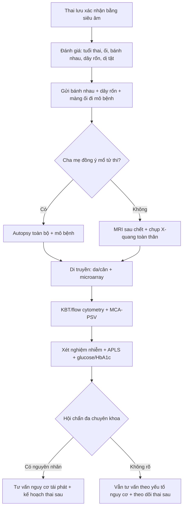
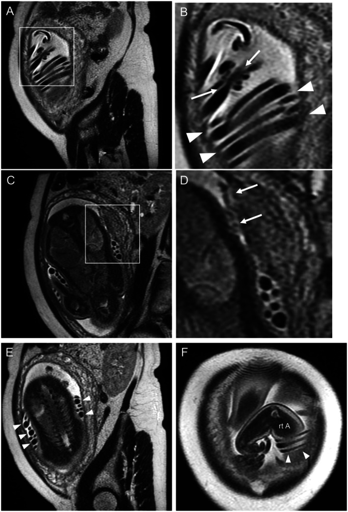
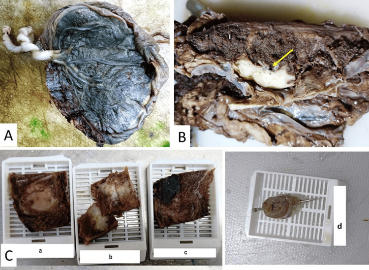
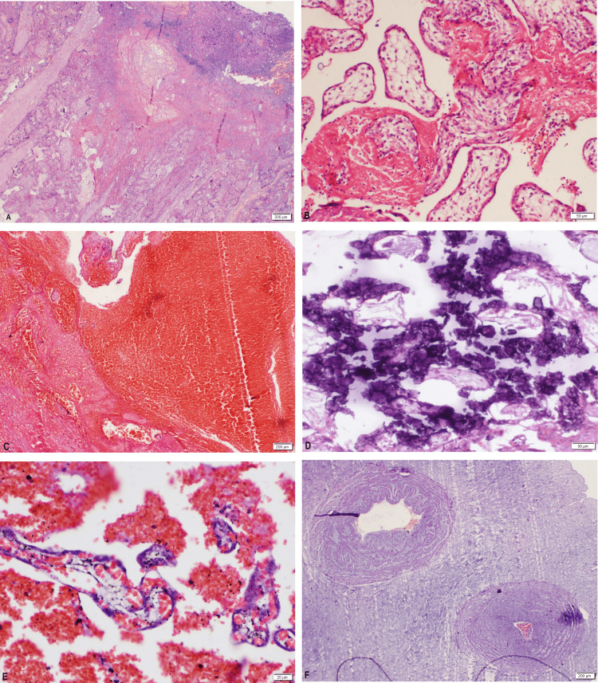

# 1953 — Thai lưu muộn: quy trình tìm nguyên nhân / Late stillbirth: structured etiologic workup

**Tags:** `pattern:thai-luu` `pattern:thai-phu` `pattern:banh-nhau-bat-thuong` `pattern:day-ron-bat-thuong` `vung:thai-nhi` `vung:banh-nhau` `vung:day-ron` `protocol:SA-thai` `protocol:MRI-thai` `protocol:giai-phau-benh`

**Mức chắc chắn (certainty):** tổng hợp y văn (literature synthesis) — số liệu từ **một đoàn hệ 70 thai lưu đủ tháng** (PMC12462411), **một loạt 50 thai lưu có mô bệnh học bánh nhau** (PMC12490432), **một tổng quan về rào cản giải phẫu bệnh/di truyền** (PMC12456481), **một nghiên cứu đa quốc gia CHAMPS với lấy mô tối thiểu** (PMC13712675), và **một ca MRI thai sau chết** (PMC12479237). Các tỷ lệ "giá trị của xét nghiệm" là từ y văn tổng hợp, không phải tỷ lệ dân số.

> **Câu chốt:** Thai lưu **không phải một chẩn đoán mà là một biến cố cần truy nguyên** — mục tiêu là trả lời "**có tái phát ở thai kỳ sau không, và phòng được gì**". Ba con số định hình cách làm: **(1)** nguyên nhân còn **không rõ ở 25–40%** ngay cả sau đánh giá chuẩn (PMC12479237); **(2)** **bánh nhau có ích trong 65%** ca và **giải phẫu bệnh thai 42%**, nhưng **chỉ 21%** thai lưu ở Mỹ được mổ tử thi (PMC12456481); **(3)** trong loạt đủ tháng, **72,9% có bất thường dây rốn** và **28,6% là xoắn quá mức (hypercoiling)** — nhưng **61,4% vẫn "không rõ nguyên nhân" vì chỉ 47,1% ca được làm mô bệnh học bánh nhau** (PMC12462411).

## 1. Tổng quan bệnh học – cơ chế hình ảnh (TẠI SAO)

### 1.1 Định nghĩa và vì sao "muộn" quan trọng

- **Thai lưu (stillbirth):** thai chết **trước khi sinh**; khác **sảy thai** (thường < 20 tuần) và **chết sơ sinh** (sau sinh).
- Ngưỡng tuổi thai **không thống nhất**: **ACOG ≥ 20 tuần**, **RCOG ≥ 24 tuần**, **WHO ≥ 28 tuần** (dùng cho so sánh quốc tế) (PMC12490432). Vì vậy mọi tỷ lệ phải đọc kèm định nghĩa — đây là cạm bẫy dịch tễ học đầu tiên.
- Toàn cầu **~1,9 triệu thai lưu/năm** (PMC13712675), tập trung ở các nước thu nhập thấp–trung bình; **72%** ca trong CHAMPS được đánh giá là **phòng được** (PMC13712675).

### 1.2 TẠI SAO thai chết: ba tầng sinh lý

1. **Thiếu oxy – thiếu máu nuôi (hypoxic–ischemic):** giảm tưới máu bánh nhau (tiền sản giật, thai chậm tăng trưởng, bong nhau) hoặc **dây rốn bị chèn** (nút thật, xoắn quá mức, sa dây rốn) → **giảm trao đổi khí** → toan hô hấp rồi toan chuyển hoá → chết thai.
2. **Nhiễm trùng:** vi khuẩn đi ngược từ âm đạo (GBS, E. coli) hoặc qua máu (giang mai, CMV, parvovirus, Listeria) → **viêm màng ối – bánh nhau** → thai nhiễm trùng huyết hoặc suy tuần hoàn.
3. **Bất thường di truyền – phát triển:** bất thường nhiễm sắc thể, dị tật tim, bất thường bánh nhau/dây rốn → thai không duy trì được.

- Trong CHAMPS, **thiếu oxy trong tử cung chiếm 75%** (49% do bệnh mẹ, 33% do bánh nhau), **nhiễm trùng bẩm sinh 9%**, **dị tật bẩm sinh 9%** (PMC13712675). Con số này cao hơn các loạt bệnh viện vì CHAMPS dùng **lấy mô tối thiểu (MITS)** và hội đồng chuyên gia — cho thấy **"không rõ nguyên nhân" thường là do thiếu xét nghiệm, không phải do không có nguyên nhân**.

### 1.3 TẠI SAO hình ảnh học lại là mắt xích đầu tiên

- **Xác nhận chết thai:** tiêu chuẩn là **không có hoạt động tim thai** trên siêu âm (quét tim thai, M-mode); **không dựa vào "thai không cử động"** vì thai ngủ có thể im lặng 20–40 phút.
- **Dấu hiệu muộn trên siêu âm** (chỉ xuất hiện **sau vài ngày**, không giúp chẩn đoán sớm): **phù da đầu (scalp edema)**, **mất tương phản não–sọ**, **chồng khớp sọ (Spalding sign)**, **bóng khí trong tim/mạch** (hiếm), **thay đổi tín hiệu do hoại tử**.
- **MRI sau chết (postmortem MRI)** trả lời câu hỏi mà siêu âm và khám lâm sàng bỏ sót: **bất thường dây rốn và bánh nhau trong tử cung, trước khi tháo thai**. Ca minh hoạ: MRI phát hiện **nút thật (true knot), dây rốn xoắn quá ít (hypocoiled) và quấn quanh thân thai**; khi sinh, dây rốn **đã tự tháo** — nghĩa là **khám sau sinh sẽ không còn thấy nút** (PMC12479237).
- **TẠI SAO tín hiệu thay đổi sau chết:** hồng cầu ly giải và mô hoại tử làm **T2 giảm tín hiệu** ở mô đặc (gan, cơ), **dịch tự do T2 sáng**; không có dòng chảy nên **mất tín hiệu mạch (flow void) là bình thường sau chết**, không được đọc là "huyết khối". Đây là lý do phải đọc MRI sau chết bằng **chuỗi xung T2 nhanh (SSFSE/HASTE)** và **đối chiếu lâm sàng**, không áp tiêu chuẩn của MRI thai sống.

### 1.4 Giá trị của từng xét nghiệm (con số để tư vấn)

| Xét nghiệm | Giá trị tìm nguyên nhân | Ghi chú |
|---|---|---|
| **Mô bệnh học bánh nhau** | **65%** ca có ích (PMC12456481) | Rẻ nhất, ít xâm lấn nhất — **luôn làm nếu có thể** |
| **Giải phẫu bệnh thai (autopsy)** | **42%** ca có ích (PMC12456481) | Chỉ **21%** ca ở Mỹ được làm; rào cản chi phí, chuyên gia, tâm lý |
| **MRI sau chết** | Thay thế một phần khi cha mẹ từ chối mổ | Phát hiện dây rốn/bánh nhau, dị tật lớn; **không thay thế mô học** |
| **Di truyền (karyotype/microarray/exome)** | Bất thường nhiễm sắc thể là nhóm nguyên nhân quan trọng; **exome** thêm chẩn đoán ở ca microarray âm (PMC13464710) | Lấy **da/cân**, không lấy máu (dung giải sau chết) |
| **KBT/flow cytometry (FMH)** | Phát hiện xuất huyết thai–mẹ | MCA-PSV **> 1,5 MoM** hỗ trợ thiếu máu thai (bài 1747) |
| **Nhiễm trùng** | **9%** ca trong CHAMPS (PMC13712675) | Cấy bánh nhau, máu thai, huyết thanh mẹ, nước tiểu |

## 2. Mẫu hình + chẩn đoán phân biệt theo vị trí (gamut)

- **Gamut theo cơ quan tổn thương (đọc bánh nhau – dây rốn – thai theo thứ tự):**
  1. **Bánh nhau – mạch máu mẹ (maternal vascular malperfusion):** nhồi máu, huyết khối khoảng gian nhung mao, bánh nhau nhỏ, bong nhau, nhau tiền đạo, **vasa previa**.
  2. **Bánh nhau – mạch máu thai (fetal vascular malperfusion):** huyết khối mạch thai, **nhung mao mất mạch**, viêm mạch huyết khối, **dây rốn quấn chặt**.
  3. **Dây rốn:** **nút thật**, **xoắn quá mức (hypercoiling)**, xoắn quá ít (hypocoiling), **bám màng (velamentous)**, dây rốn ngắn, sa dây rốn, quấn cổ/thân.
  4. **Nhiễm trùng:** viêm màng ối – bánh nhau (GBS, E. coli), giang mai, CMV, parvovirus B19, Listeria, Zika.
  5. **Thai – di truyền/dị tật:** bất thường nhiễm sắc thể, dị tật tim, thoát vị rốn, **phù thai**.
  6. **Mẹ:** tiền sản giật/THA, đái tháo đường, **hội chứng kháng phospholipid (APLS)**, bệnh tuyến giáp, chấn thương, nhiễm trùng huyết.
  7. **Xuất huyết thai–mẹ (FMH)** và **bất thường đa thai** (TTTS, TRAP, monoamniotic).
- **Phân loại theo hình thái thai:** **tươi (fresh)** gợi ý biến cố cấp (sa dây rốn, bong nhau, nhiễm trùng cấp); **macerated** gợi ý chết ≥ 48 giờ trước sinh, nguyên nhân mạn (thiểu năng bánh nhau, nhiễm trùng kéo dài). **Mức maceration không cho biết nguyên nhân**, chỉ cho biết thời điểm.

## 3. Bảng so sánh phân biệt (ma trận đối chiếu)

| Thực thể (entity) | Hình ảnh / mô bệnh điển hình | Chốt vào (rule-in) | Chốt loại (rule-out) | Gợi ý xác nhận |
|---|---|---|---|---|
| **Thiểu năng bánh nhau (MVM)** | Bánh nhau **nhỏ, dày không đều**, nhồi máu hình nêm, **huyết khối gian nhung mao**, thai **chậm tăng trưởng**, ối ít | **Nhồi máu + bánh nhau nhỏ + thai FGR/ối ít** | Bánh nhau kích thước bình thường, không nhồi máu → tìm nguyên nhân khác | Mô bệnh học Amsterdam; Doppler ĐM rốn |
| **Nút thật / xoắn quá mức dây rốn** | **Nút thật** trên MRI/SA; **> 0,3 vòng/cm** (hypercoiling); dây rốn phù, huyết khối trong tĩnh mạch rốn | **Thấy nút thật + mạch rốn xẹp/huyết khối** | Dây rốn thẳng, mạch rốn thông, không nút | MRI sau chết trước sinh; khám dây rốn tươi |
| **Nhiễm trùng đi ngược** | **Viêm màng ối – bánh nhau** (bạch cầu trung tính), thai **tươi**, mẹ **sốt/vỡ ối sớm** | **Mô bệnh viêm màng ối độ 2–3 + cấy bánh nhau dương** | Mô bệnh không viêm + cấy âm → ít nghĩ nhiễm | Cấy bánh nhau, máu thai, huyết thanh mẹ |
| **Bất thường nhiễm sắc thể** | Dị tật đa cơ quan, **nang ối/giãn não thất**, bánh nhau **hạt nho (molar)** | **Microarray phát hiện bất thường bệnh lý** | Microarray bình thường **không loại trừ** đột biến đơn gen | Microarray + exome; lấy da/cân |
| **Xuất huyết thai–mẹ (FMH)** | Thai **thiếu máu**, **phù**, suy tim; **MCA-PSV > 1,5 MoM**; KBT mẹ dương | **KBT/flow cytometry dương + MCA-PSV tăng** | KBT âm + MCA-PSV bình thường → ít nghĩ FMH | KBT sớm sau sinh; siêu âm Doppler MCA |

## 4. Protocol chụp + hệ phân độ/điểm chuẩn hóa

### 4.1 Xác nhận chết thai và đánh giá ban đầu (siêu âm)

- **Quét tim thai 2 chiều + M-mode**, ghi hình ảnh/video; nếu nghi ngờ, **hai người đọc độc lập**. Không dùng Doppler màu để "tìm dòng" khi tim đã ngừng.
- Đánh giá **sinh trắc thai** (ước tuổi, cân nặng), **lượng ối**, **vị trí bánh nhau**, **độ dày/echo bánh nhau**, **dây rốn** (số mạch, bám, có nút), **dị tật lớn**.
- **Tìm dấu hiệu nguyên nhân:** bánh nhau dày/nhồi máu, ối ít, thai FGR, phù thai, bất thường dây rốn.

### 4.2 Bộ xét nghiệm "truy nguyên" (làm càng đủ càng ít "không rõ")

1. **Bánh nhau → giải phẫu bệnh:** gửi **tươi** (hoặc ngâm nước muối lạnh), **không cố định cả bánh nhau trong formol**; gửi kèm **dây rốn và màng ối**. Lấy mẫu theo **Amsterdam**: ≥ 2 mảnh bánh nhau bình thường + 1 mảnh tổn thương + **cuộn màng ối** + **2 đoạn dây rốn** (PMC12490432).
2. **Giải phẫu bệnh thai (autopsy) hoặc MRI sau chết:** quyết định **trong 24–48 giờ** để tránh dung giải; tư vấn cha mẹ về **giá trị 42%** và **rào cản tâm lý/chi phí** (PMC12456481).
3. **Di truyền:** **karyotype + microarray** trên **da/cân** (nguyên bào sợi) — máu sau chết thường **không nuôi được**; **exome** nếu microarray âm mà thai có dị tật (PMC13464710).
4. **FMH:** **KBT/flow cytometry** mẹ + **MCA-PSV** (ngưỡng **> 1,5 MoM**) — nối bài 1747.
5. **Nhiễm trùng:** cấy **bánh nhau/màng ối**, máu thai, **huyết thanh mẹ** (giang mai, CMV, parvovirus, toxoplasma theo dịch tễ), cấy nước tiểu.
6. **Mẹ:** **glucose/HbA1c**, **APLS** (lupus anticoagulant, anticardiolipin, anti-β2GPI — làm lại sau 12 tuần), TSH, tầm soát chất gây nghiện khi có chỉ định.

### 4.3 Protocol MRI sau chết (khi được chọn)

- **1,5T hoặc 3T**, cuộn thân, **toàn thân thai + bánh nhau**; chuỗi **T2 SSFSE/HASTE** (nhanh, ít nhiễu), **T1**, **DWI**; **không cần cản từ**.
- Thời gian quét **20–40 phút**; đọc cùng **bác sĩ chẩn đoán hình ảnh + nhà giải phẫu bệnh**; ghi rõ **giới hạn**: không có mô học, bỏ sót tổn thương **< 2–3 mm**, thay đổi do dung giải.
- **Giá trị thực hành:** xác định **nút thật, hướng xoắn, bám màng, dị tật lớn** — những thứ **khám sau sinh có thể đã mất** (PMC12479237).

### 4.4 Lưu đồ quyết định

- **Tư vấn nguy cơ tái phát:** phụ thuộc nguyên nhân — **APLS** (kháng đông + aspirin), **đái tháo đường** (kiểm soát đường huyết), **bất thường NST** (tư vấn di truyền/chẩn đoán tiền sản), **thiểu năng bánh nhau** (aspirin, theo dõi Doppler). **Không có nguyên nhân** vẫn cần **theo dõi thai chặt hơn** ở thai kỳ sau.

## 5. Biến thể bình thường và cạm bẫy

- **"Không rõ nguyên nhân" khi chưa làm mô bệnh bánh nhau:** loạt đủ tháng có **61,4% "không rõ"** nhưng chỉ **47,1%** ca được làm mô bệnh bánh nhau (PMC12462411). **Trước khi nói "vô căn", hãy kiểm tra bánh nhau đã được lấy chưa.**
- **Nút thật có thể tự tháo khi sinh:** MRI **trước sinh** là bằng chứng; khám dây rốn sau sinh bình thường **không loại trừ** nút thật (PMC12479237).
- **Maceration ≠ phù thai:** cả hai đều có phù da; **phù thai thật** có **tràn dịch màng phổi/màng tim, bánh nhau dày > 6 cm, ối nhiều**; maceration có **da nhăn, bong thượng bì**, không tràn dịch.
- **Lấy máu thai để karyotype sau chết:** tế bào **không phân chia** → thất bại; dùng **da/cân** hoặc **microarray** (không cần nuôi cấy).
- **Chỉ lấy mảnh nhồi máu:** bỏ sót **bệnh mạch máu thai** và **viêm màng ối** ở vùng bánh nhau "bình thường" — phải lấy **cả mô lành** theo Amsterdam.
- **Bánh nhau "trông bình thường" không loại trừ bệnh lý:** nhồi máu nhỏ, huyết khối gian nhung mao chỉ thấy trên **kính hiển vi**.
- **Đa thai monoamniotic:** dây rốn quấn nhau gần như luôn có; **không phải mọi ca quấn dây đều do dây rốn** — cần loại trừ TTTS/TRAP và bất thường NST.
- **FMH bị bỏ sót:** thai chết **cấp, không rõ nguyên nhân**, mẹ **thiếu máu** → luôn làm **KBT** và **MCA-PSV** trước khi kết luận.

## 6. Tự lượng giá — Blind Quiz

**Ca 1 — Thai 33 tuần, không còn cử động 2 ngày, siêu âm xác nhận không có tim thai. MRI sau chết được chụp trước khi khởi phát chuyển dạ.**

- Hỏi: Mô tả bất thường dây rốn (A–D). Vì sao khám dây rốn sau sinh có thể bình thường? Điều này thay đổi tư vấn thế nào?

<b>Bấm để hiện đáp án</b>

- **Dấu hiệu:** (A, B) **nút thật** (mũi tên) và **dây rốn xoắn quá ít, thẳng** (arrowheads); (C, D) **mạch rốn xẹp** phía thai của nút; (E) **ba vòng dây rốn** quấn quanh thân thai; (F) mặt cắt ngang xác nhận nút.
- **Chẩn đoán:** thai lưu do **bất thường dây rốn (nút thật + hypocoiling + quấn thân thai)** — nguyên nhân **không thấy trên khám thường quy**.
- **Vì sao sau sinh có thể bình thường:** dây rốn **tự tháo** khi sinh; MRI trước sinh mới giữ được bằng chứng (PMC12479237).
- Nguồn ảnh: Sone K et al., J Obstet Gynaecol Res 2025 (PMC12479237), Fig. 1 — **CC BY-NC 4.0**.

**Ca 2 — Thai 36 tuần chết lưu, bánh nhau gửi tươi. Ảnh đại thể và cách lấy mẫu:**

- Hỏi: (A) màng ối có gì bất thường? (B) tổn thương hình nêm nhạt màu là gì? (C) vì sao phải lấy cả mảnh "bình thường" và mảnh tổn thương?

<b>Bấm để hiện đáp án</b>

- (A) **Màng ối nhiễm phân su (meconium-stained)** — gợi ý thai đã có biến cố cấp trước chết, không phải nguyên nhân.
- (B) **Nhồi máu bánh nhau (placental infarction)** — vùng nhạt, hình nêm, đáy ở bản mẹ; tương ứng **thiểu năng tưới máu mẹ**.
- (C) Mẫu (C) gồm **a/b: vùng nhồi máu**, **c: mảnh ngẫu nhiên**, **d: cuộn màng ối (Swiss roll)** — lấy **cả mô lành** để không bỏ sót **bệnh mạch máu thai/viêm màng ối** ở vùng trông bình thường.
- Nguồn ảnh: SR A et al., Cureus 2025 (PMC12490432), Fig. 1 — **CC BY 4.0**.

**Ca 3 — Cùng bánh nhau, tiêu bản vi thể:**

<b>Bấm để hiện đáp án</b>

- **A:** nhồi máu bánh nhau; **B:** **fibrin gian nhung mao**; **C:** **xuất huyết sau bánh nhau (retroplacental hemorrhage)** — tương ứng bong nhau; **D:** **vôi hóa**; **E:** xuất huyết gian nhung mao; **F:** **một động mạch rốn duy nhất (single umbilical artery)**.
- **Ý nghĩa:** nhiều tổn thương **cùng tồn tại**; "một tổn thương" không đủ giải thích — phải mô tả **nhiều lĩnh vực** (mạch máu mẹ, mạch máu thai, viêm, phát triển nhung mao) như tổng quan hệ thống khuyến nghị (PMC13158631).
- Nguồn ảnh: SR A et al., Cureus 2025 (PMC12490432), Fig. 2 — **CC BY 4.0**.

## Bài liên quan chéo
- [1747 – Xuất huyết thai–mẹ (FMH)](../1747-xuat-huyet-thai-me/lesson.md) (KBT, MCA-PSV, anti-D)
- [1673 – Truyền máu trong tử cung](../1673-truyen-mau-trong-tu-cung/lesson.md) (thiếu máu thai, MCA-PSV)
- [1746 – Hội chứng gương do phù thai](../1746-hoi-chung-guong/lesson.md) (phù thai, bánh nhau dày)
- [1671 – Ứ máu âm đạo – tử cung ở trẻ vị thành niên](../1671-u-mau-am-dao-tu-cung-tre-vi-thanh-nien/lesson.md)
- [1725 – Vỡ ối non tháng trước 24 tuần trên sẹo mổ lấy thai](../1725-vo-oi-non-thang-truoc-24-tuan-tren-seo-mo-lay-thai/lesson.md)

## Ảnh
- 3 ảnh: 2 **CC BY 4.0** + 1 **CC BY-NC 4.0**, nguyên bản, không crop/ghép; nguồn + giấy phép từng ảnh trong `images/CREDITS.md`.

> Không dùng để chẩn đoán độc lập khi chưa có người hướng dẫn.
