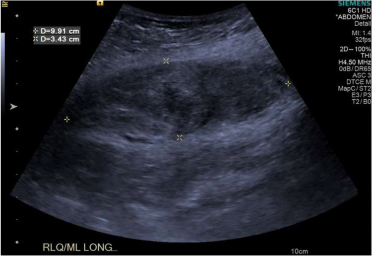
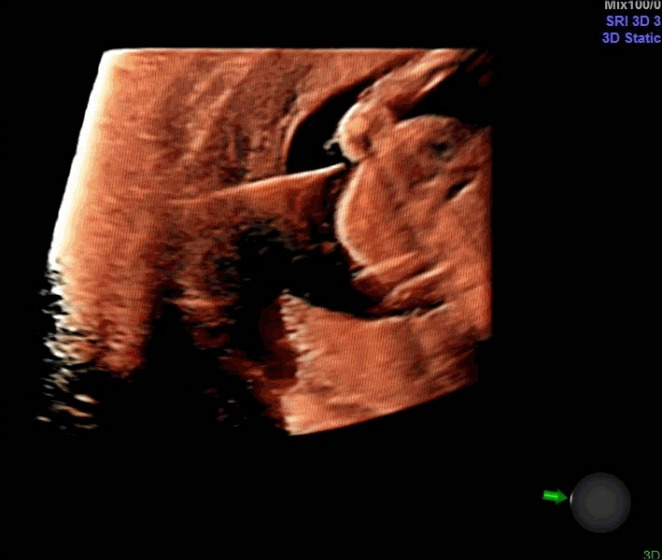
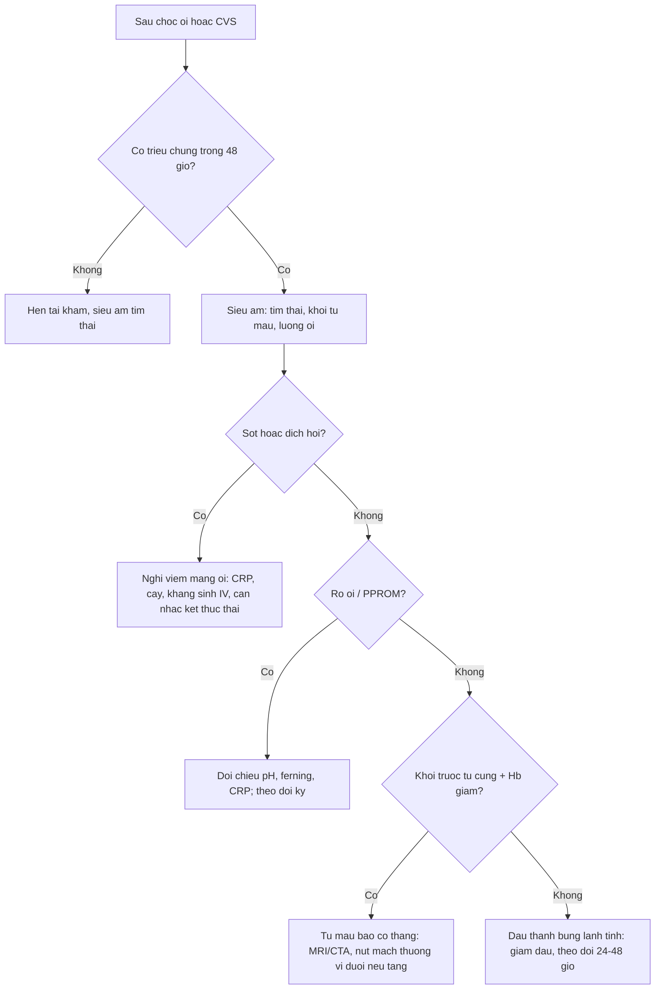
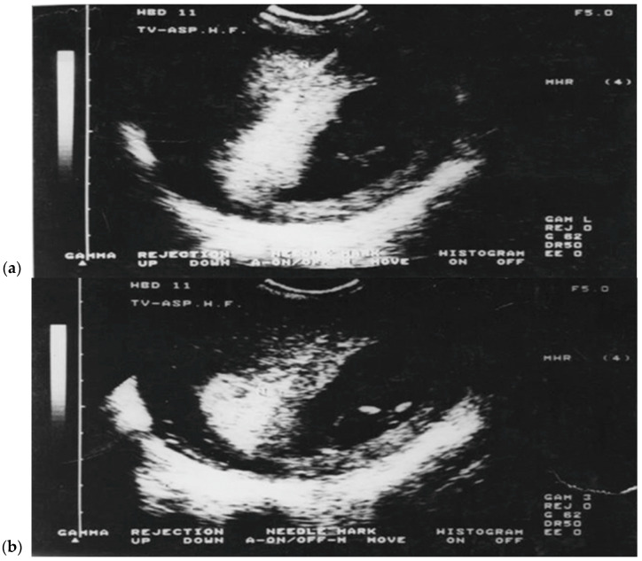

# 1954 — Chọc ối & sinh thiết gai nhau: biến chứng và dự phòng anti-D / Amniocentesis and chorionic villus sampling — complications

**Tags:** `pattern:bien-chung-thu-thuat` `pattern:ro-oi` `pattern:viem-mang-oi` `pattern:tu-mau-thanh-bung` `vung:thai` `vung:buong-oi` `vung:thanh-bung` `protocol:choc-oi` `protocol:CVS` `protocol:anti-D`

**Mức chắc chắn (certainty):** tổng hợp y văn (literature synthesis) — số liệu lấy từ **một đoàn hệ 2.798 thủ thuật** (PMC7780764), **so sánh 5 bộ hướng dẫn** (PMC9609299), **loạt 5.500 CVS** (PMC12610224), **loạt 468 CVS** (PMC11835121), **loạt 321 chọc ối** (PMC12393941), **loạt 1 thủ thuật chọc ối 5 năm** (PMC12924421) và **một ca tụ máu bao cơ thẳng** (PMC12861656). Không có thử nghiệm ngẫu nhiên mới; các con số **tỷ lệ biến chứng dao động rất rộng giữa các trung tâm** — đây là điểm phải nói với gia đình, không phải một con số tuyệt đối.

> **Câu chốt:** hai thủ thuật này **không phải "chọc rồi về"** — mỗi lần chọc là một lần đưa kim qua **thành bụng → cơ tử cung → màng ối (hoặc bánh nhau)**, nên biến chứng chia đúng theo đường kim đi: **thành bụng (tụ máu bao cơ thẳng)**, **màng ối (rò ối/PPROM, viêm màng ối)**, **bánh nhau (chảy máu, xuất huyết thai–mẹ → tạo kháng thể Rh)**, **thai (sảy thai, tổn thương kim)**. Ba con số để tư vấn: mất thai do chọc ối **0,11–0,13%** trong các loạt lớn (0,1–1% theo hướng dẫn); **rò ối 0,6%** và **PPROM 0,6–2%**; sau CVS, **sảy thai tự nhiên 0,66%** ở loạt 5.500 ca nhưng **1,04–1,49%** ở hai loạt nhỏ hơn — và **đường transabdominal ít chảy máu/nhiễm hơn hẳn transcervical (1,0% vs 4,0% chảy máu)**.

## 1. Tổng quan bệnh học – cơ chế hình ảnh (TẠI SAO)

### 1.1 Hai thủ thuật, hai cửa sổ thời gian

- **Chọc ối (amniocentesis, AC)** lấy **dịch ối + tế bào thai bong ra** để nuôi cấy/karyotype/CMA/vi sinh. Thực hiện **từ 15 tuần** (loạt 321 ca làm từ **16 tuần**); kim **20–22 G**, bỏ **1–2 mL** dịch đầu (tránh nhiễm tế bào mẹ — maternal cell contamination, MCC), hút **khoảng 20 mL**.
- **Sinh thiết gai nhau (chorionic villus sampling, CVS)** lấy **nhung mao bánh nhau** → chẩn đoán **sớm hơn 2–4 tuần** so với chọc ối, nhưng **chỉ nên làm từ 11 tuần**: làm **trước 10 tuần** gắn với **dị tật chi (limb reduction defects)** và thất bại nuôi cấy.
- Ba đường CVS: **transabdominal (TA-CVS)** — kim xuyên thành bụng vào bánh nhau; **transcervical (TC-CVS)** — ống thông/forceps qua cổ tử cung; **transvaginal (TV-CVS)** — đầu dò âm đạo + kim, đường đi **dài nhất**. Loạt 5.500 ca Zagreb: **TA 81,8%**, TC 15,5%, TV 2,7% — và từ 2012 trở đi **TA trở thành chuẩn** vì ít biến chứng hơn.

### 1.2 TẠI SAO kim gây biến chứng — bốn cơ chế, không phải "tai nạn ngẫu nhiên"

1. **Cơ học – rách màng ối:** màng ối mỏng **0,02–0,05 mm**, không tự liền ngay; một lỗ **20 G (0,9 mm)** có thể **rò ối (amniotic fluid leak)** hoặc **vỡ ối non (PPROM)**. Đa số lỗ **tự bít** — loạt 321 ca chỉ **1/321 (0,3%) rò ối**, và ca đó tiến triển **viêm màng ối ngày 4** (PMC12393941). Vì vậy **rò ối không đồng nghĩa mất thai**, nhưng **sốt + dịch hôi + đau** là chuyển sang nhiễm.
2. **Mạch máu – chảy máu:** bánh nhau là **giường mạch áp lực thấp, lưu lượng lớn**. Chọc **xuyên bánh nhau (transplacental)** làm rách nhung mao → **máu thai vào tuần hoàn mẹ = xuất huyết thai–mẹ (fetomaternal hemorrhage, FMH)** → nguy cơ **tạo kháng thể anti-D** ở mẹ Rh âm. Tần suất FMH **dao động rất rộng giữa các loạt** và **cao hơn khi xuyên bánh nhau, chọc lại lần hai, người làm ít kinh nghiệm, hoặc dịch ối có máu** (PMC9609299). Đây là lý do **kỹ thuật** (tránh bánh nhau, một lần chọc, kim mảnh) quan trọng hơn "may mắn".
3. **Nhiễm khuẩn:** đầu kim/ống thông mang **hệ khuẩn cổ tử cung** vào buồng ối — sinh bệnh học của **transcervical**: đường qua **cổ tử cung đã có khuẩn** nên **nhiễm cao hơn TA** (0,4% TC/TV vs 0,4% TA ở loạt lớn, nhưng **TV 3,0%** ở nhóm 150 ca; PMC12610224). Nhiễm biểu hiện **sốt, đau tử cung, dịch ối hôi, CRP/bạch cầu tăng**, và **viêm màng ối (chorioamnionitis)** là biến chứng **đe dọa tính mạng mẹ–thai**, không phải "viêm nhẹ".
4. **Chấn thương thai:** kim có thể **chạm thai/ống rốn** — tổn thương thai **< 0,1%** (PMC12924421). Trên siêu âm, đầu kim **tăng hồi âm (hyperechoic)** do phản xạ kim loại, nhưng **bóng lưng (posterior acoustic shadowing)** và **mặt cắt dày 1–2 mm** làm **đầu kim dễ "biến mất"** — đây là lý do phải **theo dõi liên tục đúng mặt phẳng** hoặc dùng **3D trực thời (real-time 3D)** với 3 mặt phẳng X–Y–Z (PMC6044223).

### 1.3 Cơ chế hình ảnh của biến chứng — đọc theo thời gian

- **Tụ máu bao cơ thẳng (rectus sheath hematoma):** máu trong bao cơ thẳng **không có nang thật**, nên siêu âm thấy **khối hỗn hợp âm, bờ không đều, không có vỏ rõ**; theo thời gian **hồi âm thay đổi** (máu tươi giảm âm → cục máu đông tăng âm → dịch hóa giảm âm). Ca thực tế: từ **7,2 × 3,2 × 7,0 cm** lúc chẩn đoán tăng lên **9,91 × 3,43 cm** sau điều trị bảo tồn, buộc **nút mạch động mạch thượng vị dưới phải** (PMC12861656). Vì sao tăng khi **ho**: áp lực ổ bụng tăng đột ngột làm **mạch trong bao cơ thẳng rách thêm**.
- **Rò ối:** dịch **âm trong, đồng nhất** thoát ra âm đạo; siêu âm thấy **lượng ối giảm (oligohydramnios)** nhưng **không thấy đường rò**. Chẩn đoán là **lâm sàng + soi mỏ vịt**, không phải siêu âm.
- **Viêm màng ối:** dịch ối **đục/tăng hồi âm**, **bong màng ối (membrane separation)**, **dày màng ối**, thai **nhịp nhanh** — nhưng **không có dấu hiệu hình ảnh nào đủ loại trừ**; CRP/bạch cầu và cấy dịch ối mới quyết định.
- **Thai lưu sau thủ thuật:** **không tim thai** trên siêu âm; phân biệt **thai lưu do thủ thuật** (trong **15 ngày**) với **sảy thai tự nhiên** (nền 10–15% ở tam cá nguyệt I) — đây là cạm bẫy lớn nhất khi quy kết nguyên nhân.

### 1.4 Ngưỡng định lượng để tư vấn (con số, không cảm tính)

| Thủ thuật | Biến chứng | Tỷ lệ | Nguồn |
|---|---|---|---|
| Chọc ối | Mất thai liên quan thủ thuật | **0,11%** (42.716 ca, gộp) · **0,13%** (11.746 ca) · **0,27%** (Caughey) | PMC9609299 |
| Chọc ối | Mất thai (khoảng hướng dẫn) | **0,1–0,3%** (ACOG-SMFM, NSGC) · **0,1–1%** (ISUOG, RCOG) | PMC9609299 |
| Chọc ối | Mất thai trong đoàn hệ thực hành | **0,8%** (16/2.028); **0,6%** (2/321) | PMC7780764; PMC12393941 |
| Chọc ối | PPROM | **0,6%** (12/2.028); **1–2%** theo y văn | PMC7780764; PMC12924421 |
| Chọc ối | Chảy máu âm đạo | **2–3%** | PMC12924421 |
| Chọc ối | Dịch ối lẫn máu (bloody tap) | **0,9%** (3/321) | PMC12393941 |
| Chọc ối | Rò ối | **0,3%** (1/321) | PMC12393941 |
| Chọc ối | Nhiễm trùng/tổn thương thai | **< 0,1%** | PMC12924421 |
| CVS | Sảy thai tự nhiên | **0,66%** (14/5.500); TA **0,18%** · TC **0,6%** · TV **1,3%** | PMC12610224 |
| CVS | Sảy thai liên quan thủ thuật | **1,49%** (468 ca); **1,04%** (770 ca) | PMC11835121; PMC7780764 |
| CVS | Chảy máu âm đạo sớm | **1,7%** chung; TA **1,0%** · TC **4,0%** · TV **10,0%** | PMC12610224 |
| CVS | Nhiễm trùng | **0,2%** | PMC12610224 |
| Cả hai | Dự phòng anti-D | **300 µg** sau chọc ối; **50 µg** sau CVS tam cá nguyệt I, **trong 72 giờ** | PMC12393941; PMC12610224; PMC9609299 |

## 2. Mẫu hình + chẩn đoán phân biệt theo vị trí (gamut)

- **Thành bụng trước / bao cơ thẳng:** **tụ máu bao cơ thẳng** (sau chọc ối, đặc biệt ở người **ho mạnh, chọc 2 lần, béo, dùng kháng đông/aspirin**), **áp-xe thành bụng**, **thoát vị lỗ trocar** (nếu có tiền sử nội soi), **khối u mô mềm** — nhìn **trước cơ tử cung**, không nằm trong ổ bụng.
- **Màng ối / buồng ối:** **rò ối** (dịch trong, không đau, không sốt), **PPROM** (vỡ ối trước chuyển dạ **< 37 tuần**), **viêm màng ối** (sốt + đau + dịch hôi + CRP tăng), **bong màng ối** sau thủ thuật.
- **Bánh nhau:** **tụ máu dưới màng ối/bánh nhau** (đau khu trú, siêu âm khối hỗn hợp âm cạnh bánh nhau), **bong bánh nhau (abruption)** — đau + chảy máu âm đạo + cơn co, **không phải "đau sau chọc" đơn thuần**.
- **Thai:** **thai lưu/sảy thai** (mất tim thai), **tổn thương kim** (hiếm, < 0,1%: vết thương da, mạch máu, thần kinh), **thiếu máu thai do FMH lớn** (thường không có dấu hiệu trên siêu âm thường quy — phải **MCA-PSV**).
- **Mẹ:** **tạo kháng thể Rh (alloimmunization)** — không có hình ảnh, chỉ có **Coombs gián tiếp dương** sau nhiều tuần; **phản ứng dây chằng/đau thoáng qua**; **ngất do phản xạ màng bụng**.

## 3. Bảng so sánh phân biệt (ma trận đối chiếu)

| Thực thể (entity) | Hình ảnh/lâm sàng điển hình | Chốt vào (rule-in) | Chốt loại (rule-out) | Gợi ý xác nhận |
|---|---|---|---|---|
| **Tụ máu bao cơ thẳng** | Khối **trước cơ tử cung**, hỗn hợp âm **7–10 cm**, đau khu trú, có **"pop"** khi ho; MRI: phù cơ + khối trong bụng cơ, dày **4 cm** | **Khối trong bao cơ thẳng + tiền sử chọc ối + Hb giảm** | Thai bình thường, không có khối trước tử cung → không phải tụ máu | Siêu âm + MRI; **CTA/angiography** khi tụ máu tăng dần |
| **Rò ối** | Dịch **trong** ra âm đạo, **không sốt**, lượng ối giảm; **1/321 (0,3%)** | **Dịch ối đọng ở cùng đồ sau soi mỏ vịt** + lượng ối giảm | Dịch âm đạo **không phải ối** (tiết dịch, nước tiểu) → test pH/ferning âm | Soi mỏ vịt, pH, ferning; theo dõi CRP/bạch cầu |
| **PPROM** | Vỡ ối **< 37 tuần**, rỉ ối kéo dài, **co tử cung**, nguy cơ nhiễm | **Rỉ ối + co + CRP tăng** | Màng ối còn nguyên, không rỉ dịch | Siêu âm lượng ối, CRP, cấy dịch ối |
| **Viêm màng ối (chorioamnionitis)** | **Sốt ≥ 38 °C + đau tử cung + dịch hôi + thai nhịp nhanh**; dịch ối đục | **Sốt + đau + CRP/bạch cầu tăng** | Không sốt, CRP bình thường, dịch trong | Cấy máu/dịch ối; kháng sinh + cân nhắc kết thúc thai |
| **Thai lưu/sảy thai sau thủ thuật** | Mất tim thai, không ra máu hoặc ra máu ít; **trong 15 ngày** sau thủ thuật | **Không tim thai trên siêu âm** | Tim thai còn, CRL tăng theo tuổi thai | Siêu âm lặp 1 tuần; đối chiếu tuổi thai |
| **FMH / nguy cơ Rh** | Không hình ảnh; mẹ **Rh âm**, chọc **xuyên bánh nhau** hoặc **chọc lại** | **Kleihauer–Betke dương** hoặc chọc xuyên bánh nhau ở mẹ Rh âm | Mẹ **Rh dương**; hoặc cha **Rh âm đã xác nhận** | Kleihauer–Betke, anti-D **trong 72 giờ** |
| **Đau thành bụng sau chọc (lành tính)** | Đau nhẹ **24–48 giờ**, không sốt, không khối, thai bình thường | **Đau thoáng qua + không khối + không sốt** | Đau tăng dần, khối, Hb giảm → **tụ máu**, không phải đau lành tính | Siêu âm thành bụng, Hb, theo dõi 24–48 giờ |

### Ảnh đối chiếu: tụ máu bao cơ thẳng sau chọc ối

*Khối **9,91 × 3,43 cm**, bờ không đều, không vỏ — máu trong bao cơ thẳng; xuất hiện **2 tuần sau chọc ối 20 tuần** với cơn đau sau ho. Ảnh nguyên bản (CC BY-NC-ND 4.0).*

## 4. Protocol chụp/thủ thuật + ngưỡng xử trí

### 4.1 Trước thủ thuật — những gì phải "chốt" trên siêu âm

1. **Xác định tuổi thai, số thai, tim thai, vị trí bánh nhau** (bánh trước/thấp/che lỗ trong) và **bể ối an toàn** — chọn bể **tránh bánh nhau và tránh thai**; nếu buộc phải **xuyên bánh nhau**, ghi rõ lý do (tăng nguy cơ FMH).
2. **Rh và kháng thể bất thường**: mẹ **Rh âm** → đặt sẵn **anti-D 300 µg** (chọc ối) hoặc **50 µg** (CVS tam cá nguyệt I) để tiêm **trong 72 giờ** sau thủ thuật — trừ khi **cha đã xác nhận Rh âm** (PMC9609299).
3. **Đếm số lần chọc**: mỗi lần chọc lại **tăng FMH và MCC** — mục tiêu **một lần vào**; nếu thất bại 2 lần → **dừng, hẹn lại**.
4. **Kỹ thuật kim**: chọc ối **20–22 G**; CVS TA **19–20 G**; **luôn theo dõi đầu kim liên tục**. Với mặt phẳng khó, **3D trực thời** cho thấy đầu kim đồng thời trên **3 mặt phẳng X–Y–Z**, giảm **lệch mặt phẳng (lateralization)** — nguyên nhân chọc vào **thai/ống rốn/bánh nhau** (PMC6044223):

*Đầu kim hiện **đồng thời** với thân kim trong mặt phẳng in-plane; nếu chỉ thấy **một chấm sáng** mà không thấy thân → kim đã ra khỏi mặt cắt, phải chỉnh trước khi đẩy sâu.*

### 4.2 Sau thủ thuật — 2 giờ theo dõi + 4 dấu hiệu phải quay lại

- **Theo dõi tại chỗ 2 giờ** (loạt 321 ca, PMC12393941): mạch, huyết áp, đau, ra máu, rỉ ối; **siêu âm kiểm tra tim thai** và **khối máu tụ** trước khi cho về.
- **Dặn dò 4 dấu hiệu**: **đau bụng tăng**, **ra máu**, **rỉ ối/dịch hôi**, **sốt** → quay lại ngay. Ca tụ máu bao cơ thẳng chỉ đến **2 tuần sau** với **đau sau ho** (PMC12861656) — nghĩa là **triệu chứng có thể xuất hiện muộn**, không chỉ trong 48 giờ.
- **Nghi nhiễm**: CRP, công thức máu, **cấy dịch ối/máu**, kháng sinh phổ rộng; **viêm màng ối = kháng sinh tĩnh mạch + cân nhắc kết thúc thai**, không chờ cấy.
- **Rò ối**: đa số **tự bít**; theo dõi **lượng ối, CRP, nhiệt độ**, kháng sinh dự phòng theo phác đồ; **PPROM < 24 tuần** tiên lượng xấu, cần tư vấn sản–nhi.

### 4.3 Ngưỡng "khi nào không được chọc"

- **Nghi viêm màng ối/ nhiễm tại chỗ thành bụng** — chọc sẽ đưa khuẩn vào buồng ối.
- **Thai không còn sống** hoặc **tuổi thai < 15 tuần với chọc ối** (chọc ối sớm < 15 tuần: **tăng mất thai, thất bại nuôi cấy, biến dạng bàn chân**).
- **CVS < 10 tuần** — nguy cơ **dị tật chi**; hẹn lại 11–14 tuần.
- **Rh âm chưa có anti-D** — không phải chống chỉ định tuyệt đối, nhưng phải **tiêm trong 72 giờ**; nếu không có anti-D, hoãn thủ thuật.

## 5. Biến thể bình thường và cạm bẫy

- **"Dịch ối ít sau chọc" không bằng "vỡ ối"**: lỗ kim nhỏ thường tự bít; lượng ối có thể giảm thoáng qua do **rò kín**. Chỉ gọi PPROM khi có **rỉ ối rõ + thay đổi cổ tử cung**.
- **Bloody tap không phải thất bại**: **0,9%** dịch lẫn máu; nhưng dịch **xanh–nâu** gợi ý **máu cũ** và gắn với **thất bại nuôi cấy, nhiễm, bất thường nhiễm sắc thể** — phải tư vấn và **theo dõi sát**, không "làm lại ngay" (PMC12393941).
- **MCC (nhiễm tế bào mẹ) 0,3%** dù đã bỏ 2 mL dịch đầu — nếu kết quả **đồng hợp tử bất thường mà siêu âm bình thường**, phải nghĩ MCC và kiểm tra lại.
- **Tụ máu bao cơ thẳng bị gọi là "đau do chọc ối"**: khối **trước cơ tử cung**, đau tăng khi **ho/ngồi dậy**, Hb giảm — ca thực tế **tăng từ 7,2 lên 9,91 cm** và cần **nút mạch** (PMC12861656). Bỏ sót → **sốc giảm thể tích**.
- **Kim "mất" trên siêu âm 2D**: đầu kim **tăng hồi âm nhưng mảnh**, dễ lệch mặt phẳng khi đẩy sâu; **không thấy đủ thân kim = không được đẩy tiếp**. Đây là cơ chế của **tổn thương thai < 0,1%** và **chọc vào bánh nhau**.
- **Quy kết sảy thai cho thủ thuật**: nền sảy thai tam cá nguyệt I **10–15%**; chỉ gọi "liên quan thủ thuật" khi **trong 15 ngày** và **không có bất thường nhiễm sắc thể/hình thái** — loạt 468 ca có **0,64%** đúng tiêu chuẩn này (PMC11835121).
- **CVS trước 10 tuần** (khi mẹ "muốn sớm") — **không làm**: dị tật chi và thất bại mẫu tăng; tư vấn chờ 11 tuần.

## 6. Tự lượng giá — Blind Quiz

**Ca 1 — Thai 11 tuần, siêu âm đầu dò âm đạo**

- Gợi ý lâm sàng: thai 11 tuần, mẹ 38 tuổi, cần chẩn đoán di truyền sớm.
- Câu hỏi: (a) Ảnh (a) và (b) khác nhau ở đâu? (b) Đây là đường tiếp cận nào, vì sao đường đi dài hơn TA-CVS? (c) Đường nào có **chảy máu sớm cao nhất** và bao nhiêu?

<b>Bấm để hiện đáp án (findings + chẩn đoán)</b>

- **Findings**: (a) mặt cắt **trước khi đưa kim** — thấy bánh nhau và buồng ối; (b) **đầu kim (needle mark)** đã vào bánh nhau, đường đi **qua cùng đồ/âm đạo** dài hơn nhiều so với TA.
- **Chẩn đoán**: **CVS đường transvaginal (TV-CVS)** — trong loạt 5.500 ca chỉ **150 ca (2,7%)**, thường dùng khi **bánh nhau/buồng ối không tiếp cận được bằng thành bụng**.
- **Vì sao**: TV-CVS đi **qua âm đạo → cổ tử cung → buồng ối → bánh nhau**, nên **chảy máu sớm 10,0%**, **sảy thai 1,3%**, **nhiễm 3,0%** — cao nhất trong ba đường; TA-CVS chỉ **1,0% / 0,18% / 0,4%**.
- **Nguồn ảnh**: Diagnostics 2025 — **PMC12610224** — Figure 1 — CC BY 4.0.

**Ca 2 — Đau bụng 2 tuần sau chọc ối**

- Gợi ý lâm sàng: thai 22 tuần, chọc ối lúc 20 tuần (kim 20 G, **2 lần vào tử cung**); nay đau bụng sau cơn ho, khối đau trên xương mu lệch phải.
- Câu hỏi: (a) Mô tả khối và vị trí giải phẫu. (b) Ba chẩn đoán phân biệt. (c) Vì sao khối **to lên** dù đã điều trị bảo tồn, và bước tiếp theo?

<b>Bấm để hiện đáp án (findings + chẩn đoán)</b>

- **Findings**: khối **9,91 × 3,43 cm**, hỗn hợp âm, bờ không đều, **nằm trước cơ tử cung trong bao cơ thẳng**; thai và bánh nhau bình thường.
- **Chẩn đoán**: **tụ máu bao cơ thẳng (rectus sheath hematoma)** sau chọc ối — biến chứng **hiếm nhưng có thể đe dọa mẹ**.
- **Phân biệt**: bong bánh nhau, tụ máu dưới màng ối, áp-xe thành bụng/thoát vị.
- **Vì sao to lên**: áp lực ổ bụng khi **ho** làm rách thêm nhánh **động mạch thượng vị dưới**; ca gốc tăng từ **7,2 × 3,2 × 7,0 cm** → **9,91 × 3,43 cm**, phải **chụp mạch và nút động mạch thượng vị dưới phải**.
- **Nguồn ảnh**: AJOG Glob Rep 2025 — **PMC12861656** — Figure 4 — CC BY-NC-ND 4.0.

**Ca 3 — Đầu kim ở đâu?**

- Gợi ý lâm sàng: chọc ối 20 tuần, bánh nhau **mặt trước**, bể ối nhỏ.
- Câu hỏi: (a) Cấu trúc tăng hồi âm hình thẳng là gì? (b) Vì sao 3D trực thời giúp giảm chấn thương thai? (c) Nếu bánh nhau nằm ngay đường vào, nên làm gì?

<b>Bấm để hiện đáp án (findings + chẩn đoán)</b>

- **Findings**: **thân + đầu kim 20 G** (đường tăng hồi âm) trong **bể ối**, thai ở bên phải; kim vào theo **mặt phẳng in-plane** nên thấy **cả thân lẫn đầu kim**.
- **Vì sao 3D hữu ích**: hiển thị **đồng thời 3 mặt phẳng X–Y–Z**, nên khi kim **lệch mặt phẳng** (đầu kim trông như "biến mất" trên 2D) vẫn định vị được — giảm nguy cơ **chọc vào thai/ống rốn/bánh nhau**.
- **Nếu bánh nhau chắn đường**: **đổi điểm vào** (bánh sau, bể ối khác); chỉ **xuyên bánh nhau khi không còn lựa chọn**, và khi đó phải **tăng cảnh giác FMH** → **anti-D trong 72 giờ** nếu Rh âm, theo dõi **MCA-PSV** nếu nghi thiếu máu.
- **Nguồn ảnh**: Ultrasonography 2018 — **PMC6044223** — Fig. 12 — CC BY-NC 3.0.

## Bài liên quan chéo

- [1961 – Phù thai không do miễn dịch (NIHF)](../1961-phu-thai-khong-do-mien-dich/lesson.md)
- [1673 – Truyền máu trong tử cung](../1673-truyen-mau-trong-tu-cung/lesson.md)
- [1747 – Xuất huyết thai–mẹ](../1747-xuat-huyet-thai-me/lesson.md)
- [565 – Sàng lọc hình thái và Doppler sản khoa](../565-sang-loc-hinh-thai-va-doppler-san-khoa/lesson.md)
- [566 – Song thai: chorionicity, TTTS và TAPS](../566-song-thai-chorionicity-TTTS-TAPS/lesson.md)
- [1936 – Tụ máu bao cơ thẳng bụng](../1936-tu-mau-bao-co-thang-bung/lesson.md)

## Ảnh

- `1954_cvs_SieuAm_PMC12610224.jpg` — TV-CVS 11 tuần (CC BY 4.0).
- `1954_tu-mau_SieuAm_PMC12861656.jpg` — tụ máu bao cơ thẳng 9,91 × 3,43 cm (CC BY-NC-ND 4.0).
- `1954_choc-oi_SieuAm_PMC6044223.jpg` — đầu kim 20 G, 3D trực thời (CC BY-NC 3.0).
- Nguồn + giấy phép từng ảnh: `images/CREDITS.md`. Cả ba ảnh **nguyên bản, không crop/ghép**.

> Không dùng để chẩn đoán độc lập khi chưa có người hướng dẫn.
