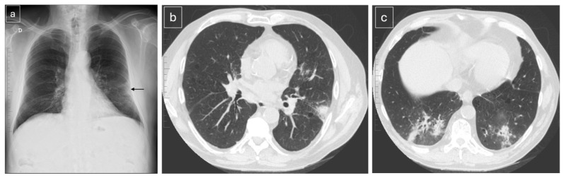
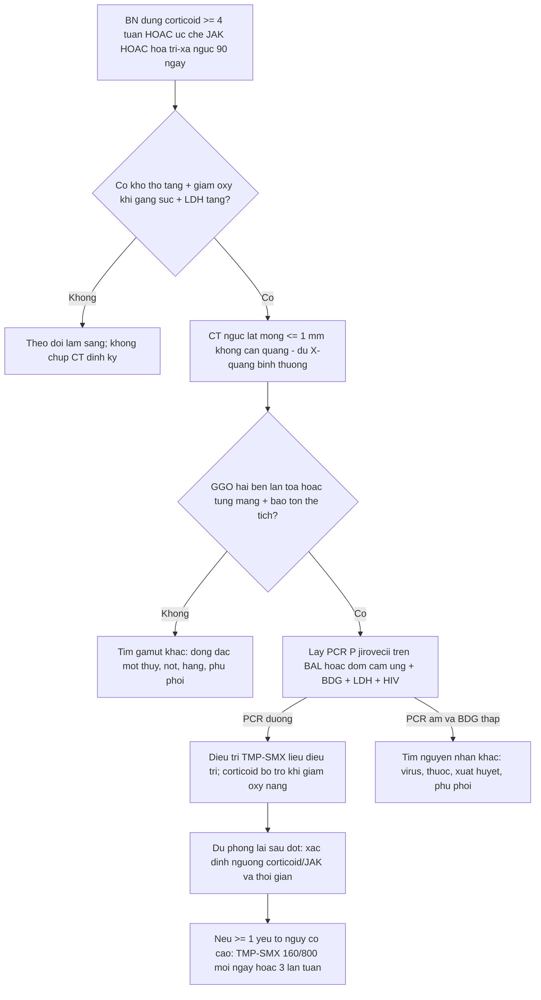
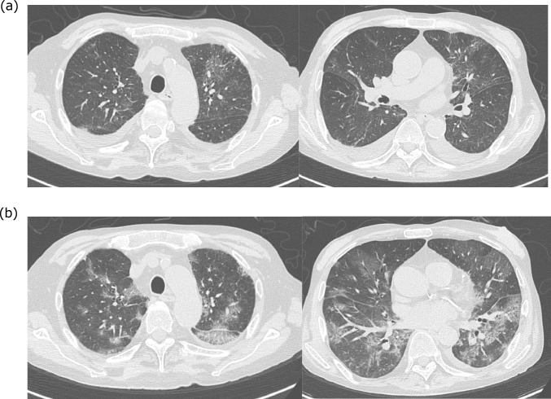
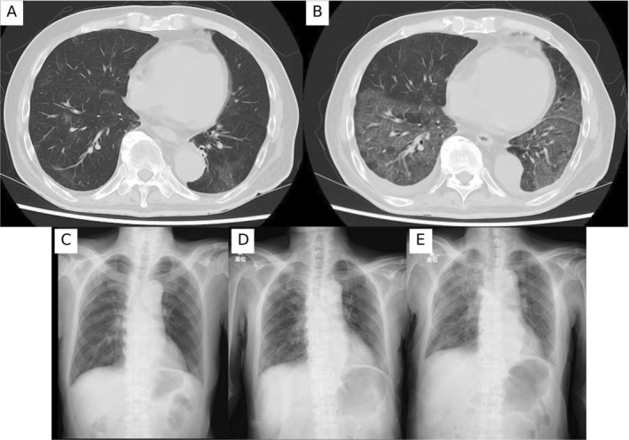
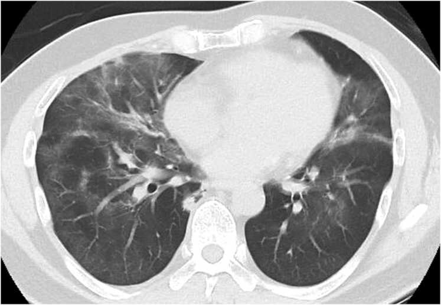

# 1955 — PJP ở người dùng corticoid kéo dài / ức chế JAK KHÔNG ghép tạng: kính mờ hai bên, ngưỡng 20 mg × 4 tuần và 70% ca không đủ ngưỡng / Pneumocystis jirovecii pneumonia in the non-transplant host

**Tags:** `pattern:kinh-mo` `pattern:ton-thuong-da-nganh` `vung:phoi` `protocol:CT-lat-mong` `protocol:BDG` `protocol:PCR-BAL` `incidentaloma:khong`
**Mức chắc chắn (certainty):** tổng hợp y văn (literature synthesis) — ghép **1 đoàn hệ hình ảnh 72 ca PJP** có HIV+ và không HIV (*Diagnostics* 2026, PMC13256207, CC BY), **1 phân tích gộp mạng lưới dự phòng** 54 báo cáo / 27 nghiên cứu / 34.473 người (*J Fungi* 2026, PMC13514556, CC BY), **1 đoàn hệ 78 ca không HIV** (*Front Med* 2024, PMC11233525, CC BY), **1 đoàn hệ 129 ca** (OFID 2024, PMC10810061, CC BY), **1 đoàn hệ 28.292 đợt điều trị corticoid kéo dài** (*Arthritis Res Ther* 2019, PMC6744623, CC BY), **1 loạt 20 ca PJP ở ung thư đặc** (*BMC Cancer* 2021, PMC8418024, CC BY) + **3 ca nguyên văn có ảnh** (PMC12685607, PMC12310852, PMC12769418 — đều CC BY). Nhóm **không có bệnh nhân của mình**. Chỗ nào nguồn không nêu rõ (ngưỡng tầm soát lao tiềm ẩn trước ức chế JAK) được ghi **"chưa rõ — cần tra guideline gốc"**, không suy diễn.

> **Câu chốt:** PJP ở người **không nhiễm HIV, không ghép tạng** là bệnh của **"liều corticoid tích lũy"** chứ không chỉ của "người suy giảm miễn dịch nặng". Ba số phải thuộc: **(1)** trong 78 ca không HIV, **59% lẽ ra phải được dự phòng** theo guideline chuyên khoa nhưng **không ai nhận** — nhóm bệnh huyết học bỏ sót tới **72%**; **42% vào ICU, tử vong 3 tháng 20%** (PMC11233525); **(2)** trong 20 ca PJP ở ung thư đặc, **chỉ 30% đạt ngưỡng cổ điển ≥ 20 mg prednisone/ngày ≥ 4 tuần**; **71% mới hóa trị trong 90 ngày**, **50% xạ ngực**, tử vong do PJP **40%** (PMC8418024) — nên **ngưỡng 20 mg × 4 tuần là điều kiện ĐỦ, không phải điều kiện CẦN**; **(3)** X-quang **bình thường ở 32,4%** ca PJP (PMC13256207) → **X-quang âm không loại trừ**, phải **CT lát mỏng**.

## 1. Tổng quan bệnh học – cơ chế hình ảnh

### 1.1 Vì sao kính mờ, không phải đông đặc (TẠI SAO)

- **Tác nhân:** *Pneumocystis jirovecii* — nấm **ngoài tế bào**, sống **bám vào tế bào phế nang type I**, không xâm lấn mô. Vì thế tổn thương **không phá vỡ cấu trúc phổi**, chỉ **lấp đầy phế nang bằng dịch tiết dạng bọt (foamy exudate: organism + fibrin + chất hoại tử tế bào)**.
- **Vật lý của "kính mờ" (ground-glass opacity, GGO):** tia X/CT đi qua vùng phế nang **còn khí nhưng bị thay một phần** bằng dịch tiết → độ suy giảm tia **tăng vừa phải**, **vẫn thấy được mạch máu và thành phế quản xuyên qua**. Khi phế nang **bị lấp hoàn toàn** → **đông đặc (consolidation)**, mạch bị che. Nên **GGO = giai đoạn sớm/còn khí**, **đông đặc = giai đoạn muộn/hợp nhất** — hai mức của cùng một quá trình.
- **Vì sao phân bố hai bên, đối xứng, ưu thế trung tâm–quanh rốn phổi:** *P. jirovecii* lan **theo đường khí** (aerosol nội sinh từ người này sang người khác, và lan trong phổi theo dòng khí) → tổn thương **lan tỏa, không tôn trọng phân thùy**, thường **nặng dần từ trên xuống** nhưng **không có "vùng lành" rõ** như nhồi máu hay viêm phổi thùy.
- **Vì sao có nang khí (pneumatocele) và tràn khí:** hoại tử **vách phế nang** + hiện tượng **van một chiều** ở tiểu phế quản → khí bị giữ → nang thành mỏng; nang **vỡ vào khoang màng phổi/trung thất** → tràn khí. Đây là lý do PJP **không được thở áp lực cao tùy tiện**.
- **Vì sao khác nhau giữa HIV và không HIV (điểm rất dễ đọc sai):** ở HIV, phản ứng viêm – miễn dịch **yếu nhưng mạn**, tổn thương **lan tỏa mô kẽ + nang**; ở người **không HIV**, phản ứng viêm **dữ dội hơn trong thời gian ngắn** → **đông đặc và tràn dịch màng phổi nhiều hơn**, có khi **không có GGO lan tỏa**. Đoàn hệ 72 ca: GGO **là mẫu hình chủ đạo ở CẢ HAI nhóm**, nhưng **mẫu hình phế nang–mô kẽ, khảm tưới máu (mosaic attenuation) và nang phổi gặp nhiều hơn ở HIV+**, còn **đông đặc và tràn dịch gặp nhiều hơn ở không HIV** (PMC13256207).

### 1.2 Vì sao bệnh nhân không ghép tạng vẫn bị PJP — "liều tích lũy" chứ không phải "suy giảm nặng"

- **Corticoid là yếu tố nguy cơ số 1:** trong 129 ca không HIV, **83,7% đang dùng corticoid**, **71,3% dùng thuốc ức chế miễn dịch**, **62% dùng cả hai** (PMC10810061).
- **Ngưỡng cổ điển ≥ 20 mg prednisone/ngày ≥ 4 tuần** bắt nguồn từ các ca PJP ở người dùng corticoid liều cao; nhưng **nó bỏ sót phần lớn thực tế**: **chỉ 6/20 (30%)** ca PJP ở ung thư đặc đạt ngưỡng này; **50% chỉ dùng corticoid ngắt quãng**, 1 ca **không dùng corticoid nào** (PMC8418024). Ở ung thư phổi, **20 mg prednisolone/ngày ≥ 3 tuần** đã là yếu tố nguy cơ độc lập cùng **giảm lympho** và **xạ–hóa trị lồng ngực** (PMC6375945).
- **Corticoid liều "trung bình" kéo dài vẫn có nguy cơ thật:** 28.292 đợt điều trị **≥ 4 tuần** với liều **không cao** — nhóm **liều thấp** có tỷ lệ mới mắc **0,01/100 người–năm**, nhưng nhóm **liều trung bình** (không dự phòng) là **0,5 (0,2–1,2)/100 người–năm**; **phân nhóm nguy cơ cao** (có **pulse corticoid** hoặc **giảm lympho nền**) lên **3,4 (1,1–8,0)/100 người–năm** (PMC6744623).
- **Vì sao lympho quan trọng hơn liều:** PJP kiểm soát nhờ **miễn dịch qua trung gian tế bào T**. Corticoid gây **giảm lympho T CD4** và ức chế chức năng; vì thế **tuổi cao, suy dinh dưỡng, xơ gan, đái tháo đường, hóa trị, xạ ngực** cộng vào cùng một ngưỡng liều. Ca nguyên văn 75 tuổi **không có yếu tố suy giảm miễn dịch kinh điển** vẫn tử vong trong **~10 ngày** khi dùng bộ ba **relugolix + darolutamide + docetaxel** cho ung thư tuyến tiền liệt (PMC12685607) — tức **hóa trị + corticoid tiền hóa trị + tuổi** đủ gây bệnh.
- **Vì sao ức chế JAK cũng là nguy cơ:** JAK–STAT là đường truyền tín hiệu của **interferon và IL-2** — chặn nó làm giảm **chức năng tế bào NK và T**. PJP đã được báo cáo ở người dùng **tofacitinib** (PMC7045858) và — rất đáng chú ý — ở người **tự dùng oclacitinib (JAK1 ức chế thú y) 16–64 mg/ngày trong ~2 năm** rồi mắc PJP (PMC12769418). Vì thế **JAK + corticoid** là tổ hợp cần coi như nguy cơ trung bình–cao.
- **Tiên lượng khi đã mắc:** **42% vào ICU**, **tử vong 3 tháng 20%** (PMC11233525); **tử vong do PJP 40%** ở nhóm ung thư đặc (PMC8418024).

### 1.3 Ngưỡng định lượng nằm lòng

| Đại lượng | Ngưỡng / con số | Ý nghĩa thực hành | Nguồn |
|---|---|---|---|
| X-quang ngực bình thường trong PJP | **32,4%** | **X-quang âm không loại trừ** → CT khi nghi | PMC13256207 |
| GGO trên CT | **mẫu hình chủ đạo ở cả HIV+ và không HIV** | GGO hai bên = mẫu hình nền của PJP | PMC13256207 |
| Đông đặc / tràn dịch màng phổi | Nhiều hơn ở **không HIV** (đông đặc **p = 0,051** trên X-quang) | Đừng vì "có đông đặc" mà loại PJP | PMC13256207 |
| Nang phổi, khảm tưới máu, mẫu hình phế nang–mô kẽ | Nhiều hơn ở **HIV+** | Không có nang **không** loại PJP ở người không HIV | PMC13256207 |
| Đồng nhiễm hô hấp | **63,9%** số ca | Không làm thay đổi mẫu hình CT (không phân biệt được) | PMC13256207 |
| Dự phòng TMP-SMX liều chuẩn | **OR 0,30** (0,18–0,48) | Giảm PJP ~70% so với không dự phòng | PMC13514556 |
| Dự phòng TMP-SMX liều thấp | **OR 0,08** (0,03–0,18) | Hiệu quả cao nhưng **chưa chứng minh không thua** liều chuẩn | PMC13514556 |
| Ngừng thuốc vì tác dụng phụ | **12,3%** (9,4–15,9) | Cái giá của dự phòng — phải cân nhắc | PMC13514556 |
| PJP đột phá khi dùng phác đồ bậc 2 | **0,5%** (5/1.056 người) | Dapsone/atovaquone/pentamidine là lựa chọn chấp nhận được | PMC13514556 |
| Ngưỡng corticoid cổ điển | **≥ 20 mg prednisone/ngày ≥ 4 tuần** | Chỉ **30%** ca ung thư đặc đạt ngưỡng này | PMC8418024 |
| Ngưỡng nguy cơ thấp hơn (ung thư phổi) | **20 mg prednisolone/ngày ≥ 3 tuần** + giảm lympho | Yếu tố nguy cơ độc lập | PMC6375945 |
| Tỷ lệ mới mắc khi dùng corticoid ≥ 4 tuần | liều thấp **0,01**; liều trung bình **0,5**; nguy cơ cao **3,4** /100 người–năm | Nguy cơ **tăng 340 lần** giữa liều thấp và nguy cơ cao | PMC6744623 |
| NNT / NNH của TMP-SMX (nhóm nguy cơ cao) | **NNT 31** (17–226) / **NNH 45** (15–∞) | Chỉ dự phòng khi NNT < NNH, tức **có ≥ 1 yếu tố nguy cơ cao** | PMC6744623 |
| Tác dụng phụ TMP-SMX | **41,5/100 người–năm** (có ca nặng) | Không dự phòng tràn lan | PMC6744623 |
| β-D-glucan (BDG) — ngưỡng | **8,5 pg/mL** (Se 76%/Sp 76%, Wako) | Ngưỡng **thấp hơn** giá trị "80–100" hay dùng | PMC8628137 |
| BDG — ngưỡng khác | **144,1 pg/mL** (Se 90%/Sp 86%, proven + probable) | **Ngưỡng phụ thuộc bộ kit** → không có một số dùng chung | PMC8085008 |
| LDH | **363 U/L** (Se 80%/Sp 76%, proven + probable) | Chỉ hỗ trợ, không chẩn đoán | PMC8085008 |
| Bỏ sót dự phòng theo guideline | **59%** ca lẽ ra phải dự phòng; huyết học **72%** | Lỗi hệ thống, không phải lỗi cá nhân | PMC11233525 |
| Tử vong | **20%** (3 tháng); **40%** (ung thư đặc); ICU **42%** | Không phải "bệnh nhẹ ở người không HIV" | PMC11233525, PMC8418024 |

## 2. Mẫu hình + chẩn đoán phân biệt theo vị trí (gamut)

- **Mẫu hình cốt lõi:** **GGO hai bên, lan tỏa hoặc từng mảng, không tôn trọng phân thùy**, ± **dày vách liên tiểu thùy mảnh** ("lát đá" khi GGO + vách dày), ± **đông đặc rải rác**, ± **nang khí thành mỏng**, ± **tràn dịch màng phổi ít**; **bảo tồn thể tích phổi** (không xẹp, không co kéo).
- **Gamut theo bối cảnh (quan trọng hơn gamut theo hình thái):**
  - **Corticoid ≥ 4 tuần, hoặc JAK ức chế, hoặc hóa trị–xạ ngực trong 90 ngày** → **PJP đứng đầu** (PMC8418024, PMC6744623).
  - **Người ghép tạng** → PJP, **CMV**, viêm phổi do **mTOR**, phù do chức năng mảnh ghép ([1789](../1789-viem-phoi-do-cmv-o-nguoi-ghep-tang/lesson.md), [1826](../1826-viem-phoi-do-thuoc-uc-che-mtor/lesson.md)).
  - **Đang dùng thuốc mới (ức chế điểm kiểm soát miễn dịch, methotrexate, amiodarone)** → **viêm phổi do thuốc**.
  - **Giảm tiểu cầu/suy thận cấp/ho ra máu** → **xuất huyết phế nang**.
  - **Sốt + tiếng tim mới + ổ nhiễm ngoài phổi** → thuyên tắc nhiễm khuẩn, **không phải PJP**.
- **Gamut theo hình thái:**
  - **GGO + nang khí:** PJP · CMV · viêm phổi do *S. aureus* (Panton–Valentine) · LAM (nang thật, thành rất mỏng, không GGO) · LCH.
  - **GGO + lát đá:** PJP · ARDS · xuất huyết phế nang · PAP · ung thư biểu mô tuyến lan tỏa.
  - **GGO đối xứng + dày vách + tràn dịch:** phù phổi · PJP · CMV.
- **Mnemonic "PJP" cho người không HIV:** **P**rednisone ≥ 4 tuần (hoặc JAK) · **J**oint/autoimmune (SLE, RA, vasculitis) · **P**lasma cell dyscrasia/lymphoma + hóa trị.

## 3. Bảng so sánh phân biệt (ma trận đối chiếu)

| Thực thể (entity) | Hình ảnh điển hình | Chốt vào (rule-in) | Chốt loại (rule-out) | Gợi ý xác nhận |
|---|---|---|---|---|
| **PJP** | **GGO hai bên lan tỏa/từng mảng**, bảo tồn thể tích, ± lát đá, ± nang khí, tràn dịch ít | **Corticoid ≥ 4 tuần/JAK/hóa trị 90 ngày + GGO hai bên + BDG tăng** | **Đông đặc một thùy đơn độc + không giảm oxy khi gắng sức** → ít nghĩ PJP | **PCR dịch rửa phế quản (BAL)**; BDG theo kit; LDH |
| **CMV (người ghép/ corticoid)** | GGO hai bên + **nốt nhỏ (< 5 mm)**, đông đặc, dày vách; có thể **loét đường tiêu hóa** | **PCR CMV máu/BAL dương + nốt nhỏ rải rác** | **Nang khí lớn + BDG rất cao** → nghiêng PJP | PCR CMV định lượng; nội soi nếu có triệu chứng tiêu hóa ([1789](../1789-viem-phoi-do-cmv-o-nguoi-ghep-tang/lesson.md)) |
| **Viêm phổi do thuốc (ICI, MTX, mTOR)** | GGO hai bên, **dạng OP** (đám mờ ngoại vi), hoặc mẫu hình NSIP; **bắt đầu sau khởi trị 2–12 tuần** | **Ngừng thuốc → cải thiện; loại trừ nhiễm** | **BDG tăng + PCR PJP dương** → không phải do thuốc đơn thuần | Ngừng thuốc thử, BAL loại trừ nhiễm ([1826](../1826-viem-phoi-do-thuoc-uc-che-mtor/lesson.md)) |
| **Xuất huyết phế nang** | GGO/tổ chức hóa hai bên, **không bảo tồn**; **thiếu máu + ho ra máu** | **BAL ra máu/ hemosiderin + giảm Hb** | **BAL không máu + BDG cao** → loại | BAL 3 ống, CT trước/sau, đông máu |
| **Phù phổi / ARDS** | GGO phụ thuộc, dày vách trơn đối xứng, **tim to + Kerley B**, tràn dịch hai bên | **BNP tăng + đáp ứng lợi tiểu** | **Bảo tồn tim + sốt + BDG tăng** → loại | Siêu âm tim, BNP ([033](../033-phu-phoi-ards/lesson.md)) |
| **Viêm phổi virus nặng (cúm, COVID-19)** | GGO ngoại vi hai bên, **phân bố theo thùy dưới**, ± nốt trung tâm tiểu thùy | **PCR virus dương** | **PCR virus âm + BDG tăng** → loại | Multiplex PCR ([947](../947-viem-phoi-rsv-va-cum-o-nguoi-ghep-tang/lesson.md)) |
| **Viêm phổi do *Nocardia*** | **Nốt 94,1%, hang 52,9%**, ít GGO lan tỏa | **Nốt/hang + ổ não** | **GGO lan tỏa không nốt** → loại | Cấy Nocardia, MRI não ([1966](../1966-nocardia-ghep-tang-not-phoi-ap-xe-nao/lesson.md)) |

*Ba lát của cùng một ca PJP ở người **nhận tạng đặc** (a) X-quang: đám mờ nhỏ sát màng phổi trung thất trái (mũi tên) — rất dễ bị đọc là "bình thường"; (b, c) CT 5 ngày sau: đông đặc ngoại vi + kính mờ hai bên. Nguồn: Diagnostics 2026 (PMC13256207), Figure 1 — CC BY.*

## 4. Protocol chụp + ngưỡng dự phòng & tầm soát

### 4.1 Protocol hình ảnh

1. **Khi nào chụp CT:** **mọi** bệnh nhân có **corticoid ≥ 4 tuần / JAK ức chế / hóa trị–xạ ngực 90 ngày** mà **khó thở tăng + giảm oxy khi gắng sức + LDH tăng**, **kể cả khi X-quang bình thường** (**32,4%** ca PJP có X-quang bình thường — PMC13256207).
2. **Cách chụp:** **CT ngực lát mỏng ≤ 1 mm, không cản quang** (high-resolution CT), cửa sổ phổi + trung thất; chụp **thì hít vào** (thì thở ra chỉ khi nghi bệnh đường thở nhỏ). **Cản quang không cần** — chỉ dùng khi nghi thuyên tắc phổi/viêm trung thất.
3. **Điều phải đo/g hi trong báo cáo:** mức lan GGO theo **% thể tích** hoặc số phân thùy, **có/không nang khí**, **tràn khí màng phổi**, **tràn dịch**, và **vị trí ưu thế** (để so sánh lần sau).
4. **Xét nghiệm chốt:** **PCR *P. jirovecii*** trên **dịch rửa phế quản** hoặc **đờm cảm ứng**; **BDG huyết thanh** (nhớ ngưỡng phụ thuộc kit: **8,5** so với **144,1 pg/mL** — PMC8628137, PMC8085008); **LDH** hỗ trợ; **HIV test luôn làm** vì đổi hoàn toàn ngưỡng dự phòng và tiên lượng.

### 4.2 Ngưỡng dự phòng (điểm cốt lõi của bài)

- **Dự phòng khi có ≥ 1 trong các điều kiện:**
  - **Prednisone ≥ 20 mg/ngày ≥ 4 tuần** (ngưỡng cổ điển), hoặc **≥ 20 mg/ngày ≥ 3 tuần + giảm lympho** ở ung thư phổi (PMC6375945);
  - **Bất kỳ liều corticoid kéo dài ≥ 4 tuần + pulse corticoid hoặc lympho nền thấp** (nhóm có tỷ lệ mới mắc **3,4/100 người–năm**, NNT **31** — PMC6744623);
  - **JAK ức chế** (đặc biệt **JAK + corticoid**, hoặc JAK ở người **> 65 tuổi/giảm lympho**);
  - **Hóa trị–xạ ngực trong 90 ngày** ở ung thư đặc (71% ca PJP — PMC8418024), **đặc biệt ung thư phổi**;
  - **Bệnh huyết học** (nhóm bỏ sót dự phòng nhiều nhất: **72%** — PMC11233525).
- **Phác đồ:** **TMP-SMX 160/800 mg (1 viên đôi) mỗi ngày** hoặc **3 lần/tuần** (liều chuẩn **OR 0,30**; liều thấp **OR 0,08** nhưng chưa chứng minh không thua — PMC13514556); **bậc 2** khi dị ứng/không dung nạp: **dapsone 100 mg/ngày**, **atovaquone 1.500 mg/ngày**, **pentamidine khí dung 300 mg/tháng** (PJP đột phá **0,5%/1.056 người** — PMC13514556).
- **Thời gian:** suốt thời gian còn **corticoid liều ngưỡng hoặc ức chế miễn dịch**; sau ngừng thuốc, **tiếp tục 4–6 tuần** (khoảng an toàn kinh điển; **chưa rõ — cần tra guideline gốc** cho từng nhóm bệnh).
- **Khi nào KHÔNG dự phòng** (chống lạm dụng): **corticoid liều thấp, ngắn < 4 tuần** (tỷ lệ mới mắc **0,01/100 người–năm** — PMC6744623); tác dụng phụ TMP-SMX **41,5/100 người–năm** nên NNT phải nhỏ hơn NNH.
- **Tầm soát trước ức chế JAK:** **HBV (HBsAg, anti-HBc, HBV DNA)** và **lao tiềm ẩn (IGRA + X-quang ngực)** là thực hành chuyên khoa; **ngưỡng/độ mạnh khuyến cáo: chưa rõ — cần tra guideline gốc** (bài này không có văn bản guideline đối chiếu trực tiếp). Nếu IGRA dương: X-quang tìm tổn thương hoạt động trước khi quyết định.

## 5. Biến thể bình thường và cạm bẫy

- **Cạm bẫy 1 — "X-quang bình thường nên không phải PJP":** **32,4%** ca PJP có X-quang bình thường (PMC13256207). Bệnh nhân **giảm oxy khi gắng sức** mà phim "sạch" là chỉ định CT.
- **Cạm bẫy 2 — dùng một ngưỡng BDG chung:** **8,5 pg/mL** (Wako, Se/Sp 76%/76%) so với **144,1 pg/mL** (Se 90%/Sp 86%) — khác biệt **gần 17 lần** do **bộ kit và quần thể** (PMC8628137, PMC8085008). Ghi rõ kit trong phiếu; **BDG âm không loại trừ** ở người đã dùng thuốc chống nấm.
- **Cạm bẫy 3 — BDG dương giả:** **chạy thận nhân tạo (màng cellulose), gạc/vật liệu y tế, IVIG, amoxicillin–clavulanate, nhiễm nấm Candida xâm lấn** đều làm BDG tăng. BDG dương **không đồng nghĩa PJP**.
- **Cạm bẫy 4 — gọi GGO sau hóa trị là "viêm phổi do thuốc" rồi cho corticoid liều cao:** corticoid **làm PJP nặng lên**; nếu có **BDG tăng/PCR dương**, phải điều trị PJP trước. Ca 75 tuổi tử vong **~10 ngày** dù đã dùng TMP-SMX + corticoid đúng (PMC12685607) cho thấy **chẩn đoán muộn**, không phải điều trị sai.
- **Cạm bẫy 5 — bỏ sót đồng nhiễm:** **63,9%** ca có đồng nhiễm hô hấp nhưng **mẫu hình CT không khác biệt** (PMC13256207) → **không thể loại trừ đồng nhiễm bằng hình ảnh**; cấy/PCR đa tác nhân vẫn cần.
- **Cạm bẫy 6 — "không có nang khí nên không phải PJP":** nang gặp **nhiều hơn ở HIV**; ở người không HIV **đông đặc + tràn dịch** là mẫu hình thường gặp hơn (PMC13256207).
- **Cạm bẫy 7 — dự phòng tràn lan:** tác dụng phụ TMP-SMX **41,5/100 người–năm**, ngừng thuốc **12,3%**. Dự phòng chỉ khi **NNT < NNH** (NNT **31** ở nhóm nguy cơ cao — PMC6744623).

## 6. Tự lượng giá — Blind Quiz ngay trên trang tĩnh

**Ca 1 — Nam 55 tuổi, xơ gan rượu, cổ trướng kháng trị, khó thở ngày thứ 4**

- Gợi ý lâm sàng (clinical context): xơ gan 13 năm, vào viện vì cổ trướng; **ngày 4** khó thở, CT thấy kính mờ + lưới **ưu thế thùy trên trái**; ban đầu nghĩ **viêm phổi hít sặc** và dùng cefmetazole; **ngày 11** SpO₂ xuống **90%**.
- Câu hỏi: Hai hàng ảnh (a) và (b) khác nhau ở điểm nào? Vì sao "ưu thế một thùy trên" **không** loại PJP? Xét nghiệm nào chốt chẩn đoán?

<b>Bấm để hiện đáp án (findings + chẩn đoán)</b>

- Dấu hiệu (findings): (a) ngày 4 — kính mờ + lưới **hai bên**, rõ hơn ở **thùy trên trái**; (b) ngày 10 — **lan rộng và đậm hơn**, thêm kính mờ **đáy phổi hai bên**. Không có đông đặc thùy, không tràn dịch lớn, **thể tích phổi bảo tồn**.
- Chẩn đoán (diagnosis): **PJP ở người xơ gan (cirrhosis-associated immune dysfunction)** — **BDG 142,5 pg/mL**, **KL-6 1.770 U/mL**, **PCR đờm dương** *P. jirovecii*, HIV âm. Bài học: **phân bố không đối xứng/ưu thế một vùng không loại PJP**; xơ gan + suy dinh dưỡng là bối cảnh nguy cơ **không có corticoid**.
- Nguồn ảnh: Clinical Journal of Gastroenterology 2025 (PMC12310852), Fig. 2 — CC BY.

**Ca 2 — Nam 75 tuổi, ung thư tuyến tiền liệt di căn, sau chu kỳ docetaxel thứ 2**

- Gợi ý lâm sàng (clinical context): đang **relugolix + darolutamide + docetaxel**; **không** tiền sử suy giảm miễn dịch, đái tháo đường kiểm soát tốt; sau chu kỳ 2 **chán ăn** rồi khó thở tăng nhanh.
- Câu hỏi: Mô tả thay đổi từ (A) sang (B)? Vì sao **X-quang (C–E)** lại là bài học về "chẩn đoán muộn"? Yếu tố nguy cơ nào **không** nằm trong ngưỡng 20 mg × 4 tuần?

<b>Bấm để hiện đáp án (findings + chẩn đoán)</b>

- Dấu hiệu (findings): (A) ngày 1 — kính mờ lốm đốm **rải rác hai bên**, dễ bị đọc là "bình thường/ít"; (B) ngày 7 — **kính mờ lan rộng hai bên + dày vách liên tiểu thùy**, xuất hiện **dịch màng phổi phải ít**; (C–E) X-quang ngày 1 → 5 → 9: mờ lưới–kính mờ **tăng dần** tới mờ lan tỏa.
- Chẩn đoán (diagnosis): **PJP** — BDG tăng, **PCR đờm dương**, tử vong do suy hô hấp **~10 ngày** sau khởi triệu chứng dù đã dùng TMP-SMX + corticoid. Yếu tố nguy cơ **ngoài ngưỡng cổ điển**: **tuổi 75**, **hóa trị docetaxel**, **ức chế androgen thế hệ mới (relugolix/darolutamide)**, **đái tháo đường**.
- Nguồn ảnh: Respirology Case Reports 2025 (PMC12685607), Figure 1 — CC BY.

**Ca 3 — Nam 53 tuổi, nghề thú y, khó thở tăng dần 2 tuần, không bệnh nền**

- Gợi ý lâm sàng (clinical context): **không HIV, không ghép tạng, không corticoid**; tự dùng **oclacitinib (ức chế JAK1 thú y) 16–64 mg/ngày trong ~2 năm** để trị viêm da dị ứng.
- Câu hỏi: Mẫu hình CT gợi ý gì? Vì sao "không có yếu tố suy giảm miễn dịch kinh điển" lại là **câu trả lời sai**? Cần hỏi thêm gì trong bệnh sử?

<b>Bấm để hiện đáp án (findings + chẩn đoán)</b>

- Dấu hiệu (findings): **kính mờ lan tỏa dạng "bản đồ" (map-like) hai bên**, ưu thế **thùy giữa và dưới**, xen vùng phổi còn sáng; không đông đặc thùy, không nang rõ.
- Chẩn đoán (diagnosis): **PJP do ức chế JAK kéo dài** — BAL có **thể nấm bắt màu Grocott** trong đại thực bào phế nang. Bài học: **luôn hỏi thuốc — kể cả thuốc thú y/tự mua** — vì ức chế JAK đơn thuần đủ gây PJP; "không corticoid" **không** loại trừ.
- Nguồn ảnh: IDCases 2026 (PMC12769418), Fig. 1 — CC BY.

## Bài liên quan chéo
- [001 – Tổng quan hệ Ngực](../001-tong-quan-he-nguc/lesson.md)
- [032 – Kính mờ (GGO) & lát đá](../032-kinh-mo-lat-da/lesson.md)
- [033 – Phù phổi & ARDS](../033-phu-phoi-ards/lesson.md)
- [1789 – Viêm phổi do CMV ở người ghép tạng](../1789-viem-phoi-do-cmv-o-nguoi-ghep-tang/lesson.md)
- [1826 – Viêm phổi do thuốc ức chế mTOR](../1826-viem-phoi-do-thuoc-uc-che-mtor/lesson.md)
- [1980 – Dự phòng nhiễm trùng cơ hội sau ghép tạng](../1980-du-phong-nhiem-trung-co-hoi-sau-ghep-tang/lesson.md)
- [947 – Viêm phổi RSV & cúm ở người ghép tạng](../947-viem-phoi-rsv-va-cum-o-nguoi-ghep-tang/lesson.md)

## Ảnh
- `images/1955_pjp_CXR-CT_PMC13256207-Fig1.jpg` — X-quang + CT, người nhận tạng đặc (CC BY).
- `images/1955_pjp_CT-xogan_PMC12310852-Fig2.jpg` — CT ngày 4 vs ngày 10, xơ gan (CC BY).
- `images/1955_pjp_CT-PMC12685607-Fig1.jpg` — CT ngày 1 vs 7 + X-quang ngày 1/5/9 (CC BY).
- `images/1955_pjp_CT-JAK_PMC12769418-Fig1.jpg` — CT kính mờ dạng bản đồ do ức chế JAK1 (CC BY).
- Nguồn + giấy phép từng ảnh: `images/CREDITS.md`. Không dùng ảnh từ Radiopaedia/AuntMinnie cho bài này.

> Không dùng để chẩn đoán độc lập khi chưa có người hướng dẫn.
