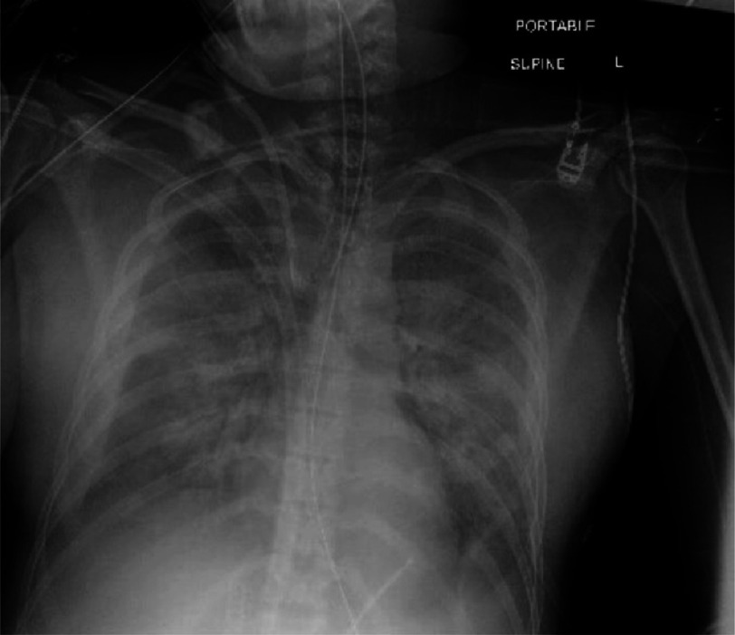
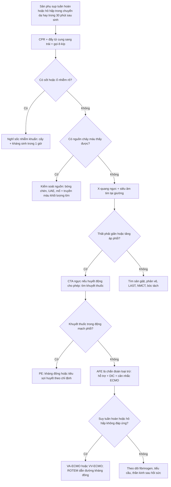
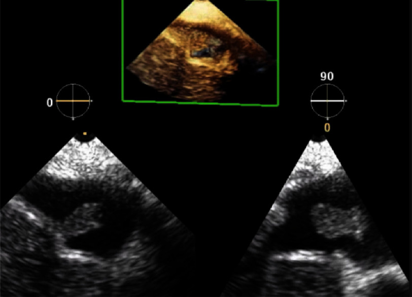
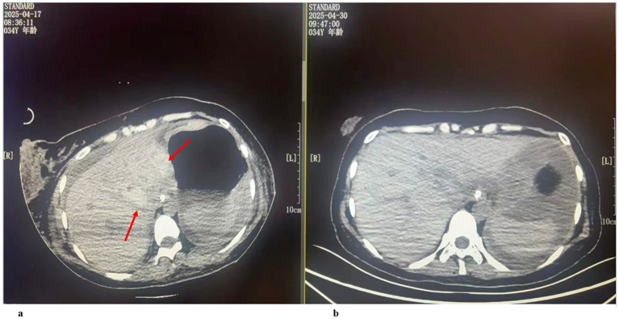

# 1956 — Thuyên tắc ối (amniotic fluid embolism, AFE): chẩn đoán bằng LOẠI TRỪ, hình ảnh chỉ để tìm nguyên nhân khác / Amniotic fluid embolism

**Tags:** `pattern:soc` `pattern:suy-that-phai` `pattern:phu-phoi` `pattern:dong-mau-noi-mach` `pattern:mat-mau-o-at` `vung:tu-cung-phan-phu` `vung:phoi` `vung:tim-phai` `protocol:Xquang-nguc` `protocol:CTA-nguc` `protocol:sieu-am-tim` `protocol:ECMO` `score:4T` `score:shock-index`
**Mức chắc chắn (certainty):** tổng hợp y văn (literature synthesis) — ghép **đoàn hệ quốc gia Hoa Kỳ 14.684.135 ca sinh** (JAMA Netw Open 2022, PMC9675004: tần suất, yếu tố nguy cơ, failure-to-rescue), **khuyến cáo SMFM cập nhật 2026** (PMC13565333: tiêu chuẩn lâm sàng + checklist xử trí ban đầu), **tổng quan 2025** (PMC12094319: tử vong theo thời gian, tiền sử 61% → ~10%), **nghiên cứu đông máu 27 ca AFE** (Sci Rep 2024, PMC10761968: tăng tiêu sợi huyết), và **3 báo cáo ca có ảnh** (Front Med 2026 PMC13057527: ngừng tim + vỡ gan; Glob Cardiol Sci Pract 2024 PMC11871562: VA-ECMO; Case Rep Obstet Gynecol 2022 PMC9132692: ROTEM dẫn đường ECMO). **Không có xét nghiệm khẳng định và không có hình ảnh đặc hiệu** — đây là giới hạn thật của toàn bộ y văn, không phải thiếu sót của bài.

> **Câu chốt:** AFE là **chẩn đoán lâm sàng–loại trừ**, đặt ra khi sản phụ **sụp tuần hoàn/hô hấp trong chuyển dạ hoặc trong 30 phút sau khi bánh nhau ra**, kèm **DIC** và **không sốt**, mà **không có nguyên nhân nào khác giải thích được** (SMFM 2026). Giá trị của CĐHA không nằm ở "thấy AFE" mà ở **loại trừ thuyên tắc phổi, bóc tách động mạch chủ, chảy máu trong ổ bụng, choáng nhiễm khuẩn** — và **không được làm chậm hồi sức/ECMO để đi chụp**.

## 1. Tổng quan bệnh học – cơ chế hình ảnh

### 1.1 Chuỗi sinh lý bệnh: ba pha trong vài phút (TẠI SAO)

- **Pha 1 — co mạch phổi + suy thất phải (phút 0–30):** dịch ối và mảnh tế bào thai vào tuần hoàn mẹ → hoạt hoá bổ thể, giải phóng chất trung gian → **co thắt mạch phổi cấp** → **tăng áp phổi cấp** → **thất phải giãn và suy** → giảm đổ đầy thất trái → **tụt huyết áp, ngừng tim**.
- **Pha 2 — suy thất trái:** thiếu máu cơ tim do giảm tưới máu vành + thiếu oxy → phù phổi cấp → **giảm oxy máu nặng**.
- **Pha 3 — rối loạn đông máu (thường trong 30 phút đầu, có khi là biểu hiện DUY NHẤT):** hoạt hoá đông máu nội mạch lan toả (DIC) + **tăng tiêu sợi huyết** — nghiên cứu so sánh 27 ca AFE với 12 ca nhau bong non nặng và 23 ca chứng cho thấy AFE có **tPA tăng và TAFI toàn phần giảm có ý nghĩa** so với cả hai nhóm, tức là có **con đường tiêu sợi huyết riêng**, không chỉ là DIC thông thường (PMC10761968).
- **Hệ quả cho hình ảnh:** phổi **phù do tăng tính thấm mao mạch** (không phải phù do tăng áp lực thuỷ tĩnh như suy tim trái mạn) → X-quang là **mờ lan toả hai bên, đối xứng, đáy nhiều hơn**, tim **không to**; tim phải **giãn** trên siêu âm tại giường; ổ bụng có thể có **máu tụ dưới bao gan** do DIC + tăng áp lực trong ổ bụng.

### 1.2 Vì sao KHÔNG có dấu hiệu hình ảnh đặc hiệu (vật lý từng phương thức)

- **X-quang ngực:** chỉ thấy **nước trong phế nang** (mờ dạng kính mờ → đông đặc) — cùng hình với phù phổi do truyền quá tải (TACO), ARDS, viêm phổi, xuất huyết phế nang. **X-quang bình thường không loại trừ AFE**, nhất là trong 30 phút đầu.
- **Siêu âm tim (TTE/TEE):** thấy **hệ quả huyết động** — thất phải giãn, vách liên thất đẩy sang trái (dấu D), tăng áp phổi, chức năng thất phải giảm. Đây là hình của **tăng áp phổi cấp**, không phải hình của AFE; **thuyên tắc phổi do huyết khối cho hình y hệt**.
- **CT/CTA:** mục đích là **loại trừ** huyết khối động mạch phổi (khuyết thuốc trong lòng mạch), **bóc tách động mạch chủ**, và tìm **ổ chảy máu** (máu tụ sau phúc mạc, vỡ gan/lách). AFE **không tạo khuyết thuốc** — mảnh ối nhỏ và phân tán, dưới ngưỡng phân giải của CT.
- **Hình ảnh "khối trong buồng tim":** cực hiếm, chỉ gặp khi **khối ối lớn đủ lớn** nằm ở nhĩ/phải; ca PMC11871562 thấy **khối di động 10 × 7 mm** ngay dưới tĩnh mạch gan trên siêu âm tim qua thành ngực. **Thấy khối không phải tiêu chuẩn chẩn đoán; không thấy khối cũng không loại trừ** — đừng để một hình đẹp làm sai đường.

### 1.3 Ngưỡng định lượng nằm lòng

- **Tần suất:** **6,0/100.000 ca sinh** trong 14.684.135 ca sinh Hoa Kỳ 2016–2019 (**880 ca AFE**) (PMC9675004); các tổng quan dùng khoảng **2–8/100.000** (PMC12094319) — khác nhau vì **tiêu chuẩn chẩn đoán không thống nhất**, không phải vì bệnh thay đổi.
- **Tử vong:** báo cáo sớm tới **61%**, số liệu gần đây **~10%**; **khoảng một nửa tử vong trong giờ đầu**, **hai phần ba trong 5 giờ**; tử vong sơ sinh **~30%** (PMC12094319).
- **Failure-to-rescue (tử vong sau khi đã chẩn đoán AFE):** **17,0%** toàn nhóm; **45,8%** khi AFE đi kèm **ngừng tim + đông máu nội mạch** (PMC9675004). Đây là con số dùng để giải thích với gia đình: **chẩn đoán đúng không bảo đảm sống**.
- **Yếu tố nguy cơ mạnh nhất:** **nhau cài răng lược (placenta accreta spectrum, PAS)** — **aOR 10,01** (KTC 95% 7,03–14,24); thể **increta/percreta aOR 17,35** (10,21–28,48) so với **accreta aOR 7,62** (4,83–12,01) (PMC9675004). Kèm theo: nhau bong non, vỡ tử cung, đa ối, viêm màng ối, tiền sản giật, thai lưu, sinh mổ, thủ thuật lấy nhau bằng tay.
- **Hệ quả đi kèm (aOR):** đông máu nội mạch **24,68** (19,38–31,44); ngừng tim **24,56** (17,84–33,81); ARDS **10,72** (8,09–14,20) (PMC9675004).
- **Cửa sổ thời gian để chẩn đoán:** khởi phát **trong chuyển dạ hoặc trong 30 phút sau khi bánh nhau ra**; **sốt là tiêu chuẩn LOẠI** (nếu sốt, nghĩ nhiễm khuẩn trước) (PMC13565333).

## 2. Mẫu hình + chẩn đoán phân biệt theo cơ chế (Gamut)

AFE là bệnh cảnh **"sụp cấp trong 30 phút quanh sinh"** — gamut xếp theo **cơ chế gây sụp**, vì trên giường bệnh câu hỏi không phải "có AFE không" mà "còn nguyên nhân nào **sửa được ngay** không".

- **Tắc mạch phổi – tim phải:** **AFE**, **thuyên tắc phổi do huyết khối (PE)**, **thuyên tắc khí**, **thuyên tắc huyết khối ối**; tất cả cho **thất phải giãn + tăng áp phổi**, khác nhau ở **bối cảnh và tốc độ**.
- **Mất máu – giảm thể tích:** **đờ tử cung**, **vỡ tử cung**, **nhau bong non**, **vỡ gan/lách**, **máu tụ sau phúc mạc** — đây là nhóm **có nguồn chảy nhìn thấy trên CT/SA**, và **hồi sức khác hẳn** (kiểm soát nguồn + truyền máu).
- **Nhiễm khuẩn:** **sốc nhiễm khuẩn đường niệu/sinh dục**, **viêm màng ối** — có **sốt**, đáp ứng kháng sinh + giải áp; AFE **không sốt**.
- **Thần kinh – sản khoa:** **sản giật**, **hội chứng HELLP vỡ gan**, **xuất huyết não** — có **tăng huyết áp, co giật, protein niệu**, hình ảnh não quyết định.
- **Thuốc – phản vệ:** **sốc phản vệ**, **ngộ độc thuốc tê tại chỗ (LAST)**, **tác dụng phụ magnesium**, **phản ứng truyền máu** — có **thuốc/dị nguyên khởi phát**, đáp ứng adrenaline.
- **Tim – mạch:** **bóc tách động mạch chủ**, **nhồi máu cơ tim**, **rối loạn nhịp**, **bệnh van tim** — CTA/ECG chốt.

Gợi nhớ **"SHE-CAN'T"** cho sụp quanh sinh: **S**epsis, **H**emorrhage, **E**mbolism (AFE/PE/khí), **C**ardiac (NMCT/bóc tách/rối loạn nhịp), **A**naphylaxis, **N**euro (sản giật/xuất huyết não), **T**oxicity (LAST/magnesium).

## 3. Bảng so sánh phân biệt (ma trận đối chiếu)

| Thực thể (entity) | Hình ảnh điển hình | Chốt vào (rule-in) | Chốt loại (rule-out) | Gợi ý xác nhận |
|---|---|---|---|---|
| **AFE** | X-quang: mờ lan toả hai bên kiểu phù phổi, tim không to; SA tim: **thất phải giãn + dấu D**, tăng áp phổi; CTA **không có khuyết thuốc**; CT bụng có thể có máu tụ do DIC | **Sụp trong 30 phút quanh sinh + DIC + KHÔNG sốt + không nguyên nhân khác** (tiêu chuẩn lâm sàng) | **Không có hình ảnh nào loại trừ được**; X-quang bình thường **không** loại trừ | Chẩn đoán loại trừ; theo dõi fibrinogen/ROTEM; điều trị hỗ trợ |
| **Thuyên tắc phổi (PE)** | CTA: **khuyết thuốc lòng mạch** hình nhánh cây; thất phải giãn nếu tắc lớn | **Khuyết thuốc trong động mạch phổi** trên CTA | CTA âm tính chất lượng tốt + D-dimer thấp | CTA ngực (nếu huyết động cho phép), siêu âm tim |
| **Mất máu ồ ạt (đờ tử cung/vỡ tử cung/vỡ gan)** | CT: ổ máu tụ, máu tự do, **thoát mạch ≥ 100 HU** thì động mạch; X-quang phổi **sạch** giai đoạn đầu | **Nguồn chảy thấy được + đáp ứng với truyền máu/kiểm soát nguồn** | Không có ổ dịch/máu tự do + Hb ổn định sau bù | CT bụng cản quang, SA tại giường, bóng chèn/UAE |
| **Sốc nhiễm khuẩn sản khoa** | CT: ổ nhiễm, khí trong mô, dịch; X-quang có thể có đông đặc khu trú | **Sốt + ổ nhiễm + cấy dương + đáp ứng kháng sinh** | Không sốt, không ổ nhiễm, lactate giảm sau hồi sức | Cấy máu/dịch ối, procalcitonin, CT bụng–chậu |
| **Sản giật / HELLP** | MRI não: **PRES** (T2/FLAIR tăng đối xứng vùng chẩm–đỉnh); CT gan: máu tụ dưới bao | **Tăng huyết áp + co giật + protein niệu/tiểu cầu giảm** | Huyết áp bình thường, không protein niệu | MRI sọ, xét nghiệm gan–thận–huyết học |
| **Thuyên tắc khí** | CT: **khí trong buồng tim/thất phải** hoặc tĩnh mạch; X-quang ít giá trị | **Khí thấy trong tim/tĩnh mạch lớn** + bối cảnh (truyền, mổ) | Không thấy khí + không bối cảnh | CT ngực, SA tim; nằm đầu thấp, 100% O₂ |
| **LAST / phản vệ** | Hình ảnh **bình thường** hoặc phù phổi sau hồi sức | **Thuốc tê/dị nguyên + ban, co thắt phế quản, đáp ứng adrenaline** | Không phơi nhiễm + không đáp ứng | Lâm sàng; tryptase (phản vệ) |

*X-quang ngực thẳng tại giường (tư thế nằm ngửa) ở ca AFE sau sinh đường âm đạo, có VA-ECMO: mờ lan toả hai bên kiểu phù phổi. Đây là hình **hệ quả**, không phải hình chẩn đoán — cùng hình với TACO, ARDS, viêm phổi. Nguồn: Glob Cardiol Sci Pract 2024 (PMC11871562), CC BY 4.0.*

## 4. Protocol + tiêu chuẩn chẩn đoán + quyết định

### 4.1 Tiêu chuẩn lâm sàng (thay cho "tiêu chuẩn hình ảnh")

1. **Sụp tuần hoàn hoặc hô hấp** (ngừng tim, tụt huyết áp kèm suy hô hấp) **trong chuyển dạ hoặc trong 30 phút sau khi bánh nhau ra**.
2. **Đông máu nội mạch lan toả** (chảy máu không cầm, fibrinogen giảm nhanh, tiểu cầu giảm).
3. **Không sốt**.
4. **Không có nguyên nhân khác** giải thích được (sau khi loại trừ PE, chảy máu, sản giật, phản vệ, nhiễm khuẩn).

*Nguồn: SMFM Special Statement cập nhật 2026 (PMC13565333); bộ tiêu chuẩn gốc Clark–Hankins.*

### 4.2 Trình tự hình ảnh (chỉ sau khi đã bắt đầu hồi sức)

- **Bước 0 — không chờ hình ảnh:** gọi ê-kíp sản–gây mê–hồi sức, **CPR chất lượng cao + đẩy tử cung sang trái**, mổ lấy thai trong 4 phút nếu ngừng tim và thai ≥ 23 tuần (resuscitative hysterotomy).
- **Bước 1 — X-quang ngực tại giường (1 phim, tư thế nằm):** phân biệt phù phổi với phổi sạch; **không dùng để chẩn đoán AFE**.
- **Bước 2 — siêu âm tim tại giường (TTE, hoặc TEE nếu đã gây mê):** tìm **thất phải giãn/dấu D**, chức năng thất trái, khối trong buồng tim, tràn dịch màng tim. Siêu âm **trả lời được trong 2–3 phút** và **không cần di chuyển bệnh nhân**.
- **Bước 3 — CTA ngực (± bụng–chậu)** chỉ khi **huyết động tạm ổn** và **PE/bóc tách còn là câu hỏi thật**: khuyết thuốc = PE; **không khuyết thuốc không loại trừ AFE**; tìm máu tụ sau phúc mạc, vỡ gan.
- **Bước 4 — CT/MRI sọ** khi có dấu hiệu thần kinh sau hồi sức (tiên lượng thần kinh, PRES, xuất huyết).
- **Bước 5 — ECMO** khi suy tuần hoàn/hô hấp không đáp ứng: **VA-ECMO** cho suy tim; **VV-ECMO** cho suy hô hấp đơn thuần. Ca PMC11871562 và PMC13057527 sống sót nhờ ECMO; ca PMC9132692 dùng **ROTEM để quyết định có/không kháng đông trong ECMO** vì bệnh nhân đã DIC nặng.

### 4.3 Điều trị hỗ trợ — những gì hình ảnh không thay được

- **Đường thở + thông khí:** oxy 100% giai đoạn đầu; đặt nội khí quản sớm nếu hôn mê/suy hô hấp.
- **Tuần hoàn:** adrenaline theo ACLS; **norepinephrine** duy trì huyết áp; **tránh thuốc gây giãn mạch phổi không chọn lọc** khi chưa có siêu âm tim.
- **Đờ tử cung đi kèm (rất thường gặp):** oxytocin, carboprost, misoprostol theo phác đồ; **TXA 1 g trong 3 giờ** (bài 1932).
- **Đông máu:** bù fibrinogen theo ngưỡng **< 2 g/L** (bài 1932); theo dõi bằng ROTEM/TEG khi có; **không truyền tiểu cầu dự phòng** nếu không chảy máu.
- **Sau hồi sức:** theo dõi **di chứng thần kinh** (thiếu oxy não) và **suy tim**; tư vấn thai kỳ sau — nguy cơ tái phát **chưa rõ**, không đủ dữ liệu để khuyên mổ lấy thai chủ động (PMC12094319).

## 5. Biến thể bình thường và cạm bẫy

- **X-quang bình thường trong 30 phút đầu** là chuyện thường — **không** loại trừ AFE; đừng "chờ phim sạch rồi yên tâm".
- **Phù phổi hai bên sau sinh = TACO** là cạm bẫy hay gặp: bệnh nhân vừa nhận dịch/oxytocin/truyền máu → **tim to, tĩnh mạch cổ nổi, đáp ứng lợi tiểu**; AFE có **thất phải giãn + DIC + không sốt**. Siêu âm tim phân biệt trong 2 phút.
- **Thất phải giãn ≠ PE:** cả hai đều giãn; **CTA là thứ phân biệt**, nhưng **đừng chụp khi huyết động chưa ổn** — nguy cơ ngừng tim trên bàn chụp cao hơn lợi ích.
- **Nhầm "không sốt" với "không nhiễm khuẩn":** sản phụ sốc có thể hạ thân nhiệt; **cấy máu + lactate + đáp ứng kháng sinh** mới là bằng chứng.
- **Bỏ sót vỡ gan/lách:** đau vai, thiếu máu không giải thích, bụng chướng sau hồi sức → **CT bụng cản quang**; ca PMC13057527 vỡ gan chỉ phát hiện khi mở bụng.
- **Sai số đo trên X-quang tại giường:** phim nằm ngửa làm **rốn phổi rộng giả**, mờ đáy do **tràn dịch lượng nhỏ**; so với phim trước và đọc cùng siêu âm phổi.
- **Ảnh hưởng của ECMO:** cannula và màng ECMO tạo **mờ/đường ống trên phim**, dễ đọc nhầm là khí trong trung thất; đối chiếu vị trí cannula.
- **Sai lầm hệ thống hay gặp nhất:** dành 20 phút cho chẩn đoán phân biệt trong khi **cửa sổ sống là 60 phút đầu** — hồi sức và **chuẩn bị ECMO** phải chạy song song với chẩn đoán.

## 6. Tự lượng giá — Blind Quiz

**Ca 1 — Sản phụ 29 tuổi, sau sinh đường âm đạo 30 phút thì khó thở, tím, tụt huyết áp. Nhìn phim trước, mô tả trước.**

- Gợi ý lâm sàng: không sốt, không chảy máu âm đạo rõ, fibrinogen tụt nhanh.
- Câu hỏi: Mô tả mờ phổi? Tim có to không? Ba chẩn đoán phân biệt hàng đầu và một thăm khám phân biệt trong 2 phút?

<b>Bấm để hiện đáp án (findings + chẩn đoán)</b>

- **Findings:** mờ lan toả hai bên, đối xứng, đáy nhiều hơn, **tim không to**, nhiều đường truyền và ống (bệnh nhân đang ECMO).
- **Chẩn đoán:** phù phổi cấp trong **AFE** (tiêu chuẩn lâm sàng: sụp trong 30 phút sau sinh + DIC + không sốt).
- **Phân biệt:** TACO (tim to, đáp ứng lợi tiểu), ARDS (khởi phát chậm hơn, không DIC sớm), viêm phổi (đông đặc khu trú, sốt), PE (CTA khuyết thuốc). **Siêu âm tim tại giường** là thăm khám phân biệt nhanh nhất.
- Nguồn ảnh: Glob Cardiol Sci Pract 2024 (PMC11871562), CC BY 4.0.

**Ca 2 — Cùng bệnh nhân, siêu âm tim trong lúc hồi sức:**

- Câu hỏi: Cấu trúc trong buồng tim là gì? Nó có phải tiêu chuẩn chẩn đoán AFE không?

<b>Bấm để hiện đáp án</b>

- **Findings:** khối di động trong **buồng tim phải** (nhĩ/thất phải), thấy rõ trên TEE 2 bình diện và dựng hình 3D.
- **Ý nghĩa:** đây là **mảnh ối/huyết khối ối nhìn thấy được** — **cực hiếm** (khối 10 × 7 mm trong ca này). **Không phải tiêu chuẩn chẩn đoán**; đa số ca AFE **không thấy khối**, và thấy khối **không** chứng minh AFE (huyết khối thông thường cũng cho hình này).
- **Giá trị thực dụng:** khối lớn trong tim phải giải thích **tắc nghẽn cơ học** và củng cố chỉ định **ECMO/phẫu thuật lấy khối** nếu tắc nghẽn nặng.
- Nguồn ảnh: Glob Cardiol Sci Pract 2024 (PMC11871562), CC BY 4.0.

**Ca 3 — Sản phụ 34 tuổi, 40 tuần 2 ngày, chuyển dạ: nhịp tim thai tụt đột ngột, sau đó sùi bọt hồng và hôn mê. Mổ lấy thai cấp, sau mổ chảy máu ồ ạt, ngừng tim lặp lại. CT bụng dưới đây:**

- Câu hỏi: Hai mũi tên đỏ chỉ gì? Vì sao bệnh nhân AFE lại có tổn thương này? Nó thay đổi xử trí thế nào?

<b>Bấm để hiện đáp án</b>

- **Findings:** (a) ngày 5 sau mổ — **máu tụ/dập gan** dưới bao gan (mũi tên), có dịch quanh gan; (b) ngày 18 — ổ máu tụ thu nhỏ, gan hồi phục.
- **Cơ chế:** DIC + tăng áp lực trong ổ bụng + co mạch do sốc → **vỡ gan tự phát**, biến chứng được mô tả ở thai kỳ có tăng huyết áp/HELLP nhưng ca này **không có tiền sử tăng huyết áp, tiền sản giật hay HELLP**.
- **Xử trí:** chảy máu gan là **nguồn chảy phải kiểm soát** (chèn, nút mạch, mổ) song song với hồi sức AFE — không được quy mọi tụt huyết áp cho "AFE" mà bỏ qua ổ chảy.
- Nguồn ảnh: Front Med 2026 (PMC13057527), CC BY 4.0.

## Bài liên quan chéo

- [500 – Tổng quan Vú & Sản phụ khoa](../500-tong-quan-vu-san-phu-khoa/lesson.md)
- [1932 – Truyền máu khối lượng lớn & rối loạn đông máu trong PPH](../1932-truyen-mau-khoi-luong-lon-bang-huyet-sau-sinh/lesson.md) (ngưỡng fibrinogen, TXA, ROTEM)
- [1927 – Thắt động mạch tử cung & động mạch chậu trong](../1927-that-dong-mach-tu-cung-va-dong-mach-chau-trong/lesson.md) (kiểm soát nguồn chảy)
- [1728 – Chảy máu sau vỡ tử cung](../1728-chay-mau-sau-vo-tu-cung/lesson.md) (CT cản quang tìm thoát mạch)
- [1957 – Hoại tử vỏ thận sau băng huyết sau sinh](../1957-hoai-tu-vo-than-sau-bang-huyet/lesson.md) (biến chứng thận của cùng bệnh cảnh)
- [070 – Thuyên tắc phổi cấp](../070-thuyen-tac-phoi-dmc-cap/lesson.md) (khuyết thuốc trên CTA — hàng phân biệt số 1)

## Ảnh

- `1956_thuyen-tac-oi_XR_GCSP-PMC11871562.jpg` — X-quang ngực, PMC11871562, **CC BY 4.0**.
- `1956_thuyen-tac-oi_TEE_GCSP-PMC11871562.jpg` — siêu âm tim qua thực quản, PMC11871562, **CC BY 4.0**.
- `1956_thuyen-tac-oi_CT_FrontMed-PMC13057527.jpg` — CT bụng, PMC13057527, **CC BY 4.0**.
- Nguồn + giấy phép từng ảnh: `images/CREDITS.md`; nguồn bài: `sources.md`.

> Không dùng để chẩn đoán độc lập khi chưa có người hướng dẫn.
