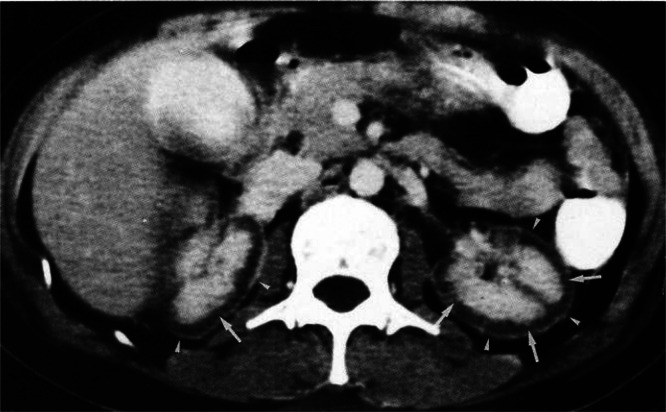
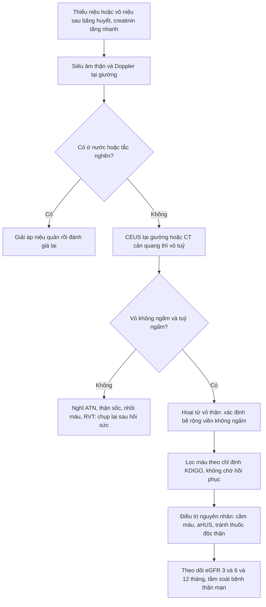
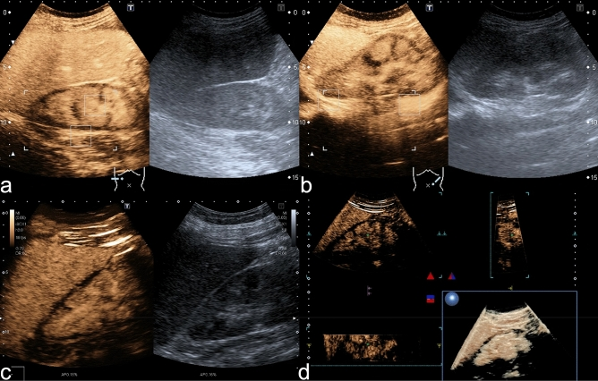
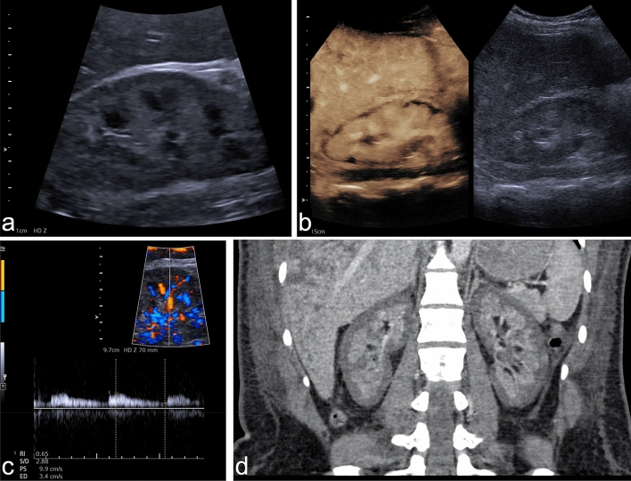
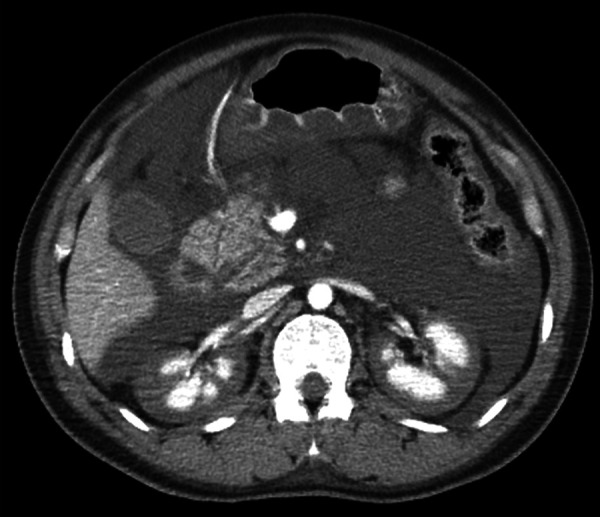

# 1957 — Hoại tử vỏ thận sau băng huyết sau sinh: vỏ không ngấm thuốc, tuỷ còn ngấm / Postpartum renal cortical necrosis

**Tags:** `pattern:vo-than-khong-ngam` `pattern:hoai-tu` `pattern:suy-than-cap` `pattern:giam-tuoi-mau` `pattern:vi-mach-huyet-khoi` `vung:than` `vung:tu-cung-phan-phu` `protocol:CT-bung-can-quang` `protocol:CEUS` `protocol:MRI-bung` `score:KDIGO`
**Mức chắc chắn (certainty):** tổng hợp y văn (literature synthesis) — ghép **loạt 21 ca RCN thai kỳ** (Kidney Int Rep 2019, PMC6409395: 17,5% AKI thai kỳ, 95,2% aHUS, kết cục 6 tháng), **loạt 17 ca MRI chức năng không cản từ** (Kidney Med 2023, PMC10131107: phenotype lan toả/khu trú và tiên lượng), **loạt 12 ca sinh thiết** (Kidney Med 2024, PMC11417324: đặc điểm mô bệnh và kết cục), **nghiên cứu CEUS 12 ca** (Sci Rep 2021, PMC7820240: reverse rim sign 12/12, RI, phân biệt huyết khối tĩnh mạch thận), **ca lâm sàng có ảnh CT** (Radiology Case Reports 2025, PMC12138507; Clin Nephrol Case Stud 2025, PMC12723601) và **ca RCN MỘT BÊN** (Radiology Case Reports 2024, PMC10992279). Số nào nguồn không nêu ghi "chưa rõ".

> **Câu chốt:** sau băng huyết, **thiểu niệu/vô niệu kéo dài + creatinin tăng nhanh** mà **siêu âm chỉ thấy thận bình thường** thì phải nghĩ **hoại tử vỏ thận** — chẩn đoán bằng **vỏ thận không ngấm thuốc trong khi tuỷ vẫn ngấm** (CT cản quang hoặc CEUS tại giường). Đây là **tổn thương không hồi phục hoàn toàn**: **66,7% còn lọc máu ở 6 tháng** trong một loạt, và **41%** phụ thuộc lọc máu trong một loạt MRI — khác hẳn **hoại tử ống thận cấp** (ATN) vốn hồi phục. Gọi nhầm ATN → tiên lượng sai, không chuẩn bị lọc máu mạn/ghép.

## 1. Tổng quan bệnh học – cơ chế hình ảnh

### 1.1 Vì sao VỎ chết mà TUỶ sống (TẠI SAO — cốt lõi của bài)

- **Giải phẫu mạch máu:** vỏ thận nhận **~90–95% lưu lượng máu thận** qua các **động mạch gian tiểu thuỳ (interlobular arteries)** rồi tiểu động mạch vào (afferent) — đây là **đoạn cuối của cây mạch**, không có tuần hoàn bàng hệ trong nhu mô. Tuỷ thận nhận lưu lượng **thấp hơn nhiều** nhưng được cấp bởi **vasa recta** chạy dọc và có **khả năng chịu thiếu oxy cao hơn** (nồng độ oxy thấp sinh lý, chuyển hoá kỵ khí).
- **Khi có sốc/giảm tưới máu toàn thể + DIC (điển hình sau băng huyết):** co mạch tiểu động mạch vào + huyết khối vi mạch + tổn thương nội mạc → **vỏ thận — nơi có nhu cầu oxy cao nhất và là "điểm tận" của mạch — chịu thiếu máu nặng nhất**, trong khi tuỷ vẫn được tưới một phần. Kết quả: **hoại tử đông vón vỏ thận (coagulative necrosis)** lan toả, **tuỷ còn sống** — đây chính là hình "vỏ tối, tuỷ sáng" trên CT.
- **Vì sao tổn thương KHÔNG hồi phục hoàn toàn:** vỏ là nơi chứa **toàn bộ cầu thận**; cầu thận hoại tử **không tái sinh**. Phần vỏ còn sống chỉ là **dải mỏng dưới bao** nuôi bởi **nhánh động mạch bao (capsular arteries)** — nên có thể thấy **viền mỏng ngấm thuốc sát bao** ("cortical rim sign"), và chức năng chỉ hồi phục **một phần** nhờ các nephron còn sót.
- **Vì sao thường gặp ở sản khoa:** thai kỳ có **tăng đông**, **giảm bù dịch nội mạch khi mất máu ồ ạt**, và các nguyên nhân **DIC "sản khoa"** (nhau bong non, nhau cài răng lược, thuyên tắc ối, nhiễm khuẩn ối, sảy thai nhiễm khuẩn) — đó là lý do RCN là **biến chứng thận nặng nhất của băng huyết sau sinh**.

### 1.2 Vì sao hình ảnh trông như vậy (vật lý từng phương thức)

- **CT cản quang (thì vỏ/tuỷ 80–100 giây):** iod có **Z = 53**, làm tăng độ suy giảm tia X tỉ lệ với nồng độ iod trong mô (khoảng **25–30 HU cho mỗi 1 mg iod/mL** ở 120 kVp). **Không có tưới máu → không có iod → không tăng đậm độ** → vỏ **không ngấm thuốc**, còn tuỷ (còn tưới máu) **ngấm thuốc** → **chênh đậm độ đảo ngược** so với bình thường (bình thường vỏ sáng hơn tuỷ ở thì vỏ). Dấu hiệu đặc hiệu: **không bài tiết thuốc cản quang vào đài bể thận** (PMC6409395).
- **CEUS (siêu âm cản quang):** vi bọt khí **nằm trong lòng mạch** (không vào kẽ) → bản đồ tưới máu thật, **không độc thận**, làm được **tại giường**. Vỏ hoại tử **không tăng âm** trong khi **tháp tuỷ tăng âm** → **"reverse rim sign"** (viền dưới bao không ngấm). Nghiên cứu 12 ca: **reverse rim sign 12/12 (100%)**, trong khi **viền giảm âm trên B-mode chỉ 4/12 (33,3%)** — nghĩa là **siêu âm thường bỏ sót 2/3 số ca** (PMC7820240).
- **Siêu âm Doppler:** **chỉ số sức cản (RI) < 1** ở cả 10 ca đo được (trung vị **0,78**; khoảng **0,60–0,91**) — khác **huyết khối tĩnh mạch thận** có **RI > 1 hoặc không đo được vì giảm tưới máu** (p = 0,001) (PMC7820240).
- **MRI:** tổn thương **T2 tối** ở **vỏ trong và cột Bertin** (phù vỏ ngoài giai đoạn sớm, sau đó **mỏng vỏ + giảm tín hiệu T2** rõ dần) — vì **hoại tử đông vón làm mất nước tự do** và **máu thoái hoá (deoxyhemoglobin/hemosiderin) rút ngắn T2**; mô hoại tử **không ngấm thuốc** trên T1 sau tiêm. MRI **không cần iod** nên dùng được khi suy thận nặng (PMC10131107).

### 1.3 Ngưỡng định lượng nằm lòng

- **Tần suất:** RCN chiếm **17,5%** các ca **tổn thương thận cấp liên quan thai kỳ** trong một loạt 21 ca (tất cả đều **sau sinh**) (PMC6409395). Con số này **không** đại diện toàn cầu — phụ thuộc tuyến chuyển đến; dùng để nhớ **RCN không phải "ca hiếm gặp trong đề thi" mà là biến chứng gặp thật**.
- **Nguyên nhân nền trong thai kỳ:** **88%** có **aHUS** (tán huyết–tăng ure máu không điển hình), **65%** có **băng huyết sau sinh**, **41%** có **tiền sản giật/HELLP**, **24%** có **DIC** (loạt 17 ca MRI) (PMC10131107). Trong loạt 21 ca: **95,2%** có thiếu máu tán huyết vi mạch; **9/15** ca xét nghiệm có **bất thường bổ thể** (PMC6409395).
- **Kết cục 6 tháng (loạt 21 ca):** chỉ **9,5%** hồi phục một phần, **23,8% tử vong**, **66,7% còn lọc máu** (PMC6409395).
- **Kết cục dài hạn (loạt 17 ca MRI, theo dõi trung vị 60 tháng):** **4 ca eGFR ≥ 60**, **6 ca eGFR 15–60**, **7 ca phụ thuộc lọc máu (41%)**; **100% ca phenotype lan toả (diffuse) đều phụ thuộc lọc máu** (PMC10131107).
- **Kết cục theo mô bệnh (loạt 12 ca sinh thiết):** **4/12 (33%)** có **eGFR < 30** sau 6 tháng; nhóm kết cục xấu có **nhiều hoại tử đông vón cầu thận, huyết khối mao mạch, hoại tử vỏ lan rộng và tổn thương tiểu động mạch** hơn (PMC11417324).
- **Ngưỡng hình ảnh:** **viền không ngấm rộng tối đa trung vị 4,5 mm** (IQR 3–5,8) trên CEUS; **thuốc vào vỏ chậm > 20 giây** gặp ở **6/12 (50%)** — nên phải **quan sát ít nhất 2 phút** trước khi kết luận (PMC7820240).
- **AKI:** tất cả bệnh nhân trong các loạt đều **AKI giai đoạn 3 (KDIGO)** — creatinin **≥ 3 lần** nền hoặc **≥ 353,6 µmol/L**, hoặc **vô niệu ≥ 12 giờ**.

## 2. Mẫu hình + chẩn đoán phân biệt theo vị trí (Gamut)

Mẫu hình mẹ: **thận hai bên, vỏ không ngấm thuốc đối xứng, tuỷ ngấm thuốc, không bài tiết thuốc** — gamut theo **phân bố tổn thương**:

- **Lan toả, đối xứng, toàn bộ vỏ (hai bên):** **hoại tử vỏ thận** (sản khoa, nhiễm khuẩn, DIC, sốc), **nhồi máu thận toàn thể hai bên** (huyết khối động mạch thận hai bên, bóc tách động mạch chủ lan tới), **"thận sốc" (shock kidney)** — giảm tưới máu toàn thể có thể hồi phục.
- **Khu trú / một bên:** **nhồi máu thận một bên** (thuyên tắc), **RCN một bên** (hiếm — chỉ vài ca trong y văn, thường kèm **tắc nghẽn đối bên** hoặc DIC) (PMC10992279), **viêm thận bể thận cấp** (ổ giảm ngấm hình nêm + ứ mủ).
- **Giảm ngấm không đều, dạng mảng:** **ATN** (vỏ vẫn ngấm, giảm ngấm vỏ không đều), **tổn thương do thuốc cản quang**, **bệnh thận do tăng huyết áp ác tính**.
- **Tuỷ tổn thương, vỏ còn:** **hoại tử nhú thận (papillary necrosis)** — ngược lại RCN: nhú không ngấm, vỏ còn.
- **Thận to + giảm ngấm + huyết khối trong tĩnh mạch:** **huyết khối tĩnh mạch thận** — RI > 1, thấy huyết khối trong lòng tĩnh mạch thận.

Gợi nhớ 4 câu hỏi: **(1) vỏ có ngấm không? (2) tuỷ có ngấm không? (3) có bài tiết thuốc không? (4) một bên hay hai bên?**

## 3. Bảng so sánh phân biệt (ma trận đối chiếu)

| Thực thể (entity) | Hình ảnh điển hình (CT thì vỏ–tuỷ / CEUS / MRI) | Chốt vào (rule-in) | Chốt loại (rule-out) | Gợi ý xác nhận |
|---|---|---|---|---|
| **Hoại tử vỏ thận (RCN)** | **Vỏ không ngấm toàn bộ, tuỷ ngấm**, không bài tiết thuốc; CEUS: **reverse rim sign**, viền không ngấm ~**4,5 mm**; MRI T2: **dải tối vỏ trong + cột Bertin** | **Vỏ không ngấm + tuỷ ngấm + bối cảnh băng huyết/DIC** | Vỏ ngấm đều (dù giảm) → không phải RCN toàn bộ | CEUS tại giường hoặc CT cản quang; sinh thiết nếu còn nghi ngờ |
| **Hoại tử ống thận cấp (ATN)** | Vỏ **vẫn ngấm thuốc**, có thể **giảm không đều**; thận to nhẹ; CEUS: tưới máu vỏ còn | **Vỏ còn tưới máu + thiểu niệu hồi phục sau 1–3 tuần** | Vỏ không ngấm hoàn toàn → nghĩ RCN | Theo dõi creatinin/nước tiểu; sinh thiết khi không hồi phục |
| **Nhồi máu thận toàn thể** | **Không ngấm cả vỏ và tuỷ** ở vùng nhồi máu, hình **nêm** hoặc toàn thận; có thể thấy **huyết khối động mạch** | **Khuyết ngấm hình nêm + huyết khối ĐM thận** trên CTA | Còn ngấm tuỷ → không phải nhồi máu toàn thể | CTA thì động mạch; siêu âm Doppler (mất phổ) |
| **Huyết khối tĩnh mạch thận** | Thận **to**, giảm ngấm lan toả, **huyết khối trong tĩnh mạch thận**; Doppler **RI > 1** hoặc không đo được | **Huyết khối trong lòng tĩnh mạch thận + RI > 1** | RI < 1 + tuỷ ngấm → không phải RVT | CT tĩnh mạch thì muộn; Doppler; MRI |
| **"Thận sốc" (shock kidney)** | Giảm ngấm vỏ **không đều**, có mảng còn ngấm; **hồi phục sau hồi sức** | **Giảm ngấm mảng + huyết động cải thiện → tưới máu trở lại** | Không ngấm toàn bộ + không hồi phục → nghĩ RCN | Chụp lại sau 24–48 giờ hồi sức |
| **Hoại tử nhú thận** | **Nhú không ngấm**, vỏ còn ngấm; có thể thấy mảnh nhú trong đài bể thận | **Khuyết nhú + vỏ còn tưới máu** | Vỏ không ngấm → không phải hoại tử nhú đơn thuần | CT thì bài tiết; soi bàng quang thấy mảnh nhú |

*CT cản quang ngày 2 ở bệnh nhân hoại tử vỏ thận hai bên sau băng huyết sau sinh: vỏ không ngấm thuốc, tuỷ còn ngấm (mũi tên) — "vỏ tối, tuỷ sáng". Nguồn: Radiology Case Reports 2025 (PMC12138507), CC BY-NC-ND 4.0 — nguyên bản, không chỉnh sửa.*

## 4. Protocol + phân độ + quyết định

### 4.1 Trình tự chẩn đoán (bắt đầu bằng thứ không cần iod)

- **Bước 1 — siêu âm thận + Doppler tại giường:** loại **ứ nước (tắc nghẽn)**, đo kích thước thận, **RI**. Lưu ý: **B-mode thường bình thường** trong RCN (chỉ 33,3% thấy viền giảm âm) — **siêu âm bình thường không loại trừ**.
- **Bước 2 — CEUS tại giường (ưu tiên khi có):** không độc thận, làm được ở bệnh nhân đang lọc máu; tìm **reverse rim sign**, đo **bề rộng viền không ngấm**, quan sát **≥ 2 phút** (thuốc vào vỏ chậm > 20 giây ở 50% ca).
- **Bước 3 — CT bụng–chậu cản quang (thì vỏ–tuỷ 80–100 giây, có thì bài tiết 5–10 phút):** xác nhận **vỏ không ngấm + tuỷ ngấm + không bài tiết**; đồng thời tìm **nguồn chảy máu còn hoạt động** (thoát mạch ≥ 100 HU) và **máu tụ sau phúc mạc** — một lần chụp trả lời hai câu hỏi.
- **Bước 4 — MRI (khi không dùng được iod hoặc cần tiên lượng):** T1 sau tiêm + T2 + DWI; **phenotype lan toả** (dải tối vỏ trong + cột Bertin, vỏ mỏng dần) **tiên lượng phụ thuộc lọc máu**.
- **Bước 5 — sinh thiết thận** khi chẩn đoán còn mơ hồ hoặc để phân biệt aHUS/TMA (mô bệnh: hoại tử đông vón vỏ ngoài, huyết khối mao mạch, cầu thận vỏ sâu còn sống) (PMC11417324, PMC12723601).

### 4.2 Phân độ và quyết định điều trị

- **Phân độ AKI theo KDIGO** (dùng chung, không có phân độ riêng cho RCN): giai đoạn 3 khi creatinin **≥ 3 lần nền** hoặc **≥ 353,6 µmol/L** hoặc **nước tiểu < 0,3 mL/kg/giờ trong 24 giờ** hoặc **vô niệu ≥ 12 giờ**.
- **Chỉ định lọc máu:** quá tải dịch, toan chuyển hoá, tăng kali không đáp ứng, urê cao có triệu chứng — **không chờ "xem có hồi phục không"**.
- **Lựa chọn lọc máu:** ca PMC12723601 chuyển sang **thận nhân tạo phúc mạc (PD)** để chăm con tại nhà, **ngừng lọc sau 6 tháng**, 4 năm sau creatinin **2,67 mg/dL** — bằng chứng rằng **RCN không đồng nghĩa lọc máu suốt đời**; nhưng phải nói rõ **đa số vẫn phụ thuộc lọc máu** (66,7% và 41% ở hai loạt trên).
- **Điều trị nguyên nhân nền:** kiểm soát chảy máu (bài 1932, 1927), **ức chế bổ thể ở aHUS** khi xác định (thảo luận với huyết học/thận), **tránh thuốc độc thận**, tối ưu huyết áp.
- **Theo dõi:** creatinin + nước tiểu **hằng ngày** giai đoạn cấp; **eGFR + protein niệu ở 3, 6, 12 tháng**; siêu âm/CEUS lặp lại để đánh giá **thể tích vỏ còn sống**; tầm soát **bệnh thận mạn** và **tăng huyết áp** sau đó.

## 5. Biến thể bình thường và cạm bẫy

- **Hai dấu "rim" ngược nhau — đừng lẫn:**
  - **"Cortical rim sign"** = **viền MỎNG NGẤM thuốc** sát bao, nuôi bởi **nhánh động mạch bao** — nghĩa là **còn một ít vỏ sống**, gặp trong RCN **và** nhồi máu thận; **không** phải dấu hiệu của vỏ lành toàn bộ.
  - **"Reverse rim sign"** trên CEUS = **viền dưới bao KHÔNG ngấm** (vỏ hoại tử) + **tháp tuỷ ngấm** — dấu hiệu **đặc trưng của RCN** (PMC7820240).
- **Siêu âm B-mode bình thường:** chỉ 1/3 ca có viền giảm âm → **không được trấn an bằng "siêu âm bình thường"** ở bệnh nhân vô niệu sau băng huyết.
- **"Thận sốc" giả RCN:** giảm tưới máu toàn thể do tụt huyết áp gây **giảm ngấm vỏ lan toả** nhưng **hồi phục** khi huyết động ổn — **chụp lại sau 24–48 giờ** trước khi kết luận vĩnh viễn.
- **RCN một bên:** hiếm, nhưng có thật — ca 51 tuổi có **sỏi 4 mm tắc nghẽn bên phải + RCN bên trái** do nhiễm khuẩn huyết/DIC; **đừng mặc định "luôn hai bên"** rồi bỏ sót tổn thương một bên (PMC10992279).
- **Ảnh giả do thì chụp:** chụp **quá sớm (< 60 giây)** thấy vỏ–tuỷ chưa tách rõ; chụp **quá muộn** khi thuốc đã vào đài bể thận làm mất dấu "không bài tiết". Ghi rõ **thì chụp** khi đọc.
- **Bệnh nhân đang lọc máu:** creatinin **không phản ánh** chức năng thận — dùng **nước tiểu 24 giờ** và hình ảnh để đánh giá.
- **Sai lầm hệ thống:** quy toàn bộ thiểu niệu cho "hoại tử ống thận do sốc" — ATN **hồi phục trong 1–3 tuần**, RCN thì không; **sự khác biệt này là lý do phải chụp**.

## 6. Tự lượng giá — Blind Quiz

**Ca 1 — Sản phụ 38 tuổi, sinh thường 37 tuần, tiền sản giật – HELLP – nhau bong non, băng huyết sau sinh, vô niệu ngày thứ 2. Nhìn CT trước, mô tả trước.**

- Gợi ý lâm sàng: creatinin tăng nhanh, nước tiểu gần như không có, đang lọc máu.
- Câu hỏi: Mô tả đậm độ vỏ và tuỷ hai thận? Có thấy thuốc trong đài bể thận không? Chẩn đoán và 3 phân biệt?

<b>Bấm để hiện đáp án (findings + chẩn đoán)</b>

- **Findings:** **vỏ thận hai bên không ngấm thuốc** (mũi tên), **tuỷ còn ngấm thuốc**; **không thấy thuốc cản quang trong đài bể thận**.
- **Chẩn đoán:** **hoại tử vỏ thận hai bên** sau băng huyết — vỏ là "điểm tận" của tuần hoàn thận nên chịu thiếu máu nặng nhất, tuỷ còn tưới máu.
- **Phân biệt:** ATN (vỏ vẫn ngấm), nhồi máu thận toàn thể (cả vỏ và tuỷ không ngấm), huyết khối tĩnh mạch thận (thận to, huyết khối trong tĩnh mạch, RI > 1).
- Nguồn ảnh: Radiology Case Reports 2025 (PMC12138507), CC BY-NC-ND 4.0.

**Ca 2 — Cùng bệnh cảnh, siêu âm cản quang (CEUS) tại giường:**

- Câu hỏi: Dấu hiệu trong (a) và (b) gọi là gì? Vì sao CEUS thấy rõ hơn B-mode? Phải quan sát bao lâu?

<b>Bấm để hiện đáp án</b>

- **Findings:** **viền dưới bao không ngấm thuốc liên tục** ("reverse rim sign") trong khi **tháp tuỷ ngấm**; (c) viền không ngấm rộng không đều; (d) dựng hình 3D.
- **Vì sao CEUS rõ hơn:** vi bọt khí **chỉ nằm trong lòng mạch** → phản ánh **tưới máu thật**; B-mode chỉ thấy **thay đổi cấu trúc** (chỉ 4/12 ca có viền giảm âm).
- **Thời gian quan sát:** **≥ 2 phút** — **50% ca có thuốc vào vỏ chậm > 20 giây**; kết luận sớm dễ bỏ sót.
- Đối chiếu 4 phương thức trên cùng bệnh nhân: B-mode (a) gần như **bình thường**; CEUS (b) lộ **viền không ngấm**; Doppler (c) cho **RI < 1** (còn tưới máu, khác RVT có RI > 1); CT dựng hình vành (d) xác nhận **vỏ không ngấm, tuỷ ngấm**:

- Nguồn ảnh: Sci Rep 2021 (PMC7820240), CC BY 4.0.

**Ca 3 — Sản phụ 32 tuổi, băng huyết sau sinh không kiểm soát, được chuyển đến. CT bụng cản quang:**

- Câu hỏi: Ngoài tổn thương thận, CT còn phải trả lời câu hỏi nào? Tiên lượng lọc máu của bệnh nhân này ra sao?

<b>Bấm để hiện đáp án</b>

- **Findings:** **mất tưới máu vỏ hai bên, tuỷ còn ngấm** (reverse rim sign); đồng thời CT phát hiện **chảy máu tử cung còn hoạt động** → cần can thiệp nội mạch cầm máu.
- **Bài học:** một lần CT cản quang trả lời **hai câu**: (1) nguồn chảy còn không; (2) vỏ thận còn sống không.
- **Tiên lượng:** bệnh nhân **vô niệu**, cần **CHDF rồi HD**, sinh thiết ngày 23 xác nhận **hoại tử đông vón vỏ ngoài, cầu thận vỏ sâu còn sống**; chuyển **PD**, **ngừng lọc sau 6 tháng**, 4 năm sau creatinin **2,67 mg/dL** — hồi phục một phần nhờ nephron còn sót, **không phải quy luật cho mọi ca**.
- Nguồn ảnh: Clin Nephrol Case Stud 2025 (PMC12723601), CC BY 4.0.

## Bài liên quan chéo

- [500 – Tổng quan Vú & Sản phụ khoa](../500-tong-quan-vu-san-phu-khoa/lesson.md)
- [1932 – Truyền máu khối lượng lớn & rối loạn đông máu trong PPH](../1932-truyen-mau-khoi-luong-lon-bang-huyet-sau-sinh/lesson.md) (nguyên nhân nền, ngưỡng fibrinogen)
- [1956 – Thuyên tắc ối](../1956-thuyen-tac-oi-anmion/lesson.md) (DIC sản khoa — nguyên nhân của cùng tổn thương thận)
- [1728 – Chảy máu sau vỡ tử cung](../1728-chay-mau-sau-vo-tu-cung/lesson.md) (CT cản quang tìm thoát mạch)
- [1921 – Nhiễm khuẩn niệu & viêm thận–bể thận cấp ở thai phụ](../1921-nhiem-khuan-nieu-thai-ky/lesson.md) (phân biệt ứ nước – nhiễm khuẩn)
- [190 – Sỏi đường niệu trên & thận ghép](../190-soi-nieu-quan-than-ghep-bang-quang-than-kinh/lesson.md) (tắc nghẽn — lý do luôn loại trừ trước)

## Ảnh

- `1957_hoai-tu-vo-than_CT_RadCaseRep-PMC12138507.jpg` — CT, PMC12138507, **CC BY-NC-ND 4.0** (nguyên bản, không chỉnh sửa).
- `1957_hoai-tu-vo-than_CEUS_SciRep-PMC7820240.jpg` — CEUS, PMC7820240, **CC BY 4.0**.
- `1957_hoai-tu-vo-than_US-CEUS_SciRep-PMC7820240.jpg` — B-mode + CEUS + Doppler + CT đối chiếu, PMC7820240, **CC BY 4.0**.
- `1957_hoai-tu-vo-than_CT_ClinNephrolCS-PMC12723601.jpg` — CT, PMC12723601, **CC BY 4.0**.
- Nguồn + giấy phép từng ảnh: `images/CREDITS.md`; nguồn bài: `sources.md`.

> Không dùng để chẩn đoán độc lập khi chưa có người hướng dẫn.
