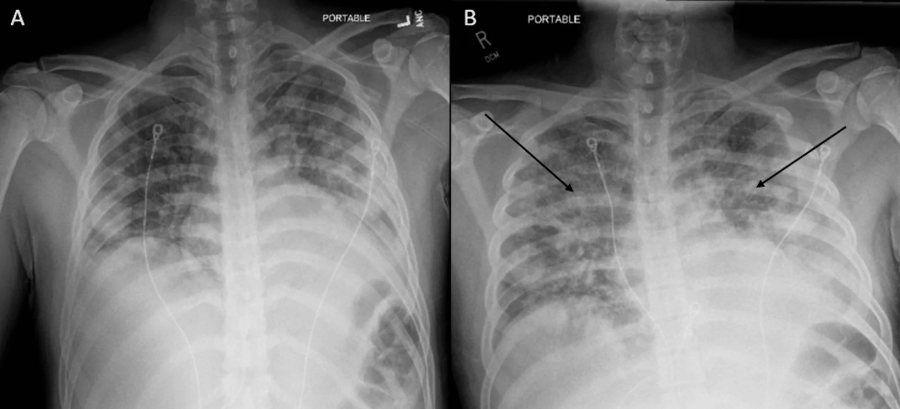
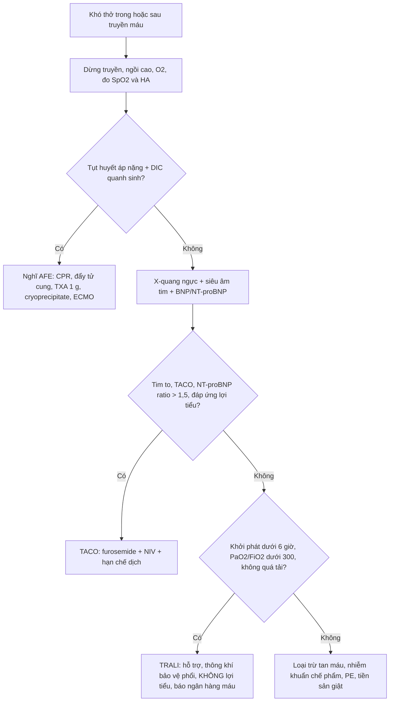
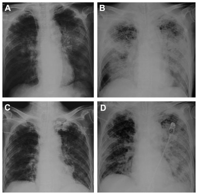
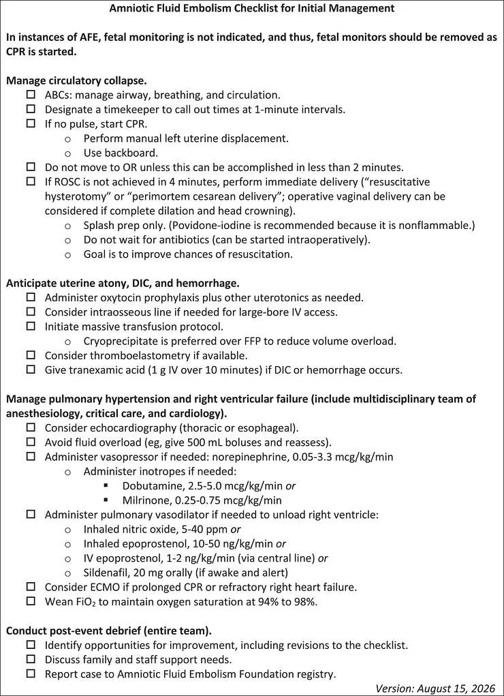

# 1958 — Phù phổi cấp sau truyền máu ở sản phụ: TACO – TRALI – AFE trên cùng một phim / Transfusion-associated circulatory overload vs TRALI vs amniotic fluid embolism

**Tags:** `pattern:phu-phoi` `pattern:mo-phoi-hai-ben` `pattern:phu-phoi-thuy-tinh` `pattern:phu-phoi-ton-thuong` `pattern:soc` `vung:phoi` `vung:tu-cung-phan-phu` `protocol:Xquang-nguc` `protocol:CT-nguc` `protocol:sieu-am-tim` `protocol:BNP`

**Mức chắc chắn (certainty):** tổng hợp y văn (literature synthesis) — dịch tễ phản ứng truyền máu từ cơ sở dữ liệu ISTARE (**132,8 triệu đơn vị máu**, **PMID 27658188**); tỉ lệ TACO từ tổng quan phạm vi ICU (**PMID 30882480**) và vai trò **BNP/NT-proBNP** từ tổng quan hệ thống biomarker (**PMID 30488959**); nguy cơ sau sinh từ thuần tập 517.854 sản phụ Thụy Điển (**PMID 31366586**); AFE từ thuần tập UKOSS 120 ca (**PMID 25683758**) và checklist SMFM 2026 (**PMC13565333**). Ca minh hoạ: **PMC13521321** (CC BY 4.0) và **PMC3177594** (CC BY-NC). Nhóm **không có bệnh nhân của mình**.

> **Câu chốt:** cùng một phim **mờ phổi hai bên sau truyền máu**, ba bệnh có **ba cơ chế khác nhau và ba điều trị ngược nhau**: **TACO = quá tải thể tích (thủy tĩnh)** → **lợi tiểu**; **TRALI = tổn thương mao mạch do kháng thể người cho (tăng thấm)** → **hỗ trợ thông khí, KHÔNG lợi tiểu**; **AFE = sốc phản vệ–đông máu nội mạch** → **CPR + sản khoa + máu**. Ba câu hỏi: **(1) khởi phát trong 6 giờ sau truyền? (2) tim có to và bệnh nhân đáp ứng lợi tiểu? (3) có tụt huyết áp + rối loạn đông máu đột ngột quanh sinh?** Sai lầm chết người: **gọi TRALI là TACO → lợi tiểu + truyền thêm dịch** (hoặc ngược lại: **gọi TACO là TRALI → truyền dịch**) — cả hai đều làm nặng phù phổi.

## 1. Tổng quan bệnh học – cơ chế hình ảnh (TẠI SAO)

### 1.1 Vì sao sản phụ là nhóm dễ bị nhất

- **Truyền máu sau sinh rất phổ biến:** tới **3%** sản phụ nhận máu sau sinh; trong thuần tập 517.854 ca sinh, **12.183 (2,4%)** được truyền (**PMID 31366586**).
- **Phản ứng truyền máu sau sinh cao gấp đôi:** **79/10.000** ca truyền ở sản phụ vs **40/10.000** ở phụ nữ không mang thai, **OR 2,0** (95% CI 1,6–2,5); **tiền sản giật là yếu tố nguy cơ mạnh nhất, OR 2,1** (1,7–2,6) (**PMID 31366586**).
- **Nền sinh lý giải thích:** thể tích huyết tương tăng **40–50%** nhưng **áp lực keo huyết tương giảm** → **ngưỡng phù phổi thủy tĩnh thấp hơn**; tiền sản giật thêm **rò mao mạch + giảm albumin + tăng sức cản mạch hệ thống** → cùng một lượng dịch gây phù nhanh hơn ở người không mang thai.
- **Ước lượng mất máu bằng mắt thấp hơn thực tế tới 40%** (**PMID 36075527**) → vừa dễ **truyền thiếu**, vừa dễ **bù quá** — chính là cái bẫy dẫn tới TACO.

### 1.2 Gánh nặng: TACO và TRALI là hai nguyên nhân tử vong hàng đầu

- ISTARE (25 quốc gia, **132,8 triệu đơn vị máu**): phản ứng bất lợi **77,5/100.000** đơn vị; tử vong **0,26/100.000**; trong **349 ca tử vong**, **58% do ba phản ứng hô hấp**: **TACO 27%**, **TRALI 19%**, khó thở sau truyền **12%** (**PMID 27658188**).
- **TACO là phản ứng truyền máu nặng thường gặp nhất**, tỉ lệ **≈ 1%** người lớn được truyền; ở ICU gộp **5,5%** (95% CI 2,6–9,4%) (**PMID 30882480**) — và chính vì "chỉ là quá tải dịch" nên **hay bị bỏ qua**.
- **AFE (để phân biệt):** **1,7/100.000** ca sinh, tử vong **0,3/100.000**, **tử vong ca bệnh 19%**, **7%** sống sót có di chứng thần kinh vĩnh viễn (UKOSS 2005–2014, **PMID 25683758**).

### 1.3 TẠI SAO TACO gây mờ phổi kiểu "thủy tĩnh"

- Truyền nhanh/khối lượng lớn + suy tim–thận + tiền sản giật → **tăng áp lực mao mạch phổi** → dịch **lọc ra khoang phế nang (transudate)**.
- Trên X-quang: **mờ hai bên, ưu thế trung tâm ("cánh dơi"), bóng tim to, bờ mạch phổi rộng, tràn dịch màng phổi hai bên, dày kẽ quanh phế quản**. Vì là **dịch toàn thân**, dấu hiệu đi kèm là **tăng cân, phù ngoại biên, tĩnh mạch cổ nổi, tăng huyết áp**.
- **Vì sao BNP tăng:** căng thành thất do tăng thể tích → phóng thích peptide lợi niệu → **NT-proBNP sau/sau trước > 1,5** hỗ trợ TACO; **BNP sau truyền < 300 pg/mL hoặc NT-proBNP < 2.000 pg/mL** (trong 24 giờ) làm TACO **khó xảy ra** (**PMID 30488959**). Lưu ý: giá trị **kém đặc hiệu ở bệnh nặng**.

### 1.4 TẠI SAO TRALI gây mờ phổi kiểu "tăng thấm" mà tim KHÔNG to

- **Mô hình hai tác động (two-hit):** (1) bệnh nhân có **bạch cầu bị "mồi" sẵn** (nhiễm trùng, phẫu thuật, sinh, chấn thương); (2) **kháng thể kháng HLA/kháng bạch cầu của người cho** (hoặc lipid hoạt tính sinh học trong chế phẩm) → **hoạt hoá bạch cầu trong mao mạch phổi** → **tổn thương nội mô** → dịch **giàu protein (exudate)** vào phế nang.
- Vì là **tổn thương mao mạch**, không phải quá tải: **tim bình thường, không tràn dịch nhiều, BNP không tăng, KHÔNG đáp ứng lợi tiểu**, và bệnh nhân có thể **sốt, tụt huyết áp**.
- **Tiêu chuẩn:** khởi phát **trong 6 giờ** sau truyền; **giảm oxy máu theo Berlin (PaO₂/FiO₂ ≤ 300 hoặc SpO₂ < 90% khí trời)**; **mờ hai bên** không giải thích trọn bởi quá tải/tăng áp; **không có bằng chứng quá tải tuần hoàn**; **loại trừ** tổn thương phổi khác. Phân **type I** (không có yếu tố nguy cơ ARDS) và **type II** (có yếu tố nguy cơ ARDS/tổn thương phổi sẵn có) (**PMID 31282773**).
- **Phòng ngừa đã chứng minh:** chiến lược **huyết tương ưu thế người cho NAM** (loại trừ người cho nữ có tiền sử thai) làm giảm TRALI (**PMID 31282773**, **PMID 25514705**).

### 1.5 TẠI SAO AFE trông giống cả hai nhưng là bệnh thứ ba

- AFE xảy ra **trong chuyển dạ hoặc ≤ 30 phút sau sinh**, cơ chế **giống phản vệ + hoạt hoá bổ thể + tăng tiêu sợi huyết** → **sụp tuần hoàn–hô hấp + DIC**, không phải "quá tải" và không phải "kháng thể truyền máu".
- **Không có xét nghiệm chốt** — chẩn đoán **loại trừ**; **CTA không thấy khuyết thuốc** (dùng để loại PE). Chi tiết chẩn đoán – xử trí ở bài [1956](../1956-thuyen-tac-oi-anmion/lesson.md).
- Điểm khác biệt cốt lõi với TACO/TRALI: **tụt huyết áp nặng + rối loạn đông máu**, và **xảy ra quanh sinh**, không nhất thiết sau truyền máu.

## 2. Mẫu hình + chẩn đoán phân biệt (gamut)

- **Mẫu hình mẹ:** **mờ phổi hai bên mới xuất hiện trong 6 giờ quanh một lần truyền máu** ở sản phụ.
- **Gamut theo cơ chế:**
  - *Quá tải thể tích:* **TACO**, suy tim cấp mất bù, hẹp van hai lá, bệnh thận giai đoạn cuối, **truyền dịch/tinh thể quá nhiều trong băng huyết**.
  - *Tăng thấm mao mạch:* **TRALI**, **ARDS** do nhiễm trùng/hít sặc, viêm phổi, **phù phổi do tiền sản giật**, phản vệ.
  - *Thuyên tắc/nội mạch:* **AFE**, thuyên tắc phổi, thuyên tắc ối thể không điển hình, thuyên tắc khí.
  - *Khác:* phản ứng tan máu cấp, nhiễm khuẩn do chế phẩm, **TRIM (transfusion-related immune modulation)/khó thở sau truyền (TAD)**, tràn khí, xẹp phổi.
- **Trục phân biệt thực dụng:** **(a) tim có to không — (b) BNP có tăng không — (c) có đáp ứng lợi tiểu không — (d) có tụt huyết áp + DIC không**. Bốn câu này phân loại được gần như toàn bộ gamut trên.

## 3. Bảng so sánh phân biệt (ma trận đối chiếu)

| Thực thể (entity) | Hình ảnh điển hình (X-quang/CT/siêu âm) | Chốt vào (rule-in) | Chốt loại (rule-out) | Gợi ý xác nhận |
|---|---|---|---|---|
| **TACO** | **Mờ hai bên ưu thế trung tâm**, **tim to (CTR > 0,5)**, **tràn dịch hai bên**, dày kẽ quanh phế quản; siêu âm: **B-lines lan toả + tĩnh mạch chủ dưới giãn, không xẹp theo nhịp thở** | **Tăng cân/ phù + tăng huyết áp + NT-proBNP sau/sau trước > 1,5 + đáp ứng lợi tiểu trong vài giờ**; tỉ lệ **≈ 1%** người được truyền | **Tim bình thường + BNP không tăng + không đáp ứng lợi tiểu + sốt/tụt huyết áp** → nghĩ TRALI | BNP/NT-proBNP trước–sau, siêu âm tim, cân nặng, bảng dịch vào–ra |
| **TRALI** | **Mờ hai bên lan toả, KHÔNG tim to, ít tràn dịch**, có thể có **phù nhu mô đối xứng**; CT: đông đặc + kính mờ hai bên | **Khởi phát ≤ 6 giờ sau truyền + PaO₂/FiO₂ ≤ 300 + không bằng chứng quá tải**; **sốt, tụt huyết áp**; **không đáp ứng lợi tiểu** | **NT-proBNP tăng > 1,5 lần + tim to + đáp ứng furosemide** → TACO | Loại trừ quá tải (siêu âm, BNP), đối chiếu túi máu/người cho, báo ngân hàng máu |
| **AFE** | Phim thường **mờ hai bên muộn hơn** (sau khi đã sụp tuần hoàn); CTA **không khuyết thuốc**; siêu âm: **thất phải giãn, tăng áp động mạch phổi** | **Sụp tuần hoàn–hô hấp trong chuyển dạ hoặc ≤ 30 phút sau sinh + DIC + không sốt**; tử vong ca bệnh **19%**, di chứng thần kinh **7%** | **Không tụt huyết áp, không DIC, chỉ khó thở sau truyền** → không phải AFE | Chẩn đoán **loại trừ**; xem bài [1956](../1956-thuyen-tac-oi-anmion/lesson.md) |
| **Phù phổi do tiền sản giật** | Tim **không to**, mờ hai bên + **tràn dịch màng phổi nhỏ**, kèm phù phổi "do tăng thấm" | **HA ≥ 140/90 + protein niệu/tiểu cầu giảm + phù sau 20 tuần**; **yếu tố nguy cơ phản ứng truyền OR 2,1** | **Huyết áp bình thường, không protein niệu, không phù** → không quy cho tiền sản giật | Xét nghiệm tiền sản giật, siêu âm tim, BNP |
| **Phản ứng tan máu cấp / nhiễm khuẩn chế phẩm** | Phổi **có thể bình thường** lúc đầu; sau đó ARDS | **Sốt cao, đau lưng, đái huyết sắc tố, tụt huyết áp trong khi truyền** | **Không sốt, không đái máu, chỉ khó thở + mờ phổi** → không phải tan máu | Coombs, haptoglobin, cấy chế phẩm |

*TACO: (A) trước khi có triệu chứng; (B) sau truyền — **tăng mờ khoang phế nang hai bên + tràn dịch màng phổi hai bên** (mũi tên) trên nền nhiều nốt di căn. Nguồn: **Cureus 2026 (PMC13521321)**, CC BY 4.0 — nguyên bản, không cắt.*

## 4. Protocol chẩn đoán + xử trí (theo giờ)

### 4.1 Ngay khi có khó thở trong/sau truyền

1. **Dừng truyền** (giữ đường truyền bằng NaCl 0,9%), **đo SpO₂, HA, mạch, nhiệt độ**, cho **ngồi cao, O₂**.
2. **Bảng dịch vào–ra + cân nặng** (nếu có), **khám tĩnh mạch cổ, phù, ran phổi**.
3. **X-quang ngực tại giường** (AP) — đánh giá **tim to, tràn dịch, phân bố mờ**; nếu không rõ hoặc cần phân biệt, **CT ngực** (không cản quang đủ để xem phù/tràn dịch).
4. **Siêu âm tim tại giường** (bắt buộc nếu có): **chức năng thất trái, áp lực đổ đầy, tĩnh mạch chủ dưới, van hai lá**; **siêu âm phổi: đếm B-line theo vùng** — B-line lan toả hai bên + tràn dịch → nghiêng **thủy tĩnh**.
5. **BNP/NT-proBNP ngay** (và so với mức trước truyền nếu có): **tỉ lệ > 1,5** → TACO; **BNP < 300 / NT-proBNP < 2.000** → TACO khó (**PMID 30488959**).
6. **Báo ngân hàng máu** + gửi mẫu: công thức máu, đông máu, haptoglobin, Coombs, cấy chế phẩm nếu sốt.

### 4.2 Ngưỡng quyết định điều trị

- **TACO:** **furosemide** (liều theo huyết áp và chức năng thận), **thở NIV/CPAP** nếu còn tỉnh, **hạn chế dịch**, **ngừng mọi truyền không cần thiết**. **Cẩn thận ở băng huyết:** lợi tiểu mạnh trên bệnh nhân còn thiếu thể tích → tụt huyết áp; phải cân bằng với **bù máu đang mất**.
- **TRALI:** **hỗ trợ** — O₂/NIV, **thông khí bảo vệ phổi 6 mL/kg cân nặng lý tưởng** nếu đạt tiêu chuẩn ARDS; **KHÔNG lợi tiểu theo phản xạ**, **không truyền thêm dịch**; theo dõi 24–48 giờ (đa số hồi phục trong 48–72 giờ nếu không có biến chứng).
- **AFE:** theo **checklist SMFM 2026** (**PMC13565333**): **CPR + đẩy tử cung sang trái**, **mổ lấy thai trong ≤ 4 phút nếu không có ROSC**, **oxytocin + thuốc co tử cung**, **TXA 1 g IV trong 10 phút**, **cryoprecipitate ưu tiên hơn FFP để giảm thể tích**, **tránh quá tải dịch (bolus 500 mL rồi đánh giá lại)**, **norepinephrine 0,05–3,3 µg/kg/phút**, **ECMO khi suy tuần hoàn kéo dài**.
- **Phòng ngừa (làm trước khi có biến cố):** chỉ định truyền theo **ngưỡng Hb**, **1 đơn vị rồi đánh giá lại** (không truyền "2 đơn vị cho chắc"), **truyền chậm ở người có suy tim/thận**, **huyết tương ưu thế người cho nam** để giảm TRALI.

## 5. Biến thể bình thường và cạm bẫy

- **Phim AP tại giường phóng đại tim** → **CTR > 0,5 trên phim AP không đủ chốt tim to**; dùng **siêu âm tim**.
- **TACO xảy ra với lượng rất nhỏ:** **1 đơn vị** cũng đủ ở người có suy tim/thận hoặc **tiền sản giật** — "chỉ truyền 1 đơn vị" **không loại trừ**.
- **TRALI có thể xuất hiện MUỘN:** cửa sổ kinh điển là **6 giờ**, nhưng **TRALI muộn 24–48 giờ (có ca 72 giờ)** đã được mô tả — ca trong bài này tái phát **48 giờ** sau mỗi lần truyền (**PMC3177594**) → "truyền máu hôm qua" **không loại trừ**.
- **BNP không đáng tin ở bệnh nặng/ICU** (đặc hiệu kém) — **không dùng một mình** để loại TACO (**PMID 30488959**).
- **Bảng dịch vào–ra thường sai** vì **mất máu ước lượng bằng mắt thấp hơn tới 40%** (**PMID 36075527**) → "cân bằng dịch dương" có thể chỉ là **bù thiếu**; đừng lợi tiểu máy móc.
- **AFE là chẩn đoán loại trừ** — **không chờ** kết quả xét nghiệm để bắt đầu CPR/TXA; ngược lại, **đừng gọi AFE** cho ca chỉ khó thở + mờ phổi mà huyết áp và đông máu bình thường.
- **Cạm bẫy "thỏa mãn tìm kiếm":** thấy mờ phổi sau truyền là dừng ở "quá tải" → bỏ **phản ứng tan máu** hoặc **nhiễm khuẩn chế phẩm** (cần **sốt, đái huyết sắc tố, Coombs**).
- **TAD/TRIM:** khó thở không đủ tiêu chuẩn TACO/TRALI vẫn phải báo cáo — đây là dữ liệu để phát hiện lô chế phẩm có vấn đề.

## 6. Tự lượng giá — Blind Quiz (ảnh ngoài, đáp án trong)

**Ca 1 — Sản phụ 34 tuổi, băng huyết sau sinh, nhận 3 đơn vị hồng cầu. 2 giờ sau: khó thở, HA 158/94, SpO₂ 88%, tăng 4 kg. Nhìn (A) và (B).**

- Câu hỏi: mô tả thay đổi giữa A và B. Ba dấu hiệu nào trên lâm sàng + phim nghiêng **quá tải thủy tĩnh**? Điều trị đầu tay và **một** điều trị phải tránh?

<b>Bấm để hiện đáp án</b>

- **Findings:** (B) so với (A): **mờ khoang phế nang hai bên tăng rõ** + **tràn dịch màng phổi hai bên** (mũi tên); trên nền nhiều nốt di căn hai phổi.
- **Nghiêng TACO:** **tăng cân 4 kg + tăng huyết áp + đáp ứng lợi tiểu**; phim có **mờ ưu thế trung tâm + tràn dịch**; BNP/NT-proBNP **tỉ lệ > 1,5** sẽ chốt thêm.
- **Điều trị:** **furosemide + NIV/CPAP + hạn chế dịch**; theo dõi sát vì vừa băng huyết.
- **Phải tránh:** **truyền thêm dịch/tinh thể** "để nâng huyết áp" — làm nặng phù phổi; và **không được** kết luận TACO chỉ vì "có mờ phổi" mà bỏ sót TRALI.
- Nguồn: **Cureus 2026 (PMC13521321)**, CC BY 4.0.

**Ca 2 — Bệnh nhân 61 tuổi (không mang thai), ung thư phổi di căn ruột, xuất huyết tiêu hoá; truyền hồng cầu đã lọc bạch cầu. Khó thở xuất hiện **48 giờ** sau truyền. Nhìn chuỗi A–D.**

- Câu hỏi: (A) và (B) khác nhau thế nào? Vì sao **không** dùng lợi tiểu? Ca này dạy gì về **cửa sổ thời gian** của TRALI?

<b>Bấm để hiện đáp án</b>

- **Findings:** (A) đợt ALI/TRALI đầu — mờ hai bên; (B) nặng lên, phải **thông khí ngày 9**; (C) **phim sạch ngày 23**; (D) **đợt thứ hai ngày 34**, sau một lần truyền khác.
- **Chẩn đoán:** **TRALI** (thể **muộn**, cả hai đợt đều **48 giờ sau truyền**) — mờ hai bên **không có bằng chứng quá tải**; nguồn ghi nhận **kháng thể kháng tiểu cầu** liên quan.
- **Vì sao không lợi tiểu:** tổn thương là **tăng thấm mao mạch**, không phải thừa thể tích; lợi tiểu gây **giảm thể tích + tụt huyết áp** và không cải thiện trao đổi khí.
- **Bài học thời gian:** tiêu chuẩn kinh điển dùng **cửa sổ 6 giờ**, nhưng **TRALI muộn (tới 48 giờ, có ca 72 giờ)** đã được mô tả — nên "truyền máu hôm qua" **không loại trừ** TRALI. Ca này cũng cho thấy **lọc bạch cầu không loại bỏ hoàn toàn** nguy cơ (kháng thể khác HLA).
- **Điều trị:** O₂/NIV, **thông khí bảo vệ phổi** nếu ARDS; **báo ngân hàng máu** (truy vết người cho, xét nghiệm kháng thể), **tránh truyền lại chế phẩm cùng người cho**.
- Nguồn: **Int J Gen Med 2011 (PMC3177594)**, CC BY-NC.

**Ca 3 — Sản phụ đang chuyển dạ đột ngột tím tái, ngừng tim, chảy máu không đông. Bảng dưới là checklist xử trí — hãy nêu 4 việc trong 4 phút đầu.**

- Câu hỏi: vì sao **không chờ** xét nghiệm? Hai điểm nào trong checklist **khác hẳn** xử trí TACO?

<b>Bấm để hiện đáp án</b>

- **Chẩn đoán:** **AFE** — sụp tuần hoàn–hô hấp quanh sinh + DIC, không sốt; chẩn đoán **loại trừ**, xử trí **ngay**.
- **4 phút đầu:** (1) **gọi CPR + đẩy tử cung sang trái**; (2) **đặt nội khí quản, thông khí**; (3) **mổ lấy thai ngay tại chỗ nếu không có ROSC trong 4 phút** (không chuyển phòng mổ nếu > 2 phút); (4) **oxytocin + TXA 1 g IV trong 10 phút + cryoprecipitate** cho DIC.
- **Khác TACO:** **không lợi tiểu**, mà **tránh quá tải dịch (bolus 500 mL rồi đánh giá)** và **ưu tiên cryoprecipitate hơn FFP** để giảm thể tích; dùng **vận mạch (norepinephrine)** thay vì bù dịch mù.
- Nguồn: **Pregnancy 2026 (PMC13565333)**, CC BY-NC.

## Bài liên quan chéo
- [500 – Tổng quan Vú & Sản phụ khoa](../500-tong-quan-vu-san-phu-khoa/lesson.md)
- [1956 – Thuyên tắc ối (AFE): chẩn đoán loại trừ, 6,0/100.000](../1956-thuyen-tac-oi-anmion/lesson.md)
- [1932 – Truyền máu khối lượng lớn & rối loạn đông máu trong PPH](../1932-truyen-mau-khoi-luong-lon-bang-huyet-sau-sinh/lesson.md)
- [1728 – Chảy máu sau vỡ tử cung](../1728-chay-mau-sau-vo-tu-cung/lesson.md)
- [1957 – Hoại tử vỏ thận sau băng huyết](../1957-hoai-tu-vo-than-sau-bang-huyet/lesson.md)

## Ảnh
- `1958_taco_trali_AnhSang_PMC13521321.jpg` — TACO trước/sau truyền; **Cureus 2026, PMC13521321**, **CC BY 4.0**, nguyên bản.
- `1958_taco_trali_AnhSang_PMC3177594.jpg` — chuỗi X-quang TRALI (A–D); **Int J Gen Med 2011, PMC3177594**, **CC BY-NC**, nguyên bản.
- `1958_taco_trali_SoDo_PMC13565333.jpg` — checklist xử trí AFE (SMFM 2026); **Pregnancy 2026, PMC13565333**, **CC BY-NC**, nguyên bản.
- Không tải: Radiopaedia (dẫn link từng ca), AuntMinnie (paywall).

> Không dùng để chẩn đoán độc lập khi chưa có người hướng dẫn.
