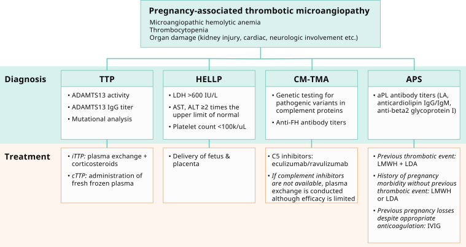
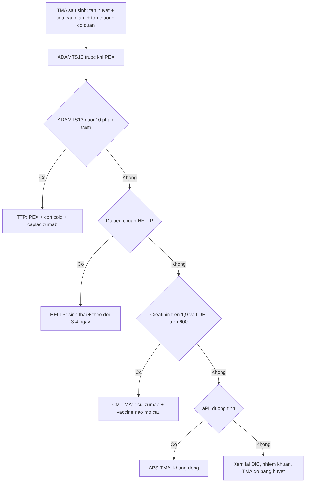
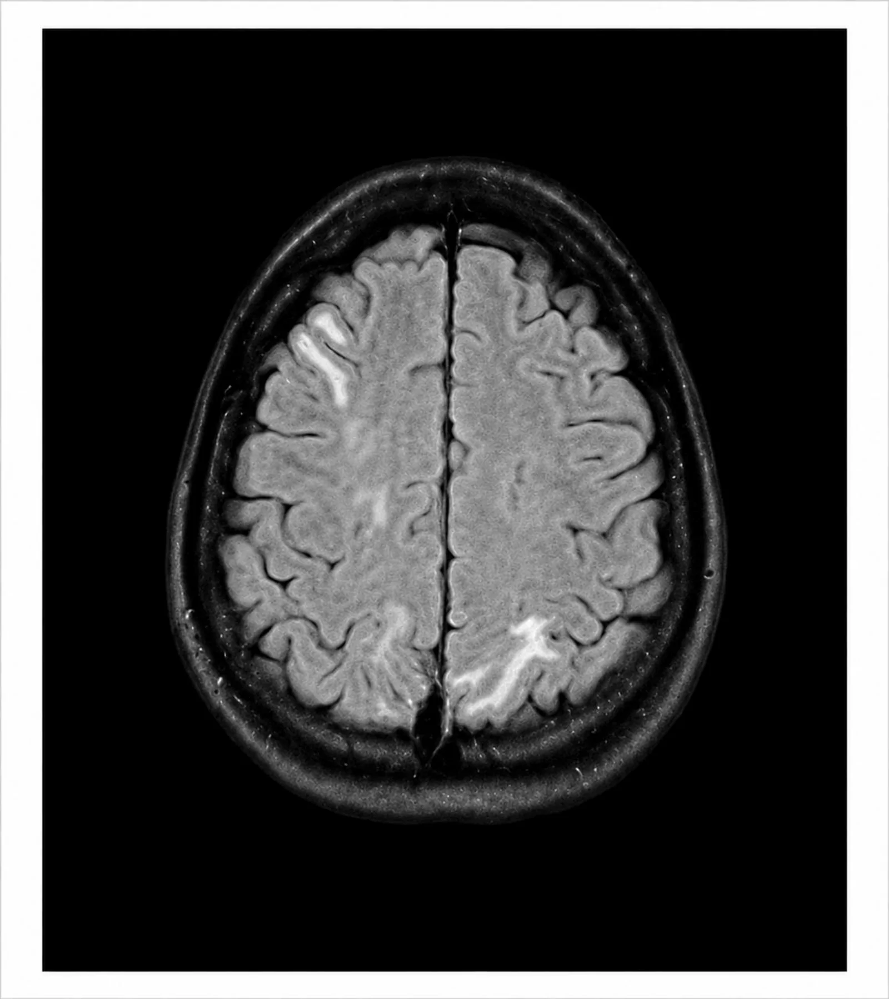
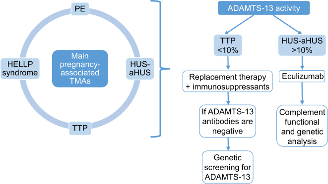

# 1959 — Tán huyết vi mạch sau sinh: phân biệt HELLP – aHUS – TTP (và vì sao "aHUS" bị chẩn đoán quá tay)

**Tags:** `pattern:tan-huyet-vi-mach` `pattern:giam-tieu-cau` `pattern:suy-than-cap` `pattern:phu-nao` `pattern:hoai-tu-gan` `vung:tu-cung-phan-phu` `vung:than` `vung:gan` `vung:nao` `protocol:MRI-so-nao` `protocol:CT-bung-can-quang` `protocol:CEUS` `protocol:xet-nghiem-ADAMTS13` `score:PLASMIC` `score:KDIGO`

**Mức chắc chắn (certainty):** tổng hợp y văn (literature synthesis) — ghép **tổng quan TMA trong thai kỳ** (Kidney Int Rep 2024, PMC11328568, CC BY 4.0), **thuật toán ADAMTS13 của labo** (Adv Lab Med 2024, PMC11381941, CC BY 4.0), **đoàn hệ 40 ca aHUS sau sinh, 25 ca có băng huyết** (Kidney Int Rep 2024, PMC11101778, CC BY 4.0), **hội chẩn đa chuyên khoa 76 ca tại Pháp** (Kidney Int Rep 2026, PMC13400224, CC BY-NC-ND 4.0), **nghiên cứu PRES trong sản giật 140 thai phụ** (Cureus 2026, PMC13330732, CC BY 4.0) và **ca PRES sau băng huyết nặng có ảnh MRI** (Cureus 2026, PMC13555745, CC BY 4.0). Không có ca do nhóm tự chụp. Số nào nguồn không nêu ghi "chưa rõ".

> **Bối cảnh thực hành:** sản phụ **sinh xong 2–5 ngày**, **thiểu niệu, creatinin tăng, tiểu cầu 60 × 10⁹/L, LDH 1.500 U/L**, huyết áp 165/105 mmHg, **nhìn mờ và co giật**. Câu hỏi không phải "có TMA không" mà là **"TMA thể nào"** — vì **HELLP chữa bằng sinh thai**, **TTP chữa bằng thay huyết tương (PEX)**, **aHUS chữa bằng ức chế bổ thể (eculizumab)**.
> **Ba con số định hướng:** **ADAMTS13 < 10%** = TTP (trước khi có PEX, sống sót chỉ **10%**); **creatinin ≥ 1,9 mg/dL + LDH ≥ 600 U/L** sau sinh: **độ đặc hiệu 100%, độ nhạy 97%** cho CM-TMA, gặp ở **91% aHUS** và **0% HELLP**; và trong **76 ca** hội chẩn thật, **không ca nào** là aHUS — **HELLP/endotheliosis** mới là chẩn đoán chính.

## 1. Tổng quan bệnh học – cơ chế hình ảnh

### 1.1 TMA là gì: ba dấu hiệu bắt buộc + định nghĩa định lượng

- **TMA (thrombotic microangiopathy)** = **thiếu máu tán huyết vi mạch** + **giảm tiểu cầu tiêu thụ** + **tổn thương cơ quan đích** do huyết khối vi mạch. Định nghĩa labo dùng trong tổng quan (PMC11328568): **Hb < 10 g/dL**, **LDH > 1,5 × giới hạn trên**, **haptoglobin không đo được**, **Coombs trực tiếp âm**, **schistocyte trên phết máu**.
- **Bốn thể chính trong thai kỳ:** **TTP** (thiếu ADAMTS13), **HELLP/tiền sản giật nặng (PE-SF)**, **CM-TMA/aHUS** (bổ thể), **APS-TMA** (kháng thể kháng phospholipid).
- **TẠI SAO mang thai là yếu tố khởi phát:** **VWF tăng ngay từ tam cá nguyệt 1** và duy trì cao **tới 6 tuần sau sinh** → tiêu thụ ADAMTS13, làm lộ bệnh **TTP bẩm sinh** vốn im lặng; đồng thời **bổ thể hoạt hóa** để dọn mảnh rau, **mảnh gai rau vào tuần hoàn mẹ** gây viêm nội mạc, và **băng huyết/DIC** làm nặng thêm. Vì vậy **cửa sổ nguy hiểm kéo dài 6 tuần sau sinh**, không chỉ vài ngày.
- **Tỉ lệ tử vong:** chẩn đoán TMA khi mang thai làm **nguy cơ tử vong tăng ~4,5 lần** so với thai phụ không TMA (PMC11328568).

### 1.2 Vì sao mỗi thể lại "đánh" một cơ quan khác nhau (cơ chế hình ảnh)

- **TTP:** thiếu **ADAMTS13** → **multimer VWF siêu lớn** không bị cắt → tiểu cầu kết dính thành huyết khối **vi mạch ở não và mọi cơ quan**, **ít tổn thương thận** so với aHUS. Hình ảnh: **nhồi máu vi mạch rải rác**, thường **CT sọ bình thường**; MRI có thể thấy **ổ nhồi máu nhỏ ở vỏ/đồi thị** — khác hẳn kiểu phù lan toả của PRES.
- **HELLP:** tổn thương nội mạc do **sFlt-1/PlGF mất cân bằng** và **hoạt hóa bổ thể** → tan máu trong lòng mạch, **hoại tử tế bào gan quanh xoang**, **giảm tiểu cầu**. Hình ảnh: **gan to, phù quanh gan, nhồi máu gan hình địa lý**, và biến chứng chết người là **tụ máu dưới bao gan (subcapsular hematoma)** — trên CT là **ổ dịch/tụ máu liềm dưới bao, đậm độ 35–70 HU**, có thể **vỡ gây chảy máu ổ bụng**.
- **CM-TMA/aHUS:** **bổ thể hoạt hóa không kiểm soát** → huyết khối **tiểu động mạch thận và cầu thận** → **vỏ thận thiếu máu**. Hình ảnh: **vỏ thận không ngấm thuốc, tuỷ còn ngấm** ("reverse rim sign") trên CT/CEUS — chi tiết và ngưỡng ở bài **1957**; đây là **hình ảnh quyết định** vì aHUS là thể **hay để lại suy thận nhất**.
- **PRES (biến chứng thần kinh của HELLP/sản giật):** huyết áp vượt **tự điều hòa não** → **phù mạch (vasogenic edema)** ở **chất trắng dưới vỏ và vỏ**, ưu thế **vùng chẩm–đỉnh**. TẠI SAO MRI "sáng" mà không "tối" trên DWI: **nước ở khoảng kẽ (ngoại bào)** làm **T2/FLAIR tăng tín hiệu** nhưng **không hạn chế khuếch tán** → **ADC tăng**, phân biệt với **nhồi máu (ADC giảm)**. Đây là lý do **PRES hồi phục** sau vài ngày–vài tuần nếu kiểm soát huyết áp.

### 1.3 Bộ số phân biệt nằm lòng (quan trọng hơn mọi mô tả định tính)

| Thông số | HELLP | CM-TMA (aHUS) | TTP |
|---|---|---|---|
| Tiểu cầu | **< 100 × 10⁹/L** (tiêu chuẩn Tennessee) | giảm vừa–nặng | giảm, thường nặng |
| LDH | **> 600 U/L** | **≥ 1.832 U/L ở 77%** (HELLP: **0%**) | tăng do tan máu |
| AST/ALT | **≥ 2 × giới hạn trên** | thường tăng nhẹ | thường bình thường |
| Creatinin | tăng ở **10%**, trong đó **40% cần lọc máu** | **≥ 1,9 mg/dL ở 98%** (HELLP: **2%**) | thường **< 1,9 mg/dL** |
| ADAMTS13 | bình thường | **≥ 10%** (thường > 20%) | **< 10%** |
| Bổ thể | có hoạt hóa, **5–45% có biến thể** | **60–70% có biến thể dị hợp** (FH/FI/MCP) | bình thường |
| Điều trị | **sinh thai** | **eculizumab/ravulizumab** | **PEX + corticoid** |
| Thời điểm | **> 2/3 ở tam cá nguyệt 3** + ngay sau sinh | **thường sau sinh** | bất kỳ lúc nào, nặng dần sau sinh |

- **Bộ đôi quyết định (PMC11328568):** **creatinin ≥ 1,9 mg/dL + LDH ≥ 600 U/L** sau sinh → **CM-TMA**: **độ nhạy 97%, độ đặc hiệu 100%**, gặp **91% aHUS** so với **0% HELLP**. Đây là công cụ **rẻ, có trong 10 phút**, dùng **trước khi có ADAMTS13**.
- **HELLP:** **0,5–1%** các thai kỳ; **tử vong mẹ 1,1%**; **tử vong chu sinh 7–34%**; thể bệnh **bắt đầu giảm sau sinh 3–4 ngày** (PMC11328568).
- **TTP:** **ADAMTS13 < 10%**; **anti-ADAMTS13 IgG dương ở ~75%** thể mắc phải; **trước PEX chỉ 10% sống sót** (PMC11328568).
- **Thực tế đa chuyên khoa (PMC13400224):** **76 ca** được hội chẩn cấp trong 24 giờ: tiền sản giật **47%**, băng huyết sau sinh **40%**, **AKI 62%**, **hoại tử vỏ thận 12%**, **TTP 17%**, **aHUS 0%**; hội chẩn **đổi cách xử trí ở 26%** ca, thường là **giảm can thiệp**.
- **Băng huyết có làm "aHUS" không? (PMC11101778):** trong **40 ca** chẩn đoán aHUS sau sinh, **25 ca có băng huyết**; **biến thể bổ thể gây bệnh 20% ở nhóm KHÔNG băng huyết và 0% ở nhóm CÓ băng huyết** → nhiều ca "aHUS sau băng huyết" thực chất là **TMA do biến cố sản khoa**, không phải bệnh bổ thể.
- **PRES (PMC13330732):** gặp ở **62/140 (44,3%)** sản giật; **huyết áp tâm thu ≥ 170 mmHg: aOR 3,21**; **≥ 3 cơn co giật: aOR 3,68**.

## 2. Mẫu hình + chẩn đoán phân biệt theo thời điểm và cơ quan (gamut)

- **Theo thời điểm so với sinh (mốc ngày 0):**
  - **Trước sinh / ngay lúc sinh:** **HELLP**, **tiền sản giật nặng**, **AFE** (bài 1958), **DIC do nhau bong non**.
  - **24–72 giờ sau sinh:** **HELLP thể khởi phát sau sinh**, **băng huyết – DIC**, **PRES**.
  - **3 ngày – 6 tuần sau sinh:** **CM-TMA/aHUS**, **TTP** (đỉnh sau sinh vì VWF còn cao), **APS-TMA**.
  - **Sau 6 tuần:** ít nghĩ TMA sản khoa; chuyển sang **bệnh thận nguyên phát, lupus, xơ cứng bì**.
- **Theo cơ quan bị "đánh" mạnh nhất:** **gan + tiểu cầu** → HELLP; **thận** → CM-TMA/RCN, APS-TMA; **não** → TTP, PRES; **phổi** → phù phổi (HELLP, quá tải, AFE); **da/đầu chi** → hoại thư chi (DIC, APS nặng).
- **Gợi nhớ bằng "3 tầng" của một ca TMA sản khoa:** (1) **tầng sản khoa** (nhau, băng huyết, nhiễm khuẩn ối); (2) **tầng huyết học** (TTP, APS, DIC); (3) **tầng bổ thể** (CM-TMA). Bỏ tầng nào cũng dẫn tới điều trị sai.

## 3. Bảng so sánh phân biệt (ma trận đối chiếu)

| Thực thể | Hình ảnh / labo điển hình | Chốt vào (rule-in) | Chốt loại (rule-out) | Gợi ý xác nhận |
|---|---|---|---|---|
| HELLP | Gan to, **tụ máu dưới bao**, nhồi máu gan; **LDH > 600**, AST/ALT **≥ 2 × ULN**, tiểu cầu **< 100 × 10⁹/L** | **Bộ ba labo + huyết áp cao/protein niệu + giảm sau sinh 3–4 ngày** | **ADAMTS13 < 10%** → TTP; **creatinin ≥ 1,9 + LDH ≥ 600** → CM-TMA | Labo 6 giờ/lần, SA/CT gan khi đau hạ sườn phải |
| CM-TMA (aHUS) | **Vỏ thận không ngấm, tuỷ ngấm**; **creatinin ≥ 1,9 mg/dL**, **LDH ≥ 1.832 U/L**; MRI não có thể PRES | **Creatinin ≥ 1,9 + LDH ≥ 600 sau sinh** (Se 97%, Sp 100%); **ADAMTS13 ≥ 10%** | Đáp ứng và hồi phục sau sinh, LDH < 600 → HELLP | ADAMTS13, bổ thể (C3, C4, sC5b-9), panel gen 15 gen, sinh thiết thận |
| TTP | **CT sọ thường bình thường**, MRI có ổ nhồi máu nhỏ; **schistocyte nhiều**, tiểu cầu rất thấp, **thần kinh dao động** | **ADAMTS13 < 10%** (± anti-ADAMTS13 IgG); **PLASMIC > 5** | Không có thiếu ADAMTS13 → không phải TTP dù có TMA | ADAMTS13 **trước** PEX, anti-ADAMTS13 IgG |
| APS-TMA | Thận **khu trú**, huyết khối động–tĩnh mạch; **có thể KHÔNG có schistocyte** | **aPL dương (LA, aCL, anti-β2GPI) + huyết khối/tổn thương thận** | aPL âm → loại | aPL 2 lần cách 12 tuần, CT/MRI mạch |
| DIC / nhiễm khuẩn huyết | **PT/aPTT kéo dài, fibrinogen giảm, D-dimer rất cao**, hạ huyết áp, ổ nhiễm | **Rối loạn đông máu tiêu thụ + cấy dương + ổ nhiễm** | Fibrinogen bình thường, ADAMTS13 < 10% → TTP | Cấy máu, ISTH DIC score, CT ổ nhiễm (bài 1926) |
| TMA do băng huyết | Thiếu máu nặng, **tổn thương thận ± RCN**, hồi phục một phần | **Băng huyết lớn + creatinin tăng + LDH tăng, ADAMTS13 ≥ 10%** | Biến thể bổ thể gây bệnh + tái phát ngoài thai kỳ → CM-TMA thật | Theo dõi 4–8 tuần, gen bổ thể |

*Bốn nhánh của TMA sản khoa: **TTP** (ADAMTS13 < 10%, PEX + corticoid), **HELLP** (LDH > 600, AST/ALT ≥ 2 × ULN, tiểu cầu < 100 k/µL → sinh thai), **CM-TMA** (gen bổ thể, anti-FH → eculizumab/ravulizumab), **APS** (aPL + kháng đông). Nguồn: Kidney Int Rep 2024 (PMC11328568), CC BY 4.0 — nguyên bản, không crop.*

## 4. Protocol xét nghiệm – hình ảnh + hệ điểm chuẩn hóa

### 4.1 Thứ tự xét nghiệm (làm sai thứ tự = mất chẩn đoán TTP)

1. **Ngay khi nghi TMA:** **CTM + phết máu ngoại vi (schistocyte)**, **LDH, haptoglobin, bilirubin gián tiếp, Coombs trực tiếp**, **creatinin, urê, điện giải, AST/ALT, LDH**, **PT/aPTT/fibrinogen/D-dimer**, **tổng phân tích nước tiểu + protein/creatinin niệu**, **cấy máu**.
2. **ADAMTS13 NGAY, TRƯỚC khi truyền huyết tương/thay huyết tương** — vì PEX làm **ADAMTS13 trở về bình thường giả tạo**. Nếu chưa có kết quả mà lâm sàng nặng (**thần kinh, tiểu cầu giảm nhanh**), **bắt đầu PEX ngay**, không chờ.
3. **PLASMIC score:** **> 5** = nguy cơ cao thiếu ADAMTS13 (điểm này được xây ngoài thai kỳ — dùng để **định hướng**, không thay ADAMTS13).
4. **Panel bổ thể** (C3, C4, yếu tố H/I, anti-FH, **sC5b-9**) + **panel gen 15 gen** (ADAMTS13, C3, CD46, CFB, CFH, CFHR1-5, CFI, DGKE, THBD, MMACHC, PLG) — làm **sau khi đã xử trí cấp**, không chờ để điều trị.
5. **aPL** (LA, anti-cardiolipin IgG/IgM, anti-β2GPI) — nếu dương, **lặp lại sau 12 tuần** để chẩn đoán APS thật.
6. **Theo dõi:** LDH + tiểu cầu **mỗi 6–12 giờ** trong 48 giờ đầu; creatinin/ngày; **nước tiểu**.

### 4.2 Hình ảnh: chụp gì, khi nào, và cái gì KHÔNG cần

- **MRI sọ (FLAIR + T2 + DWI/ADC + SWI)** khi **đau đầu dữ dội, nhìn mờ, co giật, rối loạn tri giác**: tìm **PRES** (phù vỏ–dưới vỏ, **ADC tăng**) và **xuất huyết** (SWI). **Không dùng gadolinium** khi suy thận nặng — không cần cho chẩn đoán PRES.
- **Siêu âm thận + CEUS** là lựa chọn đầu tay khi nghi **hoại tử vỏ thận**: **không độc thận**, làm tại giường; **CT có cản quang** chỉ khi cần và chức năng thận cho phép (ngưỡng eGFR theo từng cơ sở).
- **Siêu âm/CT gan** khi **đau hạ sườn phải, thiếu máu tụt, AST/ALT tăng vọt**: tìm **tụ máu dưới bao gan** (35–70 HU) — biến chứng có thể **vỡ, chảy máu ổ bụng**.
- **X-quang ngực / siêu âm phổi** khi khó thở: phù phổi do quá tải hoặc tổn thương nội mạc (bài 1958).
- **Không chụp để "tìm nguyên nhân TMA"**: TMA là **chẩn đoán labo**; hình ảnh chỉ để **đánh giá cơ quan đích và biến chứng**.

### 4.3 Sơ đồ quyết định tại giường

- **Eculizumab:** thuốc **không qua nhau thai đáng kể** (nồng độ thấp trong máu cuống rốn) và **không vào sữa** — dùng được trong thai kỳ và cho con bú. **Bắt buộc vaccine não mô cầu**; nếu tiêm vaccine ngay lúc cấp cứu → **kháng sinh dự phòng ≥ 14 ngày**. **Ravulizumab** có **thời gian bán thải ~52 ngày** (eculizumab ~11 ngày) nhưng **qua nhau thai/sữa nhiều hơn** do ái lực FcRn cao gấp > 10 lần.
- **TTP:** PEX + corticoid; **caplacizumab** đã được dùng ở thai kỳ (báo cáo ca); **ADAMTS13 tái tổ hợp 40 IU/kg** cho TTP bẩm sinh (thử nghiệm pha 3: **48 bệnh nhân**, không có cơn TTP nào khi dự phòng, ADAMTS13 đạt **~100%** so với **19%** ở nhóm chuẩn).
- **HELLP:** **sinh thai là điều trị duy nhất**, thể bệnh **giảm trong 3–4 ngày** sau sinh.

## 5. Biến thể bình thường và cạm bẫy

- **"aHUS" bị chẩn đoán quá tay:** trong **76 ca** hội chẩn, **0 ca** là aHUS; **40%** là băng huyết và **47%** tiền sản giật (PMC13400224). Nếu mọi TMA sau sinh đều được gọi aHUS thì **nhiều thai phụ nhận eculizumab không cần thiết** (đắt, nguy cơ nhiễm não mô cầu) và **bỏ qua điều trị sản khoa**.
- **Băng huyết "giả aHUS":** **0%** biến thể bổ thể ở nhóm có băng huyết so với **20%** ở nhóm không băng huyết — nên **không vội kết luận bệnh bổ thể** khi có biến cố sản khoa rõ (PMC11101778).
- **ADAMTS13 lấy sau PEX = âm tính giả:** luôn lấy **trước** huyết tương; nếu đã truyền, ghi rõ trong phiếu để không loại trừ TTP sai.
- **APS-TMA có thể KHÔNG có schistocyte** và **giới hạn ở thận** (PMC11328568) → đừng loại APS chỉ vì phết máu "sạch".
- **Truyền tiểu cầu ở TTP:** có báo cáo TMA/AKI nặng lên sau truyền tiểu cầu không tương hợp ở sản phụ (Am J Kidney Dis 2021, PMC7973159) → **chỉ truyền khi chảy máu đe dọa tính mạng hoặc trước thủ thuật không hoãn được**.
- **PRES không phải nhồi máu:** **ADC tăng** mới là PRES; **ADC giảm** là nhồi máu → tiên lượng và xử trí khác (huyết khối, không chỉ hạ áp).
- **HELLP có thể khởi phát sau sinh** và **không có tăng huyết áp rõ** — đừng đợi đủ "bộ ba" mới nghĩ đến.
- **Hình ảnh thận bình thường trên siêu âm B-mode không loại trừ RCN:** B-mode chỉ thấy viền giảm âm ở **33,3%** ca; **CEUS thấy 12/12** (bài 1957).

## 6. Tự lượng giá — Blind Quiz

**Ca 1 — Sản phụ 16 tuổi, 35,4 tuần, đau đầu dữ dội, phù chi dưới, huyết áp rất cao; mổ lấy thai cấp, sau mổ co giật toàn thể. Nhìn ảnh MRI dưới đây.**

- Câu hỏi: (1) Tổn thương ở đâu, tăng tín hiệu theo kiểu gì? (2) Vì sao gọi là "phù mạch" chứ không phải nhồi máu — cần chuỗi xung nào để chứng minh? (3) Ba việc phải làm ngay?

<b>Bấm để hiện đáp án</b>

- **Dấu hiệu:** **tăng tín hiệu FLAIR đối xứng/không đối xứng ở vỏ–dưới vỏ**, ưu thế **đỉnh–chẩm hai bên**, không có khối choán chỗ.
- **Cơ chế:** **phù mạch do tăng huyết áp vượt tự điều hòa** → nước ở khoảng kẽ → **ADC tăng**, **DWI không hạn chế** (khác nhồi máu: ADC giảm).
- **Việc phải làm:** **hạ áp có kiểm soát**, **magnesium sulfate** dự phòng/tái phát co giật, **theo dõi thần kinh + MRI lặp lại**; đồng thời **loại TMA** (CTM, LDH, creatinin, ADAMTS13) vì cùng bệnh cảnh.
- **Diễn biến thật:** hồi phục thần kinh hoàn toàn, không di chứng khu trú.
- Nguồn: Cureus 2026 (PMC13555745), CC BY 4.0.

**Ca 2 — Sản phụ sinh thường 3 ngày trước, băng huyết 1.500 mL đã bù dịch; nay thiểu niệu, creatinin 3,2 mg/dL, LDH 1.900 U/L, tiểu cầu 70 × 10⁹/L, ADAMTS13 45%. Bước tiếp theo theo sơ đồ nào?**

- Câu hỏi: thể TMA nào? Vì sao **không** phải TTP? Có nên dùng eculizumab ngay không?

<b>Bấm để hiện đáp án</b>

- **Thể:** **TMA sau băng huyết**, hình thái **CM-TMA** theo ngưỡng **creatinin ≥ 1,9 + LDH ≥ 600** (Se 97%, Sp 100%) nhưng **bối cảnh băng huyết** làm **bệnh bổ thể thật ít khả năng** (0% biến thể ở nhóm băng huyết).
- **Không phải TTP:** **ADAMTS13 45% ≥ 10%** → loại TTP; không cần PEX.
- **Eculizumab:** **cân nhắc ngắn hạn** nếu không hồi phục/hội chẩn đồng ý (loạt 40 ca: 4/5 ca RCN sau băng huyết được ức chế bổ thể, hồi phục một phần), nhưng **không dùng tràn lan** — 76 ca hội chẩn có **0 ca aHUS**.
- Nguồn: Kidney Int Rep 2024 (PMC11328568, PMC11101778), Kidney Int Rep 2026 (PMC13400224).

**Ca 3 — Sản phụ 29 tuổi, sau sinh 10 ngày: lú lẫn từng lúc, tiểu cầu 12 × 10⁹/L, LDH 2.100 U/L, creatinin 0,8 mg/dL, phết máu nhiều schistocyte.**

- Câu hỏi: chẩn đoán? Xét nghiệm chốt? Điều trị đầu tay, và vì sao **không** chờ kết quả?

<b>Bấm để hiện đáp án</b>

- **Chẩn đoán:** **TTP** — thiếu máu tán huyết vi mạch + **giảm tiểu cầu rất nặng** + **thần kinh dao động**, **creatinin bình thường** (aHUS thường creatinin cao).
- **Chốt:** **ADAMTS13 < 10%** (± anti-ADAMTS13 IgG); **PLASMIC > 5** hỗ trợ.
- **Điều trị:** **PEX + corticoid ngay**; nếu nặng/thất bại → **caplacizumab/rituximab**. **Không chờ ADAMTS13** vì **trước PEX chỉ 10% sống sót**.
- **Sai lầm hay gặp:** truyền tiểu cầu "để nâng số" — có thể làm TMA nặng lên.
- Nguồn: Kidney Int Rep 2024 (PMC11328568), Adv Lab Med 2024 (PMC11381941), CC BY 4.0.

## Bài liên quan chéo
- [1957 – Hoại tử vỏ thận sau băng huyết](../1957-hoai-tu-vo-than-sau-bang-huyet/lesson.md) — hình ảnh thận của TMA nặng nhất
- [1958 – TACO, TRALI, AFE: phù phổi sau truyền máu ở sản phụ](../1958-taco-trali-afe/lesson.md) — mặt hô hấp của cùng bệnh cảnh
- [1932 – Truyền máu khối lượng lớn trong băng huyết sau sinh](../1932-truyen-mau-khoi-luong-lon-bang-huyet-sau-sinh/lesson.md) — bù dịch và DIC
- [1926 – Viêm màng ối nhiễm khuẩn](../1926-viem-mang-oi-nhiem-khuan-oi/lesson.md) — DIC/nhiễm khuẩn huyết sản khoa
- [1948 – Co giật & động kinh sau huyết khối xoang tĩnh mạch não](../1948-co-giat-dong-kinh-huyet-khoi-xoang/lesson.md) — phân biệt co giật do nguyên nhân mạch máu

## Ảnh
- Ba ảnh tải từ Europe PMC/PMC, giấy phép ghi từng file trong `images/CREDITS.md`.
- Không dùng ảnh paywall/AuntMinnie; ảnh MRI FLAIR là **nguyên bản** (CC BY 4.0).

> Không dùng để chẩn đoán độc lập khi chưa có người hướng dẫn.
