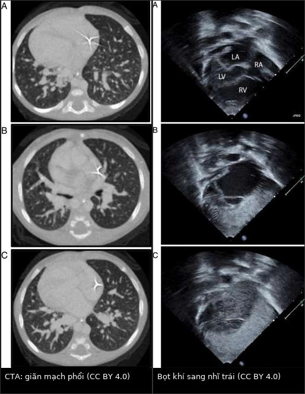
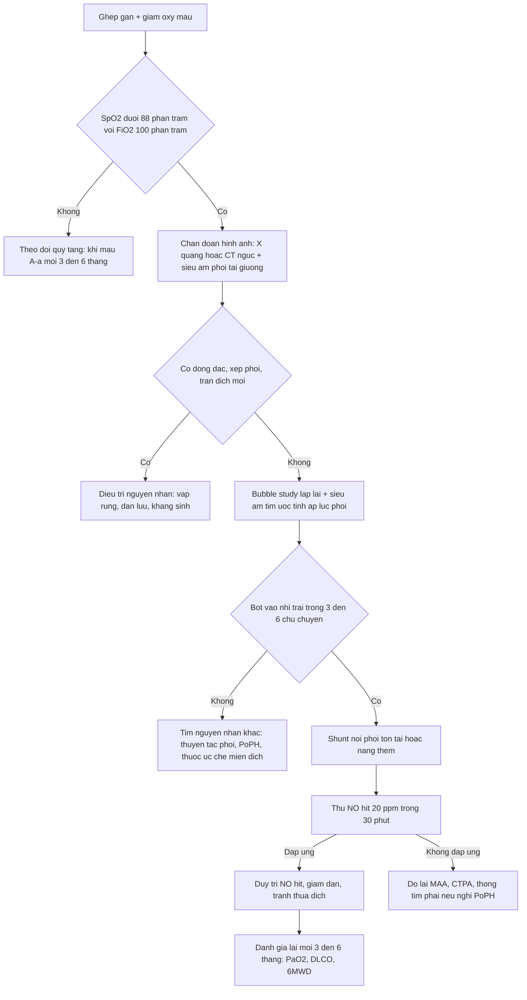
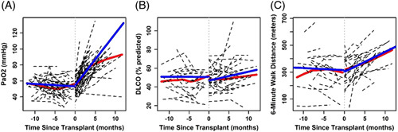
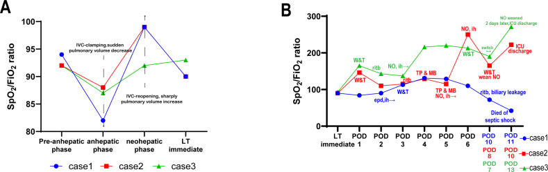

# 196 — HPS tồn tại dai dẳng sau ghép gan (persistent/residual hepatopulmonary syndrome)

**Tags:** `pattern:shunt-phai-trai` `pattern:gian-mach-trong-phoi` `pattern:giai-bao-hoa-sau-ghep` `pattern:giam-oxy-mau` `vung:gan` `vung:phoi` `score:HPS` `protocol:SA-tim-tuong-phan` `protocol:MAA` `protocol:CTPA-phoi`

**Mức chắc chắn (certainty):** tổng hợp y văn (literature synthesis) — 1 phân tích gộp 22 nghiên cứu về ghép gan ở HPS (*JHEP Rep* 2026, PMC12800508), 2 đoàn hệ Bắc Mỹ (Hepatology 2024, PMC10871618; *J Clin Exp Hepatol* 2026, PMC12569822), 1 loạt 3 ca có biến chứng giảm oxy máu nặng quanh mổ kèm ảnh đồ thị (PMC11771250), 1 bài tổng quan cơ chế (PMC13039249) và 1 ca nguyên văn có ảnh CTA + siêu âm tim cản quang (PMC4295258). Không có thử nghiệm ngẫu nhiên; mọi ngưỡng xử trí là tổng hợp thực hành, chỗ suy luận được ghi rõ.

> **Câu chốt:** ghép gan **chữa khỏi HPS ở phần lớn bệnh nhân — nhưng KHÔNG chữa ngay**. PaO₂ chỉ tăng **+6,5 mmHg/tháng** trong năm đầu, trung vị **149 ngày** mới bình thường hoá, và **~12%** bệnh nhân có **giảm oxy máu kháng trị quanh mổ** (pRH) dù mảnh ghép hoạt động tốt (PMC10871618; PMC11771250). Vì vậy câu hỏi lâm sàng của bài này không phải "có HPS không" (đã có bài 186) mà là: **"giảm oxy ở ngày hậu phẫu thứ mấy, shunt còn bao nhiêu %, và đây là quán tính hồi phục bình thường hay một nguyên nhân mới?"**

## 1. Tổng quan bệnh học – cơ chế hình ảnh (TẠI SAO)

### 1.1 Vì sao phải mất hàng tháng mới hết khó thở

- HPS là **giãn mạch trong phổi (intrapulmonary vascular dilatation, IPVD)** do gan bệnh: endotoxin từ ruột → **iNOS/eNOS, NO, CO tăng; ET-1 qua thụ thể ET-B** → giãn mao mạch + tăng sinh mạch (PMC13039249). Mao mạch phổi bình thường **8–15 µm**; trong HPS giãn tới hàng trăm µm, làm **khoảng khuếch tán khí–hồng cầu tăng** và tạo **shunt phải–trái chức năng**.
- Ghép gan **cắt nguồn tín hiệu gan** (endotoxin, cytokin) nhưng **không "thu nhỏ" ngay các mao mạch đã tái cấu trúc**. Đoàn hệ 132 bệnh nhân cho thấy quán tính này rất rõ: sau ghép, **PaO₂ tăng +6,5 mmHg/tháng (KTC 95%: 5,3–7,7)**, **trung vị 149 ngày (116–184)** để PaO₂ trở về bình thường, và **thời gian bình thường hoá không khác nhau theo độ nặng trước ghép** — trung bình **138 ngày** (HPS trung bình), **150 ngày** (nặng), **155 ngày** (rất nặng), p = 0,5 (PMC10871618). Đây là **lý do vật lý** khiến bệnh nhân vẫn tím sau một mảnh ghép tốt.
- Trước ghép, oxy máu **xấu đi từ từ**: **−3,7 mmHg/năm (KTC 95%: −6,4 đến −0,96)**; hai lớp diễn tiến được mô tả: **"bệnh rất nặng, giảm chậm"** (PaO₂ 45,0 mmHg; **−1,0 mmHg/năm**) và **"bệnh trung bình, giảm đều"** (PaO₂ 65,5 mmHg; **−2,5 mmHg/năm**) (PMC10871618). Ngược trực giác: **shunt ≥ 20% dự báo PaO₂ giảm CHẬM hơn** 0,88 mmHg/tháng — shunt lớn không đồng nghĩa xấu đi nhanh.

### 1.2 Bốn phép đo và ngưỡng định lượng nằm lòng

| Phép đo | Ngưỡng bất thường | Ý nghĩa vật lý | Nguồn |
|---|---|---|---|
| Khí máu động mạch (tư thế ngồi/đứng) | PaO₂ < 80 mmHg, **gradient A–a ≥ 15 mmHg** (≥ 20 mmHg nếu > 64 tuổi) | khuếch tán + V/Q mismatch | PMC10871618 |
| Siêu âm tim cản quang (bubble study) | bọt khí > 10 µm vào **nhĩ trái trong 3–6 chu chuyển tim** sau khi đầy nhĩ phải | mao mạch giãn cho bọt lọt qua | PMC4295258 |
| ⁹⁹ᵐTc-MAA (macroaggregated albumin) | **shunt > 6%** (giả định 13% cung lượng tim lên não) | hạt bị giữ ở mao mạch; hạt lọt lên não = shunt phải–trái | PMC10871618 |
| Orthodeoxia | PaO₂ giảm **> 4 mmHg** khi từ nằm sang ngồi/đứng | tưới máu dồn về đáy phổi nơi giãn mạch nhiều nhất | PMC10871618 |

- **Bubble study là phép đo tại giường, không cần thuốc cản quang thật:** microbubble sinh ra bằng cách lắc muối sinh lý; bình thường bị giữ ở mao mạch phổi. **Xuất hiện bọt ở nhĩ trái sau 3–6 chu chuyển = shunt TRONG PHỔI; xuất hiện sớm hơn (≤ 3 chu chuyển) = shunt TRONG TIM** (PFO/ASD) và phải loại trừ trước khi quy kết HPS (PMC4295258; đối chiếu bài 186).
- **Vì sao MAA không thay thế bubble study:** MAA **định lượng** được shunt nhưng **không định vị** được trong tim hay trong phổi → bubble study vẫn là bước đầu; MAA dùng để theo dõi mức shunt (ca thực tế **55%** và **56%** trước ghép) (PMC10871618; PMC11771250).

### 1.3 Vì sao "quanh mổ" lại là cửa tử

- **Giảm oxy máu kháng trị quanh mổ (perioperative refractory hypoxaemia, pRH)** gặp ở **~12%** bệnh nhân HPS được ghép gan, định nghĩa **SpO₂ không giữ được > 88% dù thở FiO₂ 100%** (PMC11771250).
- Cơ chế là **V/Q mismatch bị khuếch đại bởi chính cuộc mổ**, không phải shunt mới: **kẹp tĩnh mạch chủ dưới làm giảm đột ngột tưới máu phổi → SpO₂ tụt; mở lại tuần hoàn → SpO₂ tăng vọt** (thấy rõ trên đồ thị theo dõi trong mổ), rồi **tụt lại từ POD1** khi bệnh nhân nằm ngửa, thừa dịch, xẹp phổi đáy (PMC11771250).
- **Vì sao thuốc co mạch dạng hít thất bại:** mạch giãn tập trung ở **vùng lưng/đáy phổi** — nơi **thông khí kém nhất** khi nằm; khí dung chỉ vào **vùng trên/thông khí tốt** → co mạch nhầm chỗ, không cải thiện shunt (PMC11771250). Đây là lý do **ephedrine khí dung 15 mg/5 mL × 4 lần/ngày chỉ nâng SpO₂ tạm thời** ở ca 1, còn **NO hít (20 ppm) nâng SpO₂ từ 88% lên 100% trong 30 phút** ở ca 2 — vì NO đi theo khí tới đúng vùng có thông khí và **tái phân bố tưới máu sang vùng thông khí tốt**.

### 1.4 Số liệu kết cục (để tư vấn gia đình, không phải để hứa)

- **Tần suất:** HPS gặp ở **17,2%** (11,6–24,7%; n = 1.171) bệnh nhân xơ gan được đánh giá ghép gan, **26,1%** (18,5–35,5%; n = 629) ở nhóm tăng áp cửa, và **21,6%** (11,2–37,4%; n = 737) ở chính người nhận ghép (PMC12800508).
- **Tử vong trên danh sách chờ:** **13,1%** (0,6–78,5%; n = 1.240) dưới chính sách điểm ưu tiên MELD hiện hành (PMC12800508).
- **Sau ghép:** sống 1 năm **85,5%** (nghiên cứu tiến cứu, n = 240), **93,9%** (thời kỳ hậu MELD, n = 99), **83,8%** (dữ liệu registry, n = 800); sống 5 năm **85% / 92,9% / 76%** (n = 144 / 99 / 739) (PMC12800508). Đoàn hệ Canada 53 ca: tử vong **7,5% / 17% / 48%** ở 1 / 5 / 10 năm, và **oxy máu bình thường hoá ở 46/47 ca (97,9%) tại 6 tháng** (PMC12569822).
- **Hồi phục HPS:** **> 80% trong 3 tháng, 90,1% (71,7–97,0%; n = 80) tại 6 tháng, gần như tất cả trong 1 năm** (PMC12800508).
- **Dự báo tử vong sau ghép:** **PaO₂ trước ghép ≤ 50 mmHg + shunt ≥ 20%** là cặp dự báo tốt nhất (**độ nhạy 86%, độ đặc hiệu 88%**); mỗi mmHg PaO₂ tăng thêm làm **HR tử vong 0,93 (0,87–0,99)**, còn **bệnh phổi tắc nghẽn đi kèm làm HR 6,96 (1,29–37,43)** (PMC12800508; PMC12569822).

## 2. Mẫu hình + chẩn đoán phân biệt theo trục THỜI GIAN (Gamut)

Khác mọi gamut "theo vị trí", bài này phân biệt **theo ngày hậu phẫu** — vì cùng một triệu chứng, nguyên nhân đổi hoàn toàn sau 1 tuần, 1 tháng, 1 năm.

- **POD 0–3 — "còn shunt hay tụt vì thứ khác":** pRH/giãn mạch tồn tại (đáy phổi, orthodeoxia), **xẹp phổi đáy + tràn dịch màng phổi**, phù phổi do thừa dịch, **hít sặc**, **thuyên tắc phổi**, nhiễm khuẩn huyết/ARDS, thiếu máu – giảm cung.
- **Tuần 1 – tháng 6 — "hồi phục chậm, đừng vội kết luận":** quán tính hồi phục bình thường (**+6,5 mmHg/tháng**), viêm phổi do **CMV/Pneumocystis**, **viêm phổi do thuốc ức chế miễn dịch (sirolimus/everolimus)**, liệt cơ hoành, suy mảnh ghép.
- **Tháng 6 – 1 năm — "vẫn còn giảm oxy":** HPS tồn tại thật sự, **PoPH mới xuất hiện** (bài 186), hẹp/tắc shunt cửa–chủ còn lại (bài 176), huyết khối tĩnh mạch gan, hẹp đường mật tái phát gây xơ gan mảnh ghép.
- **Gợi nhớ nội bộ (nhóm tự đặt, không phải mnemonic y văn) — "SHUNT":** **S**hunt tồn tại (HPS), **H**ypoventilation/xẹp phổi, **U**ứ dịch (phù phổi, tràn dịch), **N**hiễm trùng (phổi, huyết), **T**huyên tắc phổi/PoPH.
- **Phân biệt theo cơ chế (3 tầng sinh lý):** (1) **shunt thật** — đáp ứng oxy kém, bubble/MAA dương; (2) **mismatch V/Q** — đáp ứng oxy trung bình, CT có xẹp/đông đặc; (3) **rối loạn khuếch tán** — DLCO giảm, CT phổi "sạch".

## 3. Bảng so sánh phân biệt (ma trận đối chiếu)

| Thực thể (entity) | Hình ảnh/đo lường điển hình | Chốt vào (rule-in) | Chốt loại (rule-out) | Gợi ý xác nhận |
|---|---|---|---|---|
| HPS tồn tại/giải quyết chậm | CT phổi sạch hoặc giãn mạch nhẹ; bubble study còn dương; PaO₂ tăng chậm ~6,5 mmHg/tháng | **Bubble dương + CT không có tổn thương mới + PaO₂ tăng dần theo tháng** | PaO₂ tụt nhanh trong vài giờ kèm sốt, đông đặc, tràn dịch mới → không phải quán tính | Khí máu + A–a mỗi 3–6 tháng; MAA định lượng lại; CEUS khi nghi shunt mới |
| pRH quanh mổ (V/Q mismatch) | SpO₂ < 88% dù FiO₂ 100%; X-quang/CT thường **không có đông đặc**; tụt từ POD1 | **Tụt sau khi rút ống, nằm ngửa, thừa dịch; đáp ứng NO hít trong 30 phút** | Đáp ứng hoàn toàn với nghiệm pháp Trendelenburg đơn thuần thì chỉ là thành phần tư thế, không đủ giải thích | Theo dõi SpO₂/FiO₂, thử NO hít, siêu âm phổi tìm xẹp đáy |
| PoPH (tăng áp phổi do tăng áp cửa) | Thân ĐM phổi giãn; thất phải giãn; **không** có shunt khi bubble sớm | **mPAP và PVR tăng trên thông tim phải; bubble âm tính hoặc dương muộn** | Bubble dương sớm ≤ 3 chu chuyển → shunt trong tim, không phải PoPH | Siêu âm tim ước tính PAP rồi **thông tim phải** trước khi kết luận |
| Xẹp phổi/tràn dịch hậu phẫu | Đáy phổi mờ, mất thể tích, di lệch rãnh liên thuỳ; siêu âm phổi có dấu phổi bị đè | **Tổn thương khu trú đáy + cải thiện khi ngồi dậy/vỗ rung** | CT phổi hoàn toàn sạch mà vẫn tím → nghĩ shunt | X-quang/CT ngực, siêu âm phổi tại giường |
| Viêm phổi/hít sặc | Đông đặc khu trú, có thể mức khí–phế quản; sốt, tăng bạch cầu | **Đông đặc mới + sốt + đờm** | Đông đặc mờ nhạt mà PaO₂ thấp không tương xứng → nghĩ shunt | Cấy đờm, BAL, kháng sinh theo kinh nghiệm |
| Thuyên tắc phổi | CTPA: khuyết đầy trong ĐM phổi; thất phải giãn | **Khuyết đầy trên CTPA + D-dimer** | CTPA âm tính chất lượng tốt + không tăng áp phổi | CTPA; đối chiếu liều kháng đông dự phòng |
| Shunt trong tim (PFO/ASD) | Bubble vào nhĩ trái **≤ 3 chu chuyển**; có thể thấy dòng qua vách trên siêu âm | **Bọt xuất hiện sớm, đồng thời với đầy nhĩ phải** | Bọt chỉ xuất hiện sau 3–6 chu chuyển → đường vào là phổi | Siêu âm tim TEE, nghiệm pháp Valsalva |
| Dị dạng động–tĩnh mạch phổi khu trú | Nốt mạch + mạch nuôi/mạch dẫn trên CTA; shunt **khu trú**, không lan toả | **CTA thấy nốt mạch nối ĐM–TM; đáp ứng oxy rất kém** | Giãn mạch lan toả đối xứng đáy phổi → HPS, không phải AVM | CTA mạch phổi; cân nhắc nút mạch nếu AVM lớn |

*Trái (A–C): CTA ngực trẻ 8 tháng — giãn mạch phổi lan toả, rõ hơn ở các lát thấp sát đáy, không có nốt mạch khu trú. Phải (A–C): siêu âm tim cản quang cùng ca — bọt khí chỉ xuất hiện ở nhĩ trái sau vài chu chuyển, tức shunt TRONG PHỔI. Nguồn: Govindan ML và cs., *J Med Case Rep* 2014, CC BY 4.0 (PMC4295258); ảnh ghép letterbox, giữ tỉ lệ.*

## 4. Protocol chụp/đo + hệ phân độ + sơ đồ xử trí

### 4.1 Trước ghép — bộ 4 phép đo tối thiểu

1. **Khí máu động mạch ở tư thế ngồi hoặc đứng** (không nằm): PaO₂ + gradient A–a; ghi rõ FiO₂. Ngưỡng chẩn đoán: **PaO₂ < 80 mmHg**, **A–a ≥ 15 mmHg** (**≥ 20 mmHg nếu > 64 tuổi**) (PMC10871618).
2. **Siêu âm tim cản quang với muối lắc (bubble study)** — bước đầu tay; ghi **số chu chuyển** bọt xuất hiện ở nhĩ trái (**3–6 = trong phổi**, **≤ 3 = trong tim**) (PMC4295258).
3. **⁹⁹ᵐTc-MAA** khi cần **định lượng** shunt (ngưỡng **> 6%**) và theo dõi diễn tiến; ca thực tế 55% và 56% trước ghép (PMC10871618; PMC11771250).
4. **CT ngực/CTA + siêu âm tim ước tính áp lực phổi**: để loại trừ bệnh phổi kèm theo và **PoPH** (nếu nghi PoPH → **thông tim phải**, bài 186).

### 4.2 Phân độ HPS theo PaO₂ (khí trời) và hệ quả

| Độ | PaO₂ | Ý nghĩa thực hành |
|---|---|---|
| Nhẹ | ≥ 80 mmHg | thường không triệu chứng; theo dõi |
| Trung bình | 60–79 mmHg | bắt đầu theo dõi sát, đo orthodeoxia |
| Nặng | 50–59 mmHg | **ngưỡng được hưởng điểm ưu tiên MELD** (PaO₂ < 60 mmHg) |
| Rất nặng | < 50 mmHg | tăng nguy cơ tử vong sau ghép; cân nhắc **PaO₂ ≤ 50 mmHg + shunt ≥ 20%** khi tư vấn tiên lượng |

*(Phân độ và ngưỡng MELD theo PMC10871618; cặp dự báo tử vong theo PMC12800508.)*

### 4.3 Sau ghép — theo dõi có nhịp

- **Khí máu + DLCO + 6MWD mỗi 3–6 tháng** (đúng lịch các đoàn hệ đã dùng), đo ở **tư thế ngồi**; đích "bình thường hoá" là **PaO₂ ≥ 80 mmHg, DLCO ≥ 75% dự đoán, 6MWD về giới hạn bình thường** (PMC10871618).
- **Không chụp lại CTA thường quy** nếu bệnh nhân hồi phục đúng quán tính; **chỉ chụp khi có mốc bất thường** (tụt nhanh, sốt, đau ngực, thất phải giãn).
- **Bubble study lặp lại có ích**: ca trẻ 6 tuổi vẫn còn shunt rõ trên siêu âm cản quang ở POD1 dù CT phổi sạch, và **giảm đáng kể ở 6 tháng** sau ghép (PMC11771250).

### 4.4 Sơ đồ xử trí giảm oxy máu sau ghép gan

### 4.5 Các liệu pháp "cứu" đã được báo cáo (bằng chứng ca, không phải RCT)

| Liệu pháp | Liều trong báo cáo | Kết quả thực tế |
|---|---|---|
| NO hít (iNO) | **20 ppm**, giảm dần tới 13 ppm | SpO₂ 88% → **100% trong 30 phút**; nước tiểu 5–15 mL/giờ → **110–160 mL/giờ** (ca 2) |
| Ephedrine khí dung | **15 mg/5 mL, 4 lần/ngày** | SpO₂ 83–85% → 90% **tạm thời**, PaO₂/FiO₂ không đổi (ca 1) |
| Xanh methylene IV | **3 mg/kg** | **Không hiệu quả**, CVP tăng **3–5 mmHg** (ca 2) |
| Tư thế Trendelenburg | lặp lại nhiều lần | tăng SpO₂ **thoáng qua** |

*(Toàn bộ số liệu bảng này từ PMC11771250 — 3 ca, không có nhóm chứng; dùng như gợi ý khi đường thở đã tối ưu, không phải phác đồ chuẩn.)*

## 5. Biến thể bình thường và cạm bẫy

- **Bubble study dương KHÔNG đồng nghĩa HPS:** xơ gan có IPVD nhưng PaO₂ và A–a bình thường thì **chưa đủ tiêu chuẩn HPS** — phải đủ cả 3: bệnh gan, IPVD, giảm oxy máu.
- **Đừng quy mọi giảm oxy sau ghép cho "HPS tồn tại":** ca 2 tụt PaO₂ xuống **47 mmHg, A–a 378 mmHg** mà **không có viêm phổi, phù phổi hay tràn dịch trên hình ảnh** — hình ảnh sạch **ủng hộ** shunt, nhưng vẫn phải loại trừ thuyên tắc phổi và nhiễm khuẩn bằng dữ liệu khác (PMC11771250).
- **CT phổi bình thường không loại trừ shunt:** ca trẻ 6 tuổi vẫn shunt nặng với CT ngực sạch hoàn toàn; ngược lại CTA có thể chỉ thấy **giãn mạch lan toả** rất khó định lượng — đừng đo "đường kính mạch" để chẩn đoán.
- **Giãn thân ĐM phổi trên CTA không phải bằng chứng PoPH:** phải có **mPAP/PVR trên thông tim phải**; và HPS với PoPH có thể **cùng tồn tại**, nên bubble dương không loại trừ PoPH.
- **Shunt trong tim là bẫy chết người:** nếu bọt xuất hiện **≤ 3 chu chuyển**, "chữa HPS" bằng ghép gan sẽ **không cải thiện oxy** vì đường rò nằm ở tim — cần TEE và đóng lỗ.
- **Đừng hứa "mổ xong hết tím":** quán tính **149 ngày** và **12% pRH** là hai con số phải nói trước với gia đình; ca trẻ 8 tháng còn phải **mở khí quản và thở máy kéo dài** sau ghép dù ghép thành công (PMC4295258).
- **Sai lầm tư thế:** đo khí máu khi nằm ngửa sẽ **che mất orthodeoxia** và làm nhẹ giả gradient A–a — luôn ghi tư thế.

## 6. Tự lượng giá — Blind Quiz

**Ca 1 — Trẻ 8 tháng, vàng da từ nhỏ, tím tăng dần, SpO₂ 70% khí trời.**

- Gợi ý lâm sàng: bệnh gan mật bẩm sinh đã mổ, tim lệch phải, tĩnh mạch chủ dưới bị gián đoạn.
- Câu hỏi: mô tả 2 dấu hiệu trên CTA và trên siêu âm cản quang; 3 chẩn đoán phân biệt; dấu hiệu nào chốt shunt **trong phổi** thay vì trong tim?

<b>Bấm để hiện đáp án (findings + chẩn đoán)</b>

- Dấu hiệu: CTA — **giãn mạch phổi lan toả, rõ hơn ở các lát thấp sát đáy**, không có nốt mạch khu trú, tim lệch phải. Siêu âm cản quang — bọt khí **chỉ vào nhĩ trái sau vài chu chuyển** (khoảng **3 nhịp**) sau khi đầy nhĩ phải.
- Chẩn đoán: **HPS** trên nền teo đường mật bẩm sinh (kèm polysplenia, gián đoạn tĩnh mạch chủ dưới). Chốt: bọt xuất hiện **muộn (3–6 chu chuyển)** → đường vào là **mao mạch phổi giãn**, không phải lỗ bầu dục.
- Phân biệt: shunt trong tim (PFO/ASD — bọt sớm ≤ 3 nhịp), AVM phổi khu trú (CTA có nốt mạch), PoPH (thông tim phải).
- Diễn tiến thật của ca: giữ bằng milrinone chờ ghép; sau ghép **hồi phục chậm, cần mở khí quản và thở máy kéo dài** — minh hoạ đúng "HPS tồn tại sau ghép".
- Nguồn ảnh: Govindan ML, Kuo KW, Mahani MG, Shanley TP. *J Med Case Rep* 2014;8:418 — PMC4295258, CC BY 4.0.

**Ca 2 — Người lớn HPS, PaO₂ trước và sau ghép gan: vì sao 3 tháng đầu "không nhích"?**

- Gợi ý: trục hoành là **tháng tính từ ngày ghép (0)**; đường đỏ là xu hướng trước ghép, đường xanh là sau ghép.
- Câu hỏi: mô tả hình dạng 3 đồ thị; tính tốc độ tăng PaO₂ sau ghép; khi nào được coi là "bình thường hoá"?

<b>Bấm để hiện đáp án</b>

- Dấu hiệu: (A) PaO₂ **giảm dần trước ghép** rồi **tăng dốc sau ghép**; (B) DLCO tăng chậm và ít; (C) 6MWD tăng dần — ba đường không hồi phục cùng tốc độ.
- Số liệu: PaO₂ **−3,7 mmHg/năm** trước ghép; **+6,5 mmHg/tháng** trong năm đầu sau ghép; **trung vị 149 ngày** để bình thường hoá (không khác theo độ nặng: 138/150/155 ngày, p = 0,5).
- Chốt: "không nhích" trong 3 tháng đầu là **quán tính sinh lý của IPVD**, không phải thất bại ghép — chỉ chụp lại/đổi hướng khi có mốc bất thường.
- Nguồn ảnh: Zhao X và cs. *Hepatology* 2024;79:636–649 — PMC10871618, CC BY-NC-ND 4.0 (nguyên bản, không chỉnh sửa).

**Ca 3 — SpO₂ tụt ngay trong mổ rồi tụt tiếp ở POD1: làm gì trong 30 phút đầu?**

- Gợi ý: (A) là thì mổ — chú ý mốc **kẹp tĩnh mạch chủ dưới**; (B) là 7 ngày sau ghép của 3 bệnh nhân.
- Câu hỏi: giải thích cú tụt ở thì trước gan và cú tăng ở thì tái tưới máu; ở POD1 tụt còn 88% dù FiO₂ 80%, ba lựa chọn nào và chọn cái nào?

<b>Bấm để hiện đáp án</b>

- Dấu hiệu: (A) SpO₂/FiO₂ **tụt khi kẹp tĩnh mạch chủ dưới** (giảm tưới máu phổi) và **tăng vọt khi mở kẹp**; (B) sau đó tụt dần từ POD1, có ca phải đặt lại ống, có ca nhiễm khuẩn huyết tử vong.
- Chẩn đoán: **pRH do V/Q mismatch** trên nền shunt tồn tại — không có đông đặc/tràn dịch mới trên hình ảnh.
- Xử trí trong báo cáo: **NO hít 20 ppm → SpO₂ 100% trong 30 phút**, cho phép hạ FiO₂; ephedrine khí dung chỉ tăng thoáng qua; xanh methylene **không hiệu quả** và làm tăng CVP 3–5 mmHg.
- Nguồn ảnh: Lyu H và cs. *Liver Res* 2024 — PMC11771250, CC BY-NC-ND 4.0 (nguyên bản, không chỉnh sửa).

## Bài liên quan chéo
- [186 – Hội chứng gan–phổi (HPS) & PoPH](../186-hoi-chung-gan-phoi-hps-va-poph/lesson.md) — chẩn đoán trước ghép, bubble study, MAA, thông tim
- [176 – TIPS/DIPS: theo dõi shunt](../176-tips-dips-theo-doi-shunt/lesson.md)
- [182 – Biến chứng sớm sau TIPS](../182-bien-chung-som-sau-tips/lesson.md) — suy tim cung lượng cao, phù phổi
- [149 – Tăng áp cửa không do xơ gan](../149-tang-ap-cua-khong-xo-gan/lesson.md)

## Ảnh
- `196_hps-sau-ghep-gan_CTA_PMC4295258-F1.jpg` (CTA), `196_hps-sau-ghep-gan_STT_PMC4295258-F2.jpg` (siêu âm tim cản quang), `196_hps-sau-ghep-gan_DoThi_PMC11771250-F1.jpg` (đồ thị SpO₂/FiO₂), `196_hps-sau-ghep-gan_DoThi_PMC10871618-F3.jpg` (PaO₂/DLCO/6MWD), `196_hps-sau-ghep-gan_SoDo_PMC13039249-F3.jpg` (sơ đồ cơ chế), `composite_cta-va-bong-khi.jpg` (ảnh ghép 2 ô).
- Nguồn + giấy phép từng ảnh: `images/CREDITS.md`. CC BY-NC-ND: giữ **nguyên bản**, không crop/ghép.

> Không dùng để chẩn đoán độc lập khi chưa có người hướng dẫn.
