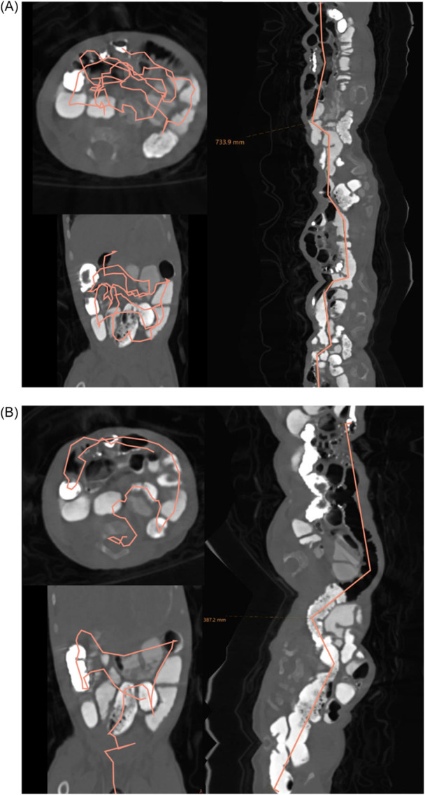
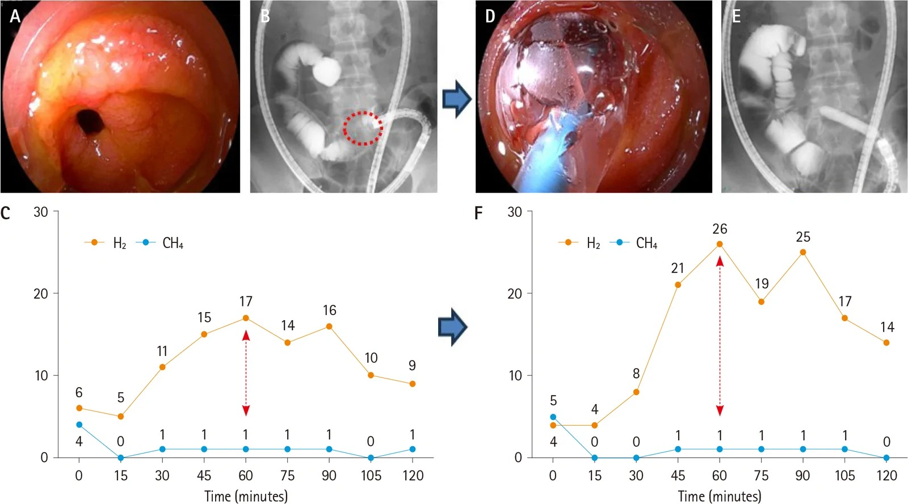
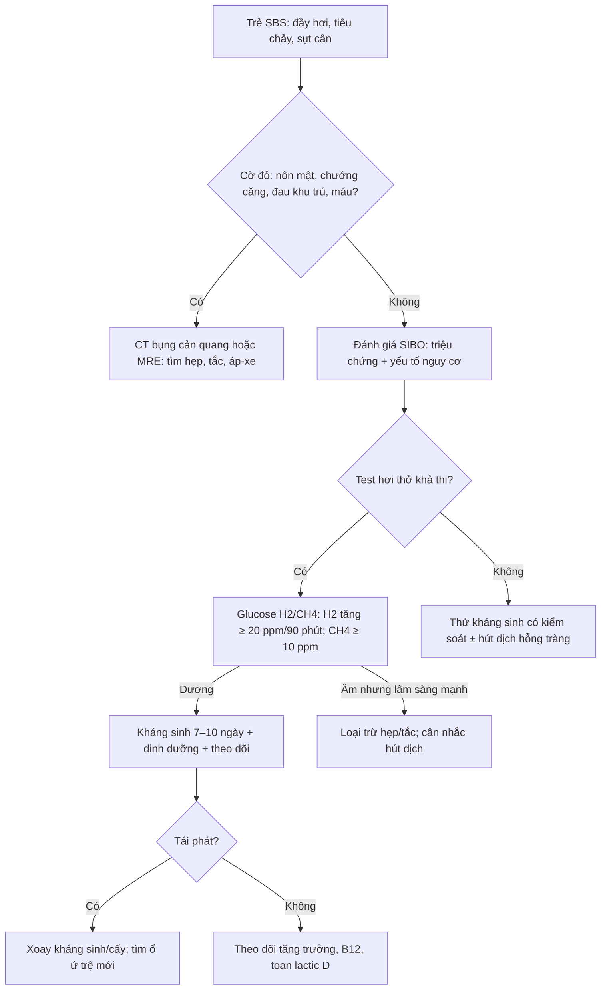
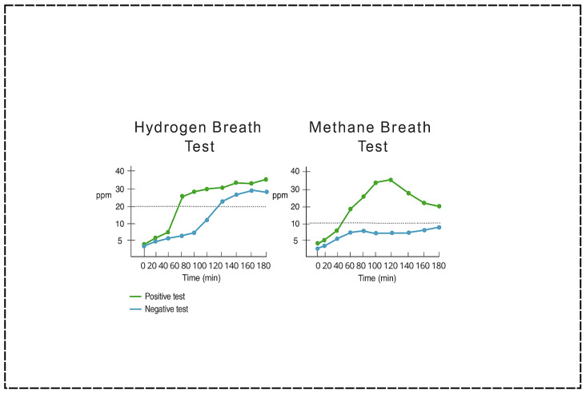

# 1960 — SIBO sau cắt ruột ngắn: ai cần test hơi thở, ngưỡng nào và khi nào xoay kháng sinh / Small intestinal bacterial overgrowth after short bowel resection

**Tags:** `pattern:gian-ruot` `pattern:u-tre` `vung:ruot-non` `vung:bung` `protocol:CT-bung` `protocol:MR-enterography` `protocol:breath-test` `score:North-American-Consensus`

**Mức chắc chắn (certainty):** tổng hợp y văn (literature synthesis) — số liệu từ **16 trẻ hội chứng ruột ngắn (short bowel syndrome, SBS)** theo dõi tại Ljubljana (PMC11941224), **tổng quan 2025** về SIBO ở trẻ SBS (PMC12651181), **đoàn hệ 2025** ở trẻ suy ruột (PMC12581465), **đoàn hệ 2026** về hẹp Crohn – SIBO – nong bóng (PMC13725394), **đồng thuận châu Á 2026** về test hơi thở (PMC13071411) và **bảng liều Boston Children's 2024** (PMC12851206). Không có thử nghiệm ngẫu nhiên ở riêng trẻ SBS; các ngưỡng điều trị là đồng thuận/kinh nghiệm, chỗ suy luận được ghi rõ.

> **Câu chốt:** SIBO **không có dấu hiệu hình ảnh đặc hiệu** — CT/MRI chỉ dùng để **đo chiều dài ruột còn lại và loại trừ hẹp/tắc/ổ ứ trệ**. Chẩn đoán dựa trên **triệu chứng + test hơi thở** (H₂ tăng **≥ 20 ppm trong 90 phút**; CH₄ **≥ 10 ppm** = tăng sinh methanogen) hoặc **hút dịch hỗng tràng ≥ 10³ CFU/mL**; ở trẻ SBS, SIBO gặp **40–80%**, tới **70%** trong một đoàn hệ Bắc Mỹ, và **76%** các đợt bùng phát triệu chứng được quy cho SIBO.

## 1. Tổng quan bệnh học – cơ chế hình ảnh (TẠI SAO SIBO không chẩn đoán bằng hình ảnh)

### 1.1 Ruột ngắn tạo ra ổ ứ trệ như thế nào

- **Định nghĩa SBS:** mất một đoạn ruột non đủ lớn gây **suy ruột (intestinal failure)** — thực hành thường dùng **phụ thuộc nuôi dưỡng tĩnh mạch (parenteral nutrition, PN) > 6 tuần** hoặc **ruột non còn lại < 25% chiều dài dự kiến** (bài 3053).
- Sau cắt ruột, đoạn còn lại **giãn ra để bù** (adaptive dilation): lòng ruột tăng đường kính, thành mỏng, nhu động giảm. Chính **giãn + nhu động kém + mất van hồi–manh tràng** tạo **ổ ứ trệ** cho vi khuẩn đại tràng trào ngược lên hỗng tràng.
- Thêm vào đó: **giảm axit dạ dày** (thuốc ức chế bơm proton), **suy giảm miễn dịch niêm mạc**, **PN kéo dài**, **điều trị kháng sinh lặp lại** — tất cả đẩy hệ vi sinh về kiểu **đại tràng hóa** (colonic-type flora), chủ yếu **Enterobacteriaceae** và anaerobe.
- **TẠI SAO SIBO gây tiêu chảy và sụt cân:** vi khuẩn **khử liên hợp muối mật** → giảm hấp thu mỡ (steatorrhea); **lên men carbohydrate** → khí H₂/CH₄/CO₂, đầy hơi, tiêu chảy thẩm thấu; **tiêu thụ vitamin B12** ở hồi tràng → thiếu máu; một số ca nặng có **nhiễm toan lactic D (D-lactic acidosis)** với triệu chứng thần kinh.
- **Ngưỡng vi sinh:** bình thường ruột non **< 10³ CFU/mL**; SIBO khi **≥ 10³ CFU/mL** dịch hỗng tràng (định lượng kỵ khí + hiếu khí) — đây là **tiêu chuẩn vàng** nhưng xâm lấn và dễ lấy sai vị trí (PMC12651181, PMC12581465).

### 1.2 Vật lý hình ảnh: vì sao CT/MRI chỉ loại trừ, không chẩn đoán

- **CT:** dịch trong lòng ruột **0–20 HU**, thành ruột ngấm thuốc sau tiêm; SIBO **không tạo đậm độ đặc hiệu**, không tạo khối, không tạo vôi. Cái thấy được là **hệ quả**: quai ruột **giãn > 3 cm** (người lớn), mức dịch–khí, thành mỏng, **không có điểm chuyển tiếp** (transition point).
- **Điểm chuyển tiếp (transition point)** là chốt phân biệt: **hẹp/tắc cơ học** có một đoạn **chuyển từ quai giãn sang quai xẹp**; **giãn thích nghi sau cắt ruột** giãn **lan tỏa**, không có đoạn xẹp đột ngột.
- **MRI/MRE:** dịch ruột **T2 rất sáng**, thành ngấm thuốc; **không hạn chế khuếch tán** (khác u/áp-xe); ưu điểm **không bức xạ** khi phải chụp lặp ở trẻ. MRE đánh giá **chiều dài ruột, hẹp, fistula, mức viêm** tốt hơn CT mềm.
- **X-quang cản quang/uống baryt:** thấy **giãn, chậm lưu hành, flocculation** (kết vón baryt do kém hấp thu) và **hẹp/blind loop**; nhưng **không phân biệt được SIBO với ứ trệ đơn thuần**.
- **TẠI SAO không có "dấu hiệu SIBO" trên hình:** vi khuẩn **không đủ đậm độ tia X** và không tạo phản ứng mô đặc hiệu ở mức CT; hình ảnh chỉ phản ánh **thể tích và động học lòng ruột**. Vì vậy câu hỏi hình ảnh đúng là: **"có hẹp/tắc/ổ ứ trệ mổ được không?"**, không phải "có SIBO không?".

### 1.3 Dịch tễ và ngưỡng định lượng

- **Tỷ lệ SIBO ở trẻ SBS:** **40–80%** tùy phương pháp; một đoàn hệ Bắc Mỹ báo **tới 70%** trẻ SBS phụ thuộc PN có **ít nhất một đợt SIBO** xác nhận/nghi ngờ (PMC12651181).
- **Loạt 16 trẻ SBS:** **5 trẻ (31,2%)** có ít nhất một đợt SIBO, tổng **25 đợt**; chiều dài ruột non còn lại trung bình **47 cm (SD 31,5)**, **mất van hồi–manh tràng 61,5% (8/13)**; triệu chứng hay gặp: **tiêu chảy 76%**, đầy hơi **56%**, chán ăn **48%**, chướng bụng **48%**, sụt cân **36%**, đau bụng **25%**, nôn **12%** (PMC11941224).
- **Đáp ứng điều trị:** **56% (14/25)** đợt khỏi sau **một** đợt kháng sinh; **36% (9/25)** cần **hai** loại; **8% (2/25)** cần **ba** loại; **12,5%** trẻ có SIBO kháng trị/tái phát phải dùng kháng sinh **xoay vòng** (PMC11941224). Tổng quan khác ghi **~30%** bệnh nhân còn triệu chứng dai dẳng và **44%** cần nhiều đợt (PMC12651181).
- **Test hơi thở:** H₂ tăng **≥ 20 ppm so với nền trong 90 phút** = dương tính; CH₄ **≥ 10 ppm** ở bất kỳ thời điểm nào = **tăng sinh methanogen (intestinal methanogen overgrowth, IMO)** (PMC12651181, PMC13071411). Lưu ý: ngưỡng này **chưa được chuẩn hóa riêng cho trẻ SBS**.
- **Cấy dịch hỗng tràng:** **≥ 10³ CFU/mL** là ngưỡng kinh điển; đoàn hệ trẻ suy ruột dùng đúng ngưỡng này và thấy **giãn ruột non phổ biến hơn ở nhóm SIBO dương** (PMC12581465).

## 2. Mẫu hình + chẩn đoán phân biệt theo vị trí (Gamut)

- **Giãn lan tỏa, không có điểm chuyển tiếp:** SBS thích nghi · giả tắc ruột mạn (CIPO) · bệnh cơ/thần kinh ruột · thuốc giảm nhu động · sprue/enteropathy. Đây là mẫu hình **"SIBO sinh lý"** điển hình sau cắt ruột.
- **Giãn khu trú + một điểm chuyển tiếp:** hẹp miệng nối · dính · hẹp Crohn · hẹp do xạ · khối/u · xoắn. **Đây là nhóm phải mổ/nong**, không phải SIBO đơn thuần.
- **Giãn + thành dày:** Crohn hoạt động · viêm ruột do xạ · thiếu máu mạn · lymphoma · phù thành do giảm albumin. Thành dày **≥ 3–5 mm** và ngấm thuốc mạnh gợi ý viêm/u, không gợi ý SIBO.
- **Giãn + túi thừa/blind loop:** diverticulum hỗng tràng · blind loop sau nối bên–bên · túi thừa Meckel khổng lồ. Đây là **ổ ứ trệ cấu trúc** — SIBO là **hệ quả**, điều trị phải tính đến việc cắt/nối lại.
- **Giãn + khí trong thành/mạch cửa:** **cờ đỏ thiếu máu ruột** — không phải SIBO; cần CT có cản quang và hội chẩn ngoại khẩn.
- **Không giãn ruột nhưng tiêu chảy mỡ/đầy hơi:** SIBO vẫn có thể; hình ảnh bình thường **không loại trừ**. Ngược lại, **giãn ruột đơn thuần không đồng nghĩa SIBO**.

## 3. Bảng so sánh phân biệt (ma trận đối chiếu)

| Thực thể (entity) | Hình ảnh điển hình (CT/MRE/X-quang) | Chốt vào (rule-in) | Chốt loại (rule-out) | Gợi ý xác nhận |
|---|---|---|---|---|
| **SBS + SIBO** | Giãn ruột non **lan tỏa**, thành mỏng, mức dịch–khí; **không điểm chuyển tiếp**; chiều dài ruột còn lại ngắn | **SBS đã biết + tiêu chảy/đầy hơi/sụt cân + H₂ ≥ 20 ppm/90 phút hoặc CH₄ ≥ 10 ppm** | **Có điểm chuyển tiếp + quai xẹp** → nghĩ tắc cơ học, không phải SIBO đơn thuần | Test hơi thở glucose; cấy dịch hỗng tràng nếu khó |
| **Tắc ruột non cơ học** | **Điểm chuyển tiếp** rõ, quai giãn **> 3 cm**, mức dịch–khí, **không có hơi trong trực tràng** | **Nôn ra dịch mật + chướng + đau quặn + điểm chuyển tiếp** | Giãn lan tỏa không điểm chuyển tiếp → ít nghĩ tắc | CT cản quang; theo dõi sát |
| **CIPO/giả tắc** | Giãn **lan tỏa** cả ruột non và đại tràng, **không điểm chuyển tiếp**, nhu động rất kém | **Giãn mạn tính + không có nguyên nhân cơ học + bệnh nền cơ/thần kinh** | Có hẹp thực thể → không phải CIPO | Manometry; loại trừ hẹp bằng CT/MRE |
| **Hẹp Crohn** | **Hẹp khu trú + thành dày + ngấm thuốc +** có thể fistula/áp-xe | **Đau khu trú + hẹp + thành dày + viêm** | Giãn lan tỏa thành mỏng → ít nghĩ Crohn | MRE/CT enterography; nội soi |
| **Viêm ruột do xạ** | Đoạn **≥ 5 cm**, thành **6–12 mm đối xứng**, ngấm kém, trong trường chiếu | **Tiền sử xạ + hẹp dài + thành dày đối xứng** | Tổn thương rời rạc ngoài trường xạ → ít nghĩ | CT/MRE; nội soi |
| **Diverticulum hỗng tràng** | Nhiều túi **chứa khí/dịch**, thành mỏng, dọc hỗng tràng; có thể **SIBO/giả tắc** | **Nhiều túi + đầy hơi/tiêu chảy + SIBO** | Không thấy túi + giãn lan tỏa → ít nghĩ | CT; small bowel follow-through |
| **Bệnh celiac** | Giãn nhẹ, **lông nhung mất**, **dày thành hỗng tràng**, hạch; có thể lồng ruột | **Tiêu chảy mỡ + sụt cân + huyết thanh celiac dương** | Hình ảnh bình thường không loại trừ; sinh thiết là chốt | Nội soi + sinh thiết; kháng thể tTG |
| **Tiêu chảy muối mật** | **Không đặc hiệu**; đại tràng bình thường; có thể sỏi mật | **Cắt hồi tràng + tiêu chảy nước + đáp ứng cholestyramine** | Không cải thiện với cholestyramine → nghĩ khác | Thử điều trị; SeHCAT nếu có |
| **Dumping sau mổ** | Dạ dày/rỗng nhanh, quai ruột giãn **thoáng qua**, không hẹp | **Triệu chứng 15–30 phút sau ăn + hạ đường huyết muộn** | Không liên quan bữa ăn → ít nghĩ | Test dung nạp; theo dõi |
| **IMO (CH₄)** | Không đặc hiệu; thường **táo bón** | **CH₄ ≥ 10 ppm** + táo bón/chướng | CH₄ thấp + tiêu chảy → ít nghĩ IMO | Test hơi thở có methane |

*(A) Đo chiều dài ruột non: **73,39 cm**; (B) đo chiều dài đại tràng: **38,72 cm**. Đường đỏ là đường đo trên các lát cắt. Hình ảnh cho thấy **giãn quai và mức dịch–khí** nhưng **không có dấu hiệu đặc hiệu của SIBO** — giá trị của CT là **đo chiều dài còn lại và loại trừ hẹp/tắc**. Nguồn: Remund B et al., *JPGN Rep* 2026 (PMC13470618), CC BY 4.0.*

*(A) Nội soi cho thấy hẹp; (B) **X-quang baryt** trong lúc nong bóng: vòng đỏ = vị trí hẹp, đoạn trước hẹp giãn; (C) test hơi thở trước nong: H₂/CH₄ **âm**; (D–E) nong bóng; (F) sau nong: **H₂ đạt 26 ppm** — đủ tiêu chuẩn SIBO dương theo đồng thuận Bắc Mỹ. Ca này cho thấy **hẹp → ứ trệ → SIBO**, và **hình ảnh chỉ ra nguyên nhân cơ học**, không chẩn đoán SIBO. Nguồn: Igarashi T et al., *J Neurogastroenterol Motil* 2026 (PMC13725394), CC BY-NC 4.0 — nguyên bản, không crop/ghép.*

## 4. Protocol chụp + hệ phân độ/điểm chuẩn hóa

### 4.1 Khi nào chụp, chụp gì

- **Không chụp để "chẩn đoán SIBO".** Chỉ chụp khi có **cờ đỏ** hoặc cần loại trừ nguyên nhân cơ học:
  - **Nôn ra dịch mật, chướng căng, đau khu trú, không trung tiện, máu trong phân** → **CT bụng có cản quang** (hoặc X-quang bụng nếu nhẹ).
  - **Sụt cân/tăng trưởng kém kéo dài, tiêu chảy không đáp ứng** → **MRE** (ưu tiên ở trẻ vì không bức xạ) hoặc **CT liều thấp**.
  - **Nghi hẹp miệng nối, blind loop, fistula** → **MRE + X-quang cản quang** theo chỉ định ngoại.
- **Trẻ SBS:** đo chiều dài ruột còn lại trên **CT/MRE** giúp tiên lượng khả năng cai PN; nhưng **chiều dài đo được phụ thuộc người đo và phần ruột giãn**, không dùng đơn lẻ để quyết định mổ.
- **Không dùng baryt thường quy** nếu chỉ theo dõi SIBO; tránh **baryt đặc** khi nghi thủng/tắc hoàn toàn.

### 4.2 Test hơi thở — protocol tối thiểu

| Bước | Yêu cầu |
|---|---|
| Nhịn ăn | **8–12 giờ** trước test (trẻ nhỏ theo tuổi) |
| Thuốc | Ngừng **kháng sinh 4 tuần**, probitic 2 tuần, thuốc nhu động 48 giờ nếu an toàn |
| Cơ chất | **Glucose 1 g/kg** (tối đa **75 g**) hoặc **lactulose 10 g**; glucose đặc hiệu hơn cho ruột non |
| Lấy mẫu | Mỗi **15–20 phút** trong **120–180 phút** |
| Dương tính | **H₂ tăng ≥ 20 ppm** so với nền **trong 90 phút**; **CH₄ ≥ 10 ppm** = IMO |
| Cạm bẫy | **Transit nhanh/lactulose** có thể làm H₂ tăng sớm do vi khuẩn đại tràng → **dương giả**; ở SBS, **âm giả** cũng thường vì hệ vi sinh thay đổi |

### 4.3 Ngưỡng điều trị và theo dõi

| Tình huống | Xử trí / ngưỡng |
|---|---|
| Đợt SIBO đầu | **Rifaximin 20–30 mg/kg/ngày** chia 2–3 lần (người lớn **400 mg × 3/ngày**), **7–10 ngày**; hoặc **metronidazole 10 mg/kg/liều × 2/ngày** (người lớn **250–500 mg × 3–4/ngày**) (PMC12851206) |
| Không đáp ứng sau **48–72 giờ** | Xem lại chẩn đoán: **hẹp/tắc, áp-xe, C. difficile, bệnh nền**; không tự tăng liều |
| Tái phát | **Xoay kháng sinh** theo chu kỳ; **cấy dịch hỗng tràng** nếu thất bại nhiều đợt |
| Dinh dưỡng | Đủ năng lượng/đạm; **MCT** khi tiêu chảy mỡ; theo dõi **B12, folate, vitamin tan trong mỡ, kẽm** |
| Theo dõi | Cân nặng/chiều cao, số đợt SIBO/năm, số ngày kháng sinh/năm, **CLABSI** (nhiễm khuẩn huyết liên quan catheter) |

## 5. Biến thể bình thường và cạm bẫy

- **Giãn thích nghi không phải tắc:** sau cắt ruột, quai giãn **lan tỏa** là sinh lý; chỉ gọi tắc khi có **điểm chuyển tiếp + quai xẹp + triệu chứng cấp**.
- **Test hơi thở âm không loại trừ SIBO:** ở SBS, hệ vi sinh và transit thay đổi làm **giảm độ nhạy**; nếu lâm sàng mạnh, có thể **thử điều trị** hoặc **hút dịch hỗng tràng**.
- **Lactulose dương giả:** cơ chất đến đại tràng sớm ở trẻ **transit nhanh/sau cắt ruột** → H₂ tăng sớm **không đồng nghĩa SIBO**; glucose đặc hiệu hơn cho ruột non (PMC13071411).
- **CH₄ dương là IMO, không phải SIBO kinh điển:** thường đi với **táo bón**; điều trị có thể khác (rifaximin ± neomycin).
- **Không điều trị "colonization" không triệu chứng:** kháng sinh kéo dài ở trẻ SBS làm **giảm đa dạng vi sinh, tăng đề kháng, tăng CLABSI**; chỉ điều trị khi có triệu chứng + bằng chứng.
- **Bỏ sót hẹp vì "chỉ thấy giãn":** đây là **satisfaction of search** điển hình — đọc CT phải **truy tìm điểm chuyển tiếp** trước khi quy mọi triệu chứng cho SIBO.
- **Toan lactic D:** nhiễm toan chuyển hóa **khoảng trống anion cao + triệu chứng thần kinh (lú lẫn, thất điều)** ở trẻ SBS sau bữa ăn carbohydrate; không có trên hình ảnh, cần **khí máu + lactate D**.
- **Thiếu B12:** sau cắt hồi tràng, dự trữ cạn dần; theo dõi **B12 định kỳ** dù không có thiếu máu.

## 6. Tự lượng giá — Blind Quiz

**Ca 1 — Bé gái 3 tuổi, hội chứng ruột ngắn sau cắt ruột non vì xoắn trung trường, đang PN tại nhà, đầy hơi và tiêu chảy tái diễn. CT bụng dưới đây dùng để làm gì?**

- Câu hỏi: Hai số đo chính trên hình là gì? Hình này **chẩn đoán được SIBO** không? Nếu không, nó giúp loại trừ điều gì?

<b>Bấm để hiện đáp án</b>

- (A) Ruột non **73,39 cm**; (B) đại tràng **38,72 cm** — đo trên CT có cản quang.
- **Không chẩn đoán SIBO**: không có dấu hiệu đặc hiệu; hình chỉ cho thấy **giãn quai, mức dịch–khí, chiều dài còn lại**.
- Giá trị thật: **loại trừ hẹp/tắc có điểm chuyển tiếp**, đánh giá chiều dài ruột còn lại để tiên lượng cai PN.
- Nguồn: Remund B et al., *JPGN Rep* 2026 (PMC13470618), CC BY 4.0.

**Ca 2 — Bé trai 12 tuổi Crohn hồi tràng, đau bụng + tiêu chảy; X-quang cản quang cho thấy hẹp, test hơi thở trước và sau nong hẹp thay đổi. Vì sao nong hẹp lại làm test hơi thở dương?**

- Câu hỏi: Panel B mô tả gì? Panel C và F khác nhau ở điểm nào? Điều này nói gì về quan hệ **hẹp – ứ trệ – SIBO**?

<b>Bấm để hiện đáp án</b>

- (B) **X-quang baryt**: vòng đỏ đánh dấu **chỗ hẹp**, đoạn trước hẹp giãn; (C) trước nong: H₂/CH₄ **âm**; (F) sau nong: **H₂ tăng tới 26 ppm** — đạt ngưỡng SIBO dương.
- Giải thích: nong hẹp làm **thay đổi lưu thông và hệ vi sinh**, có thể **phơi bày SIBO** hoặc thay đổi vị trí ứ trệ; test hơi thở **không phải chẩn đoán hình ảnh** mà là **đo lên men của vi khuẩn**.
- Bài học: **hẹp là nguyên nhân cơ học** — phải điều trị hẹp; SIBO là **hệ quả/đồng hành**, không thay thế việc tìm điểm chuyển tiếp.
- Nguồn: Igarashi T et al., *J Neurogastroenterol Motil* 2026 (PMC13725394), CC BY-NC 4.0.

**Ca 3 — Bé gái 8 tuổi SBS, đầy hơi và tiêu chảy. Hai đường cong dưới đây: đường nào dương tính, ngưỡng nào đang được dùng?**

- Câu hỏi: Đường xanh lá và xanh dương khác nhau ở đâu? Đường CH₄ đạt **10 ppm** nói lên điều gì?

<b>Bấm để hiện đáp án</b>

- Trái: **H₂** — đường xanh lá **tăng ≥ 20 ppm trong 90 phút** = dương; đường xanh dương **không đạt ngưỡng** = âm.
- Phải: **CH₄** — đường xanh lá đạt **> 10 ppm** = **IMO** (tăng sinh methanogen), thường đi với **táo bón**; không đồng nghĩa SIBO H₂ kinh điển.
- Lưu ý: hình là **sơ đồ minh họa**, không phải dữ liệu bệnh nhân; ở SBS, cả **âm giả** và **dương giả** đều có thể gặp.
- Nguồn: DeGonza H et al., *Children (Basel)* 2025 (PMC12651181), CC BY 4.0.

## Bài liên quan chéo
- [3053 – Phẫu thuật kéo dài ruột STEP/LILT ở trẻ hội chứng ruột ngắn](../3053-phau-thuat-keo-dai-ruot-step-lilt/lesson.md)
- [3006 – Hội chứng ruột ngắn & bệnh gan do nuôi dưỡng tĩnh mạch ở trẻ](../3006-ruot-ngan-ifald-o-tre/lesson.md)
- [6168 – Suy tụy ngoại tiết ở trẻ: elastase-1, mỡ tụy và PERT](../6168-suy-tuy-ngoai-tiet-tre-elastase-1/lesson.md)
- [162 – Tắc ruột non: điểm chuyển tiếp và chiến lược chẩn đoán](../162-tac-ruot/lesson.md)
- [163 – Huyết khối tĩnh mạch mạc treo & pylephlebitis](../163-pylephlebitis-huyet-khoi-tm-mac-treo/lesson.md)

> Không dùng để chẩn đoán độc lập khi chưa có người hướng dẫn.
