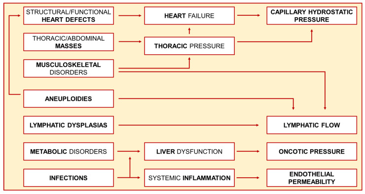
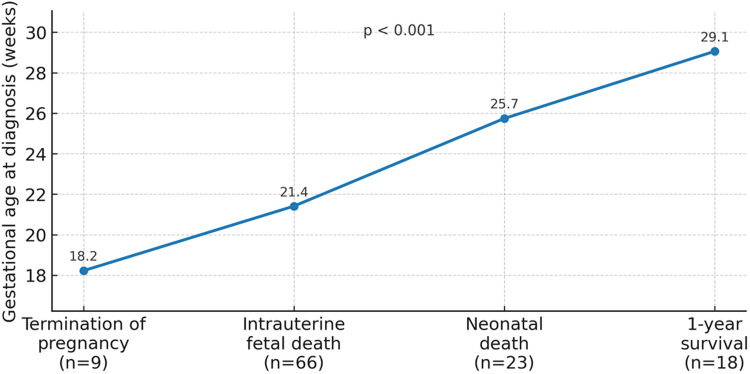
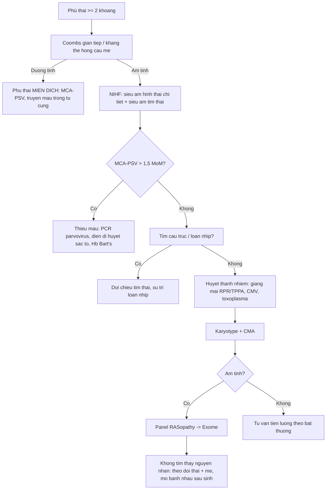
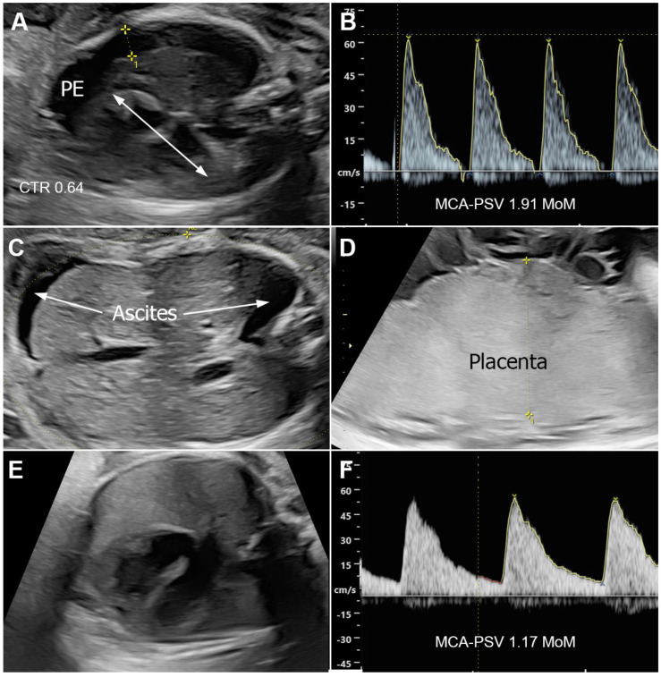

# 1961 — Phù thai không do miễn dịch (NIHF): quy trình tìm nguyên nhân / Non-immune hydrops fetalis — a stepwise work-up

**Tags:** `pattern:phu-thai` `pattern:tran-dich-da-khoang` `pattern:phu-neo-da-day` `pattern:banh-nhau-day` `vung:thai` `protocol:sieu-am-thai` `protocol:doppler-MCA-PSV` `protocol:sieu-am-tim-thai` `score:MoM-MCA-PSV`

**Mức chắc chắn (certainty):** tổng hợp y văn (literature synthesis) — số liệu lấy từ **một đoàn hệ 116 ca NIHF** (PMC13180879), **một tổng quan di truyền học** (PMC11854127), **một loạt 42 ca NIHF** (PMC11262323) và **một tổng quan + loạt ca giang mai bẩm sinh** (PMC12155325). Không có thử nghiệm ngẫu nhiên; các bước work-up là **thực hành đồng thuận**, chỗ suy luận được ghi rõ.

> **Câu chốt:** NIHF không phải một bệnh mà là **một dấu hiệu siêu âm** — “tim đập nhanh, máu loãng, hoặc bạch huyết tắc”. Ba con số quyết định cách xử trí: **(1)** chỉ **35,3%** thai được chẩn đoán trước sinh sống được tới lúc sinh, và **43,9%** trong số đó sống tới 1 tuổi (PMC13180879); **(2)** **tuổi thai lúc chẩn đoán** là yếu tố tiên lượng mạnh nhất — 1 tuần sớm hơn làm **tăng 20% nguy cơ tử vong trong tử cung/đình chỉ** (aOR 1,20), và **tràn dịch màng phổi** làm **tăng 6,11 lần** (PMC13180879); **(3)** sau xét nghiệm nhiễm sắc thể vẫn còn **~80% ca không có chẩn đoán nguyên nhân**, nên **exome** là bước tiếp theo với **hiệu suất 30,81%** riêng ở phù thai (PMC11854127).

## 1. Tổng quan bệnh học – cơ chế hình ảnh (TẠI SAO)

### 1.1 Định nghĩa — đếm “khoang”, không đếm “dấu hiệu”

- **Phù thai (hydrops fetalis)** = **dịch bất thường ở ≥ 2 khoang**: **cổ trướng (ascites)**, **tràn dịch màng phổi (pleural effusion)**, **tràn dịch màng tim (pericardial effusion)**, **phù da toàn thân (generalized skin edema)**. Đoàn hệ 116 ca dùng đúng tiêu chuẩn này, với **phù da ≥ 5 mm** (PMC13180879); một loạt khác lấy **≥ 7 mm ở da đầu thai nhi** (PMC11262323) — vì vậy **5–7 mm** là vùng ngưỡng, không phải một số tuyệt đối.
- **Đa ối (polyhydramnios)** và **bánh nhau dày (placentomegaly)** là dấu hiệu **đi kèm**, **không** tính là một khoang để chẩn đoán.
- **NIHF** = phù thai **không** do kháng thể hồng cầu mẹ (Coombs gián tiếp âm). Sau khi có dự phòng anti-D, phù thai miễn dịch chỉ còn **10–20%** tổng số phù thai; **80–90%** là NIHF, tần suất **1:1.500–1:3.800** (PMC11854127). Tại một trung tâm sản–nhi 63.000 ca sinh, tỷ lệ **theo trường hợp sinh** là **1,84/1.000** cho NIHF và **0,22/1.000** cho phù thai miễn dịch (PMC13180879).

### 1.2 Năm cơ chế, một phương trình — vì sao mỗi khoang xuất hiện theo thứ tự

Cân bằng Starling ở mao mạch thai: **Jv = Kf [(Pc − Pi) − σ(πc − πi)]**. Phù xuất hiện khi **áp lực thủy tĩnh mao mạch tăng (Pc)**, **áp lực keo giảm (πc)**, **tính thấm thành mạch tăng (Kf↑, σ↓)**, hoặc **dẫn lưu bạch huyết bị tắc**. Sơ đồ nguyên nhân → cơ chế chung:

- **Suy tim / tăng áp lực tĩnh mạch hệ thống** (dị tật tim, loạn nhịp, u tim, khối chèn ép lồng ngực) → **Pc tăng** ở tuần hoàn hệ thống và tuần hoàn phổi: **tràn dịch màng phổi và màng tim xuất hiện trước**, sau đó **cổ trướng và phù da**. Vì vậy **tràn dịch màng phổi đơn độc** là dấu hiệu **nặng** — trong đoàn hệ 116 ca, nó làm **tăng 6,11 lần** nguy cơ tử vong trong tử cung/đình chỉ chỉ định (aOR 6,11; KTC 95% 2,07–17,98) (PMC13180879).
- **Thiếu máu nặng** (parvovirus B19, Hb Bart’s, xuất huyết thai–mẹ, TRAP) → **tạo máu ngoài tủy ở gan–lách** → **tăng áp cửa** + **suy tim cung lượng cao** → **cổ trướng + phù da + bánh nhau dày**; gan to và **bánh nhau dày** là dấu hiệu sớm.
- **Giảm áp lực keo** (suy gan, bệnh chuyển hóa, thất thoát protein) → phù mô mềm lan tỏa, **cổ trướng**.
- **Tăng tính thấm thành mạch** (nhiễm trùng, viêm hệ thống, bệnh chuyển hóa) → phù da + tràn dịch **kèm dày bánh nhau và gan lách to**.
- **Tắc dẫn lưu bạch huyết** (loạn sản bạch huyết, Turner 45,X, Noonan/RASopathy, nang bạch huyết vùng cổ) → **tràn dịch màng phổi dạng dưỡng trấp**, phù da; bất thường **nhiễm sắc thể** chiếm tỷ lệ cao nhất ở **tam cá nguyệt I** — tới **70%** ca phù thai ở 3 tháng đầu, giảm còn **20%** ở 3 tháng giữa và **~5%** ở 3 tháng cuối (PMC11854127).

### 1.3 Tại sao “bánh nhau dày” và “tim to” lại là chìa khóa trên siêu âm

- **Bánh nhau dày** phản ánh **phù nhung mao (villous edema)** — hậu quả của thiếu máu/tăng áp lực tĩnh mạch trong bánh nhau. Trong loạt giang mai, **bánh nhau dày 4,2 cm** đã được ghi là placentomegaly (PMC12155325); ngưỡng thực hành thường dùng là **> 4 cm** ở tuổi thai muộn, nhưng **phụ thuộc tuổi thai** nên phải so với bảng bách phân vị, không dùng một số cố định.
- **Tim to** biểu hiện bằng **tỷ lệ tim–lồng ngực (cardiothoracic ratio, CTR)**: bình thường **≤ 0,50**; các ca phù thai do giang mai có **CTR 0,60–0,66** kèm hở van ba lá (PMC12155325). CTR tăng giúp phân biệt **nguyên nhân tim** với **nguyên nhân bạch huyết/nhiễm** ngay từ lần siêu âm đầu.
- **Cổ trướng** là khoang **thường gặp nhất**: **81,0%** (94/116), sau đó **phù da 69,8%**, **tràn dịch màng phổi 64,7%**, **màng tim 31,0%** (PMC13180879). Cổ trướng đơn thuần **không** làm tăng nguy cơ tử vong (p = 0,507), trong khi **phù da** (p = 0,036) và **màng phổi** (p = 0,021) thì có — **không phải cứ nhiều dịch là nặng hơn, mà là dịch ở đâu**.

### 1.4 Tiên lượng — con số để tư vấn

- Trong 116 ca NIHF được chẩn đoán trước sinh: **tử vong trong tử cung 56,9%**, **đình chỉ thai 7,8%**, **sinh sống 35,3%**; trong 41 trẻ sinh sống, **43,9% sống tới 1 tuổi** (PMC13180879).
- **Tuổi thai lúc chẩn đoán** tương quan với kết cục: đình chỉ thai được thực hiện ở **18,2 tuần**, tử vong trong tử cung **21,4 tuần**, tử vong sơ sinh **25,7 tuần**, sống 1 tuổi **29,1 tuần** (p < 0,001):

- **Phù thai miễn dịch** (có chỉ định truyền máu trong tử cung) có tiên lượng tốt hơn hẳn: **sống 1 tuổi 71,4%** (10/14) (PMC13180879) — đây là lý do **phải loại trừ nguyên nhân miễn dịch trước tiên**, vì đó là nguyên nhân **điều trị được**.
- **Hội chứng gương (mirror syndrome/Ballantyne)** — mẹ phù, tăng huyết áp, phù phổi do “phù theo thai” — gặp ở **5–29%** ca (PMC11854127); nhận ra muộn nghĩa là mẹ đã có biến chứng nặng.

## 2. Mẫu hình + chẩn đoán phân biệt theo cơ chế (gamut)

- **Phù thai + tim to + loạn nhịp/CTR > 0,50:** dị tật tim (Ebstein, thiểu sản tim trái, tắc tĩnh mạch phổi toàn phần), loạn nhịp (nhịp nhanh trên thất, block nhĩ–thất hoàn toàn), u tim, khối chèn ép trung thất.
- **Phù thai + bánh nhau dày + gan lách to + MCA-PSV cao:** thiếu máu — parvovirus B19, Hb Bart’s (alpha-thalassemia thể nặng), xuất huyết thai–mẹ, TRAP.
- **Phù thai + nang bạch huyết vùng cổ/dày da gáy:** loạn sản bạch huyết, Turner 45,X, Noonan và các RASopathy.
- **Phù thai + sốt/phát ban mẹ, dịch dưỡng trấp:** nhiễm trùng — giang mai, CMV, toxoplasma, parvovirus.
- **Phù thai + bất thường hình thái khác (tim, chi, sọ):** bất thường nhiễm sắc thể (T21, T18, T13, 45,X) hoặc bệnh đơn gen.
- **Phù thai + song thai một bánh nhau:** TTTS/TRAP — không phải bệnh của “một thai”.
- **Phù thai + khối u:** u quái cùng cụt, u máu bánh nhau (chorioangioma), CPAM thể lớn chèn ép.

## 3. Bảng so sánh phân biệt (ma trận đối chiếu)

| Thực thể (entity) | Hình ảnh điển hình (siêu âm/Doppler) | Chốt vào (rule-in) | Chốt loại (rule-out) | Gợi ý xác nhận |
|---|---|---|---|---|
| **Suy tim / dị tật tim** | **CTR > 0,50**, tim to, tràn dịch màng tim + màng phổi, tĩnh mạch chủ dưới giãn, phổ Doppler tĩnh mạch rốn/ống tĩnh mạch bất thường | **Dị tật cấu trúc trên siêu âm tim thai + CTR tăng** | **Tim bình thường, không loạn nhịp, CTR ≤ 0,50** → tìm nguyên nhân khác | Siêu âm tim thai đầy đủ (4 buồng, đường ra, hồi lưu tĩnh mạch phổi) |
| **Thiếu máu nặng (parvovirus/Hb Bart’s)** | **MCA-PSV > 1,5 MoM**, bánh nhau dày, gan lách to, phù da; đỉnh tâm thu tăng dần theo dõi | **MCA-PSV > 1,5 MoM** và/hoặc **Hb Bart’s** trên điện di | **MCA-PSV < 1,5 MoM** nhiều lần, không thiếu máu huyết học | MCA-PSV 3 lần/đo, điện di huyết sắc tố, PCR parvovirus, truyền máu trong tử cung |
| **Nhiễm trùng (giang mai, CMV, toxoplasma)** | Gan lách to, bánh nhau dày, **CTR 0,60–0,66**, tràn dịch đa khoang, có thể vôi hóa nhu mô | **Huyết thanh mẹ dương + phù thai + gan lách to** | **Huyết thanh âm** (chú ý **hiệu ứng prozone** của giang mai) | RPR/TPPA, CMV IgM/IgG avidity, toxoplasma; PCR dịch ối |
| **Bất thường nhiễm sắc thể / đơn gen** | Phù thai + dị tật khác (tim, chi, sọ), nang bạch huyết, dày da gáy; có thể **đơn độc** | **Karyotype/CMA bất thường** hoặc **exome có biến thể bệnh lý** | **CMA và exome âm** (không loại trừ hoàn toàn — còn 15–20% không rõ) | Karyotype + CMA (tăng 4,9%), panel RASopathy (7–41%), exome (30,81%) |
| **Loạn sản bạch huyết / Turner–Noonan** | Nang bạch huyết vùng cổ, dày da gáy, tràn dịch màng phổi **dạng dưỡng trấp**, phù da | **Nang bạch huyết + tràn dưỡng trấp** | **Không có nang bạch huyết, dịch trong** | Karyotype (45,X), panel RASopathy; phân tích dịch màng phổi sau sinh |
| **TTTS/TRAP (song thai một bánh nhau)** | Một thai thiểu ối–“dính” (stuck twin), một thai đa ối, tim to, Doppler động mạch rốn bất thường | **Chênh lệch nước ối + bàng quang một thai không thấy** | **Hai buồng ối riêng, nước ối hai thai tương đương** | Xác định chorionicity sớm; theo dõi 2 tuần/lần |
| **U bánh nhau / u quái cùng cụt** | Khối đặc–nang trong bánh nhau (**chorioangioma**) hoặc khối cùng cụt lớn, tăng sinh mạch | **Khối u thấy rõ + tăng lưu lượng mạch nuôi** | **Bánh nhau đều, không khối** | Doppler màu, MRI thai khi cần |

### Dấu hiệu lâm sàng – hình ảnh phối hợp
- **Mẹ**: cao huyết áp, phù, protein niệu → nghĩ **hội chứng gương** (5–29%), cần theo dõi mẹ song song với thai.
- **Tiền sử**: phù thai ở lần sinh trước **16,7%**, hôn nhân cận huyết **16,7%** trong loạt 42 ca (PMC11262323) — tiền sử làm thay đổi thứ tự xét nghiệm (di truyền lên trước).

## 4. Protocol chụp + hệ phân độ/điểm chuẩn hóa

### 4.1 Các bước, theo thứ tự “loại trừ cái chữa được trước”

- **Bước 1 (mẹ, trước mọi hình ảnh)**: nhóm máu + **Coombs gián tiếp**, Kleihauer–Betke khi nghi xuất huyết thai–mẹ, **RPR/TPPA**, **CMV IgM/IgG**, **toxoplasma**, **parvovirus B19**; **tổng phân tích máu + điện di huyết sắc tố** (Hb Bart’s — quan trọng ở Việt Nam và Đông Nam Á).
- **Bước 2 (hình thái)**: siêu âm thai **hình thái chi tiết** — đo **độ dày da ≥ 5 mm**, **CTR**, độ dày bánh nhau, lượng ối, các khoang dịch; đo **MCA-PSV**.
- **Bước 3 (tim)**: **siêu âm tim thai** đầy đủ — đây là bước **bắt buộc**, vì dị tật tim là nhóm nguyên nhân lớn nhất và một số (loạn nhịp, block) **điều trị được trong tử cung**.
- **Bước 4 (di truyền)**: **karyotype + microarray nhiễm sắc thể (CMA)**; nếu âm → **panel RASopathy**, rồi **exome**.

### 4.2 Ngưỡng định lượng phải nhớ

| Thông số | Ngưỡng / giá trị | Ý nghĩa | Nguồn |
|---|---|---|---|
| Phù da | **≥ 5 mm** (da đầu **≥ 7 mm**) | Một “khoang” để chẩn đoán phù thai | PMC13180879; PMC11262323 |
| Số khoang | **≥ 2** trong 4 khoang | Định nghĩa phù thai | PMC13180879 |
| MCA-PSV | **> 1,5 MoM** | Thiếu máu thai mức độ trung bình–nặng, cân nhắc truyền máu | Thực hành đồng thuận; ca thực tế **1,91–2,17 MoM** (PMC12155325) |
| Hematocrit thai | **< 30%** | Ngưỡng truyền máu trong tử cung | PMC12155325 |
| CTR | **> 0,50** | Tim to; ca phù thai do giang mai **0,60–0,66** | PMC12155325 |
| Bánh nhau | **> 4 cm** (theo tuổi thai) | Placentomegaly; ca giang mai **4,2 cm** | PMC12155325 |
| CMA sau karyotype | **+4,9%** (3,68–6,13) | Lợi ích tăng thêm của microarray ở NIHF đơn độc | PMC11854127 |
| Panel RASopathy | **7–41%** (35% ở phù thai) | Sau khi loại trừ bất thường nhiễm sắc thể | PMC11854127 |
| Exome | **30,81%** (28,56–33,07) | Hiệu suất riêng ở phù thai | PMC11854127 |

### 4.3 Điều trị — nguyên nhân quyết định
- **Thiếu máu**: **truyền máu trong tử cung** khi Hct < 30% hoặc MCA-PSV tăng liên tục; theo dõi MCA-PSV sau truyền (ca giang mai: **1,91 → 1,17 MoM** sau điều trị) (PMC12155325).
- **Giang mai**: **penicillin G tĩnh mạch** được ưu tiên hơn benzathine penicillin bắp ở thai đã phù, kèm truyền máu khi cần — đây là nguyên nhân NIHF **phòng được và chữa được**, nên **không được bỏ khỏi chẩn đoán phân biệt** (PMC12155325).
- **Loạn nhịp**: thuốc chống loạn nhịp qua mẹ (digoxin, flecainide…) — cần siêu âm tim thai theo dõi.
- **Tràn dịch màng phổi lớn gây chèn ép**: chọc hút/dẫn lưu màng phổi thai nhi trong trung tâm chuyên khoa.

## 5. Biến thể bình thường và cạm bẫy

- **“Phù thai giả” (pseudohydrops)**: dày da gáy đơn độc, nang bạch huyết, hoặc dịch rất ít ở một khoang — **không đủ 2 khoang** thì không gọi là phù thai; theo dõi thay vì can thiệp.
- **Cổ trướng đơn độc do nguyên nhân tiêu hóa** (tắc ruột, thủng ruột, viêm phúc mạc phân su): dịch **có echo/bóng khí**, **không có phù da** — đừng gán cho “suy tim”.
- **Hiệu ứng prozone của giang mai**: huyết thanh **âm giả** khi hiệu giá rất cao; nếu nghi ngờ phải **pha loãng** hoặc làm TPPA (PMC12155325).
- **MCA-PSV tăng giả** khi thai **loạn nhịp**, mẹ dùng thuốc, hoặc đo sai góc (> 15° so với dòng chảy) — đo lại 3 lần, so với bách phân vị theo tuổi thai.
- **Bỏ sót hội chứng gương**: mẹ phù/tăng huyết áp mà chỉ tập trung vào thai → **phù phổi cấp ở mẹ**.
- **Kết luận “vô căn” quá sớm**: sau karyotype vẫn còn **~80%** chưa rõ nguyên nhân (PMC11854127); “vô căn” chỉ nên là chẩn đoán **sau** CMA + exome + khám sau sinh + mô bệnh bánh nhau. Chẩn đoán nguyên nhân đạt **60–85%** khi tính cả đánh giá sau sinh (PMC11854127).

## 6. Tự lượng giá — Blind Quiz

**Ca 1 — Thai 26 tuần, mẹ không kháng thể hồng cầu**

- Gợi ý lâm sàng: thai 26 tuần, Coombs gián tiếp âm, siêu âm thấy dịch ở nhiều khoang.
- Câu hỏi: (a) Kể tên các khoang dịch trong ảnh A, C, D. (b) Chỉ số ở ảnh B là gì và nói lên điều gì? (c) Hai chẩn đoán phân biệt hàng đầu và xét nghiệm chốt?

<b>Bấm để hiện đáp án (findings + chẩn đoán)</b>

- **Findings**: (A) **tràn dịch màng phổi (PE)** + **tim to, CTR 0,64**; (B) **MCA-PSV 1,91 MoM** — cao hơn ngưỡng 1,5 MoM; (C) **cổ trướng (ascites)**; (D) **bánh nhau dày (placentomegaly)**. (E–F) sau điều trị: dịch giảm, **MCA-PSV 1,17 MoM**.
- **Chẩn đoán**: **phù thai không do miễn dịch do thiếu máu** (trong loạt gốc là **giang mai bẩm sinh**) — MCA-PSV cao + tim to + bánh nhau dày là bộ ba của **thiếu máu/tăng cung lượng**, không phải bất thường cấu trúc tim.
- **Vì sao**: thiếu máu → tạo máu ngoài tủy → tăng áp cửa + suy tim cung lượng cao → phù da, cổ trướng, bánh nhau dày; MCA-PSV phản ánh **độ nhớt máu giảm** nên đỉnh tâm thu tăng.
- **Nguồn ảnh**: J Clin Med 2025 — **PMC12155325** — Fig. 1 — CC BY 4.0.

**Ca 2 — Vì sao cùng là phù thai mà tiên lượng khác nhau?**

- Gợi ý lâm sàng: 116 ca NIHF được chẩn đoán trước sinh tại một trung tâm.
- Câu hỏi: (a) Trục tung là gì, và xu hướng nói lên điều gì? (b) Nhóm nào có tiên lượng xấu nhất? (c) Nêu một yếu tố hình ảnh làm tăng nguy cơ tử vong trong tử cung.

<b>Bấm để hiện đáp án (findings + chẩn đoán)</b>

- **Findings**: tuổi thai lúc chẩn đoán tăng dần từ nhóm **đình chỉ thai 18,2 tuần** → **tử vong trong tử cung 21,4 tuần** → **tử vong sơ sinh 25,7 tuần** → **sống 1 tuổi 29,1 tuần** (p < 0,001).
- **Kết luận**: **chẩn đoán càng sớm, tiên lượng càng xấu**; mỗi tuần chẩn đoán sớm hơn làm **tăng 20%** nguy cơ tử vong/đình chỉ (aOR 1,20). **Tràn dịch màng phổi** làm tăng **6,11 lần** nguy cơ này; ở trẻ sinh sống, mỗi tuần thai khi sinh thêm làm **tăng 55%** khả năng sống 1 tuổi (aOR 1,55).
- **Nguồn ảnh**: Front Pediatr 2026 — **PMC13180879** — Figure 1 — CC BY 4.0.

**Ca 3 — Cơ chế nào? (không cần bệnh nhân)**

- Gợi ý lâm sàng: một thai phù có bất thường nhiễm sắc thể và nang bạch huyết vùng cổ.
- Câu hỏi: Đường đi nào trong sơ đồ giải thích **tràn dịch màng phổi dạng dưỡng trấp**? Vì sao **phù da** lại xuất hiện muộn hơn **tràn dịch màng phổi** trong suy tim thai?

<b>Bấm để hiện đáp án (findings + chẩn đoán)</b>

- **Findings**: sơ đồ cho thấy **loạn sản bạch huyết (lymphatic dysplasia)** → **dòng bạch huyết giảm** → ứ dịch; **dị tật tim** → **suy tim** → **áp lực thủy tĩnh mao mạch tăng**; **bất thường nhiễm sắc thể** tác động qua **cả hai** con đường.
- **Giải thích**: màng phổi có **mao mạch phổi áp lực thấp nhưng lưu lượng lớn** và màng phổi mỏng → dịch xuất hiện sớm khi áp lực tĩnh mạch tăng; mô dưới da cần **tăng áp lực kéo dài** và **giảm áp lực keo** mới phù rõ → phù da là dấu hiệu **muộn**.
- **Nguồn ảnh**: Diagnostics 2025 — **PMC11854127** — Figure 1 — CC BY 4.0.

## Bài liên quan chéo

- [1746 – Hội chứng gương (mirror syndrome)](../1746-hoi-chung-guong/lesson.md)
- [1673 – Truyền máu trong tử cung](../1673-truyen-mau-trong-tu-cung/lesson.md)
- [1747 – Xuất huyết thai–mẹ](../1747-xuat-huyet-thai-me/lesson.md)
- [1672 – U máu bánh nhau](../1672-u-mau-banh-nhau/lesson.md)
- [566 – Song thai: chorionicity, TTTS và TAPS](../566-song-thai-chorionicity-TTTS-TAPS/lesson.md)
- [565 – Sàng lọc hình thái và Doppler sản khoa](../565-sang-loc-hinh-thai-va-doppler-san-khoa/lesson.md)
- [698 – Nang phổi bẩm sinh (CPAM/CCAM)](../698-nang-phoi-bam-sinh-cpam-ccam/lesson.md)

## Ảnh

- Tên file: `1961_phu-thai_SieuAm_PMC12155325.jpg`, `1961_phu-thai_BieuDo_PMC13180879.jpg`, `1961_phu-thai_SoDo_PMC11854127.jpg`. Nguồn + giấy phép từng ảnh: `images/CREDITS.md`.
- Cả ba ảnh **CC BY 4.0**, dùng nguyên bản, không crop/ghép.

> Không dùng để chẩn đoán độc lập khi chưa có người hướng dẫn.
