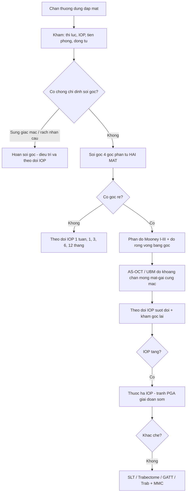
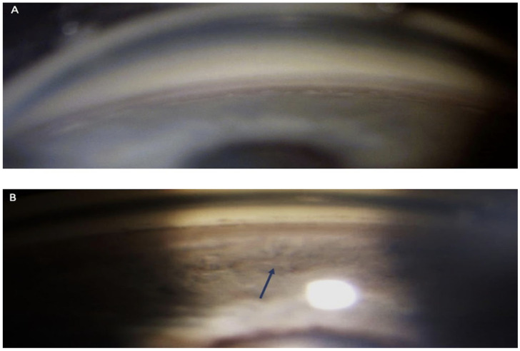
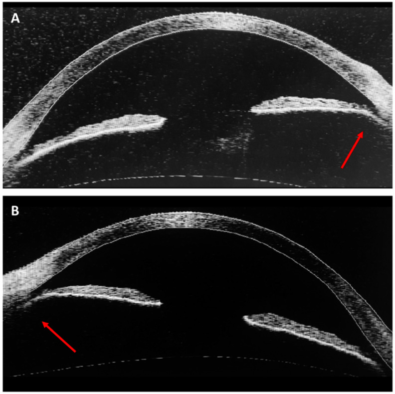

# 1962 — Rách thể mi chấn thương, góc rẽ (angle recession) và glôcôm góc rẽ / Traumatic angle recession and angle-recession glaucoma

**Tags:** `pattern:rach-the-mi` `pattern:goc-re` `pattern:glaucome-thu-phat` `pattern:di-lech-dong-tu` `vung:the-mi` `vung:goc-tien-phong` `vung:mat` `protocol:gonioscopy` `protocol:AS-OCT` `protocol:UBM` `score:IOP`

**Mức chắc chắn (certainty):** tổng hợp y văn (literature synthesis) — số liệu lấy từ **một tổng quan + ca hai mắt sau túi khí** (PMC10532958, có ảnh gonioscopy và AS-OCT), **một loạt 9 mắt SLT** (PMC11646445), **một ca GATT** (PMC13128977) và **một ca Trabectome** (PMC12143927). Không có RCT cho glôcôm góc rẽ; các khuyến cáo điều trị là **tổng hợp loạt ca**, chỗ suy luận được ghi rõ.

> **Câu chốt:** Góc rẽ là **di chứng giải phẫu để lại vĩnh viễn** sau chấn thương đụng dập, nhưng **chỉ 7–9%** người có góc rẽ phát triển glôcôm (PMC10532958). Ba con số quyết định: **(1)** góc rẽ gặp ở **14,8%** người trên 40 tuổi khi soi góc có hệ thống (146/983), và **23,5–100%** ở mắt có máu tiền phòng sau chấn thương; **(2)** glôcôm xuất hiện **hai đỉnh**: trong **1 năm đầu** (do giảm tiết thủy dịch che lấp, hết khi thể mi hồi phục) và **nhiều năm sau** — đỉnh muộn **liên quan đến độ rộng vòng góc rẽ**; **(3)** trên 276 mắt cắt bỏ sau chấn thương, khoảng cách **chân mống mắt–gai củng mạc là 0,4 mm** (bình thường **0,15 mm**) — đó là “thước đo” của góc rẽ trên AS-OCT/UBM.

## 1. Tổng quan bệnh học – cơ chế hình ảnh (TẠI SAO)

### 1.1 Giải phẫu: vì sao rách đúng ở mặt phẳng giữa cơ thể mi

- **Cơ thể mi (ciliary muscle)** có hai bó chính: **bó dọc (longitudinal)** bám vào **gai củng mạc (scleral spur)** và **bó vòng (circular)**; giữa hai bó là **các sợi chéo (oblique fibers)** — vùng **mỏng nhất** và là **mặt phẳng tách tự nhiên** khi có lực cắt.
- Chấn thương đụng dập gây **biến dạng hành não–nhãn cầu theo đường trước–sau**: xích đạo giãn ra, áp lực trong nhãn cầu tăng vọt, rồi **“nảy” ngược** — mô **mềm nhất ở chân mống mắt** chịu lực cắt lớn nhất → **rách giữa bó dọc và bó vòng của thể mi**. Vì vậy tổn thương **không phải ở mống mắt**, mà **ở thể mi**.
- Hệ quả mô học: **teo bó vòng bị tách rời**, **xơ hóa lan tỏa vùng bè**, và **tắc nghẽn ống Schlemm** (PMC10532958) → **tăng trở lực thoát thủy dịch** dù góc vẫn “mở”.
- **Đo định lượng** (276 mắt cắt bỏ sau chấn thương): **chân mống mắt → gai củng mạc = 0,4 mm** (bình thường **0,15 mm**); **mống mắt → đường Schwalbe = 0,7 mm** (bình thường **0,25 mm**) (PMC10532958). Đây là cơ sở để **đo góc rẽ trên AS-OCT** thay vì chỉ mô tả bằng mắt.

### 1.2 Vì sao nhãn áp có thể bình thường ngay sau chấn thương

- Sau đụng dập, **thể mi bị “sốc” → giảm tiết thủy dịch**; trở lực thoát đã tăng nhưng **lưu lượng vào giảm**, nên **nhãn áp có thể bình thường hoặc thấp** vài tuần đầu. Khi thể mi **hồi phục tiết**, nhãn áp mới tăng — đây là **đỉnh sớm trong vòng 1 năm**, có thể **tạm thời** và **không tương quan với độ rộng góc rẽ**.
- **Đỉnh muộn** xuất hiện **nhiều năm sau**, khi **xơ hóa vùng bè tiến triển**; đỉnh này **liên quan đến độ rộng vòng (circumferential extent) và độ sâu của vết rách** (PMC10532958). Vì vậy **theo dõi nhãn áp suốt đời** là bắt buộc, kể cả khi nhãn áp lúc ra viện bình thường.

### 1.3 Dấu hiệu soi góc (gonioscopy) — “bản đồ” của góc rẽ

- **Đặc điểm chính**: **chân mống mắt bị đẩy ra sau**, **dải thể mi lộ rộng (exposed ciliary band)**, **góc mở rộng bất thường** so với mắt bên.
- **Dấu hiệu phụ**: **dải thể mi sẫm màu và rộng hơn mắt đối diện**; **đồng tử giãn không đều từng vùng (sectorial mydriasis)** do tổn thương sợi thần kinh đi qua thể mi tới cơ vòng đồng tử — một “gợi ý ngoài góc” rất giá trị.
- **Phân độ (Mooney, theo mô tả soi góc)**:

| Độ | Mô tả soi góc |
|---|---|
| **I** | Rách nông; **không thấy khe thể mi rõ**; dải thể mi **sẫm và rộng hơn** mắt bên |
| **II** | Rách vừa; **khe thể mi rõ**; góc **sâu hơn** mắt bên do thể mi rách |
| **III** | Rách sâu; **khe sâu vào thể mi**, **không xác định được đáy khe** trên soi góc |

*(Bảng phân độ theo PMC10532958, Table 3.)*

## 2. Mẫu hình + chẩn đoán phân biệt theo thời điểm (gamut)

- **Tăng nhãn áp SỚM (< 1 năm) sau chấn thương đụng dập:** viêm bè–mống mắt (trabeculitis), **vỡ bè (trabecular disruption)**, **máu tiền phòng** bít bè, xuất huyết hắc mạc ồ ạt, tổn thương hóa chất, **glôcôm thể thủy tinh** (lệch/phồng thể thủy tinh), **dịch kính–hồng cầu (ghost cell)** sớm, **dị vật nội nhãn**, bong võng mạc (hội chứng Schwartz).
- **Tăng nhãn áp MUỘN (nhiều năm):** **góc rẽ (angle recession)**, **dính góc trước (PAS)**, **glôcôm tế bào hồng cầu (ghost cell)**, **glôcôm thể thủy tinh**, và **đóng muộn của khe thể mi (cyclodialysis cleft)**.
- **Hạ nhãn áp + tiền phòng nông + bong hắc mạc:** **khe thể mi (cyclodialysis cleft)** — cơ chế **ngược lại** với góc rẽ; xem bài 1434 để không nhầm hướng điều trị.

## 3. Bảng so sánh phân biệt (ma trận đối chiếu)

| Thực thể (entity) | Hình ảnh điển hình (soi góc/AS-OCT/UBM) | Chốt vào (rule-in) | Chốt loại (rule-out) | Gợi ý xác nhận |
|---|---|---|---|---|
| **Góc rẽ (angle recession)** | **Chân mống mắt lùi ra sau**, **dải thể mi lộ rộng**, góc sâu hơn mắt bên; AS-OCT: khoảng cách chân mống mắt–gai củng mạc **≈ 0,4 mm** | **Dải thể mi lộ + góc sâu hơn mắt đối diện** ở vùng có chấn thương | **Góc đều hai mắt, dải thể mi không lộ** | Soi góc **hai mắt**, 4 góc phần tư; AS-OCT/UBM đo |
| **Iridodialysis (rách chân mống mắt)** | **Khuyết mống mắt hình chữ D**, đồng tử **méo về phía khuyết**, thấy **đáy mống mắt**; góc **hở thông** với tiền phòng | **Khuyết mống mắt + méo đồng tử** | Mống mắt **liên tục**, chỉ có góc sâu | Soi góc, chụp tiền phòng; AS-OCT |
| **Khe thể mi (cyclodialysis cleft)** | **Hạ nhãn áp (≤ 5 mmHg)**, **tiền phòng nông**, **bong hắc mạc**, nếp võng mạc; UBM thấy **khe thông tiền phòng–khoang trên hắc mạc** | **Nhãn áp THẤP + bong hắc mạc + thấy khe** | **Nhãn áp cao/bình thường**, không bong hắc mạc | UBM 50 MHz, AS-OCT; xem bài 1434 |
| **Dính góc trước (PAS)** | **Mống mắt dính vào góc** từng đoạn, góc **đóng**; thường sau máu tiền phòng/viêm kéo dài | **Dính thực sự, không tách được khi ấn** | Góc **mở**, không dính | Soi góc ấn (indentation); AS-OCT |
| **Glôcôm tế bào hồng cầu (ghost cell)** | **Tế bào nhỏ, bạc màu lơ lửng** tiền phòng, **không viêm**, nhãn áp tăng **vài tuần–vài tháng** sau xuất huyết dịch kính | **Tế bào “bóng ma” + tiền sử xuất huyết dịch kính** | Không có tế bào lơ lửng, góc rẽ đơn thuần | Soi sinh hiển vi, đếm tế bào tiền phòng; đối chiếu tiền sử xuất huyết dịch kính |
| **Glôcôm thể thủy tinh** | Thể thủy tinh **phồng/lệch**, tiền phòng nông **không đều**, có thể **hạt thể thủy tinh** | **Bất thường thể thủy tinh + tăng nhãn áp** | Thể thủy tinh **trong, đúng vị trí** | Sinh hiển vi, AS-OCT, siêu âm B |
| **Viêm bè–mống mắt sau chấn thương** | **Tế bào/giả tế bào tiền phòng**, dính góc non, nhãn áp tăng **sớm** | **Viêm tiền phòng hoạt động** | Không tế bào, không dính | Đáp ứng corticoid tại chỗ |

### Dấu hiệu lâm sàng – hình ảnh phối hợp
- **Máu tiền phòng (hyphema)** là **liên quan thường gặp nhất** của góc rẽ; **tỷ lệ góc rẽ ở mắt có máu tiền phòng rất thay đổi: 23,5% đến 71–100%** tùy loạt (PMC10532958) — nghĩa là **không có máu tiền phòng không loại trừ** góc rẽ, và **có máu tiền phòng phải soi góc** khi hết máu.
- **Chấn thương do túi khí (airbag)** là cơ chế đang được báo cáo, có thể **hai mắt**; ca trong bài là nam 75 tuổi, tai nạn xe **22 năm trước**, nhãn áp **35 mmHg phải / 25 mmHg trái**, thị trường phải **MD −12,29 dB** (glôcôm tiến triển), mắt trái chỉ **tăng nhãn áp** (PMC10532958).

## 4. Protocol chụp + hệ phân độ/điểm chuẩn hóa

### 4.1 Thuật toán sau chấn thương đụng dập

- **Soi góc (gonioscopy)**: là **tiêu chuẩn vàng**; dùng **gương soi góc không ấn (non-indentation)** để không làm sai lệch độ sâu, sau đó **ấn (indentation)** để phân biệt **PAS thật** với **góc đóng giả**. Soi **cả hai mắt**, đủ **4 góc phần tư** — vì tổn thương có thể **khu trú** và vì **góc rẽ hai bên gặp tới 2,1%** (PMC10532958).
- **AS-OCT tiền phòng** (không tiếp xúc, không cần thuốc tê): đo **mở góc (angle opening distance)**, **độ rộng dải thể mi**, và **khoảng cách chân mống mắt–gai củng mạc**; ưu điểm là **đo được, lưu ảnh, so theo thời gian**. **UBM 50 MHz** khi cần nhìn **sau mống mắt/sau thể mi** (khe thể mi, nang thể mi) — bổ trợ, không thay thế soi góc.
- **Theo dõi nhãn áp**: khám **1 tuần, 1, 3, 6, 12 tháng** trong năm đầu, sau đó **hằng năm suốt đời** (đề xuất thực hành, không phải ngưỡng từ RCT); mỗi lần **đo cả hai mắt** và **ghi nhãn áp nền** để phát hiện đỉnh muộn.
- **Đo thị trường/RNFL–GCL** khi nhãn áp tăng hoặc khi nghi glôcôm — góc rẽ **không** bảo vệ gai thị.

### 4.2 Ngưỡng định lượng phải nhớ

| Thông số | Ngưỡng / giá trị | Ý nghĩa | Nguồn |
|---|---|---|---|
| Tỷ lệ góc rẽ khi soi góc có hệ thống | **14,8%** (146/983 người > 40 tuổi) | Góc rẽ **phổ biến hơn ta tưởng** | PMC10532958 |
| Góc rẽ ở mắt có máu tiền phòng | **23,5% – 71–100%** | Máu tiền phòng **không** dự báo chắc, nhưng buộc phải soi góc | PMC10532958 |
| Góc rẽ một bên / hai bên | **≤ 15,4% / ≤ 2,1%** | **Soi cả hai mắt** | PMC10532958 |
| Nguy cơ glôcôm ở người có góc rẽ | **7–9%** | Theo dõi dài hạn, không điều trị dự phòng | PMC10532958 |
| Khoảng chân mống mắt–gai củng mạc | **0,4 mm** (bình thường **0,15 mm**) | Thước đo góc rẽ | PMC10532958 |
| Mống mắt–Schwalbe | **0,7 mm** (bình thường **0,25 mm**) | Góc mở rộng bất thường | PMC10532958 |
| Nhãn áp trong ca hai mắt | **35 / 25 mmHg**; MD **−12,29 dB** | Mức tăng và tổn thương thị trường | PMC10532958 |
| SLT ở glôcôm góc rẽ | Thành công **55,5%** (5/9); IOP **20 → 16,83 mmHg** ở 12 tháng | Lựa chọn **ít xâm lấn** trước | PMC11646445 |
| Trabeculectomy ở góc rẽ | Thành công **43%** (so **74%** ở POAG) | Kết quả **kém hơn** POAG; **dùng MMC** | PMC12143927 |
| Trabectome (ab interno) | Giảm IOP **~31%**, về **~15 mmHg** (gộp phân tích) | Lựa chọn khi muốn **tránh bọng lọc** | PMC12143927 |
| GATT (ca) | **12 mmHg** không thuốc ở 12 tháng; góc rẽ **5 giờ đồng hồ** | Lựa chọn ở **người trẻ**, góc rẽ khu trú | PMC13128977 |

### 4.3 Điều trị — thứ tự thực tế
1. **Nội khoa**: **thuốc ức chế beta, ức chế carbonic anhydrase, alpha-agonist**; **tránh prostaglandin (PGA) ngay sau chấn thương** vì **tác dụng tiền viêm** (PMC10532958) — sau giai đoạn viêm có thể dùng lại.
2. **SLT**: thành công **55,5%** trong loạt 9 mắt, **giảm nhãn áp khiêm tốn** (20 → 16,83 mmHg) nhưng **giảm số thuốc**; có **hiệu ứng đối bên** (mắt không điều trị thành công 33,3%) (PMC11646445).
3. **Phẫu thuật**: **trabeculectomy + MMC** (xơ hóa bọng lọc hay gặp ở mắt đã chấn thương); **Trabectome** (ab interno, tránh bọng lọc, giảm ~31% IOP); **GATT** ở góc rẽ khu trú; **ống dẫn lưu** khi thất bại nhiều lần.
4. **Luôn nhớ**: điều trị **glôcôm**, không điều trị “góc rẽ” — góc rẽ **không hồi phục** và **không cần can thiệp** nếu nhãn áp bình thường.

## 5. Biến thể bình thường và cạm bẫy

- **Dải thể mi rộng sinh lý** ở **mắt cận thị cao, người trẻ** — phải so **mắt đối diện** và tìm **dấu hiệu chấn thương kèm theo** (máu tiền phòng cũ, iridodialysis, đục thể thủy tinh khu trú, sẹo giác mạc).
- **Máu tiền phòng che góc**: soi góc **khi máu đã tan**, không kết luận “góc bình thường” trong lúc còn máu; **phù giác mạc** cũng làm mờ góc — chờ hoặc dùng AS-OCT.
- **Giảm tiết thể mi che lấp tăng trở lực**: nhãn áp bình thường sau chấn thương **không** loại trừ góc rẽ; đỉnh muộn có thể **10–20 năm** sau.
- **Nhầm iridodialysis với góc rẽ**: iridodialysis có **khuyết mống mắt + méo đồng tử**; góc rẽ có **mống mắt liên tục** nhưng **chân mống mắt lùi ra sau**.
- **Nhầm khe thể mi với góc rẽ**: khe thể mi gây **hạ nhãn áp** và **bong hắc mạc** — hướng điều trị **ngược** (atropine, laser, cyclopexy), không phải hạ nhãn áp.
- **Bỏ sót mắt thứ hai**: góc rẽ hai bên tới **2,1%**, thường do **túi khí** hoặc **chấn thương lặp lại**; luôn soi **cả hai mắt** và hỏi **tiền sử chấn thương đầu/mặt**.
- **Kết luận “glôcôm góc mở nguyên phát”** ở người trẻ có tăng nhãn áp một mắt: **luôn soi góc** trước khi gán nhãn POAG.

## 6. Tự lượng giá — Blind Quiz

**Ca 1 — Nam 45 tuổi, mờ mắt sau chấn thương bóng**

- Gợi ý lâm sàng: chấn thương đụng dập mắt phải 1 tháng trước, nhãn áp 28 mmHg, mắt trái 16 mmHg.
- Câu hỏi: (a) Mô tả khác biệt giữa hai ảnh A và B. (b) Dấu hiệu nào phân biệt với iridodialysis? (c) Bước tiếp theo cần làm?

<b>Bấm để hiện đáp án (findings + chẩn đoán)</b>

- **Findings**: (A) góc phía trên **bình thường**; (B) góc phía dưới **sâu bất thường**, **dải thể mi lộ rộng** (mũi tên) so với phía trên — góc rẽ **khu trú** vùng dưới.
- **Chẩn đoán**: **góc rẽ sau chấn thương đụng dập**; cần **soi góc mắt trái** để so sánh và **đo AS-OCT**.
- **Vì sao**: lực đụng dập làm rách mặt phẳng giữa bó dọc và bó vòng thể mi → chân mống mắt lùi ra sau, dải thể mi lộ; **mống mắt vẫn liên tục** nên không phải iridodialysis.
- **Nguồn ảnh**: Life 2023 — **PMC10532958** — Figure 1 — CC BY 4.0.

**Ca 2 — Cùng bệnh nhân, câu hỏi về “thước đo”**

- Gợi ý lâm sàng: AS-OCT tiền phòng (Visante) mắt phải (A) và mắt trái (B).
- Câu hỏi: (a) Mũi tên chỉ cấu trúc nào? (b) Khoảng cách nào đo góc rẽ, và giá trị bình thường/ bệnh lý? (c) Vì sao nhãn áp có thể bình thường trong nhiều năm?

<b>Bấm để hiện đáp án (findings + chẩn đoán)</b>

- **Findings**: mũi tên chỉ **chỗ góc mở rộng bất thường** — chân mống mắt lùi ra sau, **dải thể mi lộ**; hình dạng góc **không đối xứng** với mắt bên.
- **Số đo**: khoảng **chân mống mắt–gai củng mạc ≈ 0,4 mm** ở mắt góc rẽ so với **0,15 mm** bình thường; **mống mắt–Schwalbe 0,7 mm** so với **0,25 mm** (276 mắt cắt bỏ sau chấn thương).
- **Vì sao nhãn áp bình thường lâu**: thể mi **giảm tiết** sau chấn thương che lấp tăng trở lực; khi hồi phục tiết mới tăng nhãn áp — đỉnh muộn **nhiều năm sau**, liên quan **độ rộng vòng góc rẽ**.
- **Nguồn ảnh**: Life 2023 — **PMC10532958** — Figure 3 — CC BY 4.0.

**Ca 3 — Bệnh nhân 30 tuổi, nhãn áp 30 mmHg một mắt, không tiền sử rõ**

- Gợi ý lâm sàng: nam 30 tuổi, nhãn áp mắt phải 30 mmHg, mắt trái 15 mmHg; giác mạc trong, tiền phòng sâu, **đồng tử phải giãn không đều từng vùng**; không nhớ chấn thương.
- Câu hỏi: (a) Ba chẩn đoán phân biệt? (b) Dấu hiệu nào gợi ý góc rẽ? (c) Hai việc phải làm ngay trong buổi khám.

<b>Bấm để hiện đáp án (findings + chẩn đoán)</b>

- **Chẩn đoán phân biệt**: **glôcôm góc rẽ**, **glôcôm góc mở nguyên phát**, **viêm bè–mống mắt/viêm tiền phòng**, **glôcôm thể thủy tinh**, **khe thể mi đóng muộn** (nếu có tiền sử chấn thương).
- **Gợi ý**: **giãn đồng tử từng vùng (sectorial mydriasis)** do tổn thương sợi thần kinh qua thể mi; tăng nhãn áp **một mắt ở người trẻ**; tiền sử chấn thương có thể **bị quên**.
- **Phải làm**: (1) **soi góc cả hai mắt, đủ 4 góc phần tư**; (2) **AS-OCT/UBM** đo góc + **chụp/ghi hình** để theo dõi; sau đó khởi trị hạ nhãn áp (tránh PGA giai đoạn sớm) và hẹn theo dõi **suốt đời**.
- **Nguồn**: số liệu và dấu hiệu từ PMC10532958 (tổng quan + ca).

## Bài liên quan chéo

- [1447 – Rách thể mi sau MIGS/Yamane](../1447-rach-the-mi-sau-migs-va-yamane/lesson.md)
- [1434 – Hạ nhãn áp & khe thể mi (cyclodialysis cleft)](../1434-ha-nhan-ap-rach-the-mi-sau-quang-dong/lesson.md)
- [1444 – Viêm màng bồ đào sau chấn thương](../1444-viem-mang-bo-dao-sau-chan-thuong/lesson.md)
- [1416 – Glôcôm do dầu silicone](../1416-glaucom-do-dau-silicone/lesson.md)
- [1452 – Glôcôm do thể thủy tinh chưa mổ](../1452-glaucom-do-the-thuy-tinh-chua-mo/lesson.md)
- [449 – Chấn thương mắt do dị vật](../449-chan-thuong-mat-dich-vat/lesson.md)
- [412 – U trong nhãn cầu](../412-u-trong-nhan-cau/lesson.md)

## Ảnh

- Tên file: `1962_goc-re_Gonioscopy_PMC10532958.jpg`, `1962_goc-re_ASOCT_PMC10532958.jpg`. Nguồn + giấy phép từng ảnh: `images/CREDITS.md`.
- Cả hai ảnh **CC BY 4.0**, dùng nguyên bản, **không crop/ghép**; ảnh soi góc giữ nguyên độ mờ của bản gốc để trung thực nguồn.

> Không dùng để chẩn đoán độc lập khi chưa có người hướng dẫn.
