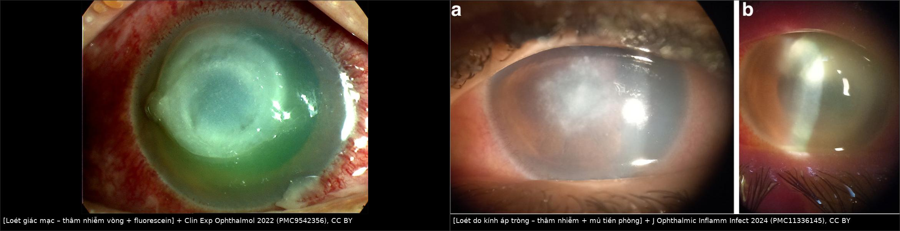
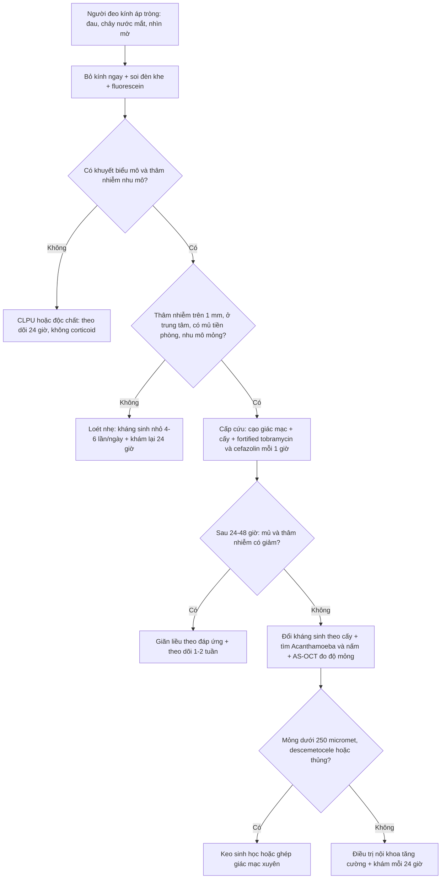
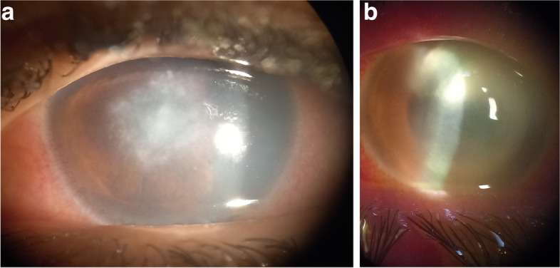
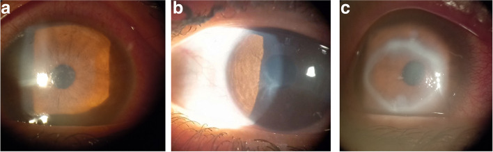
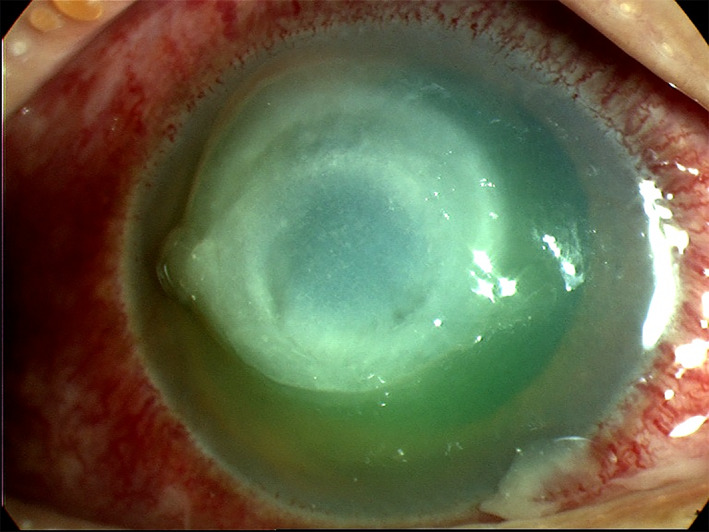

# 1964 — Loét giác mạc do kính áp tròng: "thâm nhiễm vòng + mủ tiền phòng" / Contact lens–related microbial keratitis

**Tags:** `pattern:o-loet-giac-mac` `pattern:tham-nhien-nhu-mo` `pattern:vong-mien-dich` `pattern:mu-tien-phong` `pattern:mo-giac-mac` `pattern:thung-giac-mac` `vung:giac-mac` `vung:tien-phong` `vung:mat` `protocol:slit-lamp` `protocol:cam-mau-cay` `protocol:AS-OCT` `incidentaloma:khong`
**Mức chắc chắn (certainty):** tổng hợp y văn (literature synthesis) — ghép **tổng quan viêm giác mạc nhiễm trùng** (Clin Exp Ophthalmol 2022, PMC9542356), **nghiên cứu đoàn hệ Pseudomonas aeruginosa** ở Anh (Front Med 2026, PMC13395769), **khảo sát dịch tễ loét nặng phải nhập viện** (Acta Ophthalmol 2025, PMC11986396), **nghiên cứu yếu tố nguy cơ vệ sinh kính** (J Ophthalmic Inflamm Infect 2024, PMC11336145) và **dịch tễ loét nặng ở một trung tâm** (2025). Câu nào là suy luận được ghi **[suy luận]**.

> **Câu hỏi thực hành:** nữ 22 tuổi, **đeo kính áp tròng mềm quên tháo khi ngủ 2 đêm**, vào viện vì **đau mắt phải dữ dội, chói sáng, nhìn mờ 2 ngày**. Sinh hiển vi: **ổ loét trung tâm ~ 3 mm, thâm nhiễm nhu mô trắng đục, mủ tiền phòng 1 mm**. Người trực định **nhỏ corticoid giảm viêm + hẹn 1 tuần**. Câu hỏi: **có được dùng corticoid lúc này không, cấy gì, kháng sinh nào, và dấu hiệu nào buộc phải mổ?**
> Bài chốt theo ba trục: (1) **đây là cấp cứu nhãn khoa** — Pseudomonas làm **chảy mủ, mỏng và thủng giác mạc trong vài ngày**, nên **không chờ kết quả cấy**; (2) **corticoid chỉ sau khi đã kiểm soát nhiễm** — dùng sớm ở loét do Pseudomonas/Acanthamoeba làm **tăng nguy cơ thủng**; (3) **thâm nhiễm vòng không đồng nghĩa Acanthamoeba** — cùng dấu hiệu này còn gặp ở Pseudomonas, nấm và cả viêm do phản ứng miễn dịch. Nối [1472 – Viêm giác mạc do Acanthamoeba](../1472-viem-giac-mac-acanthamoeba/lesson.md), [1456 – Bỏng hóa chất mắt](../1456-bong-hoa-chat-mat/lesson.md), [1425 – Viêm nội nhãn sau tiêm nội nhãn](../1425-viem-noi-nhan-sau-tiem-noi-nhan/lesson.md).

## 1. Tổng quan bệnh học – cơ chế hình ảnh: vì sao kính áp tròng mở đường cho Pseudomonas

- **Bình thường giác mạc không có mạch máu** → miễn dịch dựa vào **nước mắt, lysozyme, IgA, biểu mô nguyên vẹn và các yếu tố thể miễn dịch từ rìa**. Chỉ cần **một khuyết biểu mô** là hàng rào mất.
- **Bốn cơ chế của kính áp tròng (contact lens, CL):**
  1. **Thiếu oxy (hypoxia):** khi nhắm mắt, oxy khí trời tới giác mạc giảm còn **~ 2–3%** so với **21%** khi mở; kính có **Dk/t thấp** (độ thấm khí/độ dày) hoặc **đeo qua đêm** làm biểu mô **chậm tái tạo, giảm bám dính, tăng nhạy cảm nhiễm** — đây là lý do **đeo qua đêm là yếu tố nguy cơ mạnh nhất**.
  2. **Chấn thương vi mô:** ma sát bề mặt + **khuyết biểu mô dạng chấm** → cửa vào cho vi khuẩn.
  3. **Màng sinh học (biofilm):** Pseudomonas bám kính, **hộp đựng kính và dung dịch** thành **biofilm** — kháng được dung dịch đa năng và **không bị rửa trôi**; nhiễm từ **nước máy** (rửa kính/vỏ bằng nước máy, tắm/bơi khi đeo) là nguồn vi khuẩn và **Acanthamoeba**.
  4. **Suy giảm hàng rào miễn dịch tại chỗ:** nước mắt bị kính chia cắt thành lớp mỏng, **giảm rửa trôi và giảm yếu tố kháng khuẩn**.
- **TẠI SAO Pseudomonas lại chiếm ưu thế:** trực khuẩn Gram âm ưa nước, **sống được trong dung dịch và biofilm kính**, có **pili/flagella** bám biểu mô tổn thương, tiết **exotoxin (ExoU, exotoxin A), protease và elastase** → **phân giải nhu mô nhanh**; vì vậy bệnh cảnh **tiến triển trong vài ngày** chứ không "từ từ như nấm".
- **TẠI SAO T2… (không áp dụng) — thay bằng: TẠI SAO thâm nhiễm trắng đục và mủ tiền phòng:**
  - Thâm nhiễm = **tụ bạch cầu trung tính + phù nhu mô + hoại tử collagen** → tán xạ ánh sáng → **đục trắng** trên đèn khe; **mất tính trong suốt** vì collagen mất trật tự.
  - **Mủ tiền phòng (hypopyon)** = bạch cầu lắng ở góc dưới tiền phòng; **mức lắng ngang** do trọng lực.
  - **Thâm nhiễm vòng (ring infiltrate)** = **lắng đọng phức hợp kháng nguyên–kháng thể + bạch cầu** trong nhu mô, chạy vòng quanh ổ loét ("Wessely ring") — **không đặc hiệu**: gặp ở Pseudomonas, Acanthamoeba, nấm, và cả viêm giác mạc **do phản ứng miễn dịch** sau nhiễm.
- **TẠI SAO loét đeo kính thường "nhẹ hơn" loét không do kính:** ở đoàn hệ Pseudomonas 66 mắt, nhóm do kính **trẻ hơn, thị lực vào viện tốt hơn, ổ loét nhỏ và không ở trung tâm, ít mủ tiền phòng**, **lành nhanh hơn: trung vị 17 ngày so với 32 ngày** (p = 0,029) và **nguy cơ kết cục thị lực xấu thấp hơn** (aOR 0,13; KTC 95% 0,01–0,84) (PMC13395769) — **[suy luận]** vì người đeo kính thường trẻ, đi khám sớm, và vi khuẩn nhạy kháng sinh (**97,0%** Pseudomonas trong nghiên cứu còn nhạy).
- **Ngưỡng định lượng phải nhớ:**
  - **Viêm giác mạc nói chung (mọi nguyên nhân):** **27,6/100.000/năm** ở Mỹ (1999), **40,3/100.000** ở Anh (2006), **6,6/100.000** ở Úc (PMC9542356).
  - **Loét nặng do kính phải nhập viện:** **2,52/10.000 người đeo kính/năm** với **kính đeo qua đêm (extended wear)**, so với **0,52/10.000/năm** với **kính dùng một ngày** — chênh **~ 5 lần** (Acta Ophthalmol 2025, 41 bệnh nhân/42 mắt trong 3 năm; **66%** dùng kính qua đêm, **29%** dùng kính ngày; **45%** thừa nhận dùng sai cách; **chỉ 37%** biết loét giác mạc là biến chứng) (PMC11986396).
  - **Pseudomonas trong loét do kính:** là **Gram âm hay gặp nhất** trong nhóm loét do kính (PMC9542356); **53,1%** các ca Pseudomonas giác mạc trong đoàn hệ Anh là **do kính áp tròng**; **71,2%** phải nhập viện, **19,7%** phải mổ (PMC13395769).
  - **Yếu tố nguy cơ vệ sinh (Ai Cập 2024):** **tắm/bơi khi đeo kính** (p = 0,012) và **rửa kính bằng nước máy** (p = 0,030) tăng loét **nhiễm trùng**; **đeo > 12 giờ** tăng loét **không nhiễm trùng ~ 4 lần** (p = 0,030); **đeo qua đêm** tăng **2,6 lần** (p = 0,030) (PMC11336145).
  - **Thời gian lành:** nhóm do kính **17 ngày** so với **32 ngày** ở nhóm không do kính (trung vị, PMC13395769).

## 2. Mẫu hình + chẩn đoán phân biệt theo vị trí (gamut)

- **Mẫu hình cốt lõi:** người **đang đeo kính áp tròng**, **đau tăng nhanh trong 1–3 ngày** + **chói sáng** + **chảy nước mắt** + **nhìn mờ**, kèm **ổ loét có khuyết biểu mô bắt màu fluorescein** và **thâm nhiễm nhu mô bên dưới**. **Mủ tiền phòng, thâm nhiễm vòng, mỏng nhu mô** = dấu hiệu **nặng**.
- **Gamut theo vị trí tổn thương:**
  - **Trung tâm (trục thị giác) / cạnh trung tâm:** Pseudomonas, Acanthamoeba, nấm sợi, HSV; **nguy cơ sẹo trung tâm → mất thị lực** cao nhất, chỉ định điều trị tích cực sớm.
  - **Ngoại vi / rìa (limbus):** **viêm giác mạc rìa do tụ cầu (marginal keratitis)**, **CLPU (contact lens peripheral ulcer)**, **loét Mooren**, **viêm rìa do bệnh hệ thống** — thường **biểu mô còn nguyên hoặc khuyết nhỏ** và **đáp ứng nhanh khi bỏ kính**.
  - **Nhiều ổ / vệ tinh:** nấm, Acanthamoeba, HSV địa thư; **một ổ đơn độc tiến triển nhanh** = vi khuẩn.
  - **Sau ghép giác mạc / mắt có bệnh nền:** phổ tác nhân rộng hơn (kể cả nấm, Corynebacterium, kháng thuốc) — **không dùng phác đồ "kính áp tròng"** cho nhóm này.
- **Gamut theo cơ chế (mnemonic "PAMS"):** **P**seudomonas (kính, nước), **A**canthamoeba (nước máy, bơi), **M**ycosis (chấn thương thực vật), **S**taphylococcus/marginal + **S**imple toxic (dung dịch, CLARE).

## 3. Bảng so sánh phân biệt (ma trận đối chiếu)

| Thực thể (entity) | Hình ảnh điển hình trên đèn khe | Chốt vào (rule-in) | Chốt loại (rule-out) | Gợi ý xác nhận |
|---|---|---|---|---|
| **Loét do kính áp tròng – Pseudomonas** | Ổ loét **trung tâm, khuyết biểu mô rõ**, thâm nhiễm trắng đục **dày**, bờ ướt, có thể **thâm nhiễm vòng + mủ tiền phòng + chảy mủ** | **Đang đeo kính + đau < 72 giờ + khuyết biểu mô + thâm nhiễm nhu mô**; tiến triển nhanh dù đã bỏ kính | Biểu mô **nguyên vẹn**, thâm nhiễm **nhỏ < 1 mm ở ngoại vi** → nghĩ CLPU/toxic | Nhuộm Gram + cấy **cạo giác mạc**; cấy **kính, hộp, dung dịch** |
| **Acanthamoeba (bài 1472)** | **Đau nhiều hơn dấu hiệu**, **viêm thần kinh tỏa tia (radial keratoneuritis)**, **thâm nhiễm dưới biểu mô**, **vòng** (xuất hiện muộn), loét không đáp ứng kháng sinh | **Đau dữ dội + thâm nhiễm dưới biểu mô/vòng + tiền sử nước máy, bơi, bỏ kính** | **Mủ tiền phòng đặc + mủ chảy** trong 24 giờ đầu → nhiều khả năng vi khuẩn | **IVCM** tìm nang vách đôi; cấy trên **thạch không dinh dưỡng + E. coli**; PCR |
| **Nấm sợi (Fusarium, Aspergillus)** | Bờ **lông vũ (feathery)**, **ổ vệ tinh**, **mảng nội mô**, tiến triển **chậm nhiều ngày–tuần** | **Chấn thương thực vật/cây cỏ + bờ lông vũ + vệ tinh** | Loét **tiến triển trong 24–48 giờ** có mủ → vi khuẩn | Nhuộm **Grocott/Calcofluor**, cấy **Sabouraud 22–25 °C**, PCR |
| **HSV giác mạc** | **Địa thư (dendrite)** bắt fluorescein, **giảm cảm giác giác mạc**, tái phát nhiều lần | **Địa thư + giảm cảm giác + tiền sử tái phát** | **Thâm nhiễm vòng + mủ tiền phòng + đang đeo kính** → không quy cho HSV | Soi nhuộm huỳnh quang, PCR dịch ổ loét |
| **CLPU / loét do độc chất / CLARE** | Thâm nhiễm **nhỏ ≤ 1–2 mm, ngoại vi**, **biểu mô nguyên vẹn** hoặc khuyết chấm, mắt đỏ nhẹ | **Bỏ kính 24–48 giờ → đỡ rõ**; không mủ tiền phòng | **Thâm nhiễm trung tâm > 1 mm + khuyết biểu mô + mủ** → phải điều trị như nhiễm trùng | Theo dõi sát 24 giờ; **không** dùng corticoid |
| **Viêm giác mạc rìa do tụ cầu (marginal)** | **Cung thâm nhiễm ngoại vi cách rìa 1–2 mm**, **biểu mô nguyên vẹn**, chấm fluorescein ở bờ | **Cung ngoại vi + nguyên biểu mô + viêm bờ mi** | Tổn thương **trung tâm + khuyết biểu mô lớn** → không phải marginal | Đáp ứng corticoid **rất nhanh** (khác nhiễm trùng) |

*Trái: thâm nhiễm vòng + nhuộm fluorescein — mẫu hình gặp ở Pseudomonas, Acanthamoeba và nấm, **không** dùng một mình để chẩn đoán. Phải: loét do kính áp tròng — thâm nhiễm trung tâm (a) và **mủ tiền phòng** (b). Nguồn: Clin Exp Ophthalmol 2022 (PMC9542356) và J Ophthalmic Inflamm Infect 2024 (PMC11336145), CC BY. Ảnh ghép letterbox, không crop.*

### Ba dấu hiệu đọc kỹ trên đèn khe
- **Kích thước + độ sâu thâm nhiễm:** đo **mm** cả hai chiều và ghi **độ sâu % nhu mô**; **thâm nhiễm > 1 mm ở trung tâm** là ngưỡng phải điều trị như nhiễm trùng và khám lại trong **24 giờ** [suy luận từ tiêu chuẩn thực hành].
- **Mủ tiền phòng:** đo **chiều cao mủ (mm)** và tế bào tiền phòng; **mủ tăng nhanh trong 24 giờ** = kiểm soát thất bại.
- **Độ mỏng nhu mô:** **AS-OCT** đo độ dày còn lại (µm); **mỏng < 250 µm hoặc descemetocele** = nguy cơ thủng, cần **keo sinh học/mổ** chứ không chỉ nhỏ thuốc.

## 4. Protocol chụp/khám + phác đồ điều trị

### 4.1. Khám và xét nghiệm (làm ngay, không chờ)
- **Sinh hiển vi đèn khe:** đánh giá **biểu mô (fluorescein), kích thước/độ sâu thâm nhiễm, mủ tiền phòng, đồng tử dính, IOP**; **bỏ kính ngay** và **không đeo lại** cho tới khi lành.
- **Cạo giác mạc (corneal scrape) tại ổ loét** trước khi nhỏ kháng sinh: **nhuộm Gram + Giemsa**, **cấy** trên môi trường thường (thạch máu, thạch chocolate), **Sabouraud** (nấm) và **thạch không dinh dưỡng có E. coli** (Acanthamoeba); **PCR** khi nghi HSV/Acanthamoeba.
- **Cấy kính, hộp đựng và dung dịch** — đây là nguồn **tái nhiễm** hay bị bỏ qua; **thay kính và hộp** sau khi khỏi.
- **AS-OCT** khi thâm nhiễm sâu/mỏng để đo **độ dày nhu mô còn lại**; **CT/MRI hốc mắt** chỉ khi nghi lan **hốc mắt/củng mạc** hoặc **viêm nội nhãn**.

### 4.2. Kháng sinh (empiric, trước khi có kết quả)
- **Loét nặng/nghi Pseudomonas:** **nhỏ fortified tobramycin 1,4% (14 mg/mL) + cefazolin 5% (50 mg/mL) mỗi 1 giờ, cả ban đêm**, trong **24–48 giờ đầu**, rồi giãn theo đáp ứng (tổng quan PMC9542356 khuyến cáo nhỏ **1 giọt mỗi giờ kể cả ban đêm** cho cả **fluoroquinolone 0,3% đơn trị** hoặc **fortified 5% cefazolin + gentamicin 0,9%**).
- **Thay thế đơn trị:** **fluoroquinolone 0,3% (ciprofloxacin/ofloxacin)** hoặc **moxifloxacin 0,5%** — hiệu quả tương đương ở loét nhẹ–trung bình, ít độc biểu mô hơn [suy luận từ tổng quan].
- **Điều chỉnh theo cấy + kháng sinh đồ**; **không dùng corticoid** cho tới khi **ổ loét đã lành biểu mô và hết mủ tiền phòng** — corticoid sớm ở loét do Pseudomonas/Acanthamoeba làm **tăng nguy cơ thủng** (vai trò corticoid "còn tranh cãi" trong tổng quan PMC9542356).
- **Điều trị hỗ trợ:** **atropine 1%** giãn đồng tử (giảm co thắt thể mi, phòng dính), **giảm đau**, **không băng bịt mắt** khi có mủ, **khám lại sau 24–48 giờ** (bắt buộc).

### 4.3. Khi nào phải mổ/keo sinh học
- **Keo cyanoacrylate (tissue adhesive):** **descemetocele/thủng nhỏ** — che đỡ tạm thời, tỷ lệ thành công **29–86%** tùy nguyên nhân, thường phải làm lại trong **1 tháng** (PMC9542356).
- **Ghép giác mạc xuyên (therapeutic PK):** **thủng lớn, mỏng tiến triển, nhiễm lan tới rìa, thất bại điều trị nội khoa**; nguy cơ **tái nhiễm 5–14%**, cao hơn khi tổn thương **chạm rìa, có mủ tiền phòng hoặc đã thủng** (PMC9542356).
- **PACK-CXL (cross-linking kích hoạt bằng riboflavin)** là lựa chọn **bổ sung** cho loét nhiễm trùng tiến triển — **chưa có chỉ định thống nhất**, không thay thế kháng sinh.

## 5. Biến thể bình thường và cạm bẫy

- **Cạm bẫy 1 — "thâm nhiễm vòng = Acanthamoeba":** vòng chỉ là **phức hợp miễn dịch**, gặp cả ở **Pseudomonas** và **nấm**; chẩn đoán Acanthamoeba cần **đau nhiều hơn dấu hiệu + viêm thần kinh tỏa tia + IVCM/cấy** (bài 1472). Điều trị "Acanthamoeba" cho một ca Pseudomonas nặng làm **mất 1–2 tuần vàng**.
- **Cạm bẫy 2 — corticoid "giảm viêm" khi chưa kiểm soát nhiễm:** giảm đau và giảm mủ **giả tạo**, nhưng **ức chế bạch cầu + ức chế tổng hợp collagen** → **mỏng và thủng giác mạc**. Không corticoid khi **còn khuyết biểu mô/mủ tiền phòng**.
- **Cạm bẫy 3 — bỏ sót "mắt đỏ nhẹ" ở người đeo kính:** **CLPU/thâm nhiễm nhỏ ngoại vi** thường **tự khỏi sau 48–72 giờ bỏ kính**; điều trị như loét nặng gây **độc biểu mô và chậm lành**, còn **theo dõi lỏng** ở tổn thương trung tâm > 1 mm thì **mất thị lực**.
- **Cạm bẫy 4 — không cấy kính/hộp:** hồ sơ thường chỉ cấy giác mạc; **kính và hộp** cho **cùng một chủng** và giải thích **tái phát**; **không thay hộp** → tái nhiễm.
- **Cạm bẫy 5 — "đã dùng kháng sinh nên cấy âm":** cạo giác mạc **trước** khi nhỏ thuốc; nếu đã nhỏ, vẫn cấy và ghi rõ để diễn giải.
- **Cạm bẫy 6 — bệnh nhân không biết nguy cơ:** **chỉ 37%** người bị loét nặng biết đeo kính có thể gây loét, **45%** thừa nhận dùng sai cách (PMC11986396) → **tư vấn là một phần điều trị**: **không ngủ/tắm/bơi khi đeo**, **không rửa bằng nước máy**, **thay hộp ≥ 3 tháng**, **bỏ kính ngay khi đau**.

## 6. Tự lượng giá — Blind Quiz

**Ca 1 — Nữ 22 tuổi, đeo kính mềm qua đêm 2 đêm, đau dữ dội, nhìn mờ. Ảnh đèn khe bên phải của ảnh ghép.**

- Câu hỏi: mô tả 2 dấu hiệu ở (a) và (b)? Chẩn đoán hàng đầu? Ba việc phải làm trong 1 giờ đầu?

<b>Bấm để hiện đáp án</b>

- (a) **ổ thâm nhiễm trung tâm, trắng đục, bờ nhem** + khuyết biểu mô; (b) **mủ tiền phòng** (mức lắng ngang) + thâm nhiễm nhu mô dày.
- Chẩn đoán: **loét giác mạc nhiễm trùng do kính áp tròng**, hàng đầu **Pseudomonas** (Gram âm hay gặp nhất ở nhóm này).
- Trong 1 giờ: **bỏ kính**, **cạo giác mạc nhuộm Gram + cấy** (kèm cấy kính/hộp/dung dịch), **fortified tobramycin 1,4% + cefazolin 5% mỗi giờ**; **không corticoid**; hẹn khám lại **24 giờ**.
- Nguồn: J Ophthalmic Inflamm Infect 2024 (PMC11336145), CC BY.

**Ca 2 — Nam 30 tuổi, đeo kính, tắm và bơi khi đeo kính, đau rất nhiều so với mức tổn thương nhìn thấy.**

- Câu hỏi: đọc (a), (b), (c). Vì sao **không** được dùng corticoid ở đây? Xét nghiệm nào chốt?

<b>Bấm để hiện đáp án</b>

- (a) **thâm nhiễm dưới biểu mô dạng chấm**; (b) **thâm nhiễm quanh thần kinh (perineural/radial keratoneuritis)**; (c) **thâm nhiễm vòng**. Bộ ba này + **đau nhiều hơn dấu hiệu** + **tiếp xúc nước máy/bơi** → nghĩ **Acanthamoeba** (bài 1472).
- Corticoid làm **giảm đau giả tạo** nhưng **tăng sinh nang và ăn mòn nhu mô** → chậm chẩn đoán, tăng nguy cơ thủng; chỉ cân nhắc **sau khi đã có thuốc kháng nang** (biguanide/chlorhexidine) và hết nhiễm.
- Chốt: **IVCM tìm nang vách đôi**, cấy **thạch không dinh dưỡng phủ E. coli**, **PCR**.
- Nguồn: J Ophthalmic Inflamm Infect 2024 (PMC11336145), CC BY.

**Ca 3 — Bệnh nhân đeo kính 3 ngày đau, ổ loét đã được nhỏ kháng sinh 1 tuần ở tuyến trước, nay thâm nhiễm vòng + mủ tiền phòng, nhu mô rất mỏng.**

- Câu hỏi: vì sao "không đáp ứng kháng sinh" ở đây lại là **thông tin chẩn đoán**? Hai khả năng phải nghĩ tới? Khi nào gọi mổ?

<b>Bấm để hiện đáp án</b>

- **Không đáp ứng sau 1 tuần kháng sinh đúng** → nghĩ **Acanthamoeba** (không đáp ứng kháng sinh thường) hoặc **nấm sợi**; cũng có thể **kháng thuốc/vi khuẩn khác** — phải **cấy lại + PCR + IVCM** trước khi đổi mù.
- Thâm nhiễm vòng + nhu mô mỏng: **thâm nhiễm vòng không đặc hiệu** (Pseudomonas, Acanthamoeba, nấm, phản ứng miễn dịch).
- Gọi mổ/keo khi: **descemetocele, thủng, mỏng tiến triển < 250 µm, nhiễm chạm rìa** hoặc **mủ tiền phòng tăng dù đã điều trị**; keo cyanoacrylate thành công **29–86%**, ghép xuyên có **tái nhiễm 5–14%**.
- Nguồn: Clin Exp Ophthalmol 2022 (PMC9542356), CC BY.

## Bài liên quan chéo
- [400 – Tổng quan Mắt & thị giác](../400-tong-quan-mat-thi-giac/lesson.md)
- [1472 – Viêm giác mạc do Acanthamoeba](../1472-viem-giac-mac-acanthamoeba/lesson.md)
- [1456 – Bỏng hóa chất mắt cấp](../1456-bong-hoa-chat-mat/lesson.md)
- [1425 – Viêm nội nhãn sau tiêm nội nhãn](../1425-viem-noi-nhan-sau-tiem-noi-nhan/lesson.md)

## Ảnh
- `images/1964_loet-giac-mac_SlitLamp_PMC11336145-F3.jpg` — thâm nhiễm trung tâm (a) + mủ tiền phòng (b), J Ophthalmic Inflamm Infect 2024, **CC BY 4.0**.
- `images/1964_acanthamoeba_SlitLamp_PMC11336145-F2.jpg` — thâm nhiễm dưới biểu mô (a), viêm thần kinh tỏa tia (b), thâm nhiễm vòng (c), cùng bài, **CC BY 4.0**.
- `images/1964_loet-giac-mac_SlitLamp_PMC9542356-F1.jpg` — thâm nhiễm vòng + fluorescein, Clin Exp Ophthalmol 2022, **CC BY 4.0**.
- `images/composite_loet-giac-mac.jpg` — ảnh ghép đối chiếu (letterbox, không crop) từ hai ảnh **CC BY** trên.
- Nguồn + giấy phép từng file: `images/CREDITS.md`.

> Không dùng để chẩn đoán độc lập khi chưa có người hướng dẫn.
