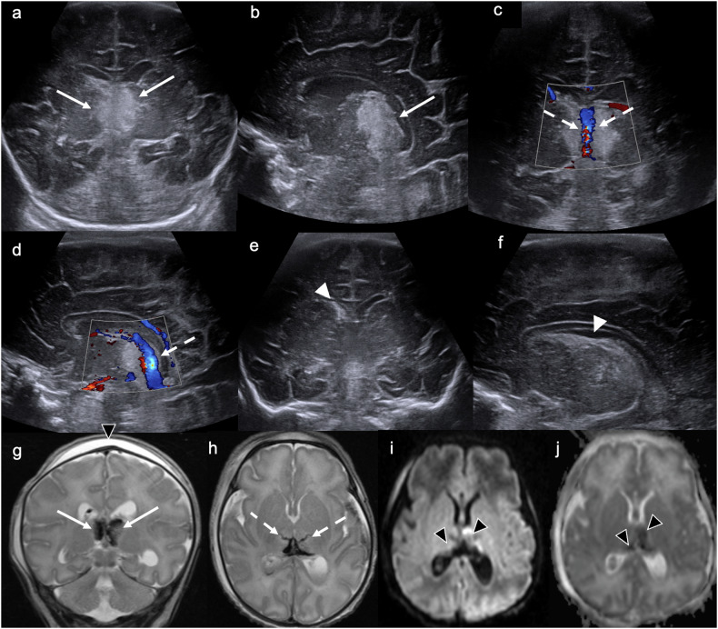
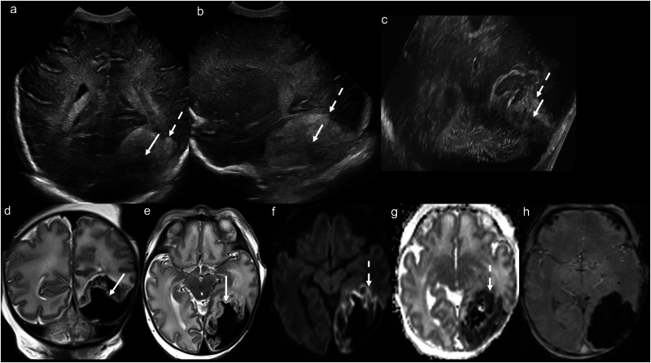
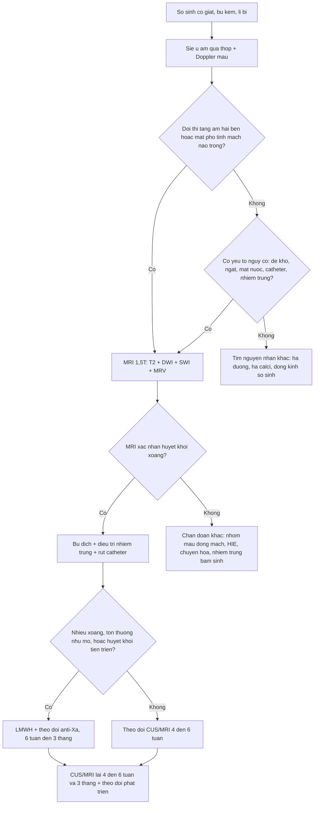

# 1965 — Huyết khối xoang tĩnh mạch não ở trẻ sơ sinh / Neonatal cerebral sinovenous thrombosis (CSVT)

**Tags:** `pattern:huyet-khoi-xoang` `pattern:tang-am-doi-thi` `pattern:xuat-huyet-doi-thi` `pattern:mat-dong-xoang` `pattern:giam-khuay-tan` `vung:nao` `vung:nao-that` `vung:so-sinh` `protocol:sieu-am-qua-thop` `protocol:MRI-so-nao` `protocol:MRV`

**Mức chắc chắn (certainty):** tổng hợp y văn (literature synthesis) — số liệu lấy từ **một tổng quan siêu âm sọ trẻ đủ tháng có hình CUS + MRI đối chiếu** (PMC12283534, *Insights into Imaging* 2025, CC BY 4.0), **một đoàn hệ 9 sơ sinh** (PMC9406898, *Children* 2022, CC BY) và **một nghiên cứu bệnh–chứng 26 sơ sinh ≥ 35 tuần** (PMC6714919, *Clin Appl Thromb Hemost* 2019, CC BY-NC). Không có RCT riêng cho sơ sinh; phần kháng đông là **ngoại suy từ hướng dẫn người lớn/trẻ lớn**, đã ghi rõ chỗ suy luận.

> **Câu chốt:** Ở sơ sinh, huyết khối xoang **không biểu hiện bằng đau đầu/liệt nửa người** mà bằng **co giật, bú kém, li bì** — và **dấu hiệu hình ảnh mạnh nhất không phải là cục huyết khối, mà là tổn thương ĐỒI THỊ hai bên** (tăng âm trên siêu âm → giảm tín hiệu T2 → hạn chế khuếch tán). Ba con số quyết định: **(1)** sơ sinh là nhóm tuổi mắc nhiều nhất, gộp **1:1.600–1:2.300 trẻ sinh sống** (sổ đăng ký Hà Lan **1–12/100.000**, Canada **47/100.000**); **(2)** **81%** ca khởi phát trong **tuần đầu** và **88%** có **co giật**; **(3)** **81%** huyết khối **nhiều xoang**, **81%** có tổn thương chất trắng, **58%** có **xuất huyết nội thất và/hoặc đồi thị** — chính cặp đồi thị là chìa khóa chẩn đoán trên siêu âm.

## 1. Tổng quan bệnh học – cơ chế hình ảnh (TẠI SAO)

### 1.1 Vì sao đúng trẻ sơ sinh: tam chứng Virchow ở một hệ tĩnh mạch "chảy chậm"

- **Ứ trệ (stasis):** xoang màng não là **bể chứa dung tích lớn, dòng chảy chậm, áp lực thấp**; ở sơ sinh lại thêm **mất nước** (bú kém, vàng da chiếu đèn, sốt), **đa hồng cầu** và **tăng hematocrit** → độ nhớt tăng, vận tốc dòng giảm.
- **Tăng đông (hypercoagulability):** nồng độ **antithrombin III, protein C, protein S** thấp sinh lý; **yếu tố đông máu phụ thuộc vitamin K** thấp; **đột biến** yếu tố V Leiden (OR **3,1**; KTC 1,8–5,5), **prothrombin G20210A** (OR **3,1**; KTC 1,4–6,8); riêng ở sơ sinh, **FII G20210A** có OR **10,96** (KTC 1,09–110,35) trong một nghiên cứu bệnh–chứng 26 ca — khoảng tin cậy rất rộng, **chưa đủ để khẳng định**.
- **Tổn thương nội mạc (endothelial injury):** **đẻ khó (forceps/giác hút)**, ngạt chu sinh, nhiễm khuẩn huyết/viêm màng não, **catheter tĩnh mạch rốn hoặc tĩnh mạch trung tâm** đặt sát xoang.
- **Bối cảnh thực hành:** trong 26 ca, các yếu tố **không do thrombophilia** hay gặp nhất là **nhiễm trùng (10 ca)**, **catheter trung tâm (8 ca)**, **bệnh não thiếu oxy–thiếu máu (4 ca)** (PMC6714919). Trong 9 ca khác, **77,8% mẹ có thrombophilia di truyền**, **44,4% ngạt chu sinh** (PMC9406898).

### 1.2 Cơ chế hình ảnh: vì sao tổn thương nằm ở ĐỒI THỊ

- Huyết khối **tĩnh mạch não sâu** (tĩnh mạch não trong, tĩnh mạch Galen, xoang thẳng) → **ứ máu tĩnh mạch → tăng áp lực mao mạch → phù độc tế bào (cytotoxic edema) rồi xuất huyết** ở vùng do các tĩnh mạch xuyên đồi thị dẫn lưu. Đồi thị là "ngã ba" của hệ sâu nên tổn thương **hai bên, đối xứng tương đối, khu trú đồi thị** — khác hẳn nhồi máu động mạch não giữa (vỏ–dưới vỏ một bên).
- **Thời gian T1/T2:** máu **tối cấp–cấp** (deoxyhemoglobin) → **T1 đồng tín hiệu, T2 giảm tín hiệu**; **bán cấp sớm** (methemoglobin nội bào) → **T1 tăng, T2 giảm**; **bán cấp muộn** → **T1 và T2 đều tăng**. Vì vậy trên phim sơ sinh **T2 giảm tín hiệu đồi thị = xuất huyết**, còn **T2 tăng = phù** đơn thuần.
- **Khuếch tán:** phù độc tế bào → **DWI tăng, ADC giảm**; vùng xuất huyết có thể **ADC giảm quanh ổ máu** (đây là phần "còn cứu được" quanh ổ hủy tủy).
- **Siêu âm:** cục máu đông có **trở kháng âm khác nhu mô** → **tăng âm**; nhưng siêu âm qua thóp **kém phân giải ở vùng xa (thalamus, hố sau, xoang ngang)** và **không thấy được huyết khối trong tĩnh mạch xuyên nhỏ** — đúng ca minh họa dưới đây: CUS chỉ thấy **đồi thị tăng âm**, MRI mới thấy **đường giảm tín hiệu của tĩnh mạch xuyên đồi thị bị huyết khối** và ổ **nhồi máu xuất huyết** (Hình 1, PMC12283534).
- **MRV (2D TOF hoặc MRV tương phản):** mất tín hiệu dòng chảy trong lòng xoang = huyết khối; **T1 sau tiêm** thấy **dấu "empty delta"** ở xoang dọc trên khi có huyết khối thành.

*Sơ sinh 36 tuần, ngày thứ 2 sau đẻ forceps thất bại, bú kém. (a, b) Đồi thị trong **tăng âm hai bên** (mũi tên). (c, d) Doppler màu còn dòng ở **tĩnh mạch não trong** (mũi tên đứt). (e, f) Chất tăng âm ở sừng trước phải/cađô-đồi thị = **xuất huyết mầm (GMH độ 1)**. (g) T2 **giảm tín hiệu đồi thị hai bên** = xuất huyết; (h) đường **giảm tín hiệu tuyến tính** của tĩnh mạch xuyên đồi thị bị huyết khối — **không thấy trên CUS**; (i, j) DWI/ADC **hạn chế khuếch tán** đồi thị = nhồi máu xuất huyết tĩnh mạch cấp. Nguồn: Insights into Imaging 2025, **PMC12283534**, Fig. 3, CC BY 4.0.*

### 1.3 Dịch tễ và tiên lượng (định lượng)

| Chỉ số | Số liệu | Nguồn |
|---|---|---|
| Tần suất chung ở sơ sinh | **1:1.600–1:2.300** trẻ sinh sống | PMC9406898 (tổng quan) |
| Sổ đăng ký | Hà Lan **1–12/100.000**; Canada **47/100.000** trẻ sinh sống | PMC9406898 |
| Huyết khối ở NICU | **6,9–15/1.000** ca nhập NICU (báo cáo cũ **2,4–5,5/1.000**) | PMC9406898 |
| Thời điểm khởi phát | **81%** trong **tuần đầu** sau sinh | PMC9406898 |
| Tuổi chẩn đoán (trung vị) | **11 ngày** (IQR 6–21); MRI lúc **6 ngày** (IQR 3–12) | PMC6714919 |
| Co giật | **88%** (22/26) | PMC6714919 |
| Nhiều xoang cùng lúc | **81%** (21/26); **44,4%** (4/9) | PMC6714919, PMC9406898 |
| Vị trí hay gặp | Xoang ngang và xoang dọc trên **cùng 53%** (14/26 mỗi loại); xoang dọc trên **77,8%** ở loạt 9 ca | PMC6714919, PMC9406898 |
| Tổn thương nhu mô | Chất trắng **81%**; xuất huyết nội thất ± đồi thị **58%** | PMC6714919 |
| Sống qua đợt cấp | **> 90%**; tử vong trong loạt 9 ca **22,2%** (do biến chứng huyết khối: huyết khối trong tim, thiếu máu ruột) | PMC9406898 |

## 2. Mẫu hình + chẩn đoán phân biệt theo vị trí xoang (Gamut)

- **Xoang dọc trên (superior sagittal sinus):** huyết khối → **nhồi máu/xuất huyết cạnh đường giữa hai bên**, phù vỏ–dưới vỏ; trên CT không cản quang có **dấu delta đặc** ("dense triangle"), trên CUS là **khối tăng âm hình tam giác ở đỉnh đầu**; trên MRI/MRV là **mất tín hiệu dòng chảy**.
- **Xoang ngang – xoang sigma (transverse/sigmoid):** sau **đẻ khó, viêm tai giữa, catheter**, hay gặp ở **thành sau hố sọ**; cần **cửa sổ xuyên chũm (transmastoid)** mới thấy; biến chứng: **xuất huyết tiểu não, nhồi máu thái dương–chẩm**.
- **Hệ tĩnh mạch sâu (tĩnh mạch não trong, Galen, xoang thẳng):** **tổn thương đồi thị hai bên** (nhồi máu ± xuất huyết) — *pattern gần như đặc hiệu* ở sơ sinh; có thể kèm **xuất huyết đồi thị–nội thất**.
- **Tĩnh mạch vỏ não (cortical veins):** **xuất huyết dưới màng mềm (subpial hemorrhage)** với **dấu "âm dương" (yin-yang sign)** trên siêu âm, ổ **nhồi máu xuất huyết quanh vỏ** (Hình 2, PMC12283534).
- **Gamut "đồi thị hai bên ở sơ sinh":** huyết khối tĩnh mạch não sâu · **bệnh não thiếu oxy–thiếu máu (HIE)** thể nặng (thường kèm nhân bèo sẫm, không có máu) · bệnh chuyển hóa (axit hữu cơ, sulfit oxidase/molybdenum cofactor) · viêm não do enterovirus · u/xuất huyết hai bên do rối loạn đông máu.
- **Gamut "co giật sơ sinh + hình ảnh bình thường/thoáng qua":** huyết khối xoang thể nhỏ · nhồi máu động mạch não giữa (thường một bên, vỏ–dưới vỏ) · ngạt chu sinh · hạ calci/hạ đường · động kinh sơ sinh lành tính.

## 3. Ma trận đối chiếu (Chốt vào / Chốt loại)

| Thực thể | Hình ảnh điển hình | Chốt vào (rule-in) | Chốt loại (rule-out) | Gợi ý xác nhận |
|---|---|---|---|---|
| **Huyết khối xoang dọc trên** | CUS: khối **tăng âm tam giác** ở đỉnh; MRI: **mất tín hiệu dòng** trên MRV; CT: **dấu delta đặc** | **Mất tín hiệu dòng trên MRV + phù/xuất huyết cạnh đường giữa** | Còn dòng đầy đủ trên MRV 2 bình diện → không phải huyết khối tắc | MRV 2D TOF ± T1 sau tiêm; Doppler màu |
| **Huyết khối tĩnh mạch não sâu (đồi thị)** | **Đồi thị tăng âm hai bên** → **T2 giảm** → **DWI tăng/ADC giảm**; đường giảm tín hiệu tĩnh mạch xuyên | **Đồi thị hai bên + giảm tín hiệu T2 (máu) ± hạn chế khuếch tán** | Tổn thương **vỏ–dưới vỏ một bên** theo động mạch → nghĩ nhồi máu động mạch | MRI 1,5T: T2, DWI/ADC, SWI, MRV |
| **Xuất huyết dưới màng mềm do huyết khối tĩnh mạch vỏ** | Ổ **giảm âm hình bầu dục** đẩy lõm vỏ não (dấu **âm dương**), tăng âm chất trắng quanh | **"Yin-yang" + ổ dưới màng mềm lồi vào vỏ** | Máu dưới màng cứng do chấn thương: hình liềm, **không** đẩy lõm vỏ kiểu này | CUS xuyên thóp + sau; MRI T2*/SWI |
| **HIE thể nặng (đủ tháng)** | **Đồi thị–nhân bèo sẫm tăng âm đối xứng**, vỏ não có thể tăng âm; **không có máu** | **Đối xứng, kèm tổn thương nhân bèo sẫm, tiền sử ngạt, không giảm tín hiệu T2** | **Có giảm tín hiệu T2/SWI bloom** → xuất huyết (nghĩ tĩnh mạch) | MRI sớm **48–96 giờ**, DWI |
| **Nhiễm trùng bẩm sinh (CMV) có vôi hóa quanh não thất** | **Nang dưới màng nội tủy/cađô-đồi thị**, vôi hóa quanh não thất, **giãn não thất** | **Nang + vôi hóa + giãn não thất, không có huyết khối** | Không nang, không vôi hóa → ít nghĩ CMV | PCR CMV nước tiểu/máu, MRI |
| **Nhồi máu động mạch não giữa** | Vùng **theo lãnh thổ động mạch**, thường một bên, **vỏ + dưới vỏ**, hình nêm | **Theo lãnh thổ mạch + DWI hạn chế khuếch tán** | Tổn thương **hai bên đồi thị** không theo lãnh thổ → nghĩ tĩnh mạch | MRA/CTA ít dùng; MRI + siêu âm Doppler |

*Sơ sinh 35 tuần, phù thai không do miễn dịch. (a–c) CUS xuyên thóp và **xuyên chũm**: ổ **giảm âm hình bầu dục** vùng thái dương–chẩm trái, **đẩy lõm vỏ não** (mũi tên liền), tăng âm chất trắng quanh (mũi tên đứt) — dấu **"âm dương"**. (d–e) T2 xác nhận **xuất huyết dưới màng mềm**; (f–g) DWI/ADC hạn chế khuếch tán vùng **nhồi máu xuất huyết** quanh ổ; (h) SWI nhậy từ tính mạnh. Nguồn: Insights into Imaging 2025, **PMC12283534**, Fig. 5, CC BY 4.0.*

## 4. Protocol chụp + ngưỡng xử trí

### 4.1 Siêu âm qua thóp (CUS) — đầu tay, tại giường, không bức xạ

- **Đầu dò:** linear tần số cao **9–15 MHz** cho vùng gần (não thất, đồi thị), **curvilinear 5–8 MHz** cho vùng sâu/hố sau; **luôn dùng Doppler màu + phổ** cho xoang dọc trên, tĩnh mạch não trong và xoang ngang.
- **Cửa sổ bắt buộc:** thóp trước (mặt phẳng vành + dọc giữa), **thóp sau**, và **xuyên chũm (transmastoid)** — thiếu cửa sổ chũm là **bỏ sót xoang ngang/sigma**.
- **Ngưỡng hình ảnh:** **đồi thị tăng âm hai bên** ≥ vùng nhân bèo sẫm bình thường + **mất phổ tĩnh mạch não trong** = nghi huyết khối sâu; **giãn não thất bên > 10 mm** (đo ở sừng chẩm) là dấu gián tiếp của tăng áp tĩnh mạch.
- **Giới hạn phải nói rõ với lâm sàng:** CUS **bình thường KHÔNG loại trừ** huyết khối xoang — trong ca minh họa, CUS **không thấy** huyết khối tĩnh mạch xuyên đồi thị mà chỉ thấy **đồi thị tăng âm**; MRI mới xác định (PMC12283534).

### 4.2 MRI — tiêu chuẩn chẩn đoán

- **Từ 1,5 T** (3 T cũng được nhưng cân nhắc nhiệt/SAR ở sơ sinh): **T1 dọc giữa + T2 vành/trục + DWI/ADC + SWI (hoặc T2*) + MRV 2D TOF**; **T1 sau tiêm** khi cần phân biệt huyết khối thành xoang với dòng chảy chậm.
- **Không cần an thần:** cho bú–quấn (feed-and-wrap), chăn ấm, nút tai; nếu cần thì **theo dõi SPO₂ + nhiệt độ** trong máy.
- **Thời điểm:** chụp khi trẻ đủ ổn định để chuyển — trong đoàn hệ 26 ca, MRI được làm **trung vị ngày thứ 6** (IQR 3–12) và chẩn đoán xác định ở **11 ngày tuổi** (PMC6714919); **chậm trễ làm mất cửa sổ can thiệp**.

### 4.3 Xử trí và ngưỡng (kháng đông, theo dõi)

- **Bù dịch/điện giải** là bước đầu (mất nước là yếu tố sinh bệnh chính); **điều trị nhiễm trùng/viêm màng não**; **rút catheter tĩnh mạch trung tâm** nếu đang đặt.
- **Kháng đông:** chỉ định khi **huyết khối lan rộng/nhiều xoang, có tổn thương nhu mô, hoặc huyết khối tiến triển**; **LMWH** là lựa chọn thuận tiện ở sơ sinh; **theo dõi anti-Xa** vì nồng độ antithrombin thấp → **liều/kg ở sơ sinh thường cao hơn trẻ lớn** và đáp ứng khó đoán. Thời gian **6 tuần – 3 tháng** tùy mức lan và tái thông; **không có RCT riêng ở sơ sinh** (ngoại suy từ hướng dẫn người lớn — PMC9406898 nêu rõ).
- **An toàn:** trong loạt 9 ca điều trị LMWH **3 tháng**, **không ca nào xuất huyết nội sọ sau kháng đông** (PMC9406898) — nhưng cỡ mẫu nhỏ, không thay thế được đánh giá cá thể (đặc biệt khi có **xuất huyết đồi thị lớn**).
- **Theo dõi:** CUS/MRI nhắc lại **4–6 tuần** rồi **3 tháng** để đánh giá **tái thông** và **giãn não thất tiến triển**; **theo dõi động kinh** (điện não đồ) và **phát triển thần kinh** đến 2 tuổi.

## 5. Biến thể bình thường và cạm bẫy

- **Xoang dọc trên "đặc" trên CT không cản quang** có thể chỉ do **hematocrit cao** ở sơ sinh — **dấu delta đặc không đủ chẩn đoán**, phải xem MRV/CTV.
- **Tăng âm đồi thị đối xứng sau ngạt** (HIE) rất giống nhồi máu tĩnh mạch: **hỏi tiền sử đẻ, Apgar, pH cuống rốn**; tìm **giảm tín hiệu T2/SWI bloom** để phân định **máu** với **phù**.
- **Vùng đỉnh đầu (vertex) là vùng gần đầu dò** — dễ **giả tăng âm** do phản xạ bề mặt; phải đổi góc và so với **MRV** trước khi gọi là huyết khối xoang dọc trên.
- **Tụ máu dưới cân (subgaleal)** sau đẻ forceps có thể **đè ép xoang** và tạo hình giả trên CUS (Hình 1g, mũi tên đen) — đừng đọc thành **máu dưới màng cứng**.
- **Bỏ sót "hai ổ" (satisfaction of search):** thấy xuất huyết mầm ở sừng trước (GMH độ 1) là đủ "hài lòng" để dừng — nhưng chính **GMH nhỏ + đồi thị tăng âm** mới là chùm dấu hiệu của huyết khối xoang.
- **Siêu âm bình thường ở trẻ chỉ "bú kém"** không loại trừ gì: huyết khối **xoang ngang một bên** gần như **không thấy** nếu không có cửa sổ xuyên chũm.

## 6. Tự lượng giá — Blind Quiz

**Ca 1 — sơ sinh 36 tuần, ngày 2, bú kém sau đẻ forceps thất bại**

- Gợi ý lâm sàng: trẻ đủ tháng gần, đẻ forceps thất bại, **bú kém**, chưa co giật rõ.
- Câu hỏi: (1) Hai bất thường chính trên siêu âm là gì? (2) Vì sao **Doppler màu vẫn thấy dòng ở tĩnh mạch não trong** mà vẫn phải nghĩ huyết khối? (3) Chuỗi xung MRI nào **quyết định** (T2, DWI hay MRV)?

Đáp án ca 1

- **Dấu hiệu:** (a, b) **đồi thị trong tăng âm hai bên**, bên trái nhiều hơn; (e, f) **chất tăng âm ở sừng trước phải/cađô-đồi thị** = xuất huyết mầm độ 1. (g) T2 **giảm tín hiệu đồi thị** = máu; (h) **đường giảm tín hiệu tuyến tính** của tĩnh mạch xuyên đồi thị = huyết khối **không thấy trên CUS**; (i, j) **DWI tăng/ADC giảm** = nhồi máu xuất huyết cấp.
- **Vì sao Doppler vẫn có dòng:** huyết khối nằm ở **tĩnh mạch xuyên nhỏ đi vào đồi thị**, không phải thân tĩnh mạch não trong — **dòng ở thân lớn không loại trừ tắc nhánh nhỏ**.
- **Chuỗi quyết định:** **T2** (phát hiện máu: giảm tín hiệu) + **DWI/ADC** (phù độc tế bào) + **MRV** (xác định mức lan xoang). CUS chỉ là **dấu hiệu gợi ý**, không phải chẩn đoán xác định.
- Nguồn: PMC12283534, Fig. 3.

**Ca 2 — sơ sinh 35 tuần, phù thai, siêu âm thấy ổ cạnh vỏ não**

- Gợi ý lâm sàng: phù thai không do miễn dịch, tầm soát nhiễm trùng và thiếu máu–thiếu oxy.
- Câu hỏi: (1) Ổ **giảm âm hình bầu dục đẩy lõm vỏ** là gì và dấu hiệu đó tên gì? (2) Vì sao phải chụp **cửa sổ xuyên chũm**? (3) SWI để làm gì khi đã có T2?

Đáp án ca 2

- **Dấu hiệu:** ổ **xuất huyết dưới màng mềm (subpial)** vùng thái dương–chẩm trái, **đẩy lõm vỏ não**, tăng âm chất trắng quanh = **nhồi máu tĩnh mạch xuất huyết**; hình ảnh **"âm dương" (yin-yang sign)** trên siêu âm.
- **Cửa sổ xuyên chũm:** ổ ở **hố sọ sau/thái dương–chẩm** nằm ngoài vùng nhìn của thóp trước; xoang ngang/sigma chỉ thấy qua **xuyên chũm**.
- **SWI/T2*:** nhạy hơn T2 với **sản phẩm máu (hemosiderin/deoxyhemoglobin)** → xác định **mức xuất huyết** và **huyết khối tĩnh mạch vỏ**; T2 chỉ cho biết "giảm tín hiệu", SWI cho biết **lan tỏa nhậy từ tính**.
- Nguồn: PMC12283534, Fig. 5.

**Ca 3 — trẻ 5 ngày tuổi, co giật, CUS bình thường**

- Gợi ý lâm sàng: đẻ thường, mẹ bị **sốt ối non**; trẻ bú kém từ ngày 3, nay co giật.
- Câu hỏi: (1) CUS bình thường có loại trừ huyết khối xoang? (2) Bước tiếp theo? (3) Nếu MRI thấy **đồi thị hai bên giảm tín hiệu T2 + DWI hạn chế khuếch tán**, chẩn đoán và hướng điều trị?

Đáp án ca 3

- **Không loại trừ.** CUS bỏ sót huyết khối **tĩnh mạch sâu, xoang ngang một bên, huyết khối nhỏ**; tổn thương có thể chỉ là **đồi thị tăng âm thoáng qua**.
- **Bước tiếp:** **MRI 1,5T với T2 + DWI/ADC + SWI + MRV** (không cần an thần, feed-and-wrap), kèm **cấy máu/dịch não tủy** vì nhiễm trùng là yếu tố thúc đẩy.
- **Chẩn đoán:** **huyết khối tĩnh mạch não sâu gây nhồi máu xuất huyết đồi thị hai bên**. Điều trị: **bù dịch, kháng sinh theo ổ nhiễm, kháng đông LMWH có theo dõi anti-Xa** khi tổn thương lan/nhu mô; theo dõi **giãn não thất** và **động kinh**.
- **Cạm bẫy:** gọi đây là "HIE" vì có tăng âm đồi thị — nhưng HIE **không có máu (không giảm T2)** và thường kèm nhân bèo sẫm.

## Bài liên quan

- [216 – Dị dạng mạch não & huyết khối xoang tĩnh mạch (người lớn)](../216-di-dang-mach-CVST/lesson.md) — nền tảng về dấu delta, MRV và kháng đông ở người lớn.
- [1948 – Co giật & động kinh sau huyết khối xoang tĩnh mạch não](../1948-co-giat-dong-kinh-huyet-khoi-xoang/lesson.md) — di chứng muộn, theo dõi điện não.
- [1949 – Thai kỳ sau huyết khối xoang tĩnh mạch não](../1949-thai-ky-sau-huyet-khoi-xoang-tinh-mach-nao/lesson.md) — cùng bệnh, khác bối cảnh (sản khoa).
- [6111 – Huyết khối tĩnh mạch thận ở trẻ sơ sinh](../6111-huyet-khoi-tinh-mach-than-so-sinh/lesson.md) — cùng nguyên lý "mất dòng tĩnh mạch ở sơ sinh", khác tạng.
- [3045 – Catheter rốn ở sơ sinh (UVC/UAC)](../3045-catheter-ron-so-sinh-uvc-uac/lesson.md) — yếu tố nguy cơ đặt được và rút được.
- [6113 – Huyết khối động mạch chủ sau catheter động mạch rốn](../6113-huyet-khoi-dong-mach-chu-so-sinh-uac/lesson.md) — mặt động mạch của cùng catheter.

> **Disclaimer y tế:** Bài viết phục vụ học tập và tra cứu, **không dùng để chẩn đoán độc lập** khi chưa có người hướng dẫn. Ngưỡng kháng đông ở sơ sinh phải cá thể hóa theo cân nặng, anti-Xa và mức xuất huyết.
