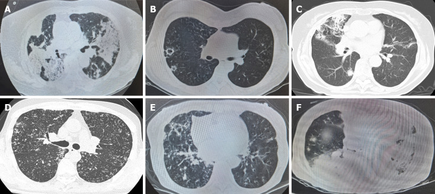
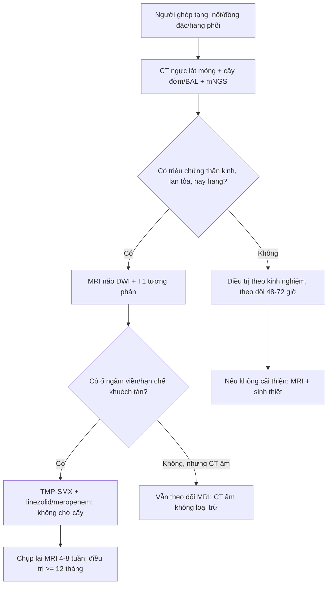
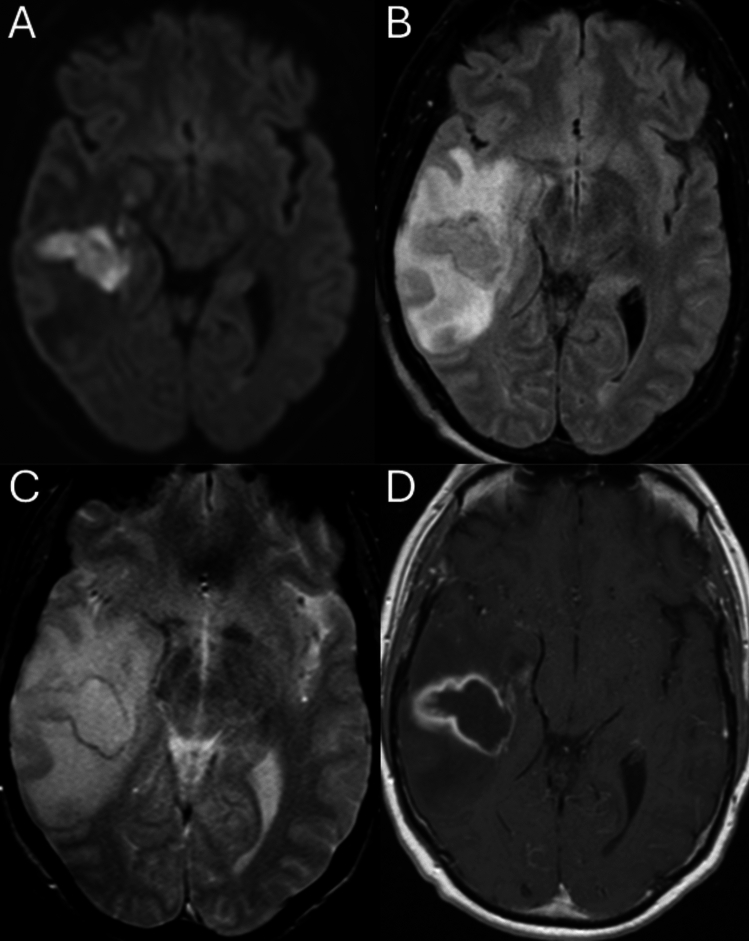

# 1966 — Nhiễm *Nocardia* ở người ghép tạng: nốt phổi + áp-xe não / Nocardiosis in transplant recipients: lung nodules and brain abscesses

**Tags:** `pattern:not-phoi` `pattern:dong-dac` `pattern:hang` `pattern:ap-xe-nao` `vung:phoi` `vung:nao` `protocol:CT-nguc` `protocol:MRI-nao-tuong-phan` `incidentaloma:khong`

**Mức chắc chắn (certainty):** tổng hợp y văn (literature synthesis) — **125 ca** người ghép tạng nhiễm *Nocardia* đa trung tâm (**PMID 36303280**), **75 ca** viêm phổi do *Nocardia* có phân tích CT (**PMID 38529577**), **52 ca** nhiễm *Nocardia* hệ thần kinh trung ương có MRI (**PMID 41979781**), **34 ca** viêm phổi có CT theo dõi (**PMID 37185005**), **25 ca** so sánh người suy giảm và không suy giảm miễn dịch (**PMID 25584096**), **102 ca** viêm phổi do *Nocardia* (**PMID 41640705**, ảnh CC BY-NC), cùng phân tích gộp **260 ca + 519 chứng** về dự phòng TMP-SMX (**PMID 37865337**). Nhóm **không có bệnh nhân của mình**.

> **Câu chốt:** ở người ghép tạng, **một nốt/đông đặc phổi "không hợp lý" + đau đầu hoặc thay đổi tri giác** phải chụp **MRI não có tương phản** ngay — *Nocardia* lan máu lên não ở **64,3%** ca có lan tỏa (**PMID 38529577**) và **86,5%** ca nhiễm hệ thần kinh trung ương có tổn thương phổi đồng thời (**PMID 41979781**). **CT não bình thường không loại trừ** (19,2% ca nhiễm hệ thần kinh trung ương có CT âm, thường là nhiều ổ nhỏ **0,6 cm** so với **1,8 cm**, p = 0,005), và **không nên chờ cấy** khi đã có tổn thương não.

## 1. Tổng quan bệnh học – cơ chế hình ảnh (TẠI SAO)

### 1.1 Sinh vật học → vì sao tổn thương là "mủ không vỏ"

- *Nocardia* là **trực khuẩn Gram dương, kháng cồn yếu, phân nhánh dạng sợi**, sống trong đất. Nó **không tạo vỏ** như *Cryptococcus*, cũng không xâm lấn mạch như *Aspergillus*; đáp ứng mô là **viêm mủ – áp-xe** với **bờ hoại tử** và **ít phản ứng xơ**.
- Vì sợi nấm **lan theo đường tiếp giáp chậm**, ổ áp-xe thường **nhiều ngăn, nhiều ổ vệ tinh**, và **vỏ áp-xe mỏng** trong giai đoạn sớm — đây là lý do **tổn thương não ngấm thuốc viền nhưng không có "vỏ dày đều"** như áp-xe vi khuẩn trưởng thành.
- **TẠI SAO lên não:** *Nocardia* gây **nhiễm khuẩn huyết kín** rồi **lan máu**; vì vậy **nhiễm phổi là cửa vào** và **não là đích** — **86,5%** ca nhiễm hệ thần kinh trung ương có tổn thương phổi (**PMID 41979781**), **64,3%** ca lan tỏa có tổn thương não (**PMID 38529577**).
- **TẦN SUẤT:** **0,2%** (13/6179) người ghép tạng tại một trung tâm, **trung vị 8,8 tháng** sau ghép (3,7–98) (**PMID 38930538**). Ở một đoàn hệ đa trung tâm **125 ca**, **26,4%** (33 ca) có lan tỏa (**PMID 36303280**).
- **TỬ VONG:** **16,8%** trong 12 tháng ở **125 ca** (**PMID 36303280**); **25,3%** trong 12 tháng ở **75 ca** viêm phổi (**PMID 38529577**); **23,1%** trong 12 tháng ở **52 ca** nhiễm hệ thần kinh trung ương (**PMID 41979781**); **42,8%** (6/14) ở một loạt nhiễm hệ thần kinh trung ương khác (**PMID 38406155**). Ghép gan là yếu tố nguy cơ tử vong độc lập (**HR 3,52**, KTC 95% 1,27–9,76) (**PMID 36303280**).

### 1.2 Vì sao hình ảnh phổi "giống mọi thứ"

- *Nocardia* gây **nốt, đông đặc vá, hang, tràn dịch, dày màng phổi, giãn phế quản** — **không có dấu hiệu đặc trưng**. Trong **34 ca** (**PMID 37185005**): **nốt 94,1%**, **mờ đông đặc (GGO) 76,5%**, **đông đặc vá 73,5%**, **hang 52,9%**, **khối 32,4%**, **hạch trung thất/rốn 61,8%**, **dày màng phổi 52,9%**, **giãn phế quản 44,1%**, **tràn dịch 38,2%**.
- **Hang hóa là dấu hiệu của suy giảm miễn dịch:** **85% vs 29%** (p = 0,005) giữa người suy giảm và không suy giảm (**PMID 37185005**); ở **75 ca**, thể lan tỏa có **hang 64,3% vs 32,8%** và **tràn dịch 64,3% vs 29,5%** (**PMID 38529577**).
- **Nền giãn phế quản** là bối cảnh rất thường gặp: **52,9%** ca viêm phổi do *Nocardia* (**PMID 41640705**) — tức là "**giãn phế quản + nốt/hang mới**" phải nghĩ *Nocardia*, không chỉ bội nhiễm thông thường.
- **TẠI SAO hình ảnh không thể chốt:** cùng một đông đặc + hang có thể là **lao, nấm, ung thư, áp-xe vi khuẩn**; *Nocardia* chỉ được **nghi ngờ** trên hình ảnh khi **nốt + đông đặc vá + hang cùng lúc**, đặc biệt **kèm tổn thương ngoài phổi (não, mô mềm)** (**PMID 37185005**).

### 1.3 Vật lý hình ảnh: đọc não thế nào

- **DWI/ADC:** ổ mủ **hạn chế khuếch tán trung tâm** (ADC thấp) — phân biệt với **phù quanh ổ** (ADC cao) và với **di căn hoại tử** (thường không hạn chế mạnh ở trung tâm hoại tử).
- **T1 sau tương phản:** **ngấm thuốc viền**, vỏ **mỏng–không đều** ở giai đoạn sớm, **dày hơn** khi trưởng thành; **ổ vệ tinh nhỏ** quanh ổ lớn là dấu hiệu gợi ý.
- **GRE/SWI:** **viền giảm tín hiệu** (sản phẩm máu/hemosiderin) — gặp trong áp-xe não nói chung, không đặc hiệu.
- **Vị trí:** **trên lều 96,2%**, **nhiều ổ 59,6%**, **hai bán cầu 57,7%** (**PMID 41979781**). Tổn thương **< 1 cm** và **nhiều ổ** là nhóm **dễ bị CT bỏ sót**.
- **Vì sao vẫn cần MRI dù đã có CT:** **19,2%** (5/26) ca có **CT não bình thường**; nhóm này tổn thương **nhỏ hơn** (trung vị **0,6 vs 1,8 cm**) và thường **nhiều ổ/hai bán cầu** (**PMID 41979781**).

## 2. Mẫu hình + chẩn đoán phân biệt theo bối cảnh (Gamut)

- **Người ghép tạng, nốt/đông đặc phổi + đau đầu/sốt:** ***Nocardia*** (ưu tiên khi có **hang + tràn dịch + tổn thương não**), ***Aspergillus*** (dấu **halo**, xâm lấn mạch, ho máu), ***PJP*** (mờ kính mờ **đối xứng rốn phổi**, LDH cao), **CMV** (mờ kính mờ + hạ bạch cầu), **lao** (hang thùy trên + nốt vệ tinh), **di căn** (nốt bờ rõ, nhiều kích thước).
- **Nhiều ổ ngấm thuốc viền ở não:** ***Nocardia***, **toxoplasma** (nhân xám, nhiều ổ nhỏ), **áp-xe do vi khuẩn/nấm**, **di căn**, **lao não**, **lymphoma** (hiếm khi nhiều ổ hoại tử).
- **Mnemonic "NOCAR":** **N**odules/necrosis, **O**pportunistic (ghép, corticoid, JAK), **C**avitation + **C**NS, **A**cid-fast weak (kháng cồn yếu), **R**espiratory entry (phổi là cửa vào).
- **Câu hỏi quyết định:** "**Có tổn thương ngoài phổi không?**" — nếu có **thần kinh**, phải **MRI ngay** và **điều trị theo kinh nghiệm**, không chờ cấy.

## 3. Bảng so sánh phân biệt (ma trận đối chiếu)

| Thực thể (entity) | Hình ảnh điển hình | Chốt vào (rule-in) | Chốt loại (rule-out) | Gợi ý xác nhận |
|---|---|---|---|---|
| ***Nocardia*** | **Nốt + đông đặc vá + hang**, có thể **tràn dịch**; **nhiều ổ não ngấm viền**, hạn chế khuếch tán | **Nốt + hang + tổn thương não** ở người ghép; **hang 85% ở người suy giảm** | Không có tổn thương ngoài phổi + **giãn phế quản đơn thuần** không loại trừ (52,9% có nền giãn phế quản) | **Cấy đờm/BAL, mNGS, nhuộm kháng cồn yếu**; sinh thiết não |
| ***Aspergillus*** (xâm lấn) | **Nốt + halo sign**, đông đặc quanh nhồi máu, **hang liềm khí** khi hồi phục bạch cầu | **Halo + giảm bạch cầu hạt**, **ho máu** | Nốt **bờ rõ, không halo**, nhiều ổ não nhỏ → *Nocardia*/di căn | Galactomannan, PCR, sinh thiết |
| **PJP** | **Mờ kính mờ đối xứng**, lan từ rốn phổi, **không hang** | **Kính mờ hai bên + LDH cao + giảm oxy** | Có **hang/nốt đặc** hoặc ổ não → không phải PJP đơn thuần | DFA/PCR dịch rửa phế quản |
| **CMV** | Mờ kính mờ, **nốt nhỏ rải rác**, dày thành phế quản | **CMV DNA dương + hạ bạch cầu** | **Hang + ổ não** → nghĩ *Nocardia*/nấm | PCR CMV, pp65 |
| **Di căn phổi–não** | **Nốt tròn bờ rõ**, nhiều kích thước, **không hang** (trừ SCC); não: **nhiều ổ ranh giới rõ**, phù nhiều | **Tiền sử ung thư + nốt bờ rõ + nhiều ổ não** | **Hang + tổn thương nốt vệ tinh** và **hạn chế khuếch tán trung tâm** → áp-xe | Sinh thiết, PET-CT |
| **Lao phổi–não** | **Hang thùy trên/đỉnh**, nốt vệ tinh, **tree-in-bud**; não: **lao màng não**, ổ lao | **Tree-in-bud + hang thùy trên + dịch não tủy kiểu lao** | **Nhiều ổ ngấm viền lớn ở bán cầu** không có lao màng não → *Nocardia*/di căn | AFB, PCR lao, ADA |
| **Áp-xe do vi khuẩn (kể cả septic emboli)** | **Nốt ngoại vi + mạch nuôi**, hang khi hoại tử; não: nhiều ổ nhỏ **ranh giới vùng tưới máu** | **Cấy máu dương + van tim/ổ nhiễm rõ** | **Nốt phổi trung tâm + hang + ổ não lớn** → *Nocardia* | Cấy máu, siêu âm tim |

*Sáu bệnh nhân khác nhau: đông đặc vá, nốt, hang, giãn phế quản nền, tràn dịch — **cùng một tác nhân, nhiều kiểu hình**. Nguồn: World J Radiol 2026, **PMC12865543**, **CC BY-NC 4.0** (nguyên bản).*

### Ba dấu hiệu làm thay đổi quyết định
- **Nốt + hang + tràn dịch cùng lúc** ở người ghép: **không** đọc là "viêm phổi cộng đồng" — cấy/mNGS và **MRI não**.
- **CT não âm** ở bệnh nhân có triệu chứng thần kinh: **vẫn phải MRI** (19,2% CT âm).
- **Hang ở người suy giảm miễn dịch**: **85%** có hang (**PMID 37185005**) — hang càng làm *Nocardia* nổi bật hơn so với PJP/CMV.

## 4. Protocol chụp + theo dõi + sơ đồ quyết định

- **CT ngực:** lát mỏng **≤ 1 mm**, có tương phản; mô tả **số nốt, kích thước nốt lớn nhất (mm), hang (mm), tràn dịch, hạch, nền giãn phế quản**.
- **MRI não:** **T1, T2, FLAIR, DWI/ADC, GRE/SWI, T1 sau tương phản** — bắt buộc khi có **triệu chứng thần kinh**, **lan tỏa**, hoặc **dự định điều trị ≥ 6 tháng**; đo **đường kính ổ lớn nhất**, đếm **số ổ**.
- **Theo dõi:** chụp lại **MRI sau 4–8 tuần** và khi kết thúc điều trị; **ổ có thể to lên ban đầu** do phản ứng viêm — chỉ đổi điều trị khi **không cải thiện lâm sàng** hoặc **xuất hiện ổ mới**.
- **Thời gian điều trị:** **phổi 6–12 tháng**, **có tổn thương hệ thần kinh trung ương ≥ 12 tháng** (tổng hợp từ **PMID 36303280, 41979781, 38406155**) — ghi rõ đây là **thực hành**, không có thử nghiệm ngẫu nhiên.
- **Dự phòng:** **TMP-SMX** giảm nguy cơ (**aOR 0,3**; KTC 95% 0,18–0,52; **PMID 37865337**); **25%** ca nhiễm đột phá dù đang dự phòng, nhưng **98%** còn nhạy TMP-SMX — **nhiễm đột phá không loại trừ** *Nocardia*.
- **Không có RADS** cho *Nocardia*; phân tầng theo **vị trí (phổi/não/lan tỏa)** và **thời gian điều trị**.

## 5. Biến thể bình thường và cạm bẫy

- **CT não bình thường không loại trừ** — 19,2% ca; tổn thương **0,6 cm** dễ bỏ sót trên lát 5 mm → **MRI lát mỏng**.
- **"Di căn" giả**: nhiều ổ ngấm viền + nốt phổi ở người có tiền sử ung thư rất dễ bị gọi là di căn; **hạn chế khuếch tán trung tâm** và **hang phổi** nghiêng về nhiễm (**PMID 42780233** — ca bị chẩn đoán và điều trị như di căn, chỉ phát hiện sau tử thiết).
- **Nhiễm đột phá dù đang TMP-SMX** (25% ca) — **không** dùng "đang dự phòng" để loại trừ.
- **Corticoid liều cao** là yếu tố nguy cơ (HR 3,72); bệnh nhân **JAK ức chế + corticoid** cũng thuộc nhóm nguy cơ dù **không ghép tạng**.
- **Hang không đồng nghĩa lao** ở người ghép — **85%** *Nocardia* ở người suy giảm có hang.
- **Cấy âm** vì *Nocardia* mọc chậm (**3–5 ngày, có khi > 2 tuần**) — phải **báo phòng xét nghiệm** giữ cấy lâu và nhuộm **kháng cồn yếu**.
- **Điều trị ngắn rồi dừng** khi ổ não "nhỏ lại" là nguyên nhân **tái phát 6,1%** (**PMID 41979781**).

## 6. Tự lượng giá — Blind Quiz

**Ca 1 — Người ghép thận, sốt + đau nửa đầu 5 ngày. Nhìn MRI, mô tả trước.**

- Hỏi: 4 chuỗi xung cho biết gì? Chẩn đoán phân biệt hàng đầu? Vì sao phải chụp phổi?

<b>Bấm để hiện đáp án</b>

- **A** DWI: **hạn chế khuếch tán trung tâm** ổ thái dương phải; **B** FLAIR: **phù quanh ổ rõ**; **C** GRE: **viền giảm tín hiệu mảnh**; **D** T1 sau tương phản: **ngấm thuốc viền dày, bờ trong nhẵn** — áp-xe trưởng thành.
- Phân biệt: **áp-xe do *Nocardia***, toxoplasma, áp-xe vi khuẩn, di căn hoại tử.
- Chụp phổi vì **86,5%** ca nhiễm hệ thần kinh trung ương có tổn thương phổi — phổi là cửa vào. Nguồn: *Infection* 2026, **PMC13193237**, **CC BY 4.0**.

**Ca 2 — Cùng bối cảnh, CT ngực ở 6 bệnh nhân. Kể 3 kiểu hình và nêu kiểu nào gợi suy giảm miễn dịch nặng nhất.**

<b>Bấm để hiện đáp án</b>

- Các kiểu: **đông đặc vá**, **nốt rải rác**, **hang**, **giãn phế quản nền + nốt**, **tràn dịch/dày màng phổi**.
- **Hang** gợi suy giảm miễn dịch: **85% vs 29%** (p = 0,005).
- Không kiểu nào đặc hiệu — phải cấy/mNGS. Nguồn: *World J Radiol* 2026, **PMC12865543**, **CC BY-NC 4.0** (nguyên bản).

## Bài liên quan chéo
- [1980 – Dự phòng nhiễm trùng cơ hội sau ghép tạng](../1980-du-phong-nhiem-trung-co-hoi-sau-ghep-tang/lesson.md)
- [1789 – Viêm phổi do CMV ở người ghép tạng](../1789-viem-phoi-do-cmv-o-nguoi-ghep-tang/lesson.md)
- [025 – Hang & nấm phổi](../025-ton-thuong-phoi-tao-hang/lesson.md) (hang + liềm khí, aspergilloma)
- [020 – Nốt phổi](../020-not-phoi/lesson.md) (ngưỡng kích thước, hình thái nốt)
- [1853 – Rò tá tràng mảnh ghép sau ghép tụy](../1853-ro-ta-trang-sau-ghep-tuy/lesson.md) (ổ nhiễm là nguồn nhiễm khuẩn huyết ở người ghép)
- [040 – Tràn dịch màng phổi](../040-tran-dich-mang-phoi/lesson.md) (tràn dịch kèm đông đặc)

> Không dùng để chẩn đoán độc lập khi chưa có người hướng dẫn.
