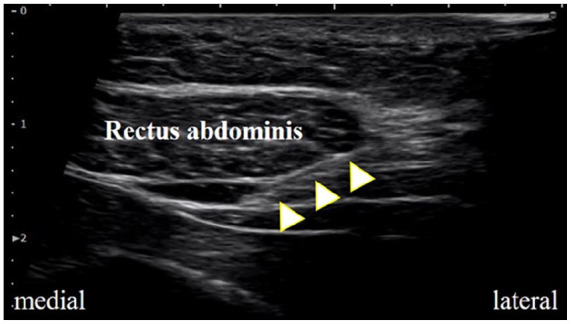
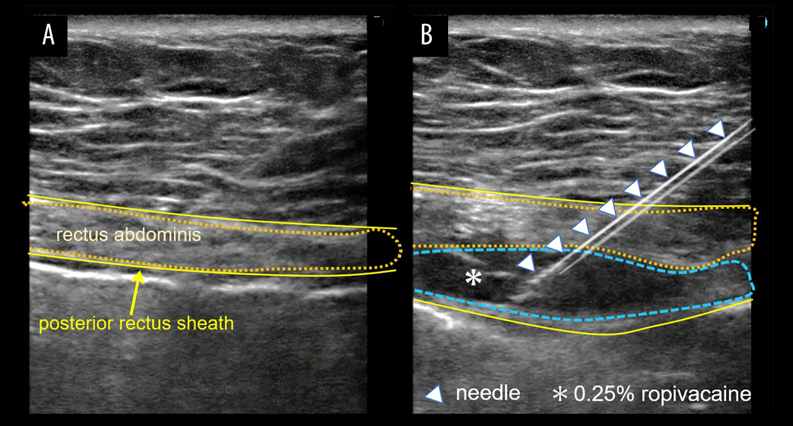
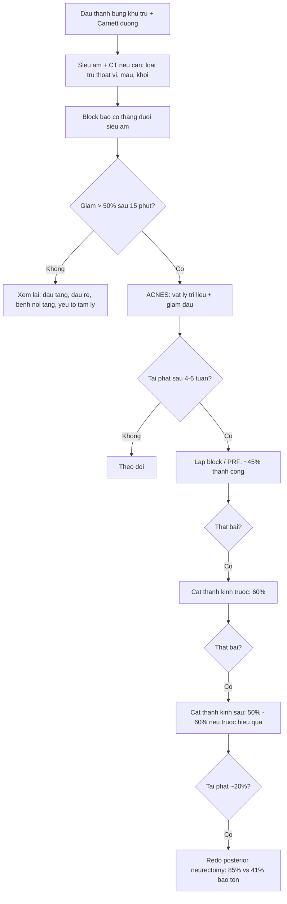

# 1967 — Hội chứng đau nhánh trước thần kinh liên sườn (ACNES): đau thành bụng khu trú, hình ảnh "bình thường" và vai trò của block bao cơ thẳng dưới siêu âm / Anterior cutaneous nerve entrapment syndrome

**Tags:** `pattern:dau-thanh-bung` `pattern:khong-dich` `vung:thanh-bung` `anatomy:thanh-kinh-lien-suon` `protocol:sieu-am-dau-dong` `protocol:block-bao-co-thang` `score:Carnett` `incidentaloma:khong`

**Mức chắc chắn (certainty):** tổng hợp y văn (literature synthesis) — ghép **đoàn hệ 1.116 bệnh nhân** xác lập bộ tiêu chuẩn lâm sàng (*Ann Surg* 2021, **PMID 30817351**; tên tác giả đọc từ `authorString` của PMID), **nghiên cứu cắt ngang 21 bệnh nhân tại khoa cấp cứu Nhật** (*J Gen Fam Med* 2024, **PMC11565070**), **so sánh 37 bệnh nhân mổ lại sau thất bại** (*J Abdom Wall Surg* 2025, **PMC12765713**), **16 trẻ tại cấp cứu** (*Pediatr Int* 2025, **PMC12123555**), **31 trẻ tại trung tâm đau bậc 3** với phản biện về lạm dụng can thiệp (*BMJ Paediatr Open* 2026, **PMC12878369**), cùng **ca minh hoạ kỹ thuật block dưới siêu âm** (*Am J Case Rep* 2026, **PMC13545972**; *SAGE Open Med Case Rep* 2025, **PMC12378487**). Nhóm **không có bệnh nhân của mình**.

> **Câu hỏi thực hành:** nữ **34 tuổi**, **8 tháng** sau mổ lấy vạt DIEP, đau **nhói, khu trú một điểm** ở **bờ ngoài cơ thẳng bụng phải, ngang rốn**; đau tăng khi **ngồi dậy, ho, gồng bụng**, giảm khi nằm yên; **không sốt, không sụt cân, không rối loạn đại tiện**. Siêu âm bụng và CT bụng–chậu (làm ở tuyến trước) **bình thường**. Câu hỏi: **có phải "đau do dính sau mổ" — hình ảnh âm tính có loại trừ được gì, và bước tiếp theo là gì?**
> Bài chốt **bốn điểm**: **(1) ACNES là đau thành bụng do nhánh trước T10–T12 bị chèn ở bờ ngoài cơ thẳng — chẩn đoán hoàn toàn bằng lâm sàng: đau khu trú + Carnett dương + rối loạn cảm giác + pinch test; (2) hình ảnh bình thường là **dấu hiệu đặc trưng**, không phải "không có bệnh" — siêu âm/CT dùng để **loại trừ** thoát vị, tụ máu, khối và để **dẫn đường block**; (3) **block bao cơ thẳng dưới siêu âm giảm đau > 50% sau 15 phút** là tiêu chuẩn hỗ trợ mạnh (81% ca trong đoàn hệ 1.116) và đồng thời là điều trị bậc 1; (4) **chỉ chuyển mổ khi thất bại 2 bậc nội khoa** — cắt thần kinh trước đạt 60%, sau đạt 50%, mổ lại sau tái phát 85%.** Nối [1871 – Phồng/yếu thành bụng sau DIEP/TRAM](../1871-phong-thanh-bung-sau-vat-diep-tram/lesson.md), [1936 – Tụ máu bao cơ thẳng bụng](../1936-tu-mau-bao-co-thang-bung/lesson.md), [3061 – Di căn lỗ trocar](../3061-di-can-lo-trocar-sau-pipac-va-noi-soi/lesson.md).

## 1. Tổng quan bệnh học – cơ chế hình ảnh: vì sao "không thấy gì" mà vẫn đau

### 1.1 Giải phẫu – nơi thần kinh "bị kẹp"

- **Nhánh trước của T10–T12** chạy trong **mặt phẳng mạch–thần kinh giữa cơ chéo trong và cơ ngang bụng**, rồi **xuyên qua mạc sau cơ thẳng (posterior rectus sheath)** ở **bờ ngoài cơ thẳng** (gần đường bán nguyệt), **đi trong cơ thẳng** và **ra ngoài qua mạc trước** để thành **nhánh da**.
- **Điểm chèn (entrapment point)** chính là chỗ **xuyên mạc sau** — nơi mạc dày, góc gập, và nơi phẫu thuật (rạch ngang, lấy vạt, đặt trocar, khâu mạc) **cắt ngang hoặc khâu vướng** nhánh thần kinh. Vì vậy ACNES hay xuất hiện **sau mổ bụng**, nhưng **cũng có thể tự phát** (đoàn hệ 1.116 ca: đa số khởi phát **tự nhiên**, đột ngột hoặc từ từ — PMID 30817351).
- **Bản đồ khoanh da (dermatome) giúp định vị:** **T10 = quanh rốn**, **T11 = dưới rốn**, **T12 = trên xương mu/bẹn**. Trong 21 ca cấp cứu, **48% đau ở T11–T12** và **5% đau hai bên** (PMC11565070).
- **Vì sao đau dữ dội mà không có dấu hiệu nội tạng:** đây là **đau thành bụng (parietal)**, không phải đau tạng. Đau tạng **lan mơ hồ, kèm vã mồ hôi, buồn nôn, thay đổi mạch**; đau thành bụng **khu trú, sờ đúng điểm là đau, tăng khi căng cơ**. Vì vậy **Carnett dương** là dấu hiệu phân biệt cốt lõi.

### 1.2 Vì sao hình ảnh bình thường — và tại sao đó là "dấu hiệu", không phải "âm tính"

- **Kích thước tổn thương dưới ngưỡng không gian của hình ảnh:** nhánh trước thần kinh liên sườn có đường kính **khoảng 1 mm** (sợi trục + bao myelin), không có mô đệm lớn. Siêu âm tần số cao có thể thấy **thân thần kinh lớn** (như dây thần kinh giữa 3–4 mm), nhưng **không đủ tương phản** để thấy một nhánh 1 mm nằm trong cơ thẳng dày.
- **Tổn thương là "chức năng – vi mô":** chèn ép gây **thiếu máu cục bộ thần kinh, phù sợi trục, xơ hóa quanh thần kinh (perineural fibrosis)**, đôi khi **neuroma nhỏ** — không tạo khối, không thay đổi đậm độ, không phá xương. Vì vậy **CT/MRI bình thường là kỳ vọng**, không phải bằng chứng loại trừ.
- **Vậy hình ảnh để làm gì:** (1) **loại trừ** các nguyên nhân có hình ảnh (thoát vị, tụ máu bao cơ thẳng, áp-xe, khối u, lạc nội mạc, giãn cơ thẳng); (2) **dẫn đường block** chính xác vào **mạc sau cơ thẳng**; (3) phát hiện **bệnh nội tạng đi kèm** — điều này quan trọng vì ACNES **có thể cùng tồn tại** với bệnh nặng (ca ACNES ở bệnh nhân **ung thư đại tràng tiến xa**, PMC13545972).
- **Hệ quả thực hành:** câu "siêu âm và CT bình thường" **không** trả lời được "có ACNES hay không"; chỉ **khám + block chẩn đoán** trả lời được. Ngược lại, **không được dừng ở ACNES** khi có **dấu hiệu báo động** (sụt cân, thiếu máu, rối loạn đại tiện, khối sờ được, sốt).

### 1.3 Dịch tễ và ngưỡng định lượng (số phải nhớ)

- **Tần suất:** **0,11%** tổng số ca đau bụng tại một khoa cấp cứu Nhật trong 4 năm (21 ca/10 năm; 5, 2, 1, 1 ca mỗi năm 2020–2023) — thấp hơn nhiều so với **2%** tại một khoa cấp cứu Hà Lan chuyên về ACNES; tác giả cho rằng **thiếu nhận biết** làm chẩn đoán bị bỏ sót (PMC11565070).
- **Chân dung điển hình:** tuổi trung vị **50** (16–83), **62% nữ**, **52% khởi phát cấp < 1 tuần**, **33% có tiền sử mổ bụng**, **24% đái tháo đường** (PMC11565070); trong 1.116 ca, đa số **nữ, tuổi trẻ–trung niên, BMI bình thường**, đau **NRS 6–8**, chẩn đoán **muộn sau nhiều lần đi khám** (PMID 30817351).
- **Bộ tiêu chuẩn lâm sàng (1.116 ca):** **rối loạn cảm giác 78%**, **pinch test dương 78%**, **Carnett dương 87%**, **giảm đau > 50% sau block bao cơ thẳng cải biên 81%** (PMID 30817351). Đây là **bốn trụ** của chẩn đoán.
- **Tiêu chuẩn block:** giảm **> 50% điểm đau sau 15 phút** với thuốc tê (đề xuất của Siawash, **chưa được thẩm định** ở nghiên cứu độc lập — chính nhóm nghiên cứu nhi khoa nêu rõ điều này, PMC12878369).
- **Hiệu quả điều trị theo bậc (người lớn):** **tiêm điểm đau/PRF ~45%**; **cắt thần kinh trước (anterior neurectomy) 60%**; **cắt thần kinh sau (posterior neurectomy) 50%** — nhưng **60% nếu cắt trước đã từng hiệu quả**, chỉ **40% nếu cắt trước thất bại**; **tái phát sau cắt sau ~20%**; **mổ lại (redo posterior neurectomy)** đạt **95% ngắn hạn** và **85% dài hạn (trung vị 40 tháng) so với 41% ở nhóm điều trị bảo tồn** (p = 0,008; PGIC 70% vs 41%, p = 0,018) (PMC12765713).
- **Một lần tiêm tại cấp cứu:** **36%** hết đau lâu dài (trung vị theo dõi **51,5 tháng**), **64%** tái phát trong **trung vị 1 tuần** — nên **hẹn theo dõi ngắn** là bắt buộc, không phải tùy chọn (PMC11565070).
- **Trẻ em — nơi dễ lạm dụng can thiệp:** 16 trẻ tại cấp cứu, tuổi trung vị **11** (9–14), **50% nữ**, chẩn đoán sớm (**3 ngày**, 0–46), đau **bên phải, nhói, tăng khi vận động**, **63% có triệu chứng "giả tạng"** (buồn nôn, đau kiểu viêm ruột thừa); tiêm thuốc tê ở **31%** và **hiệu quả ở tất cả**, nhưng **60% tái phát** (PMC12123555). Ở **31 trẻ** chuyển đến trung tâm đau bậc 3, **không ca nào đủ tiêu chuẩn chắc chắn** của ACNES, **< 25%** được tiếp cận theo mô hình sinh–tâm–xã hội trước đó, và **64,5% (20/31) giảm/không còn đau** sau điều trị theo mô hình này — tức **không cần can thiệp xâm lấn** (PMC12878369).

## 2. Mẫu hình + chẩn đoán phân biệt theo vị trí (Gamut)

- **Mẫu hình cốt lõi:** **đau khu trú một điểm** ở **bờ ngoài cơ thẳng**, **tăng khi gồng bụng** (Carnett), **rối loạn cảm giác** (tăng/giảm cảm giác đau khi châm hoặc véo da), **không có dấu hiệu nội tạng**, **hình ảnh bình thường**.
- **Gamut theo vị trí:**
  - **Quanh rốn (T10):** ACNES · thoát vị rốn · u niệu rốn (người lớn) · di căn rốn · lạc nội mạc.
  - **Dưới rốn/hố chậu phải (T11):** ACNES · viêm ruột thừa/viêm túi thừa · thoát vị bẹn–đùi · tụ máu bao cơ thẳng · lạc nội mạc thành bụng · u cơ thẳng.
  - **Dưới sườn/hạ sườn (T10–T11):** ACNES · bệnh túi mật · loét dạ dày · thoát vị Spigelian · gãy sườn · đau cơ chéo.
  - **Trên xương mu/bẹn (T12):** ACNES · thoát vị bẹn · viêm khớp mu · đau dây chằng tròn · lạc nội mạc.
- **Gamut theo cơ chế (dễ bị bỏ qua):**
  - **Thần kinh:** ACNES · chèn ép rễ T10–L1 · đau thần kinh sau zoster · bệnh thần kinh đái tháo đường.
  - **Cơ–cân:** tụ máu bao cơ thẳng · giãn cơ thẳng · rách cơ chéo · thoát vị Spigelian · bulge sau vạt ([1871](../1871-phong-thanh-bung-sau-vat-diep-tram/lesson.md)).
  - **Mô mềm:** lạc nội mạc thành bụng · u mỡ/angiolipoma · u sợi (desmoid) · di căn lỗ trocar ([3061](../3061-di-can-lo-trocar-sau-pipac-va-noi-soi/lesson.md)).
  - **Nội tạng "giả thành bụng":** viêm ruột thừa, viêm túi thừa, viêm túi mật, bệnh loét — **Carnett có thể dương giả** khi ổ viêm dính thành bụng.

## 3. Bảng so sánh phân biệt (ma trận đối chiếu)

| Thực thể (entity) | Hình ảnh điển hình (US/CT/MRI) | Chốt vào (rule-in) | Chốt loại (rule-out) | Gợi ý xác nhận |
|---|---|---|---|---|
| **ACNES** | **Bình thường** trên US/CT; không khối, không dịch, không lỗ khuyết; đôi khi **dày nhẹ cơ thẳng** hoặc **thoái hoá mỡ** tại chỗ tiêm cũ | **Đau khu trú bờ ngoài cơ thẳng + Carnett dương + rối loạn cảm giác + pinch test dương**; **giảm > 50% sau block** | Có **lỗ khuyết/túi** (thoát vị), **khối**, **dịch**, hoặc đau lan theo tạng | Block bao cơ thẳng dưới siêu âm (chẩn đoán + điều trị); đáp ứng > 50% sau 15 phút |
| **Tụ máu bao cơ thẳng (RSH)** | US: khối **hồi âm hỗn hợp trong bao cơ**; CT: **~45 HU (máu lỏng) – ~85 HU (cục)**, hình thoi trong bao, có thể thoát cản quang | **Khối tăng đậm độ trong bao cơ + đau cấp + tiền sử kháng đông/ho** | Đậm độ dịch **0–20 HU**, không trong bao cơ → seroma; Carnett dương nhưng **sờ thấy khối** | CT bụng (đúng **95–100%** vs siêu âm **75–95%**); xem [1936](../1936-tu-mau-bao-co-thang-bung/lesson.md) |
| **Thoát vị Spigelian** | US/CT: **lỗ khuyết ở đường bán nguyệt**, ngay trên/dưới đường cung, túi chứa **mỡ hoặc ruột**, rõ hơn khi **Valsalva** | **Lỗ khuyết + nội dung chui ra + tăng khi gắng sức** | Mạc liền, chỉ đau điểm → ACNES | CT có Valsalva; đo đường kính lỗ (mm) |
| **Thoát vị bẹn/đùi/rốn** | Lỗ khuyết + túi; US động và CT Valsalva | **Khối sa khi ho, đẩy lên được**, có lỗ | Đau khu trú không khối, không lỗ → ACNES | Khám + US động; CT khi béo/nghi nghẹt |
| **Lạc nội mạc thành bụng** | US: **nốt đặc, hồi âm thấp, không mạch**; MRI: **T2 thấp–trung bình**, ngấm thuốc, có thể có **chấm xuất huyết** | **Đau theo chu kỳ kinh + nốt đặc trong cơ/mô mỡ + tiền sử mổ** | Đau không chu kỳ, không nốt → ACNES | MRI vùng thành bụng; hỏi kỹ chu kỳ |
| **U mỡ/angiolipoma mô mềm** | US: khối **hồi âm đều, có vách mảnh**; CT: **−50 đến −120 HU** (mỡ); angiolipoma có **thành phần mô mềm/ngấm thuốc** | **Khối đặc/sờ được + đậm độ mỡ** | Chỉ đau điểm, không khối → ACNES | CT/MRI; **Carnett dương giả** đã gặp với angiolipoma sâu (PMC13478911) |
| **U sợi (desmoid)** | MRI: khối **xâm lấn**, T2 **tăng không đồng nhất** (dải tối collagen), **ngấm thuốc mạnh**; CT: mô mềm đồng nhất | **Khối đặc xâm lấn + ngấm thuốc + tiền sử FAP/mổ** | Không khối → ACNES | MRI có cản quang; sinh thiết khi cần |
| **Bệnh nội tạng "giả thành bụng"** | US/CT có **dấu hiệu nội tạng** (ruột thừa dày, túi mật căng, dịch tự do, thâm nhiễm mỡ) | **Đau tạng + dấu hiệu hình ảnh + xét nghiệm viêm** | Hình ảnh bình thường + Carnett dương đơn thuần → ACNES | CT bụng có cản quang khi có dấu hiệu báo động |

*Siêu âm dọc: **cơ thẳng bụng** phía trên, **mạc sau cơ thẳng** là đường sáng dưới cơ; **kim (mũi tên vàng)** đi từ **bên ngoài vào trong (lateral → medial)** và dừng **ngay trên mạc sau** — đúng mặt phẳng thần kinh xuyên qua. Nguồn: *SAGE Open Med Case Rep* 2025, Fig. 2, **PMC12378487**, **CC BY-NC 4.0** — ảnh nguyên bản.*

*Cùng kỹ thuật, hai thì: **(A)** xác định **cơ thẳng** và **mạc sau**; **(B)** kim vào tới mạc sau rồi **bơm 0,25% ropivacaine** tách lớp (hydrodissection, dấu ✳) — thuốc tê lan dọc **mặt phẳng thần kinh**, không tiêm vào thân cơ. Nguồn: *Am J Case Rep* 2026, Fig. 3, **PMC13545972**, **CC BY-NC-ND 4.0** — ảnh nguyên bản, không crop/ghép.*

### Bốn dấu hiệu khám quyết định
- **1. Carnett:** ấn điểm đau rồi cho bệnh nhân **gập đầu/nâng chân** để căng cơ bụng — **đau tăng = dương** (đau thành bụng); **đau giảm = âm** (nghĩ đau tạng).
- **2. Pinch test:** **véo da–mỡ** tại điểm đau rồi so bên đối diện — **đau không tương xứng = dương** (78% trong 1.116 ca).
- **3. Rối loạn cảm giác:** dùng **kim châm/nhẹ** so hai bên — **tăng hoặc giảm cảm giác** tại đúng điểm đau (78%).
- **4. Block chẩn đoán:** **giảm > 50% sau 15 phút** — vừa xác nhận, vừa là **điều trị đầu tay** (81%).

## 4. Protocol chụp + phân bậc điều trị

- **Siêu âm (bắt buộc, bước 1):** đầu dò **linear 12–18 MHz** (béo: **9–12 MHz**), bệnh nhân **nằm ngửa, gối gấp nhẹ**; quét **dọc và ngang** toàn thành bụng trước, **so hai bên**; **chụp lại khi gồng bụng/Carnett** và **khi Valsalva** để tìm **lỗ thoát vị ẩn**. Ghi: **vị trí điểm đau đánh dấu trên da**, độ dày cơ thẳng, mạc liền/khuyết, khối/dịch, **khoảng cách từ da tới mạc sau** (để chọn kim).
- **CT bụng–chậu có cản quang:** khi **siêu âm không kết luận**, **béo**, **nghi thoát vị/khối**, hoặc **có dấu hiệu báo động**; thêm **thì Valsalva** nếu nghi thoát vị thành bụng ([1871](../1871-phong-thanh-bung-sau-vat-diep-tram/lesson.md)).
- **MRI:** khi nghi **lạc nội mạc**, **desmoid**, **u thần kinh**, hoặc **đau rễ** (MRI cột sống thắt lưng).
- **Block bao cơ thẳng dưới siêu âm (kỹ thuật):** vô khuẩn; **kim 22–25 G, in-plane**, từ **bờ ngoài vào trong**, dừng **ngay trên mạc sau cơ thẳng**; **hút thử** (không máu/không khí) rồi **bơm thuốc tê** (bài gốc dùng **0,25% ropivacaine**) để **hydrodissection**; có thể lặp **2–3 mức** nếu đau lan. **Đánh giá lại sau 15 phút** bằng NRS: **> 50% = dương**.
- **Steroid không thêm lợi ích:** thử nghiệm ngẫu nhiên cho thấy **thêm glucocorticoid vào thuốc tê không cải thiện** kết quả — nên **không dùng steroid thường quy** (được trích trong PMC11565070).
- **Phân bậc điều trị (người lớn):**

- **Ngưỡng chuyển mổ:** **thất bại block lặp lại + PRF**, đau ảnh hưởng chức năng kéo dài; **không mổ khi chưa thử ít nhất 2 bậc nội khoa**. Ở **trẻ**, ưu tiên **mô hình sinh–tâm–xã hội** trước (64,5% cải thiện, PMC12878369).

## 5. Biến thể bình thường và cạm bẫy

- **"Hình ảnh bình thường" không loại trừ bệnh nặng:** ACNES đã được báo cáo **cùng tồn tại với ung thư đại tràng tiến xa**; các block lặp lại chỉ giảm đau **tạm thời** (PMC13545972). Luôn hỏi **sụt cân, thiếu máu, rối loạn đại tiện, khối sờ được, sốt** — có một dấu là **phải chụp nội tạng**, không được quy hết cho ACNES.
- **Carnett dương giả:** tổn thương **sâu trong thành bụng** (angiolipoma, khối cơ) vẫn gây **đau tăng khi căng cơ** — Carnett chỉ nói "đau thuộc thành bụng", **không nói "thần kinh"** (PMC13478911).
- **Tiêm sai mặt phẳng:** tiêm **vào thân cơ thẳng** thay vì **trên mạc sau** → thuốc không tới thần kinh → **block âm giả** và kết luận sai "không phải ACNES". Đây là lý do phải **hydrodissection dưới siêu âm**, không tiêm mù theo mốc giải phẫu.
- **Bỏ sót tụ máu bao cơ thẳng:** bệnh nhân **đang kháng đông**, đau cấp, **sờ thấy khối** — siêu âm/CT phải loại trừ trước khi tiêm (nguy cơ chọc vào ổ máu).
- **Trẻ em: chẩn đoán "quá tay":** trong 31 trẻ tại trung tâm đau, **không ca nào đủ tiêu chuẩn chắc chắn**, và **64,5% cải thiện** bằng tiếp cận sinh–tâm–xã hội — nên **không vội cắt thần kinh** ở trẻ (PMC12878369).
- **Đau tái phát sau mổ cắt thần kinh không có nghĩa "mổ hỏng":** **~20%** tái phát sau cắt sau; **mổ lại đạt 85%** nhưng chỉ ở **trung tâm chuyên khoa** — cần chọn đúng bệnh nhân (PMC12765713).
- **Đừng quên nguyên nhân cơ học đi kèm:** ACNES **có thể phối hợp** với thoát vị nhỏ/bulge sau vạt — block giảm đau nhưng **không sửa được lỗ khuyết**.

## 6. Tự lượng giá — Blind Quiz

**Ca 1 — Đau điểm bờ ngoài cơ thẳng, hình ảnh bình thường**

- Gợi ý lâm sàng: nữ **34 tuổi**, 8 tháng sau lấy vạt DIEP, đau nhói **một điểm** ngang rốn bên phải, tăng khi ngồi dậy; siêu âm/CT bình thường.
- Câu hỏi: Kim đang ở mặt phẳng nào? Vì sao tiêm vào đây? Đánh giá kết quả thế nào?

<b>Bấm để hiện đáp án (findings + chẩn đoán)</b>

- Dấu hiệu: kim đi **in-plane từ bờ ngoài vào trong**, dừng **ngay trên mạc sau cơ thẳng** (đường sáng dưới cơ), **không vào thân cơ**.
- Chẩn đoán: kỹ thuật **block bao cơ thẳng** cho **ACNES** — nhánh trước T10–T12 xuyên mạc sau ở đúng vị trí này.
- Đánh giá: **NRS sau 15 phút**, **giảm > 50% = dương** (tiêu chuẩn hỗ trợ; 81% ca trong 1.116 bệnh nhân). Nếu âm: xem lại mặt phẳng tiêm, tìm thoát vị/tụ máu/đau tạng.
- Nguồn ảnh: *SAGE Open Med Case Rep* 2025, Fig. 2, **PMC12378487**, **CC BY-NC 4.0**.

**Ca 2 — Hydrodissection: thuốc tê đi đâu?**

- Gợi ý lâm sàng: nam **76 tuổi**, đau hạ sườn phải nhiều tháng, đã nội soi dạ dày và siêu âm bụng âm tính; đau tăng khi gập bụng.
- Câu hỏi: Panel B khác panel A ở điểm nào? Vì sao phải "tách lớp" thay vì bơm một lần?

<b>Bấm để hiện đáp án (findings + chẩn đoán)</b>

- Dấu hiệu: **A** — cơ thẳng và **mạc sau** là đường sáng liên tục; **B** — kim tới mạc sau, **thuốc tê (✳)** tạo khoang **không hồi âm** tách dọc mạc, đẩy cơ lên.
- Chẩn đoán: **ACNES**; hydrodissection làm thuốc lan **dọc mặt phẳng thần kinh** và **giảm đau ngay** — đồng thời là **test chẩn đoán**.
- Vì sao: bơm vào thân cơ → thuốc không tiếp xúc nhánh thần kinh → **âm giả**; tách lớp còn **giải phóng chèn ép** tại chỗ xuyên mạc.
- Nguồn ảnh: *Am J Case Rep* 2026, Fig. 3, **PMC13545972**, **CC BY-NC-ND 4.0**.

**Ca 3 — Đau thành bụng ở trẻ (không có ảnh)**

- Gợi ý lâm sàng: bé gái **12 tuổi**, đau bụng **3 tuần**, khám nhiều nơi "không tìm thấy gì", đau **quanh rốn**, có lúc **buồn nôn**, đi học vẫn được nhưng **giảm tập trung**; không sụt cân, không sốt.
- Câu hỏi: Nên làm gì trước — block/cắt thần kinh hay tiếp cận khác? Bằng chứng nào ủng hộ?

<b>Bấm để hiện đáp án (findings + chẩn đoán)</b>

- Dấu hiệu: đau khu trú, không dấu hiệu báo động, hình ảnh bình thường; **63% trẻ ACNES có triệu chứng "giả tạng"** như buồn nôn (PMC12123555).
- Chẩn đoán: **nghi ACNES ở trẻ** — nhưng **không vội can thiệp**: trong 31 trẻ chuyển trung tâm đau, **không ca nào đủ tiêu chuẩn chắc chắn**, và **64,5% giảm đau** sau **tiếp cận sinh–tâm–xã hội** (PMC12878369).
- Việc làm: khám Carnett/pinch, **siêu âm loại trừ**, đánh giá **yếu tố tâm lý – học tập – gia đình**; block chẩn đoán **một lần** nếu cần; **chỉ chuyển mổ khi thất bại rõ ràng và đã điều trị toàn diện**.
- Nguồn: *BMJ Paediatr Open* 2026 **PMC12878369**; *Pediatr Int* 2025 **PMC12123555**.

## Bài liên quan chéo
- [1871 – Phồng – yếu thành bụng sau lấy vạt DIEP/TRAM: bulge vs thoát vị, CT Valsalva](../1871-phong-thanh-bung-sau-vat-diep-tram/lesson.md)
- [1936 – Tụ máu bao cơ thẳng bụng: "bụng cấp" giả, 45–85 HU, 27,1% nút mạch](../1936-tu-mau-bao-co-thang-bung/lesson.md)
- [3061 – Di căn lỗ trocar sau PIPAC/nội soi: nốt mới ở đường trocar](../3061-di-can-lo-trocar-sau-pipac-va-noi-soi/lesson.md)
- [1689 – Nhiễm trùng & hoại tử vạt tự thân sau tái tạo vú](../1689-nhiem-trung-va-hoai-tu-vat-tu-than-sau-tai-tao-vu/lesson.md)
- [160 – Bụng cấp (tiếp cận tổng quát)](../160-bung-cap-GI/lesson.md)

## Ảnh
- `images/1967_acnes_US-kim-sau-bao-co-thang_PMC12378487.jpg` — US kim tới mạc sau, **CC BY-NC 4.0**, nguyên bản.
- `images/1967_acnes_US-hydrodissection-bao-co-thang_PMC13545972.webp` — US hydrodissection, **CC BY-NC-ND 4.0**, nguyên bản.
- Không có ảnh composite (một ảnh là **CC BY-NC-ND** — cấm tạo tác phẩm phái sinh).

> Không dùng để chẩn đoán độc lập khi chưa có người hướng dẫn.
