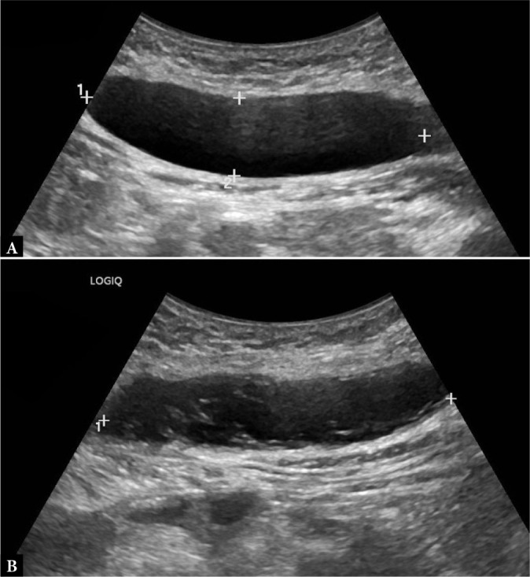
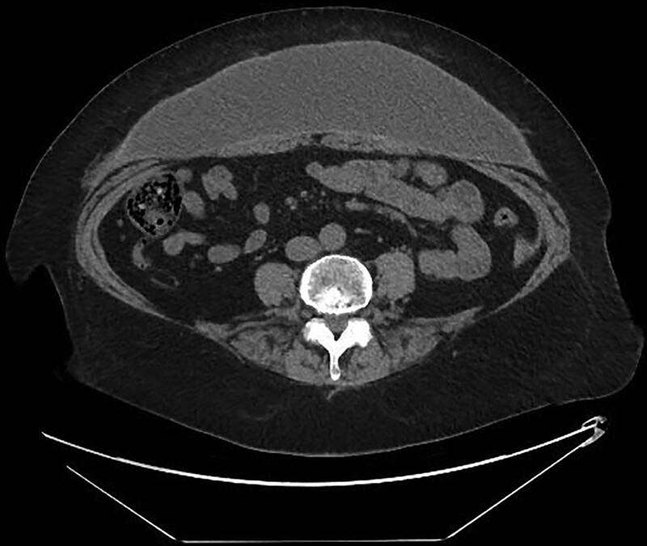
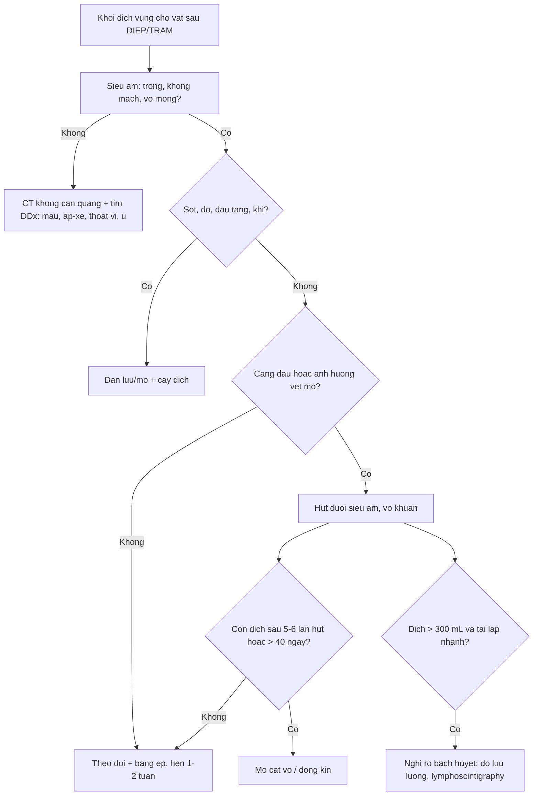

# 1968 — Seroma vùng cho vạt sau DIEP/TRAM: vì sao dịch tích, khi nào chỉ theo dõi, khi nào chọc hút và khi nào phải mổ / Donor-site seroma after DIEP/TRAM flap

**Tags:** `pattern:seroma` `pattern:dich-tu-do` `pattern:khong-dich` `vung:thanh-bung` `vung:vu` `anatomy:bao-co-thang` `protocol:sieu-am-dau-dong` `protocol:CT-khong-can-quang` `incidentaloma:seroma-sau-mo` `score:the-tich-dich`

**Mức chắc chắn (certainty):** tổng hợp y văn (literature synthesis) — ghép **phân tích gộp 71 nghiên cứu / 12.739 bệnh nhân / 16.915 vạt DIEP** về seroma vùng cho (*Plast Reconstr Surg Glob Open* 2026, **PMC13561297**), **đoàn hệ 156 bệnh nhân seroma sau mổ 12 năm** có khuyến cáo xử trí (*J Clin Med* 2022, **PMC9457167**), **khảo sát 97 phẫu thuật viên vú Anh** về dẫn lưu và rút dẫn lưu (*Breast Cancer Res Treat* 2024, **PMC10787912**), **ca lâm sàng siêu âm đối chiếu seroma – tụ máu** (*J Ultrasonography* 2025, **PMC12831968**) và **ca seroma bao xơ 8 năm sau tạo hình bụng** (*Plast Reconstr Surg Glob Open* 2021, **PMC8376326**). Nhóm **không có bệnh nhân của mình**.

> **Câu hỏi thực hành:** nữ **48 tuổi**, **12 ngày** sau tái tạo vú bằng vạt DIEP trái, về nhà với **hai dẫn lưu đã rút ngày 7**; nay **bụng dưới căng, phồng nhẹ, không sốt, không đau nhiều**, vết mổ khô. Siêu âm: **khoảng dịch không hồi âm dưới da, bờ đều, không mạch, sâu 2,1 cm, kích thước 6,4 × 4,8 × 3,0 cm**. Câu hỏi: **đây là seroma hay tụ máu/nhiễm — có cần chọc không, chọc bao nhiêu lần thì dừng, và khi nào phải mổ?**
> Bài chốt **bốn quyết định**: **(1) seroma vùng cho DIEP gặp 6% (KTC 95% 4–7%) và phần lớn tự giới hạn; (2) siêu âm là bước đầu: dịch **không hồi âm, không mạch, không vách** = seroma; **có hồi âm trong lòng/không đồng nhất** = nghĩ tụ máu; **vách dày, khí, tăng sinh mạch viền** = nghĩ nhiễm; (3) chọc hút khi **căng đau hoặc ảnh hưởng vận động/vết mổ**, vô khuẩn, dưới siêu âm; **không chọc mù khi đang rối loạn đông máu**; (4) **kéo dài > 40 ngày hoặc > 5–6 lần hút mà thể tích không giảm → chuyển mổ** (nguy cơ phải mổ **81,5% vs 31,8%**), **đặt lại dẫn lưu chỉ là biện pháp tạm và 85% vẫn phải mổ**.** Nối [1871 – Phồng/yếu thành bụng sau DIEP/TRAM](../1871-phong-thanh-bung-sau-vat-diep-tram/lesson.md), [1689 – Nhiễm trùng và hoại tử vạt tự thân](../1689-nhiem-trung-va-hoai-tu-vat-tu-than-sau-tai-tao-vu/lesson.md), [1687 – Hoại tử mỡ sau tái tạo vú](../1687-hoai-tu-mo-sau-tai-tao-vu-vat-ghep-mo/lesson.md).

## 1. Tổng quan bệnh học – cơ chế hình ảnh: vì sao "khoang chết" lại đầy dịch

### 1.1 Sinh lý bệnh: ba nguồn dịch, một khoang chết

- **Khoang chết (dead space) là điều kiện tiên quyết.** Lấy vạt DIEP bóc toàn bộ **da – mỡ dưới da – hàng xuyên (perforator)** khỏi **mạc trước cơ thẳng**, rồi đóng lại bằng cách **kéo hai bờ da–mỡ vào nhau**. Hai mặt mô vừa bóc **không dính lại ngay** mà **trượt lên nhau (shear)** theo từng cử động thở/đi lại → khoang thật sự vẫn tồn tại trong **nhiều ngày**.
- **Ba nguồn dịch:** (1) **mạch bạch huyết bị cắt** trong vạt và trong mô đệm quanh hàng xuyên — dịch giàu protein; (2) **dịch viêm** sau tổn thương mô (tăng tính thấm mao mạch 24–72 giờ đầu); (3) **máu rỉ** từ diện bóc (bị đốt/đốt điện, nên ít nhưng vẫn có).
- **Vì sao dẫn lưu không "chữa" được:** ống dẫn lưu chỉ **hút phần dịch đã vào khoang**; nó **không làm mạch bạch huyết đóng lại** và **không làm hai mặt mô dính**. Vì vậy seroma **vẫn xuất hiện sau khi rút dẫn lưu** — đúng như tổng quan 2026 nhấn mạnh: dẫn lưu kín là chuẩn mực nhưng **không loại bỏ được seroma** (PMC13561297).
- **Vì sao seroma mạn lại thành "nang":** dịch đọng lâu → **fibrin lắng, tế bào viêm, tổ chức hạt** → hình thành **vỏ xơ (pseudocapsule)** sau vài tuần. Khi đã có vỏ, **hút bao nhiêu cũng tái lập** vì vỏ tiết dịch và **không co lại** — đây là cơ sở của "seroma bao xơ" phải **cắt bỏ vỏ** (PMC8376326).

### 1.2 Vật lý hình ảnh: vì sao seroma "trong như nước" còn tụ máu thì không

- **Siêu âm:** seroma là **dịch đồng nhất, ít tế bào, ít protein** → **không hồi âm (anechoic)**, **tăng hồi âm phía sau (posterior acoustic enhancement)**, **không có tín hiệu Doppler**. Tụ máu có **hồng cầu, fibrin, cục máu** → **hồi âm trong lòng**, có **vách/lắng**, và **không mạch** (khác u). Ca minh hoạ ở mục 3 là ví dụ đối chiếu **cùng một bệnh nhân, cùng một lần khám**: ổ phải **trong** = seroma, ổ trái **không đồng nhất** = tụ máu (PMC12831968).
- **CT:** dịch seroma **0–20 HU** (gần nước), đồng nhất, **thành mỏng đều**, **không khí**, **không ngấm thuốc**. Tụ máu cấp **~45 HU (máu lỏng) đến ~85 HU (cục máu)** theo số liệu đã tổng hợp ở [bài 1936](../1936-tu-mau-bao-co-thang-bung/lesson.md); tụ máu bán cấp **giảm đậm độ dần từ ngoại vi vào trung tâm**. Mỡ dưới da **−50 đến −120 HU** — nên **một "khối dịch" −90 HU là mỡ, không phải seroma**.
- **MRI (ít dùng cho seroma):** seroma **T1 thấp – T2 rất cao** (nước tự do); tụ máu bán cấp **T1 cao** do **methemoglobin** (Fe³⁺) — đây là lý do **T1 cao trong "khối dịch sau mổ" phải nghĩ máu, không phải seroma**.
- **Vì sao phân biệt được bằng hình ảnh dù cùng là "dịch":** tín hiệu/đậm độ phản ánh **thành phần** (nước tự do vs hồng cầu vs mủ vs mỡ), còn **vị trí – bờ – vỏ** phản ánh **thời gian**. Ba câu hỏi: **đậm độ/tín hiệu gì → ở khoang nào → vỏ dày bao nhiêu**.

### 1.3 Dịch tễ và ngưỡng định lượng (số phải nhớ)

- **Tần suất gộp: 6% (KTC 95% 4–7%)** — **71 nghiên cứu, 12.739 bệnh nhân, 16.915 vạt DIEP, 736 seroma**; độ không đồng nhất lớn (**I² = 85,3%; τ² = 0,05; p < 0,001**); BMI trung bình **27,2 kg/m²**, tuổi **50,4** (PMC13561297). Y văn đơn lẻ báo **< 1% đến > 20%** — chính vì **định nghĩa seroma khác nhau**, nên **con số 6% là mốc để tư vấn, không phải để so từng bài**.
- **Yếu tố nguy cơ — nghịch lý cần biết:** trong phân tích gộp, **hút thuốc KHÔNG liên quan** (p = 0,57) và **đái tháo đường chỉ xu hướng** (p = 0,07) → tác giả kết luận seroma do **yếu tố kỹ thuật – chu phẫu** nhiều hơn bệnh nền (PMC13561297). Vì vậy **"bệnh nhân không hút thuốc" không loại trừ seroma**.
- **Dự phòng có bằng chứng:** **khâu căng tiến triển (progressive tension sutures, PTS)** giảm seroma so với chỉ dùng dẫn lưu (**RR 0,34; KTC 95% 0,15–0,76**); **giữ cân Scarpa** trong tạo hình bụng giảm tới **80%** nguy cơ seroma; nhưng ở **vùng cho DIEP**, PTS chỉ kiểm soát **khoang nông**, còn dịch đến từ **mặt phẳng sâu quanh hàng xuyên** — nên hiệu quả **không đồng nhất**; **liệu pháp áp lực âm trên vết mổ (NPWT)** không khác biệt (302 bệnh nhân) và **lấy vạt bằng robot** cũng không khác biệt (5 nghiên cứu, 691 bệnh nhân) (PMC13561297).
- **Thực hành dẫn lưu (khảo sát Anh 2024):** **85% (82/97)** phẫu thuật viên vú dùng dẫn lưu (39% thường quy, 45% chọn lọc); trong số dùng, **62% (59/79) rút theo thể tích**, phổ biến nhất **< 50 mL/24 giờ** (PMC10787912). Đây là **mốc tham chiếu**, không phải guideline quốc tế.
- **Hệ quả lâm sàng:** seroma **kéo dài làm chậm lành vết mổ, tăng nguy cơ nhiễm, làm trễ xạ/hóa trị bổ trợ** và là **lý do nhập viện/thủ thuật lại** — nên câu hỏi "chọc hay không" là câu hỏi **kinh tế – thời gian điều trị**, không chỉ "khó chịu".

## 2. Mẫu hình + chẩn đoán phân biệt theo vị trí và thời điểm (Gamut)

- **Mẫu hình chung:** **khối dịch dưới da, bờ đều, không đau hoặc căng nhẹ, xuất hiện sau khi rút dẫn lưu** ở đúng vùng cho vạt. Không sốt, không đỏ, vết mổ khô.
- **Gamut theo thời gian sau mổ:**
  - **0–14 ngày:** **seroma** (hay nhất), **tụ máu** (đặc biệt nếu kháng đông/tiền sử chảy máu), **nhiễm sớm/áp-xe** (sốt, đỏ, đau tăng), **hoại tử mỡ sớm** (vùng cứng, không dịch).
  - **14 ngày–3 tháng:** **seroma dai dẳng**, **seroma nhiễm** (vách dày, dịch đục), **hoại tử mỡ** ([1687](../1687-hoai-tu-mo-sau-tai-tao-vu-vat-ghep-mo/lesson.md)), **rò bạch huyết** (dịch ra nhiều, tái lập nhanh sau hút).
  - **> 3 tháng:** **seroma bao xơ (encapsulated)**, **bulge/thoát vị** ([1871](../1871-phong-thanh-bung-sau-vat-diep-tram/lesson.md)), **hoại tử mỡ vôi hoá**, **u tái phát/di căn thành bụng** (rất hiếm), **u mô mềm mới**.
- **Gamut theo độ sâu (quyết định thái độ xử trí):**
  - **Dưới da nông (trên cân Scarpa):** seroma "túi nước" điển hình, hút dễ, ít nguy cơ.
  - **Dưới cân Scarpa – trên mạc trước cơ thẳng:** đúng khoang chết của vạt DIEP; hút khó hơn, dễ tái lập.
  - **Trong cơ thẳng/bao cơ thẳng:** tụ máu bao cơ thẳng ([1936](../1936-tu-mau-bao-co-thang-bung/lesson.md)), không phải seroma vùng cho.
  - **Dưới mạc (trong ổ bụng):** không bao giờ là seroma vùng cho — phải loại **thoát vị, dịch ổ bụng, biến chứng nội tạng**.

## 3. Bảng so sánh phân biệt (ma trận đối chiếu)

| Thực thể (entity) | Hình ảnh điển hình (US/CT/MRI) | Chốt vào (rule-in) | Chốt loại (rule-out) | Gợi ý xác nhận |
|---|---|---|---|---|
| **Seroma đơn thuần** | US: **không hồi âm, đồng nhất**, tăng hồi âm sau, **không mạch**; CT: **0–20 HU**, thành mỏng, không khí, không ngấm | **Dịch đồng nhất + không mạch + đúng khoang chết dưới da** ở vùng cho vạt | Có **hồi âm trong lòng/vách** → nghĩ máu; **khí/thành dày/ngấm viền** → nghĩ nhiễm | US ± CT không cản quang; đo 3 chiều, tính thể tích; chọc hút vô khuẩn nếu căng đau |
| **Tụ máu (hematoma)** | US: **hồi âm trong lòng**, có vách/lắng, **không mạch**; CT cấp **~45–85 HU**, bán cấp giảm dần từ ngoại vi; MRI **T1 cao** (methemoglobin) | **Đậm độ/tín hiệu máu + tiền sử kháng đông/chảy máu + đau căng nhanh** | Dịch **0–20 HU, T1 thấp** → seroma; có mạch trong tổn thương → u/giả phình | CT không cản quang; nếu nghi chảy máu hoạt động → **CT có cản quang thì muộn** |
| **Seroma nhiễm/áp-xe** | US: **vách dày không đều**, hồi âm trong lòng, **khí** (bóng mờ bẩn), tăng sinh mạch viền; CT: thành ngấm thuốc, **khí trong mô mềm**, thâm nhiễm mỡ quanh | **Sốt/đỏ/đau tăng + khí + thành ngấm thuốc** | Dịch trong, thành mỏng, không khí → không nhiễm | Chọc hút **cấy dịch** trước kháng sinh; **khí trong mô mềm = dẫn lưu/mổ, không chờ** |
| **Rò bạch huyết (lymphatic fistula)** | Không có dấu hiệu riêng trên US/CT: **dịch tái lập rất nhanh**, thể tích lớn; có thể thấy **đường rò** nếu bơm chất chỉ thị | **Dịch > 300 mL/ngày hoặc tái lập trong vài giờ sau hút**, không sốt, vết mổ khô | Đáp ứng với 1–2 lần hút, thể tích giảm dần → seroma thường | Đo lưu lượng/24 giờ; **lymphoscintigraphy** khi cần (nhóm seroma thật đã loại các ca này) |
| **Hoại tử mỡ** | US: khối **hồi âm hỗn hợp, không mạch**, có thể viền giảm âm; CT: mô mềm/mỡ **không ngấm**, có vôi hoá muộn | **Khối đặc/xơ cứng, không phải túi dịch; tiến triển theo tuần–tháng** | Dịch di động, thay đổi theo tư thế → seroma | So [1687](../1687-hoai-tu-mo-sau-tai-tao-vu-vat-ghep-mo/lesson.md); theo dõi 3–6 tháng |
| **Bulge/thoát vị vùng cho** | CT có **Valsalva**: mạc **liên tục + cơ mỏng** = bulge; **lỗ khuyết + túi** = thoát vị | **Thay đổi theo gắng sức, không có túi dịch** | Dịch khu trú, không đổi theo Valsalva → seroma | So [1871](../1871-phong-thanh-bung-sau-vat-diep-tram/lesson.md); CT 2 thì |
| **Seroma bao xơ (mạn)** | CT: **khối dịch 0–20 HU, vỏ xơ dày đều, bám mạc**, không khí; có thể **vôi hoá vỏ** | **Tồn tại > 3 tháng, thể tích không giảm dù hút nhiều lần, vỏ rõ** | Vỏ mỏng + giảm dần → seroma cấp; **nốt đặc trong vỏ** → loại u | MRI/CT có cản quang; **cắt vỏ + đóng kín** là điều trị |

*Hai ổ dịch ở thành bụng **cùng một bệnh nhân** (nữ 26 tuổi, 2 tuần sau tạo hình bụng): **(A)** ổ **không hồi âm, đồng nhất** = seroma; **(B)** ổ **không đồng nhất, có hồi âm trong lòng** = tụ máu; cả hai **không có tín hiệu Doppler**. Nguồn: *Journal of Ultrasonography* 2025, Fig. 7, **PMC12831968**, **CC BY-NC-ND 4.0** — ảnh nguyên bản, không crop/ghép.*

*CT ngang không cản quang: **khối dịch lớn, đồng nhất, bờ rõ, nằm TRƯỚC cơ thẳng bụng** (giữa mỡ dưới da và mạc trước) — seroma **bao xơ** tồn tại **8 năm** sau tạo hình bụng, đã **cắt bỏ vỏ**. Điểm cần nhớ: vị trí **trước mạc**, không trong ổ bụng, không trong cơ. Nguồn: *Plast Reconstr Surg Glob Open* 2021, Fig. 1, **PMC8376326**, **CC BY-NC-ND 4.0** — ảnh nguyên bản.*

### Ba câu hỏi quyết định trên siêu âm
- **1. Trong hay đục?** **Không hồi âm + tăng hồi âm sau** = seroma; **hồi âm trong lòng, vách, lắng** = máu hoặc mủ. Đây là câu hỏi **phân biệt sống còn** vì tụ máu lớn/đang chảy phải xử trí khác.
- **2. Có mạch không?** **Không mạch** loại u/giả phình; **mạch trong vỏ hoặc trong tổn thương** buộc phải tìm nguyên nhân khác (u, giả phình, dị dạng).
- **3. Vỏ dày bao nhiêu, có khí không?** Vỏ **< 2 mm, đều** = seroma đơn thuần; **vỏ dày không đều + khí** = nhiễm, phải **dẫn lưu/mổ** chứ không hút đơn thuần.

## 4. Protocol chụp + phân tầng xử trí

- **Siêu âm là bước đầu, luôn làm:** đầu dò **linear 12–18 MHz** (người béo dùng **9–12 MHz**), quét **dọc và ngang**, so **hai bên**, đo **3 chiều** và tính thể tích theo **V = 0,52 × D1 × D2 × D3**. Ghi: **vị trí so với cân Scarpa/mạc trước**, **độ sâu từ mặt da**, **độ dày vỏ**, **hồi âm trong lòng**, **khí**, **Doppler**, **có thông với ổ bụng không**.
- **CT bụng–chậu không cản quang** khi: **khối lớn/béo khó siêu âm**, **nghi thoát vị/bulge** (thêm thì **Valsalva**, xem [1871](../1871-phong-thanh-bung-sau-vat-diep-tram/lesson.md)), **nghi tụ máu sâu**, **sốt chưa rõ ổ**. **Có cản quang** khi nghi **áp-xe (thành ngấm thuốc)** hoặc **chảy máu hoạt động (thoát cản quang)**.
- **Chọc hút dưới siêu âm — kỹ thuật:** vô khuẩn, **kim 18–21 G**, đường vào **xa vết mổ và xa mạch**, **không xuyên qua túi thoát vị/ổ bụng**; hút **hết dịch** rồi **băng ép**; **gửi cấy** nếu sốt/đỏ/dịch đục; **không bơm chất gây xơ ngay lần đầu** ở vùng cho vạt (nguy cơ hoại tử da).
- **Phân tầng xử trí (số liệu từ 156 bệnh nhân, PMC9457167):**
  - **Không đau, thể tích nhỏ, không sốt:** theo dõi + băng ép; **không chọc chỉ vì "có dịch"**.
  - **Căng đau/ảnh hưởng vết mổ:** hút dưới siêu âm; hẹn lại 1–2 tuần.
  - **Hút > 40 ngày:** **81,5% phải mổ** so với **31,8%** ở nhóm hút ≤ 40 ngày (p = 0,001; nguy cơ tương đối **9,43**) → **nên tư vấn mổ sớm** thay vì hút mãi.
  - **Không giảm sau 5–6 lần hút:** đặt vấn đề **mổ cắt vỏ** (tiêu chuẩn nhóm tác giả dùng).
  - **Đặt lại dẫn lưu khi dịch ~> 300 mL:** 10/10 bệnh nhân trong loạt này **cuối cùng vẫn phải mổ**; nhìn chung đặt lại dẫn lưu **tăng 3,3 lần** nguy cơ mổ (85% phải mổ) → **chỉ là biện pháp tạm**.
  - **Nhiễm/skin necrosis:** mổ dẫn lưu/cắt lọc; trong loạt có **25 ca nhiễm** và **17 ca hoại tử da** tại thời điểm nhập viện.
- **Sơ đồ quyết định:**

## 5. Biến thể bình thường và cạm bẫy

- **"Túi dịch" sau mổ có thể là mỡ:** mỡ dưới da **−50 đến −120 HU** trên CT, **hồi âm đều, hơi sáng** trên siêu âm; đừng gọi là seroma rồi chọc. Đo HU là cách phân biệt rẻ nhất.
- **Dẫn lưu "khô" không loại trừ seroma:** ống có thể **bị fibrin bít** hoặc **rút ra khỏi khoang**; bệnh nhân vẫn căng, siêu âm vẫn có dịch. **Luôn siêu âm khi lâm sàng không khớp với lượng dịch trong ống**.
- **Hút mù bằng kim to ở vùng bẹn/bụng dưới:** nguy cơ **chọc vào mạch (động mạch thượng vị dưới/nhánh bẹn)** hoặc **vào túi thoát vị**. Luôn **dưới siêu âm**, và **không chọc khi INR > 1,5 / tiểu cầu < 50 × 10⁹/L** mà chưa xử lý.
- **Seroma "tái phát" sau 3 tháng = đổi chẩn đoán:** nghĩ **seroma bao xơ**, **hoại tử mỡ**, **bulge**, hoặc **tổn thương mới**. Đừng tiếp tục hút mà không chụp lại.
- **Bẫy thỏa mãn tìm kiếm (satisfaction of search):** thấy seroma rồi dừng, bỏ sót **thoát vị lỗ trocar** hoặc **khối mô mềm** đi kèm — luôn quét toàn thành bụng.
- **Seroma nhiễm có thể không sốt:** ở người suy giảm miễn dịch/sau xạ, **chỉ đỏ và dịch đục**; cấy dịch là bắt buộc khi định hút lần 2.
- **Không dùng kháng sinh dự phòng "cho chắc" sau mỗi lần hút:** làm mờ cấy và chọn sai kháng sinh khi nhiễm thật.

## 6. Tự lượng giá — Blind Quiz

**Ca 1 — Bụng dưới căng sau tạo hình bụng**

- Gợi ý lâm sàng: nữ **26 tuổi**, **2 tuần** sau **cắt dạ dày ống + tạo hình bụng**, đau nhẹ, không sốt, da hơi đổi màu nhưng **nguyên vẹn**.
- Câu hỏi: Hai ổ dịch khác nhau ở điểm nào? Chẩn đoán từng ổ? Có cần chọc cả hai không?

<b>Bấm để hiện đáp án (findings + chẩn đoán)</b>

- Dấu hiệu: **A** — ổ **không hồi âm, đồng nhất**, bờ đều, **không mạch** = **seroma**. **B** — ổ **không đồng nhất, hồi âm trong lòng**, không mạch = **tụ máu**.
- Chẩn đoán: **seroma (phải) + tụ máu (trái)** cùng một bệnh nhân. Seroma hút nếu căng đau; **tụ máu không hút mù** — theo dõi nếu nhỏ, **CT có cản quang** nếu đau tăng/Hb giảm để loại chảy máu hoạt động.
- Vì sao: cùng là "dịch", nhưng **thành phần** quyết định hồi âm — nước tự do trong, hồng cầu/fibrin tạo hồi âm. Cả hai **không có mạch**, nên Doppler âm **không** phân biệt được với u.
- Nguồn ảnh: *Journal of Ultrasonography* 2025, Fig. 7, **PMC12831968**, **CC BY-NC-ND 4.0**.

**Ca 2 — Khối bụng dưới tồn tại 8 năm**

- Gợi ý lâm sàng: nữ **64 tuổi**, **8 năm** sau tạo hình bụng, bụng **nhô ra** nhưng **không đau**, không sốt, không có khối sa khi gắng sức.
- Câu hỏi: Khối dịch nằm ở khoang nào? Vì sao không tự tiêu? Hai chẩn đoán phân biệt cần loại trừ?

<b>Bấm để hiện đáp án (findings + chẩn đoán)</b>

- Dấu hiệu: khối **dịch đồng nhất, bờ rõ, thành mỏng–đều**, nằm **trước cơ thẳng bụng** (giữa mỡ dưới da và mạc trước), **không thông ổ bụng**, không khí.
- Chẩn đoán: **seroma bao xơ mạn** — vỏ xơ tiết dịch và không co nên **không thể tự tiêu**; điều trị là **cắt bỏ vỏ + đóng kín**.
- Phân biệt: **thoát vị/bulge** (có lỗ khuyết, thay đổi theo Valsalva) và **u mô mềm/hay hoại tử mỡ có vỏ** (nốt đặc, ngấm thuốc) — CT có cản quang hoặc MRI nếu không chắc.
- Nguồn ảnh: *Plast Reconstr Surg Glob Open* 2021, Fig. 1, **PMC8376326**, **CC BY-NC-ND 4.0**.

**Ca 3 — Dịch tái lập trong vài giờ (không có ảnh)**

- Gợi ý lâm sàng: nữ **55 tuổi**, **10 ngày** sau DIEP, hút ra **350 mL** dịch vàng trong; **6 giờ sau đã căng lại**, vết mổ khô, không sốt, không đỏ.
- Câu hỏi: Đây là seroma thường hay biến chứng khác? Cần đo gì và làm gì tiếp?

<b>Bấm để hiện đáp án (findings + chẩn đoán)</b>

- Dấu hiệu: **tái lập rất nhanh với thể tích lớn (> 300 mL/ngày)**, không nhiễm trùng, không tụ máu.
- Chẩn đoán: nghĩ **rò bạch huyết (lymphatic fistula)** hơn là seroma đơn thuần — seroma thường **giảm dần** sau mỗi lần hút.
- Việc làm: **đo lưu lượng 24 giờ**, cấy dịch (loại nhiễm), **không đặt lại dẫn lưu hút mạnh** (làm tăng lưu lượng); hội chẩn phẫu thuật; **lymphoscintigraphy** khi cần xác định đường rò. Trong loạt 156 bệnh nhân, nhóm đặt lại dẫn lưu vì dịch ~> 300 mL **đều phải mổ**.
- Nguồn: *J Clin Med* 2022, **PMC9457167** (nhóm seroma thật đã **loại trừ** ca rò bạch huyết bằng lymphoscintigraphy).

## Bài liên quan chéo
- [1871 – Phồng – yếu thành bụng sau lấy vạt DIEP/TRAM: bulge vs thoát vị, CT Valsalva](../1871-phong-thanh-bung-sau-vat-diep-tram/lesson.md)
- [1689 – Nhiễm trùng & hoại tử vạt tự thân sau tái tạo vú](../1689-nhiem-trung-va-hoai-tu-vat-tu-than-sau-tai-tao-vu/lesson.md)
- [1687 – Hoại tử mỡ sau tái tạo vú, vạt & ghép mỡ](../1687-hoai-tu-mo-sau-tai-tao-vu-vat-ghep-mo/lesson.md)
- [1936 – Tụ máu bao cơ thẳng bụng: "bụng cấp" giả, đậm độ máu 45–85 HU](../1936-tu-mau-bao-co-thang-bung/lesson.md)
- [516 – Hình ảnh vú sau điều trị: tái tạo, hoại tử mỡ, sẹo vs tái phát](../516-hinh-anh-vu-sau-dieu-tri/lesson.md)

## Ảnh
- `images/1968_seroma-vat-bung_US-seroma-vs-hematoma_PMC12831968.jpg` — US đối chiếu seroma/tụ máu, **CC BY-NC-ND 4.0**, nguyên bản.
- `images/1968_seroma-vat-bung_CT-seroma-man-PMC8376326.jpg` — CT seroma bao xơ, **CC BY-NC-ND 4.0**, nguyên bản.
- Không có ảnh composite: cả hai ảnh là **CC BY-NC-ND** (cấm tạo tác phẩm phái sinh).

> Không dùng để chẩn đoán độc lập khi chưa có người hướng dẫn.
