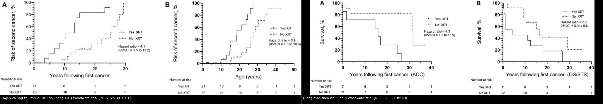
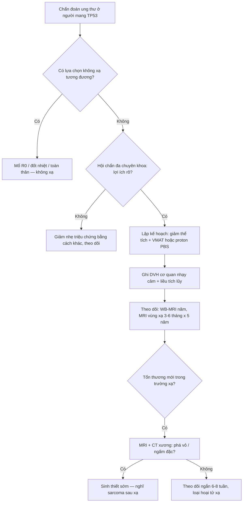
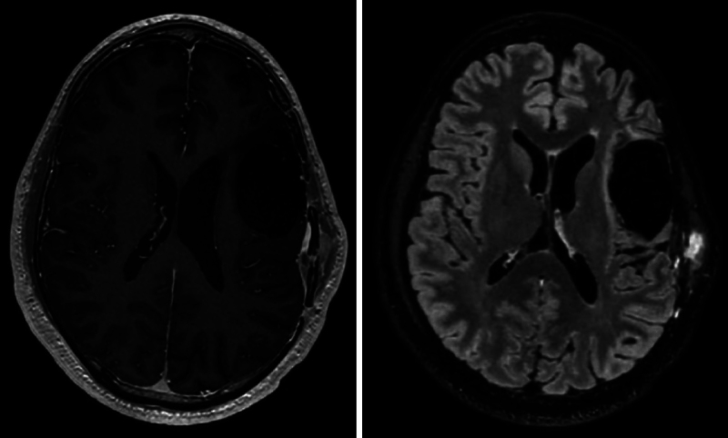
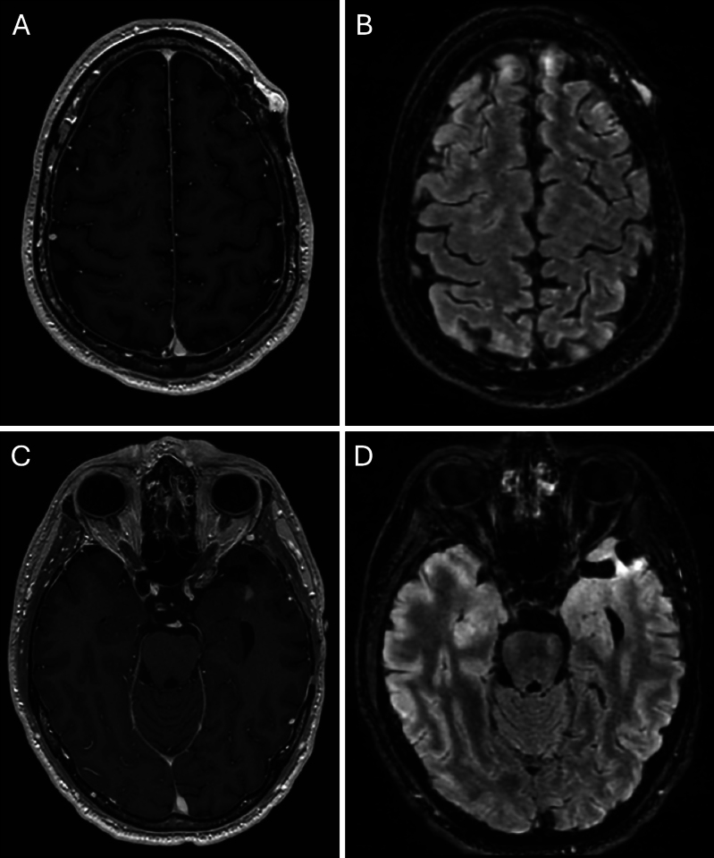
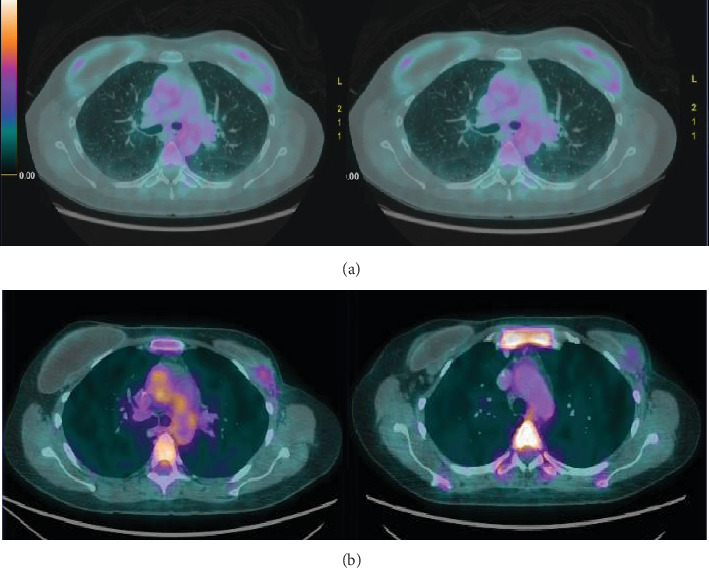
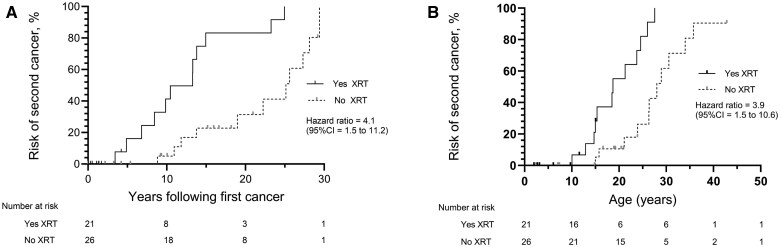

# 197 — Xạ trị ở Li-Fraumeni (TP53): khi nào buộc phải xạ, chọn kỹ thuật nào & theo dõi gì / Radiotherapy in Li-Fraumeni syndrome

**Tags:** `pattern:sarcoma-sau-xa` `vung:toan-than` `vung:vu` `vung:nao` `score:Chompret` `protocol:WB-MRI` `incidentaloma:ton-thuong-truong-xa`
**Mức chắc chắn (certainty):** tổng hợp y văn (literature synthesis) — nhóm tự biên từ toàn văn các bài mở: bài điểm luận xạ trị trong LFS (PMC12880795, CC BY 4.0), nghiên cứu đoàn hệ nhi 47 bệnh nhân (PMC12505129, CC BY 4.0), tổng quan có hệ thống về xạ trị bổ trợ ung thư vú trong LFS (PMC11987720, CC BY 4.0), loạt ca sarcoma sau xạ sọ–màng não (PMC12684234, CC BY-NC-ND 4.0) và ca angiosarcoma thành ngực phát hiện TP53 sau xạ (PMC11671632, CC BY). Số liệu lấy từ toàn văn, không lấy từ abstract gián tiếp.

## 1. Tổng quan bệnh học – cơ chế hình ảnh

- **Bệnh học:** Li-Fraumeni (LFS) do **đột biến dòng mầm TP53** (di truyền trội NST thường). p53 là trung tâm của **đáp ứng tổn thương ADN**: dừng chu kỳ tế bào qua **CDKN1A/p21**, huy động **sửa chữa ADN** (NER, BER, tái tổ hợp tương đồng), rồi **chết theo lập trình** (BAX/PUMA/NOXA) hoặc **lão hóa (senescence)**. Mất một alen → tế bào **sống sót dù mang đột biến** → các đột biến do tia xạ **được "cố định" và nhân lên**.
- **TẠI SAO tia xạ là vấn đề riêng ở LFS (chứ không chỉ là "nguy cơ chung"):** tia xạ gây **đứt sợi đôi ADN**; ở người bình thường tế bào hỏng bị loại bỏ, ở LFS **ngưỡng hoạt hóa điểm kiểm soát G1/S cao hơn** → tế bào tổn thương **sống sót nhiều hơn** và tích lũy **bất thường cấu trúc nhiễm sắc thể**. Điều này **KHÔNG có nghĩa là u kháng xạ** — biểu hiện là **mô lành quanh trường xạ dễ sinh u thứ hai**, không phải u chính khó diệt.
- **Vì sao hình ảnh học lại quan trọng trong câu chuyện này:** sarcoma sau xạ (radiation-induced sarcoma — RIS) mọc **ngay trong trường xạ, sát diện mổ cũ**, và trên MRI là **nốt ngấm thuốc + T2/FLAIR sáng** — **trùng hình ảnh với tái phát u** và với **hoại tử xạ**; phân biệt dựa vào **thời gian (latency), vị trí tương quan trường xạ, và mô học**, không dựa vào một chuỗi xung.
- **Ngưỡng định lượng nằm lòng:**
  - **Trẻ em LFS (n = 47):** thời gian trung vị đến ung thư nguyên phát thứ hai **13,3 năm** nếu có xạ trị so với **25,1 năm** nếu không (**HR 7,9; 95% CI 2,8–22,6**); sống sót trung vị **9,7 năm** so với **29,2 năm** (**HR 3,2; 1,5–6,6**) (PMC12505129).
  - **Nguy cơ tích lũy ung thư thứ hai theo thời gian:** HR **4,1 (1,5–11,2)** cho "số năm sau ung thư đầu"; HR **3,9 (1,5–10,6)** cho "tuổi tại chẩn đoán ung thư thứ hai" (Hình 1A/B của cùng nghiên cứu).
  - **Ung thư vú LFS:** đoàn hệ lớn nhất **227 phụ nữ**, **79 (34,8%)** có xạ trị bổ trợ → **6 sarcoma, tất cả trong trường xạ**, nguy cơ tích lũy **~4,8–5% ở 5 năm** (đoàn hệ 227 phụ nữ, 2024 — dẫn trong PMC12880795 và PMC11987720). Các đoàn hệ nhỏ hơn: **10%** (30/48 có xạ trị), **11%** (2/18), **16,7%** (2/12), **30%** (2/6) — dao động lớn vì cỡ mẫu nhỏ (PMC11987720).
  - **Latency điển hình:** sarcoma/angiosarcoma sau xạ trong LFS xuất hiện **4–5 năm** sau xạ (không phải 10–20 năm như dân số chung) (PMC12684234, PMC11987720).
  - **Dose–response:** mô hình chuột tp53 dị hợp cho thấy **ngưỡng trên ~100 mGy** cho u do tia xạ; ở người **chưa có ngưỡng liều an toàn** — số liệu lâm sàng **không tìm thấy quan hệ liều–nguy cơ rõ** (PMC11987720, PMC12880795).
- **Một điểm phản biện (fidelity):** bằng chứng hiện có **không** cho rằng mọi người mang TP53 đều chắc chắn bị sarcoma sau xạ, và **không** có thử nghiệm tiến cứu; các tác giả nhấn mạnh **"xạ trị không phải chống chỉ định tuyệt đối"** — nhưng phải qua **hội chẩn đa chuyên khoa** và chỉ khi lợi ích ung thư học rõ ràng (PMC12880795).

## 2. Mẫu hình + chẩn đoán phân biệt theo tình huống (gamut)

- **Gamut theo "có nên xạ hay không"** (không phải gamut theo hình ảnh — đây là quyết định lâm sàng, hình ảnh phục vụ quyết định):
  - **Nên tránh xạ (ưu tiên thay thế):** ung thư vú giai đoạn sớm có thể **cắt toàn bộ tuyến** thay vì bảo tồn + xạ; sarcoma mô mềm **mổ được R0**; di căn đơn độc **đốt (RFA/MWA) hoặc mổ**; theo dõi tích cực.
  - **Có thể phải xạ (không có lựa chọn tương đương):** **diện cắt R1/R2 không mổ lại được**; u **không mổ được** vì giải phẫu/nguy cơ mổ; **cấp cứu chức năng** (chèn ép tủy, tắc đường thở, tắc mạch); **giảm đau/chảy máu** (palliative); **không còn lựa chọn toàn thân**.
  - **Gamut tổn thương mới trong trường xạ cũ (bài toán hình ảnh):** **sarcoma sau xạ** / **tái phát u nguyên phát** / **hoại tử xạ (radiation necrosis)** / **di căn mới** / **nhiễm trùng – áp-xe trong diện mổ**.

## 3. Bảng so sánh phân biệt (ma trận đối chiếu)

**Bảng 3A — tổn thương ngấm thuốc mới trong trường xạ ở người mang TP53**

| Thực thể (entity) | Hình ảnh điển hình | Chốt vào (rule-in) | Chốt loại (rule-out) | Gợi ý xác nhận |
|---|---|---|---|---|
| **Sarcoma sau xạ (RIS)** | Khối **mô mềm/xương** ngấm thuốc, **T2 sáng**, nằm **trong trường xạ, sát diện mổ**, phá vỏ xương/da | **Latency 3–6 năm + phá hủy xương/vỏ + trong trường xạ** | Ngấm **kiểu vòng mỏng đều, không phá vỏ** → nghĩ hoại tử xạ | MRI + CT xương; **sinh thiết** là chốt |
| **Tái phát u nguyên phát** | Nốt ngấm thuốc **tại diện mổ/bờ u cũ**, T2 sáng, DWI sáng | **Sát diện mổ + lớn nhanh + DWI sáng** | Tổn thương **ngoài trường xạ**, hình thái khác u ban đầu | MRI đa chuỗi (DWI/ADC, tưới máu), PET; sinh thiết |
| **Hoại tử xạ** | **Ngấm vòng**, trung tâm không ngấm (hoại tử), phù T2/FLAIR lan theo hình **"ngón tay"**, xuất hiện **6–24 tháng** sau xạ | **Vòng ngấm + trung tâm dịch + giảm dần theo thời gian** | Phá vỏ xương/da, nốt đặc ngấm đặc → nghĩ RIS/tái phát | MRI phổ/chuyển hóa (MET/FET-PET), theo dõi 6–8 tuần |
| **Di căn mới** | Nhiều nốt, thường **ngoài trường xạ**, hình tròn đều | **Nhiều ổ + ngoài trường** | Một ổ đơn độc sát diện mổ → khó, cần mô học | PET-CT toàn thân (cân nhắc liều), sinh thiết |
| **Nhiễm trùng trong diện mổ** | Tụ dịch **ngấm vòng**, khí, phù mô mềm, dày màng não | **Khí + sốt + tăng CRP + ngấm vòng** | Khối đặc ngấm tiến triển không sốt → không nghĩ nhiễm | Xét nghiệm dịch, cấy; **không sinh thiết mù khi chưa loại nhiễm** |

**Bảng 3B — chọn kỹ thuật khi buộc phải xạ**

| Lựa chọn | Nguyên lý liều | Chốt vào (rule-in) | Chốt loại (rule-out) | Ghi chú thực hành |
|---|---|---|---|---|
| **Photon 3D-CRT** | Trường đơn giản, liều trung gian–cao lan vào mô lành | **Cần xạ nhanh, tuyến không có VMAT/proton** | Không dùng khi cần bảo vệ cơ quan sát kề (tủy, thân não, tim) | Dữ liệu cũ: sarcoma sau xạ gặp sau **2D/IMRT** nhưng **không gặp sau 3D-CRT** trong một đoàn hệ nhỏ (đoàn hệ 48 phụ nữ, *Cancers* 2024 — dẫn trong PMC12880795) — bằng chứng yếu |
| **VMAT** | Độ tương thích cao, gradient dốc, **ít MU hơn IMRT tĩnh** | **Cần liều đồng nhất + ít liều cao vào mô lành** | Cảnh giác **"bồn liều thấp" (low-dose bath)** lan rộng | Giảm MU → giảm tán xạ; nhưng thể tích liều thấp tăng |
| **Proton (pencil beam scanning)** | **Bragg peak**, liều sau đích gần bằng 0, **integral dose thấp hơn** | **U cạnh cơ quan nhạy cảm, trẻ em, cần giảm thể tích chiếu** | **Passive scattering** (nhiều neutron thứ cấp) → ưu tiên **PBS** | NCDB **> 450.000** bệnh nhân: proton giảm ung thư nguyên phát thứ hai so với IMRT photon; **không phải bằng 0** (đã có osteosarcoma sau proton) |
| **Giảm thể tích chiếu** | Bỏ **chiếu hạch dự phòng** khi ung thư học cho phép | **Chỉ chiếu u thô + vùng nguy cơ cao** | Không bỏ chiếu khi hạch dương tính rõ | Biện pháp **rẻ nhất** để giảm nguy cơ, theo khuyến cáo trong PMC12880795 |

*Trái: nguy cơ tích lũy ung thư nguyên phát thứ hai (A theo số năm, B theo tuổi) — đường liền = **có xạ trị**, đường chấm = không. Phải: sống sót sau ung thư đầu ở nhóm **carcinoma vỏ thượng thận** (A) và **sarcoma mô mềm/xương** (B). Nguồn: Woodward ER et al., J Natl Cancer Inst 2025, CC BY 4.0. Ảnh ghép letterbox.*

## 4. Protocol: lập kế hoạch xạ trị & theo dõi sau xạ

**Trước khi quyết định (bắt buộc):**
1. **Xác nhận TP53** và **hội chẩn đa chuyên khoa** (ung thư, xạ trị, phẫu thuật, di truyền) — ghi rõ trong hồ sơ **lợi ích ung thư học kỳ vọng** và **các lựa chọn không xạ đã cân nhắc**.
2. **Ưu tiên thay thế:** mổ R0, đốt nhiệt, liệu pháp toàn thân ít gây độc gen; với vú — **ASCO 2020 khuyến cáo mức độ vừa: tránh xạ trị bổ trợ khi có thể, chọn cắt toàn bộ tuyến; xạ sau cắt toàn bộ chỉ khi nguy cơ tái phát tại chỗ–vùng cao** (PMC11987720).
3. **Nếu vẫn phải xạ — 4 nguyên tắc lập kế hoạch:** (a) **giảm thể tích chiếu**, bỏ chiếu hạch dự phòng nếu chấp nhận được; (b) **kỹ thuật tương thích cao** (VMAT) và **ưu tiên proton PBS** khi có; (c) **ghi rõ liều–thể tích vào cơ quan nhạy cảm** (tủy, thân não, tim, tuyến giáp, vú đối bên) trong DVH; (d) **theo dõi dài hạn có chủ đích theo trường xạ**.

**Theo dõi sau xạ (lịch tối thiểu):**
- **Toàn thân MRI (WB-MRI) mỗi năm** — không dùng CT toàn thân định kỳ để giảm liều tích lũy genotoxic.
- **MRI vú mỗi năm** ở nữ **20–65 tuổi**; **MRI não mỗi năm đến 50 tuổi** (khuyến cáo Frebourg, dẫn trong PMC11987720).
- **Theo dõi riêng trường xạ:** với sarcoma mô mềm/xương — **MRI vùng xạ 3–6 tháng/lần trong 5 năm đầu**, sau đó thưa dần; với u não — **MRI não 3–6 tháng/lần trong 5 năm đầu** rồi 6–12 tháng (thực hành của nhóm UCSF trong PMC12684234: **MRI não mỗi 6 tháng**).
- **Mốc cảnh giác:** tổn thương mới trong trường xạ xuất hiện **3–6 năm** sau xạ ở LFS → **ngưỡng sinh thiết thấp hơn dân số chung**, không "chờ 3 tháng chụp lại" nếu có **phá vỏ xương/da hoặc lớn nhanh**.

## 5. Biến thể bình thường và cạm bẫy

- **Cạm bẫy 1 — "proton là an toàn tuyệt đối":** đã có **osteosarcoma sọ 5 năm sau proton** trị glioma độ cao ở bệnh nhân LFS (PMC12684234). Proton giảm **thể tích và liều tích phân**, **không đưa nguy cơ về 0** — câu tư vấn phải nói rõ.
- **Cạm bẫy 2 — chờ đợi tổn thương trong trường xạ:** ở LFS, **latency RIS ngắn (4–5 năm)**; một nốt ngấm thuốc **phá vỏ xương/da** trong trường xạ **không được** mặc định là "hoại tử xạ" chỉ vì nó nằm sát diện mổ.
- **Cạm bẫy 3 — hoại tử xạ "giả sarcoma":** hoại tử xạ điển hình **ngấm vòng, trung tâm dịch, xuất hiện 6–24 tháng**, có thể **to ra rồi thoái triển**; **PET acid amin (MET/FET)** giúp phân biệt, nhưng **không thay thế mô học** khi có phá hủy xương.
- **Cạm bẫy 4 — bỏ sót TP53 khi chưa xét nghiệm:** trong đoàn hệ ung thư vú LFS, **87% bệnh nhân không biết mình mang đột biến tại thời điểm điều trị** (đoàn hệ 48 phụ nữ, 2024 — dẫn trong PMC11987720) → họ đã được xạ trị theo phác đồ thường. **Tiêu chuẩn Chompret** (ung thư vú **< 31 tuổi**, nhiều u nguyên phát, ACC/plexus choroid/rhabdomyosarcoma thể anaplastic) phải được áp **trước** khi lên kế hoạch xạ.
- **Cạm bẫy 5 — "không xạ bằng mọi giá" trong cấp cứu:** chèn ép tủy, tắc đường thở, tắc mạch là **chỉ định xạ cấp cứu**; trì hoãn vì lo nguy cơ về sau gây tổn thương **không hồi phục ngay bây giờ**. Quyết định phải cân bằng **hai mốc thời gian**, không chỉ mốc 20 năm.
- **Cạm bẫy 6 — dùng CT liên tiếp để "theo dõi cho chắc":** mỗi CT là một liều bổ sung vào cơ thể **sửa chữa ADN kém**; ưu tiên **MRI/siêu âm**, chỉ CT khi cần xương phổi cấp.

## 6. Tự lượng giá — Blind Quiz

**Ca 1 — Nam 35 tuổi LFS, 4 năm sau hóa–xạ trị u sao bào. MRI sọ mới.**

- Gợi ý lâm sàng: không triệu chứng thần kinh mới; theo dõi MRI mỗi 6 tháng.
- Câu hỏi: Tổn thương nằm ở đâu so với diện mổ và trường xạ? 3 chẩn đoán phân biệt? Bước tiếp theo?

<b>Bấm để hiện đáp án</b>

- Dấu hiệu (findings): **nốt ngấm thuốc** ở **vòm sọ đỉnh trái**, **T2/FLAIR sáng**, lan vào **màng não và cơ thái dương**, **sát diện mổ và trong trường xạ**.
- Chẩn đoán (diagnosis): **sarcoma sau xạ (pleomorphic sarcoma có thành phần tạo xương–sụn)** — latency **4 năm**. Phân biệt: tái phát glioma, hoại tử xạ, di căn. Chốt: **phá hủy xương + trong trường xạ + sinh thiết**.
- Nguồn ảnh: Kondapavulur S et al., J Neurosurg Case Lessons 2025, Fig. 1, **CC BY-NC-ND 4.0** (nguyên bản).

**Ca 2 — Cùng bệnh nhân, sau mổ sarcoma, tái phát nhiều lần. Đọc 4 ảnh.**

- Câu hỏi: (A)/(B) và (C)/(D) khác nhau ở điểm nào? Vì sao theo dõi sát vẫn còn giá trị?

<b>Bấm để hiện đáp án</b>

- Dấu hiệu: (A) T1 sau tiêm, (B) FLAIR — **khối mô mềm nông vùng trán** ngấm thuốc và T2 sáng (tái phát tại vùng mổ); (C)/(D) — **tổn thương mới vùng thái dương** ngấm thuốc, T2 sáng (tái phát lần sau).
- Chẩn đoán: **sarcoma sau xạ tái phát nhiều đợt** trong trường xạ — bản chất sinh học hung hãn, cần **theo dõi ảnh đều** để can thiệp sớm.
- Nguồn ảnh: Kondapavulur S et al., 2025, Fig. 3, **CC BY-NC-ND 4.0** (nguyên bản).

**Ca 3 — Nữ ung thư vú đã xạ thành ngực, 4 năm sau nổi nốt da–thành ngực; PET/CT trước và sau 6 chu kỳ.**

- Gợi ý lâm sàng: nốt/tím da vùng xạ cũ; sinh thiết ra **angiosarcoma**; xét nghiệm gen sau đó phát hiện **TP53 dòng mầm**.
- Câu hỏi: Vì sao phải xét nghiệm TP53 ở ca này? Đáp ứng trên PET/CT nói lên điều gì?

<b>Bấm để hiện đáp án</b>

- Dấu hiệu: (a) **nhiều nốt tăng chuyển hóa** vùng thành ngực/da trong trường xạ; (b) sau 6 chu kỳ — **giảm nốt, giảm ngấm**.
- Chẩn đoán: **angiosarcoma sau xạ** ở người mang **TP53 dòng mầm** phát hiện **sau** khi đã xạ trị — chính là kịch bản "không biết LFS trước điều trị" (87% trong đoàn hệ vú LFS). Bài học: **nghi LFS → xét nghiệm trước khi lên kế hoạch xạ**; đáp ứng hình ảnh tốt **không** xóa nguy cơ u thứ hai về sau.
- Nguồn ảnh: David BBL et al., Case Rep Oncol Med 2024, Fig. 2, **CC BY**.

**Ca 4 — Đọc đường cong: trẻ LFS có/không xạ trị.**

- Câu hỏi: Đường liền hay đường chấm là nhóm **có xạ trị**? Hai con số cần nhớ?

<b>Bấm để hiện đáp án</b>

- **Đường liền = có xạ trị** — dốc lên sớm và cao hơn rõ rệt (A theo số năm, B theo tuổi).
- Hai con số: **13,3 năm vs 25,1 năm** (thời gian đến ung thư thứ hai; HR **7,9**) và **HR 3,2 (1,5–6,6)** cho sống sót.
- Nguồn ảnh: Woodward ER et al., J Natl Cancer Inst 2025, Fig. 1, **CC BY 4.0**.

## Bài liên quan chéo
- [198 – Li-Fraumeni (TP53): Chompret, phổ u BOSCA & tư vấn di truyền](../198-li-fraumeni-tp53-chompret-tu-van/lesson.md)
- [199 – Quy trình xét nghiệm gen & tầm soát gia đình](../199-quy-trinh-xet-nghiem-gen-tam-soat-gia-dinh/lesson.md)
- [523 – Sarcoma mạch do xạ của vú (angiosarcoma) & AVL](../523-sarcoma-mach-do-xa-vu/lesson.md)
- [213 – U não: tiếp cận tổn thương ngấm thuốc & tổn thương mới sau điều trị](../213-u-nao/lesson.md)
- [598 – Xạ trị vùng hạch sau ung thư vú](../598-xa-tri-vung-hach-sau-ung-thu-vu/lesson.md)
- [597 – Tái phát nách đơn độc sau điều trị](../597-tai-phat-nach-don-doc-sau-dieu-tri/lesson.md)
- [929 – Gây xơ hóa nang qua da](../929-xo-hoa-nang-qua-da/lesson.md)

## Ảnh
- Ảnh tải từ bài full-text mở (Europe PMC), ghi nguồn + giấy phép từng file trong `images/CREDITS.md`.
- Ảnh **CC BY-NC-ND 4.0** (PMC12684234) dùng **nguyên bản — không cắt, không ghép**.
- Ảnh **CC BY 4.0** (PMC12505129, PMC11671632) được ghép composite bằng `tools/make_composite.py` (letterbox, giữ aspect, dải đen attribution).

> Không dùng để chẩn đoán độc lập khi chưa có người hướng dẫn.
