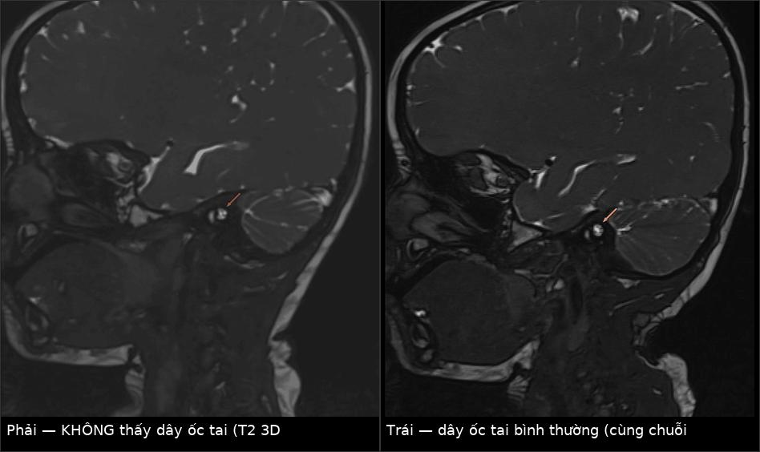
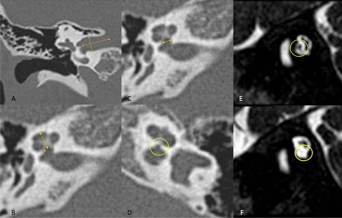
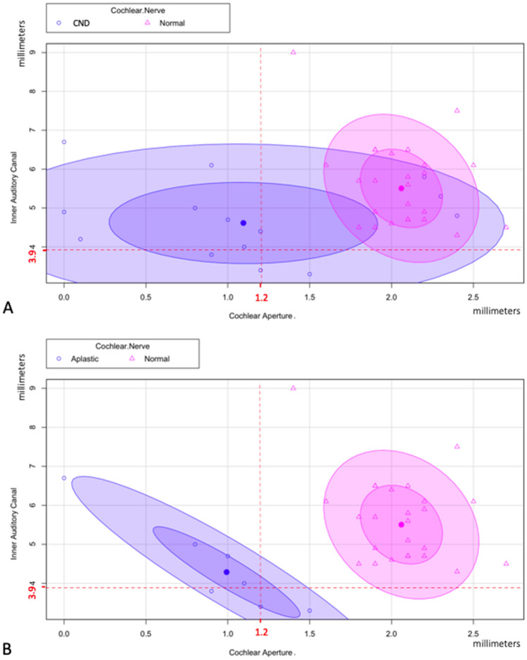
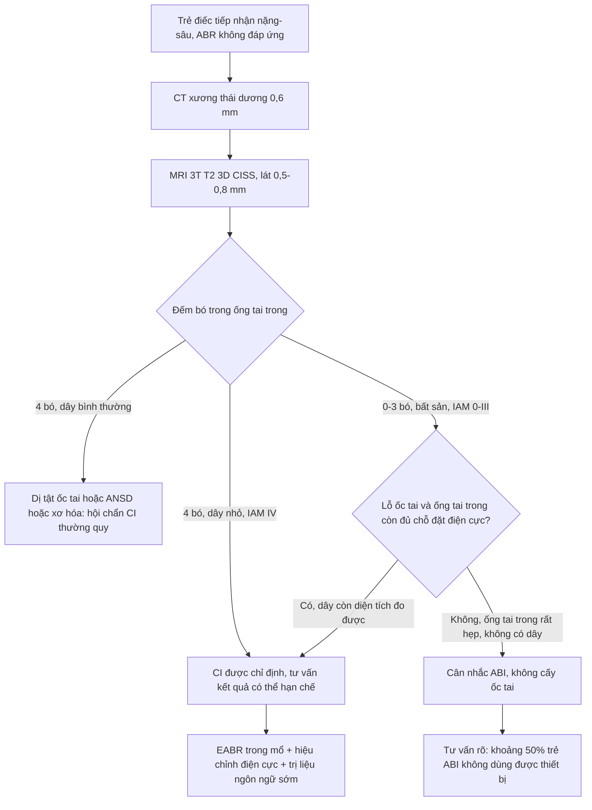
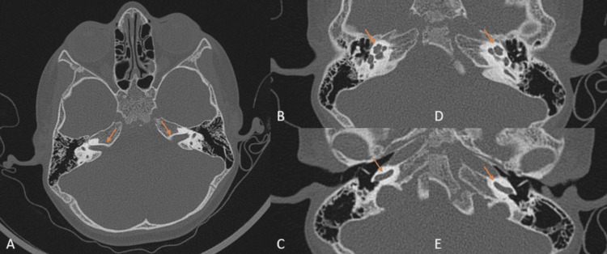
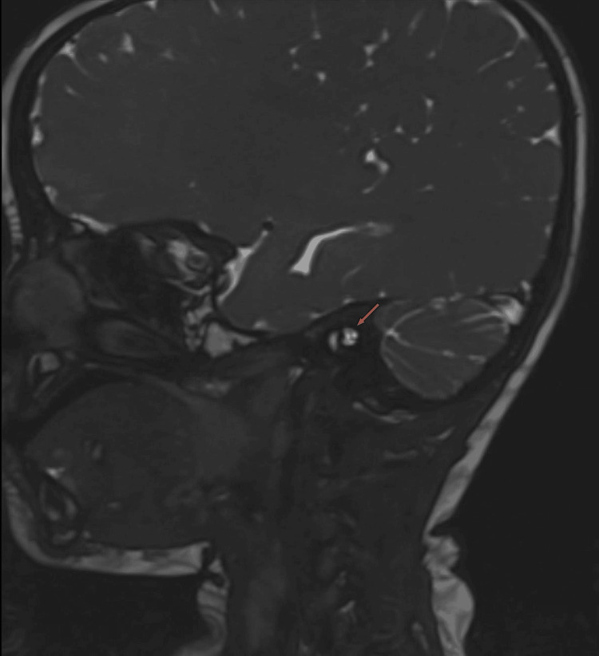
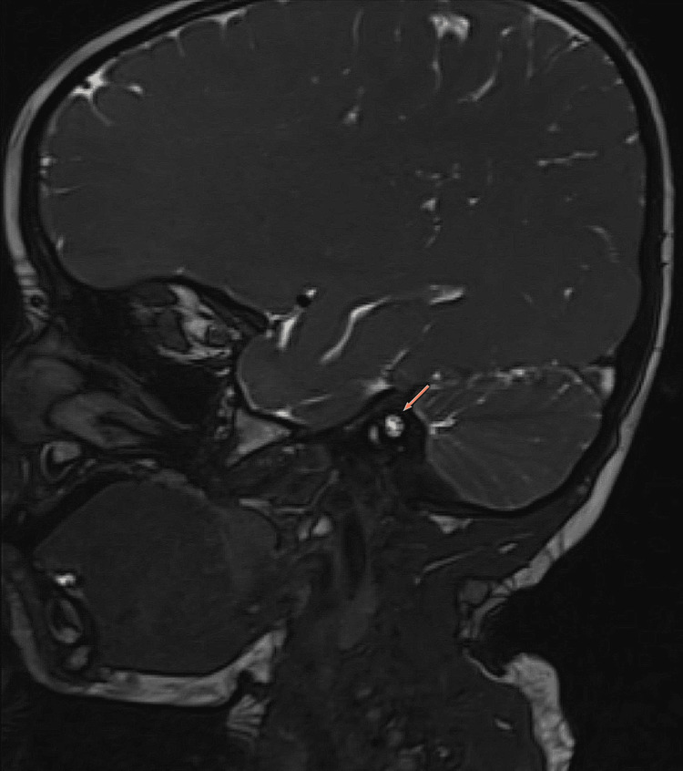

# 1971 — Bất sản / giảm sản dây thần kinh ốc tai (cochlear nerve deficiency): đếm bó dây trên CISS, ngưỡng lỗ ốc tai, và khi nào cấy ốc tai vẫn được

**Tags:** `pattern:bat-san-day-oc-tai` `pattern:giam-san-day-oc-tai` `pattern:hep-lo-oc-tai` `pattern:hep-ong-tai-trong` `pattern:di-thinh-tiep-nhan` `vung:oc-tai` `vung:tai-trong` `score:IAM-nerve-grade` `protocol:MRI-CISS` `protocol:CT-xuong-da-lat-mong` `protocol:ABR`
**Mức chắc chắn (certainty):** tổng hợp y văn (literature synthesis) — ghép **39 trẻ điếc một bên bẩm sinh** có chụp CT + MRI (**PMC7870947**, CC BY), **188 tai / 105 trẻ** CND theo hệ phân độ ống tai trong, trong đó **42 trẻ cấy ốc tai** so với **24 trẻ chứng** (**PMC9813738**, CC BY), **70 trẻ** CND có mô hình học máy dự báo kết quả (**PMC9260115**, CC BY), **16 trẻ** cấy ốc tai hai bên tuần tự (**PMC13162032**, CC BY-NC-ND), **48 trẻ** với ABR/EABR (**PMC13435270**, CC BY), **13 bệnh nhân** hội chứng khe mang–tai EYA1 (**PMC13464796**, CC BY), kỹ thuật ABI nhi (**PMC12819425**, CC BY) và một **ca nguyên văn có ảnh** CT bình thường nhưng MRI mất dây ốc tai (**PMC11604252**, CC BY).

> **Câu chốt:** **CT xương thái dương bình thường KHÔNG loại trừ bất sản dây thần kinh ốc tai.** CT chỉ nhìn được *vỏ xương* (lỗ ốc tai, ống tai trong); dây thần kinh là mô mềm, chỉ hiện ra nhờ **dịch não tủy sáng trên T2 3D CISS/FIESTA** — dây thần kinh là **khuyết tối** nằm trong “đường hầm sáng”. Ca minh họa trong bài: **HRCT ốc tai và ống tai trong hoàn toàn bình thường**, MRI 3T lại **không thấy phân nhánh ốc tai bên phải** — trẻ **3 tuổi**, đã qua giai đoạn vàng của ngôn ngữ.

> **Phân vai với bài khác:** [702](../702-oc-tai-nhiem-trung-bao-thai/lesson.md) dùng CISS để quyết định **cấy ốc tai ở trẻ điếc do CMV/rubella**; [692](../692-microtia-atresia-phuc-hoi-thinh-luc/lesson.md) phủ **microtia – hẹp ống tai ngoài**; [478](../478-diec-tiep-am-ansd-tre/lesson.md) phủ **bệnh lý thần kinh thính giác (ANSD)** với tai trong **bình thường**; [497](../497-theo-doi-sau-cay-oc-tai-tre/lesson.md) phủ **theo dõi sau cấy**. Bài này chỉ đi sâu **hình thái dây thần kinh ốc tai**: đếm bó, đo lỗ ốc tai, phân độ, và **quyết định CI vs ABI**.

## 1. Tổng quan bệnh học – cơ chế hình ảnh (TẠI SAO phải đếm dây, không chỉ nhìn xương)

### 1.1 Dịch tễ — con số đủ lớn để không được bỏ qua

- **20%** trẻ điếc tiếp nhận (sensorineural hearing loss, SNHL) bẩm sinh có **bất thường giải phẫu tai trong** trên hình ảnh (PMC11604252).
- **Bất sản/giảm sản dây ốc tai (cochlear nerve deficiency, CND)** ước tính **0,8–1,8%** trẻ điếc sâu (PMC11604252), nhưng trong nhóm **SNHL bẩm sinh** nói chung dao động **2,5–21,2%** tùy tiêu chuẩn chọn và độ phân giải MRI (PMC9813738).
- Trong **39 trẻ điếc một bên bẩm sinh** không hội chứng: **46% (18/39)** có dị tật tai trong; **CND là dị tật hay gặp nhất — 35,9% (14/39)**, gồm **7 giảm sản** và **7 bất sản**; **cả 7 ca bất sản đều điếc sâu**, còn giảm sản thì mức điếc **thay đổi** (vừa/nặng/sâu) (PMC7870947).
- Hội chứng khe mang–tai do **EYA1**: **5/13 bệnh nhân** có CND — tức đột biến một gen mà 1/3 số người mang gen đã mất dây thần kinh (PMC13464796).

### 1.2 TẠI SAO CISS/FIESTA nhìn được dây thần kinh, còn CT thì không

| Thành phần trong ống tai trong | CT xương thái dương | MRI T2 3D CISS/FIESTA | Vì sao |
|---|---|---|---|
| **Xương vỏ** (lỗ ốc tai, vách ống tai trong) | **Thấy rõ**, đo được mm | Đen (xương không có proton tự do) | Canxi hydroxyapatit hấp thụ tia X mạnh → **+700 đến +2.000 HU** |
| **Dịch não tủy** trong ống tai trong | Không phân biệt được (đậm độ mô mềm) | **Rất sáng** | Nước tự do, T2 dài; chuỗi steady-state (CISS/FIESTA/DRIVE) giữ tín hiệu T2 **với lát cắt ≤ 1 mm** nên nước “sáng tuyệt đối” |
| **Dây thần kinh + mạch máu** | **Không thấy** (chỉ thấy bóng gián tiếp qua kích thước lỗ) | **Khuyết tối bên trong dịch sáng** | Sợi trục myelin ít proton tự do → T2 ngắn/tối; mạch máu cũng tối |
| **Kích thước dây** | Suy ra từ **lỗ ốc tai** (bone cochlear nerve canal) và **ống tai trong** | Đo **trực tiếp diện tích** dây | Đây là lý do CT có **độ đặc hiệu cao nhưng độ nhạy thấp** (xem 1.3) |

- **Hệ quả thực hành:** một **CT bình thường** chỉ chứng minh *vỏ xương* bình thường. Muốn trả lời “có dây ốc tai hay không” **bắt buộc** chuỗi T2 3D độ phân giải cao, **lát ≤ 0,8 mm**, **tái tạo oblique sagittal vuông góc với ống tai trong** — mặt phẳng này cắt ngang 4 dây nên đếm được từng bó (PMC11604252, PMC9813738).
- **Bốn dây bình thường** trong ống tai trong (từ trên xuống, trước ra sau): **dây mặt (VII)** ở **trước–trên**, **dây ốc tai (cochlear)** ở **trước–dưới**, **dây tiền đình trên** và **dây tiền đình dưới** ở **sau**. Mất dây ốc tai → ô **trước–dưới trống**.
- **Vì sao dễ nhầm trên MRI thường:** dây ốc tai **nhỏ hơn dây mặt** (bình thường tỷ lệ diện tích **VCN/FN ≈ 1,50 ± 0,48** — tức thường nhỏ hơn dây mặt), nên trên lát **2–3 mm** hoặc chuỗi T1/T2 thông thường, dây ốc tai bị **hòa vào dây mặt** hoặc mất do **hiệu ứng thể tích từng phần (partial volume)**.

### 1.3 Ngưỡng định lượng — dùng được ngay trên máy

| Thông số | Ngưỡng / giá trị tham chiếu | Ý nghĩa | Nguồn |
|---|---|---|---|
| **Lỗ ốc tai (cochlear aperture / bony cochlear nerve canal, BCNC)** | **≤ 1,2 mm = hẹp**; trung vị bên bệnh **1,9 mm (1,3–2,2)** vs bên lành **2,2 mm (2,0–2,3)** vs chứng **2,1 mm (2,0–2,2)**, p < 0,01 | Cửa ra của dây ốc tai; hẹp = dây nhỏ/không có | PMC7870947 |
| **BCNC ở trẻ đã xác định CND (70 trẻ)** | **0,83 ± 0,58 mm** (0,01–2,28 mm) | Đa số **< 1,2 mm** | PMC9260115 |
| **BCNC dự báo CND** | **Se 84% / Sp 98%** (Clemmens 2013, trích lại) | CT **gần như chốt** khi hẹp nặng, nhưng **âm tính giả 16%** | qua PMC9260115 |
| **Đường kính ống tai trong (IAC)** | **< 3,9 mm = hẹp**; trẻ CND trung bình **2,47 ± 0,85 mm** | Ống hẹp gợi ý bất sản, nhưng **Sp 98% / Se 44%** — chỉ dùng để **chốt vào**, không để loại trừ | PMC7870947, PMC9260115 |
| **Số bó dây trong IAC** | Bình thường **4**; CND trung bình **1,71 ± 0,80 bó** | Càng ít bó + diện tích càng nhỏ → kết quả CI càng kém | PMC9260115 |
| **Diện tích dây tiền đình ốc tai (VCN area)** | **1,32 ± 0,55 mm²** ở CND; tỷ lệ **VCN/dây mặt 1,50 ± 0,48** | Hai biến **duy nhất** được chọn trong mô hình dự báo | PMC9260115 |
| **Ống nội dịch rộng (EVA)** | **> 2 mm** (bài này dùng ngưỡng 2 mm; ngưỡng operculum **> 1,9 mm** ở bài 702) | Đi kèm 6/39 ca USNHL | PMC7870947 |
| **Hẹp lỗ ốc tai ↔ CND** | **10/14 ca CND có hẹp lỗ ốc tai**, Fisher **p = 0,001** | Hẹp lỗ ốc tai là **dấu gián tiếp mạnh nhất trên CT** | PMC7870947 |

## 2. Mẫu hình (pattern) + chẩn đoán phân biệt theo nội dung ống tai trong (gamut)

### 2.1 Gamut theo “số bó dây nhìn thấy” trên oblique sagittal CISS

- **0–3 bó = bất sản (aplasia)** — hệ phân độ IAM **0, I, II, III** (PMC9813738). Đây là nhóm **nặng nhất về hình ảnh**, nhưng **không đồng nghĩa vô vọng** (xem mục 4).
- **4 bó nhưng dây ốc tai nhỏ = giảm sản (hypoplasia)** — IAM **grade IV**.
- **4 bó, dây ốc tai bình thường = grade V (bình thường)**.
- **Dây lạc chỗ (aberrant)** — dây ốc tai đi **sau** dây tiền đình dưới hoặc **chui vào ống bán khuyên**; hình thái hiếm, thường kèm hẹp lỗ ốc tai; **không** cấy ốc tai được theo giải phẫu thông thường.

### 2.2 Gamut theo nguyên nhân — “một dây mất” luôn phải hỏi 3 câu

1. **Có hội chứng không?** — CHARGE (**bài 1951**, CND gặp ở **49,1%** trong tổng quan đó), **EYA1** khe mang–tai (5/13), **Noonan**, **DiGeorge**, **Mondini/IP**.
2. **Có bất thường xương đi kèm không?** — hẹp lỗ ốc tai (10/14), **ống tai trong vách ngăn (partitioned IAC)**: gặp ở **1,1%** tai có lỗ ốc tai bình thường, **14,9%** tai hẹp lỗ ốc tai, **20,9%** tai teo lỗ ốc tai, và gần như **luôn kèm bất sản/giảm sản dây ốc tai** (PMC13569618).
3. **Có nguyên nhân mắc phải không?** — CMV bẩm sinh (bài 6102/702), rubella (6128), **viêm màng não phế cầu gây xơ hóa mê nhĩ** (dây còn nhưng ốc tai xơ → CI vẫn được nhưng khó), sau xạ, u dây VIII.

> **Ghi nhớ:** “**4 dây — 1 thiếu**”. Trên lát oblique sagittal chỉ cần đếm: **trước–trên = VII**, **trước–dưới = ốc tai**, **sau trên/dưới = tiền đình**. Thiếu ô **trước–dưới** = CND.

## 3. Bảng so sánh phân biệt (ma trận đối chiếu)

| Thực thể (entity) | Hình ảnh điển hình (CT / MRI CISS) | Chốt vào (rule-in) | Chốt loại (rule-out) | Gợi ý xác nhận |
|---|---|---|---|---|
| **Bất sản dây ốc tai (CND aplasia, IAM 0–III)** | Ống tai trong có **0–3 bó**; ô trước–dưới **trống**; lỗ ốc tai **0,83 ± 0,58 mm**, thường **≤ 1,2 mm** | **Không thấy bó trước–dưới trên ≥ 2 mặt cắt liên tiếp** + lỗ ốc tai ≤ 1,2 mm | Thấy bó mảnh ở ô trước–dưới → **giảm sản**, không phải bất sản | MRI 3T CISS 0,5–0,8 mm + tái tạo oblique sagittal; CT đo lỗ ốc tai |
| **Giảm sản dây ốc tai (IAM IV)** | **4 bó**, dây ốc tai **nhỏ hơn dây mặt** rõ rệt; VCN/FN < 1,2; lỗ ốc tai **1,2–1,9 mm** | **Đủ 4 bó nhưng dây ốc tai teo** | Dây ốc tai bằng dây mặt (tỷ lệ ~1,5) → bình thường | Đo diện tích VCN (mm²) trên T2 3D |
| **Hẹp lỗ ốc tai đơn thuần (không CND)** | Lỗ ốc tai ≤ 1,2 mm nhưng **vẫn thấy dây** trong ống tai trong | **Có dây + lỗ hẹp** | Không có dây → CND thật | MRI là trọng tài; CT một mình **không** đủ |
| **ANSD (bệnh lý thần kinh thính giác)** | **Tai trong và dây bình thường**, ốc tai đủ vòng | **Có dây, ốc tai bình thường, ABR bất thường + OAEs còn** | Mất dây hoặc dị tật ốc tai → không phải ANSD thuần | ABR + DPOAE/CM; MRI để **loại trừ CND** (bài 478) |
| **Dị tật ốc tai (IP-I, IP-II/Mondini, CH)** | Ốc tai **thiếu vòng/thiếu vách**, có thể **EVA**; dây có thể còn | **Mô tả vòng ốc tai + EVA** | Dây bình thường + ốc tai bình thường → không phải nhóm này | CT 0,6 mm + MRI CISS; EVA operculum > 1,9 mm (bài 702) |
| **Xơ hóa mê nhĩ sau viêm màng não** | Ốc tai **mất tín hiệu dịch** (T2 tối), dây còn | **Tiền sử viêm màng não + ốc tai tối** | Dịch sáng bình thường → không xơ hóa | MRI T2 3D trước CI; CI **không chờ** khi đang xơ hóa |

*Trái: ống tai trong bên **phải** — thấy dây mặt và dây tiền đình, **ô trước–dưới trống** (mũi tên đỏ). Phải: bên **trái** của cùng bệnh nhi — dây ốc tai **bình thường** ở góc trước–dưới (mũi tên đỏ). Nguồn: Cureus 2024, **PMC11604252**, CC BY 4.0. Ảnh ghép letterbox, giữ nguyên tỷ lệ.*

### 3.1 Ba dấu hiệu cần đọc thành lời (không đọc “mất dây” chung chung)

- **Dấu “ô trống trước–dưới”** — trên oblique sagittal: đếm **4 ô**, ô trước–dưới mất = dây ốc tai. Đây là dấu **quyết định**, không phải “ống tai trong hẹp”.
- **Dấu “vỏ xương bình thường – dây mất”** — ca PMC11604252: **HRCT bình thường cả 5 mặt cắt** (IAC, vòng đỉnh, vòng giữa, vòng đáy hai bên), MRI mới lộ bệnh. **Kết luận thực hành: không bao giờ kết luận “tai trong bình thường” chỉ từ CT ở trẻ điếc.**
- **Dấu “lỗ ốc tai = thước đo gián tiếp”** — lỗ ốc tai **càng hẹp, khả năng CND càng cao**; biểu đồ phân tán cho thấy nhóm **bất sản** nằm **hoàn toàn bên trái mốc 1,2 mm**, còn nhóm bình thường nằm **bên phải 1,9 mm** (PMC7870947).

*(A) ống tai trong trên CT coronal; (B) chiều cao ốc tai; (C) lỗ ốc tai bình thường; (D) **hẹp lỗ ốc tai nặng** bên trái; (E) dây ốc tai **bình thường** trên MRI oblique sagittal; (F) dây ốc tai **giảm sản** — ống xương gần như cốt hóa hết. Nguồn: Scientific Reports 2021, **PMC7870947**, CC BY 4.0. Nguyên bản, không chỉnh sửa.*

*Trục X = lỗ ốc tai (mm), trục Y = ống tai trong (mm). Đường đỏ: **1,2 mm** và **3,9 mm**. Nhóm **bất sản dây** (chấm xanh) tập trung ở lỗ ốc tai **< 1,2 mm**; nhóm bình thường (tam giác hồng) **≥ 1,9 mm**. Nguồn: Scientific Reports 2021, **PMC7870947**, CC BY 4.0.*

## 4. Protocol chụp + hệ phân độ + quyết định CI hay ABI

### 4.1 Protocol (theo thứ tự làm thật)

1. **ABR/ASSR + đo thính lực hành vi** trước — hình ảnh không thay được đo thính lực; **ABR có sóng dương đặc trưng gặp ở 41,67% trẻ CND** so với **0% trẻ chứng** (p < 0,05) và được xem là dấu **còn đường dẫn truyền** (PMC13435270).
2. **CT xương thái dương 0,6 mm** (không cản quang): đo **lỗ ốc tai**, **chiều cao ốc tai**, **đường kính ống tai trong**, tìm **EVA**, **vách ngăn ống tai trong**, dị tật vòng ốc tai. Giá trị: **lỗ ốc tai Se 84%/Sp 98%** cho CND (qua PMC9260115).
3. **MRI 3T: T2 3D CISS/FIESTA/DRIVE, lát 0,5–0,8 mm**, không cản quang là đủ; **tái tạo oblique sagittal vuông góc ống tai trong** để **đếm bó** và **đo diện tích VCN**; thêm T1 sau tiêm **chỉ khi** nghi u/viêm dây.
4. **Ghi báo cáo theo 4 con số**: (a) **số bó** trong ống tai trong (0–4); (b) **diện tích VCN (mm²)** và **tỷ lệ VCN/dây mặt**; (c) **lỗ ốc tai (mm)**; (d) **đường kính ống tai trong (mm)**. Kèm câu kết luận: *bất sản / giảm sản / dây lạc chỗ / bình thường*.
5. **EABR trong mổ** (điện thế thân não do kích thích điện) khi cấy ốc tai ở trẻ CND — giúp tiên lượng và hiệu chỉnh điện cực.

### 4.2 Hệ phân độ IAM (internal auditory meatus nerve grading) — bản dùng trong y văn CND

| Độ | Số bó trong ốc tai trong | Dây ốc tai | Nhóm |
|---|---|---|---|
| **0** | 0 | Không có | Bất sản |
| **I** | 1 | Không có | Bất sản |
| **II** | 2 | Không có | Bất sản |
| **III** | 3 | Không có | Bất sản |
| **IV** | 4 | **Giảm sản** | Giảm sản |
| **V** | 4 | Bình thường | Bình thường |

- **Sự thật cần nhớ (và là chỗ y văn cũ nói sai):** phân độ này **mô tả hình thái, KHÔNG dự báo kết quả cấy ốc tai.** Trong **42 trẻ CND** cấy ốc tai so với **24 trẻ chứng**: nhóm CND kém hơn chứng ở mọi mốc **6–24 tháng**, nhưng **giữa bốn nhóm phân độ CND không khác nhau có ý nghĩa** (p > 0,05), và **trẻ không thấy dây trên MRI vẫn hưởng lợi từ CI** (PMC9813738). Điều **dự báo được** là **diện tích VCN + số bó**: mô hình SVM đạt **độ chính xác 71% / AUC 0,71** cho thính lực và **93% / AUC 0,94** cho lời nói (PMC9260115).

### 4.3 Sơ đồ quyết định CI vs ABI (dùng cho hội chẩn, không phải phác đồ cứng)

### 4.4 Bằng chứng về kết quả — nói với gia đình bằng số, không bằng hy vọng

- **Cấy ốc tai ở CND vẫn có lợi:** **16 trẻ** cấy **hai bên tuần tự** (CI đầu **trung vị 12 tháng**, CI thứ hai **trung bình 43 tháng**, cách nhau **26 tháng**): **cả 16 đều tiến bộ** theo thang CAP/IT-MAIS/SIR; **9 trẻ** làm được bài đo lời nói, **cả 9 đều tăng điểm nhận lời nói đóng**; **4 trẻ đạt > 90%** bài đóng và **44–85%** bài mở âm tiết (PMC13162032).
- **ABI (auditory brainstem implant)** dành cho trẻ **không thể cấy ốc tai** vì giải phẫu (không có dây/ốc tai không đặt được điện cực). Kết quả ở trẻ **không do NF2** tốt hơn NF2, nhưng **hiếm khi đạt hiểu lời nói**, và tại một trung tâm lớn **~50% trẻ ABI không dùng thiết bị** (PMC12819425). Vì vậy **ABI không phải “lựa chọn an toàn hơn”**, và quyết định cần hội chẩn đa chuyên khoa.
- **Cửa sổ ngôn ngữ:** trẻ CND được cấy **trung vị 12 tháng** trong loạt trên; chậm trễ sau **3–5 tuổi** làm mất khả năng phát triển lời nói dù điện cực hoạt động.

## 5. Biến thể bình thường và cạm bẫy

- **Dây ốc tai nhỏ hơn dây mặt là bình thường** (tỷ lệ diện tích **VCN/FN ≈ 1,5** nhưng nhiều trẻ bình thường vẫn < 1,5). **Không gọi giảm sản** chỉ vì dây ốc tai nhỏ hơn dây VII — phải đo **mm²** và so với lỗ ốc tai.
- **Lát cắt quá dày = “bất sản giả”**: trên lát **2–3 mm**, dây ốc tai mất do **partial volume**. Luôn tái tạo **oblique sagittal mỏng ≤ 0,8 mm** và xác nhận trên **≥ 2 lát liên tiếp**.
- **Mạch máu trong ống tai trong** (động mạch mê nhĩ) cũng **tối** như dây → có thể **đếm thừa 1 bó**. Đối chiếu vị trí giải phẫu và hình dạng **tròn đều, chạy dọc** của mạch.
- **Ống tai trong vách ngăn (partitioned IAC)** dễ bị đọc là “ống tai trong hẹp đơn thuần”; tỷ lệ đi kèm CND rất cao (**20,9%** ở tai teo lỗ ốc tai) → **luôn đếm dây** khi thấy vách ngăn (PMC13569618).
- **CT bình thường ≠ tai trong bình thường** — đây là **cạm bẫy số 1** của bài này, đã gây chậm chẩn đoán ở ca minh họa (chẩn đoán lúc **3 tuổi**, sau khi đã qua giai đoạn vàng).
- **Sai lầm ngược lại: gọi ABI quá sớm.** Bằng chứng hiện tại (PMC9813738, PMC13162032) cho thấy **không thấy dây trên MRI không loại trừ khả năng hưởng lợi từ CI** — vì vậy câu “không thấy dây → ABI” trong một số bài tổng quan cũ **cần đọc lại** (xem phản biện dưới).
- **Thỏa mãn tìm kiếm (satisfaction of search):** thấy EVA hoặc dị tật vòng ốc tai rồi dừng, **không đếm dây** → bỏ sót CND đi kèm (2/14 ca CND trong loạt có EVA kèm theo, PMC7870947).

> **Phản biện (cửa 3 của Argon):** câu “**không thấy dây thần kinh ốc tai → ABI, không cấy ốc tai**” (được nhắc trong bài 702 và trong bảng tổng quan 700) là **quy tắc đơn giản hóa**. Dữ liệu mới hơn cho thấy **trẻ không thấy dây trên MRI vẫn có thể hưởng lợi từ CI**, và **phân độ IAM không dự báo được kết quả**; yếu tố dự báo là **diện tích VCN và số bó**. Bài này **không sửa** kết luận của 702 (bối cảnh CMV/rubella khác), nhưng ghi rõ: quyết định CI vs ABI phải **cá thể hóa**, không dựa vào một dấu hình ảnh.

## 6. Tự lượng giá — Blind Quiz

**Ca 1 — Trẻ 3 tuổi, điếc phải nặng hơn trái, CT xương thái dương được ghi “bình thường”. Trước khi đọc đáp án, hãy tự hỏi: CT này có trả lời được câu hỏi “có dây ốc tai không”?**

- Gợi ý lâm sàng: không phản ứng với tiếng lớn bên phải từ **6 tháng**; chậm nói; BERA: **điếc sâu phải, nặng trái**.
- Câu hỏi: (1) Trên CT này thấy gì, đo được gì? (2) Vì sao CT **không** loại trừ được bất sản dây? (3) Bước tiếp theo bắt buộc là gì?

<b>Bấm để hiện đáp án (findings + chẩn đoán)</b>

- **Findings CT:** ống tai trong hai bên **đều đặn**, vòng đỉnh/giữa/đáy ốc tai hai bên **bình thường**; **không** thấy hẹp lỗ ốc tai rõ.
- **Vì sao CT không đủ:** CT chỉ thấy **vỏ xương**; dây thần kinh là **mô mềm** chỉ hiện trên **T2 3D CISS** nhờ **dịch não tủy sáng**.
- **Bước tiếp:** **MRI 3T CISS** + tái tạo oblique sagittal đếm bó → kết quả: **bất sản dây ốc tai phải** (ảnh ca 2).
- **Nguồn:** Cureus 2024, **PMC11604252**, CC BY 4.0.

**Ca 2 — Cùng bệnh nhi: MRI 3T T2 3D, hai bên. Bên nào bất thường, bất thường ở ô nào?**

- Câu hỏi: (1) Đếm số bó mỗi bên. (2) Ô giải phẫu nào mất? (3) Chẩn đoán và mức độ (bất sản hay giảm sản)?

<b>Bấm để hiện đáp án</b>

- **Phải (trái ảnh):** thấy **dây mặt** (trước–trên) và **dây tiền đình** (sau) — **ô trước–dưới trống**: **không có dây ốc tai**.
- **Trái (phải ảnh):** đủ **4 bó**, dây ốc tai nằm **trước–dưới**, kích thước bình thường.
- **Chẩn đoán:** **bất sản dây ốc tai phải (CND aplasia)**, tương ứng **IAM grade 0–III**.
- **Ảnh gốc từng tai** (chưa ghép, để đọc chi tiết):

*Bên phải: dây mặt và dây tiền đình còn, ô trước–dưới trống.*

*Bên trái: dây ốc tai bình thường ở góc trước–dưới.*

- **Nguồn:** Cureus 2024, **PMC11604252**, CC BY 4.0 (ảnh ghép letterbox).

**Ca 3 — Trẻ điếc một bên, CT có hẹp lỗ ốc tai. Con số nào giúp em quyết định “có dây hay không”?**

- Câu hỏi: (1) Nêu ngưỡng lỗ ốc tai bất thường. (2) Nếu lỗ ốc tai **1,0 mm** nhưng MRI **vẫn thấy dây nhỏ**, gọi là gì và tiên lượng ra sao? (3) Nếu lỗ **1,0 mm** và MRI **không thấy dây**, xử trí khác thế nào?

<b>Bấm để hiện đáp án</b>

- **Ngưỡng:** lỗ ốc tai **≤ 1,2 mm = hẹp**; trung vị bên bệnh **1,9 mm** vs bên lành **2,2 mm** (p < 0,01) (PMC7870947). Trẻ CND trung bình **0,83 ± 0,58 mm** (PMC9260115).
- **Lỗ 1,0 mm + có dây nhỏ (4 bó):** **giảm sản dây ốc tai (IAM IV)** → **vẫn cấy ốc tai được**, tư vấn kết quả **có thể hạn chế** nhưng **không loại trừ** lợi ích.
- **Lỗ 1,0 mm + không thấy dây:** **bất sản** → hội chẩn **CI vs ABI**; nếu ống tai trong còn chỗ và đo được diện tích VCN, **CI vẫn là lựa chọn hợp lý** (dữ liệu 42 trẻ, PMC9813738); ABI khi giải phẫu **không cho phép** đặt điện cực.
- **Nguồn:** Scientific Reports 2021 (**PMC7870947**), Front Neurosci 2022 (**PMC9260115**), Front Neurol 2022 (**PMC9813738**) — đều CC BY.

## Bài liên quan chéo
- [700 – Tổng quan Đầu Mặt Cổ](../700-head-neck-overview/lesson.md) (bảng DDx “trẻ điếc tiếp nhận nặng–sâu”)
- [702 – Cấy ốc tai ở trẻ điếc do CMV/rubella bẩm sinh](../702-oc-tai-nhiem-trung-bao-thai/lesson.md) (CISS đếm dây, EVA, cửa sổ 18 tháng)
- [692 – Microtia – hẹp ống tai ngoài & phục hồi thính lực](../692-microtia-atresia-phuc-hoi-thinh-luc/lesson.md) (điếc dẫn truyền, khác đường)
- [478 – Điếc tiếp nhận & ANSD ở trẻ](../478-diec-tiep-am-ansd-tre/lesson.md) (tai trong bình thường, ABR/OAE)
- [497 – Theo dõi sau cấy ốc tai ở trẻ](../497-theo-doi-sau-cay-oc-tai-tre/lesson.md) (biến chứng, nhiễm trùng, vắc-xin phế cầu)
- [1951 – Hội chứng CHARGE](../1951-hoi-chung-charge/lesson.md) (CND 49,1%, hẹp mũi sau, dị tật tim)
- [6102 – Nhiễm CMV bẩm sinh](../6102-nhiem-cmv-bao-thai/lesson.md) · [6128 – Rubella bẩm sinh](../6128-rubella-bam-sinh/lesson.md)

## Ảnh
- `1971_cnd_CT_PMC11604252-i01.jpg` — HRCT xương thái dương (5 mặt cắt), ống tai trong & vòng ốc tai **bình thường**. CC BY 4.0.
- `1971_cnd_MRI-phai_PMC11604252-i02.jpg` — MRI T2 3D bên phải: **mất dây ốc tai** (ô trước–dưới).
- `1971_cnd_MRI-trai_PMC11604252-i03.jpg` — MRI bên trái: **dây ốc tai bình thường**.
- `1971_cnd_CT-MRI_PMC7870947-Fig1.jpg` — 6 ô: đo ống tai trong/chiều cao ốc tai/lỗ ốc tai; hẹp lỗ ốc tai nặng; dây bình thường vs **giảm sản**.
- `1971_cnd_CT_PMC7870947-Fig3.jpg` — phân bố lỗ ốc tai × ống tai trong với ngưỡng **1,2 / 3,9 mm**.
- `composite_cnd-phai-vs-trai.jpg` — ghép đối chiếu hai tai (letterbox, không crop).
- Nguồn + giấy phép từng file: `images/CREDITS.md`. Không tải được: **Hình 4** của PMC11604252 (máy chủ 403) — chỉ dẫn link trong `sources.md`.

> Không dùng để chẩn đoán độc lập khi chưa có người hướng dẫn.
