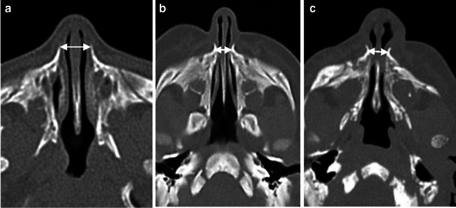
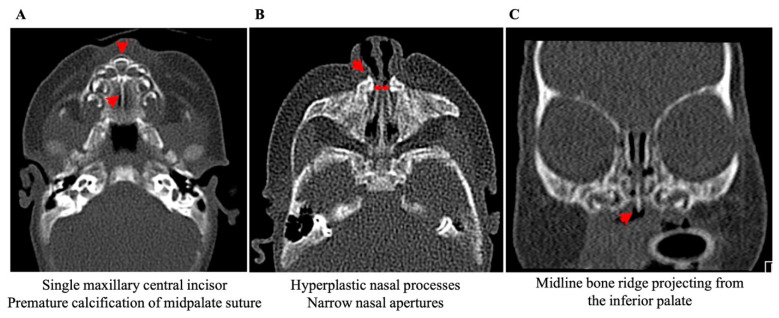
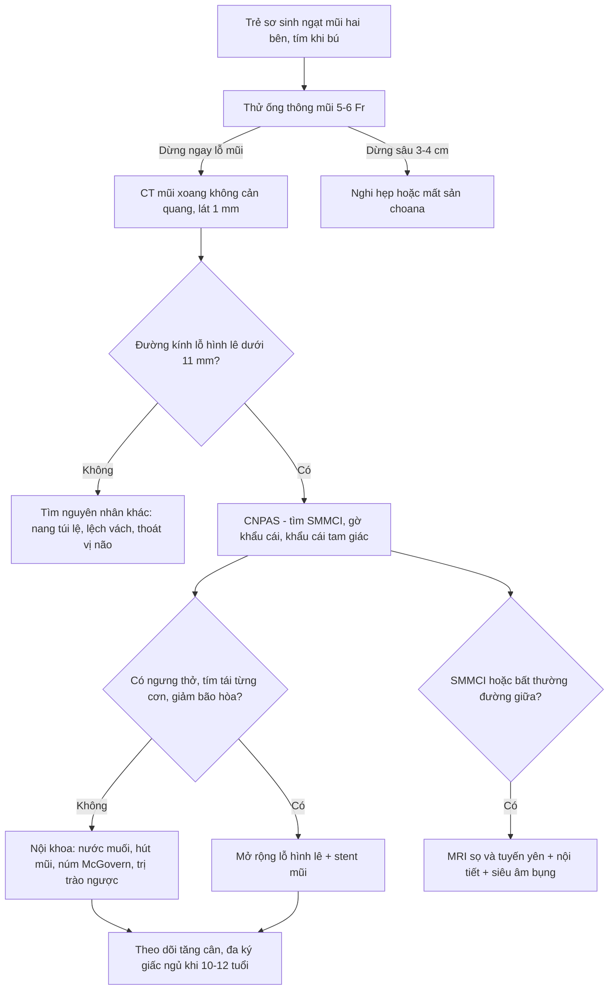
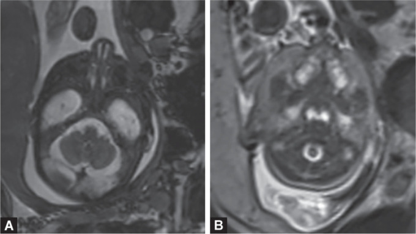

# 1972 — Hẹp lỗ hình lê bẩm sinh / Congenital nasal pyriform aperture stenosis (CNPAS)

**Tags:** `pattern:hep-bam-sinh` `pattern:hep-mui-truoc` `pattern:ngat-mui-so-sinh` `pattern:rang-giua-doc-nhat` `vung:mui` `vung:xuong-mat` `vung:dau-co` `score:PA-width` `protocol:CT-xuong-lat-1mm` `protocol:MRI-so-nao`

**Mức chắc chắn (certainty):** tổng hợp y văn (literature synthesis) — dựng từ **một nghiên cứu 3D-CT 22 trẻ sơ sinh có thuật toán tự động** (PMC12321926), **một phân tích gộp 320 ca** (Ensing 2025, chỉ đọc phần tóm tắt có số), **một loạt 4 ca cùng kích thước khác diễn tiến** (PMC9705134), **một tổng quan điều trị 25 bài + 4 ca** (PMC11854878) và **hai ca lâm sàng có ảnh CT** (PMC10498658, PMC11008318). Không có thử nghiệm ngẫu nhiên nào trong bệnh này; mọi ngưỡng điều trị đều là **loạt ca**, chỗ suy luận được ghi rõ.

> **Câu chốt:** Lỗ hình lê (pyriform aperture) là **cửa xương hẹp nhất của đường thở mũi**, và ở trẻ sơ sinh — đứa trẻ **bắt buộc thở mũi** — chỉ cần hẹp thêm vài mm là đủ gây ngưng thở. Ba con số quyết định: **(1)** trẻ đủ tháng bình thường rộng **11,8 ± 0,8 mm** (đo tự động) / **11,46 ± 1,09 mm** (đo tay), nên **< 11 mm là ngưỡng chẩn đoán**; **(2)** trong **320 ca gộp**, **74,2% được mổ**, nhưng đường kính nhóm chỉ điều trị nội khoa (**5,3 ± 1,6 mm**) **không khác** nhóm mổ (**5,1 ± 1,5 mm**; chênh **0,2 mm**, KTC 95% −0,4 đến 0,7) — **đường kính dùng để chẩn đoán, KHÔNG dùng để tiên lượng**; **(3)** yếu tố quyết định mổ là **triệu chứng**: ngưng thở **aOR 9,1** (KTC 95% 2,4–35) và **stridor/thở rít aOR 3,9** (1,4–10,8).

## 1. Tổng quan bệnh học – cơ chế hình ảnh (TẠI SAO)

### 1.1 Giải phẫu: hẹp ở xương, không phải ở màng

- **Lỗ hình lê** là cửa vào xương của mũi, hình quả lê: **trên** là xương mũi, **dưới** là chỗ tiếp giáp mảnh ngang xương hàm trên với **gai mũi trước**, **hai bên** là **mấu mũi của xương hàm trên (nasal process of the maxilla)**.
- Cơ chế kinh điển (Brown 1989): **quá sản và cong vào trong của mấu mũi xương hàm trên** → hẹp lòng xương, **không có màng chắn**. Vì vậy tổn thương **không đáp ứng với thuốc co mạch** và **không nhìn thấy bằng đèn soi mũi thông thường** — phải chụp cắt lớp.
- Hệ quả giải phẫu đi kèm (cùng một “sự cố” đường giữa): **khẩu cái tam giác**, **gờ xương giữa mặt dưới khẩu cái cứng (midline inferior palatal ridge)**, **răng cửa giữa độc nhất (solitary median maxillary central incisor — SMMCI)**.

### 1.2 TẠI SAO hẹp vài mm lại thành cấp cứu: vật lý dòng khí

- Trẻ sơ sinh **bắt buộc thở mũi** trong khoảng **4–6 tháng đầu** (chỉ thở miệng khi khóc). Mọi cản trở mũi vì thế là **cản trở đường thở chính**, không phải “nghẹt mũi”.
- Trở lực đường thở theo **định luật Hagen–Poiseuille: R ∝ 1/r⁴**. Khi bán kính giảm từ **11,8 mm xuống 4,7 mm** (tỷ lệ **2,5 lần**), **diện tích giảm ~6,3 lần** nhưng **trở lực tăng ~40 lần** (2,5⁴ ≈ 39,7). Đó là lý do **5 mm** không phải “hẹp nhẹ” mà là **tắc nghẽn sinh lý**.
- Hệ quả lâm sàng kinh điển: **tím tái từng cơn, giảm khi khóc** (khóc = chuyển sang thở miệng), **ngưng thở khi bú** (vừa bú vừa thở mũi không được), **sặc, chậm tăng cân**; nặng hơn là **thiếu oxy não** do các cơn ngưng thở lặp lại.

### 1.3 TẠI SAO CT xương là chuẩn: tương phản xương – khí

- Xương vỏ **600–1.000 HU trở lên**, khí trong mũi **≈ −1.000 HU** → trên cửa sổ xương (WW ~2.000, WL ~400) bờ mấu mũi hiện **trắng đục, sắc nét**, đo được **tới 0,1 mm** mà không cần cản quang. Mô mềm/màng nhầy **30–60 HU** vì thế **không thể giải thích** một lòng mũi hẹp 4 mm.
- Mặt cắt chuẩn: **ngang, qua ống mũi dưới (inferior meatus)**, đo **đường vuông góc giữa hai bờ trong mấu mũi xương hàm trên**. Cùng mặt phẳng đó còn thấy **răng cửa giữa độc nhất** và **gờ khẩu cái** — ba dấu hiệu của cùng một phổ bệnh.
- Vì sao cần **3D**: trên 22 trẻ, **đường kính lỗ hình lê không phân biệt** được thể vừa với thể nặng (**4,5 ± 0,9 vs 4,4 ± 1,4 mm**, p = 0,30), nhưng **diện tích cắt ngang ở 75% chiều dài mũi giữa** thì phân biệt rõ (**68,6 ± 7,5 vs 33,5 ± 13,7 mm²**, p < 0,01). Nghĩa là: **hẹp khu trú ở cửa mũi = thể vừa; hẹp lan suốt 3/4 ống mũi = thể nặng**.

### 1.4 Số liệu định lượng nền (đo trên CT, trẻ 0–35 ngày)

| Nhóm | Đường kính lỗ hình lê – tự động (mm) | Đo tay (mm) | Diện tích cắt ngang tại 75% (mm²) |
|---|---|---|---|
| Bình thường (n = 12) | **11,8 ± 0,8** | 11,46 ± 1,09 | — |
| Hẹp thể vừa – điều trị nội khoa (n = 4) | **4,5 ± 0,9** | 4,98 ± 0,63 | **68,6 ± 7,5** |
| Hẹp thể nặng – phải mổ (n = 6) | **4,4 ± 1,4** | 4,67 ± 1,28 | **33,5 ± 13,7** |

- Dịch tễ: **≈ 1/25.000 trẻ sinh sống** (so với hẹp/mất sản choana **≈ 1/8.000**); thể **đơn độc chỉ 20%**, còn lại nằm trong dị tật đường giữa.
- **Răng cửa giữa độc nhất** gặp **25%** (1/4) thể vừa và **33,3%** (2/6) thể nặng trong loạt 10 ca trên; ngược lại, **gần 90% trẻ có răng cửa giữa độc nhất có dị tật đường giữa bẩm sinh** — nên thấy răng này là phải đi tìm hội chứng.
- **Bất thường tuyến yên** được báo cáo ở **40%** bệnh nhân trong một tổng quan; loạt 4 ca có **3/4 mẹ đái tháo đường thai kỳ** (yếu tố liên quan được nhắc nhiều lần, cơ chế chưa rõ).
- Một chi tiết dễ bỏ: trong hẹp lỗ hình lê, **thể tích vòm mũi hầu lớn hơn khoảng 1/3** so với trẻ bình thường — giãn bù trừ phía sau chỗ hẹp. Đừng vì “mũi sau rộng” mà loại trừ hẹp mũi trước.

## 2. Mẫu hình + chẩn đoán phân biệt theo vị trí (Gamut)

Ngạt mũi sơ sinh **luôn định khu theo 5 tầng từ trước ra sau** — nhớ chuỗi **“Xương – Sụn – Vách – Lệ – Choana”**:

- **Tầng 1 – xương mũi trước:** **hẹp lỗ hình lê bẩm sinh** (bài này), hẹp do sẹo/chấn thương, u xương lành tính (rất hiếm).
- **Tầng 2 – van mũi/sụn:** hẹp van mũi, **bất sản cánh mũi (alar agenesis)**, hẹp sụn do dị tật khe mặt (Tessier).
- **Tầng 3 – vách:** lệch vách, **tụ máu vách mũi** sau chấn thương sinh, hẹp do ống thông/đặt nội khí quản kéo dài.
- **Tầng 4 – đường lệ:** **nang ống lệ – túi lệ (dacryocystocele)** ở sơ sinh — khối xanh tím dưới góc mắt trong, thường một bên.
- **Tầng 5 – mũi sau:** **hẹp/mất sản choana** (xương ~90%, hỗn hợp/màng phần còn lại), hẹp mũi sau, **thoát vị não – màng não (encephalocele)**.

**Hội chứng kèm theo (khi thấy bất thường đường giữa):**
- **Phổ holoprosencephaly / SMMCI** — đột biến **SHH**, biểu hiện nhẹ nhất là **một răng cửa giữa**; nặng hơn: khuyết sọ mặt, bất thường tuyến yên, chậm phát triển.
- **CHARGE** (bài 1951) — chủ yếu gây **hẹp/mất sản choana**, không phải hẹp lỗ hình lê; nhưng cả hai cùng nằm trong gamut “ngạt mũi sơ sinh hai bên”.
- **Loạn sản giữa mặt** (achondroplasia, Apert, Binder) — hẹp lỗ hình lê *kèm* hàm trên lùi; xử trí theo bệnh nền.

Câu hỏi phân biệt gọn nhất ở giường: **ống thông mũi 5–6 Fr dừng ở đâu?** Dừng **ngay lỗ mũi** = tầng 1–2; dừng **sâu 3–4 cm** = tầng 5 (choana). Nhưng **đừng** coi “ống 5 Fr qua được” là bình thường: ca điển hình vẫn **qua 5 Fr mà không qua 6 Fr**.

## 3. Bảng so sánh phân biệt (ma trận đối chiếu)

| Thực thể (entity) | Hình ảnh điển hình | Chốt vào (rule-in) | Chốt loại (rule-out) | Gợi ý xác nhận |
|---|---|---|---|---|
| **Hẹp lỗ hình lê (CNPAS)** | CT ngang qua ống mũi dưới: lỗ hình lê **4–7 mm**, mấu mũi xương hàm **dày, cong vào trong**, khẩu cái tam giác, gờ giữa khẩu cái, **SMMCI** | **PA < 11 mm** ở trẻ đủ tháng + **choana thông** + không có màng | PA ≥ 11 mm, hoặc hẹp do màng/mô mềm → không phải CNPAS | Đo lại đúng bình diện, cửa sổ xương; nội soi kiểm tra |
| **Mất sản/hẹp choana** | Màng hoặc xương chắn **sau** ổ mũi, dày **≤ 1 cm**, vách lá mía bên dày | Ống 6 Fr **không tới được vòm hầu**; choana đặc trên CT | Ống tới hầu + choana thông hoàn toàn | Nội soi mũi sau + CT |
| **Nang túi lệ (dacryocystocele)** | Khối **mô mềm** giữa cuốn dưới và thành mũi bên, bờ tròn, **không phá xương** | Khối dưới góc mắt trong, chảy nước mắt, ấn ra mủ | **Lỗ hình lê rộng bình thường** → loại CNPAS | Siêu âm/CT mô mềm |
| **Tụ máu/lệch vách** | Vách dày hình thoi, lệch sang bên | Tiền sử chấn thương sinh, sưng nề | Lỗ hình lê ≥ 11 mm | Nội soi mũi |
| **Thoát vị não – màng não mũi** | Khối mô mềm **có cuống**, khiếm khuyết xương sàng/mũi, có thể thấy mô não | **Liên tục với nội sọ** trên MRI | Không có khiếm khuyết xương → loại | **MRI** trước mọi can thiệp |
| **Loạn sản giữa mặt** | Hàm trên lùi, lỗ hình lê hẹp nhưng **toàn bộ khối mặt** bất thường | Bệnh nền xương – sụn đã biết | Hẹp PA đơn độc, phần còn lại bình thường | Phim sọ mặt, tư vấn đa chuyên khoa |

*Ba trẻ sơ sinh, cùng bình diện ngang qua lỗ hình lê, mũi tên hai chiều = đường kính. (a) 11 mm; (b) 4,7 mm nhưng chỉ cần nội khoa; (c) 6,7 mm nhưng phải mổ vì ngưng thở. Nguồn: Yeshua T và cs, Pediatr Radiol 2025, PMC12321926, Hình 2, CC BY 4.0 — nguyên bản, không chỉnh sửa.*

### Ba dấu hiệu “cùng một phổ bệnh” trên CT

*(A) một răng cửa giữa xương hàm trên + vôi hóa sớm đường khớp giữa khẩu cái; (B) mấu mũi xương hàm quá sản, lỗ mũi hẹp; (C) gờ xương giữa nhô ra từ mặt dưới khẩu cái. Nguồn: Emodi O và cs, Children (Basel) 2025, PMC11854878, Hình 3, CC BY 4.0 — nguyên bản.*

- **SMMCI** nằm ngay trên đường giữa, chỉ thấy khi cửa sổ xương và lát cắt đi qua **xương ổ răng** — cuộn hết khối dữ liệu, đừng chỉ nhìn 3 lát “đẹp”.
- **Gờ khẩu cái** là dấu hiệu **rất đặc hiệu** nhưng dễ bị bỏ vì nằm ở mặt dưới khẩu cái, cần **tái tạo đứng (coronal)** mới thấy rõ.

## 4. Protocol chụp + hệ phân độ & thuật toán điều trị

### 4.1 Protocol CT mũi xoang sơ sinh (ALARA)

- **Không cản quang**, cửa sổ xương, **lát 0,6–1 mm**, chồng lát **0,33–0,75 mm**, tái tạo **axial + coronal + sagittal**, pixel **0,2–0,4 mm**; FOV từ **trần sọ tới hàm dưới** (để không bỏ sót thoát vị não/bất thường nội sọ).
- Thông số liều tham chiếu từ loạt 22 trẻ: **70–100 kV**, **40–190 mA**, **CTDIvol 1,5–11,4 mGy**. Luôn ghi **DLP/CTDIvol** vào phiếu để theo dõi liều tích lũy ở trẻ phải chụp lại.
- Đo **đường kính lỗ hình lê** tại **ống mũi dưới**, vuông góc với trục mũi; ghi **mm tới 0,1**. Nếu có công cụ 3D: đo thêm **diện tích cắt ngang tại 25/50/75%** chiều dài mũi giữa — đây là biến phân biệt **vừa/nặng**.
- Khi có **SMMCI/gờ khẩu cái** → **MRI sọ + vùng tuyến yên** và **xét nghiệm nội tiết** (hạ đường huyết, cortisol, FT4), vì bất thường tuyến yên được báo cáo tới **40%**.
- **Không** dùng MRI để chẩn đoán hẹp xương; MRI dành cho **mô mềm, thoát vị não, tuyến yên**.

### 4.2 Phân độ & ngưỡng: đường kính để chẩn đoán, triệu chứng để quyết định

| Mức | Tiêu chí | Hướng xử trí | Bằng chứng |
|---|---|---|---|
| Chẩn đoán | **PA < 11 mm** (trẻ đủ tháng) | Xác nhận CNPAS, tìm dị tật phối hợp | Ngưỡng kinh điển, lặp lại ở 4 nguồn |
| Thể **nhẹ – vừa** | PA **≥ 6 mm**, bú được, không ngưng thở | **Nội khoa**: nước muối, hút mũi, **núm vú McGovern** (núm có lỗ lớn làm “đường thở miệng”), điều trị trào ngược | Thành công **80–90%** (tổng quan 25 bài) |
| Thể **nặng** | **Tím tái từng cơn, ngưng thở, giảm bão hòa** dù đã nội khoa; PA thường **< 6 mm** | **Mổ mở rộng lỗ hình lê** (đường dưới môi hoặc nội soi), **đặt stent mũi 5 ngày–4 tuần** | Thành công **85–100%** (chỉ định vàng) |
| Thể nặng, chọn lựa khác | Hẹp **5–7 mm**, không tím tái | Nong **Hegar**/bóng, **RME** (nới rộng hàm, **15–20 ngày**), **iSARPE** | Nong bóng **~75%**; iSARPE **~87%** |
| Theo dõi dài hạn | Trẻ lớn **10–12 tuổi** | Đánh giá **đa ký giấc ngủ + chỉnh nha**, cân nhắc **SARPE**, phục hình răng cửa | Thuật toán theo tuổi (2025) |

**Ba con số phải nhớ khi hội chẩn:** hẹp **< 6 mm** + triệu chứng nặng → mổ (85–100% thành công); hẹp **≥ 6 mm** không triệu chứng → thử nội khoa (80–90% thành công); và **đường kính một mình không dự báo** ai cần mổ (chênh **0,2 mm**, không có ý nghĩa).

## 5. Biến thể bình thường và cạm bẫy

- **Đo sai bình diện** là lỗi số 1: đo ở **sụn mũi/đầu mũi** cho ra 2–4 mm “hẹp nặng” giả; đo ở phần **rộng nhất** của ổ mũi lại bỏ sót. Luôn ghi rõ “ngang qua **ống mũi dưới**”.
- **Đầu nghiêng** làm mặt cắt chéo → lỗ hình lê **hẹp giả một bên**. Tái tạo lại trục trước khi kết luận bất đối xứng.
- **“Choana thông nên không tắc”** — sai. Ca điển hình: ống **5 Fr qua được**, **6 Fr không**, nội soi **2,2 mm không qua**, nhưng choana **hoàn toàn thông**; nguyên nhân nằm ở tầng 1.
- **Ngưỡng 11 mm lấy từ trẻ đủ tháng**: một trẻ **non tháng 1,2 kg** có lỗ hình lê **5 mm** vẫn điều trị nội khoa thành công và hết triệu chứng sau **26 ngày**. Với trẻ non tháng/nhẹ cân, **dùng ngưỡng tuyệt đối sẽ mổ oan** — phải cân theo tuổi thai và triệu chứng.
- **Hai trẻ cùng 4,5–5 mm, một mổ một không** (loạt 4 ca: **5,0 / 4,5 / 5,0 / 4,8 mm**, chỉ 2 ca mổ): kích thước **không** phải tiên lượng. Đừng “đọc số rồi kết luận”.
- **Bỏ sót hội chứng đường giữa**: răng cửa giữa **chỉ 25–33%** trong loạt hẹp, nhưng khi có thì **90% kèm dị tật đường giữa**. Không thấy răng **không** loại trừ hội chứng; thấy răng **buộc** phải khảo sát nội sọ và nội tiết.
- **Hẹp lại và sẹo dính sau mổ**: synechiae sau mổ là biến chứng có thật, có ca phải mổ lại. Stent **5 ngày–4 tuần** + nong định kỳ; cha mẹ được dạy **nong bằng ống thông 8 Fr** tại nhà trong 6 tuần (theo ca đã báo).
- **Nhầm với viêm mũi sơ sinh**: dùng thuốc co mạch kéo dài ở trẻ nhỏ **không** giải quyết hẹp xương và che mất chẩn đoán.
- **Bẫy “thỏa mãn tìm kiếm”**: đã thấy bất thường này (ví dụ hẹp choana một bên) thì **vẫn phải đo lỗ hình lê** và xem đường giữa — ca ghép trong y văn có **hẹp lỗ hình lê một bên + mất sản choana bên đối diện + bất sản cánh mũi**.

## 6. Tự lượng giá — Blind Quiz

**Ca 1 — Ba trẻ sơ sinh, ba mặt cắt CT cùng bình diện.**

- Bệnh cảnh: cả ba đều ngạt mũi hai bên từ sau sinh; (a) không triệu chứng nặng, (b) và (c) đều được đo đường kính.
- Câu hỏi: (1) Đường kính mỗi trường hợp? (2) Vì sao (b) **nhỏ hơn** lại chỉ điều trị nội khoa còn (c) **lớn hơn** phải mổ? (3) Dấu hiệu nào khác trên CT cần tìm?

<b>Bấm để hiện đáp án</b>

- (a) **11 mm** — bình thường (trẻ 4 ngày tuổi). (b) **4,7 mm** — hẹp, điều trị nội khoa thành công. (c) **6,7 mm** — hẹp, **phải mổ**.
- Vì **đường kính là công cụ chẩn đoán, không phải tiên lượng**: trong 320 ca gộp, nhóm nội khoa **5,3 mm** và nhóm mổ **5,1 mm** khác nhau **0,2 mm** (không có ý nghĩa). Yếu tố quyết định là **ngưng thở (aOR 9,1)** và **thở rít (aOR 3,9)**.
- Trên cả ba lát: tìm **mấu mũi xương hàm dày cong vào trong**, **khẩu cái tam giác**, **gờ giữa khẩu cái**, và **răng cửa giữa độc nhất** ở lát qua xương ổ răng.
- Nguồn: Yeshua T và cs, Pediatr Radiol 2025 (PMC12321926), Hình 2, CC BY 4.0. Ca (b)/(c) là **phản biện số liệu**: nếu chỉ dựa vào 4,7 < 6,7 mm, ta sẽ chọn sai người mổ.

**Ca 2 — Trẻ 3 tháng, ngạt mũi từ nhỏ, CT có bất thường đường giữa.**

- Bệnh cảnh: không có tiền sử chấn thương; mẹ đái tháo đường thai kỳ.
- Câu hỏi: (1) Ba dấu hiệu trên CT? (2) Còn thiếu những khảo sát nào trước khi mổ? (3) Vì sao phải hỏi mẹ về đường huyết của trẻ?

<b>Bấm để hiện đáp án</b>

- (A) **một răng cửa giữa xương hàm trên** + vôi hóa sớm đường giữa khẩu cái; (B) **mấu mũi xương hàm quá sản, lỗ mũi hẹp**; (C) **gờ xương giữa mặt dưới khẩu cái**. Bộ ba này = **phổ holoprosencephaly/SMMCI** thể nhẹ.
- Cần **MRI sọ + vùng tuyến yên**, **xét nghiệm nội tiết** (đường huyết, cortisol, FT4), **siêu âm bụng** (thận đơn độc), đánh giá thính lực và tư vấn di truyền (**SHH**) — vì bất thường tuyến yên gặp tới **40%** và có thể biểu hiện bằng **hạ đường huyết** sớm.
- Nguồn: Emodi O và cs, Children (Basel) 2025 (PMC11854878), Hình 3, CC BY 4.0.

**Ca 3 — Thai 30 tuần, MRI thai vì nghi bất thường đường giữa.**

- Bệnh cảnh: siêu âm thai 25 tuần thấy **một răng cửa giữa**; MRI thai 30 tuần được chỉ định.
- Câu hỏi: (1) Hai bất thường trên MRI? (2) Chẩn đoán trước sinh thay đổi kế hoạch sinh thế nào? (3) Sau sinh cần chụp gì, khi nào?

<b>Bấm để hiện đáp án</b>

- (A) hình ảnh **hẹp lỗ hình lê**; (B) **dị dạng hàm trên dạng tam giác**. Karyotype và CGH array bình thường (46XY) — chẩn đoán sau sinh là **SMMCI đơn độc kèm hẹp lỗ hình lê**.
- Chẩn đoán trước sinh **không cho phép can thiệp trong tử cung**, nhưng đổi kế hoạch: **sinh tại trung tâm có hồi sức sơ sinh**, chuẩn bị đường thở, tránh cho mẹ về tuyến không có nhi.
- Sau sinh: đánh giá ngạt mũi và bú; **CT mũi xoang không cản quang lát 1 mm** khi có triệu chứng; **MRI sọ/tuyến yên + nội tiết** nếu có SMMCI; theo dõi tăng trưởng và phát triển.
- Nguồn: Fuchs F và cs, Int J Clin Pediatr Dent 2020 (PMC7450187), Hình 2, **CC BY-NC 4.0** — nguyên bản, không chỉnh sửa.

## Bài liên quan chéo

- [700 – Tổng quan Đầu Mặt Cổ](../700-head-neck-overview/lesson.md)
- [710 – Giải phẫu mũi xoang trên CT & biến thể](../710-sinonasal-ct-anatomy/lesson.md)
- [612 – Cấp cứu đường thở trên ở trẻ em](../612-cap-cuu-duong-tho-tren-tre-em/lesson.md)
- [603 – Pierre Robin: tắc nghẽn đường thở](../603-pierre-robin-tac-nghen-duong-tho/lesson.md)
- [1951 – Hội chứng CHARGE: hẹp mũi sau và dị tật tai trong](../1951-hoi-chung-charge/lesson.md)

> Không dùng để chẩn đoán độc lập khi chưa có người hướng dẫn.
