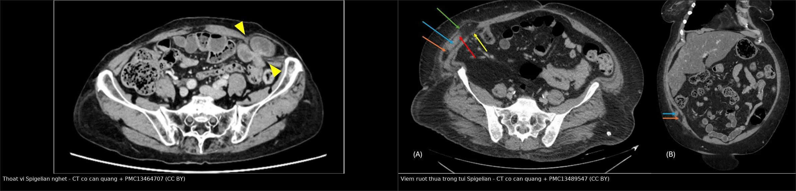
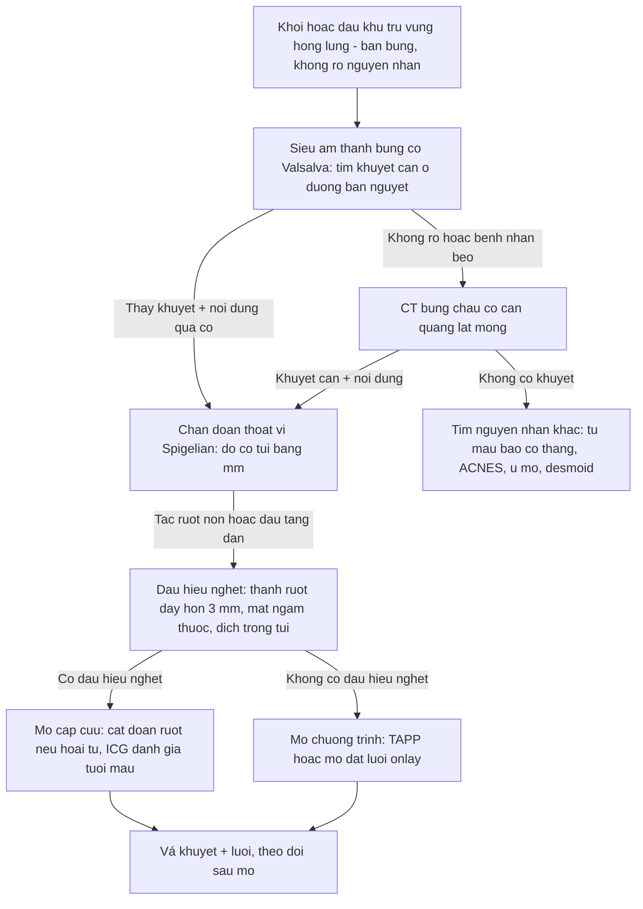
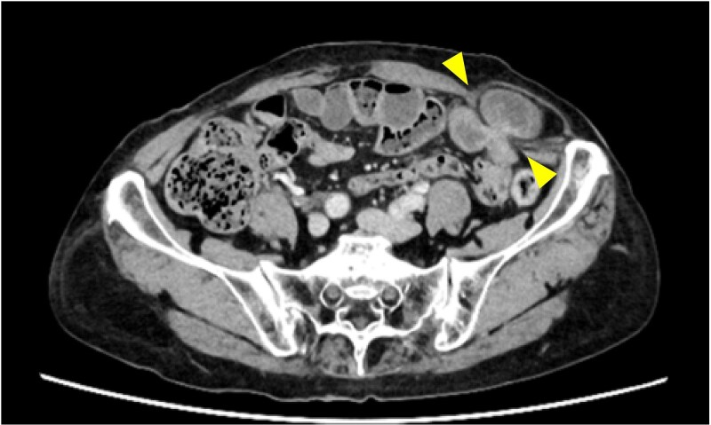
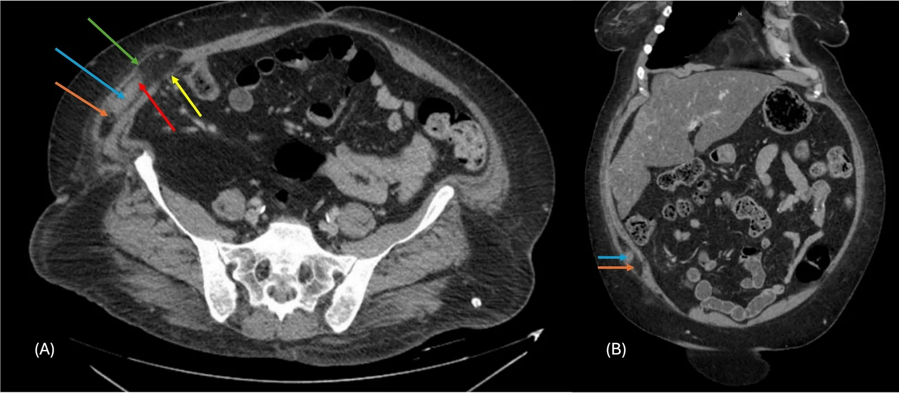
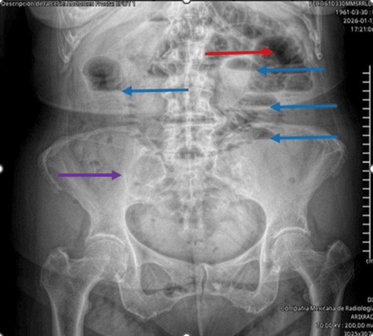

# 1973 — Thoát vị Spigelian: khuyết cân ở đường bán nguyệt, cổ túi hẹp nên nghẹt tới 17–30%, và 1/3 số ca chỉ lộ ra trên CT / Spigelian hernia

**Tags:** `pattern:thoat-vi` `pattern:khuyet-can` `pattern:tac-ruot-non` `pattern:khoi-thanh-bung` `vung:thanh-bung` `vung:o-bung` `protocol:CT-bung-co-can-quang` `protocol:sieu-am-Valsalva` `score:EHS`
**Mức chắc chắn (certainty):** tổng hợp y văn (literature synthesis) — ghép **ca nghẹt có CT + mổ cấp cứu** (J Surg Case Rep 2026, PMC13464707, CC BY), **ca viêm ruột thừa trong túi thoát vị Spigelian có CT** (Cureus 2026, PMC13489547, CC BY), **ca tắc ruột non do thoát vị nghẹt có phim bụng đứng** (Cureus 2026, PMC13341219, CC BY), cùng **tổng quan 124 ca nhi khoa** (Children 2025, PMC12468178, CC BY) và **ca thoát vị lỗ trocar sau cắt tử cung nội soi** (Cureus 2025, PMC12828436, CC BY). Số nào nguồn không nêu ghi "chưa rõ".

> **Câu chốt:** thoát vị Spigelian chỉ chiếm **0,12–2%** thoát vị thành bụng, nhưng **cổ túi hẹp < 2 cm và bị giam dưới cân chéo ngoài còn nguyên vẹn** nên **17–30% đã nghẹt/tắc nghẽn ngay lúc chẩn đoán**, và **chỉ ~50% ca được chẩn đoán trước mổ** (PMC13401996, PMC13099412, PMC13464707). Vì túi nằm **giữa các lớp cơ (interparietal)**, khám chỉ thấy khối ở **64%** ca — "không sờ thấy khối" **không loại trừ**. Trên CT, chốt chẩn đoán là **khuyết cân ở đường bán nguyệt, ngay bờ ngoài cơ thẳng, với quai ruột/mỡ đi qua cổ hẹp**; và trong mọi ca **tắc ruột non không rõ nguyên nhân phải nhìn lại thành bụng** — ca chỉ điểm đã được mổ cấp cứu vì **quai hồi tràng hoại tử** trong túi.

## 1. Tổng quan bệnh học – cơ chế hình ảnh

### 1.1 Giải phẫu: vì sao đúng chỗ đó mới thoát vị (TẠI SAO)

- **Đường bán nguyệt (linea semilunaris)** là bờ ngoài cơ thẳng bụng, nơi **cân của cơ chéo bụng trong và cơ ngang bụng** hoà vào bao cơ thẳng. Khoảng giữa bờ ngoài cơ thẳng và **đường cung (arcuate line)** chính là **cân Spigelian**.
- **Trên đường cung:** phía sau cơ thẳng còn **lá sau bao cơ thẳng**, nên thành bụng sau dày 2 lớp cân → hiếm thoát vị.
- **Dưới đường cung:** **lá sau bao cơ thẳng hết** (chỉ còn phúc mạc + cân ngang), nên vùng này chỉ còn **cân ngang + cân chéo trong** che chắn → đây là **điểm yếu thật**. Thoát vị Spigelian gần như luôn nằm **dưới/ngang đường cung**, và **85–90%** tập trung trong **"vành đai Spigelian"** — dải ngang **~6 cm trên mặt phẳng liên gai chậu trước trên** (PMC13099412, PMC10440020).
- **Vì sao khó sờ thấy:** túi thoát vị chui qua **cân ngang/cân chéo trong** nhưng vẫn nằm **dưới cân chéo ngoài còn nguyên** → khối **liên thành bụng (interparietal)**, không đội da. Đây là lý do **64%** ca có khối sờ được nhưng **chỉ ~50%** được chẩn đoán trước mổ (PMC13401996).
- **Vì sao dễ nghẹt:** lỗ khuyết **nhỏ, bờ cân xơ cứng**, đường ra hẹp hơn nội dung → quai ruột vào rồi **phù nề, không ra được**; **17–30%** đã nghẹt/tắc nghẽn khi phát hiện (PMC13099412), **17–24%** trong một ca loạt khác (PMC13464707), và **tới 20%** trong tổng quan khác (PMC13401996). Khuyết điển hình **< 2 cm** (PMC13464707) — **khuyết càng nhỏ, nguy cơ nghẹt càng cao**, ngược với trực giác "nhỏ thì lành".
- **Yếu tố thúc đẩy:** tăng áp lực ổ bụng (ho mạn, táo bón, rặn, thai, cổ trướng), **béo**, tuổi **50–70**, nữ nhiều hơn, và **can thiệp thành bụng**: cổng trocar **10 mm** là vị trí đã ghi nhận gây thoát vị Spigelian **dù đã khâu cân cổng** (PMC12828436).

### 1.2 Vì sao nhìn thấy — vật lý từng phương thức

- **Siêu âm (động, bước 1):** mỡ trong túi **tăng hồi âm**, quai ruột có **lớp hồi âm dày + bóng khí/echo dày bên trong**, dịch trong túi **giảm hồi âm**. Chốt chẩn đoán là **khuyết cân nhìn thấy được**, và **độ rộng khuyết tăng khi Valsalva/gồng bụng** — siêu âm **động** là thế mạnh duy nhất của nó so với CT tĩnh. Hạn chế: **béo, khí ruột, đau** làm mất cửa sổ; thành bụng bên khó hơn đường giữa.
- **CT (bước 2, chuẩn thực hành):** mỡ và cơ chênh nhau **rất rõ** trên cửa sổ mô mềm, nên CT thấy **khuyết cân như một chỗ mất liên tục của lớp cân**, kèm **nội dung đi qua cổ**. Vật lý đậm độ dùng để định danh nội dung: **mỡ −40 đến −120 HU**, **dịch 0–20 HU**, **máu tụ 45–85 HU**, **quai ruột chứa khí −1.000 HU**. Dấu hiệu nghẹt trên CT: **thành ruột dày > 3 mm**, **thành không ngấm thuốc**, **dịch trong túi**, **khí trong thành (pneumatosis)**, và **điểm chuyển tiếp (transition point) đúng tại cổ túi**.
- **X-quang bụng:** không thấy túi, chỉ thấy **hệ quả** — quai ruột giãn, mức nước–hơi kiểu **bậc thang**, và đôi khi **một quai giãn nằm lệch ra ngoài thành bụng** (ca chỉ điểm: quai chứa khí tròn ở hố chậu phải, tách khỏi các quai còn lại) (PMC13341219). Vì thế X-quang **không loại trừ** thoát vị Spigelian.
- **MRI:** hữu ích khi **thai phụ** hoặc khi cần phân biệt **mô mềm** (u mỡ, desmoid, lạc nội mạc); túi và nội dung thấy rõ trên **T2 fat-sat**, nhưng **không cần thiết** cho chẩn đoán thường quy.

### 1.3 Ngưỡng định lượng nằm lòng

| Đại lượng | Ngưỡng / con số | Ý nghĩa | Nguồn |
|---|---|---|---|
| Tỷ lệ trong thoát vị thành bụng | **0,12–2%** (có nguồn ghi 1–2%) | Bệnh hiếm nhưng **không được bỏ** khi đau khu trú | PMC13401996, PMC13099412 |
| Vị trí | **~6 cm trên mặt phẳng liên gai chậu** ("vành đai Spigelian"), **85–90%** | Chỉ cần tìm đúng dải này | PMC13099412, PMC10440020 |
| Kích thước khuyết điển hình | **< 2 cm** | Khuyết nhỏ = cổ hẹp = **nghẹt sớm** | PMC13464707 |
| Nghẹt/tắc nghẽn lúc chẩn đoán | **17–30%** (17–24% ở ca loạt khác; tới 20% ở tổng quan khác) | Lý do **mổ chương trình cho mọi ca** | PMC13099412, PMC13464707, PMC13401996 |
| Sờ thấy khối | **64%** | 36% **không có khối** — không loại trừ | PMC13401996 |
| Chẩn đoán trước mổ | **~50%** | Một nửa vào mổ vì "bụng cấp" chưa rõ nguyên nhân | PMC13401996 |
| Biểu hiện bằng tắc ruột non | **21%** | Gamut "tắc ruột non không rõ nguyên nhân" | PMC10440020 |
| Nhi khoa: nghẹt/hoại tử | **12,2%** (15/124), **2 ca tử vong** | Trẻ cũng không "lành tính" | PMC12468178 |
| Cổng trocar gây thoát vị | **10 mm** là cỡ cổng hay gặp nhất | Khâu cân **không** bảo đảm | PMC12828436 |
| Ca chỉ điểm 1 (nghẹt) | nữ **64 tuổi**, **hoại tử hồi tràng**, cắt đoạn + nối, ra viện **ngày 7** | Mổ cấp cứu là chuẩn khi nghẹt | PMC13341219 |
| Ca chỉ điểm 2 (viêm ruột thừa trong túi) | nữ **52 tuổi**, túi **4 cm**, ruột thừa mủ | Nội dung túi có thể là **ruột thừa** | PMC13489547 |
| Ca chỉ điểm 3 (lỗ trocar) | nữ **70 tuổi**, **2 ngày** sau cắt tử cung nội soi, **vỡ ruột** | Sau mổ nội soi, đau lỗ trocar = thoát vị tới khi loại trừ | PMC12828436 |

## 2. Mẫu hình + chẩn đoán phân biệt theo vị trí (gamut)

- **Mẫu hình cốt lõi:** **khuyết cân ở đường bán nguyệt, bờ ngoài cơ thẳng bụng, ngang/dưới đường cung**, có **mỡ hoặc quai ruột đi qua cổ hẹp**; khuyết **rộng ra khi Valsalva** (siêu âm) hoặc khi gồng (CT động).
- **Theo nội dung túi (content gamut):**
  - **Mỡ mạc nối (omentum)** — thể hay gặp nhất, **không nghẹt ruột** nhưng đau mạn.
  - **Ruột non** — nghẹt/tắc ruột, nguy cơ hoại tử (PMC13341219).
  - **Đại tràng sigma** — nghẹt, dễ nhầm viêm túi thừa.
  - **Ruột thừa** — "Amyand của thành bụng": **viêm ruột thừa trong túi Spigelian** (PMC13489547, PMC13214601).
  - **Túi thừa Meckel** — thể Littre.
  - **Túi mật, buồng trứng, bàng quang** — ca lẻ, gây triệu chứng cơ quan.
  - **Chỉ có mỡ trước phúc mạc, KHÔNG có túi phúc mạc** — thể **"không túi" (sacless)**: soi ổ bụng thấy phúc mạc **liền**, dễ kết luận "không thoát vị" (PMC13099412).
- **Theo vị trí (location gamut) — dùng để loại trừ:**
  - **Trên đường cung:** hiếm; nếu có thì khuyết thường lớn hơn.
  - **Ngang đường cung (vành đai Spigelian):** điển hình.
  - **Dưới đường cung, sát gai chậu trước trên:** dễ nhầm **thoát vị bẹn/đùi** và **thoát vị thắt lưng**.
  - **Tại lỗ trocar cũ:** **thoát vị lỗ trocar** (thể đặc biệt của Spigelian khi cổng nằm ngoài bờ cơ thẳng) (PMC12828436).
- **Bắt chước (mimic) hay gặp nhất:** **tụ máu bao cơ thẳng** (đau, khối, nhưng **không có khuyết cân**), **ACNES** (đau khu trú, **hình ảnh bình thường**), **u mỡ dưới da**, **desmoid**, **lạc nội mạc thành bụng**, **di căn lỗ trocar**, **áp-xe thành bụng**, **diastasis recti**.

## 3. Bảng so sánh phân biệt (ma trận đối chiếu)

| Thực thể (entity) | Hình ảnh điển hình (US/CT/MRI) | Chốt vào (rule-in) | Chốt loại (rule-out) | Gợi ý xác nhận |
|---|---|---|---|---|
| **Thoát vị Spigelian** | Khuyết cân ở đường bán nguyệt, bờ ngoài cơ thẳng, ngang/dưới đường cung; mỡ hoặc quai ruột qua cổ hẹp | **Mất liên tục lớp cân + nội dung ổ bụng đi qua cổ**, rộng ra khi **Valsalva**; cổ **< 2 cm** | **Cân liên tục**, khối nằm trong cơ/trong bao cơ thẳng | CT bụng có cản quang (gồng bụng nếu nghi ngờ); siêu âm động |
| **Thoát vị nghẹt (cùng thực thể, giai đoạn nặng)** | Thành ruột dày, **không ngấm thuốc**, dịch trong túi, điểm chuyển tiếp tại cổ | **Thành ruột > 3 mm + mất ngấm + dịch trong túi** | Thành ngấm thuốc đều, không dịch, không điểm chuyển tiếp | **Mổ cấp cứu**; ICG đánh giá tưới máu |
| **Tụ máu bao cơ thẳng** | Khối trong bao cơ thẳng, **không có khuyết cân**, bờ cơ còn | **Máu 45–85 HU, không ngấm, dưới đường cung lan khoang trước bàng quang** | **Có khuyết cân + nội dung đi qua = loại máu tụ** | CT không cản quang; theo dõi Hct |
| **Thoát vị lỗ trocar** | Khuyết cân đúng trục cổng cũ, mỡ/ruột ± Richter | **Tiền sử cổng ≥ 10 mm + khuyết tại đúng trục trocar** | Không tiền sử trocar, khuyết ở vị trí khác | CT; đối chiếu vị trí cổng trong biên bản mổ |
| **ACNES** | **Không tổn thương**; đau điểm Carnett dương | **Carnett (+) + điểm đau khu trú T10–T12**, hình ảnh bình thường | **Có khuyết cân hoặc khối = không phải ACNES đơn thuần** | Tiêm block chẩn đoán |
| **U mỡ dưới da** | Khối mỡ **−40 đến −120 HU** dưới cân, **không thông ổ bụng** | Mỡ **dưới** cân nông, không có cổ | **Có cổ đi vào ổ bụng = loại u mỡ** | Siêu âm/CT |
| **Desmoid thành bụng** | Khối đặc, **T2 tín hiệu trung bình–thấp**, ngấm thuốc, bám cân, không cổ | Khối đặc **không có cổ**, xâm lấn cân | **Không có khuyết cân thật** | MRI; sinh thiết khi cần |
| **Lạc nội mạc thành bụng** | Nốt đặc **đau theo chu kỳ**, sẹo mổ cũ, T1 chấm xuất huyết | Đau **theo chu kỳ** + nốt ngấm thuốc trong cơ/cân | Không có khuyết cân, không liên quan chu kỳ | MRI; hỏi kỹ chu kỳ |
| **Di căn lỗ trocar** | Nốt đặc **ngấm thuốc** đúng đường trocar, ± bệnh phúc mạc | **Tiền sử ung thư + nốt đặc đúng trục cổng** | **Nốt mỡ/có cổ = thoát vị** | Sinh thiết trước khi mổ |

## 4. Protocol chụp + hệ phân độ/điểm chuẩn hóa

### 4.1 Trình tự hình ảnh

1. **Siêu âm thành bụng có động tác Valsalva (bước 1):** đầu dò thẳng tần số cao, quét **dọc và ngang dải 6 cm trên gai chậu trước trên**, so sánh hai bên; đo **chiều rộng khuyết (mm)** khi nghỉ và khi gồng; ghi **nội dung túi** (mỡ/quai ruột/dịch) và **có/không giảm hồi âm thành ruột**.
2. **CT bụng–chậu có cản quang (bước 2, chuẩn):** lát **≤ 2,5 mm**, cửa sổ mô mềm; đọc **theo dõi liên tục lớp cân từ trên xuống** để không bỏ khuyết nhỏ; đo **cổ túi** và **kích thước khuyết**; tìm **điểm chuyển tiếp**, **dấu nghẹt**, **nội dung bất thường** (ruột thừa, Meckel, bàng quang). CT **động (gồng bụng)** khi khuyết chỉ lộ lúc tăng áp lực.
3. **X-quang bụng đứng** chỉ để đánh giá **tắc ruột** — không dùng để chẩn đoán thoát vị.
4. **MRI** khi **thai phụ**, khi cần phân biệt **mô mềm** (desmoid/lạc nội mạc/di căn) hoặc khi CT không kết luận.

### 4.2 Phân độ và ngưỡng xử trí

- **Phân loại EHS 2009 (thoát vị thành bụng nguyên phát):** theo **vị trí** — đường giữa **M1–M5**, thành bụng bên **L1–L4**; theo **kích thước khuyết** — **nhỏ < 2 cm**, **trung bình 2–4 cm**, **lớn > 4 cm**. EHS **không có mã riêng cho Spigelian**: bài này xếp vào **nhóm bên (L)**, và vì khuyết điển hình **< 2 cm** nên đa số là **"nhỏ"** — nhưng chính vì nhỏ nên **nghẹt 17–30%**.
- **Chỉ định mổ:** **mọi** thoát vị Spigelian đã chẩn đoán, kể cả không triệu chứng — vì nguy cơ nghẹt **17–30%** và **21%** biểu hiện bằng tắc ruột non (PMC13099412, PMC10440020). Đây là điểm khác biệt với nhiều thoát vị bẹn nhỏ.
- **Cấp cứu:** nghẹt/tắc ruột → **mổ ngay**; nếu nội dung là **ruột thừa viêm** → cắt ruột thừa + vá thoát vị cùng lúc (PMC13489547); nếu nghi **hoại tử** → cắt đoạn ruột (PMC13341219); **ICG** hỗ trợ quyết định giữ/cắt ruột trong mổ nội soi (PMC13464707).
- **Kỹ thuật:** **TAPP/TEP nội soi** đặt lưới (ưu tiên khi chẩn đoán rõ, không nghẹt), hoặc **mở đặt lưới onlay** (đơn giản, an toàn trong cấp cứu) (PMC12817791); lưới tự cố định đã được báo cáo cho TAPP (PMC13337955). Không có thử nghiệm ngẫu nhiên so sánh — **chưa rõ ưu thế tuyệt đối**.
- **Theo dõi sau mổ:** tái phát thấp; ca loạt TAPP ghi **không tái phát** trong theo dõi ngắn (PMC13464707, PMC12817791); đau mạn và biến chứng lưới cần hỏi khi khám lại.

## 5. Biến thể bình thường và cạm bẫy

- **Biến thể bình thường 1 — mỡ trước phúc mạc lồi ra qua khe cân ngang:** người gầy, vận động viên có thể có **mỡ tiền phúc mạc nhô nhẹ** qua khe cân mà **không có túi phúc mạc**; chỉ gọi thoát vị khi có **cổ rõ + nội dung di động**, hoặc khi **có triệu chứng khu trú**.
- **Biến thể bình thường 2 — bất đối xứng cơ thẳng và đường bán nguyệt:** đường bán nguyệt **cong**, không phải đường thẳng; đừng đo "khuyết" theo một lát cắt duy nhất — phải **truy vết nhiều lát**.
- **Cạm bẫy 1 — "sờ không thấy khối thì không phải thoát vị":** chỉ **64%** có khối sờ được, và **~50%** chỉ chẩn đoán được trong mổ (PMC13401996). Đau khu trú + Carnett dương tính **không** loại trừ thoát vị.
- **Cạm bẫy 2 — thể "không túi" (sacless):** soi ổ bụng thấy **phúc mạc liền** vì túi chỉ là **mỡ tiền phúc mạc** trong khuyết cân; phải **mở cân** mới thấy (PMC13099412). Đây là lý do **không được kết luận "không thoát vị" chỉ vì soi ổ bụng âm**.
- **Cạm bẫy 3 — tắc ruột non "không rõ nguyên nhân":** phải **nhìn lại thành bụng trên CT**; ca chỉ điểm có **quai hồi tràng hoại tử** trong túi và **21%** ca biểu hiện bằng tắc ruột (PMC13341219, PMC10440020). Bỏ qua thành bụng = **satisfaction of search** kinh điển.
- **Cạm bẫy 4 — sau mổ nội soi, đau lỗ trocar bị quy cho "đau hơi/dính":** cổng **10 mm** ngoài bờ cơ thẳng có thể gây thoát vị Spigelian **dù đã khâu cân**; ca chỉ điểm vỡ ruột **2 ngày** sau cắt tử cung nội soi (PMC12828436). Khám muộn = **viêm phúc mạc phân**.
- **Cạm bẫy 5 — gọi là "u mỡ" hay "hạch":** nốt mỡ **không có cổ** mới là u mỡ; nốt **có cổ vào ổ bụng** là thoát vị. Ngược lại, nốt **đặc ngấm thuốc** ở đúng đường trocar ở bệnh nhân ung thư là **di căn lỗ trocar** — **không mổ "thoát vị"** trước khi loại trừ.
- **Cạm bẫy 6 — đo khuyết trên CT tĩnh:** khuyết có thể **đóng lại khi thư giãn**; nếu nghi ngờ mà CT tĩnh âm, **chụp lại lúc gồng** hoặc làm **siêu âm động**.

## 6. Tự lượng giá — Blind Quiz ngay trên trang tĩnh

**Ca 1 — Nữ 60–70 tuổi, đau bụng tăng dần, nôn, không trung tiện**

- Gợi ý lâm sàng (clinical context): đau bụng + nôn; CT có cản quang được chỉ định vì bụng cấp chưa rõ nguyên nhân.
- Câu hỏi: Quai ruột bất thường nằm ở **lớp nào của thành bụng**? Vì sao nó **không đội da**? Có dấu hiệu **nghẹt** không, và thái độ xử trí?

<b>Bấm để hiện đáp án (findings + chẩn đoán)</b>

- Dấu hiệu (findings): **quai ruột non** (mũi tên đầu) nằm **ngay dưới cân chéo ngoài, ngoài bờ cơ thẳng bụng trái**, tức **trong thành bụng (interparietal)**; thành ruột **còn ngấm thuốc**, **không có khí trong thành**, **không dịch tự do đáng kể**.
- Chẩn đoán (diagnosis): **thoát vị Spigelian nghẹt (incarcerated) nhưng chưa hoại tử** — cổ túi hẹp giữ quai ruột; vì nằm dưới cân chéo ngoài còn nguyên nên **không sờ rõ**. Xử trí trong ca gốc: **TAPP cấp cứu + ICG đánh giá tưới máu**, **giữ được ruột**, không tái phát trong theo dõi ngắn.
- Nguồn ảnh: J Surg Case Rep 2026 (PMC13464707), Fig. 1 — CC BY.

**Ca 2 — Nữ 52 tuổi, đau hố chậu phải lan bẹn hơn 1 tháng, đã chụp cột sống "không thấy gì"**

- Gợi ý lâm sàng: đau lan xuống chi dưới nên ban đầu được nghĩ **thần kinh – cơ xương**; bạch cầu hơi tăng, mạch hơi nhanh.
- Câu hỏi: Cấu trúc **hình ống** trong túi thoát vị là gì? Vì sao đau lại **lan xuống đùi**? Nếu chỉ siêu âm bụng thường quy thì sai ở đâu?

<b>Bấm để hiện đáp án (findings + chẩn đoán)</b>

- Dấu hiệu (findings): **(A)** thành bụng bên phải có **khuyết cân** (mũi tên vàng) với **cổ túi** (mũi tên đỏ); trong túi là **ruột thừa viêm** (mũi tên xanh) **dày, ngấm thuốc**, kèm **mỡ quanh viêm** (mũi tên cam) và **cân chéo ngoài còn nguyên** (mũi tên xanh lá). **(B)** lát đứng dọc xác nhận túi nằm **trong thành bụng**, không trong ổ phúc mạc.
- Chẩn đoán (diagnosis): **viêm ruột thừa trong túi thoát vị Spigelian** — một dạng "Amyand của thành bụng". Đau lan đùi vì túi nằm trên **đường đi thần kinh gian sườn – chậu** và kích thích cơ thành bụng. Siêu âm bụng thường quy **bỏ sót** vì không khảo sát thành bụng bên; ca gốc được **mổ nội soi robot: cắt ruột thừa + vá thoát vị + lưới**.
- Nguồn ảnh: Cureus 2026 (PMC13489547), Fig. 1 — CC BY.

**Ca 3 — Nữ 64 tuổi, đau bụng – nôn – không trung tiện 2 ngày**

- Gợi ý lâm sàng: bụng chướng, gõ trong; không có tiền sử mổ bụng.
- Câu hỏi: Ba dấu hiệu X-quang của **tắc ruột non**? Quai tròn ở hố chậu phải (mũi tên tím) gợi ý gì mà phim **không** trả lời được? Bước tiếp theo?

<b>Bấm để hiện đáp án (findings + chẩn đoán)</b>

- Dấu hiệu (findings): **quai ruột non giãn** (mũi tên đỏ), **mức nước–hơi kiểu bậc thang** (mũi tên xanh), và **một quai chứa khí tròn, tách khỏi đám quai giữa** ở hố chậu phải (mũi tên tím) — vị trí **lệch ra ngoài khung ruột bình thường**.
- Chẩn đoán (diagnosis): **tắc ruột non do thoát vị Spigelian nghẹt** — mổ cấp cứu phát hiện **hồi tràng tận hoại tử** trong túi, phải **cắt đoạn + nối**, ra viện **ngày 7**. Phim **không** cho biết khuyết cân ở đâu, ruột còn sống hay đã hoại tử → cần **CT có cản quang** (hoặc mổ ngay nếu bụng cấp).
- Nguồn ảnh: Cureus 2026 (PMC13341219), Fig. 1 — CC BY.

## Bài liên quan chéo
- [1967 – ACNES: đau thành bụng khu trú, hình ảnh bình thường](../1967-acnes-dau-thanh-bung-sau-mo/lesson.md)
- [1936 – Tụ máu bao cơ thẳng bụng](../1936-tu-mau-bao-co-thang-bung/lesson.md)
- [1872 – Thoát vị Littre: túi thừa Meckel trong túi thoát vị](../1872-thoat-vi-littre-tui-thua-meckel-trong-tui-thoat-vi/lesson.md)
- [3111 – Thoát vị lỗ trocar sau nội soi](../3111-thoat-vi-lo-trocar-sau-noi-soi/lesson.md)
- [3106 – Thoát vị lỗ bịt](../3106-thoat-vi-lo-bit/lesson.md)
- [100 – Tổng quan hệ Bụng: bản đồ chẩn đoán phân biệt](../100-tong-quan-he-bung/lesson.md)

## Ảnh
- 3 ảnh gốc, **tất cả CC BY** — chi tiết Fig/PMCID trong `images/CREDITS.md`; ảnh ghép tạo bằng `tools/make_composite.py` (letterbox nền đen, không crop/kéo giãn).
- Không tải ảnh từ các bài **CC BY-NC-ND** (PMC12817791) — chỉ dùng số liệu.

> Không dùng để chẩn đoán độc lập khi chưa có người hướng dẫn.
