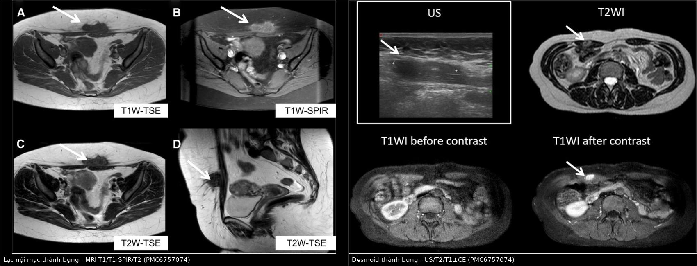
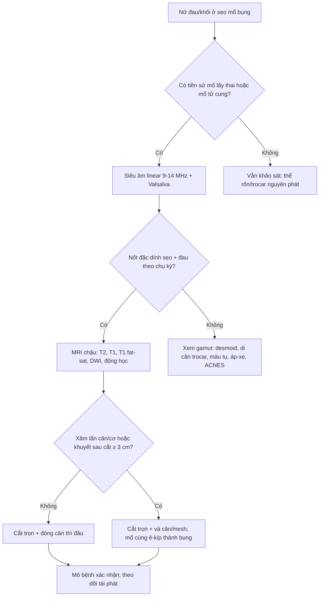
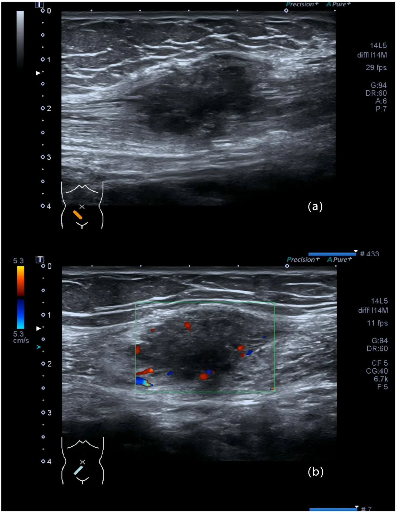
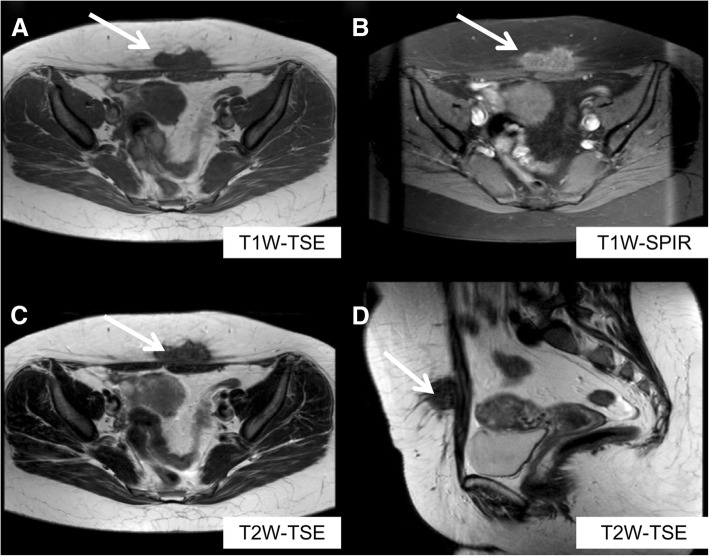
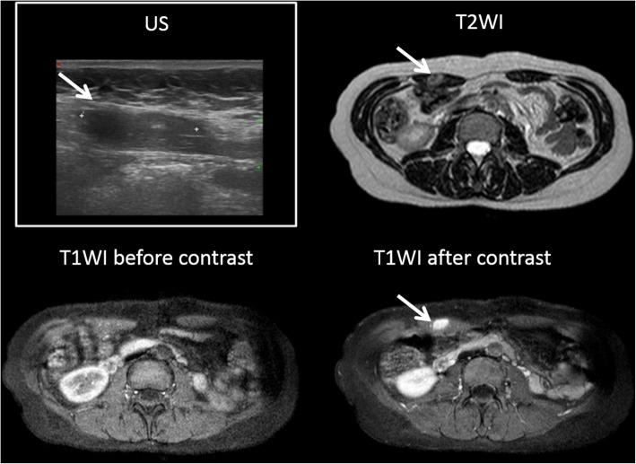
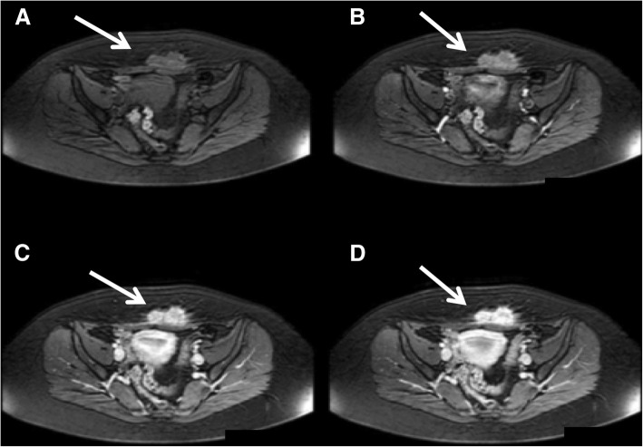

# 1974 — Lạc nội mạc thành bụng (abdominal wall endometriosis): nốt đặc trong sẹo mổ, đau theo chu kỳ và cách phân biệt với u xơ hóa (desmoid) / Abdominal wall endometriosis

**Tags:** `pattern:not-dac` `pattern:dau-chu-ky` `pattern:khoi-thanh-bung` `vung:thanh-bung` `anatomy:co-thang-bung` `protocol:sieu-am-tan-so-cao` `protocol:MRI-chau`

**Mức chắc chắn (certainty):** tổng hợp y văn (literature synthesis) — ghép **đoàn hệ 291 ca** có siêu âm đối chiếu mổ (*Front Med* 2026, **PMC13754834**), **122 ca** phân loại theo độ sâu (*BMC Womens Health* 2026, **PMC12924505**), **29 ca** mô bệnh–hình ảnh (*J Clin Med* 2026, **PMC13207820**), **46 ca** so sánh bác sĩ chuyên khoa lạc nội mạc với ê-kíp ngoại tổng quát (*Int J Gynaecol Obstet* 2026, **PMC13674816**), **21 ca** xâm lấn cân (*BMC Surg* 2025, **PMC12802257**), **10 ca MRI** mô tả đặc điểm tín hiệu (*Eur Radiol* 2010, **PMC2850520**), **tổng quan hình ảnh biến chứng mổ lấy thai** (*Insights Imaging* 2019, **PMC6757074**) và **ca ung thư biểu mô tế bào sáng** trên nền lạc nội mạc sẹo mổ (*Int J Surg Case Rep* 2026, **PMC13747552**). Nhóm **không có bệnh nhân của mình**.

> **Câu hỏi thực hành:** nữ **34 tuổi**, **3 năm** sau mổ lấy thai lần hai (rạch Pfannenstiel), khám vì **khối nhỏ dưới sẹo**, đau **âm ỉ vài ngày trước và trong kỳ kinh**, đau tăng khi **gồng bụng** nhưng **không sốt, không sụt cân**. Siêu âm tuyến trước ghi "**nốt giảm âm 22 mm trong mỡ dưới da, không thấy dòng chảy**"; bác sĩ lâm sàng hỏi: **đây là lạc nội mạc, u xơ hóa (desmoid), di căn lỗ trocar hay u hạt chỉ khâu — và có cần MRI trước khi mổ?**
> Bài chốt **bốn điểm**: **(1) lạc nội mạc thành bụng (AWE) là mô nội mạc lạc chỗ trong thành bụng, 0,1–0,4% sau mổ lấy thai, xuất hiện muộn (trung vị 34 tháng sau mổ, 48 tháng từ mổ tới chẩn đoán — PMC13754834); (2) chẩn đoán là **hình ảnh + bối cảnh**, không phải mô bệnh trước mổ: nốt đặc dính sẹo, đau theo chu kỳ, **T1 có ổ tăng tín hiệu do máu bán cấp**, T2 trung bình–thấp do xơ, **ngấm thuốc muộn và tiến triển**; (3) **siêu âm đo kích thước tốt (ICC 0,872) nhưng đánh giá xâm lấn cơ–cân kém** (giá trị tiên đoán âm chỉ 44,7%) → **MRI khi nghi xâm lấn sâu hoặc mổ lại**; (4) **cắt trọn là điều trị chuẩn**, khuyết cân **≥ 3 cm** cần vá/mesh, tái phát sau cắt trọn thấp (**1,8–5%**), và **tăng nhanh – đặc – hạch – chỉ số u tăng** ở người lớn tuổi là cờ đỏ ác hóa.** Nối [1967 – ACNES](../1967-acnes-dau-thanh-bung-sau-mo/lesson.md), [1936 – Tụ máu bao cơ thẳng](../1936-tu-mau-bao-co-thang-bung/lesson.md), [3061 – Di căn lỗ trocar](../3061-di-can-lo-trocar-sau-pipac-va-noi-soi/lesson.md).

## 1. Tổng quan bệnh học – cơ chế hình ảnh: vì sao nốt "đau theo tháng" lại có tín hiệu máu cũ

### 1.1 Bệnh học: mô nội mạc bị "gieo" vào thành bụng

- **Định nghĩa:** lạc nội mạc thành bụng là **tuyến và mô đệm nội mạc (endometrial glands and stroma)** nằm **ngoài phúc mạc**, trong thành bụng — thường **dưới da, trong cân/cơ thẳng hoặc sát phúc mạc** (PMC13754834).
- **Cơ chế chính (iatrogenic implantation):** khi mở tử cung (mổ lấy thai, mổ bóc u xơ, lấy thai ngoài tử cung), **tế bào nội mạc theo máu/mảnh mô bám vào vết mổ** rồi phát triển; vì vậy **99,7% ca trong đoàn hệ 291 ca có tiền sử mổ lấy thai** (PMC13754834). Thể **rốn nguyên phát** (không qua mổ) có giả thuyết **chuyển sáp nhập bẩm sinh (metaplasia)** và chiếm **68,4%** các ca lạc nội mạc rốn (PMC8879338).
- **Vì sao đau theo chu kỳ:** mô lạc chỗ vẫn **đáp ứng estrogen–progesterone** → **tăng sinh rồi bong/ra máu** mỗi tháng trong một khoang kín, gây **căng, viêm tại chỗ và xơ hóa tiến triển**. Vì vậy đau đạt đỉnh **quanh kỳ kinh**, và tổn thương **to ra chậm theo thời gian** — đây là điểm khác biệt với u hạt chỉ khâu (đau liên tục, không đổi theo chu kỳ).
- **Mô học:** tuyến nội mạc + đệm + **xuất huyết cũ (hemosiderin)** + **xơ cơ trơn (fibromuscular hyperplasia)**; chính thành phần xơ–cơ và máu cũ quyết định tín hiệu MRI.

### 1.2 Vì sao hình ảnh trông như vậy — giải thích bằng vật lý, không liệt kê tín hiệu

- **T1 tăng tín hiệu từng ổ (foci):** máu bán cấp chứa **methemoglobin nội bào** → **T1 ngắn → tăng tín hiệu**, và **không mất tín hiệu** trên chuỗi xung **bão hòa mỡ (fat-sat)**. Đây là dấu hiệu **hữu ích nhất** để phân biệt AWE với u đặc không xuất huyết — nhưng **không phải lúc nào cũng có**: trong 10 ca/12 tổn thương, Busard mô tả tín hiệu **đồng tín hiệu hoặc hơi tăng so với cơ trên T1**, kèm **ổ tăng tín hiệu do xuất huyết** (PMC2850520).
- **T2 thấp hay cao phụ thuộc thành phần:** xơ và cơ trơn dày đặc → **T2 thấp**; tuyến và phù → **T2 cao**. Vì vậy văn bản kinh điển "T2 thấp" chỉ đúng một phần: tổn thương **giàu xơ** mới tối, còn tổn thương **giàu tuyến** có thể **đồng tín hiệu hoặc hơi tăng so với cơ** (PMC2850520; PMC6757074). **Không được loại trừ AWE chỉ vì T2 không tối.**
- **Ngấm thuốc muộn–tiến triển:** mô đệm xơ có **mao mạch thưa, khoảng kẽ rộng** → thuốc khuếch tán chậm; tổn thương **ngấm dần từ thì động mạch sang thì cửa và thì muộn**, khác với cấu trúc giàu mạch (u máu, di căn) ngấm mạnh ngay thì động mạch (PMC6757074).
- **Khuếch tán:** **ADC trung bình 0,93 × 10⁻³ mm²/s** (b = 50–1.200 s/mm², 4 ca) — thấp hơn nang dịch đơn thuần (ADC thường **> 2,0**) nhưng **chồng lấp với u đặc**, nên DWI **không dùng để khẳng định**, chỉ hỗ trợ loại nang/seroma (PMC2850520).
- **TẠI SAO đau mà siêu âm có thể chỉ là "nốt giảm âm":** tổn thương **đặc, không có bao rõ**, viền xơ lẫn tuyến → **giảm âm không đồng nhất, bờ không đều**, mạch máu **thưa** trên Doppler (PMC13754834; PMC13207820). Không có dấu hiệu đặc hiệu tuyệt đối trên siêu âm — **bối cảnh lâm sàng làm nên chẩn đoán**.

### 1.3 Dịch tễ và các ngưỡng định lượng phải nhớ

| Chỉ số | Số liệu | Nguồn |
|---|---|---|
| Tần suất sau mổ lấy thai | **0,1–0,4%** | PMC6757074 |
| Thời gian từ mổ lấy thai tới chẩn đoán | trung vị **48 tháng** (IQR 36–72) | PMC13754834 |
| Thời gian ủ bệnh (mổ → triệu chứng) | trung vị **34 tháng** (IQR 18–48) | PMC13754834 |
| Triệu chứng khởi phát → chẩn đoán | trung vị **12 tháng** (IQR 6–30) | PMC13754834 |
| Khối sờ được / đau theo chu kỳ | **81,8%** / **46,7%** | PMC13754834 |
| Một ổ / nhiều ổ | **88,0%** / **12,0%** | PMC13754834 |
| Phân bố theo độ sâu (I/II/III) | **23,0% / 45,1% / 31,9%** | PMC12924505 |
| Kích thước trung bình (14 ca) | **24,1 mm** (9–45 mm) | PMC13412156 |
| Xâm lấn cân–cơ | **42,9%** (21 ca) · **63,0%** (29 ca) | PMC12802257 · PMC13207820 |
| Tổn thương **≥ 3 cm** ở type II/III | **67,8% / 80,0%** | PMID 37981767 (2023) |
| Tái phát sau cắt trọn | **1,8%** (291 ca) · **4,8%** (21 ca) · **5%** (gộp thể thành bụng) | PMC13754834 · PMC12802257 · PMID 31618674 |
| U xơ hóa (desmoid) thành bụng | **3,7 ca mới/1 triệu người/năm** | PMC6757074 |

- **Vì sao chẩn đoán muộn:** đau và khối **nhỏ, nằm trong sẹo** nên bị quy cho "đau dính sau mổ" hoặc "sẹo lồi"; trong 46 ca, **chỉ 42,1%** được chẩn đoán đúng khi do ê-kíp ngoại tổng quát đánh giá, so với **96,3%** khi qua trung tâm lạc nội mạc (**OR 28,01** cho chẩn đoán sai; **PMC13674816**).
- **Vì sao số ca tăng:** số mổ lấy thai tăng + **siêu âm tần số cao** phát hiện được nốt nhỏ trong sẹo (PMC7767517).

## 2. Mẫu hình + chẩn đoán phân biệt theo vị trí (gamut)

- **Mẫu hình chung:** **nốt đặc, dính vào sẹo mổ**, bờ không đều, **đau theo chu kỳ**, không sốt; siêu âm **giảm âm không đồng nhất**, Doppler **thưa mạch**; MRI **T1 có ổ tăng tín hiệu**, T2 **trung bình–thấp**, **ngấm thuốc muộn**.
- **Gamut theo ĐỘ SÂU (phân loại dùng để lập kế hoạch mổ):**
  - **Type I — dưới da/mỡ:** khối nông, sờ rõ, ít xâm lấn; cắt trọn + đóng cân đơn giản.
  - **Type II — cân cơ thẳng/cơ thẳng:** hay gặp nhất (**45,1%**); cần đánh dấu mức xâm lấn, khuyết cân sau cắt có thể cần vá.
  - **Type III — phúc mạc/trong ổ bụng:** đau nhiều hơn, khối lớn hơn, **mổ lâu, mất máu nhiều hơn**, nguy cơ vào ổ bụng (PMID 37981767; PMC12924505).
- **Gamut theo VỊ TRÍ:**
  - **Sẹo mổ lấy thai (Pfannenstiel/đường giữa):** phổ biến nhất — **66,3%** trong 83 ca (PMID 35246836).
  - **Rốn:** **30–40%** của AWE, **68,4%** là thể nguyên phát; dễ bị chẩn đoán nhầm **thoát vị rốn nghẹt** (PMC8879338; PMC13280939).
  - **Lỗ trocar sau nội soi:** nốt dọc đường trocar — hàng đầu là **di căn lỗ trocar** nếu có tiền sử ung thư (bài 3061), lạc nội mạc đứng thứ hai.
  - **Sẹo mổ ruột thừa, sẹo tầng sinh môn, vùng bẹn:** hiếm nhưng đã báo cáo, có ca **42 năm** sau mổ (PMC13397975).
- **Mnemonic "SẸO" (SCAR)** cho nốt mới ở sẹo mổ bụng: **S**ẹo lồi/xơ cơ · **Ẹ** (endometriosis) lạc nội mạc · **O** (other: u hạt chỉ khâu) · **C**arcinoma/di căn (kể cả di căn lỗ trocar). Đọc theo **thời gian (chu kỳ hay không) + tín hiệu máu cũ + bối cảnh mổ**.

## 3. Bảng so sánh phân biệt (ma trận đối chiếu)

| Thực thể (entity) | Hình ảnh điển hình (US/CT/MRI) | Chốt vào (rule-in) | Chốt loại (rule-out) | Gợi ý xác nhận |
|---|---|---|---|---|
| **Lạc nội mạc thành bụng (AWE)** | Nốt đặc **dính sẹo**, giảm âm không đồng nhất; MRI **T1 có ổ tăng tín hiệu (máu cũ)**, T2 trung bình–thấp, **ngấm thuốc muộn–tiến triển**, **ADC ~0,93** | **Đau theo chu kỳ + tiền sử mổ lấy thai + ổ T1 tăng tín hiệu trong nốt dính sẹo** | **Không có đau chu kỳ + ngấm thuốc thì động mạch mạnh + T2 rất sáng đồng nhất** → nghĩ u khác | MRI chậu có T1 fat-sat + động học; mô bệnh sau cắt |
| **U xơ hóa (desmoid)** | Khối **T1 và T2 đều thấp**, bờ có "đuôi xơ", **ngấm thuốc đồng nhất**, có thể **xâm lấn cơ**, không có ổ xuất huyết | **T2 thấp đồng nhất + lớn dần liên tục, không theo chu kỳ** | **Có ổ T1 tăng tín hiệu + đau theo kỳ kinh** → nghi AWE | MRI + theo dõi kích thước; mô bệnh (β-catenin) |
| **Di căn lỗ trocar** | Nốt đặc **đúng trục trocar**, ngấm thuốc, có thể nhiều nốt; **không có ổ máu cũ** | **Tiền sử ung thư ổ bụng–chậu + nốt dọc đường trocar + bệnh phúc mạc kèm** | **Đau theo chu kỳ + ổ T1 tăng tín hiệu + không có ung thư nguyên phát** | Sinh thiết/kết hợp PET-CT (bài 3061) |
| **U hạt chỉ khâu (suture granuloma)** | Nốt **nhỏ < 1 cm** quanh nút chỉ, T2 thấp, **ngấm thuốc dạng vòng**, có thể có **vật liệu khâu cản quang** | **Nốt nhỏ cạnh nút chỉ, ổn định nhiều năm** | **To ra theo chu kỳ + ổ T1 tăng tín hiệu** | So phim cũ; mô bệnh khi cắt |
| **Tụ máu bao cơ thẳng (bài 1936)** | Hình **thoi/thấu kính trong bao cơ**, máu lỏng **~45 HU**, cục **~85 HU**, không ngấm; MRI tín hiệu thay đổi theo tuổi máu | **Khởi phát cấp sau ho/gắng sức/chống đông; không đau chu kỳ** | **Đau lặp lại theo tháng + ổ nhỏ trong sẹo da** | CT không cản quang; siêu âm theo dõi |
| **Áp-xe / seroma sau mổ** | Ổ dịch **0–20 HU**, viền ngấm thuốc, có thể **khí trong ổ**, phù mô mềm quanh | **Sốt, đau liên tục, tăng CRP, ổ dịch non–dịch** | **Không sốt + nốt đặc + đau theo chu kỳ** | Chọc hút/cấy; không dẫn lưu mù nếu nghi AWE |
| **ACNES (bài 1967)** | **Không có khối**, hình ảnh bình thường; đau khu trú bờ ngoài cơ thẳng, **Carnett dương** | **Đau khu trú + Carnett +, block giảm > 50%** | **Có nốt thật trên siêu âm/MRI** | Khám + block chẩn đoán |
| **Sarcoma mô mềm thành bụng** | Khối **lớn (> 5 cm)**, T2 sáng không đồng nhất, **hoại tử**, xâm lấn rộng, không dính sẹo | **Khối lớn, tăng nhanh, không theo chu kỳ** | **Nốt < 3 cm trong sẹo + đau chu kỳ** | MRI + sinh thiết có kế hoạch ở trung tâm sarcoma |

*Trái: AWE — nốt dính sẹo, **T1/T2 trung bình–thấp**, có ổ tăng tín hiệu trên T1-SPIR do máu cũ. Phải: desmoid — **T1 và T2 đều thấp**, ngấm thuốc đồng nhất, không có ổ xuất huyết. Nguồn: Insights Imaging 2019 (PMC6757074), CC BY 4.0. Ảnh ghép letterbox, không crop.*

### 3.1 Đọc tín hiệu cho đúng: ba cạm bẫy của "chữ ký MRI"

- **Không có "chữ ký" duy nhất:** cùng một bệnh, tổn thương **giàu xơ → T2 tối**, **giàu tuyến → T2 sáng**; ổ máu cũ có thể **rất nhỏ hoặc không thấy** ở tổn thương < 1 cm (PMC2850520).
- **T1 fat-sat là chuỗi xung bắt buộc:** nếu chỉ chụp T1 không bão hòa mỡ, **mỡ dưới da sáng** sẽ che mất ổ máu; ngược lại, **mỡ trong tổn thương** (u mỡ, angiolipoma) cũng sáng trên T1 và **tối đi** trên fat-sat — chính vì vậy phải so **T1 với T1 fat-sat**.
- **Ngấm thuốc muộn không đồng nghĩa lành:** desmoid cũng ngấm; khác biệt nằm ở **bối cảnh (chu kỳ) + ổ máu cũ + bờ tổn thương**.

## 4. Protocol chụp + phân loại dùng trong thực hành

### 4.1 Siêu âm (tuyến đầu)

- **Đầu dò linear 9–14 MHz**, đặt **trực tiếp trên sẹo**, khảo sát **dọc và ngang**; **so sánh khi gồng bụng/Valsalva** để loại **thoát vị** (khuyết cân + nội dung di động).
- Ghi: **kích thước 3 chiều (mm)**, **độ sâu theo phân loại I–III**, **bờ**, **đồng nhất/không**, **có ổ tăng âm/xuất huyết**, **Doppler màu** (AWE thường **thưa mạch**).
- **Giá trị:** đo đường kính lớn **tương quan tốt với mổ (ICC 0,872)**, nhưng phát hiện **xâm lấn cơ–cân** chỉ đạt **PPV 88,8% / NPV 44,7%**, **âm tính giả 22,9%** (PMC13754834) → **siêu âm bình thường hoặc "chưa xâm lấn" không loại trừ xâm lấn sâu**.

### 4.2 MRI (khi nghi xâm lấn sâu, mổ lại, hoặc muốn loại desmoid/di căn)

- **Cuộn bề mặt chậu (pelvic phased array)**, FOV che toàn thành bụng trước; lát **3–4 mm**, không khoảng trống.
- **Chuỗi xung tối thiểu:** **T2 axial + sagittal** (không fat-sat để thấy giải phẫu, và **T2 fat-sat/STIR** để thấy phù) · **T1 in-phase** · **T1 fat-sat** (tìm ổ máu cũ) · **DWI b = 0/400/800** (ADC) · **T1 động học sau tiêm** (động mạch/cửa/muộn 3–5 phút).
- **Cách đọc:** đánh dấu **vị trí tương đối với cân cơ thẳng và lá sau** (vì lá sau quyết định có vào ổ bụng); đo **khoảng cách tới phúc mạc**; ghi **số ổ**, **kích thước lớn nhất**, **tín hiệu T1/T2**, **kiểu ngấm thuốc**.
- **Khi nào KHÔNG cần MRI:** nốt **< 1 cm**, nông dưới da, điển hình trên siêu âm, chưa mổ — có thể mổ trực tiếp và xác nhận mô bệnh.

### 4.3 Phân loại + thuật toán (không có RADS riêng cho AWE)

- **Phân loại theo độ sâu (dùng trong các đoàn hệ lớn):** **Type I** da/mỡ dưới da · **Type II** cân cơ thẳng/cơ thẳng · **Type III** phúc mạc/ổ bụng (PMC12924505; PMC13754834).
- **Ngưỡng lập kế hoạch:** **khuyết cân ≥ 3 cm → vá cân/mesh** (PMC12802257; PMC13674816); tổn thương **≥ 3 cm** gặp ở **67,8%** type II và **80,0%** type III (PMID 37981767).
- **Yếu tố tiên lượng tái phát:** **cắt không trọn** là yếu tố chính; **độ sâu không làm tăng tái phát** trong 122 ca (PMC12924505); **BMI ≥ 25 kg/m²** gợi ý tái phát cao hơn nhưng số biến cố ít (PMC13754834).

## 5. Biến thể bình thường và cạm bẫy

- **"Sẹo dày" sau mổ lấy thai:** mô sẹo xơ có thể **giảm âm, T2 tối**, nhưng **không đau theo chu kỳ** và **không có ổ T1 tăng tín hiệu**; đừng gọi là AWE chỉ vì "có nốt trong sẹo".
- **Đau không theo chu kỳ vẫn có thể là AWE:** chỉ **46,7%** ca có đau chu kỳ rõ (PMC13754834); ở **type III**, triệu chứng đầu tiên thường là **đau** chứ không phải khối sờ (PMID 37981767).
- **Rốn: AWE giả "thoát vị nghẹt":** khối rốn đau, hồng tím, có thể **không đẩy được**; siêu âm thấy **nốt đặc trong mỡ rốn, không có khuyết cân** → **không mổ cấp cứu như thoát vị** (PMC13280939).
- **Nhầm với thai ở sẹo mổ (cesarean scar pregnancy):** bối cảnh **có thai/PAPP-A**, β-hCG dương, tổn thương **trong cơ tử cung trước**, không phải trong thành bụng — **không cắt "nốt thành bụng" khi chưa loại thai**.
- **Chọc hút/dẫn lưu mù:** AWE là **mô đặc**, chọc hút thường chỉ được **máu cũ/dịch ít, không chẩn đoán**; dẫn lưu còn tạo **đường rò kéo dài**. Chỉ chọc khi nghi **áp-xe**.
- **Sinh thiết trước mổ:** kim nhỏ thường **không đủ** vì tổn thương xơ; nếu nghi **ác hóa** (lớn nhanh, thành phần đặc, hạch, CA-125 tăng) thì **core biopsy có kế hoạch** tại trung tâm có mổ ngay sau đó.
- **Mesh trong "trường bẩn":** đặt mesh vào vùng vừa cắt AWE làm tăng nguy cơ **nhiễm mesh**; với khuyết **< 3 cm**, đóng cân thì đầu thường đủ (PMC13412156; PMC12802257).
- **Người lớn tuổi/đã mãn kinh:** AWE thường **teo và đau giảm**; **khối vẫn to ra sau mãn kinh** là dấu hiệu **cảnh báo ác hóa** — ca ung thư biểu mô tế bào sáng xuất hiện **20 năm** sau mổ lấy thai (PMC13747552).

## 6. Tự lượng giá — Blind Quiz

**Ca 1 — Nữ 32 tuổi, 2 năm sau mổ lấy thai, khối dưới sẹo đau trước kỳ kinh.**

- Gợi ý: khối nằm **trong lớp cơ**, bờ không rõ; panel dưới là **Doppler màu**.
- Câu hỏi: (1) mô tả 3 dấu hiệu trên siêu âm; (2) nêu 3 chẩn đoán phân biệt; (3) dấu hiệu nào trên MRI sẽ chốt hướng AWE?

<b>Bấm để hiện đáp án (findings + chẩn đoán)</b>

- **Dấu hiệu:** (a) khối **giảm âm không đồng nhất** trong lớp cơ, **bờ không đều, không có bao**; (b) **không có khuyết cân/nội dung thoát vị khi Valsalva** → không phải thoát vị; (c) Doppler **thưa tín hiệu** trong khối, không có mạch nuôi lớn.
- **Chẩn đoán:** **lạc nội mạc thành bụng** — vì khối đặc dính sẹo + đau theo chu kỳ ở người có tiền sử mổ lấy thai.
- **Ba phân biệt:** **desmoid** (T2 thấp đồng nhất, lớn dần không theo chu kỳ) · **u hạt chỉ khâu** (nhỏ, quanh nốt chỉ, ổn định) · **di căn lỗ trocar** (nếu có tiền sử ung thư; nốt đúng trục trocar).
- **Dấu hiệu chốt trên MRI:** **ổ tăng tín hiệu trên T1 fat-sat** (máu bán cấp) trong nốt **ngấm thuốc muộn–tiến triển**; ADC thấp (~0,93) giúp loại nang/seroma.
- Nguồn ảnh: *Front Med* 2026 (PMC13754834), Fig. 3, **CC BY 4.0**.

**Ca 2 — Nữ 35 tuổi, 3 năm sau mổ lấy thai, khối 2,5 cm dính sẹo; MRI dưới đây.**

- Câu hỏi: (1) đọc tín hiệu trên 4 chuỗi xung; (2) vì sao tổn thương **không tối trên T2** mà vẫn là AWE? (3) chuỗi xung nào bắt buộc phải có để không bỏ sót?

<b>Bấm để hiện đáp án (findings + chẩn đoán)</b>

- **Tín hiệu:** nốt dính cân cơ thẳng, **T1-TSE tín hiệu thấp–trung bình**, **T1-SPIR có vùng tăng tín hiệu** (máu cũ), **T2-TSE trung bình–thấp**, bờ không đều; trên lát sagittal thấy rõ **độ sâu tới cân**.
- **Vì sao không tối trên T2:** thành phần **tuyến và phù** làm T2 tăng, chỉ phần **xơ–cơ trơn** mới tối; tín hiệu là **phổ**, không phải hằng số (PMC2850520).
- **Chuỗi xung bắt buộc:** **T1 fat-sat** (hoặc T1-SPIR) — nếu thiếu, ổ máu cũ bị mỡ dưới da che lấp; thêm **động học sau tiêm** để thấy ngấm muộn.
- Nguồn ảnh: *Insights Imaging* 2019 (PMC6757074), Fig. 11, **CC BY 4.0**.

**Ca 3 — Cùng bệnh cảnh nhưng khối lớn dần đều, không đau theo kỳ kinh: MRI này là gì?**

- Câu hỏi: dấu hiệu nào **loại AWE** và hướng tới **desmoid**? Điều gì quyết định thái độ xử trí?

<b>Bấm để hiện đáp án (findings + chẩn đoán)</b>

- **Dấu hiệu:** khối **T1 và T2 đều thấp**, **ngấm thuốc đồng nhất** sau tiêm, **không có ổ tăng tín hiệu trên T1** — phù hợp **u xơ hóa (desmoid)**.
- **Loại AWE vì:** không có **ổ máu cũ** trên T1 và **không đau theo chu kỳ**; desmoid **lớn dần liên tục**, có thể xâm lấn cơ.
- **Xử trí:** desmoid thành bụng **không tự khỏi**, cần **theo dõi tích cực** hoặc **cắt rộng**; không đáp ứng với điều trị nội tiết như AWE. Tần suất **3,7/1 triệu người/năm** (PMC6757074).
- Nguồn ảnh: *Insights Imaging* 2019 (PMC6757074), Fig. 13, **CC BY 4.0**.

**Ca 4 (nâng cao) — Sau cắt trọn 8 tháng, đau quay lại đúng chỗ cũ.**

- Câu hỏi: ngấm thuốc kiểu gì? Tái phát hay xơ sẹo? Bước tiếp theo?

<b>Bấm để hiện đáp án (findings + chẩn đoán)</b>

- **Dấu hiệu:** tổn thương **ngấm thuốc tăng dần và muộn** từ thì động mạch sang thì cửa/tĩnh mạch — kiểu ngấm của **mô xơ có mao mạch thưa**, gặp ở **AWE tái phát** nhưng **cũng gặp ở sẹo xơ**.
- **Không chốt được bằng một lần chụp:** cần **so phim cũ + đau theo chu kỳ + kích thước tăng**; nếu vẫn nghi và đau nhiều → **cắt lại + mô bệnh**.
- **Vì sao tái phát:** thường do **cắt không trọn vi thể**; tỉ lệ **1,8–5%** sau cắt trọn (PMC13754834; PMID 31618674).
- Nguồn ảnh: *Insights Imaging* 2019 (PMC6757074), Fig. 12, **CC BY 4.0**.

## 7. Câu hỏi nghiên cứu & điểm chưa đồng thuận (tính đến 11/2026)

1. **[Tranh cãi] Ở phụ nữ có lạc nội mạc thành bụng, cắt rộng với biên 1 cm có giảm tái phát so với cắt trọn không đo biên?**
   - **Đã biết:** cắt trọn tổn thương là điều trị chuẩn, tái phát sau cắt trọn **1,8%** (291 ca — PMC13754834) và **5%** ở thể thành bụng trong tổng quan hệ thống (PMID 31618674); độ sâu **không** làm tăng tái phát trong 122 ca (PMC12924505).
   - **Chưa rõ:** các đoàn hệ **không ghi nhận tình trạng biên mô học một cách hệ thống** (chính tác giả PMC13754834 nêu là hạn chế), nên **không thể tách vai trò của biên** khỏi kỹ thuật cắt.
   - **Hướng nghiên cứu:** đoàn hệ tiến cứu có **đánh dấu vị trí + đo biên**, so **cắt trọn định hướng siêu âm** với **cắt rộng 1 cm**, outcome **tái phát 3–5 năm**.
   - **Nguồn:** PMC13754834 (2026); PMC12924505 (2026); PMID 31618674 (2020).

2. **[Tranh cãi] Đốt nhiệt (cryoablation/microwave/HIFU) có thay được phẫu thuật ở AWE đơn độc ≤ 3 cm?**
   - **Đã biết:** phân tích gộp **126 bệnh nhân** cryoablation cho thấy **giảm điểm đau VAS** có ý nghĩa (DOI 10.1093/bjr/tqaf009); **18 ca** đốt vi sóng giảm **VAS trung vị 8–10 → 0–1** sau 1 tháng, thể tích **3,33 → 0,75 cm³** sau 6 tháng (PMC12974297).
   - **Chưa rõ:** toàn bộ là **hồi cứu, cỡ mẫu nhỏ, theo dõi ngắn**, **không có so sánh trực tiếp** với cắt trọn; chưa rõ **tái phát dài hạn** và **ảnh hưởng tới sinh sản/thành bụng**.
   - **Hướng nghiên cứu:** **RCT** đốt nhiệt vs cắt trọn ở tổn thương **≤ 3 cm**, outcome **VAS 12 tháng + tái phát + biến chứng thành bụng**.
   - **Nguồn:** DOI 10.1093/bjr/tqaf009 (2025); PMC12974297 (2026).

3. **[Khác biệt thực hành] Siêu âm chuyên khoa lạc nội mạc so với CT/MRI "không chuyên" làm thay đổi tỉ lệ chẩn đoán đúng tới mức nào?**
   - **Đã biết:** trong **46 ca**, trung tâm lạc nội mạc chẩn đoán đúng **96,3%** so với **42,1%** của ngoại tổng quát; nhập viện qua ngoại tổng quát làm **tăng 28 lần** khả năng chẩn đoán sai (OR 28,01; KTC 2,74–286,47); nhóm ngoại tổng quát dùng **CT/MRI nhiều hơn** (42,1% vs 3,7%) trong khi nhóm chuyên khoa dùng **siêu âm lạc nội mạc 100%** (PMC13674816).
   - **Chưa rõ:** nghiên cứu **một trung tâm, hồi cứu, 46 ca** — chưa rõ lợi ích có lặp lại ở tuyến không chuyên và **chi phí–hiệu quả** của việc chuyển tuyến.
   - **Hướng nghiên cứu:** nghiên cứu **triển khai (implementation)** đào tạo siêu âm AWE cho bác sĩ siêu âm tổng quát, đo **tỉ lệ chẩn đoán đúng trước–sau** và **số MRI/CT tránh được**.
   - **Nguồn:** PMC13674816 (2026).

## Bài liên quan chéo

- [100 – Tổng quan hệ Bụng](../100-tong-quan-he-bung/lesson.md) (bảng DDx khối thành bụng)
- [1967 – ACNES: đau thành bụng khu trú, hình ảnh bình thường](../1967-acnes-dau-thanh-bung-sau-mo/lesson.md)
- [1936 – Tụ máu bao cơ thẳng bụng](../1936-tu-mau-bao-co-thang-bung/lesson.md)
- [3061 – Di căn lỗ trocar sau nội soi](../3061-di-can-lo-trocar-sau-pipac-va-noi-soi/lesson.md)
- [3112 – Gạc sót (gossypiboma)](../3112-gossypiboma-gac-sot-sau-mo/lesson.md)

> Không dùng để chẩn đoán độc lập khi chưa có người hướng dẫn.
