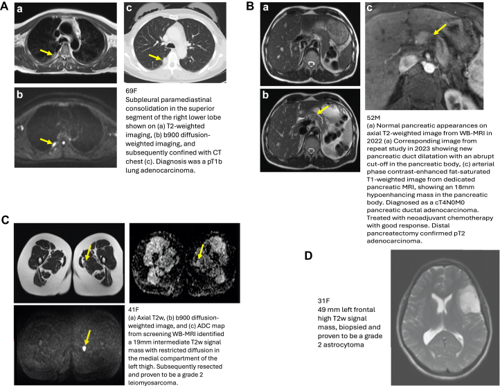
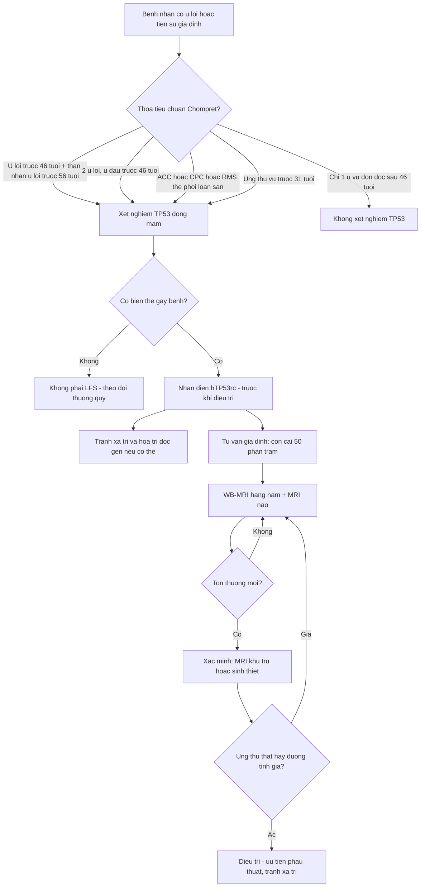
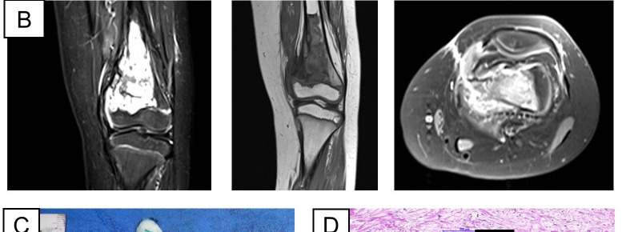

# 198 — Li-Fraumeni (TP53): tiêu chuẩn Chompret, phổ u BOSCA & tư vấn di truyền

**Tags:** `pattern:ung-thu-da-o-som` `pattern:sarcoma` `vung:toan-than` `vung:vu` `vung:nao` `score:Chompret` `protocol:WB-MRI` `incidentaloma:ton-thuong-toan-than`
**Mức chắc chắn (certainty):** tổng hợp y văn (literature synthesis) — nhóm tự biên từ guideline ERN GENTURIS 2020 (PMC7609280, CC BY 4.0), nghiên cứu WB-MRI SIGNIFIED 2026 (PMC12954316, CC BY-NC-ND), báo cáo ca LFS–osteosarcoma đầu tiên tại Việt Nam (PMC11493536, CC BY 4.0) và bài điểm luận LFS 2026 (PMC13574328, CC BY 4.0). Số liệu lấy nguyên từ toàn văn, không lấy từ abstract gián tiếp.

## 1. Tổng quan — "ai là LFS" quyết định trước khi chụp, và tại sao phải chụp bằng MRI

- **Bệnh học:** **Li-Fraumeni / hội chứng ung thư liên quan TP53 di truyền (heritable TP53-related cancer syndrome — hTP53rc)** do **đột biến dòng mầm (germline) gen ức chế u TP53**, di truyền **trội trên nhiễm sắc thể thường**. p53 là "người gác cổng bộ gen": khi ADN hỏng, p53 dừng chu kỳ tế bào, sửa hoặc cho tế bào chết theo lập trình. Mất một alen → **sửa chữa ADN suy yếu + bất ổn định nhiễm sắc thể** → nhiều ung thư **nguyên phát độc lập**, **sớm**, **hai bên**, **nhiều ổ** — chứ không phải một u di căn.
- **Ngưỡng định lượng nằm lòng:**
  - **Nguy cơ cả đời:** nữ **~90%**, nam **~70%** (PMC11493536) — nghĩa là **đa số** người mang bệnh lý TP53 sẽ có ít nhất một ung thư trong đời.
  - **Đột biến mới (de novo): 7–20%** → **không có tiền sử gia đình không loại trừ LFS** (PMC7609280).
  - **Tỉ lệ phát hiện đột biến TP53 theo kiểu u (không cần tiền sử gia đình):** **carcinoma vỏ thượng thận (ACC) hoặc carcinoma đám rối mạch mạc ở trẻ: 50–80%**; **rhabdomyosarcoma thể phôi–loạn sản (embryonal anaplastic): tới 73%**; **ung thư vú nữ < 31 tuổi: 3,8–7,7%** (PMC7609280).
  - **Hiệu quả tầm soát bằng WB-MRI:** tỉ lệ phát hiện ung thư **~7%** ở lần chụp đầu (gộp nhiều nghiên cứu, PMC7609280). Trong **SIGNIFIED (54 người mang TP53)**: **9/54 (16,7%) phải sinh thiết/cắt** sau WB-MRI đầu, **4 ung thư (7,4%)** được chẩn đoán khi chưa triệu chứng; **5 ung thư xuất hiện giữa hai lần chụp** — nằm **ngoài trường nhìn** (sarcoma chi trên, carcinoma vú) hoặc mới mọc về mặt lâm sàng (PMC12954316).
  - **Giá trị sống còn:** theo dõi đa phương thức giúp phát hiện sớm — **sống toàn bộ 5 năm 88,8% ở nhóm được tầm soát so với 59,6% ở nhóm không tầm soát** (Villani 2016, dẫn qua PMC13574328).
- **TẠI SAO phải là MRI, không phải CT/PET:** tế bào thiếu p53 **sửa chữa ADN kém** → **tia xạ là tác nhân gây ung thư thứ phát mạnh** ở nhóm này. Guideline khuyến cáo **xét nghiệm TP53 trước khi điều trị** để tránh xạ trị/hóa trị gây độc gen nếu có thể (PMC7609280). WB-MRI **không tia xạ**, quét **đỉnh đầu → bàn chân**, lặp lại hằng năm trong nhiều thập kỷ.
- **TẠI SAO thấy được u trên MRI (vật lý):** u đặc tăng sinh tế bào → **khuếch tán bị hạn chế (restricted diffusion)** → **DWI sáng, ADC thấp**; chuỗi **ức mỡ T2/STIR/DIXON** làm u nổi trên nền mỡ; **T1 sau tiêm** cho thấy mạch nuôi. U mô mềm nhỏ 19 mm vẫn phát hiện được vì tương phản mô mềm cao — điều X-quang không làm được.
- **Cạm bẫy gadolinium:** gadolinium có thể **lưu lại cơ thể nhiều tháng–năm** → hạn chế tiêm lặp, nếu cần chỉ dùng **GBCA mạch vòng (macrocyclic)** (PMC7609280).

## 2. Mẫu hình + gamut theo TUỔI và CƠ QUAN

- **Nguyên tắc đọc:** LFS không phải "một bệnh của một cơ quan" mà là **phổ u theo tuổi**. Hỏi đúng 2 câu: **(1) tuổi tại thời điểm chẩn đoán? (2) có ung thư nguyên phát thứ hai không?**
- **Gợi nhớ BOSCA (5 u lõi — core tumours):** **B**reast (vú, đặc biệt **< 31 tuổi**) · **O**steosarcoma (xương, hàm) · **S**oft-tissue sarcoma (mô mềm) · **C**NS tumour (u não) · **A**drenocortical carcinoma (vỏ thượng thận).
- **Theo tuổi:**
  - **Nhũ nhi – < 5 tuổi:** **ACC** (khối thượng thận, thường chức năng, nam hóa), **carcinoma đám rối mạch mạc** (choroid plexus carcinoma), **rhabdomyosarcoma thể phôi–loạn sản**, **medulloblastoma nhóm SHH**.
  - **Trẻ lớn – thiếu niên:** **osteosarcoma** (đặc biệt **xương hàm**), **sarcoma mô mềm**, **ALL thể giảm bội nhiễm sắc thể (hypodiploid ALL)**.
  - **Người lớn trẻ:** **ung thư vú rất sớm (< 31 tuổi, có thể hai bên)**, sarcoma, u não, **adenocarcinoma phổi** (đã nằm trong phổ LFS — thử nghiệm LIFSCREEN).
  - **Mọi tuổi:** **ung thư nguyên phát thứ hai trong trường xạ trị** của u lõi đầu tiên xuất hiện **< 46 tuổi**.
- **Mẫu hình hình ảnh đặc trưng:** nhiều khối **độc lập, khác cơ quan, khác mô học**, không theo một đường di căn; u **nhỏ nhưng đã ác** (19 mm sarcoma, 18 mm pancreatic ductal adenocarcinoma — PMC12954316).
- **Phản biện nguồn:** u não LFS **không đồng nhất** — medulloblastoma SHH mang TP53 có tiên lượng xấu hơn, nhưng không phải "mọi medulloblastoma có TP53 đều xấu"; kết luận cũ đã được thu hẹp cho phân nhóm phân tử (PMC13574328).

## 3. Bảng so sánh phân biệt (ma trận đối chiếu)

| Thực thể (entity) | Hình ảnh / phổ u điển hình | Chốt vào (rule-in) | Chốt loại (rule-out) | Gợi ý xác nhận |
|---|---|---|---|---|
| **LFS (TP53 dòng mầm)** | Nhiều u lõi **BOSCA** ở người trẻ; sarcoma mô mềm/xương, ACC, u não, vú < 31 tuổi; **u thứ hai trong trường xạ** | **Thỏa tiêu chuẩn Chompret** (u lõi < 46 tuổi + thân nhân bậc 1–2 u lõi < 56 tuổi; hoặc ≥ 2 u lõi, u đầu < 46 tuổi; hoặc ACC/CPC/RMS loạn sản; hoặc vú < 31 tuổi) | Chỉ **một** u vú đơn độc **> 46 tuổi**, không tiền sử gia đình → **không nên xét nghiệm** (Khuyến cáo 4, PMC7609280) | Giải trình tự TP53 + đối chiếu IARC/ClinGen; tư vấn di truyền |
| **CMMRD (MMR lưỡng alen)** | Trẻ **< 10 tuổi**: u não (HGG tế bào khổng lồ), lymphoma T, **đa polyp đại tràng**, **vết café-au-lait** | **U não/lymphoma + CALM + tiền sử gia đình Lynch**; ≥ 10 polyp adenoma < 18 tuổi | CALM đơn thuần không có u → không phải CMMRD; xét nghiệm MMR mô | IHC MMR/MSI + giải trình tự (bài 690) |
| **NF1** | **U dây thần kinh đệm thị giác**, neurofibroma, **loạn sản xương bướm**, CALM bờ đều | Tiêu chuẩn NIH NF1 (≥ 2 dấu hiệu) | U não đơn độc + CALM không đủ tiêu chuẩn → nghĩ CMMRD/LFS | MRI sọ–hốc mắt, khám da (bài 377) |
| **Lynch (MMR đơn alen)** | **Đại tràng/nội mạc tử cung** ở người lớn; **không** có u não thời thơ ấu | Tiêu chuẩn Amsterdam/Bethesda, MSI cao | U não trẻ + polyp sớm → CMMRD chứ không phải Lynch | IHC MMR, giải trình tự dòng mầm |
| **BRCA1/2** | Vú/buồng trứng; **không** sarcoma, ACC, u não trẻ | Tiền sử gia đình vú–buồng trứng, tuổi trung niên | Sarcoma xương/mô mềm ở trẻ → không nghĩ BRCA | Panel gen di truyền |
| **CHIP / thể khảm TP53 (mimic)** | **Không có** phenotype LFS; biến thể TP53 trong máu **VAF thấp**, người lớn tuổi | Phát hiện TP53 khi giải trình tự máu vì lý do khác, VAF thấp | Có u lõi + VAF ~50% → LFS thật | Lặp mẫu, **nguyên bào sợi da/tóc**, VAF (PMC13586324) |

*Bốn ca LFS phát hiện nhờ WB-MRI: **(A)** nữ 69 tuổi — adenocarcinoma phổi pT1b (liềm màng phổi trái, mũi tên); **(B)** nam 52 tuổi — giãn ống tụy đột ngột + khối giảm ngấm 18 mm thì động mạch, **pancreatic ductal adenocarcinoma**; **(C)** nữ 41 tuổi — khối 19 mm đùi trái, DWI sáng/ADC thấp, **leiomyosarcoma độ 2**; **(D)** nữ 31 tuổi — khối 49 mm trán trái T2 sáng, **astrocytoma độ 2**. Nguồn: Finn E và cs., *ESMO Open* 2026 (PMC12954316), **CC BY-NC-ND 4.0** — ảnh **nguyên bản, không cắt/ghép**.*

## 4. Protocol + tiêu chuẩn Chompret + lịch tầm soát

- **Ai cần xét nghiệm gen (Chompret sửa đổi, ERN GENTURIS 2020 — PMC7609280):**
  1. **Gia đình:** u lõi (vú, sarcoma mô mềm, osteosarcoma, u TKTW, ACC) **< 46 tuổi** + **≥ 1 thân nhân bậc 1 hoặc 2 có u lõi < 56 tuổi**.
  2. **Nhiều u nguyên phát:** **≥ 2 u lõi**, u đầu tiên **< 46 tuổi**, bất kể tiền sử gia đình.
  3. **U hiếm:** **ACC, carcinoma đám rối mạch mạc, rhabdomyosarcoma thể phôi–loạn sản** — bất kể tiền sử gia đình.
  4. **Vú rất sớm:** **< 31 tuổi**, bất kể tiền sử gia đình.
- **Mở rộng (Khuyến cáo 2–3):** **ALL giảm bội nhiễm sắc thể**, **medulloblastoma SHH không rõ nguyên nhân**, **osteosarcoma xương hàm** ở trẻ/thiếu niên; **u nguyên phát thứ hai trong trường xạ** của u lõi đầu tiên **< 46 tuổi**.
- **Ngoại lệ có chủ đích:** người **> 46 tuổi** có **ung thư vú đơn độc**, không thỏa Chompret → **không nên xét nghiệm TP53** (Khuyến cáo 4a). Phát hiện tình cờ TP53 ở nhóm này phải chuyển **hội đồng đa chuyên khoa**, không mặc định gọi là LFS (Khuyến cáo 4b).
- **Lịch tầm soát (ERN GENTURIS 2020):**
  - **Trẻ em:** khám lâm sàng + **siêu âm bụng mỗi 6 tháng**; **WB-MRI hằng năm + MRI sọ não hằng năm từ năm đầu đời** (nếu biến thể gây u thời thơ ấu). Protocol Toronto/Kratz dùng **siêu âm bụng mỗi 3–4 tháng**.
  - **Người lớn:** khám + **WB-MRI hằng năm**; **MRI vú hằng năm ở nữ từ 20 đến 65 tuổi**; **MRI sọ não hằng năm đến 50 tuổi**.
  - **Kỹ thuật WB-MRI:** 1,5 T, **không cản quang**, **T1 + T2 + DWI trục** từ đỉnh đầu đến bàn chân, đọc độc lập bởi 2 bác sĩ CĐHA chuyên ung thư, thảo luận hội đồng đa chuyên khoa (PMC12954316).
- **Giới hạn của WB-MRI (phải nói trước khi chụp):** **không thay thế MRI vú** và **kém nhạy với nốt phổi nhỏ** — chính các ung thư "giữa hai lần chụp" trong SIGNIFIED là **sarcoma chi trên và carcinoma vú** (PMC12954316).

## 5. Biến thể bình thường và cạm bẫy

- **CHIP (clonal haematopoiesis of indeterminate potential) giả LFS:** người lớn tuổi giải trình tự máu có biến thể TP53 **VAF thấp**, **không có phenotype** — báo cáo ca 94 tuổi cho thấy TP53 đột biến **độc lập ở máu và ở u**, không phải dòng mầm (PMC13586324). **Không chẩn đoán LFS từ một mẫu máu duy nhất**; lặp mẫu, xét nghiệm nguyên bào sợi da.
- **Thể khảm (mosaic):** **VAF < 50%** có thể là **khảm sau hợp tử**, **tăng sinh dòng vô tính (ACE)** hoặc **ADN u lưu hành** — ba bệnh cảnh, ba cách tư vấn. Ca minh họa: nữ có ACC tuổi 2 và osteosarcoma tuổi 16, biến thể **TP53 c.733G>A p.(Gly245Ser)** với **VAF khác nhau theo mô: nước bọt 44%, máu 31%, nguyên bào sợi nuôi cấy 18%, đại tràng 9%** → **khảm sau hợp tử**, và **9/9 phôi PGT-M không mang biến thể** (PMC12856235).
- **Không có tiền sử gia đình ≠ không LFS:** **7–20% là de novo** (PMC7609280) — đừng chờ "đủ gia đình" mới nghĩ tới.
- **U thứ hai trong trường xạ:** dễ bị đọc là "tái phát/di căn" và bỏ qua chỉ định xét nghiệm — **Khuyến cáo 3** dành riêng cho bệnh cảnh này.
- **Một u vú đơn độc ở người > 46 tuổi:** làm quá chỉ định (xét nghiệm TP53 tràn lan) gây lo lắng và chi phí, không cải thiện kết cục (Khuyến cáo 4, PMC7609280).
- **Biến thể VUS:** TP53 missense chiếm đa số; phân loại cần **dữ liệu phenotype + tần suất dân số + dự đoán tin học + thử nghiệm chức năng** (dữ liệu IARC p53) — không tự gọi "gây bệnh" theo một công cụ (PMC7609280).
- **Bẫy của tầm soát:** **dương tính giả và tổn thương không rõ** rất thường gặp trên WB-MRI; **chỉ sinh thiết khi có bất thường ở ≥ 2 chuỗi và/hoặc lớn lên theo thời gian**; kết quả "chưa rõ" cần chụp lại 3–6 tháng, không mổ ngay (nguyên tắc ONCO-RADS — bài 199).
- **Trường nhìn:** sarcoma **chi trên** và carcinoma **vú** là các "điểm mù" thực tế của WB-MRI trong SIGNIFIED → **phải chụp từ đỉnh đầu đến bàn chân + MRI vú riêng ở nữ**.

## 6. Tự lượng giá — Blind Quiz

**Ca 1 — Người mang TP53 không triệu chứng, chụp WB-MRI tầm soát. Bốn bệnh nhân trong một hình.**

- Gợi ý lâm sàng: **không ai có triệu chứng**; tất cả đang trong chương trình tầm soát LFS.
- Hỏi: (1) Đây là phương thức gì, vì sao chọn phương thức này? (2) Mỗi panel (A–D) là tổn thương gì? (3) Dấu hiệu nào trên ảnh khiến đó là "u thật" chứ không phải tổn thương lành?

<b>Bấm để hiện đáp án (findings + chẩn đoán)</b>

- **Phương thức:** **WB-MRI không cản quang** (T1/T2/DWI, ức mỡ) — chọn vì **không tia xạ**, bệnh nhân phải chụp lặp hằng năm nhiều thập kỷ và tế bào thiếu p53 nhạy cảm với tia xạ.
- **Findings – chẩn đoán:**
  - **(A)** nữ 69 tuổi: đám mờ dưới màng phổi phải, **mũi tên vàng** chỉ tổn thương nhỏ → **adenocarcinoma phổi pT1b**.
  - **(B)** nam 52 tuổi: ống tụy giãn, **cắt cụt đột ngột** ở thân tụy + khối **giảm ngấm 18 mm** thì động mạch → **pancreatic ductal adenocarcinoma** (pT2 sau mổ).
  - **(C)** nữ 41 tuổi: khối **19 mm** đùi trái, **DWI sáng + ADC thấp** → **leiomyosarcoma độ 2**.
  - **(D)** nữ 31 tuổi: khối **49 mm** trán trái **T2 sáng**, không đặc → **astrocytoma độ 2**.
- **Chốt "u thật":** bất thường **trên ≥ 2 chuỗi**, **DWI sáng/ADC thấp**, có **hiệu ứng khối**, và **lớn lên** giữa các lần chụp. Tổn thương chỉ thấy trên 1 lát/1 chuỗi → chụp lại, không sinh thiết ngay.
- **Ý nghĩa thực hành:** 4/54 người (7,4%) có ung thư ở lần chụp đầu; **5 ca ung thư xen kẽ** nhắc rằng tầm soát **giảm chứ không xóa** nguy cơ.
- Nguồn: Finn E và cs., *ESMO Open* 2026 (PMC12954316), **CC BY-NC-ND 4.0** — ảnh nguyên bản, không cắt/ghép.

**Ca 2 — Bé gái 9 tuổi, đau gối trái 3 tháng, sưng vùng đầu dưới xương đùi.**

- Hỏi: (1) Mô tả tổn thương và vùng chuyển tiếp? (2) Ba chẩn đoán phân biệt? (3) Nếu trong gia đình có nhiều người ung thư sớm, bạn nghĩ thêm gì và xét nghiệm gì **trước khi mổ**?

<b>Bấm để hiện đáp án (findings + chẩn đoán)</b>

- **Findings:** khối lớn **đầu dưới xương đùi trái**, **phá vỡ vỏ xương**, phản ứng màng xương, tín hiệu **T2 sáng không đồng nhất**, xâm lấn mô mềm lân cận; **vùng chuyển tiếp rộng** (bờ không rõ với tủy lành).
- **Chẩn đoán:** **osteosarcoma** — xác nhận bằng mô bệnh (tế bào xương ác, chất nền xương).
- **Phân biệt:** **Ewing sarcoma** (tuổi nhỏ hơn, tổn thương thân xương, "onion-skin" màng xương), **viêm xương–tủy xương** (sốt, CRP tăng, phù tủy lan), **di căn xương/sarcoma khác** (ít gặp ở tuổi này).
- **Bối cảnh LFS:** ca này là **báo cáo LFS đầu tiên tại Việt Nam** — bé gái 9 tuổi, **nhiều người thân bậc 1–2 ung thư**, giải trình tự toàn bộ hệ gen phát hiện **TP53 NM_000546.6:c.733G>A (p.Gly245Ser)** dị hợp, **di truyền từ mẹ**; 17 người thân được mời, chỉ 8 đồng ý, tất cả **âm tính** (PMC11493536).
- **Việc phải làm trước khi điều trị:** **xét nghiệm TP53 trước phẫu thuật/xạ trị** — nếu dương tính, **tránh xạ trị** và hóa trị độc gen nếu có thể; tư vấn di truyền cho gia đình (con cái **50% nguy cơ**).
- **Phản biện nguồn:** đây là **ca đơn lẻ**, không đại diện cho toàn bộ osteosarcoma; nhưng đúng nguyên tắc: **u lõi ở trẻ + tiền sử gia đình dày = xét nghiệm TP53**.
- Nguồn: Le TT và cs., *Frontiers in Oncology* 2024 (PMC11493536), CC BY 4.0 — **cắt panel B** (MRI) từ Figure 1, giữ nguyên tỷ lệ.

## Bài liên quan chéo
- [199 – Quy trình xét nghiệm gen & tầm soát người thân (WB-MRI, ONCO-RADS, cascade)](../199-quy-trinh-xet-nghiem-gen-tam-soat-gia-dinh/lesson.md)
- [197 – Xạ trị ở Li-Fraumeni: khi nào buộc phải xạ, chọn kỹ thuật & theo dõi sarcoma sau xạ](../197-xa-tri-li-fraumeni/lesson.md)
- [690 – CMMRD: tầm soát WB-MRI & nội soi ở trẻ](../690-cmmrd-tam-soat-wb-mri-o-tre/lesson.md)
- [377 – U thần kinh đệm dạng đám rối & MPNST (NF1)](../377-u-than-kinh-dang-dam-roi-va-mpnst-nf1/lesson.md)
- [379 – MPNST: điều trị & di căn phổi](../379-mpnst-dieu-tri-di-can-phoi/lesson.md)
- [524 – Sàng lọc & quản lý nguy cơ cao ung thư vú](../524-sang-loc-va-quan-ly-nguy-co-cao-ung-thu-vu/lesson.md)
- [016 – Nốt phổi ở người có tiền sử ung thư](../016-not-phoi-tien-su-ung-thu/lesson.md)
- [100 – Tổng quan hệ Bụng (bản đồ bài)](../100-tong-quan-he-bung/lesson.md)

> Không dùng để chẩn đoán độc lập khi chưa có người hướng dẫn.
