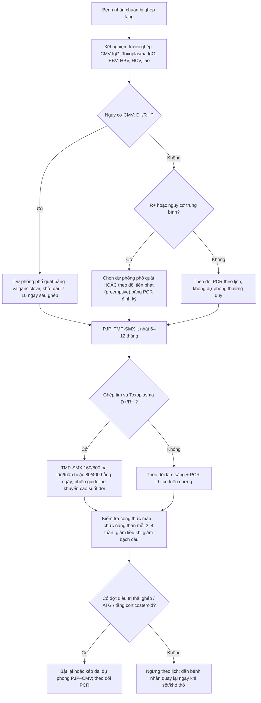
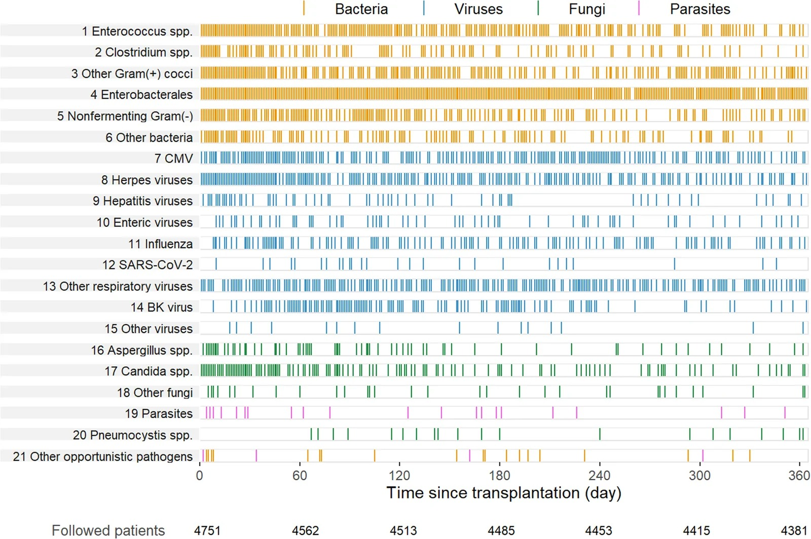
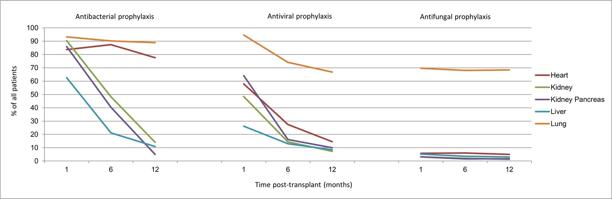
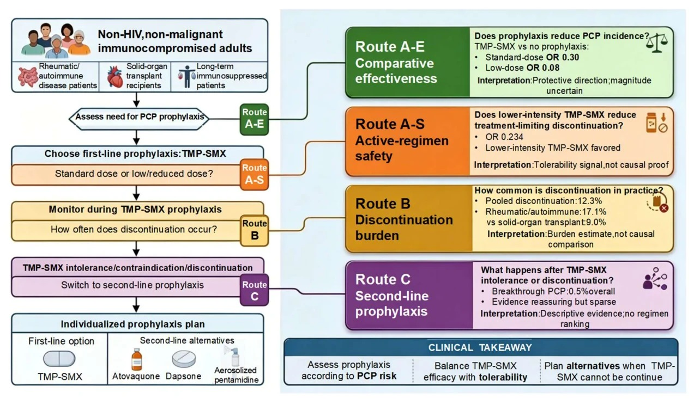
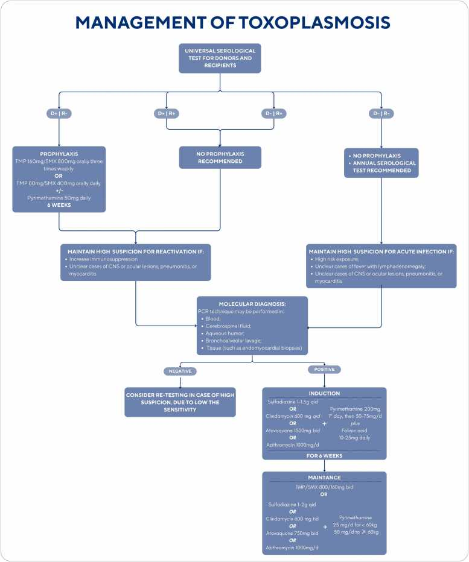

# 1980 — Dự phòng nhiễm trùng cơ hội sau ghép tạng: PJP – CMV – toxoplasma, lịch và khi nào ngừng / Opportunistic infection prophylaxis after solid organ transplant

**Tags:** `pattern:kinh-mo` `pattern:nuot-ky-sinh` `pattern:ton-thuong-da-nganh` `vung:phoi` `vung:o-bung` `protocol:PCR-multiplex` `protocol:BDG` `incidentaloma:khong`

**Mức chắc chắn (certainty):** tổng hợp y văn (literature synthesis) — **1 đoàn hệ quốc gia 4.751 người ghép** (*Curr Infect Dis Rep* 2026, PMC13653959, CC BY), **1 phân tích gộp mạng lưới về dự phòng PJP** (*J Fungi* 2026, PMC13514556, CC BY), **1 tổng quan về CMV ở người ghép thận** (PMC13697321, CC BY-NC-ND) và **1 tổng quan về toxoplasma ở người ghép tim** (*JHLT Open* 2026, PMC12799946, CC BY-NC-ND). Nhóm **không có bệnh nhân của mình**. Chỗ nguồn không nêu rõ (thời gian dự phòng ở nhóm D+/R−) được ghi là **"chưa rõ — cần tra guideline gốc"**, không suy diễn.

> **Câu chốt:** sau ghép tạng, **nguy cơ nhiễm trùng thay đổi theo mốc thời gian** vì thuốc ức chế miễn dịch mạnh nhất trong **1–6 tháng đầu**; dự phòng phải **đặt đúng cửa sổ** chứ không phải "cho kháng sinh chung". Ba số phải thuộc: **(1)** trong đoàn hệ 4.751 người ghép, **27%** bị nhiễm trùng trong **tháng đầu**, **33%** từ **1–6 tháng**, **23%** từ **6–12 tháng** — tức nguy cơ **không biến mất** khi ra viện (PMC13653959); **(2)** dự phòng PJP bằng TMP-SMX **giảm PJP rõ rệt** (OR **0,30** với liều chuẩn, OR **0,08** với liều thấp) nhưng **12,3%** người dùng phải ngừng vì tác dụng phụ — ở người ghép tạng là **9,0%** (PMC13514556); **(3)** ở người ghép tim **D+/R−** cho toxoplasma, **không dự phòng thì nguy cơ lây từ 57–75%**, và **có dự phòng thì hầu như không còn ca hoạt hóa** — dự phòng có thể phải **suốt đời** (PMC12799946).

## 1. Tổng quan bệnh học – cơ chế hình ảnh

### 1.1 Vì sao "lịch" quan trọng hơn "loại kháng sinh"

- Sau ghép, **trạng thái ức chế miễn dịch ròng (net state of immunosuppression)** thay đổi theo thời gian: **cao nhất 1–6 tháng đầu** (liều ức chế cao, thiếu hụt tế bào T, giảm bạch cầu do thuốc), rồi **giảm dần** nhưng **tăng vọt** mỗi khi **điều trị thải ghép/thay đổi thuốc**.
- Vì vậy mỗi tác nhân có **cửa sổ riêng**: vi khuẩn ngoại sinh **24–72 giờ quanh mổ**; **CMV** tập trung **1–6 tháng**; **PJP** có thể **muộn hơn, sau khi đã ngừng dự phòng**; **toxoplasma** ở người ghép tim **D+/R−** có thể **bùng phát muộn** và cần dự phòng dài.
- Đoàn hệ Thụy Sĩ (4.751 người ghép: 383 tim, 1.121 gan, 488 phổi, 2.646 thận, 113 thận–tụy) ghi **5.389 nhiễm trùng lâm sàng** trong năm đầu: **27%** bệnh nhân nhiễm trong tháng 1 (**11,95 ca/1.000 ngày–ghép**), **33%** từ tháng 1–6 (**3,88/1.000**), **23%** từ tháng 6–12 (**2,02/1.000**); **vi khuẩn chiếm ~60%** tổng số nhiễm (PMC13653959).
- **Điều trị thải ghép làm "mở lại" cửa sổ:** nhiễm PJP và CMV muộn xuất hiện **sau khi đã ngừng dự phòng**, thường sau các đợt tăng ức chế miễn dịch (PMC13653959). Đây là lý do dự phòng phải **bật lại** khi có biến cố, không chỉ tính theo tháng.

### 1.2 Ba tác nhân, ba cơ chế hình ảnh

| Tác nhân | Cơ chế tổn thương | Hình ảnh chính | Số liệu định lượng |
|---|---|---|---|
| **PJP** (*Pneumocystis jirovecii*) | Vi nấm bám **phế nang**, gây **viêm phổi kẽ–phế nang** với **dịch protein trong lòng phế nang** (không phải mủ đặc) | **Kính mờ hai bên**, ưu thế **rốn phổi/perihilar**, **dày kẽ dạng lưới**, **nang khí (pneumatocele)** ở 10–30%; CT có thể **âm tính sớm** | Dự phòng **≥ 6–12 tháng** sau ghép (AST, dẫn trong PMC13514556); **12,3%** ngừng TMP-SMX vì tác dụng phụ (chung), **9,0%** ở người ghép tạng (PMC13514556) |
| **CMV** | Virus **họ Herpes**, lây qua **mô ghép/bạch cầu**; ức chế miễn dịch → **nhân lên** trong nội mô, gây **viêm phổi, viêm gan, viêm dạ dày–ruột, viêm võng mạc** | **Kính mờ + nốt nhỏ + đông đặc**; viêm phổi CMV **không đặc hiệu**, phải **PCR/DNAemia** | Không dự phòng: **nhiễm 60%, bệnh 56%** trong 3 tháng (PMC13697321); dự phòng **bắt đầu 7–10 ngày** sau ghép, kéo dài **3–6 tháng** (PMC13697321); **25%** vẫn nhiễm dù có dự phòng (PMC13697321) |
| **Toxoplasma** (*T. gondii*) | Ký sinh trùng **nội bào**, tạo **nang bradyzoite** trong cơ tim/dây thần kinh; ở người ghép tim, nang nằm **ngay trong mô ghép** | **Viêm não: nhiều ổ ngấm thuốc hình vòng ở hạch nền**, phù; **viêm cơ tim**, **viêm phổi kẽ**; chẩn đoán bằng **PCR dịch não tủy/máu** | **D+/R− không dự phòng: lây 57–75%**; dự phòng TMP-SMX **160/800 ba lần/tuần** hoặc **80/400 mỗi ngày**; nhiều guideline khuyến cáo **suốt đời** ở D+/R− (PMC12799946) |

### 1.3 TẠI SAO TMP-SMX phòng được cả ba — và vì sao không phải "một liều cho tất cả"

- **TMP-SMX** ức chế **hai bước liên tiếp** trong tổng hợp folate của vi khuẩn/đơn bào: **dihydropteroate synthase (SMX)** và **dihydrofolate reductase (TMP)**. PJP và Toxoplasma đều **không tự tổng hợp purin** nên phụ thuộc folate → nhạy cảm. Đây là lý do **một thuốc phủ được 2 tác nhân**, và cũng phủ **Nocardia, Listeria** một phần.
- **Liều "chuẩn" và "thấp" khác nhau về độc tính, không khác nhiều về hiệu quả:** phân tích gộp mạng lưới cho thấy cả liều chuẩn (OR 0,30; KTC 95% 0,18–0,48) và liều thấp (OR 0,08; 0,03–0,18) đều giảm PJP so với không dự phòng, trong khi **liều thấp ít phải ngừng hơn** (OR 0,234; 0,145–0,377) (PMC13514556). Vì vậy ở người **không dung nạp**, **giảm liều là một lựa chọn có bằng chứng**, không phải "bỏ dự phòng".
- **"Dự phòng" không đồng nghĩa "không cần chẩn đoán":** CMV có thể **nhiễm đột phá** (25% dù dự phòng — PMC13697321); PJP muộn sau khi ngừng; toxoplasma có thể lây **dù đã dự phòng không đủ liều**. Triệu chứng + PCR vẫn là chuẩn.

## 2. Mẫu hình + chẩn đoán phân biệt theo vị trí (gamut)

- **Phổi (kính mờ hai bên):** **PJP** (kính mờ đối xứng rốn phổi + dày kẽ + nang khí), **CMV** (kính mờ + nốt nhỏ + đông đặc, có thể một bên), **RSV/cúm** (tree-in-bud, dày thành phế quản), **Aspergillus** (nốt + dấu quầng), **nhiễm *Nocardia*** (nốt/đông đặc + áp-xe não), **phù phổi** (dịch khe, tim to), **xuất huyết phế nang** (kính mờ + ho ra máu).
- **Não (nhiều ổ ngấm thuốc):** **toxoplasma** (nhiều ổ vòng ở hạch nền, **thường không quá 3 cm**), **lymphoma nguyên phát CNS** (một/nhiều ổ, ngấm đồng nhất, **hạn chế khuếch tán mạnh**), **áp-xe nấm** (Aspergillus, Mucor), **PML** (BK/ JC — **không ngấm thuốc**, chất trắng dưới vỏ), **CMV encephalitis** (quanh não thất), **di căn**.
- **Đường tiêu hóa:** **CMV** (loét nông, dày thành, có thể **thủng**), **C. difficile**, **EBV–PTLD** (khối/dày thành), **Mycobacterium** (loét, hạch mạc treo).
- **Mắt:** **CMV retinitis** (xuất huyết + hoại tử dạng "pizza pie" ở người ghép **hiếm hơn AIDS** nhưng mù nhanh), **toxoplasma retinochoroiditis** (ổ hoại tử trắng cạnh sẹo cũ).
- **Bối cảnh quyết định tên gọi:** cùng "kính mờ hai bên", **cửa sổ 1–6 tháng sau ghép + suy giảm lympho** → PJP/CMV; **sau khi tăng ức chế miễn dịch** → PJP muộn; **người ghép tim D+/R−** → toxoplasma. Không có bối cảnh thì chỉ là "viêm phổi" — không được gọi tên tác nhân.

## 3. Bảng so sánh phân biệt (ma trận đối chiếu)

| Thực thể (entity) | Hình ảnh / xét nghiệm điển hình | Chốt vào (rule-in) | Chốt loại (rule-out) | Gợi ý xác nhận |
|---|---|---|---|---|
| **PJP** | Kính mờ hai bên ưu thế rốn phổi + dày kẽ; **BDG huyết thanh tăng**; LDH tăng | **Kính mờ đối xứng + BDG dương + PCR/BAL dương** | CT bình thường **không loại trừ** ở người suy giảm miễn dịch nhẹ; BDG âm **giảm mạnh** khả năng PJP | PCR *P. jirovecii* trên BAL; BDG; không cần hình ảnh để bắt đầu điều trị khi lâm sàng nặng |
| **CMV** | Kính mờ + nốt nhỏ + đông đặc; **PCR CMV máu (DNAemia)**; soi đáy mắt | **DNAemia dương + tổn thương cơ quan phù hợp** (viêm phổi/gan/ruột) | PCR âm **không loại trừ** CMV ở mô (sinh thiết); IgM không dùng để chẩn đoán bệnh | PCR định lượng + nội soi/sinh thiết; soi đáy mắt |
| **Toxoplasma** | **Nhiều ổ vòng ở hạch nền** trên MRI; **PCR dịch não tủy**; tổn thương cơ tim trên MRI tim | **IgG D+/R− + tổn thương não nhiều ổ + PCR dương** | Ổ đơn độc > 3 cm, ngấm đồng nhất, hạn chế khuếch tán mạnh → nghĩ lymphoma hơn | PCR máu/DNT; MRI não; sinh thiết não khi không đáp ứng 10–14 ngày |
| **Nhiễm *Nocardia*** | Nốt/đông đặc phổi + **áp-xe não**; Gram dương dạng sợi phân nhánh | **Nốt phổi + áp-xe não + cấy Nocardia** | Không có tổn thương não và cấy âm → ít nghĩ | Cấy mẫu bệnh phẩm, PCR 16S; hình ảnh não |
| **Phù phổi / xuất huyết phế nang** | Kính mờ + **dịch khe + tim to** hoặc **ho ra máu** | **Đáp ứng lợi tiểu nhanh** (phù) hoặc **Hct giảm + hình mờ đậm** (xuất huyết) | Kính mờ dai dẳng không đáp ứng lợi tiểu → không phải phù đơn thuần | Siêu âm tim, BNP; BAL có hemosiderin |
| **PTLD (EBV)** | Khối/dày thành ruột, hạch, **ngấm thuốc đồng nhất**, có thể trong mô ghép | **EBV DNA cao + khối + mô bệnh tăng sinh lympho** | Không có EBV DNA và mô bệnh lành → không phải PTLD | Sinh thiết + EBV DNA + PET/CT |

## 4. Protocol chụp + hệ phân độ/điểm chuẩn hóa

### 4.1 Chọn chiến lược dự phòng (flowchart)

### 4.2 Liều và thời gian (theo nguồn)

| Tác nhân | Thuốc dự phòng | Liều / đường | Thời gian | Nguồn |
|---|---|---|---|---|
| **PJP** | **TMP-SMX** (ưu tiên) | 80/400 mg uống **mỗi ngày** hoặc 160/800 mg **3 lần/tuần** (liều thấp có hiệu quả, ít ngừng hơn) | **≥ 6–12 tháng** sau ghép; lâu hơn ở ghép phổi | AST dẫn trong PMC13514556; PMC13514556 |
| **PJP (thay thế)** | Dapsone 100 mg/ngày; atovaquone 1.500 mg/ngày; pentamidine khí dung 300 mg/tháng | — | Khi dị ứng/không dung nạp sulfa | PMC13514556 |
| **CMV** | **Valganciclovir** (hoặc ganciclovir IV, letermovir) | 900 mg/ngày khi CrCl ≥ 60; **450 mg/ngày** khi CrCl 40–59; **450 mg mỗi 48 giờ** khi 25–39; **450 mg 2 lần/tuần** khi < 25; **100 mg 3 lần/tuần** khi lọc máu | **3–6 tháng**; khởi đầu **7–10 ngày** sau ghép | PMC13697321 |
| **Toxoplasma (D+/R−)** | **TMP-SMX** | **160/800 mg uống 3 lần/tuần** hoặc **80/400 mg mỗi ngày** | **Nhiều guideline: suốt đời** ở nhóm nguy cơ cao; một số trung tâm thêm **pyrimethamine 50 mg/ngày × 100 ngày** | PMC12799946 |
| **Toxoplasma (dị ứng sulfa)** | Dapsone + pyrimethamine | **Dapsone 50 mg/ngày + pyrimethamine 50 mg/tuần** | Như trên | PMC12799946 |

- **Điều chỉnh theo chức năng thận là bắt buộc** với valganciclovir: **quá liều ở suy thận gây giảm bạch cầu trung tính**, dễ bị quy nhầm cho mycophenolate hoặc nhiễm virus.
- **Theo dõi trong khi dự phòng:** công thức máu + creatinin **mỗi 2–4 tuần** trong 3 tháng đầu; với TMP-SMX thêm **kali** (tăng kali do TMP) và **men gan**.
- **Khi nào ngừng:** theo lịch ở trên; **ngừng sớm hơn không được khuyến cáo** nếu còn yếu tố nguy cơ (điều trị thải ghép, giảm bạch cầu, ghép phổi). Không có "điểm cắt" tuyệt đối — **quyết định theo nguy cơ tái đánh giá mỗi lần thay đổi ức chế miễn dịch**.

### 4.3 Hình minh họa

- Đọc hai hình này cùng nhau: **nhiễm trùng rải khắp năm đầu** (hình trên) nhưng **dự phòng phần lớn đã ngừng ở tháng 12** trừ **ghép phổi** (hình dưới) — đó chính là **khoảng trống** sinh ra CMV/PJP muộn.

## 5. Biến thể bình thường và cạm bẫy

- **Biến thể bình thường:** **kính mờ nhẹ đáy phổi** do thở kém sau mổ; **dày kẽ nhẹ** do quá tải dịch; **hạch trung thất nhỏ** sau ghép; **tăng nhẹ LDH** do tan máu nhẹ — **không** được tự động gọi là nhiễm trùng cơ hội.
- **Cạm bẫy 1 — "đã hết 6 tháng là an toàn":** CMV **muộn** và PJP **muộn** xảy ra **sau khi ngừng dự phòng**, nhất là sau đợt điều trị thải ghép (PMC13653959). Phải **bật lại** dự phòng khi tăng ức chế miễn dịch.
- **Cạm bẫy 2 — quên toxoplasma ở người ghép tim D+/R−:** không có dự phòng thì **57–75% lây** (PMC12799946); tổn thương có thể **âm thầm** và chỉ lộ ra khi đã **viêm cơ tim/viêm não**.
- **Cạm bẫy 3 — "TMP-SMX độc nên bỏ":** **12,3%** ngừng vì tác dụng phụ (9,0% ở người ghép tạng) nhưng **giảm liều có bằng chứng** (OR 0,234 ít ngừng hơn, hiệu quả vẫn giữ) (PMC13514556); bỏ hẳn là mở cửa cho PJP.
- **Cạm bẫy 4 — không chỉnh liều valganciclovir theo CrCl:** suy thận sau ghép là phổ biến; **quá liều → giảm bạch cầu**, dễ bị gọi là "do mycophenolate" rồi **giảm thuốc ức chế miễn dịch** sai hướng (nguy cơ thải ghép).
- **Cạm bẫy 5 — tương tác thuốc:** **valganciclovir + mycophenolate** cộng hợp tủy; **TMP-SMX + methotrexate** tăng độc tủy; **dapsone** ở người **thiếu G6PD** gây tan máu; **atovaquone** hấp thu kém nếu không uống cùng thức ăn béo.
- **Cạm bẫy 6 — BDG dương không đồng nghĩa PJP:** BDG dương còn gặp ở **Candida/Aspergillus**, lọc máu màng cellulose, globulin IV; BDG **âm** có giá trị **loại trừ** tốt hơn.
- **Cạm bẫy 7 — coi "PCR CMV dương" là bệnh CMV:** **nhiễm** (DNAemia) khác **bệnh** (tổn thương cơ quan). Điều trị theo **ngưỡng DNA + triệu chứng**, không theo một lần PCR dương.
- **Cạm bẫy 8 — satisfaction of search:** thấy PJP trên CT rồi dừng, bỏ sót **đồng nhiễm** (CMV, Aspergillus) — trong đoàn hệ, **nhiễm trùng chồng lấp** là quy luật, không phải ngoại lệ.

## 6. Tự lượng giá — Blind Quiz ngay trên trang tĩnh

**Ca 1 — bệnh nhân ghép thận, khó thở tháng thứ 3**

- Gợi ý lâm sàng: nam **52 tuổi**, ghép thận **tháng thứ 3**, đang dùng tacrolimus–mycophenolate–prednisolone; sốt nhẹ, **SpO₂ 90%**, CT **kính mờ hai bên ưu thế rốn phổi**.
- Câu hỏi: Nhìn timeline, **nhóm tác nhân nào** đang ở đỉnh trong khoảng 60–120 ngày? Ba chẩn đoán phân biệt hàng đầu? Xét nghiệm nào **chốt**?

<b>Bấm để hiện đáp án (findings + chẩn đoán)</b>

- Dấu hiệu: hình timeline cho thấy **vi khuẩn** rải đều cả năm, **CMV** và **herpes virus** tập trung nhiều ở **60–180 ngày**, **PJP** xuất hiện **rải rác từ ~60 ngày trở đi** và **vẫn có ca sau 240 ngày**.
- Chẩn đoán: nghĩ **PJP** (kính mờ đối xứng + LDH tăng + BDG dương), **CMV** (DNAemia, có thể kèm tổn thương gan/ruột), **nhiễm khuẩn cộng đồng** (phế cầu, cúm). Chốt bằng **PCR *P. jirovecii* trên BAL + BDG + PCR CMV máu**.
- Vì sao: cửa sổ 1–6 tháng là lúc **ức chế miễn dịch mạnh nhất**; kính mờ đối xứng rốn phổi là mẫu hình kinh điển của PJP.
- Nguồn ảnh: van Delden C, Zou M, Mueller N. *Curr Infect Dis Rep* 2026;28(1). Fig. 2 — PMC13653959 · CC BY 4.0.

**Ca 2 — quyết định dự phòng PJP ở người không dung nạp TMP-SMX**

- Gợi ý lâm sàng: nữ **38 tuổi** ghép gan, TMP-SMX gây **phát ban + giảm bạch cầu**, cần dự phòng PJP 6 tháng.
- Câu hỏi: Có nên **ngừng hẳn** dự phòng? Ba lựa chọn thay thế? Con số nào nói rằng **giảm liều** hợp lý?

<b>Bấm để hiện đáp án (findings + chẩn đoán)</b>

- Dấu hiệu/số liệu trong sơ đồ: TMP-SMX liều chuẩn **OR 0,30** và liều thấp **OR 0,08** so với không dự phòng; **liều thấp ít ngừng hơn** (OR **0,234**); ngừng thuốc chung **12,3%**, ở người ghép tạng **9,0%**; nhiễm đột phá khi dùng thuốc thay thế **0,5%**.
- Chẩn đoán/ xử trí: **không bỏ dự phòng** — thử **giảm liều TMP-SMX**; nếu vẫn không dung nạp → **atovaquone 1.500 mg/ngày**, **dapsone 100 mg/ngày** (kiểm G6PD), **pentamidine khí dung 300 mg/tháng**.
- Vì sao: hiệu quả bảo vệ còn giữ ở liều thấp trong khi độc tính giảm; bỏ dự phòng đổi lấy nguy cơ PJP có tử vong cao.
- Nguồn ảnh: Wu X, Zhang Y, Wang K, Zhu L. *J Fungi (Basel)* 2026;12(8):627. Fig. 2 — PMC13514556 · CC BY 4.0.

**Ca 3 — người ghép tim D+/R−, sốt và lú lẫn**

- Gợi ý lâm sàng: nam **45 tuổi**, ghép tim **2 tháng**, **Toxoplasma IgG âm trước ghép**, người hiến **IgG dương**; sốt, lú lẫn, yếu nửa người.
- Câu hỏi: Nguy cơ lây nếu **không dự phòng**? Phác đồ dự phòng và thời gian? Nếu dị ứng sulfa thì dùng gì?

<b>Bấm để hiện đáp án (findings + chẩn đoán)</b>

- Dấu hiệu: sơ đồ xử trí toxoplasma tóm tắt **sàng lọc trước ghép**, **dự phòng ở D+/R−**, **theo dõi PCR**, và **điều trị khi có tổn thương cơ quan**.
- Chẩn đoán: **viêm não do toxoplasma lây từ mô ghép** (D+/R−) — nguy cơ **57–75%** nếu không dự phòng; dự phòng **TMP-SMX 160/800 ba lần/tuần** hoặc **80/400 mỗi ngày**, nhiều guideline **suốt đời**; dị ứng sulfa → **dapsone 50 mg/ngày + pyrimethamine 50 mg/tuần**.
- Vì sao: nang bradyzoite nằm **trong cơ tim của người hiến**; ức chế miễn dịch cho phép nang **giải phóng** và gây bệnh.
- Nguồn ảnh: Tejo AM, Campos SV. *JHLT Open* 2026;11:100450. Fig. 4 — PMC12799946 · CC BY-NC-ND 4.0 (nguyên bản, không chỉnh sửa).

## Bài liên quan chéo
- [1788 – Viêm phổi do *Pneumocystis jirovecii* ở người không nhiễm HIV](../1788-viem-phoi-pjp-khong-hiv/lesson.md)
- [1826 – Viêm phổi do thuốc ức chế mTOR](../1826-viem-phoi-do-thuoc-uc-che-mtor/lesson.md)
- [1789 – Viêm phổi do CMV ở người ghép tạng](../1789-viem-phoi-do-cmv-o-nguoi-ghep-tang/lesson.md)
- [3096 – Bệnh thận do BK polyomavirus sau ghép thận](../3096-benh-than-do-bk-polyomavirus/lesson.md)

## Ảnh
- Tên file: `NNN_slug_Modality_SourceID.jpg`. Nguồn + giấy phép từng ảnh trong `images/CREDITS.md`.
- Bài **không có composite** vì một ảnh là **CC BY-NC-ND** (không được tạo tác phẩm phái sinh).

> Không dùng để chẩn đoán độc lập khi chưa có người hướng dẫn.
