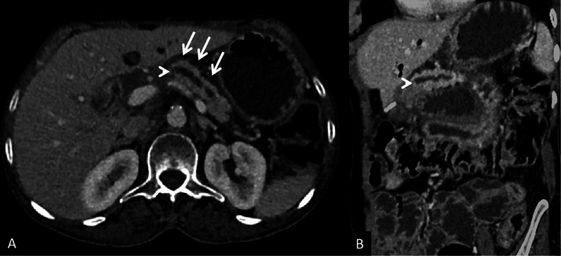
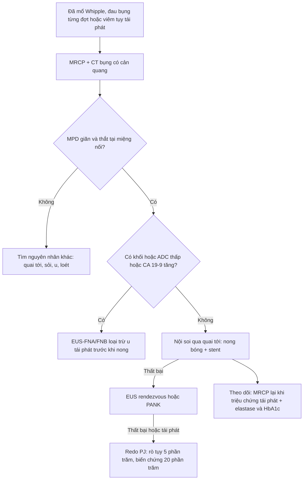
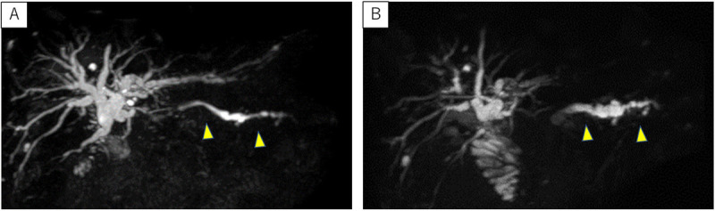

# 1981 — Hẹp miệng nối tụy–ruột sau mổ Whipple / Pancreaticojejunostomy (PJ) stricture

**Tags:** `pattern:hep-mieng-noi` `pattern:gian-ong-tuy` `pattern:teo-tuy` `pattern:viem-tuy-tai-phat` `vung:tuy` `vung:o-bung` `protocol:MRCP` `protocol:CT-bung-co-can-quang` `protocol:EUS` `score:MPD`

**Mức chắc chắn (certainty):** tổng hợp y văn (literature synthesis) — số liệu lấy từ **ba đoàn hệ/loạt ca có đếm được mẫu số** (314 ca, J Visc Surg 2019; 20 ca theo dõi 1 năm, Langenbecks Arch Surg 2023 — PMC10444682; 95 ca PEI, Pancreatology 2022), **một bài tổng quan hình ảnh hậu phẫu** (Indian J Radiol Imaging 2026 — PMC12788925) và **ba ca nguyên văn có ảnh** (PMC11213583; PMC5076772; Gastrointest Endosc 2010). Không có thử nghiệm ngẫu nhiên; các ngưỡng điều trị là thực hành đồng thuận, chỗ suy luận được ghi rõ.

> **Câu chốt:** hẹp miệng nối tụy–ruột là biến chứng **muộn, hiếm nhưng bị bỏ sót nhiều** — ba con số quyết định: **(1)** hẹp *có triệu chứng* chỉ **0,9% (3/314)** và y văn ghi **< 3%**, nhưng xuất hiện **chủ yếu ở người mổ vì bệnh lành tính nên sống lâu** (ANZ J Surg 2018); **(2)** **MRCP là khảo sát xác nhận tốt nhất** — ống tụy chính (MPD) giãn thượng lưu **thắt đột ngột tại miệng nối**, và trong ca được can thiệp MPD giảm từ **8,3 mm xuống 3,6 mm** (giảm **60%**) sau khi thông lại (Gastrointest Endosc 2010); **(3)** **hình ảnh thông ≠ chức năng tốt**: 1 năm sau mổ, **15/16 (94%)** miệng nối thông trên MRI nhưng fecal elastase giảm từ **96 xuống 15 µg/g** (bình thường > 200) — nên **không được chẩn đoán hẹp bằng elastase thấp** (PMC10444682).

## 1. Tổng quan bệnh học – cơ chế hình ảnh (TẠI SAO)

### 1.1 Bệnh học: xơ hóa tại chỗ nối, không phải "ống tụy bị bịt"

- Sau cắt đầu tụy–tá tràng (pancreaticoduodenectomy, PD/Whipple), mỏm tụy còn lại được nối vào **quai hỗng tràng** (PJ) hoặc dạ dày (PG). Miệng nối là **chỗ hẹp nhất của toàn bộ đường tụy** vì: (a) đường kính ống tụy bị cắt ngang chỉ **2–4 mm**; (b) mỏm tụy bị **thiếu máu cục bộ** sau khi thắt các nhánh mạc treo; (c) nếu có **rò tụy sau mổ (POPF)** thì ổ viêm–dịch quanh miệng nối tổ chức hóa thành **mô xơ**.
- Hệ quả: lòng nối hẹp dần trong **nhiều tháng–nhiều năm**, tạo **tăng áp lực trong ống tụy thượng lưu** → **viêm tụy tái phát từng đợt**, đau bụng, và cuối cùng **teo nhu mô tụy** + **suy tụy ngoại tiết** (PEI) + **đái tháo đường**.
- Vì là biến chứng **muộn**, nó gặp nhiều ở người mổ vì **bệnh tiên lượng tốt** (nang nhầy, u thần kinh nội tiết, viêm tụy mạn, chấn thương) — nhóm sống đủ lâu để hẹp biểu hiện.

### 1.2 TẠI SAO nhìn thấy trên MRCP và CT: nước trong ống tụy là "đèn hiệu"

- **Dịch tụy gần như là nước tự do** → thời gian T2 **rất dài**, nên trên **MRCP (xung T2 nặng, 3D thick-slab)** ống tụy hiện thành **đường sáng trắng** trên nền mô tối; không cần cản quang.
- **Hẹp = mất tín hiệu dịch tại một điểm** + **giãn thượng lưu**: ống tụy trước chỗ hẹp to ra, **thắt hình nón (tapered) đột ngột** đúng tại thành hỗng tràng, và **không thấy dòng dịch nối tiếp vào ruột**. Ca minh họa ở mục 2 cho thấy MPD giãn **theo trục thân–đuôi** với **điểm tắc hoàn toàn tại miệng nối**.
- **Mô xơ tại miệng nối** trên MRI có tín hiệu **T2 trung–thấp** (collagen ít nước) và **ngấm thuốc thì muộn** (xơ mạch hóa), trong khi **u tái phát** là mô đặc **ngấm thuốc thì động mạch–tĩnh mạch**, **hạn chế khuếch tán (ADC thấp)** và có **khối > 1 cm**. Đây là chìa khóa phân biệt "hẹp lành" với "hẹp do u".
- **Trên CT** (ảnh A ở mục 2): ống tụy giãn là cấu trúc **giảm đậm dịch (0–20 HU)** chạy trong nhu mô tụy teo; **teo nhu mô** là dấu phụ rất gợi ý vì tụy mất chức năng thì mô mỡ thay dần. Cần **thì tĩnh mạch cửa** để thấy miệng nối, mô xơ và loại trừ giả phình động mạch quanh mổ.

### 1.3 Ngưỡng định lượng dùng được ngay trên máy

- **MPD bình thường ≤ 3 mm**; sau PD, đường kính ống tụy còn lại **trung vị 4 mm (IQR 3–5)** ở 1 năm — nên **"giãn nhẹ 3–5 mm" một mình không phải hẹp** (PMC10444682).
- Ngưỡng thực dụng cho hẹp *có ý nghĩa*: **MPD > 3 mm kèm thắt đột ngột tại miệng nối + teo nhu mô thượng lưu ± đợt viêm tụy tái phát**. Ca được can thiệp trong y văn: MPD **8,3 mm → 3,6 mm** sau thông (giảm **60%**), đau hết trong **24 tháng** theo dõi (Gastrointest Endosc 2010).
- **Chức năng ≠ hình thái:** PEI sau PD gần như **phổ quát** — **98%** bệnh nhân PD có fecal elastase **< 200 µg/g** ở 6 tháng (J Visc Surg 2018, 91 ca), **tất cả 95 bệnh nhân** trong đoàn hệ tiến cứu có PEI ở 6 tháng, và **81% (95% CI 61–93%)** được xác nhận PEI dài hạn bằng bộ ba nghiệm pháp (Pancreatology 2024). Vì vậy **elastase thấp là hệ quả của phẫu thuật, không phải bằng chứng hẹp**.

## 2. Mẫu hình + chẩn đoán phân biệt theo vị trí (gamut)

**Mẫu hình chính:** *"ống tụy giãn thượng lưu + thắt đột ngột tại miệng nối + teo nhu mô"* ở bệnh nhân đã mổ Whipple, đến với **đau bụng từng đợt** hoặc **viêm tụy tái phát**.

Gamut theo **vị trí so với miệng nối** — gợi nhớ **S.C.A.R.**:

| Vị trí | Thực thể | Vì sao phải nghĩ tới |
|---|---|---|
| **Tại miệng nối** | **S**tricture (hẹp lành tính) | Xơ hóa sau POPF/thiếu máu; thắt nhẵn, không khối |
| **Tại miệng nối** | **C**ancer (u tái phát) | Khối mô mềm > 1 cm, ngấm thuốc, ADC thấp, CA 19-9 tăng |
| **Quanh miệng nối** | **A**fferent loop (quai tới) | Tắc quai tới: quai ruột giãn > 3 cm, đầy dịch, không hơi |
| **Thượng lưu** | **R**emnant pancreatitis (viêm tụy mỏm) | Phù nhu mô, dịch quanh tụy, PPAP sau mổ |
| **Ngoài tụy** | Nang bạch huyết, áp-xe, giả phình ĐM | Ổ dịch/krăng quanh mỏm tụy, khí trong ổ, giả phình thì ĐM |

- **Phân biệt sống còn:** "hẹp lành tính" → **nong/stent qua nội soi**; "u tái phát" → **chẩn đoán mô học + điều trị hệ thống**, nong bóng chỉ làm chậm chẩn đoán.
- **Không quên trục chức năng:** PEI và đái tháo đường sau PD tiến triển **độc lập** với hẹp — nghĩa là bệnh nhân có thể vừa hẹp vừa PEI, và điều trị PEI (enzyme thay thế) không chờ kết quả hình ảnh.

*(A) ảnh trục: ống tụy chính giãn (mũi tên trắng) với **điểm thắt đột ngột tại miệng nối PJ** (đầu mũi tên); (B) ảnh MPR cong theo trục ống tụy cho thấy rõ ống giãn thượng lưu. Nguồn: Indian J Radiol Imaging 2026 — PMC12788925, Fig. 4; giấy phép **CC BY-NC-ND 4.0**, ảnh nguyên bản không cắt/ghép.*

## 3. Bảng so sánh phân biệt (ma trận đối chiếu)

| Thực thể (entity) | Hình ảnh điển hình (CT / MRCP / EUS) | Chốt vào (rule-in) | Chốt loại (rule-out) | Gợi ý xác nhận |
|---|---|---|---|---|
| **Hẹp PJ lành tính** | MPD giãn **thắt hình nón, bờ nhẵn** đúng tại miệng nối; nhu mô teo; không khối | **Thắt nhẵn + MPD > 3 mm + teo + đợt viêm tụy tái phát** | Khối mô mềm ngấm thuốc > 1 cm hoặc ADC thấp → không phải hẹp đơn thuần | MRCP ± secretin; EUS đo/thông; nong bóng thử |
| **U tái phát tại miệng nối** | Khối **mô mềm ≥ 1 cm**, bờ không đều, **ngấm thuốc thì ĐM/TM**, hạn chế khuếch tán | **Khối + ADC thấp + CA 19-9 tăng** | Ống giãn đơn thuần, không khối, CA 19-9 ổn định → nghĩ hẹp lành | EUS-FNA/FNB qua quai tới; PET-CT khi còn nghi |
| **Viêm tụy mỏm cấp (PPAP)** | Nhu mô **phù, ngấm thuốc không đều**, dịch quanh tụy, **không thắt miệng nối** | **Khởi phát ≤ 7 ngày sau mổ + amylase/lipase > 3× ULN + phù nhu mô** | Hẹp có thắt khu trú, khởi phát nhiều tháng–năm → không phải PPAP | CT thì TM cửa; theo dõi enzyme |
| **Tắc quai tới (afferent loop)** | **Quai hỗng tràng giãn > 3 cm, đầy dịch, không hơi**, hình chữ U; ống tụy có thể không giãn | **Quai giãn + nôn dịch mật + đau sau ăn** | MPD giãn đơn thuần, quai ruột xẹp → loại | CT có cản quang; enterography |
| **Ổ dịch / giả phình quanh miệng nối** | Ổ dịch **0–20 HU**, có khí nếu nhiễm; giả phình **ngấm thuốc đồng thì ĐM, giữ hình** | **Khí trong ổ + sốt** (áp-xe) hoặc **nang đậm độ mạch thì ĐM** (giả phình) | Ổ dịch đồng nhất, không khí, không đậm mạch → theo dõi | CTA; siêu âm Doppler; chọc hút khi nghi nhiễm |

## 4. Protocol chụp + hệ phân độ / thuật toán xử trí

- **Bước 1 — MRCP (khảo sát được chọn):** 3D thick-slab + chuỗi mỏng T2 fat-sat; thêm **secretin** (1 IU/kg) nếu cần đánh giá "thông chức năng": ống tụy giãn thêm sau 5–10 phút rồi xẹp = miệng nối còn thông; **không giãn thêm** gợi ý mất chức năng tiết hoặc tắc hoàn toàn (diễn giải thận trọng ở người đã PEI nặng).
- **Bước 2 — CT bụng có cản quang (thì ĐM + TM cửa, lát ≤ 3 mm):** đo MPD, tìm khối, mô xơ, ổ dịch, giả phình, quai tới. Đây là phim "một lần chụp trả lời nhiều câu hỏi" trong cấp cứu.
- **Bước 3 — EUS:** đo ống tụy, xác định miệng nối, **chọc ống tụy + đặt guidewire** để nong/stent (kỹ thuật "rendezvous"); **tỉ lệ thất bại của EUS rendezvous tới 25%**, phải làm lại nhiều lần (J Visc Surg 2019).
- **Bước 4 — nội soi qua quai tới (double-balloon) hoặc PANK** khi đường ngược dòng không tới được; kỹ thuật PANK (pancreatic antegrade needle-knife) đặt stent bắc cầu **6–8 tuần**, nâng cỡ rồi rút sau 4 tuần nữa.
- **Bước 5 — mổ lại (redo PJ)** khi thất bại nội soi/lâm sàng tái phát: **rò tụy sau mổ lại ~5%**, **biến chứng chung ~20%** — thấp hơn nhiều người nghĩ, nên **không được coi "mổ lại là quá nặng"** để trì hoãn vô hạn (J Visc Surg 2019).

**Ngưỡng & con số dùng trong quyết định:**

| Thông số | Ngưỡng / giá trị | Ý nghĩa |
|---|---|---|
| MPD sau PD | trung vị **4 mm (IQR 3–5)** ở 1 năm | "Giãn nhẹ" là bình thường hậu phẫu |
| MPD gợi ý hẹp | **> 3 mm + thắt đột ngột** | Kết hợp teo nhu mô và triệu chứng |
| Fecal elastase | **< 200 µg/g** = suy ngoại tiết | Không dùng để chẩn đoán hẹp |
| Tỷ lệ hẹp có triệu chứng | **0,9% (3/314)**; y văn **< 3%** | Bệnh hiếm, dễ bỏ sót |
| Thất bại EUS rendezvous | **tới 25%** | Cần kế hoạch dự phòng |
| Redo PJ | rò tụy **~5%**, biến chứng **~20%** | Lựa chọn hợp lý khi nội soi thất bại |

## 5. Biến thể bình thường và cạm bẫy

- **"Ống tụy giãn nhẹ sau Whipple" là bình thường:** trung vị **4 mm** ở 1 năm, **94% miệng nối thông** — đừng gọi hẹp chỉ vì MPD 4–5 mm.
- **Miệng nối khó thấy:** trên CT trục, PJ nằm sát **tĩnh mạch mạc treo trên** và có thể bị nhầm với **miệng nối dạ dày–hỗng tràng**; phải dùng **MPR cong theo trục ống tụy** (ảnh B ở mục 2) hoặc MRCP trước khi kết luận.
- **Mô xơ ngấm thuốc = "khối giả":** xơ hóa quanh miệng nối ngấm thuốc **thì muộn**, không hạn chế khuếch tán, kích thước **ổn định qua các lần chụp**. U tái phát thì **to lên** và **ADC giảm** — so phim cũ là bắt buộc.
- **Bẫy chức năng:** elastase thấp gần như **chắc chắn có** sau PD (**98%**), nên dùng nó để "chẩn đoán hẹp" là **sai logic**; ngược lại, đừng vì "hình ảnh thông" mà bỏ điều trị enzyme — **94% thông** vẫn kèm PEI.
- **Bẫy điều trị:** nong bóng lặp lại nhiều lần ở người **hẹp tái phát** làm tăng xơ và trì hoãn mổ lại; sau **2–3 lần thất bại** nên chuyển tuyến có khả năng mổ lại.

## 6. Tự lượng giá — Blind Quiz (bấm để hiện đáp án)

**Ca 1 — Nam 62 tuổi, Whipple vì nang nhầy 3 năm trước, đau thượng vị tái diễn, lipase tăng nhẹ.**

- Câu hỏi: (1) Cấu trúc giãn chạy ngang thân tụy là gì? (2) Nó thắt lại ở đâu và tại sao? (3) Ba chẩn đoán phân biệt?

<b>Bấm để hiện đáp án (findings + chẩn đoán)</b>

- **Findings:** ống tụy chính giãn (mũi tên trắng) chạy trong nhu mô tụy teo, **thắt đột ngột tại miệng nối tụy–hỗng tràng** (đầu mũi tên); MPR cong xác nhận toàn bộ trục ống tụy thượng lưu giãn.
- **Chẩn đoán:** **hẹp miệng nối PJ** sau Whipple — xơ hóa tại chỗ nối làm tắc dòng dịch tụy, gây viêm tụy thượng lưu tái phát.
- **Phân biệt:** u tái phát tại miệng nối (cần khối/ADC thấp), tắc quai tới, ổ dịch–giả phình quanh mỏm tụy.
- **Nguồn ảnh:** Indian J Radiol Imaging 2026, PMC12788925 Fig. 4 — CC BY-NC-ND 4.0 (nguyên bản, không cắt/ghép).

**Ca 2 — Cùng bệnh nhân, theo dõi MRCP 9 tháng và 22 tháng sau mổ.**

- Câu hỏi: (1) Ống tụy thay đổi thế nào giữa hai lần chụp? (2) Dấu hiệu nào trên MRCP xác nhận hẹp? (3) Bước tiếp theo?

<b>Bấm để hiện đáp án</b>

- **Findings:** (A) 9 tháng: **không giãn** ống tụy còn lại (đầu mũi tên vàng); (B) 22 tháng: **ống tụy chính giãn rõ** thượng lưu — tiến triển theo thời gian, phù hợp hẹp miệng nối mắc phải.
- **Chẩn đoán:** hẹp PJ tiến triển; MRCP là khảo sát xác nhận (J Visc Surg 2019).
- **Bước tiếp theo:** nội soi qua quai tới để nong/stent; nếu thất bại → EUS rendezvous/PANK; nếu vẫn thất bại → redo PJ.
- **Nguồn ảnh:** Endosc Ultrasound 2024, PMC11213583 Fig. 1 — CC BY-NC-SA 4.0 (nguyên bản, không cắt/ghép).

## Bài liên quan chéo
- [135 – Viêm tụy cấp & phân độ Atlanta](../135-viem-tuy-Atlanta/lesson.md)
- [1730 – Hội chứng ống tụy đứt](../1730-hoi-chung-ong-tuy-dut/lesson.md)
- [1736 – Co thắt tụy & rò tụy nội bộ](../1736-co-truong-tuy-ro-tuy-noi-bo/lesson.md)
- [1840 – Huyết khối mảnh ghép tụy](../1840-huyet-khoi-manh-ghep-tuy/lesson.md)
- [1934 – Rò tụy–phế quản](../1934-ro-tuy-phe-quan/lesson.md)

## Ảnh
- `images/1981_hep-mieng-noi_CT_PMC12788925.jpg` — CT, CC BY-NC-ND 4.0 (nguyên bản).
- `images/1981_hep-mieng-noi_MRCP_PMC11213583.jpg` — MRCP, CC BY-NC-SA 4.0 (nguyên bản).
- Nguồn + giấy phép từng ảnh: `images/CREDITS.md`. Không tạo ảnh ghép vì một ảnh là **CC BY-NC-ND**.

> Không dùng để chẩn đoán độc lập khi chưa có người hướng dẫn.
