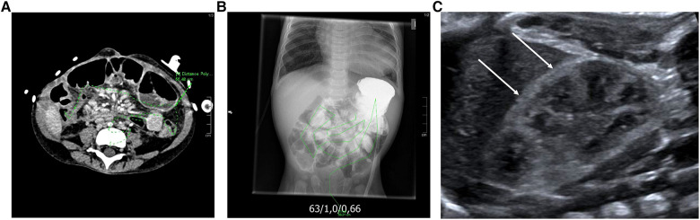
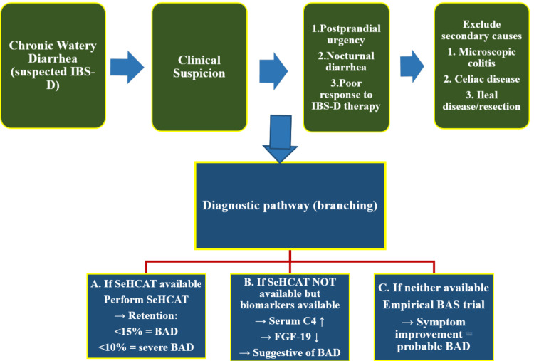
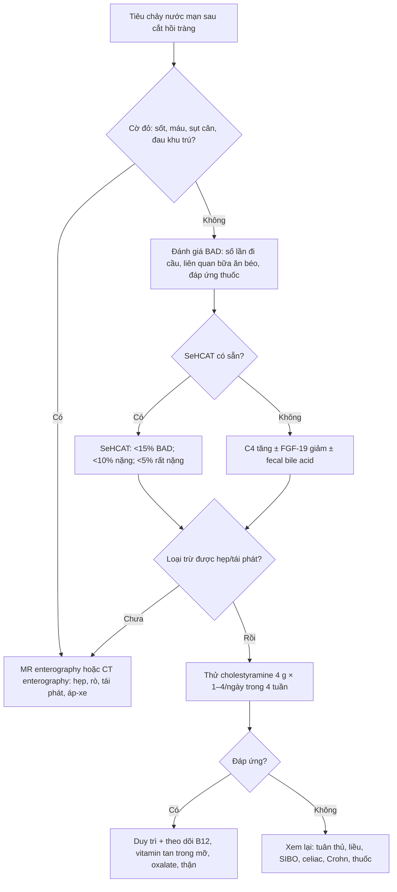
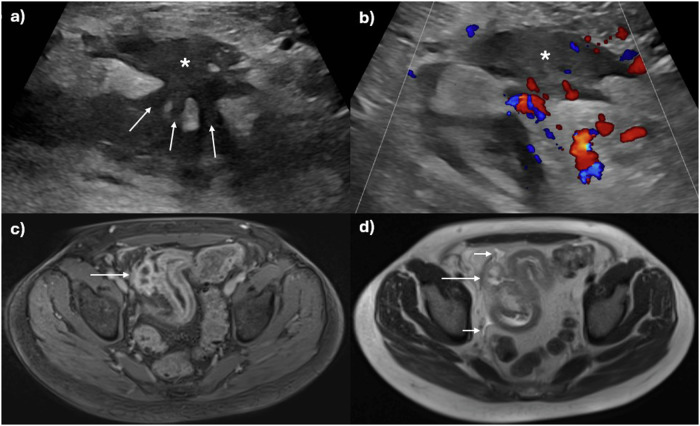
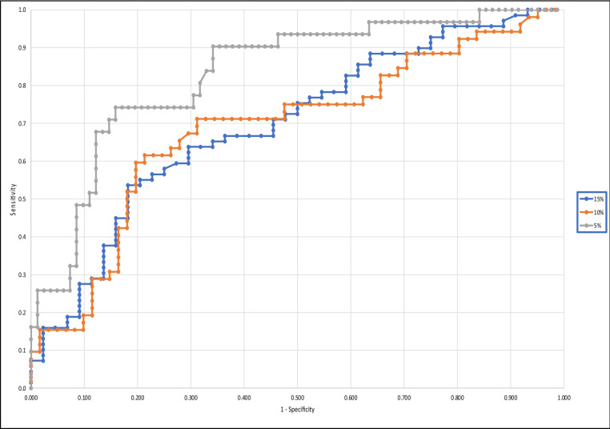

# 1982 — Tiêu chảy muối mật sau cắt hồi tràng: khi nào nghĩ tới và khi nào chụp / Bile acid diarrhea after ileal resection

**Tags:** `pattern:tieu-chay` `pattern:kem-hap-thu` `vung:ruot-non` `vung:bung` `protocol:SeHCAT` `protocol:MR-enterography` `protocol:CT-bung` `score:SeHCAT`

**Mức chắc chắn (certainty):** tổng hợp y văn (literature synthesis) — ngưỡng và cơ chế từ **tổng quan BAD 2026** (PMC13264416), **hướng dẫn tiêu chảy mạn 2023 của Hội Tiêu hóa Nhật** (PMC11633876), **nghiên cứu SeHCAT – fecal bile acid** (PMC9117305); số liệu cắt hồi tràng từ **91 bệnh nhân Crohn có phẫu thuật** (PMID 30116880) và **đoàn hệ 5.264 người Đan Mạch** (PMC10712339); hình ảnh đo ruột và biến chứng oxalate từ **nghiên cứu 55 trẻ hội chứng ruột ngắn** (PMC10369460). Không có thử nghiệm ngẫu nhiên riêng cho BAD sau cắt hồi tràng; chỗ suy luận được ghi rõ.

> **Câu chốt:** Tiêu chảy sau cắt hồi tràng **không đồng nghĩa** với bệnh Crohn tái phát, SIBO hay "hội chứng ruột kích thích". Nếu bệnh nhân **tiêu chảy nước, đi nhiều lần, không sốt, không máu**, và **hết sau bữa ăn béo** thì phải nghĩ **mất muối mật (bile acid diarrhea, BAD)**. Hình ảnh **không chẩn đoán BAD** — nhưng phải chụp để **đo chiều dài ruột còn lại, loại trừ hẹp/tái phát/rò** trước khi quy mọi triệu chứng cho "hội chứng ruột kích thích".

## 1. Tổng quan bệnh học – cơ chế hình ảnh

### 1.1 Vòng tuần hoàn ruột – gan và chỗ đứt gãy

- **Muối mật (bile acids)** được gan tổng hợp từ cholesterol, bài tiết vào ruột non để **nhũ tương hóa mỡ**. Bình thường **95%** được **tái hấp thu chủ động ở hồi tràng tận** qua **chất vận chuyển ASBT (apical sodium-dependent bile acid transporter, SLC10A2)**, quay về gan qua tĩnh mạch cửa — vòng tuần hoàn ruột – gan (enterohepatic circulation).
- **Cắt hồi tràng** làm mất bề mặt tái hấp thu → muối mật **tràn xuống đại tràng**. Tại đại tràng, muối mật **tăng tính thấm niêm mạc, kích thích bài tiết Cl⁻/nước qua cAMP** và **tăng nhu động** → **tiêu chảy nước, đi nhiều lần, có khi són phân**.
- **Cơ chế thứ hai (BAD nguyên phát):** rối loạn **trục FXR – FGF19** làm gan **tăng tổng hợp muối mật** dù hồi tràng còn nguyên; đây là cơ chế của BAD "vô căn" / IBS-D (PMC13264416).
- **Vì sao cắt hồi tràng càng dài càng nặng:** mất **chiều dài tái hấp thu** và mất **van hồi – manh tràng** (làm transit nhanh, tăng vi khuẩn đại tràng trào ngược). Nghiên cứu 91 bệnh nhân Crohn cho thấy **97% (88/91)** có SeHCAT bất thường sau cắt hồi tràng, dù trung vị chỉ cắt **24 cm** (khoảng 15–165 cm) — nghĩa là **cắt ít vẫn đủ gây BAD** (PMID 30116880).
- **Sinh lý bệnh của biến chứng muộn:** mất muối mật kéo dài → **kém hấp thu mỡ** → **thiếu vitamin tan trong mỡ (A, D, E, K)**; mất bề mặt hồi tràng → **thiếu B12**; mỡ không hấp thu **gắn calci**, để **oxalate tự do** hấp thu nhiều → **tăng oxalate niệu** → **sỏi thận/calci hóa thận** (bài 3058).

### 1.2 TẠI SAO hình ảnh không chẩn đoán được BAD

- **BAD là bệnh chức năng, không phải bệnh cấu trúc:** không có khối, không có viêm khu trú, không có dày thành đặc hiệu. **CT/MRI ở bệnh nhân BAD điển hình thường bình thường** — vì vậy "CT bình thường" **không loại trừ** BAD.
- **Muối mật không tạo đậm độ tia X** và **không đủ lớn** để thấy trên siêu âm; hình ảnh chỉ thấy **hệ quả**: quai ruột giãn nhẹ, dịch trong lòng ruột, **sỏi thận/calci hóa tủy thận** do oxalate, hoặc **hẹp/tái phát Crohn**.
- **SeHCAT (⁷⁵Se-homotaurocholic acid)** là **xét nghiệm chức năng bằng đồng vị phóng xạ**: uống capsule acid mật gắn ⁷⁵Se, chụp **gamma camera** ngay sau uống và **ngày thứ 7**, tính **tỷ lệ lưu giữ**. Vì acid mật chỉ được tái hấp thu ở **hồi tràng tận**, độ lưu giữ phản ánh **chức năng hồi tràng** — đây là lý do SeHCAT được xem là "chuẩn vàng" của BAD.
- **Ngưỡng SeHCAT:** **< 15%** = BAD; **< 10%** = BAD mức trung bình – nặng; **< 5%** = nặng (PMC13264416). Một số phác đồ dùng **< 10%** làm ngưỡng chẩn đoán chính; **10–15%** là vùng nhẹ/ranh giới.
- **TẠI SAO vẫn cần CT/MRI:** để trả lời **ba câu hỏi cấu trúc** trước khi chấp nhận BAD: (1) **chiều dài ruột non còn lại** bao nhiêu, (2) có **hẹp miệng nối** hay **tái phát Crohn** không, (3) có **rò, áp-xe, tắc** không. Bỏ bước này là bỏ sót nguyên nhân mổ được.

### 1.3 Ngưỡng định lượng và dịch tễ

| Chỉ số | Số liệu | Nguồn |
|---|---|---|
| Tỷ lệ BAD trong dân số | **1–2%** | PMC10712339 |
| BAD trong IBS-D | **10% nặng**, **32% trung bình** (tổng quan 2009 dẫn trong hướng dẫn Nhật) | PMC11633876 |
| SeHCAT bất thường sau cắt hồi tràng ở Crohn | **97% (88/91)**; trung vị cắt **24 cm** | PMID 30116880 |
| Ngưỡng SeHCAT | **< 15%** BAD; **< 10%** trung bình – nặng; **< 5%** nặng | PMC13264416 |
| Đáp ứng cholestyramine | Khoảng **70%** bệnh nhân đáp ứng; **< 5%** đáp ứng tốt nhất | PMC13264416, PMC9117305 |
| Biến chứng muộn | Thiếu **B12**, thiếu vitamin **A/D/E/K**, **tăng oxalate niệu**, sỏi thận | PMC10369460 |

- **Vì sao tỷ lệ BAD ở IBS-D cao đến vậy:** triệu chứng **trùng lặp hoàn toàn** với IBS-D (tiêu chảy nước, đau bụng, không máu); nếu không đo SeHCAT/C4, bệnh nhân bị dán nhãn "IBS" và **điều trị triệu chứng vô ích** trong nhiều năm.
- **Vì sao cholecystectomy liên quan:** bỏ túi mật làm **mất kho dự trữ muối mật**, acid mật xuống ruột **liên tục và nhiều hơn** trong bữa ăn → một số bệnh nhân tiêu chảy nước sau cắt túi mật, đáp ứng với **chất gắn acid mật (bile acid sequestrant)**.

## 2. Mẫu hình + chẩn đoán phân biệt theo vị trí/bối cảnh (gamut)

- **Sau cắt hồi tràng tận (thường gặp nhất):** BAD ± **SIBO** ± **hẹp miệng nối** ± **tái phát Crohn**. Đây là gamut "3 trong 1" — phải loại trừ cấu trúc trước.
- **Sau cắt túi mật:** BAD do mất kho dự trữ; thường xuất hiện **vài tuần – vài tháng** sau mổ, tiêu chảy nước, không sốt.
- **Bệnh Crohn hồi tràng không mổ:** viêm/loét làm giảm tái hấp thu; phân biệt với **tái phát sau mổ** bằng **MR enterography/ileocolonoscopy**.
- **SIBO (bài 1960):** cùng bối cảnh cắt ruột, nhưng **đầy hơi, chướng, tiêu chảy sau carbohydrate**, đáp ứng kháng sinh; có thể **đồng thời** với BAD.
- **Bệnh celiac, viêm ruột do xạ, vagotomy, thuốc (metformin, ức chế GLP-1, colchicine):** tiêu chảy mạn, nhưng **không đáp ứng chất gắn acid mật**; hỏi kỹ thuốc và bệnh nền.
- **Hội chứng ruột ngắn (bài 1762, 3006):** BAD là **một phần** của bệnh cảnh; ở đây vấn đề là **dinh dưỡng, PN, nhiễm catheter**, không chỉ tiêu chảy.
- **Viêm đại tràng vi thể (microscopic colitis):** tiêu chảy nước ở người lớn tuổi, **nội soi đại tràng bình thường**, chẩn đoán bằng **sinh thiết**; không đáp ứng chất gắn acid mật.

## 3. Bảng so sánh phân biệt (ma trận đối chiếu)

| Thực thể (entity) | Hình ảnh điển hình | Chốt vào (rule-in) | Chốt loại (rule-out) | Gợi ý xác nhận |
|---|---|---|---|---|
| **BAD sau cắt hồi tràng** | **CT/MRE thường bình thường**; có thể thấy **đoạn hồi tràng đã cắt, miệng nối**, quai giãn nhẹ, **sỏi/calci hóa thận** do oxalate | **SeHCAT < 15%** (nặng < 10%, rất nặng < 5%) + tiêu chảy nước đáp ứng **cholestyramine** | **Không** loại trừ bằng CT/MRI bình thường; **không** chẩn đoán bằng "đáp ứng thử" đơn thuần nếu chưa loại trừ cấu trúc | SeHCAT; nếu không có: **C4 tăng, FGF-19 giảm**, fecal bile acid |
| **SIBO (bài 1960)** | CT: quai giãn, mức dịch – khí, **không điểm chuyển tiếp**; không có dấu hiệu đặc hiệu | **Test hơi thở H₂ ≥ 20 ppm/90 phút** hoặc **CH₄ ≥ 10 ppm**; hút dịch hỗng tràng **≥ 10³ CFU/mL** | Đáp ứng cholestyramine **không** loại trừ SIBO (có thể đồng thời) | Test hơi thở, thử kháng sinh có kiểm soát |
| **Tái phát Crohn sau cắt** | MRE: **dày thành > 3 mm, tăng tín hiệu T2, ngấm thuốc, hẹp/rò**, hạch, mô mỡ quanh ruột | **Dày thành + ngấm thuốc + loét/hẹp** tại miệng nối | Niêm mạc bình thường trên nội soi + MRE âm → ít khả năng tái phát | MR enterography + ileocolonoscopy + calprotectin |
| **Hẹp miệng nối** | CT/MRE: **đoạn hẹp chuyển tiếp**, quai trước hẹp giãn; X-quang baryt: "string sign" | **Điểm chuyển tiếp + quai giãn trước hẹp** | Không có điểm chuyển tiếp → không phải hẹp cơ học | CT/MRE, nội soi, nong bóng |
| **Hội chứng ruột ngắn** | CT: **chiều dài ruột non còn lại ngắn**, giãn thích nghi, mất van hồi – manh tràng | **Ruột non còn lại < 25%** chiều dài dự kiến hoặc **phụ thuộc PN > 6 tuần** | Chiều dài bình thường → không phải SBS | Đo chiều dài trên CT/MRE (ảnh dưới) |
| **Viêm đại tràng vi thể** | Nội soi/CT **bình thường** | **Sinh thiết: tăng lympho bào hoặc dải collagen** | Sinh thiết bình thường → loại trừ | Sinh thiết đại tràng |

*(A) CT bụng: đo chiều dài ruột non còn lại bằng đường vẽ; (B) X-quang: đo chiều dài ruột; (C) siêu âm thận: **viền vỏ tăng âm** (mũi tên) = calci hóa tủy thận do tăng oxalate niệu ở trẻ hội chứng ruột ngắn. Đây là ví dụ hình ảnh **chỉ đo hậu quả**, không chẩn đoán BAD. Nguồn: Schaefer JT et al., *Front Pediatr* 2023 (PMC10369460), CC BY 4.0.*

## 4. Protocol chụp + hệ phân độ/điểm chuẩn hóa

### 4.1 SeHCAT — "protocol" chức năng

- **Chỉ định:** tiêu chảy nước mạn (> 4 tuần) không rõ nguyên nhân, đặc biệt **sau cắt hồi tràng/cắt túi mật**, nghi IBS-D không đáp ứng điều trị thường quy.
- **Kỹ thuật:** uống capsule **⁷⁵Se-homotaurocholic acid** (liều chuẩn theo quy định địa phương, thường **370 kBq**); chụp **gamma camera toàn thân** tại **thời điểm 0 (hoặc 1 giờ)** và **ngày 7**; tính **% lưu giữ đã hiệu chỉnh phân rã**.
- **Ngưỡng:** **< 15%** = BAD; **< 10%** = trung bình – nặng; **< 5%** = nặng (PMC13264416). **15–20%** là vùng ranh giới — kết hợp lâm sàng.
- **Hạn chế:** không phổ biến ở nhiều nước; **transit nhanh, bệnh celiac, SIBO** có thể gây **dương giả**; **thu thập/đo sai** gây **âm giả**. Thai kỳ: tránh (đồng vị phóng xạ).
- **Khi không có SeHCAT:** **C4 (7α-hydroxy-4-cholesten-3-one) tăng** và **FGF-19 giảm** gợi ý BAD; **fecal bile acid** là lựa chọn thay thế (PMC9117305). Nếu không có xét nghiệm nào: **thử cholestyramine 4 tuần** và đánh giá đáp ứng — nhưng phải **loại trừ cấu trúc trước**.

*Lưu đồ gốc: nghi BAD khi tiêu chảy nước mạn + mót sau ăn + tiêu chảy ban đêm + đáp ứng kém điều trị IBS-D; loại trừ viêm đại tràng vi thể, celiac, bệnh hồi tràng/cắt ruột; nếu có SeHCAT → **< 15% BAD, < 10% nặng**; nếu không → **C4 tăng/FGF-19 giảm**; nếu không có gì → **thử chất gắn acid mật**. Nguồn: Maqsood A et al., *Cureus* 2026 (PMC13264416), CC BY 4.0.*

### 4.2 MR enterography / CT enterography — "protocol" cấu trúc

- **Chỉ định:** mọi bệnh nhân tiêu chảy mạn sau cắt hồi tràng có **đau bụng, sụt cân, sốt, máu trong phân, hoặc không đáp ứng điều trị** — để tìm **hẹp, rò, tái phát Crohn, áp-xe**.
- **Chuẩn bị MRE:** nhịn ăn **4–6 giờ**; uống **dung dịch cản quang ruột** (mannitol/PEG **1–1,5 L** trong 45–60 phút) để giãn ruột; **glucagon IV** giảm nhu động; **1.5T hoặc 3T**.
- **Chuỗi xung tối thiểu:** **T2 HASTE/SSFSE** (phù, dịch), **T2 fat-sat**, **DWI** (ổ viêm/áp-xe), **T1 sau tiêm cản quang** (ngấm thuốc, rò). Đo **chiều dài ruột non còn lại** trên **coronal T2**; đo **độ dày thành** tại miệng nối (bình thường **≤ 3 mm**).
- **CT enterography** khi không có MRI: **lát mỏng ≤ 1 mm**, cản quang IV, uống **nước/iodine dilute**; ưu điểm **nhanh**, nhược điểm **bức xạ** (trẻ, chụp lặp).
- **Không dùng CT bụng thường quy để "tìm BAD"** — chỉ dùng khi có **cờ đỏ** hoặc cần đo chiều dài ruột trước phẫu thuật.

### 4.3 Điều trị và theo dõi (phần hình ảnh cần biết)

- **Cholestyramine 4 g** × **1–4 lần/ngày** (trước bữa ăn), tăng dần; **colestipol 5 g** hoặc **colesevelam 625 mg** (dung nạp tốt hơn) là lựa chọn thay thế.
- **Đánh giá đáp ứng sau 4 tuần:** giảm số lần đi cầu, phân thành khuôn; nếu không đáp ứng → **kiểm tra tuân thủ, liều, chẩn đoán khác (SIBO, Crohn, celiac)**.
- **Tương tác thuốc:** cholestyramine gắn **levothyroxine, warfarin, digoxin, statin, thuốc tránh thai** → uống **cách 4 giờ**.
- **Theo dõi:** **B12** (sau cắt hồi tràng), **vitamin A/D/E/K**, **calci – oxalate niệu 24 giờ**, **siêu âm thận** tầm soát sỏi/calci hóa; **DEXA** nếu kém hấp thu kéo dài.
- **Không tự ngừng chất gắn acid mật khi đã đáp ứng:** BAD sau cắt hồi tràng thường **kéo dài**; ngừng thuốc sẽ tái phát.

## 5. Biến thể bình thường và cạm bẫy

- **"CT bình thường" không loại trừ BAD:** đây là cạm bẫy hay gặp nhất — bệnh chức năng, không có tổn thương cấu trúc. Đừng dừng lại ở "không thấy gì".
- **Tiêu chảy sau cắt hồi tràng không phải lúc nào cũng do BAD:** có thể **SIBO**, **transit nhanh**, **tái phát Crohn**, **nhiễm trùng**, **thuốc**; và **BAD + SIBO** có thể cùng tồn tại.
- **SeHCAT dương giả:** **transit nhanh, bệnh celiac, SIBO** làm mất acid mật khỏi ruột mà không do hồi tràng; **dương giả** dẫn tới dùng cholestyramine vô ích và bỏ sót bệnh nền.
- **SeHCAT âm giả:** **thu thập/đo sai**, **không nhịn ăn**, **nôn capsule**; nếu lâm sàng mạnh, **lặp lại** hoặc dùng **C4/fecal bile acid**.
- **Cholestyramine không phải "thuốc không tác dụng phụ":** gây **táo bón, đầy hơi, tăng transaminase** hiếm; **gắn thuốc khác** (levothyroxine, warfarin) — luôn hỏi danh sách thuốc.
- **Bỏ sót biến chứng muộn:** **B12** (thiếu máu, thần kinh), **vitamin D** (loãng xương), **oxalate** (sỏi/calci hóa thận) — hình ảnh **calci hóa tủy thận** trên siêu âm là dấu hiệu muộn, không nên chờ tới lúc đó.
- **Satisfaction of search:** thấy **miệng nối hẹp nhẹ** rồi quy hết tiêu chảy cho hẹp, trong khi bệnh nhân có **BAD**; ngược lại, thấy "hồi tràng đã cắt" rồi quy hết cho BAD, bỏ sót **tái phát Crohn**.
- **Không lạm dụng CT lặp lại:** tiêu chảy mạn không cờ đỏ **không cần** CT nhiều lần; ưu tiên **xét nghiệm chức năng + MRE một lần** khi có chỉ định.

## 6. Tự lượng giá — Blind Quiz

**Ca 1 — Bé trai 3 tuổi, hội chứng ruột ngắn sau cắt hồi tràng vì xoắn ruột, tiêu chảy nước và sụt cân. CT bụng và siêu âm thận dưới đây:**

- Câu hỏi: (A) đang đo gì? (C) mũi tên chỉ gì? Hai phát hiện này liên quan thế nào đến cắt hồi tràng?

<b>Bấm để hiện đáp án</b>

- (A) **Đo chiều dài ruột non còn lại** trên CT (đường vẽ theo quai ruột); (B) đo trên X-quang; đây là cách **định lượng chiều dài ruột** để tiên lượng và theo dõi.
- (C) Siêu âm thận: **viền vỏ tăng âm** (mũi tên) = **calci hóa tủy thận** do **tăng oxalate niệu** — biến chứng của kém hấp thu mỡ sau cắt ruột (free fatty acid gắn calci → oxalate tự do hấp thu).
- Liên quan: cắt hồi tràng → **mất tái hấp thu muối mật + kém hấp thu mỡ** → BAD, thiếu vitamin tan trong mỡ, **tăng oxalate niệu**. Hình ảnh **không chẩn đoán BAD**, nhưng đo được **chiều dài ruột** và **biến chứng**.
- Nguồn: Schaefer JT et al., *Front Pediatr* 2023 (PMC10369460), CC BY 4.0.

**Ca 2 — Nam 32 tuổi, Crohn, đã cắt hồi – manh tràng 2 năm; đau hố chậu phải, tiêu chảy, CRP tăng. Siêu âm (a, b) và MRI (c, d):**

- Câu hỏi: Hình (a–b) và (c–d) cho thấy gì tại miệng nối? Đây là **BAD đơn thuần** hay có **tái phát Crohn**? Cần làm gì tiếp?

<b>Bấm để hiện đáp án</b>

- (a–b) Siêu âm: **dày thành ruột**, mất phân tầng, tăng tín hiệu Doppler; (c–d) MRI: **dày thành + ngấm thuốc**, có **đường rò/hẹp** tại miệng nối.
- Đây là **tái phát Crohn có biến chứng (rò/hẹp)**, không phải BAD đơn thuần — dù BAD có thể **đồng thời** sau cắt hồi tràng.
- Bước tiếp: **ileocolonoscopy + sinh thiết**, **calprotectin**, điều trị Crohn (sinh học/kháng viêm); **không** chỉ cho cholestyramine rồi theo dõi.
- Nguồn: Hameed M et al., *Eur Radiol* 2025 (PMC12634764), CC BY 4.0.

**Ca 3 — Nữ 41 tuổi, tiêu chảy nước 8 tháng sau cắt hồi tràng 40 cm; SeHCAT không có. Bác sĩ dùng fecal bile acid và vẽ đường cong ROC dưới đây:**

- Câu hỏi: Trục tung/trục hoành là gì? Điểm nào trên đường cong tương ứng **SeHCAT ≤ 5%**? Vì sao không dùng một ngưỡng duy nhất cho mọi mức BAD?

<b>Bấm để hiện đáp án</b>

- Trục tung = **độ nhạy (sensitivity)**; trục hoành = **1 − độ đặc hiệu (1 − specificity)**; đường cong càng lệch lên trái trên thì xét nghiệm càng tốt.
- Đường **SeHCAT ≤ 5%** (BAD nặng) có **AUC cao nhất**; khi hạ ngưỡng xuống **≤ 10%** hoặc **≤ 15%**, độ đặc hiệu giảm — tức **càng mở rộng định nghĩa BAD, xét nghiệm càng kém đặc hiệu**.
- Vì vậy **không có một ngưỡng duy nhất**: ngưỡng phụ thuộc **mục đích** (sàng lọc vs xác nhận) và **tỷ lệ mắc trước xét nghiệm**; kết hợp lâm sàng + đáp ứng thuốc.
- Nguồn: Kumar A et al., *Sci Rep* 2022 (PMC9117305), CC BY 4.0.

## Bài liên quan chéo
- [1960 – SIBO sau cắt ruột ngắn](../1960-sibo-sau-cat-ruot-ngan/lesson.md)
- [1762 – Hội chứng ruột ngắn ở người lớn](../1762-hoi-chung-ruot-ngan-nguoi-lon/lesson.md)
- [3006 – Hội chứng ruột ngắn & bệnh gan do nuôi dưỡng tĩnh mạch ở trẻ](../3006-ruot-ngan-ifald-o-tre/lesson.md)
- [3053 – Phẫu thuật kéo dài ruột STEP/LILT](../3053-phau-thuat-keo-dai-ruot-step-lilt/lesson.md)
- [162 – Tắc ruột non: điểm chuyển tiếp và chiến lược chẩn đoán](../162-tac-ruot/lesson.md)
- [1981 – Hẹp miệng nối tụy – ruột sau Whipple](../1981-hep-mieng-noi-tuy-ruot-sau-whipple/lesson.md)
- [1984 – Hẹp ruột non do NSAID và CMUSE](../1984-hep-ruot-nsaid-mang-ngan-va-cmuse/lesson.md)

## Ảnh
- Nguồn + giấy phép từng ảnh: `images/CREDITS.md`. Tất cả ảnh **CC BY 4.0**, dùng nguyên bản, không crop/ghép.
- Hình đo chiều dài ruột và calci hóa thận (PMC10369460) là ca trẻ hội chứng ruột ngắn; hình MRE (PMC12634764) là ca tái phát Crohn sau cắt hồi – manh tràng; hình ROC (PMC9117305) là biểu đồ so sánh xét nghiệm.

> Không dùng để chẩn đoán độc lập khi chưa có người hướng dẫn.
