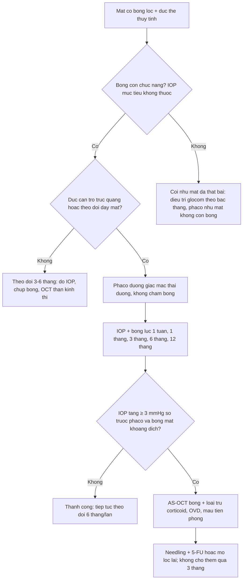
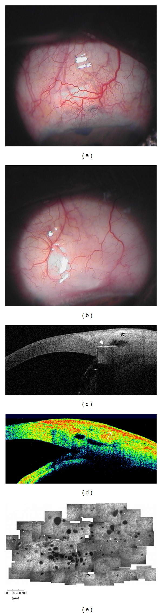
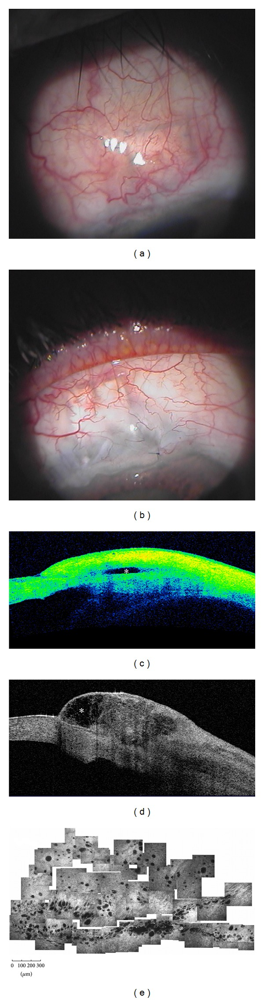
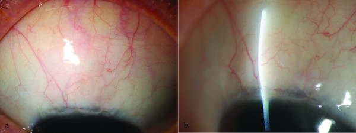
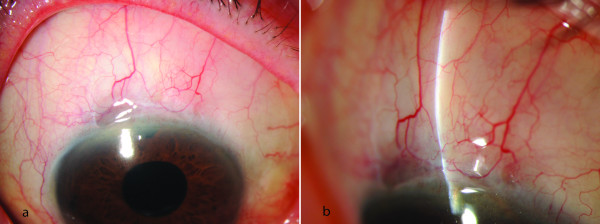

# 1983 — Đục thể thủy tinh sau trabeculectomy: phaco trên mắt có bọng lọc làm hỏng bọng thế nào, và làm sao để không tự tay phá bọng / Cataract after trabeculectomy and phacoemulsification in the bleb eye

**Tags:** `pattern:duc-the-thuy-tinh` `pattern:duc-nhan` `pattern:duc-duoi-bao-sau` `pattern:bleb-xo` `pattern:bleb-det` `pattern:bleb-dang-nang` `pattern:tang-nhan-ap-sau-phaco` `vung:the-thuy-tinh` `vung:mat` `vung:tien-phong` `protocol:den-khe` `protocol:AS-OCT` `protocol:phaco` `protocol:gonioscopy` `score:WBCS`
**Mức chắc chắn (certainty):** tổng hợp y văn (literature synthesis) — ghép **1 nghiên cứu đoàn hệ 122 mắt** (Sałaga-Pylak, *BMC Ophthalmol* 2013, PMC3638009, CC BY 2.0), **2 phân tích từ đoàn hệ CBIITS 1.098 mắt** (PMC6812865; PMC8066976), **1 phân tích gộp 25 nghiên cứu / 4.749 mắt** (PMC7896844), **1 nghiên cứu nội mô 60 mắt** (PMC8526602) và **1 nghiên cứu hình thái bọng bằng AS-OCT** (PMC4127298). Chỗ suy luận được ghi rõ "suy luận"; chỗ y văn chưa có số liệu trực tiếp ghi "chưa rõ".

> **Vì sao bài này quan trọng:** **đục thể thủy tinh là biến chứng muộn thường gặp nhất của trabeculectomy**, nên gần như mắt nào có bọng lọc tốt rồi cũng sẽ đến lúc phải phaco. Câu hỏi thực hành **không phải** "bọng có thể hỏng không" (có, và mất **~25–40%** chức năng trong 5 năm) mà là **"IOP tăng sau phaco là do bọng xơ thật, hay chỉ là đáp ứng corticoid, OVD còn sót, hay viêm thoáng qua — và khi nào thì gọi là thất bại"**. Gọi sớm → mổ/needling oan một bọng còn tốt; gọi muộn → thần kinh thị đã mất thêm trong khi bọng đã xơ không hồi.

## 1. Tổng quan bệnh học – cơ chế hình ảnh: vì sao mắt có bọng lại đục, và vì sao phaco lại phá bọng

### 1.1 Đục thể thủy tinh sau trabeculectomy: hai lực cộng lại

- **Lực thứ nhất — tuổi và tiến triển tự nhiên.** Tuổi trung bình trong các loạt trabeculectomy là **~70 tuổi** (70,7 ± 7,0 ở nhóm phaco sau trab, 70,8 ± 6,3 ở nhóm chứng; PMC3638009), đúng độ tuổi đục nhân sinh lý tăng nhanh.
- **Lực thứ hai — chính cuộc mổ lọc.** Bọng lọc làm **giảm lưu lượng thủy dịch đi qua tiền phòng**, gây **hạ nhãn áp tương đối**, **tiền phòng nông**, **viêm dưới lâm sàng kéo dài** và **vỡ hàng rào máu–thủy dịch**. Ba hệ quả trực tiếp lên thể thủy tinh:
  - **Giảm "dinh dưỡng" bề mặt:** thủy dịch mang **acid ascorbic** và glutathion cho biểu mô và vỏ trước; lưu lượng giảm + thành phần thủy dịch đổi (protein tăng khi hàng rào vỡ) → **stress oxy hóa** ở vỏ trước và biểu mô thể thủy tinh.
  - **Tiếp xúc nội mô–vỏ trước** khi tiền phòng nông: vùng tiếp xúc mất lớp nước đệm, tế bào biểu mô bị kích thích và chuyển sản → **đục dưới bao trước** và **đục vỏ**.
  - **Viêm và phản ứng tiền phòng tái diễn** (đặc biệt sau needling, sau bơm 5-FU) → đục **dưới bao sau (PSC)** nhanh.
- **Con số phải nhớ:** y văn dẫn **từ vài % đến vài chục %** mắt đục thể thủy tinh sau mổ lọc, tùy thời gian theo dõi và tuổi (PMC3638009, phần Background — bài gốc dẫn nguồn 12, 13). **Chưa có con số thống nhất** cho quần thể Việt Nam — ghi "chưa rõ", không bịa.
- **Vì sao đục lại quan trọng với bọng:** đục thể thủy tinh **làm giảm thị lực đúng lúc bọng còn tốt**; nếu chờ quá lâu, mắt **mất cửa sổ theo dõi đáy mắt và thị trường**, và mổ muộn trên mắt đã hypotony/viêm mạn thì **nội mô đã mỏng** — chính là nhóm mất nội mô nhiều nhất (mục 1.3).

### 1.2 Phaco trên mắt có bọng: bốn cơ chế phá bọng, xếp theo mức bằng chứng

1. **Viêm và xơ hóa thành bọng (cơ chế chính, có bằng chứng định lượng).** Phaco giải phóng **TGF-β, IL-6, FGF** từ biểu mô và mô kết mạc; nguyên bào sợi dưới kết mạc tăng sinh và **co rút** → thành bọng dày, **diện tích và độ cao bọng giảm**, dòng thoát giảm. Trong 50 mắt phaco sau trab thành công, **diện tích bọng nhỏ dần có ý nghĩa** (χ²(6) = 33,9; p < 0,001) và **độ cao bọng giảm** (χ²(6) = 38,2; p < 0,001), trong khi 72 mắt chứng **không đổi** (p = 0,6 và 0,7) (PMC3638009). Đây là bằng chứng **hình thái** mạnh nhất cho "phaco làm xẹp bọng".
2. **Mất gradient xuyên bọng.** Khi phaco làm **sâu tiền phòng và hạ IOP**, chênh áp qua lỗ lọc giảm; bọng **xẹp cơ học**, dính thành–củng mạc, rồi xơ. Cơ chế này giải thích vì sao **bọng giảm độ cao ngay 24 giờ** sau phaco (Z = 2,3; p = 0,02 so với trước mổ; PMC3638009).
3. **Thao tác trên kết mạc.** Đường vào **xuyên giác mạc vùng rìa phía trên** (nơi có bọng) hoặc **dụng cụ đè kết mạc** làm rách biểu mô, đưa nguyên bào sợi vào bọng. Đây là **biến số kiểm soát được bằng kỹ thuật** (mục 4) — bằng chứng chủ yếu là cơ chế và thực hành, **không có RCT** so sánh đường rạch trên vs thái dương.
4. **Tăng IOP sớm sau mổ = dấu tiên lượng xấu, không phải "chuyện nhỏ".** Trong nhóm phaco sau trab, xác suất thành công theo Cox là **70% ở 24 giờ, 54% ở 14 ngày, 42% ở 1 tháng** sau phaco (PMC3638009). Nói cách khác: **mắt tăng IOP ngay trong tháng đầu sau phaco có nguy cơ thất bại bọng rất cao** — đây là cửa sổ can thiệp.

### 1.3 Các con số quyết định

- **IOP trước và sau phaco (50 mắt, trab bằng 5-FU):** **11,6 ± 3,8 mmHg** trước; **14,4 ± 3,9** (24 giờ), **13,8 ± 3,4** (10 ngày), **13,5 ± 3,4** (1 tháng), **13,3 ± 3,5** (6 tháng), **13,1 ± 2,8** (12 tháng), **13,2 ± 2,9 mmHg** (18 tháng); nhóm chứng **11,0 → 11,5 mmHg** (PMC3638009). **Tăng IOP xảy ra ở 70% mắt phaco so với 36% mắt chứng** trong 18 tháng.
- **Xác suất thành công (IOP < 17 mmHg, không thuốc):** **75 / 75 / 71%** ở 6 / 12 / 18 tháng (nhóm phaco) so với **92 / 92 / 91%** (nhóm chứng); Wald p = 0,006, **Exp(B) = 3,7**; thời gian thất bại trung bình **14,6 vs 17,2 tháng** (PMC3638009).
- **Đoàn hệ CBIITS (1.098 mắt trab + MMC, 34 trung tâm):** sau 5 năm, thành công **40,0% vs 59,1%** (tiêu chí A: IOP ≥ 21 mmHg, p = 0,01), **35,0% vs 52,9%** (B: ≥ 18 mmHg, p = 0,01), **25,0% vs 37,5%** (C: ≥ 15 mmHg, p = 0,08) — nhóm **trab rồi phaco** so với **trab đơn thuần**; **khoảng cách trab → phaco càng ngắn, nguy cơ thất bại càng cao** (PMC6812865).
- **Phacotrab một thì vs trab rồi phaco:** thành công **không khác** khi không kiểm duyệt, nhưng khi **kiểm duyệt các ca phaco trong 5 năm**, nhóm **trab rồi phaco** thành công **cao hơn** ở cả 3 tiêu chí (p = 0,02 / < 0,01 / < 0,01); **IOP trước mổ thấp, tuổi trẻ và mổ kết hợp** là yếu tố **tiên lượng xấu** (PMC8066976).
- **Mất tế bào nội mô giác mạc (ECD):** **3,1%** sau trab đơn thuần, **17,9%** sau phaco, **31,6%** sau phacotrab một thì, **42,6%** sau **phacotrab hai thì (trab, rồi phaco sau 3 tháng)** — tức **hai lần can thiệp vào tiền phòng đắt hơn một lần** (PMC8526602).
- **Phân tích gộp 25 nghiên cứu / 4.749 mắt:** IOP trung bình **không khác** giữa phacotrab và trab (kèm/không kèm phaco sau) — MD **0,63 mmHg** (95% CI −0,32 đến 1,59) và **−0,52** (−1,45 đến 0,40); phacotrab **ít biến chứng hơn** (RR 0,80; 95% CI 0,67–0,95) và **thị lực tốt hơn 1,4 dòng** (PMC7896844). **Đọc đúng:** "ít biến chứng hơn" **không** có nghĩa "bọng bền hơn" — hai câu hỏi khác nhau.

## 2. Mẫu hình + chẩn đoán phân biệt theo thời điểm (gamut)

**Ba câu hỏi với mọi mắt có bọng lọc bị đục thể thủy tinh:** **(1) bọng còn chức năng không (IOP mục tiêu, không thuốc)? (2) đục ở mức nào và có cản trở theo dõi đáy mắt? (3) phaco sẽ đặt vào đâu trong trục thời gian — một thì, hai thì, hay hoãn?**

- **Trước mổ (mẫu hình chỉ định):** IOP đạt mục tiêu **không thuốc** với bọng khu trú; đục **nhân vàng** hoặc **PSC** ở trục quang; thị lực giảm **≥ 2 dòng** hoặc không đọc được OCT/đáy mắt. Đây là **đục thật**, không phải tổn thương thoáng qua (so với [1935](../1935-duc-the-thuy-tinh-sau-migs/lesson.md)).
- **Ngày 1–7 sau phaco:** IOP có thể **tăng nhẹ do OVD còn sót, viêm, máu tiền phòng**; bọng **giảm độ cao** (p = 0,02). **Không** gọi thất bại ở giai đoạn này.
- **1–6 tháng:** **bọng xẹp dần, diện tích giảm** (p < 0,001); IOP **tăng dần** dù chưa vượt ngưỡng. Đây là lúc **đo lại IOP không thuốc** và **chụp AS-OCT bọng**.
- **6–18 tháng:** **thất bại chức năng** — IOP ≥ 17 mmHg không thuốc (hoặc ≥ 21 mmHg theo tiêu chí A của CBIITS); thời điểm thất bại trung bình **14,6 tháng** sau phaco (PMC3638009).
- **Muộn, hướng ngược lại:** **hypotony** (IOP thấp, hoàng điểm nhăn) và **rò bọng** — vẫn xảy ra sau phaco trên mắt bọng mỏng; **không** được chỉ nghĩ đến "tăng áp".
- **Mẫu hình hình ảnh:**
  - **Đèn khe:** bọng **lan tỏa (diffuse)** hoặc **dạng nang (cystic)** với **vi nang (microcysts)** lấp lánh = còn chức năng; bọng **dẹt (flat)** hoặc **dạng nang Tenon dày (encapsulated)** = mất chức năng (PMC4127298).
  - **AS-OCT bọng:** bọng tốt có **khoang giảm hồi âm (low-reflective cavity)**, thành mỏng, nhiều vi nang; bọng hỏng có **thành dày, khoang hẹp/biến mất**, mô đặc tăng hồi âm (PMC4127298).
  - **Hiển vi đồng tiêu (confocal):** **mật độ vi nang** giảm rõ ở bọng hỏng — dùng khi cần khách quan hóa "bọng còn hay mất" trước khi quyết định needling.
  - **Đáy mắt/OCT thần kinh thị:** đo **RNFL/GC-IPL** trước và sau phaco — IOP tăng có ý nghĩa chỉ khi **kèm mất thần kinh thị**, không chỉ là con số.

## 3. Bảng so sánh phân biệt (ma trận đối chiếu)

| Thực thể (entity) | Hình ảnh điển hình | Chốt vào (rule-in) | Chốt loại (rule-out) | Gợi ý xác nhận |
|---|---|---|---|---|
| **Suy bọng do xơ hóa sau phaco** | Bọng dẹt, thành dày, mất khoang dịch trên AS-OCT; IOP tăng dần 1–18 tháng | **Tiền sử phaco trên mắt có bọng + IOP không thuốc tăng ≥ 3 mmHg so với trước phaco + bọng mất khoang dịch** | **Bọng còn khoang giảm hồi âm + vi nang + IOP không đổi** | AS-OCT bọng + IOP không thuốc 3 lần; so ảnh trước/sau |
| **Bọng dạng nang Tenon (encapsulated bleb)** | Vòm khu trú, thành dày, mạch máu to; AS-OCT: khoang lớn **thành dày > 1 mm**, không vi nang | **Bọng cao khu trú bất thường + IOP tăng + đau/khó chịu** | Bọng lan tỏa mềm, vi nang, IOP tốt | Đèn khe + AS-OCT; phân biệt với bọng "cao" lành tính |
| **Đáp ứng corticoid** | Giác mạc trong, tiền phòng yên, bọng **không đổi**; IOP tăng **2–6 tuần** sau khi tăng liều corticoid | **IOP tăng đúng mốc thêm corticoid + bọng nguyên vẹn + giảm khi ngừng/giảm** | Bọng dẹt/xơ, IOP tăng kèm thay đổi hình thái bọng | Ngừng/giảm corticoid, đo lại 1–2 tuần |
| **OVD còn sót / tăng IOP sớm sau phaco** | Tiền phòng có chất nhầy trong, IOP vọt **ngày 1–3**, bọng có thể xẹp tạm | **IOP vọt trong 72 giờ + tiền phòng sâu, không viêm** | IOP tăng **sau 1 tháng**, bọng xẹp tiến triển | Rửa tiền phòng nếu cần; đáp ứng nhanh với hạ áp |
| **Glôcôm ác tính / block đồng tử** | **Tiền phòng dẹt**, IOP cao, **lỗ mống mắt (PI) thông** | **Tiền phòng dẹt + IOP cao + PI thông** | Tiền phòng sâu, bọng dẹt = suy bọng | Siêu âm/UBM, xem [1448](../1448-glaucoma-ac-tinh-sau-mo-noi-nhan/lesson.md) |
| **Hypotony maculopathy** | IOP **≤ 6 mmHg**, hoàng điểm nhăn nheo trên OCT, bọng quá lớn/rò | **IOP thấp kéo dài + nếp gấp hoàng điểm + thị lực giảm** | IOP bình thường/cao | OCT hoàng điểm; soi bọng tìm rò (Seidel) |
| **Phù hắc mạc / tràn dịch** | Siêu âm: dịch dưới hắc mạc, hắc mạc dày; tiền phòng nông | **Tiền phòng nông + IOP thấp + siêu âm có dịch** | Tiền phòng sâu, bọng xẹp | Siêu âm B/UBM |

## 4. Protocol chụp – kỹ thuật phaco trên mắt có bọng + cách cho điểm bọng

### 4.1 Trước mổ: đo cái gì, ở đâu

- **IOP không thuốc (washout) ít nhất 4 tuần** nếu an toàn, để biết **bọng đang gánh bao nhiêu**; ghi rõ **số thuốc** và **thời điểm so với phaco**.
- **Đèn khe + ảnh bọng**: chụp **cùng một góc, cùng đèn** để so sánh về sau — đây là "hồ sơ bọng", không phải ảnh minh họa.
- **AS-OCT bọng** (nếu có): đo **chiều cao khoang, độ dày thành, mật độ vi nang**; **đo bề dày giác mạc trung tâm (CCT) và ECD** để tư vấn nguy cơ nội mô.
- **Đáy mắt/OCT thần kinh thị** làm mốc thị lực–thần kinh trước mổ.

### 4.2 Kỹ thuật: "không chạm bọng"

- **Đường rạch giác mạc trong (clear cornea) thái dương, 2,4–2,6 mm**, **tránh tuyệt đối vùng rìa phía trên có bọng**; không dùng đường vào xuyên bọng.
- **Gây tê tại chỗ/nhỏ giọt** khi phối hợp được; **tránh bơm dưới kết mạc sát bọng**.
- **Giữ tiền phòng ổn định**, tránh **tăng áp trong mổ** (không đè nhãn cầu, không bơm quá tay) và tránh **hạ áp đột ngột** (không hút mạnh) — cả hai đều làm bọng "sốc" cơ học.
- **Không massage/không đè bọng** trong 4–6 tuần đầu sau mổ.
- **Kết thúc mổ:** kiểm tra kín vết mổ (không để rò), **không bơm quá căng**; dùng **corticoid tại chỗ giảm liều nhanh** (vì vừa gây tăng IOP vừa ức chế lành bọng — cân bằng).
- **Tư vấn trước mổ:** nói rõ **nguy cơ mất chức năng bọng ~25–40% trong 5 năm**, khả năng **cần thêm thuốc/needling/mổ lọc lại**.

### 4.3 Cho điểm bọng: WBCS và AS-OCT

- **Würzburg bleb classification score (WBCS):** 4 thành phần — **mạch máu (vascularisation), mạch xoắn ốc (cork-screw vessels), dạng nang/bao (encapsulation), vi nang (microcysts)** — tổng **0–12 điểm**. Trong loạt chuẩn hóa, bọng **11 điểm** đi kèm **IOP 13 mmHg không thuốc** và bọng **6 điểm** đi kèm **IOP 18 mmHg** (PMC3439283) — nhưng **điểm cao không đồng nghĩa "không cần theo dõi"**. Dùng **xu hướng trên cùng một mắt**, **không** dùng làm ngưỡng tuyệt đối giữa các mắt.
- **AS-OCT bọng:** phân **lan tỏa / dạng nang / dẹt / bao xơ** theo hình thái khoang và thành; đây là cách khách quan nhất để chứng minh "bọng mất chức năng" khi IOP còn lưỡng lự (PMC4127298).

## 5. Biến thể bình thường và cạm bẫy

- **Bọng "cao" không phải bọng hỏng.** Bọng dạng nang **còn vi nang, thành mỏng, IOP tốt** là biến thể lành; chỉ **bao xơ thành dày + IOP tăng** mới là bệnh (mục 3).
- **IOP tăng 24–72 giờ sau phaco thường do OVD/viêm, không phải xơ bọng.** Rửa tiền phòng và theo dõi 1 tuần **trước khi** kết luận; nhưng **nhớ**: IOP tăng **14 ngày–1 tháng** đã mang tiên lượng xấu (thành công chỉ **54%** ở 14 ngày, **42%** ở 1 tháng; PMC3638009).
- **"Phaco luôn hạ IOP" — đúng ở mắt không có bọng, sai ở mắt có bọng.** Hiệu ứng hạ áp của phaco (**1–3 mmHg**) có thể **che lấp** mất bọng trong vài tháng đầu, rồi IOP **bật lên** khi bọng đã xơ hẳn. Đừng dùng "IOP vẫn 15 mmHg" làm bằng chứng bọng còn tốt.
- **Đo IOP trên mắt có bọng:** không ấn đè mạnh, không đo qua bọng; dùng **tonometry không tiếp xúc** nếu nghi rò, và **luôn ghi rõ thuốc**.
- **Nhầm với tăng IOP do corticoid:** sau phaco ai cũng dùng corticoid; **bọng nguyên vẹn + IOP tăng rồi giảm khi giảm thuốc** = do thuốc, **không** phải thất bại bọng.
- **Bỏ sót hypotony:** mắt có bọng mỏng, phaco xong **IOP 5–6 mmHg**, hoàng điểm nhăn → điều trị **ngược** với tăng áp; đọc OCT hoàng điểm trước khi tăng thuốc hạ áp.
- **Cạm bẫy "một thì cho tiện":** phacotrab một thì **ít biến chứng hơn** (RR 0,80) nhưng **không** cho bọng bền hơn; ngược lại, **phacotrab hai thì làm mất nội mô nhiều nhất (42,6%)** (PMC8526602). Chọn theo **bọng và nội mô**, không theo lịch mổ.
- **Cạm bẫy số liệu:** nhóm chứng trong PMC3638009 là **mắt trab không phaco**, không phải "mắt bình thường"; đừng suy ra "phaco làm tăng IOP ở mọi mắt".

## 6. Tự lượng giá — Blind Quiz

**Ca 1 — Nam 72 tuổi, trabeculectomy + MMC 3 năm trước, IOP 12 mmHg không thuốc. Phaco thái dương 8 tháng trước; nay IOP 19 mmHg, bọng dẹt, không đau.**

- Hỏi: (1) mô tả (a), (b) và (c)/(d); (2) đây có phải thất bại bọng do phaco? Vì sao **không** phải bao xơ Tenon? (3) bước xử trí tiếp theo?

<b>Bấm để hiện đáp án (findings + chẩn đoán)</b>

- **(a)** bọng **dẹt**, mạch máu nổi rõ trên nền kết mạc mỏng; **(b)** bọng **dạng bao xơ** khu trú; **(c)** AS-OCT: **thành dày, khoang dịch hẹp, không vi nang**; **(d)** bản đồ màu cho thấy mô đặc; phần confocal (e) **rất ít vi nang** so với bọng tốt.
- **Chẩn đoán:** **suy bọng do xơ hóa sau phaco**. Không phải bao xơ Tenon đơn thuần vì **IOP tăng tiến triển sau phaco** và **không có vòm căng khu trú**; cả hai đều là "bọng mất chức năng" nhưng **bao xơ** thường xuất hiện **sớm sau trab** và có vòm căng, còn ca này là **xơ lan tỏa sau can thiệp thứ hai**.
- **Xử trí:** xác nhận bằng **IOP không thuốc 3 lần + AS-OCT**; nếu thất bại thật → **needling + 5-FU** (bọng dẹt còn mô) hoặc **mổ lọc lại**; đồng thời khởi động lại thuốc hạ áp trong lúc chờ.
- Nguồn ảnh: Mastropasqua R et al., *Biomed Res Int* 2014 (PMC4127298), CC BY 3.0 — nguyên bản.

**Ca 2 — Nữ 68 tuổi, trabeculectomy 2 năm trước, IOP 13 mmHg không thuốc, đục nhân độ 2, thị lực 20/60.**

- Hỏi: (1) mô tả (a)/(b) và (c)/(d); (2) vì sao **không** vội phaco? (3) nếu phải phaco, đặt đường rạch ở đâu và theo dõi gì?

<b>Bấm để hiện đáp án (findings + chẩn đoán)</b>

- **(a)** bọng **lan tỏa** phẳng, **(b)** bọng **dạng nang** với vi nang; **(c)/(d)** AS-OCT: **khoang giảm hồi âm rõ (dấu \*)**, thành **mỏng**, vi nang dày đặc trên confocal (e).
- **Không vội phaco:** bọng đang **gánh toàn bộ** IOP (13 mmHg không thuốc); phaco có thể làm mất **25–40%** chức năng bọng trong 5 năm. Chờ đến khi đục **cản trở sinh hoạt/theo dõi** là hợp lý; **không** mổ vì "tiện".
- **Nếu phaco:** đường **giác mạc trong thái dương**, **không chạm bọng**; theo dõi **IOP không thuốc + AS-OCT bọng ở 1, 3, 6, 12 tháng**; cảnh giác IOP tăng **14 ngày–1 tháng** (tiên lượng xấu).
- Nguồn ảnh: Mastropasqua R et al., *Biomed Res Int* 2014 (PMC4127298), CC BY 3.0 — nguyên bản.

**Ca 3 — Hai mắt khác nhau, cùng 6 tháng sau trabeculectomy + MMC; cả hai đều "không dùng thuốc".**

- Hỏi: (1) mô tả hình thái bọng ở mỗi ảnh (a)/(b); (2) mắt nào nhiều khả năng cần can thiệp hơn và **vì sao không thể chỉ nhìn ảnh**? (3) vai trò của điểm WBCS?

<b>Bấm để hiện đáp án (findings + chẩn đoán)</b>

- **Ảnh trên:** bọng **khu trú, thành dày, mạch xoắn ốc**; bài gốc cho **WBCS = 11 điểm** (mạch máu 2, mạch xoắn 3, bao 3, vi nang 3) với **IOP 13 mmHg không thuốc**.
- **Ảnh dưới:** bọng **kém nổi, ít mạch xoắn ốc, không vi nang**; **WBCS = 6 điểm** (mạch máu 2, mạch xoắn 3, bao 1, vi nang 0) với **IOP 18 mmHg**.
- **Mắt cần can thiệp hơn:** ảnh dưới (điểm thấp + IOP 18 mmHg). Nhưng **không thể chỉ nhìn ảnh**: cùng một hình thái "bọng dẹt" có thể gặp ở mắt **kiểm soát tốt nhờ thuốc** hoặc **đã thất bại**; quyết định cần **IOP không thuốc + AS-OCT + mốc thần kinh thị**.
- **Vai trò WBCS:** chuẩn hóa mô tả bọng để **so sánh trên cùng một mắt theo thời gian** và giữa các lần khám; **không** thay thế IOP không thuốc và **không** dùng một mình để quyết định mổ.
- Nguồn ảnh: Furrer S et al., *BMC Ophthalmol* 2012 (PMC3439283), CC BY 2.0 — nguyên bản, không crop/ghép.

## Bài liên quan chéo
- [1935 – Đục thể thủy tinh sau MIGS: đục thật hay tổn thương thoáng qua](../1935-duc-the-thuy-tinh-sau-migs/lesson.md) (cùng câu hỏi "phaco khi nào", khác loại can thiệp glôcôm)
- [1447 – Rách thể mi sau MIGS/Yamane](../1447-rach-the-mi-sau-migs-va-yamane/lesson.md) (biến chứng tiền phòng sau thủ thuật glôcôm)
- [1452 – Glôcôm do thể thủy tinh chưa mổ](../1452-glaucom-do-the-thuy-tinh-chua-mo/lesson.md) (khi thể thủy tinh là nguyên nhân tăng áp, không phải nạn nhân)
- [1411 – Tăng nhãn áp do corticoid nội nhãn](../1411-tang-nhan-ap-do-corticoid-noi-nhan/lesson.md) (loại trừ trước khi gọi "thất bại bọng")
- [1448 – Glôcôm ác tính sau mổ nội nhãn](../1448-glaucoma-ac-tinh-sau-mo-noi-nhan/lesson.md) (tiền phòng dẹt + IOP cao)
- [1882 – Phù hoàng điểm do prostaglandin sau phaco](../1882-phu-hoang-diem-prostaglandin-sau-phaco/lesson.md) (mắt giả thủy tinh thể xấu đi sau phaco)
- [442 – Glaucoma: OCT và đánh giá thần kinh thị](../442-glaucoma-OCT/lesson.md) (mốc thần kinh thị trước/sau phaco)

> Không dùng để chẩn đoán độc lập khi chưa có người hướng dẫn.
