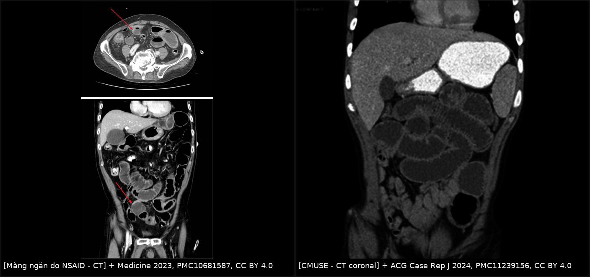
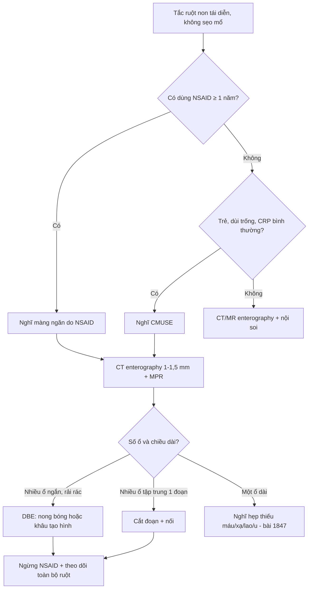
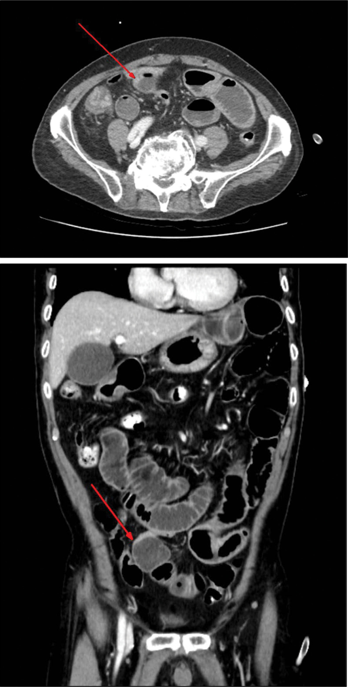
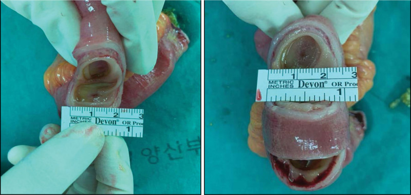
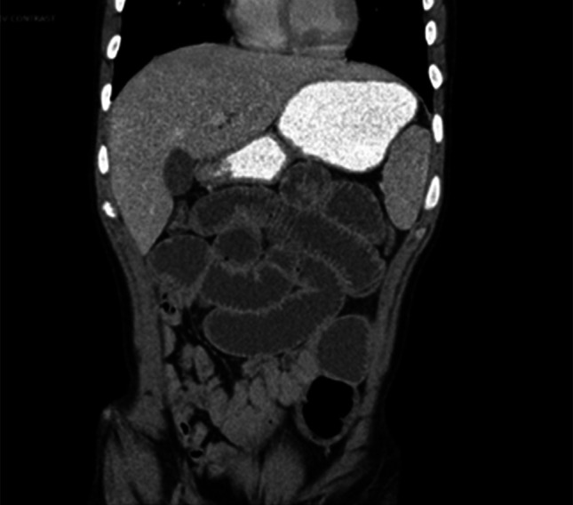
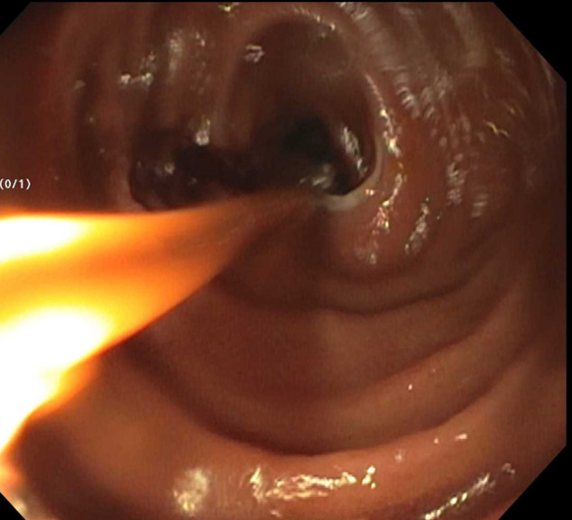
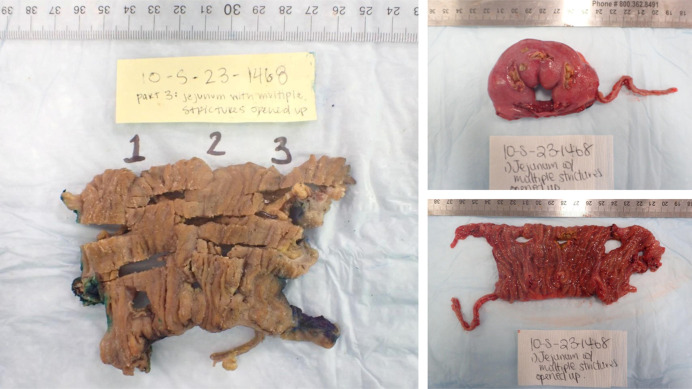

# 1984 — Bệnh màng ngăn ruột non do NSAID (diaphragm disease) & viêm ruột loét–hẹp nhiều ổ (CMUSE): nhiều hẹp NGẮN, khi nào nong – khâu tạo hình – cắt đoạn

**Tags:** `pattern:hep-ngan` `pattern:nhieu-o-hep` `pattern:tac-ruot` `pattern:day-thanh-ruot` `vung:ruot-non` `vung:hoi-trang` `vung:tieu-hoa` `protocol:CT-bung-can-quang` `protocol:MR-enterography` `protocol:noi-soi-vien-capsule` `protocol:noi-soi-hai-bong`

**Mức chắc chắn (certainty):** tổng hợp y văn (literature synthesis) — ghép 1 ca nguyên văn có ảnh CT + đại thể (Medicine 2023, PMC10681587, CC BY 4.0), 1 tổng quan 144 ca màng ngăn toàn ống tiêu hóa (Gastroenterol Res Pract 2016, PMC4826940, CC BY), 1 loạt 3 ca + tổng quan (Ann Surg Treat Res 2018, PMC5931940, CC BY-NC), 2 ca CMUSE (ACG Case Rep J 2024, PMC11239156, CC BY; Am J Case Rep 2024, PMC11332959, CC BY-NC-ND). Số nào nguồn không đưa thì ghi "chưa rõ".

> **Bài này trả lời 4 câu hỏi của ca "tắc ruột non tái diễn, không có sẹo mổ":**
> (1) **Đây là dính, Crohn, lao, hẹp do thiếu máu hay màng ngăn do thuốc?** (2) **Vì sao CT chỉ thấy "thắt đột ngột" mà không thấy khối?** (3) **Nội soi viên nang có an toàn không?** (4) **Nong bóng, khâu tạo hình hay cắt đoạn — và ngừng thuốc có đủ?**
> Đây là **nhóm nhiều ổ hẹp ngắn** đối chiếu với [1847 – Hẹp ruột do thiếu máu sau nút mạch](../1847-hep-ruot-thieu-mau-sau-nut-mach/lesson.md) (**một ổ, dài**) và [162 – Tắc ruột non/già](../162-tac-ruot/lesson.md) (bàn về cơ chế tắc chung).

## 1. Tổng quan bệnh học – cơ chế hình ảnh

### 1.1 Màng ngăn hình thành thế nào (chuỗi 3 bước)

- **Bước 1 — độc tế bào:** NSAID ức chế cyclooxygenase (giảm prostaglandin bảo vệ niêm mạc) **và** ức chế phosphoryl hóa oxy hóa ở ty thể tế bào ruột (uncoupling) → giảm ATP.
- **Bước 2 — mất hàng rào:** thiếu ATP làm rối loạn các liên kết chặt (tight junction) → **tăng tính thấm niêm mạc**; acid mật, enzym tụy và vi khuẩn tràn vào lớp dưới niêm.
- **Bước 3 — viêm rồi xơ:** hóa ứng động bạch cầu trung tính → loét nông **hình vành khăn**; mô hạt dưới niêm mạc trưởng thành thành sẹo collagen, co lại như **"dây rút" (drawstring)** quanh lòng ruột → **màng ngăn mỏng**, đường kính lỗ còn **1–4 mm** ("pinhole").
- **Điểm mấu chốt về giải phẫu bệnh:** tổn thương **chỉ ở niêm mạc và dưới niêm mạc**, **thanh mạc nguyên vẹn** → mặt ngoài ruột bình thường. Đây là lý do **nội soi ổ bụng dễ bỏ sót**, phải **sờ toàn bộ ruột** hoặc **nội soi trong mổ** (Ann Surg Treat Res 2018, PMC5931940).

### 1.2 Vì sao hình ảnh "nghèo" hơn bệnh lý

- Màng **dày 2–4 mm**, không tạo khối, không thâm nhiễm mỡ, không hạch → trên CT chỉ thấy **giãn quai ruột phía trên + chỗ thắt đột ngột (transition)**; muốn thấy chính màng phải cắt **≤ 1–1,5 mm** và tái tạo đúng mặt phẳng vuông góc với trục ruột.
- Hồi cứu CT ở bệnh nhân màng ngăn: **92% có hẹp**, chiều dài hẹp **5 mm – 10 cm** (trung vị **1 cm**, trung bình **2,8 cm**) (Medicine 2023, PMC10681587, dẫn dữ liệu tổng quan).
- **Tại sao thành ruột dày:** phì đại **cơ niêm (muscularis mucosae)** và xơ dưới niêm, **không phải** viêm xuyên thành — nên độ dày thành thường **< 5 mm**, khác Crohn.
- **Tại sao tắc từng đợt:** lỗ hẹp cố định nhưng khẩu kính thay đổi theo nhu động và mảnh thức ăn; giữa các cơn, quai ruột xẹp lại nên phim chụp lúc "êm" có thể bình thường.

### 1.3 Số liệu dịch tễ và ngưỡng định lượng

- **2%** người dùng NSAID cổ điển **dài hạn** phát triển màng ngăn ruột non; **50–70%** người dùng NSAID dài hạn có **một dạng enteropathy** (loét/erosion) (Gastroenterol Res Pract 2016, PMC4826940; Ann Surg Treat Res 2018, PMC5931940).
- **Tuổi trung bình 65 ± 11**; **nữ:nam ≈ 3:1** (loạt tổng quan: 2,3:1); **96%** dùng NSAID **> 1 năm** (khoảng **2 tháng – 25 năm**).
- **Số tổn thương: 3–70 màng** trên một bệnh nhân; màng dày **2–4 mm** (Medicine 2023, PMC10681587).
- **Vị trí:** **59,7%** ở ruột non, **30,2%** ở đại tràng; trong ruột non **57,9%** ở **hồi tràng**; **hồi tràng tận thường được bảo tồn** (chỉ 5 ca) (PMC4826940).
- **Yếu tố nguy cơ di truyền:** đa hình **CYP2C9*3** (giảm phân hủy NSAID) liên quan tăng nguy cơ (PMC4826940; PMC5931940).
- **Dạng thuốc:** thuốc **phóng thích chậm/bao tan ở ruột** (đặc biệt diclofenac SR) hay gây tổn thương **đại tràng phải** vì thuốc đi tới đại tràng mới tan hết; **26,4% (38/144)** ca trong tổng quan vẫn dùng **ức chế COX-2 chọn lọc** — "chọn lọc" **không miễn nhiễm**.

### 1.4 CMUSE — người anh em "không do thuốc" của cùng mẫu hình

- **CMUSE/CNSU** (cryptogenic multifocal ulcerating stenosing enteropathy / chronic nonspecific multiple ulcers of the small intestine): **~200 ca** đã báo cáo toàn cầu; **không** dùng NSAID; nhiều **hẹp ngắn + loét nông**; thiếu máu, phù, hạ albumin do mất đạm; **ngón tay dùi trống**.
- **CT của CMUSE:** nhiều **hẹp ngắn < 2 cm**, **hẹp hình vành khăn**, thành dày nhẹ, **giãn ruột phía trên**, **không thủng, không rò** (Am J Case Rep 2024, PMC11332959, dẫn Ramos và cs).
- **Cơ chế di truyền:** mất chức năng **SLCO2A1** (vận chuyển prostaglandin) hoặc **PLA2G4A** → prostaglandin ứ lại tại niêm mạc → loét và xơ hẹp; thể SLCO2A1 hay kèm **dùi trống** và bệnh khớp tăng sinh (ACG Case Rep J 2024, PMC11239156).

## 2. Mẫu hình + chẩn đoán phân biệt theo vị trí (gamut)

- **Trục 1 — số ổ và chiều dài hẹp (quyết định nhất):**
  - **Nhiều ổ, mỗi ổ RẤT NGẮN (1–5 mm) như màng** → màng ngăn do NSAID, CMUSE.
  - **Một ổ, đoạn hẹp DÀI (vài cm)** → hẹp sau thiếu máu (bài 1847), hẹp do xạ, lao, u.
  - **Nhiều ổ nhưng dài/không đều, có loét dọc, hạch** → Crohn.
- **Trục 2 — vị trí:** hồi tràng giữa–xa (NSAID, CMUSE); **hồi tràng tận + manh tràng** (lao, Crohn); **đại tràng phải** (NSAID phóng thích chậm); dạ dày/tá tràng (ít gặp, thường kèm tổn thương ruột non).
- **Trục 3 — bối cảnh:** đau lưng/khớp dùng **naproxen, diclofenac, piroxicam ≥ 1 năm** → nghĩ màng ngăn; **trẻ/người trẻ không dùng thuốc, dùi trống, CRP bình thường** → CMUSE; **tiền sử nút mạch mạc treo** → hẹp thiếu máu.
- **Trục 4 — biến chứng:** hẹp đơn thuần (hẹp + giãn) / **kẹt viên nang** / **tắc hoàn toàn** / **xuất huyết ẩn – thiếu sắt** / hiếm: thủng, lồng ruột.
- **Gợi nhớ SHORT:** **S**trictures **H**ẹp ngắn **O**nly small bowel **R**ecurrent (tái diễn) **T**hinking of drugs (nghĩ tới thuốc) — nếu **một ổ dài** thì nghĩ nhóm thiếu máu/xạ/lao/u.

## 3. Bảng so sánh phân biệt (ma trận đối chiếu)

| Thực thể (entity) | Hình ảnh điển hình | Chốt vào (rule-in) | Chốt loại (rule-out) | Gợi ý xác nhận |
|---|---|---|---|---|
| **Màng ngăn do NSAID (diaphragm disease)** | Nhiều màng mỏng **2–4 mm**, lỗ **1–4 mm**, hẹp ngắn, giãn quai trên, thành dày nhẹ < 5 mm | **Nhiều hẹp rất ngắn + tiền sử NSAID ≥ 1 năm + không sẹo mổ** | Một ổ hẹp dài, thâm nhiễm mỡ, hạch → không phải màng ngăn | Hỏi kỹ thuốc giảm đau (kể cả thuốc mua tự do); DBE thấy màng; mô học xơ dưới niêm |
| **CMUSE/CNSU** | Nhiều hẹp ngắn **< 2 cm**, loét nông, giãn trên, **không rò/thủng** | **Nhiều hẹp ngắn + loét nông + KHÔNG dùng NSAID + CRP bình thường** | Loét dọc, sùi, hạch, thâm nhiễm xuyên thành → Crohn/u | Gen **SLCO2A1/PLA2G4A**; dùi trống; theo dõi tái phát sau mổ |
| **Crohn ruột non** | Loét dọc, **cobblestone**, hẹp dài/không đều, **thâm nhiễm mỡ (creeping fat)**, hạch, rò | **Loét dọc + thâm nhiễm mỡ + hạch + tăng CRP** | Nhiều màng ngắn đều, không hạch, không rò → màng ngăn/CMUSE | Nội soi + mô học u hạt; MRI theo dõi |
| **Lao ruột** | Loét hình vành khăn ở **hồi tràng tận/manh tràng**, hạch hoại tử, dày thành | **Hạch hoại tử + tổn thương hồi manh tràng + bằng chứng lao** | Hẹp rải rác nhiều đoạn không hạch → không điển hình lao | PCR/cấy lao, X-quang phổi, T-SPOT |
| **Hẹp sau thiếu máu (bài 1847)** | **Một ổ hẹp dài**, thành mỏng–xơ, không loét, tiền sử nút mạch/tắc mạch mạc treo | **Một ổ + bối cảnh thiếu máu mạc treo** | Nhiều ổ ngắn → nghĩ màng ngăn/CMUSE | So phim cũ; CT thấy mạch mạc treo |
| **Hẹp do xạ** | Đoạn hẹp dài trong **trường chiếu xạ**, thành dày, mất lớp mỡ, không loét nông | **Vị trí trùng trường xạ + tiền sử xạ** | Nhiều ổ ngoài trường xạ → không do xạ | Đối chiếu kế hoạch xạ; MRI |
| **Dính/sẹo mổ** | **Một điểm gấp khúc**, không có màng, không dày thành; quai ruột dính thành bụng | **Sẹo mổ + một điểm tắc** | Nhiều ổ ngắn rải rác → không phải dính đơn thuần | Mổ/phẫu thuật nội soi; sờ ruột |
| **U ruột non** | Khối đặc ngấm thuốc, lồng ruột, hạch, di căn | **Khối đặc + hạch + di căn** | Chỉ màng mỏng không khối → không phải u | CT/MRI bụng, nội soi + sinh thiết |

*Trái: CT bụng — giãn quai ruột non với chỗ thắt đột ngột ở hồi tràng xa, không thấy khối (màng ngăn do NSAID). Phải: CT coronal — tắc ruột non không viêm, nhiều quai giãn, không thâm nhiễm mỡ (CMUSE). Nguồn: Medicine 2023 (PMC10681587, CC BY 4.0) và ACG Case Rep J 2024 (PMC11239156, CC BY 4.0). Ảnh ghép letterbox.*

## 4. Protocol chụp + chiến lược xử trí

### 4.1 Protocol hình ảnh

- **CT enterography (ưu tiên):** uống **1,5–2 L** dung dịch cản quang **trung tính** (mannitol/PEG) chia đều **45–60 phút**; cắt **1–1,5 mm**, tái tạo MPR trục ngang + coronal + **mặt phẳng vuông góc với trục ruột**; đọc theo trình tự: **số ổ → chiều dài → đường kính lỗ → mức giãn trước hẹp (> 3 cm) → thành/dấu viêm**.
- **MR enterography:** khi cần tránh bức xạ (trẻ, theo dõi lặp ở CMUSE); T2 + DWI + T1 sau tiêm; **không dùng** để đo lỗ màng chính xác.
- **Nội soi viên nang (capsule endoscopy):** chẩn đoán tốt nhưng **nguy cơ kẹt cao** — trong loạt 36 ca có **31 ca (86%)** phải lấy viên nang bằng mổ mở và **4 ca** bằng DBE (PMC4826940); **ưu tiên DBE** khi đã biết có hẹp hoặc nghi tắc.
- **Nội soi hai bóng (DBE) / nội soi trong mổ:** vừa xác định **số ổ và chiều dài**, vừa **nong bóng** hoặc **khâu tạo hình**; cần khảo sát **toàn bộ ruột** vì tổn thương có thể ở nhiều đoạn.

### 4.2 Chiến lược xử trí (ngưỡng thực hành)

- **Bước 1 — ngừng NSAID (và thay bằng thuốc khác):** tổn thương **sớm/loét** có thể hồi phục; màng **xơ đã hình thành** thì không mất đi, nhưng ngừng thuốc **ngăn tổn thương mới** và cải thiện tiên lượng (PMC5931940).
- **Bước 2 — nong bóng qua nội soi:** hợp với **ít ổ, hẹp ngắn, không loét hoạt động**; nguy cơ thủng **thấp** vì mô xơ (PMC5931940); có thể lặp lại.
- **Bước 3 — khâu tạo hình dọc (stricturoplasty):** khi nhiều ổ **rải rác** không thể cắt hết, hoặc muốn giữ chiều dài ruột.
- **Bước 4 — cắt đoạn:** khi nhiều ổ **tập trung một đoạn** (như ca 20 cm có 3–5 màng), hoặc hẹp không nong được, hoặc có biến chứng (thủng, lồng ruột).
- **CMUSE:** lui bệnh bằng **corticoid** (có thể đảo ngược hẹp sớm), **kháng TNF** trong ca khó; hẹp xơ cố định → nong/mổ; theo dõi **CRP, calprotectin, CT/MRI + capsule luân phiên**.

## 5. Biến thể bình thường và cạm bẫy

- **Cạm bẫy 1 — "không thấy màng" trên CT:** màng mỏng **2–4 mm**, không khối; nếu chỉ đọc lát 5 mm hoặc không tái tạo vuông góc trục ruột sẽ **bỏ sót** và gọi là "tắc ruột không rõ nguyên nhân". Luôn đoạn thắt phải **cắt mỏng lại**.
- **Cạm bẫy 2 — một đoạn có nhiều màng giả dính:** ca nguyên văn có **3–5 màng trong 20 cm** nên CT đọc thành **"dây dính" (adhesion band)**; mổ nội soi **không tìm thấy dây dính** vì thanh mạc bình thường (PMC10681587).
- **Cạm bẫy 3 — hồi tràng tận "sạch":** hồi tràng tận thường **được bảo tồn** (chỉ 5 ca trong tổng quan), nên tổn thương ở **hồi tràng giữa** dễ nằm ngoài tầm nội soi thường.
- **Cạm bẫy 4 — kẹt viên nang:** đặt capsule khi chưa loại trừ hẹp → **kẹt tới 86%** trong loạt có hẹp; phải có **DBE/mổ** lấy, và viên nang kẹt có thể gây **tắc hoàn toàn**.
- **Cạm bẫy 5 — CMUSE bị gọi là Crohn:** CMUSE **không u hạt, không xuyên thành, không rò, CRP/ESR bình thường**, tổn thương **giới hạn ở ruột non**; dùng ustekinumab/infliximab kéo dài mà không đúng bệnh sẽ **che mất chỉ định mổ hẹp xơ**.
- **Cạm bẫy 6 — tiền sử thuốc không được khai:** bệnh nhân không coi **thuốc giảm đau mua tự do** là "thuốc"; trong ca nguyên văn, tiền sử naproxen chỉ được phát hiện **sau khi mổ**. Phải hỏi **tên thuốc, liều, thời gian, dạng phóng thích chậm**.
- **Cạm bẫy 7 — "COX-2 chọn lọc thì an toàn":** **26,4%** ca trong tổng quan vẫn dùng ức chế COX-2 chọn lọc; không được loại trừ màng ngăn chỉ vì thuốc "chọn lọc".

## 6. Tự lượng giá — Blind Quiz

**Ca 1 — Nam 74 tuổi, đau bụng – chướng 2 tháng, không sẹo mổ, không đáp ứng đặt ống thông dạ dày.**

- Gợi ý: đau lưng mạn, tự mua **naproxen 500 mg × 2 lần/ngày ≥ 3 năm**.
- Câu hỏi: Dấu hiệu chính? Ba chẩn đoán phân biệt? Vì sao CT không thấy "khối"?

<b>Bấm để hiện đáp án (findings + chẩn đoán)</b>

- Dấu hiệu: **giãn quai ruột non** với **chỗ thắt đột ngột (mũi tên đỏ)** ở hồi tràng xa, không thấy khối, không thâm nhiễm mỡ, không hạch.
- Chẩn đoán: **màng ngăn do NSAID** — màng chỉ dày 2–4 mm ở niêm mạc/dưới niêm nên CT chỉ thấy **giãn + thắt**, không thấy "khối".
- Phân biệt: dính/sẹo mổ (không có sẹo), Crohn (không loét dọc/thâm nhiễm mỡ), hẹp thiếu máu (một ổ dài, có bối cảnh mạch).
- Nguồn ảnh: *Medicine* 2023 (PMC10681587), Fig. 1, CC BY 4.0.

**Ca 2 — Bệnh phẩm sau cắt đoạn ruột non: nhìn lòng ruột, mô tả trước khi mở đáp án.**

- Câu hỏi: Cấu trúc trong lòng ruột là gì? Vì sao mặt ngoài ruột bình thường? Đo chiều dày màng trên thước.

<b>Bấm để hiện đáp án</b>

- Dấu hiệu: **3 màng ngăn hình vành khăn**, lỗ trung tâm rất nhỏ ("pinhole"), màng mỏng **2–4 mm**, có thước đối chiếu.
- Chẩn đoán: **bệnh màng ngăn** — sẹo collagen chỉ ở niêm mạc/dưới niêm, **thanh mạc nguyên vẹn** nên nhìn ngoài bình thường và nội soi ổ bụng dễ bỏ sót.
- Nguồn ảnh: *Medicine* 2023 (PMC10681587), Fig. 3, CC BY 4.0.

**Ca 3 — Nam 25 tuổi, tiêu chảy mạn, thiếu máu thiếu sắt, hạ albumin, tắc ruột tái diễn, ngón tay dùi trống, KHÔNG dùng NSAID.**

- Câu hỏi: Mẫu hình hẹp? Ba phân biệt? Xét nghiệm/mô học nào chốt?

<b>Bấm để hiện đáp án</b>

- Dấu hiệu: nhiều quai ruột non **giãn**, **không thâm nhiễm mỡ, không hạch, không dịch tự do**; nội soi bóng cho thấy **nhiều hẹp ngắn lành tính** (8 ổ cách ≥ 10 cm + 5 ổ sát nhau trong ca này).
- Chẩn đoán: **CMUSE** — mô học **loét nông, không u hạt, không xuyên thành**; gen **SLCO2A1/PLA2G4A**; dùi trống là gợi ý thể SLCO2A1.
- Phân biệt: Crohn (loét dọc, xuyên thành, u hạt), lao ruột (hạch hoại tử, hồi manh tràng), màng ngăn do NSAID (tiền sử thuốc).
- Nguồn ảnh: *ACG Case Rep J* 2024 (PMC11239156), Fig. 2, CC BY 4.0.

*Nội soi bóng (balloon enteroscopy): nhiều chỗ hẹp ngắn, niêm mạc **không loét hoạt động, không sùi** — mẫu hình "hẹp lành tính" của CMUSE. Nguồn: PMC11239156, Fig. 3, CC BY 4.0.*

*Mô học: nhiều ổ loét nông 1–4 mm, bờ rõ, niêm mạc giữa các ổ không có dấu hiệu tổn thương mạn — không u hạt. Nguồn: PMC11239156, CC BY 4.0.*

## Bài liên quan chéo
- [100 – Tổng quan hệ Bụng](../100-tong-quan-he-bung/lesson.md)
- [1847 – Hẹp ruột do thiếu máu sau nút mạch](../1847-hep-ruot-thieu-mau-sau-nut-mach/lesson.md) (một ổ, dài)
- [162 – Tắc ruột non/già & thiếu máu mạc treo](../162-tac-ruot/lesson.md)
- [160 – Bụng cấp hố chậu & tắc ruột](../160-bung-cap-GI/lesson.md)
- [163 – Pylephlebitis & huyết khối tĩnh mạch mạc treo](../163-pylephlebitis-huyet-khoi-tm-mac-treo/lesson.md)

> Không dùng để chẩn đoán độc lập khi chưa có người hướng dẫn.
